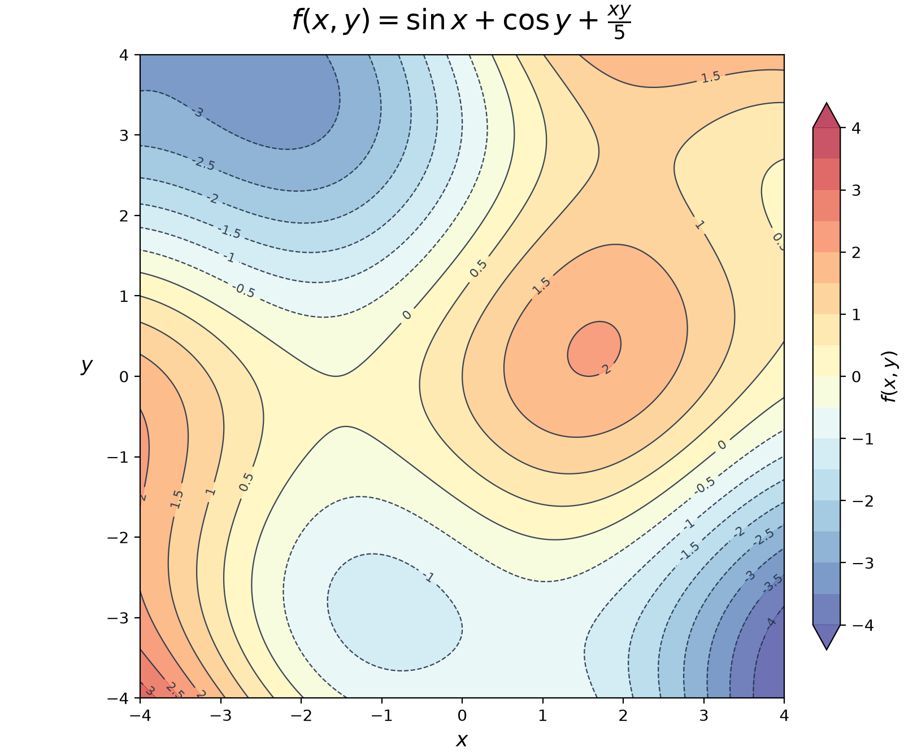

# 第三章

## 3.1 一般函数与定义域（General Functions and Domains）

### 函数类型、定义域与值域（Function Types, Domain and Range）

对于标量值函数（Scalar-valued Function）

$$
f:\mathbb{R}^n\to\mathbb{R},
$$

输入可以有多个坐标，但输出只有一个实数。

对于向量值函数（Vector-valued Function）

$$
F:\mathbb{R}^n\to\mathbb{R}^m,
$$

输出是一个有 $m$ 个分量的向量。每个输出分量都可以单独看作一个标量值函数，称为分量函数（Component Function）。

非线性映射（Nonlinear Map）可能把直线映成曲线。输入与输出维度是否相同，不能用来判断映射是否线性；线性映射（Linear Map）需要保持向量加法和数乘。

例如，对于标量值函数

$$
f:\mathbb{R}^2\to\mathbb{R},
\qquad f(x,y)=x^2+y^2,
$$

- **定义域（Domain）**：允许输入的集合，这里是 $\mathbb{R}^2$。
- **值域（Range）**：实际能得到的输出集合，这里是 $[0,\infty)$。
- **陪域（Codomain）**：函数声明的输出所属集合，这里是 $\mathbb{R}$，不一定等于值域。

这里的定义域可以正式写成：

$$
D=\{(x,y)\in\mathbb{R}^2\}=\mathbb{R}^2.
$$

### 图像与等值线（Graphs and Level Curves）

二元标量函数 $f(x,y)$ 的图像（Graph）由三维空间中的点 $(x,y,f(x,y))$ 组成。

固定一个常数 $c$，满足

$$
f(x,y)=c
$$

的所有输入点组成等值集（Level Set）。对于二元标量函数，它通常表现为等值线（Level Curve）。

!!! note "注意"
    等值线不一定是一条普通曲线，也可能退化为一个点，或者为空。

把多个不同 $c$ 对应的等值线画在一起，就得到等高线图（Contour Plot）。同一条等值线上的函数值相同。

上图是 $f(x,y)=\sin x+\cos y+\frac{xy}{5}$ 的等高线图。曲线上的数字表示对应的等值 $c$。

### 开球、极限与连续性（Open Balls, Limits and Continuity）

向量 $\mathbf{x}$ 与 $\mathbf{a}$ 之间的距离表示为 $\|\mathbf{x}-\mathbf{a}\|$。

以 $\mathbf{a}$ 为中心、半径为 $\delta>0$ 的开球（Open Ball）为：

$$
B_\delta(\mathbf{a})
=\{\mathbf{x}\in\mathbb{R}^n:\|\mathbf{x}-\mathbf{a}\|<\delta\}.
$$

开球包含内部所有点，但不包含边界。在二维空间中，它是不包含圆周的圆盘。

多变量极限（Multivariable Limit）记作：

$$
\lim_{\mathbf{x}\to\mathbf{a}}f(\mathbf{x})=L.
$$

意思是：输入在定义域内足够接近 $\mathbf{a}$，但不等于 $\mathbf{a}$ 时，输出足够接近 $L$。

!!! tip "从不同路径靠近"
    输入可以沿不同方向、不同路径靠近同一个点。
    找到两条极限结果不同的路径，就可以证明极限不存在。
    但只检查几条路径结果相同，还不足以证明极限存在。

函数在定义域内的点 $\mathbf{a}$ 处连续（Continuous），要求：

$$
\lim_{\mathbf{x}\to\mathbf{a}}f(\mathbf{x})=f(\mathbf{a}).
$$

### 内部点、边界点、闭集与有界集（Interior Points, Boundary Points, Closed Sets and Bounded Sets）

这些概念描述集合的几何性质，本节尤其用它们研究定义域。

- **内部点（Interior Point）**：可以在这个点周围找到一个开球，使整个球都包含在集合内。
- **边界点（Boundary Point）**：无论周围的球多小，球内总能同时找到集合内的点和集合外的点。边界点不一定属于集合。
- **闭集（Closed Set）**：包含自己的全部边界点。
- **有界集（Bounded Set）**：能够被某个有限半径的球全部包住。

例如，圆盘

$$
D=\{(x,y)\in\mathbb{R}^2:x^2+y^2\leq9\}
$$

的边界是圆周 $x^2+y^2=9$。它包含边界，因此是闭集；它也能被有限半径的球包住，因此是有界集。

## 3.2 单参数映射与变化（One-parameter Maps and Changes）

### 参数化（Parameterization）

只有一个输入参数的向量值函数可以写作：

$$
\mathbf{r}:I\to\mathbb{R}^n,
\qquad I\subseteq\mathbb{R},
\qquad
\mathbf{r}(t)=
\begin{pmatrix}
r_1(t)\\
\vdots\\
r_n(t)
\end{pmatrix}.
$$

随着参数（Parameter）$t$ 变化，位置向量（Position Vector）$\mathbf{r}(t)$ 描出一条曲线。这种描述方式称为参数化（Parameterization）。

同一条曲线可以有不同的参数化，行进方向和速度也可能不同。

### 极限与连续性（Limits and Continuity）

向量值函数的极限可以逐个分量计算：

$$
\lim_{t\to a}\mathbf{r}(t)=
\begin{pmatrix}
\displaystyle\lim_{t\to a}r_1(t)\\
\vdots\\
\displaystyle\lim_{t\to a}r_n(t)
\end{pmatrix},
$$

前提是每个分量的极限都存在。

函数在 $t=a$ 处连续，意味着：

$$
\lim_{t\to a}\mathbf{r}(t)=\mathbf{r}(a).
$$

这一小节的概念很多，这里不逐一抄录；导数、切向量与求导法则等内容可以参考教材。

## 3.3 偏导，梯度，Hessian / Jacobian 矩阵

### 偏导 

如果我需要对多变量函数求导，我需要说明：对哪个变量求导，以及哪些变量保持不变。

$$
f_x(x,y)
=\frac{\partial f}{\partial x}
=\frac{\partial}{\partial x}(x^2y+3y^2)
=2xy.
$$

这里对 $x$ 求偏导，那么 $x$ 的导数就为 $0$

### 偏导的几何意义

曲面：

$$
z=f(x,y),
$$

固定 $y=b$，相当于用竖直平面 $y=b$ 切曲面，得到一条切片曲线（Slice Curve）。

就是这条曲线在对应点处、沿 \(x\) 增加方向的切线斜率。
类似地，固定 $x=a$ 后：

$$
f_y(a,b)
$$

描述沿 $y$ 方向的斜率。

### 高阶偏导数

对偏导数继续求导.

$f_{xy}$ 和 $f_{yx}$ 叫作混合偏导数（Mixed Partial Derivatives)

$$
f_{xy}
=(f_x)_y
=\frac{\partial}{\partial y}
\left(\frac{\partial f}{\partial x}\right)
=\frac{\partial^2f}{\partial y\,\partial x}.
$$

!!! tips "克莱罗定理（Clairaut’s Theorem）"
    $$
    f_{xy}=f_{yx}
    $$
   
     只要这两个混合偏导数在该点附近存在且连续

### Hessian / Jacobian 矩阵

$$
\boxed{
H_f=
\begin{pmatrix}
f_{xx}&f_{xy}\\
f_{yx}&f_{yy}
\end{pmatrix}
}
$$ 

$$
\boxed{
J_F=
\begin{pmatrix}
\frac{\partial F_1}{\partial x_1}&\cdots&
\frac{\partial F_1}{\partial x_n}\\
\vdots&\ddots&\vdots\\
\frac{\partial F_m}{\partial x_1}&\cdots&
\frac{\partial F_m}{\partial x_n}
\end{pmatrix}
}
$$

## 3.4 局部线性化与可微性（Local Linearization and Differentiability）

### 线性近似（Linear Approximation）

对于一元函数，在 $x=a$ 附近有：

$$
f(x)\approx L(x)=f(a)+f'(a)(x-a).
$$

推广到多变量标量函数，使用梯度（Gradient）：

$$
L(\mathbf{x})
=f(\mathbf{a})+\nabla f(\mathbf{a})\cdot(\mathbf{x}-\mathbf{a}).
$$

其中，$\mathbf{a}$ 是固定的基点（Base Point）。对于二元函数，展开为：

$$
L(x,y)=f(a,b)+f_x(a,b)(x-a)+f_y(a,b)(y-b).
$$

!!! note "线性部分与仿射近似"
    完整的 $L$ 是仿射函数（Affine Function）。
    令输入变化量 $\mathbf{h}=\mathbf{x}-\mathbf{a}$，其中的线性部分是 $\nabla f(\mathbf{a})\cdot\mathbf{h}$，预测的是输出变化量。

!!! example "例子"
    设：

    $$
    f(x,y)=x^2+2y^2,
    \qquad(a,b)=(1,1).
    $$

    计算函数值和偏导数：

    $$
    f(1,1)=3,\qquad f_x=2x,\qquad f_y=4y.
    $$

    所以：

    $$
    L(x,y)=3+2(x-1)+4(y-1).
    $$

    用它估计附近的函数值：

    $$
    f(1.01,0.98)
    \approx3+2(0.01)+4(-0.02)
    =2.94.
    $$

    实际值为 $2.9409$，因此这个近似比较接近。

### 可微性（Differentiability）

令误差（Error）为：

$$
E(\mathbf{h})
=f(\mathbf{a}+\mathbf{h})
-f(\mathbf{a})
-\nabla f(\mathbf{a})\cdot\mathbf{h}.
$$

在定义域内部的点 $\mathbf{a}$ 处，可微性要求梯度存在，并且：

$$
\lim_{\mathbf{h}\to\mathbf{0}}
\frac{|E(\mathbf{h})|}{\|\mathbf{h}\|}=0.
$$

也就是说，当输入变化趋于零时，误差相对于输入变化量的比值也趋于零。

!!! warning "偏导数存在不等于可微"
    各偏导数在某点存在，不一定意味着函数在该点可微。
    可微一定意味着连续。

!!! tip "常用的充分条件"
    如果各一阶偏导数在该点的一个邻域内存在，并在该点连续，那么函数在该点可微。

### 切平面（Tangent Plane）

如果 $f(x,y)$ 在 $(a,b)$ 处可微，那么曲面 $z=f(x,y)$ 在点 $(a,b,f(a,b))$ 处的切平面为：

$$
\boxed{
z=f(a,b)+f_x(a,b)(x-a)+f_y(a,b)(y-b)
}
$$

它就是线性近似函数 $L(x,y)$ 的图像。

一个对应的法向量（Normal Vector）为：

$$
\mathbf{n}=
\begin{pmatrix}
-f_x(a,b)\\
-f_y(a,b)\\
1
\end{pmatrix}.
$$

### 向量值函数的局部线性化（Vector-valued Local Linearization）

设：

$$
F:\mathbb{R}^n\to\mathbb{R}^m,
\qquad
F(\mathbf{x})=
\begin{pmatrix}
F_1(\mathbf{x})\\
\vdots\\
F_m(\mathbf{x})
\end{pmatrix}.
$$

雅可比矩阵（Jacobian Matrix）记作 $J_F(\mathbf{x})$，定义为：

$$
J_F(\mathbf{x})=
\begin{pmatrix}
\frac{\partial F_1}{\partial x_1}
&\cdots&
\frac{\partial F_1}{\partial x_n}\\
\vdots&\ddots&\vdots\\
\frac{\partial F_m}{\partial x_1}
&\cdots&
\frac{\partial F_m}{\partial x_n}
\end{pmatrix}.
$$

它把各输出分量对各输入变量的一阶偏导数排成矩阵：每一行对应一个输出，每一列对应一个输入，因此大小为 $m\times n$。

对于可微的 $F$，雅可比矩阵把线性近似推广到向量输出：

$$
\boxed{
F(\mathbf{a}+\mathbf{h})
\approx F(\mathbf{a})+J_F(\mathbf{a})\mathbf{h}
}
$$

其中，预测的输出变化量为：

$$
\Delta F
=F(\mathbf{a}+\mathbf{h})-F(\mathbf{a})
\approx J_F(\mathbf{a})\mathbf{h}.
$$

对于只有一个输出的标量函数，雅可比矩阵只有一行，等于梯度的转置：

$$
J_f(\mathbf{a})=\nabla f(\mathbf{a})^T.
$$

| 函数类型（Function Type） | 预测变化的工具 |
|---|---|
| 一元标量函数 $f:\mathbb{R}\to\mathbb{R}$ | 导数（Derivative）$f'(a)$ |
| 多元标量函数 $f:\mathbb{R}^n\to\mathbb{R}$ | 梯度的转置（Transpose of the Gradient）$\nabla f(\mathbf{a})^T$ |
| 向量值函数 $F:\mathbb{R}^n\to\mathbb{R}^m$ | 雅可比矩阵（Jacobian Matrix）$J_F(\mathbf{a})$ |

## 3.5 复合函数和 Chain rule

### 单变量 Chain rule
在以前我们学过:

$$
\frac{d}{dx}f(g(x))
=
f'(g(x))g'(x).
$$

假设：

$$
z=f(x,y),
\qquad x=x(t),\quad y=y(t).
$$

那么 $t$ 可以通过两条路径影响 $z$：

$$
t\to x\to z,
\qquad
t\to y\to z.
$$

所以：

$$
\frac{dz}{dt}
=
\frac{\partial f}{\partial x}\frac{dx}{dt}
+
\frac{\partial f}{\partial y}\frac{dy}{dt}
$$

这里的偏导数要在当前的位置 $(x(t),y(t))$ 处计算。

!!! example "例子：单参数链式法则"
    设：

    $$
    z=f(x,y)=x^2+y^2,
    \qquad x(t)=t^2,\quad y(t)=t.
    $$

    先计算偏导数和参数函数的导数：

    $$
    f_x=2x,\quad f_y=2y,
    \qquad x'(t)=2t,\quad y'(t)=1.
    $$

    根据链式法则（Chain Rule）：

    $$
    \frac{dz}{dt}
    =
    \frac{\partial f}{\partial x}\frac{dx}{dt}
    +
    \frac{\partial f}{\partial y}\frac{dy}{dt}.
    $$

    将 $x=t^2$、$y=t$ 代入：

    $$
    \frac{dz}{dt}
    =(2t^2)(2t)+(2t)(1)
    =4t^3+2t.
    $$

### 多变量 Chain rule

现在假设：

$$
z=f(x,y),
\qquad x=x(u,v),\quad y=y(u,v).
$$

分别对 $u,v$ 求偏导：

$$
\frac{\partial z}{\partial u}
=f_xx_u+f_yy_u
$$

$$
\frac{\partial z}{\partial v}
=f_xx_v+f_yy_v
$$

!!! example "例子：两个独立变量的链式法则"
    设：

    $$
    z=f(x,y)=x^2+2y^2,
    \qquad x=u+v,\quad y=u-v.
    $$

    先计算外层函数的偏导数：

    $$
    f_x=2x,\qquad f_y=4y.
    $$

    再计算内层函数的偏导数：

    $$
    x_u=1,\quad y_u=1,
    \qquad x_v=1,\quad y_v=-1.
    $$

    根据链式法则（Chain Rule），对 $u$ 求偏导：

    $$
    \begin{aligned}
    \frac{\partial z}{\partial u}
    &=f_xx_u+f_yy_u\\
    &=2(u+v)\cdot1+4(u-v)\cdot1\\
    &=6u-2v.
    \end{aligned}
    $$

    对 $v$ 求偏导：

    $$
    \begin{aligned}
    \frac{\partial z}{\partial v}
    &=f_xx_v+f_yy_v\\
    &=2(u+v)\cdot1+4(u-v)\cdot(-1)\\
    &=-2u+6v.
    \end{aligned}
    $$

### 广义链式法则 Jacobian Chain rule

$$
\boxed{
J_{F\circ G}(\mathbf a)
=
J_F(G(\mathbf a))J_G(\mathbf a)
}
$$

!!! example "例子：广义链式法则"
    设内层函数为：

    $$
    G:\mathbb R^2\to\mathbb R^3,
    \qquad
    G(x,y)=
    \begin{pmatrix}
    x^2\\
    y\\
    x+y
    \end{pmatrix},
    $$

    外层函数为：

    $$
    F:\mathbb R^3\to\mathbb R^2,
    \qquad
    F(u,v,w)=
    \begin{pmatrix}
    u+v^2\\
    uw
    \end{pmatrix}.
    $$

    求复合函数 $F\circ G$ 在 $\mathbf a=(1,2)$ 处的 Jacobian。

    **第一步：计算内层函数的输出。**

    $$
    G(1,2)=
    \begin{pmatrix}
    1\\
    2\\
    3
    \end{pmatrix}.
    $$

    这就是外层函数 $F$ 接收到的输入。

    **第二步：计算内层 Jacobian。**

    $$
    J_G(x,y)=
    \begin{pmatrix}
    2x&0\\
    0&1\\
    1&1
    \end{pmatrix},
    \qquad
    J_G(1,2)=
    \begin{pmatrix}
    2&0\\
    0&1\\
    1&1
    \end{pmatrix}.
    $$

    **第三步：计算外层 Jacobian，并代入 $G(\mathbf a)$。**

    $$
    J_F(u,v,w)=
    \begin{pmatrix}
    1&2v&0\\
    w&0&u
    \end{pmatrix}.
    $$

    注意这里代入的是 $(u,v,w)=(1,2,3)$：

    $$
    J_F(G(\mathbf a))
    =J_F(1,2,3)
    =
    \begin{pmatrix}
    1&4&0\\
    3&0&1
    \end{pmatrix}.
    $$

    **第四步：按照“外层乘内层”的顺序相乘。**

    $$
    \begin{aligned}
    J_{F\circ G}(1,2)
    &=J_F(G(1,2))J_G(1,2)\\
    &=
    \begin{pmatrix}
    1&4&0\\
    3&0&1
    \end{pmatrix}
    \begin{pmatrix}
    2&0\\
    0&1\\
    1&1
    \end{pmatrix}\\
    &=
    \begin{pmatrix}
    2&4\\
    7&1
    \end{pmatrix}.
    \end{aligned}
    $$

    
