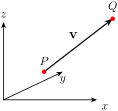
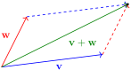
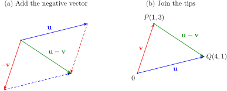
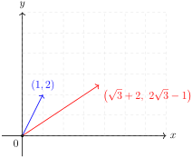
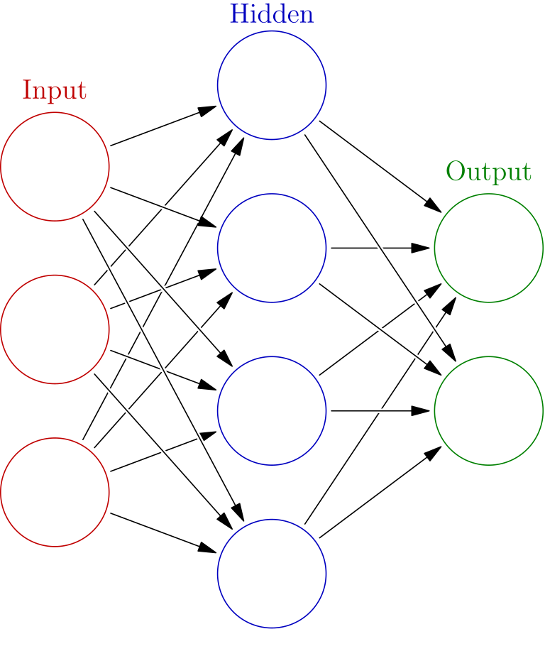
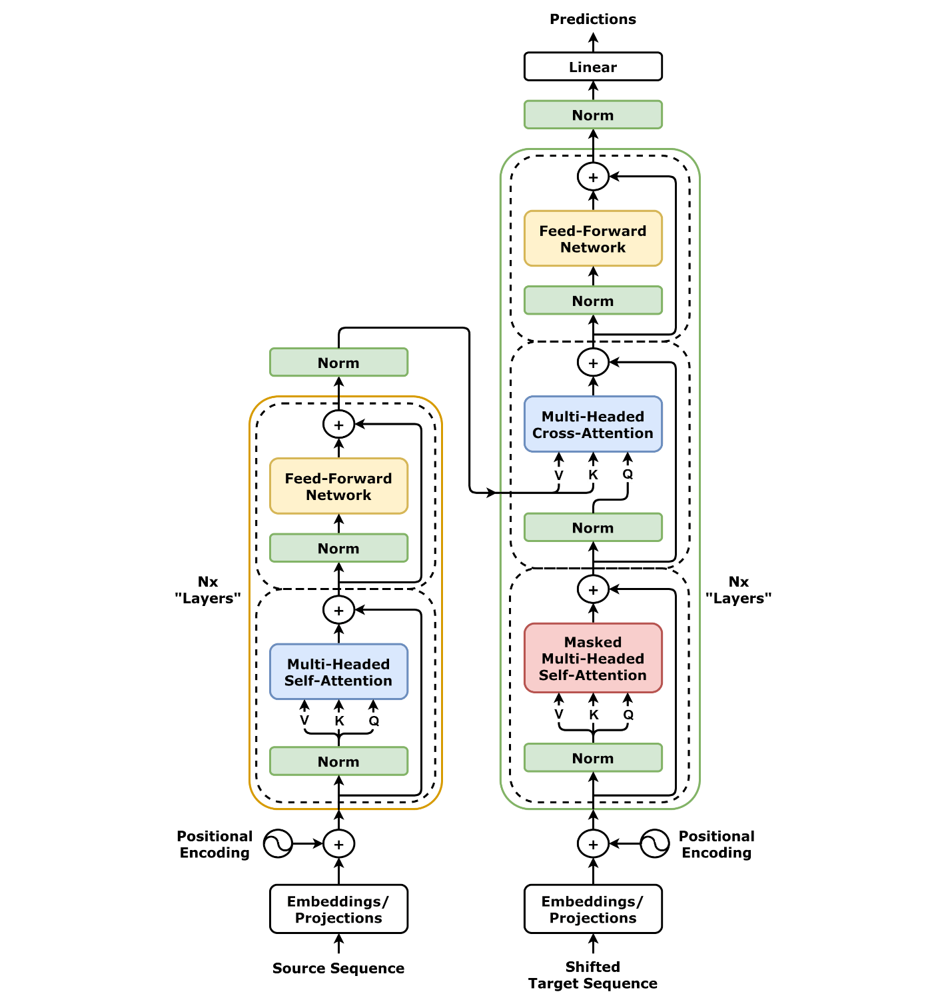

# 1.1 Vectors {#11-vectors}

!!! note "译文与来源"

    本页为教材公开源文件 v0.2 的非官方中文翻译，保留原公式、例题、活动、代码和习题；例题与活动等编号按本地小节重排，解答和证明可点击展开；正文与标题中的数学专有名词保留英文，中文用于解释；术语表保留中英对照以便查阅。原文作者：Jacob Denson、Kaitlyn Phillipson、Sebastien Roch。除另有注明的插图外，译文遵循 [CC BY-NC-SA 4.0](https://creativecommons.org/licenses/by-nc-sa/4.0/)。[阅读英文原文](1-1.md#sec-u1-vector-geometry)。


<a id="sec-u1-vector-geometry"></a>

## Vectors as lists of numbers {#vectors-as-lists-of-numbers}

实数也称为 scalar。


<a id="def-1-0-scalars-and-vectors"></a>

**定义 1.1.1：vector**

一个 $n$ 维 vector 是 $n$ 个 scalar 的有序列表，通常写成 $\mathbf{v} = (v_1,v_2,\ldots,v_n)$。所有 $n$ 维 vector 组成的集合记作 $\mathbb{R}^n$。

vector 可以写成方括号内的一排或一列数字，分别对应 row vector 和 column vector：

$$
\begin{bmatrix} v_1 & \cdots & v_n \end{bmatrix} \quad\text{and}\quad \begin{bmatrix} v_1 \\ \vdots \\ v_n \end{bmatrix}
$$


习惯上用粗体字母表示变量，例如$\mathbf{v}$或$\mathbf{w}$，来表示 vector。我们让 $\mathbf{0}$ 表示仅由零组成的 vector $(0,\dots,0)$。如果两个 vector $\mathbf{v}$ 和 $\mathbf{w}$ 具有相同的条目数并且所有相应的条目都相等，则它们相等。 $n$ 维空间中的点也可以使用笛卡尔 coordinate 通过 $n$ 数字的有序列表来标识。当特指点$P$时，我们写$P(x_1,x_2,\ldots,x_n)$来表示它的 coordinate。

## Vectors as displacements in space: building intuition {#vectors-as-displacements-in-space-building-intuition}

vector 可用于表示空间中点之间的位移。 vector $\mathbf{v}=(v_1,v_2,v_3)$表示从$P(x_1,y_1,z_1)$到$Q(x_2,y_2,z_2)$的位移，其中$x_2 = x_1 + v_1$、$y_2 = y_1 + v_2$和$z_2 = z_1 + v_3$。这个 vector 也写为$\overrightarrow{PQ}$。由于 vector 通常表示位移，因此它们被绘制为从一点开始并在该点被 vector 位移的位置结束的箭头。


<a id="fig-1-1-vector-as-arrow"></a>

* vector $\mathbf{v}$ 表示为两点 $P$ 和 $Q$ 之间的箭头。*



**活动 1.1.1：vector 作为空间位移 (U1-LO2)**

表示从点 $P(1,2)$ 到点 $Q(5,7)$ 的位移的 vector 是多少？

??? success "解答"

    如果 $\mathbf{v} = (v_1,v_2)$ 是位移，那么我们将有 $(1 + v_1, 2 + v_2) = (5,7)$，即 $1 + v_1 = 5$ 和 $2 + v_2 = 7$。求解这些方程可得到 $v_1 = 4$ 和 $v_2 = 5$，因此 displacement vector 为 $\mathbf{v} = (4,5)$。


<a id="def-1-1-vector-length"></a>

**定义 1.1.2：vector 的长度**

vector $\mathbf{v} = (v_1,\dots,v_n)$ 的长度，也称 Euclidean norm，定义为 

$$
\| \mathbf{v} \| = \sqrt{ v_1^2 + \cdots + v_n^2 }
$$


**活动 1.1.2：vector 长度和几何形状 (U1-LO1)**

使用平面几何验证 $2$  vector 的长度是表示该 vector 的箭头线段的长度。

??? success "解答"

    令 $\mathbf{v} = (x,y)$ 为任意 $2$  vector。考虑一个具有顶点 $P(0,0)$、$Q(x,0)$ 和 $R(x,y)$ 的三角形（参见 [图 1.1.2](1-1.md#fig-1-1-triangle-pythagoras)）。


    <a id="fig-1-1-triangle-pythagoras"></a>

    *具有顶点 $P(0,0)$、$Q(x,0)$ 和 $R(x,y)$ 的三角形，绘制以确定 $2$  vector 所基于的线段的长度。*

    

    这个三角形是直角的（两条边水平和垂直），斜边是 vector $\mathbf{v}$ 构建的线段。从$P(0,0)$到$Q(x,0)$的边长为$|x|$，从$Q(x,0)$到$R(x,y)$的边长为$|y|$。根据 Pythagorean theorem，我们得出斜边的长度为
    
    $$
    \sqrt{ |x|^2 + |y|^2 } = \sqrt{x^2 + y^2} = \| \mathbf{v} \|
    $$
    

在微积分中，vector 常用来表示位移。本课程还会用它表示一条数据或一组模型参数；同样的 vector 运算也能用于比较文档、处理 token，以及描述数据特征。

## Adding and scaling vectors {#adding-and-scaling-vectors}

先沿一个 vector 移动，再沿另一个 vector 移动，得到的总位移就是两个 vectors 的和。这给出了 vector addition 的几何意义。


<a id="def-1-1-adding-vectors"></a>

**定义 1.1.3：vector addition**

两个$n$ vector $\mathbf{v} = (v_1,\dots,v_n)$和$\mathbf{w} = (w_1,\dots,w_n)$之和，表示为$\mathbf{v} + \mathbf{w}$，是由元组$(v_1 + w_1, \dots, v_n + w_n)$给出的 vector。

**注**

两个 vector 的和可以通过绘制平行四边形并将 vector 沿平行四边形的两侧放置来形象地表示，如[图 1.1.3](1-1.md#fig-1-1-adding-vectors)所示。


<a id="fig-1-1-adding-vectors"></a>

*两个 vector $\mathbf{v}$ 和 $\mathbf{w}$ 的和。*



还可以按给定的 scalar 缩放 vector。


<a id="def-1-1-scaling"></a>

**定义 1.1.4：vector 的 scalar multiplication**

如果 $\mathbf{v} = (v_1,\cdots,v_n)$ 是$n$ vector，$t \in \mathbb{R}$是 scalar，我们让$t \mathbf{v}$表示 vector $(tv_1, \cdots, tv_n)$，即将 vector $\mathbf{v}$的每个条目乘以$t$。


<a id="def-u1-unit-vector-normalization"></a>

**定义 1.1.5：unit vector 和 normalization**

unit vector 是长度为一的 vector。若 $\mathbf{x}$ 非零，则与 $\mathbf{x}$ 同方向的 unit vector 为 

$$
\mathbf{u}=\frac{\mathbf{x}}{\|\mathbf{x}\|}.
$$

将nonzero vector 除以自身的 norm 称为 normalization，这样既保留方向，又使长度变成一。


<a id="def-u1-linear-combinations-weighted-averages"></a>

**定义 1.1.6：vector 的 linear combination 和凸组合**

设 $\mathbf{v}_1,\ldots,\mathbf{v}_k$ 是 $\mathbb R^n$ 中的 vector，$c_1,\ldots,c_k$ 是 scalar，则 

$$
c_1\mathbf{v}_1+\cdots+c_k\mathbf{v}_k
$$

是 $\mathbf{v}_1,\ldots,\mathbf{v}_k$ 的 linear combination，其中 $c_1,\ldots,c_k$ 称为组合的 coefficient。若对所有 $i$ 都有 $c_i\ge 0$，且满足 $c_1+\cdots+c_k=1$，这个 linear combination 就是凸组合（Convex Combination）。

凸组合可以解释为加权平均值。


<a id="act-u1-weighted-average-values"></a>

**活动 1.1.3：加权平均值 (U1-LO8)**

令 $\mathbf{v}_1=(10,0)$、$\mathbf{v}_2=(0,10)$ 和 $\mathbf{v}_3=(10,10)$。令 $\alpha_1=1/4$、$\alpha_2=1/4$ 和 $\alpha_3=1/2$。计算$\alpha_1\mathbf{v}_1+\alpha_2\mathbf{v}_2+\alpha_3\mathbf{v}_3$。

??? success "解答"

    我们有
    
    $$
    \begin{aligned}
    \frac14(10,0) & = \left(\frac52,0\right) \\
    \frac14(0,10) & = \left(0,\frac52\right) \\
    \frac12(10,10) & = (5,5) \\
    \alpha_1\mathbf{v}_1+\alpha_2\mathbf{v}_2+\alpha_3\mathbf{v}_3 & = \left(\frac{15}{2},\frac{15}{2}\right) \\
    & = (7.5,7.5)
    \end{aligned}
    $$
    
     coefficient 是非负的并且加到 $1$，所以这是一个凸组合。


<a id="ex-u1-vector-subtraction"></a>

**例题 1.1.1：将 vector 减法写成 linear combination**

减去一个 vector 意味着加上它的负数：

$$
\mathbf{u}-\mathbf{v}=\mathbf{u}+(-\mathbf{v})=1\mathbf{u}+(-1)\mathbf{v}.
$$

因此，$\mathbf{u}-\mathbf{v}$是$\mathbf{u}$和$\mathbf{v}$的 linear combination， coefficient 为$1$和$-1$。例如，如果 $\mathbf{u}=(4,1)$ 和 $\mathbf{v}=(1,3)$，则 

$$
\mathbf{u}-\mathbf{v}=(4,1)+(-1,-3)=(3,-2).
$$


从几何角度来看，$-\mathbf{v}$ 与$\mathbf{v}$ 具有相同的长度，但指向相反的方向。因此，我们可以使用[图 1.1.3](1-1.md#fig-1-1-adding-vectors)与$\mathbf{u}$和$-\mathbf{v}$的平行四边形构造，如[图 1.1.4](1-1.md#fig-u1-subtracting-vectors)左侧所示。同样，当$\mathbf{u}$和$\mathbf{v}$从同一点开始时，从$\mathbf{v}$尖端到$\mathbf{u}$尖端的箭头代表$\mathbf{u}-\mathbf{v}$。这里，它是从 $P(1,3)$ 到 $Q(4,1)$ 的位移，如右图所示。


<a id="fig-u1-subtracting-vectors"></a>

*差值$\mathbf{u}-\mathbf{v}$作为总和$\mathbf{u}+(-\mathbf{v})$（左）以及从$\mathbf{v}$尖端到$\mathbf{u}$尖端的位移（右）。*



## Dot products of vectors {#dot-products-of-vectors}


<a id="def-1-1-dot-product"></a>

**定义 1.1.7：dot product**

两个$n$ vector $\mathbf{v} = (v_1,\dots,v_n)$和$\mathbf{w} = (w_1,\dots,w_n)$的 dot product 是 scalar 

$$
\mathbf{v} \cdot \mathbf{w} = v_1 w_1 + \cdots + v_n w_n
$$


<a id="thm-6-1-dot-product-properties"></a>

**定理 1.1.1：dot product 的性质**

令 $\mathbf{x}$、$\mathbf{y}$ 和 $\mathbf{z}$ 为 $\mathbb{R}^n$ 中的 vector，并令 $a$ 为 $\mathbb{R}$ 中的 scalar。那么以下性质成立：
- $\mathbf{x} \cdot \mathbf{y} = \mathbf{y} \cdot \mathbf{x}$.

- $\mathbf{x} \cdot (\mathbf{y} + \mathbf{z}) = \mathbf{x} \cdot \mathbf{y} + \mathbf{x} \cdot \mathbf{z}$.

- $(a \mathbf{x}) \cdot \mathbf{y} = a (\mathbf{x} \cdot \mathbf{y}) = \mathbf{x} \cdot (a \mathbf{y})$.

- $\mathbf{x} \cdot \mathbf{x} \geq 0$，且$\mathbf{x} \cdot \mathbf{x} = 0$当且仅当$\mathbf{x} = \mathbf{0}$。

- $\| a \mathbf{x} \| = |a| \| \mathbf{x} \|$.


<a id="rem-1-1-length-as-dot-product"></a>

**说明**

注意，$\| \mathbf{v} \|^2 = \mathbf{v} \cdot \mathbf{v}$ 对于任何 $\mathbf{v} \in \mathbb{R}^n$。

**活动 1.1.4：展开总和的平方 norm (U1-LO1)**

证明对于任何 $\mathbf{x}, \mathbf{y} \in \mathbb{R}^n$ 都有 $\| \mathbf{x} + \mathbf{y} \|^2 = \| \mathbf{x} \|^2 + 2 (\mathbf{x} \cdot \mathbf{y}) + \| \mathbf{y} \|^2$。

??? success "解答"

    我们使用[ dot product 的性质](1-1.md#thm-6-1-dot-product-properties)中的属性和[说明](1-1.md#rem-1-1-length-as-dot-product)中的 norm 恒等式来计算
    
    $$
    \begin{aligned}
    \| \mathbf{x} + \mathbf{y} \|^2 & = ( \mathbf{x} + \mathbf{y} ) \cdot ( \mathbf{x} + \mathbf{y} ) \\
    & = \mathbf{x} \cdot \mathbf{x} + \mathbf{y} \cdot \mathbf{x} + \mathbf{x} \cdot \mathbf{y} + \mathbf{y} \cdot \mathbf{y} \\
    & = \| \mathbf{x} \|^2 + 2 \mathbf{x} \cdot \mathbf{y} + \| \mathbf{y} \|^2
    \end{aligned}
    $$
    


<a id="def-u1-orthogonal-vectors"></a>

**定义 1.1.8：orthogonal vector**

如果 

$$
\mathbf{x}\cdot\mathbf{y}=0.
$$

则称 vector $\mathbf{x},\mathbf{y}\in\mathbb{R}^n$  orthogonal，也称互相垂直。这个定义适用于所有 vector，包括 zero vector； zero vector 与每个 vector 都 orthogonal。

在几何上，两个 vector 的 dot product 是一个与两个nonzero vector $\mathbf{v}$和$\mathbf{w}$之间的角度有关的量。如果我们将两个 vector 绘制为具有相同起点的箭头，那么它们在包含这两个 vector 的平面上形成一个角度，并且角度 $\theta$ 如下所示。


<a id="thm-u1-angle-between-vectors"></a>

**定理 1.1.2：vector 之间的角度**

对于两个nonzero vector $\mathbf{v}, \mathbf{w} \in \mathbb{R}^n$， vector 之间的角度$\theta$是满足方程

$$
\cos \theta = \frac{\mathbf{v} \cdot \mathbf{w}}{\| \mathbf{v} \| \| \mathbf{w} \|}
$$

的量。


<a id="thm-6-1-cauchy-schwarz"></a>

**定理 1.1.3：Cauchy–Schwarz inequality**

对于任意 $\mathbb{R}^n$ 中的 vectors $\mathbf{x}, \mathbf{y}$，都有：

$$
| \mathbf{x} \cdot \mathbf{y} | \leq \| \mathbf{x} \| \| \mathbf{y} \|
$$

中的 vector。如果任一 vector 为零，则相等成立。对于nonzero vector，当且仅当它们是彼此的 scalar 倍数时，相等才成立。

dot product 也能比较两个 vectors 的方向。设 $\theta$ 是 nonzero vectors $\mathbf{v}$、$\mathbf{w}$ 的夹角：

- 当 $\theta$ 接近零时，两者方向接近。因为 $\cos(0^\circ) = 1$，所以：

    $$
    \frac{\mathbf{v} \cdot \mathbf{w}}{\| \mathbf{v} \| \| \mathbf{w} \|} \approx 1
    $$

- 当 $\theta$ 接近 $180^\circ$ 时，两者方向相反。因为 $\cos(180^\circ) = -1$，所以：

    $$
    \frac{\mathbf{v} \cdot \mathbf{w}}{\| \mathbf{v} \| \| \mathbf{w} \|} \approx -1
    $$

- 当 $\theta$ 接近 $90^\circ$ 时，两者接近 orthogonal。因为 $\cos(90^\circ) = 0$，所以：

    $$
    \frac{\mathbf{v} \cdot \mathbf{w}}{\| \mathbf{v} \| \| \mathbf{w} \|} \approx 0
    $$

两个 nonzero vectors 恰好 orthogonal 时，它们的夹角为 $90^\circ$。


nonzero vector $\mathbf{v}$ 和 $\mathbf{w}$ 之间的 cosine similarity 用 

$$
\operatorname{cosim}(\mathbf{v},\mathbf{w}) = \frac{\mathbf{v} \cdot \mathbf{w}}{\| \mathbf{v} \| \| \mathbf{w} \|}.
$$

表示，范围在 $-1$ 和$1$，并测量两个 vector 指向相同或相反方向的程度。该术语在数据科学的某些领域尤其常见。


<a id="warn-u1-cosine-similarity-zero-vector"></a>

**注意**

如果任一 vector 为 zero vector，则 cosine similarity 未定义。


<a id="act-u4-cosine-similarity-revisited"></a>

**活动 1.1.5：cosine similarity 的范围和解释 (U1-LO1)**

令$\mathbf{u}$和$\mathbf{v}$为$\mathbb{R}^n$中的nonzero vector。它们的 cosine similarity 是

$$
\frac{\mathbf{u}\cdot\mathbf{v}}{\|\mathbf{u}\|\|\mathbf{v}\|}.
$$


1. 使用 [ Cauchy–Schwarz inequality ](1-1.md#thm-6-1-cauchy-schwarz) 解释为什么这个数字在 $-1$ 和 $1$ 之间。

2. 什么条件使 cosine similarity 等于$0$，这在几何上意味着什么？


??? success "解答"

    作者：柯西-施瓦茨，$|\mathbf{u}\cdot\mathbf{v}|\leq \|\mathbf{u}\|\|\mathbf{v}\|$。由于两个 norm 均非零，除法得到 $-1\leq(\mathbf{u}\cdot\mathbf{v})/(\|\mathbf{u}\|\|\mathbf{v}\|)\leq 1$。当 $\mathbf{u}\cdot\mathbf{v}=0$ 时，该值恰好是 $0$，这意味着 vector 是 orthogonal 的。


<a id="act-1-1-internal-angle-act-1"></a>

**活动 1.1.6：计算 cosine similarity (U1-LO1)**

计算两个 vector $\mathbf{v} = (1,2)$和$\mathbf{w} = (\sqrt{3} + 2, 2\sqrt{3} - 1)$之间的 cosine similarity。

??? success "解答"

    我们首先计算两个 vector 的长度，即
    
    $$
    \| \mathbf{v} \| = \sqrt{ (1)^2 + (2)^2 } = \sqrt{5}
    $$
    
    和
    
    $$
    \begin{aligned}
    \| \mathbf{w} \| & = \sqrt{ (\sqrt{3} + 2)^2 + (2\sqrt{3} - 1)^2 } \\
    & = \sqrt{ (3 + 4 \sqrt{3} + 4) + (12 - 4 \sqrt{3} + 1) } \\
    & = \sqrt{20}
    \end{aligned}
    $$
    
    接下来，我们计算 dot product 
    
    $$
    \begin{aligned}
    \mathbf{v} \cdot \mathbf{w} & = (1)(\sqrt{3} + 2) + (2)(2\sqrt{3} - 1) \\
    & = \sqrt{3} + 2 + 4\sqrt{3} - 2 \\
    & = 5 \sqrt{3}
    \end{aligned}
    $$
    
    因此，两个 vector 之间的 cosine similarity 为
    
    $$
    \begin{aligned}
    \frac{\mathbf{v} \cdot \mathbf{w}}{\| \mathbf{v} \| \| \mathbf{w} \|} & = \frac{5 \sqrt{3}}{\sqrt{5} \sqrt{20}} \\
    & = \sqrt{3}/2
    \end{aligned}
    $$
    


<a id="fig-dot-product-angle-example"></a>

*来自 [计算 cosine similarity (U1-LO1)](1-1.md#act-1-1-internal-angle-act-1) 的 vector $\mathbf{v}$ 和 $\mathbf{w}$，从原点绘制为箭头。*



**活动 1.1.7：求 vector 之间的角度 (U1-LO1)**

计算两个 vector 之间的角度 

$$
\mathbf{v} = \begin{bmatrix} 2 \\ 3 \\ 0 \\ 2 \end{bmatrix} \quad\text{and}\quad \mathbf{w} = \begin{bmatrix} 1 \\ 0 \\ 1 \\ -1 \end{bmatrix}
$$


??? success "解答"

    我们计算出
    
    $$
    \begin{aligned}
    \mathbf{v} \cdot \mathbf{w} &= (2)(1) + (3)(0) + (0)(1) + (2)(-1) \\
    &= 2 + 0 + 0 - 2 = 0
    \end{aligned}
    $$
    
    因此，如果 $\theta$ 是两个 vector 之间的角度，则
    
    $$
    \cos(\theta) = \frac{\mathbf{v} \cdot \mathbf{w}}{\| \mathbf{v} \| \| \mathbf{w} \|} = \frac{0}{\| \mathbf{v} \| \| \mathbf{w} \|} = 0
    $$
    
    因此
    
    $$
    \theta = \cos^{-1}(0) = 90^\circ
    $$
    

我们将在[原教材相关内容](4-index.md#u4-orthogonality-least-squares)和[原教材相关内容](7-index.md#u7-abstract-vector-spaces-polynomial-approximation)中更详细地研究 dot product。


<a id="def-u1-distance-between-vectors"></a>

**定义 1.1.9：vector 之间的距离**

$\mathbb{R}^n$ 中两个 vector $\mathbf{u}=(u_1,\ldots,u_n)$ 和 $\mathbf{v}=(v_1,\ldots,v_n)$ 之间的欧氏距离为 

$$
\operatorname{dist}(\mathbf{u},\mathbf{v}) = \| \mathbf{u} - \mathbf{v} \| = \sqrt{(u_1-v_1)^2+\cdots+(u_n-v_n)^2}.
$$

同样的公式给出了具有这些 coordinate 的两点之间的距离。

如[图 1.1.4](1-1.md#fig-u1-subtracting-vectors)所示，当两个 vector 从同一点开始时，$\mathbf{u}-\mathbf{v}$从$\mathbf{v}$的尖端指向$\mathbf{u}$的尖端。因此，它的 Euclidean norm 衡量了这些端点之间的距离。对于[将 vector 减法写成 linear combination ](1-1.md#ex-u1-vector-subtraction)、

$$
\operatorname{dist}(\mathbf{u},\mathbf{v})=\|(3,-2)\|=\sqrt{3^2+(-2)^2}=\sqrt{13}.
$$

中的 vector 则相反， cosine similarity 是比较 normalization 后的方向。


<a id="cor-u1-triangle-inequality"></a>

**推论 1.1.1：triangle inequality**

如果$\mathbf{x}, \mathbf{y} \in \mathbb{R}^n$，则

$$
\| \mathbf{x} + \mathbf{y} \| \leq \| \mathbf{x} \| + \| \mathbf{y} \|
$$


**注**

[ vector 的 triangle inequality ](1-1.md#cor-u1-triangle-inequality) 意味着距离 function 的 triangle inequality，即

$$
\operatorname{dist}(\mathbf{x}, \mathbf{z}) \leq \operatorname{dist}(\mathbf{x}, \mathbf{y}) + \operatorname{dist}(\mathbf{y}, \mathbf{z})
$$

事实上，我们计算出

$$
\begin{aligned}
\operatorname{dist}(\mathbf{x}, \mathbf{z}) & = \| \mathbf{x} - \mathbf{z} \| \\
& = \| \mathbf{x} - \mathbf{y} + \mathbf{y} - \mathbf{z} \| \\
& \leq \| \mathbf{x} - \mathbf{y} \| + \| \mathbf{y} - \mathbf{z} \| \\
& = \operatorname{dist}(\mathbf{x},\mathbf{y})+\operatorname{dist}(\mathbf{y},\mathbf{z})
\end{aligned}
$$


<a id="subsec-u1-vector-applications"></a>

## Applications of vectors {#applications-of-vectors}

vector 可以表示位移以外的量。 vector 的条目可以记录测量、计数、样本或特征。 vector 的含义取决于它的 coordinate 表示的内容。


<a id="tab-u1-vector-representations"></a>

**表 1.1.1：一些 vector 表示**


| 对象 | 条目的含义 |
|---|---|
| 颜色 | 红色、绿色和蓝色强度 |
| 时间序列 | 连续多次测量 |
| 投资组合 | 每项资产持有的金额 |
| 图片 | 像素强度，按固定顺序列出 |
| 文件 | 所选单词的计数 |
| 客户 | 购买选定的产品 |
| 有特征的物体 | 测量的属性，例如尺寸、价格、重量或评级 |

相同的 vector 运算可以有不同的解释。总和可以添加购买量、添加字数或添加两个时间序列。 scalar 倍数可以重新缩放 graph、将投资组合加倍或更改单位。 dot product 可以产生分数。距离可以比较两个 eigenvector。 cosine similarity 比较 normalization 后的方向。


<a id="act-u1-word-count-vectors"></a>

**活动 1.1.8：词频 vector (U1-LO1, U1-LO2)**

使用字典`linear`、`matrix`、`data`。文档 vector 按顺序记录这些单词出现的次数。查询

$$
\mathbf{q}=\begin{bmatrix}1\\0\\1\end{bmatrix}
$$

代表短语“linear 数据”。考虑三个文档 vector 

$$
\mathbf{D}_1=\begin{bmatrix}3\\0\\3\end{bmatrix},\qquad \mathbf{D}_2=\begin{bmatrix}1\\1\\0\end{bmatrix},\qquad \mathbf{D}_3=\begin{bmatrix}0\\2\\0\end{bmatrix}.
$$

计算 $\mathbf{q}$ 和每个 $\mathbf{D}_i$ 之间的 cosine similarity 和欧几里得距离。按 cosine similarity 从最相似到最不相似对文档进行排序，并按欧几里得距离从最近到最远对文档进行排序。

??? success "解答"

    首先，
    
    $$
    \begin{aligned}
    \operatorname{cosim}(\mathbf{q},\mathbf{D}_1) &= \frac{\mathbf{q}\cdot\mathbf{D}_1}{\|\mathbf{q}\|\|\mathbf{D}_1\|} \\
    &= \frac{6}{\sqrt{2}\sqrt{18}} \\
    &= 1.
    \end{aligned}
    $$
    
     接下来，
    
    $$
    \begin{aligned}
    \operatorname{cosim}(\mathbf{q},\mathbf{D}_2) &= \frac{\mathbf{q}\cdot\mathbf{D}_2}{\|\mathbf{q}\|\|\mathbf{D}_2\|} \\
    &= \frac{1}{\sqrt{2}\sqrt{2}} \\
    &= \frac12.
    \end{aligned}
    $$
    
     最后，$\operatorname{cosim}(\mathbf{q},\mathbf{D}_3)=0$。

     vector $\mathbf{D}_1$ 与 $\mathbf{q}$ 指向完全相同的方向，因为 $\mathbf{D}_1=3\mathbf{q}$。 vector $\mathbf{D}_2$与查询共享单词“linear”，但也包含“matrix”。 vector $\mathbf{D}_3$仅包含“matrix”，因此它与查询 orthogonal。

    所以按 cosine similarity 排序是
    
    $$
    \mathbf{D}_1,\ \mathbf{D}_2,\ \mathbf{D}_3.
    $$
    
    

    对于欧几里德距离，
    
    $$
    \begin{aligned}
    \operatorname{dist}(\mathbf{q},\mathbf{D}_1) &= \|\mathbf{q}-\mathbf{D}_1\| \\
    &= \left\|\begin{bmatrix}1\\0\\1\end{bmatrix}-\begin{bmatrix}3\\0\\3\end{bmatrix}\right\| \\
    &= \left\|\begin{bmatrix}-2\\0\\-2\end{bmatrix}\right\|=\sqrt{8}=2\sqrt{2}, \\
    \operatorname{dist}(\mathbf{q},\mathbf{D}_2) &= \|\mathbf{q}-\mathbf{D}_2\| \\
    &= \left\|\begin{bmatrix}1\\0\\1\end{bmatrix}-\begin{bmatrix}1\\1\\0\end{bmatrix}\right\| \\
    &= \left\|\begin{bmatrix}0\\-1\\1\end{bmatrix}\right\|=\sqrt{2}, \\
    \operatorname{dist}(\mathbf{q},\mathbf{D}_3) &= \|\mathbf{q}-\mathbf{D}_3\| \\
    &= \left\|\begin{bmatrix}1\\0\\1\end{bmatrix}-\begin{bmatrix}0\\2\\0\end{bmatrix}\right\| \\
    &= \left\|\begin{bmatrix}1\\-2\\1\end{bmatrix}\right\|=\sqrt{6}.
    \end{aligned}
    $$
    
     自 $\sqrt{2}\lt\sqrt{6}\lt2\sqrt{2}$ 起，从小到大欧几里德距离的排名为 
    
    $$
    \mathbf{D}_2,\ \mathbf{D}_3,\ \mathbf{D}_1.
    $$
    
    

在之前的活动中，根据 cosine similarity，$\mathbf{D}_1$与查询最相似，但根据欧几里德距离，与查询距离最远； $\mathbf{D}_2$ 按欧几里得距离最接近。这两个度量选择不同的文档，因为 cosine similarity 比较 normalization 后的方向，而欧几里得距离也取决于 vector 长度。


<a id="code-u1-word-count-vectors"></a>

**活动 1.1.9：代码中相同的排名（U1-LO2、U1-LO8）**

以下代码重复 [词频 vector (U1-LO1, U1-LO2)](1-1.md#act-u1-word-count-vectors) 的 cosine similarity 和欧几里得距离排名。我们计算查询和每个文档之间的 cosine similarity，然后通过取每个差异的 norm 来计算欧几里德距离。


```python
import numpy as np

D1 = np.array([3., 0., 3.])
D2 = np.array([1., 1., 0.])
D3 = np.array([0., 2., 0.])
q = np.array([1., 0., 1.])

score1 = (D1 @ q) / (np.linalg.norm(D1) * np.linalg.norm(q))
score2 = (D2 @ q) / (np.linalg.norm(D2) * np.linalg.norm(q))
score3 = (D3 @ q) / (np.linalg.norm(D3) * np.linalg.norm(q))

distance1 = np.linalg.norm(D1 - q)
distance2 = np.linalg.norm(D2 - q)
distance3 = np.linalg.norm(D3 - q)

(score1, score2, score3), (distance1, distance2, distance3)
```

输出（大约）：


```text
((1.0, 0.5, 0.0),
 (2.8284271247461903, 1.4142135623730951, 2.449489742783178))
```

第一个元组给出 cosine similarity，第二个元组给出欧几里得距离，每个元组相对于 $\mathbf{q}$ 的顺序为 $\mathbf{D}_1$、$\mathbf{D}_2$、$\mathbf{D}_3$。距离越小意味着文档越近。


1. 哪个分数对应$\mathbf{D}_2$？

2. 代码在哪里计算$\mathbf{D}_1\cdot\mathbf{q}$？

3. 哪个文档与 cosine similarity 查询最相似？

4. 哪一行计算$\|\mathbf{D}_2-\mathbf{q}\|$？

5. 按欧几里得距离从最近到最远对文档进行排序。该排名与 cosine similarity 排名相比如何？


??? success "解答"

    $\mathbf{D}_2$的分数是`score2`。表达式 `D1 @ q` 计算 $\mathbf{D}_1\cdot\mathbf{q}$。由于 `score1` 最大，因此 $\mathbf{D}_1$ 与查询最相似。

    第 `distance2 = np.linalg.norm(D2 - q)` 行计算 $\|\mathbf{D}_2-\mathbf{q}\|$。距离分别为$2\sqrt{2}$、$\sqrt{2}$和$\sqrt{6}$，因此从最近到最远的排名是$\mathbf{D}_2$，然后是$\mathbf{D}_3$，然后是$\mathbf{D}_1$。根据 cosine similarity，排名为$\mathbf{D}_1$，然后$\mathbf{D}_2$，然后$\mathbf{D}_3$。因此，$\mathbf{D}_1$首先是 cosine similarity，而$\mathbf{D}_2$首先是欧氏距离。


<a id="ex-u1-neural-networks-transformers"></a>

**例题 1.1.2：neural network 与 Transformer**

neural network 是由层构建的 function。一层将数字作为输入，使用权重将它们组合起来，应用规则，并将输出数字发送到下一层。在许多 neural network 中，层的输入和输出都是 vector。权重是根据训练期间的数据进行调整的。

Transformer 是处理序列的 neural network 架构。语言模型先把文本拆成 tokens；一个 token 可以是完整单词、单词的一部分、标点符号或其他文本片段。序列中的每个 token 位置都用一个 vector 表示。

Transformer 层会为每个 token 位置计算新的 vector。token 本身并没有改变，改变的是它的表示：新的 vector 融合了上下文信息。例如，在“小红鸟”中，“鸟”的表示可以吸收“小”和“红”的信息。用于 next-token prediction 时，最后一个位置的表示会帮助模型预测接下来出现的 token。

对于一个输出位置，其查询用于决定哪些位置是相关的。每个 token 都有一个用于比较的键和一个包含它可以提供的信息的值。查询和键决定权重；值是求平均值的值。每个位置都具有所有三个角色，但下一个活动仅计算鸟位置的 attention output。


<a id="fig-u1-neural-network-layers"></a>

*具有输入层、隐藏层和输出层的 neural network 图。来源：[维基百科， neural network （机器学习）](https://en.wikipedia.org/wiki/Neural_network_(machine_learning))，由[Glosser.ca](https://commons.wikimedia.org/wiki/User_talk:Glosser.ca)使用[彩色 neural network .svg](https://commons.wikimedia.org/wiki/File:Colored_neural_network.svg)，[人工 neural network .svg](https://commons.wikimedia.org/wiki/File:Artificial_neural_network.svg)的衍生品，根据[抄送-SA 3.0](https://creativecommons.org/licenses/by-sa/3.0/)许可。*




<a id="fig-u1-transformer-token-vectors"></a>

*Transformer 处理一系列token vector。下面的活动重点关注图中可见的 vector 运算：token embedding、 dot product 分数、加权平均值和 affine 层。来源：[维基百科，Transformer（深度学习架构）](https://en.wikipedia.org/wiki/Transformer_(deep_learning_architecture))，使用 dvgodoy 的[Transformer，完整架构.png](https://commons.wikimedia.org/wiki/File:Transformer,_full_architecture.png)，并在 [CC BY 4.0](https://creativecommons.org/licenses/by/4.0/) 下获得许可。*




<a id="act-u1-token-attention"></a>

**活动 1.1.10：收集鸟位置的背景信息（U1-LO1、U1-LO8）**

考虑 token 序列

$$
\text{small}, \qquad \text{red}, \qquad \text{bird}.
$$


我们计算“鸟”所在位置的 attention output。小鸟的位置就是目的地； “小”、“红色”和“鸟”本身就是可能的信息来源。

查询$\mathbf{q}_{\text{bird}}$与每个键$\mathbf{k}_i$进行比较以产生相关性分数。分数被转换为权重，这些权重用于对 value vector 进行平均：

$$
\begin{aligned}
\text{query--key scores} &\longrightarrow \text{weights} \\
&\longrightarrow \text{weighted average of values}.
\end{aligned}
$$


对于本次活动，代币$i$的分数为

$$
\operatorname{score}_i=\mathbf{q}_{\text{bird}}\cdot \mathbf{k}_i.
$$


使用

$$
\mathbf{q}_{\text{bird}}=\begin{bmatrix}1\\1\end{bmatrix},\qquad
          \mathbf{k}_{\text{small}}=\begin{bmatrix}1\\0\end{bmatrix},\qquad
          \mathbf{k}_{\text{red}}=\begin{bmatrix}0\\1\end{bmatrix},\qquad
          \mathbf{k}_{\text{bird}}=\begin{bmatrix}1\\1\end{bmatrix}.
$$


1. 计算三个分数

$$
\mathbf{q}_{\text{bird}}\cdot \mathbf{k}_{\text{small}},\qquad
              \mathbf{q}_{\text{bird}}\cdot \mathbf{k}_{\text{red}},\qquad
              \mathbf{q}_{\text{bird}}\cdot \mathbf{k}_{\text{bird}}.
$$


2. 通过将每个分数除以所有三个分数的总和来标准化正分数。将所得权重称为 

$$
\boldsymbol{\alpha}=
              \begin{bmatrix}
              \alpha_{\text{small}}\\
              \alpha_{\text{red}}\\
              \alpha_{\text{bird}}
              \end{bmatrix}.
$$


3. value vector 的 coordinate 是抽象的玩具特征。使用 

$$
\mathbf{v}_{\text{small}}=\begin{bmatrix}4\\0\end{bmatrix},\qquad
              \mathbf{v}_{\text{red}}=\begin{bmatrix}0\\4\end{bmatrix},\qquad
              \mathbf{v}_{\text{bird}}=\begin{bmatrix}4\\4\end{bmatrix}
$$

计算 

$$
\mathbf{h}_{\text{bird}}
              =
              \alpha_{\text{small}}\mathbf{v}_{\text{small}}
              +
              \alpha_{\text{red}}\mathbf{v}_{\text{red}}
              +
              \alpha_{\text{bird}}\mathbf{v}_{\text{bird}}.
$$


4. 哪个代币权重最大？ “小”和“红”的总权重是多少？这对在鸟的位置收集到的信息意味着什么？


??? success "解答"

    分数是
    
    $$
    \begin{aligned}
    \mathbf{q}_{\text{bird}}\cdot \mathbf{k}_{\text{small}} &= 1, \\
    \mathbf{q}_{\text{bird}}\cdot \mathbf{k}_{\text{red}} &= 1, \\
    \mathbf{q}_{\text{bird}}\cdot \mathbf{k}_{\text{bird}} &= 2.
    \end{aligned}
    $$
    
    

    分数总和为 
    
    $$
    1+1+2=4.
    $$
    
     因此 
    
    $$
    \boldsymbol{\alpha}
              =
              \begin{bmatrix}
              1/4\\
              1/4\\
              1/2
              \end{bmatrix}.
    $$
    
    

    小鸟位置的 attention output 是加权平均值
    
    $$
    \mathbf{h}_{\text{bird}}
              =
              \frac14
              \begin{bmatrix}4\\0\end{bmatrix}
              +
              \frac14
              \begin{bmatrix}0\\4\end{bmatrix}
              +
              \frac12
              \begin{bmatrix}4\\4\end{bmatrix}
              =
              \begin{bmatrix}3\\3\end{bmatrix}.
    $$
    
    

    标记“bird”获得最大的权重，因为它的 key vector 与 $\mathbf{q}_{\text{bird}}$ 具有最大的 dot product。鸟的位置将权重 $1/2$ 分配给“鸟”本身，将总权重 $1/2$ 分配给“小”和“红色”。因此， attention output 将来自 token 本身的信息与其上下文的信息结合起来。将目的地包括在可能的源中有助于保留有关该位置的 token 的信息。 $\mathbf{h}_{\text{bird}}$的 coordinate 仍然是抽象的玩具特征；重要的解释是权重如何在三个源位置上分布。完整的 Transformer 层将 attention output 与鸟位置的当前 vector 结合起来并进一步处理。


<a id="fig-u1-bird-position-attention"></a>

*注意一个目标位置。 Bird 查询为“small”、“red”和“bird”处的 value vector 生成分数 $1,1,2$ 和权重 $1/4,1/4,1/2$。它们的加权平均值是鸟位置的 attention output。完整的Transformer 层在每个 token位置执行类似的计算，并进一步处理每个 attention output。*

![鸟的位置显示为目的地，查询 \mathbf{q}_{\text{bird}}。箭头将该查询与三个可能的源位置small、red 和bird 的键进行比较，产生分数1、1 和2。相应的 value vector 流入权重为 1/4、 1/4 和 1/2 的加权平均值，产生 attention output \mathbf{h}_{\text{bird}}=[3,3]^T。最后一行显示当前的鸟 position vector 和 attention output，它们被组合并进一步处理以形成下一个鸟 position vector。仅显示一个目的地；完整的Transformer 层在每个 token 位置执行类似的计算。](images/img-u1-bird-position-attention.svg)


<a id="warn-u1-attention-normalization"></a>

**注意**

这一活动隔离了Transformer层的一部分。它使用正分数总和进行 normalization，以保持算术简单。真正的Transformer attention 通常使用不同的规则将分数转换为权重，但它遵循相同的模式：

$$
\text{scores}
        \quad \longrightarrow \quad
        \text{weights}
        \quad \longrightarrow \quad
        \text{weighted average of values}.
$$

然后，一个完整的层将 attention output 与当前 token 表示相结合，并进一步处理结果。

<a id="img-1-1-vector-as-arrow"></a>

<a id="img-1-1-triangle-pythagoras"></a>

<a id="img-1-1-adding-vectors"></a>

<a id="img-u1-subtracting-vectors"></a>

<a id="img-1-1-dot-product-angle-example"></a>

<a id="img-u1-bird-position-attention"></a>
