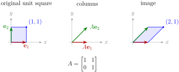
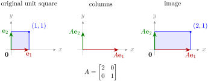
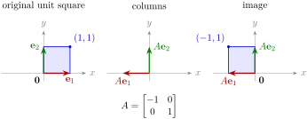
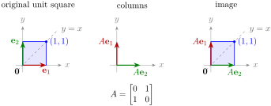

# 1.3 Matrix-vector product and linear maps {#13-matrix-vector-product-and-linear-maps}

!!! note "译文与来源"

    本页为教材公开源文件 v0.2 的非官方中文翻译，保留原公式、例题、活动、代码和习题；例题与活动等编号按本地小节重排，解答和证明可点击展开；正文与标题中的数学专有名词保留英文，中文用于解释；术语表保留中英对照以便查阅。原文作者：Jacob Denson、Kaitlyn Phillipson、Sebastien Roch。除另有注明的插图外，译文遵循 [CC BY-NC-SA 4.0](https://creativecommons.org/licenses/by-nc-sa/4.0/)。[阅读英文原文](1-3.md#sec-u1-matrix-vector-geometric-actions)。


<a id="sec-u1-matrix-vector-geometric-actions"></a>


<a id="subsec-u1-matrix-vector-product"></a>

## Matrix-vector product {#matrix-vector-product}


<a id="subsec-u1-column-vectors"></a>

vector 可以写成行或 column。在本课程中，当 matrix 作用于 vector 时，我们通常将 vector 写成 column：

$$
\mathbf{x}=\begin{bmatrix}x_1\\x_2\\\vdots\\x_n\end{bmatrix}.
$$


从现在开始，当我们写 $\mathbf{x}=(x_1,\ldots,x_n)$ 时，$\mathbf{x}$ 被解释为 column vector。

如果 $A$ 是 $m\times n$  matrix，则 $A$ 有 $n$  column。我们写 

$$
A=\begin{bmatrix}\mathbf{a}_1 & \mathbf{a}_2 & \cdots & \mathbf{a}_n\end{bmatrix}
$$

其中每个 $\mathbf{a}_j$ 是 $\mathbb R^m$ 中的 column vector。


<a id="def-2-2-matrix-vector-product"></a>

**定义 1.3.1：matrix-vector product**

令$A=\begin{bmatrix}\mathbf{a}_1 & \mathbf{a}_2 & \cdots & \mathbf{a}_n\end{bmatrix}$为$m\times n$ matrix，并令$\mathbf{x}=(x_1,\ldots,x_n)$为$\mathbb R^n$中的 column vector。 matrix-vector product 为 

$$
A\mathbf{x}=x_1\mathbf{a}_1+x_2\mathbf{a}_2+\cdots+x_n\mathbf{a}_n.
$$


<a id="act-u1-compute-matrix-vector-product"></a>

**活动 1.3.1：计算 matrix-vector product (U1-LO4)**

计算$A\mathbf{x}$，其中

$$
A=\begin{bmatrix}-1 & 4 & -5\\ 3 & 1 & -2\end{bmatrix},
            \qquad
            \mathbf{x}=\begin{bmatrix}2\\-3\\4\end{bmatrix}.
$$


??? success "解答"

    使用 column，
    
    $$
    \begin{aligned}
    A\mathbf{x} &=2\begin{bmatrix}-1\\3\end{bmatrix}-3\begin{bmatrix}4\\1\end{bmatrix}+4\begin{bmatrix}-5\\-2\end{bmatrix} \\
    &=\begin{bmatrix}2(-1)-3(4)+4(-5)\\2(3)-3(1)+4(-2)\end{bmatrix} \\
    &=\begin{bmatrix}-34\\-5\end{bmatrix}.
    \end{aligned}
    $$
    
    


<a id="thm-u1-row-dot-product-view"></a>

**定理 1.3.1：从 row 的 dot product 理解乘积**

如果 $A$ 是 $m\times n$  matrix， row $\operatorname{row}_1(A),\ldots,\operatorname{row}_m(A)$ 作为 $n$  vector，则 

$$
A\mathbf{x}=
            \begin{bmatrix}
            \operatorname{row}_1(A)\cdot\mathbf{x}\\
            \operatorname{row}_2(A)\cdot\mathbf{x}\\
            \vdots\\
            \operatorname{row}_m(A)\cdot\mathbf{x}
            \end{bmatrix}.
$$


??? info "证明"

    写出$A=[\mathbf{a}_1\ \cdots\ \mathbf{a}_n]$，其中$\mathbf{a}_j=(a_{1j},\ldots,a_{mj})$，并让$\mathbf{x}=(x_1,\ldots,x_n)$。由于
    
    $$
    A\mathbf{x}=x_1\mathbf{a}_1+\cdots+x_n\mathbf{a}_n,
    $$
    
    它的第$i$条目是
    
    $$
    x_1a_{i1}+\cdots+x_na_{in}=\operatorname{row}_i(A)\cdot\mathbf{x}.
    $$
    
    堆叠这些条目给出了规定的公式。


<a id="ex-u1-matrix-vector-row-computation"></a>

**活动 1.3.2：使用行计算相同的乘积 (U1-LO4)**

我们使用 row dot product 重新审视[计算 matrix-vector product (U1-LO4)](1-3.md#act-u1-compute-matrix-vector-product)。计算$A\mathbf{x}$，其中

$$
A=\begin{bmatrix}-1 & 4 & -5\\ 3 & 1 & -2\end{bmatrix},
            \qquad
            \mathbf{x}=\begin{bmatrix}2\\-3\\4\end{bmatrix}.
$$


??? success "解答"

    取 $A$ 与 $\mathbf{x}$ 的每一行的 dot product： 
    
    $$
    \begin{aligned}
    A\mathbf{x} &=\begin{bmatrix}(-1,4,-5)\cdot(2,-3,4)\\(3,1,-2)\cdot(2,-3,4)\end{bmatrix} \\
    &=\begin{bmatrix}(-1)(2)+4(-3)+(-5)(4)\\3(2)+1(-3)+(-2)(4)\end{bmatrix} \\
    &=\begin{bmatrix}-34\\-5\end{bmatrix}.
    \end{aligned}
    $$
    
     每个 dot product 给出使用 column 获得的相同输出 vector 的一个 component。


<a id="thm-2-2-distributive-properties"></a>

**定理 1.3.2：matrix-vector product 的性质**

令$A$和$B$为$m\times n$ matrix，令$\mathbf{x},\mathbf{y}\in\mathbb R^n$，令$r$为 scalar。然后
- $A(\mathbf{x}+\mathbf{y})=A\mathbf{x}+A\mathbf{y}$,

- $A(r\mathbf{x})=r(A\mathbf{x})=(rA)\mathbf{x}$,

- $(A+B)\mathbf{x}=A\mathbf{x}+B\mathbf{x}$.


??? info "证明"

    我们证明第一个性质。写下$A=[\mathbf{a}_1\ \cdots\ \mathbf{a}_n]$、$\mathbf{x}=(x_1,\ldots,x_n)$和$\mathbf{y}=(y_1,\ldots,y_n)$。根据上面的定义，
    
    $$
    \begin{aligned}
    A(\mathbf{x}+\mathbf{y}) &= (x_1+y_1)\mathbf{a}_1+\cdots+(x_n+y_n)\mathbf{a}_n \\
    &= A\mathbf{x}+A\mathbf{y}.
    \end{aligned}
    $$
    
    


<a id="note-u1-matrix-vector-shape-habit"></a>

**说明：matrix 与 vector 相乘前检查 dimension**

在形成$A\mathbf{x}$之前，检查$A$的 column 数是否等于$\mathbf{x}$的条目数。如果$A$是$m\times n$和$\mathbf{x}\in\mathbb R^n$，则$A\mathbf{x}\in\mathbb R^m$：它的$m$条目来自上面的$m$ row dot product。


<a id="box-u1-rows-measure-columns-contribute"></a>

**说明：行负责测量， column 提供贡献**

matrix-vector product 有两个互补的读数。在行视图中，每行通过与 $\mathbf{x}$ 进行 dot product 来测量输入。在 column 视图中，

$$
A\mathbf{x}=x_1\mathbf{a}_1+\cdots+x_n\mathbf{a}_n,
$$

因此输入 coordinate 表明每个 column 对输出的贡献程度。


<a id="subsubsec-u1-matrix-vector-product-examples"></a>

### Examples of matrix-vector products {#examples-of-matrix-vector-products}

相同的乘积$A\mathbf{x}$可以代表不同的操作，具体取决于$A$的 row 和 column 的含义。接下来的活动展示了三种常见模式：评分、选择和衡量变化。


<a id="act-u1-row-score"></a>

**活动 1.3.3：按特征对对象进行评分 (U1-LO4)**

让$X$的行代表具有两个特征的三个对象：

$$
X=\begin{bmatrix}3& 1\\1& 4\\2& 2\end{bmatrix},
              \qquad
              \mathbf{w}=(2,-1).
$$

计算$X\mathbf{w}$。解释结果。

??? success "解答"

    我们有
    
    $$
    X\mathbf{w}=
                  \begin{bmatrix}3& 1\\1& 4\\2& 2\end{bmatrix}
                  \begin{bmatrix}2\\-1\end{bmatrix}
                  =
                  \begin{bmatrix}5\\-2\\2\end{bmatrix}.
    $$
    
     每个输出都是一个分数：
    
    $$
    2(\text{first feature})-(\text{second feature}).
    $$
    
    


<a id="act-u1-selector-matrix"></a>

**活动 1.3.4：选择器 matrix （U1-LO4、U1-LO5）**

让

$$
S=\begin{bmatrix}1&0&0&0\\0&0&1&0\end{bmatrix},
              \qquad
              \mathbf{x}=\begin{bmatrix}5\\6\\7\\8\end{bmatrix}.
$$

计算$S\mathbf{x}$。 $S$有什么作用？

??? success "解答"

    我们有
    
    $$
    \begin{aligned}
                  S\mathbf{x}
                  &=
                  \begin{bmatrix}
                  1\cdot 5+0\cdot 6+0\cdot 7+0\cdot 8\\
                  0\cdot 5+0\cdot 6+1\cdot 7+0\cdot 8
                  \end{bmatrix}\\
                  &=
                  \begin{bmatrix}5\\7\end{bmatrix}.
                  \end{aligned}
    $$
    
     matrix $S$选择$\mathbf{x}$的第一个和第三个条目。


<a id="act-u1-difference-matrix"></a>

**活动 1.3.5：差分 matrix （U1-LO4、U1-LO5）**

让

$$
D=\begin{bmatrix}-1& 1& 0\\0& -1& 1\end{bmatrix},
              \qquad
              \mathbf{x}=\begin{bmatrix}2\\5\\9\end{bmatrix}.
$$

计算$D\mathbf{x}$。 $D$测量什么？

??? success "解答"

    我们有 
    
    $$
    \begin{aligned}
                  D\mathbf{x}
                  &=
                  \begin{bmatrix}
                  -1\cdot 2+1\cdot 5+0\cdot 9\\
                  0\cdot 2+(-1)\cdot 5+1\cdot 9
                  \end{bmatrix}\\
                  &=
                  \begin{bmatrix}3\\4\end{bmatrix}.
                  \end{aligned}
    $$
    
     这些条目是连续的差异： 
    
    $$
    5-2=3,\qquad 9-5=4.
    $$
    
     因此 $D$ 衡量短时间序列中的变化。


<a id="code-u1-word-count-vectors-matrix"></a>

**活动 1.3.6：matrix 代码中的文档排名（U1-LO4、U1-LO8）**

前面的[词频 vector 活动](1-1.md#act-u1-word-count-vectors)逐一计算了查询与各篇文档的 cosine similarity。下面把 document vectors 存为数据 matrix 的各个 rows，用一次 matrix-vector multiplication 同时计算所有分数。


```python
import numpy as np

doc_names = np.array(["D1", "D2", "D3"])

X = np.array([
    [3., 0., 3.],
    [1., 1., 0.],
    [0., 2., 0.],
])

q = np.array([1., 0., 1.])

scores = (X @ q) / (
    np.linalg.norm(X, axis=1) * np.linalg.norm(q)
)
ranking = doc_names[np.argsort(scores)[::-1]]

scores, ranking
```

输出：


```text
(array([1. , 0.5, 0. ]),
 array(['D1', 'D2', 'D3']))
```


1. 第二行`X`代表什么？

2. 哪个表达式计算三个 dot product $\mathbf{D}_i\cdot\mathbf{q}$？

3. `np.argsort(scores)[::-1]`有什么作用？


??? success "解答"

    `X`的行是$\mathbf{D}_1$、$\mathbf{D}_2$和$\mathbf{D}_3$。乘积 `X @ q` 使用查询计算三个 dot product。

    要理解`np.argsort(scores)[::-1]`，请分两步阅读：


    1. `np.argsort(scores)` 返回按升序排列分数的索引，而不是排序后的分数值。 NumPy 索引从 `0` 开始。对于分数 `[1, 0.5, 0]`，它返回 `[2, 1, 0]`：最小分数位于索引 `2`，下一个分数位于索引 `1`，最大分数位于索引 `0`。

    2. `[::-1]` 反转该索引数组。切片的形式为 `[start:stop:step]`；将端点留空并使用步骤`-1`向后遍历整个数组。因此`[2, 1, 0]`变为`[0, 1, 2]`，它列出了从最大分数到最小分数的索引。


    对`ranking`的赋值使用这些索引来从`doc_names`中选择条目。我们可以用两行编写相同的计算：


    ```python
    order = np.argsort(scores)[::-1]
    ranking = doc_names[order]
    ```

    这里`order`是`[0, 1, 2]`，所以`ranking`按顺序包含`doc_names[0]`、`doc_names[1]`和`doc_names[2]`。因此，文档名称从最高分到最低分排列。如果分数发生变化，索引可以以不同的顺序选择名称。

    显示的输出`array(['D1', 'D2', 'D3'])`描述了一个包含三个文本字符串的一维NumPy数组。

    分数与[词频 vector (U1-LO1, U1-LO2)](1-1.md#act-u1-word-count-vectors)一致：$1,\frac12,0$。


<a id="ex-u1-attention-matrix-form"></a>

**例题 1.3.1：matrix 形式的 attention 活动**

在[收集鸟位置的背景信息（U1-LO1、U1-LO8）](1-1.md#act-u1-token-attention)中，我们一次计算了

$$
\mathbf{q}\cdot\mathbf{k}_{\mathrm{small}},\qquad
            \mathbf{q}\cdot\mathbf{k}_{\mathrm{red}},\qquad
            \mathbf{q}\cdot\mathbf{k}_{\mathrm{bird}}
$$

的分数。 matrix-vector multiplication 一次计算出相同的分数。

将关 key vector 作为

$$
K=\begin{bmatrix}
            \mathbf{k}_{\mathrm{small}}^T\\
            \mathbf{k}_{\mathrm{red}}^T\\
            \mathbf{k}_{\mathrm{bird}}^T
            \end{bmatrix}.
$$

的行然后

$$
K\mathbf{q}=
            \begin{bmatrix}
            \mathbf{k}_{\mathrm{small}}\cdot\mathbf{q}\\
            \mathbf{k}_{\mathrm{red}}\cdot\mathbf{q}\\
            \mathbf{k}_{\mathrm{bird}}\cdot\mathbf{q}
            \end{bmatrix}.
$$


对于[收集鸟位置的背景信息（U1-LO1、U1-LO8）](1-1.md#act-u1-token-attention)、

$$
K=\begin{bmatrix}1&0\\0&1\\1&1\end{bmatrix},
            \qquad
            \mathbf{q}=\begin{bmatrix}1\\1\end{bmatrix},
$$

中的数字，所以

$$
K\mathbf{q}=\begin{bmatrix}1\\1\\2\end{bmatrix}.
$$


<a id="code-u1-token-attention"></a>

**活动 1.3.7：代码中相同的 attention 计算（U1-LO4，U1-LO8）**

以下代码根据 token attention 活动执行计算。


```python
import numpy as np

tokens = np.array(["small", "red", "bird"])

q = np.array([1., 1.])

K = np.array([
    [1., 0.],
    [0., 1.],
    [1., 1.],
])

V = np.array([
    [4., 0.],
    [0., 4.],
    [4., 4.],
])

s = K @ q
alpha = s / s.sum()
out = alpha @ V

s, alpha, out
```

输出：


```text
(array([1., 1., 2.]),
 array([0.25, 0.25, 0.5 ]),
 array([3., 3.]))
```


1. 哪一行计算 token 分数？

2. 哪个代币权重最大？

3. 哪条线形成加权平均值？

4. 为什么`alpha`的entries 的和等于$1$？


??? success "解答"

    第 `s = K @ q` 行计算三个 dot product。 token “鸟”获得最大的权重。线 `out = alpha @ V` 形成`V`  row 的加权平均值。 `alpha` 的entries 的和等于 $1$，因为分数除以它们的总和。


<a id="def-2-2-standard-basis"></a>

**定义 1.3.2：standard basis**

第 $j$  standard basis vector $\mathbf{e}_j$ 是 column vector，其中 $1$ 位于位置 $j$ 且其他位置为零。

basis 的正式定义将在第二章介绍；目前只需记住 $\mathbf{e}_j$ 的具体形式，以及它选取第 $j$ 个 column 的作用。


<a id="fact-u1-columns-are-images-basis"></a>

**事实 1.3.1**

如果$A=\begin{bmatrix}\mathbf{a}_1 & \cdots & \mathbf{a}_n\end{bmatrix}$，则$A\mathbf{e}_j=\mathbf{a}_j$。将 matrix 应用于 standard basis vector 会选出一个 column。

??? info "证明"

    除了位置 $j$ 的 $1$ 之外，$\mathbf{e}_j$ 的 coordinate 均为零。因此， matrix-vector product 的 column 公式给出 
    
    $$
    A\mathbf{e}_j=\sum_{k=1}^{n}(\mathbf{e}_j)_k\mathbf{a}_k=\mathbf{a}_j.
    $$
    
     这里$(\mathbf{e}_j)_k$表示$\mathbf{e}_j$的第$k$ coordinate，当$k=j$时等于$1$，否则等于$0$。


<a id="fact-u1-identity-property"></a>

**例题 1.3.2：identity matrix 使 vector 保持不变**

对于每个 column vector $\mathbf{x}\in\mathbb R^n$，$I_n\mathbf{x}=\mathbf{x}$。

事实上，来自[ identity matrix ](1-2.md#def-u1-identity-matrix)的 identity matrix 的 column 是$\mathbf{e}_1,\ldots,\mathbf{e}_n$。因此，写$\mathbf{x}=(x_1,\ldots,x_n)$，

$$
I_n\mathbf{x}=x_1\mathbf{e}_1+\cdots+x_n\mathbf{e}_n=\begin{bmatrix}x_1\\\vdots\\x_n\end{bmatrix}=\mathbf{x}.
$$


<a id="subsec-u1-geometric-actions"></a>

## \mathbb R^2 中的几何 matrix 动作：建立直觉 {#mathbb-r2}

在$\mathbb R^2$中， matrix $A=\begin{bmatrix}\mathbf{a}_1 & \mathbf{a}_2\end{bmatrix}$将$\mathbf{e}_1$发送到$\mathbf{a}_1$，将$\mathbf{e}_2$发送到$\mathbf{a}_2$。每个 vector $\mathbf{x}=(x_1,x_2)$都可以写成$x_1\mathbf{e}_1+x_2\mathbf{e}_2$，因为

$$
x_1\mathbf{e}_1+x_2\mathbf{e}_2=x_1\begin{bmatrix}1\\0\end{bmatrix}+x_2\begin{bmatrix}0\\1\end{bmatrix}=\begin{bmatrix}x_1\\x_2\end{bmatrix}=\mathbf{x}.
$$

因此，

$$
\begin{aligned}
A\mathbf{x} &=A(x_1\mathbf{e}_1+x_2\mathbf{e}_2) \\
&=x_1A\mathbf{e}_1+x_2A\mathbf{e}_2 \\
&=x_1\mathbf{a}_1+x_2\mathbf{a}_2.
\end{aligned}
$$

第二个等式使用 linear，最后一个等式使用[事实 1.3.1](1-3.md#fact-u1-columns-are-images-basis)。因此，$2\times 2$ matrix 在几何上是由它发送两个 coordinate 方向的位置决定的。


<a id="box-u1-unit-square-test"></a>

要理解 $2\times 2$  matrix $A$，请将其应用于单位正方形的四个角。该 graph 通常是平行四边形。离开原点的两条边是$A$的 column。我们将其称为单位平方可视化。


<a id="fig-u1-unit-square-test"></a>

*$2\times 2$  matrix 将单位正方形发送到由其两个 columns 确定的平行四边形。这是 column 贡献的几何版本。*




<a id="fig-u1-shear-unit-grid"></a>

*同样的剪切$A=\begin{bmatrix}1&1\\0&1\end{bmatrix}$将$(x,y)$发送到$(x+y,y)$。 $1\times1$ 正方形的网格变成平行四边形的网格，将单位正方形可视化扩展到原点之外。匹配的颜色标记相应的单元格。*

![左侧面板显示 [-2,2]\times[-2,2] 上的整数网格。右侧面板显示其在与 中相同的剪切下的像，两个面板中的 coordinate 比例相同。水平网格线保持水平，而垂直网格线向右倾斜。蓝色单位正方形映射到具有角 (0,0)、 (1,0)、 (2,1) 和 (1,1) 的平行四边形。远离原点且具有角 (-2,1)、 (-1,1)、 (-1,2) 和 (-2,2) 的橙色正方形映射到具有角 (-1,1)、 (0,1)、 (1,2) 和 (0,2) 的平行四边形。水平轴上方的点向右移动，其下方的点向左移动，其上的点保持固定。](images/img-u1-shear-unit-grid.svg)


<a id="fig-u1-horizontal-stretch"></a>

*水平拉伸 $2$ 倍会使单位正方形变成两倍宽的矩形。第一个 column 将水平 basis vector 加倍，而第二个 column 使垂直 basis vector 保持不变。*




<a id="tab-u1-transformation-gallery"></a>

**表 1.3.1：常见几何变换示例**


| matrix | $A\mathbf{e}_1$ | $A\mathbf{e}_2$ | 名称 | 单位平方效应 |
|---|---|---|---|---|
| $\begin{bmatrix}2&0\\0&1\end{bmatrix}$ | $\begin{bmatrix}2\\0\end{bmatrix}$ | $\begin{bmatrix}0\\1\end{bmatrix}$ | 水平拉伸 | 右边缘进一步向右移动。 |
| $\begin{bmatrix}0&0\\0&1\end{bmatrix}$ | $\begin{bmatrix}0\\0\end{bmatrix}$ | $\begin{bmatrix}0\\1\end{bmatrix}$ | projection 到 $y$ 轴上 | 水平信息被遗忘。 |
| $\begin{bmatrix}-1&0\\0&1\end{bmatrix}$ | $\begin{bmatrix}-1\\0\end{bmatrix}$ | $\begin{bmatrix}0\\1\end{bmatrix}$ | 沿$y$轴的反射 | 正方形向左翻转。 |
| $\begin{bmatrix}0&1\\1&0\end{bmatrix}$ | $\begin{bmatrix}0\\1\end{bmatrix}$ | $\begin{bmatrix}1\\0\end{bmatrix}$ | 沿线反射$y=x$ | 正方形处于同一区域，但水平和垂直 coordinate 方向交换。 |
| $\begin{bmatrix}1&1\\0&1\end{bmatrix}$ | $\begin{bmatrix}1\\0\end{bmatrix}$ | $\begin{bmatrix}1\\1\end{bmatrix}$ | 水平剪切 | 底部边缘保持固定；顶部边缘向右移动。 |
| $\begin{bmatrix}0&-1\\1&0\end{bmatrix}$ | $\begin{bmatrix}0\\1\end{bmatrix}$ | $\begin{bmatrix}-1\\0\end{bmatrix}$ | $90^\circ$逆时针旋转 | 正方形绕原点旋转。 |
| $\begin{bmatrix}1&0\\0&0\end{bmatrix}$ | $\begin{bmatrix}1\\0\end{bmatrix}$ | $\begin{bmatrix}0\\0\end{bmatrix}$ | projection 到 $x$ 轴上 | 垂直信息被遗忘。 |

[在疯狂剪切中练习识别此类几何变换。](https://math345-games.github.io/ShearMadness/)


<a id="act-u1-horizontal-shear"></a>

**活动 1.3.8：水平剪切（U1-LO4）**

让$A=\begin{bmatrix}1&1\\0&1\end{bmatrix}$。计算 $A\mathbf{e}_1$、$A\mathbf{e}_2$ 和 $A\mathbf{x}$，其中 $\mathbf{x}=(1,1)$。

??? success "解答"

    我们有 
    
    $$
    A\mathbf{e}_1=\begin{bmatrix}1\\0\end{bmatrix},\qquad
                A\mathbf{e}_2=\begin{bmatrix}1\\1\end{bmatrix},\qquad
                A\mathbf{x}=\begin{bmatrix}2\\1\end{bmatrix}.
    $$
    
     公式是 $A(x,y)=(x+y,y)$。 $y=0$ 的点保持固定，$y=1$ 的点右移$1$。

**说明**

对于剪切 matrix $A=\begin{bmatrix}1&1\\0&1\end{bmatrix}$，行视图给出 

$$
A\begin{bmatrix}x\\y\end{bmatrix}
          =
          \begin{bmatrix}
          (1,1)\cdot(x,y)\\
          (0,1)\cdot(x,y)
          \end{bmatrix}
          =
          \begin{bmatrix}x+y\\y\end{bmatrix}.
$$

第一行测量水平加垂直，而第二行仅测量垂直。柱视图给出 

$$
A\begin{bmatrix}x\\y\end{bmatrix}
          =
          x\begin{bmatrix}1\\0\end{bmatrix}
          +
          y\begin{bmatrix}1\\1\end{bmatrix},
$$

因此 $y$  coordinate 有助于向上和向右运动。


<a id="act-u1-reflection-y-axis"></a>

**活动 1.3.9：沿 y 轴的反射 (U1-LO4)**

让$A=\begin{bmatrix}-1&0\\0&1\end{bmatrix}$。计算 $A\mathbf{e}_1$、$A\mathbf{e}_2$、$A\mathbf{x}$ 和 $A\mathbf{y}$，其中 $\mathbf{x}=(1,1)$ 和 $\mathbf{y}=(0,1)$。

??? success "解答"

    我们得到 
    
    $$
    \begin{aligned}
    A\mathbf{e}_1 &= \begin{bmatrix}-1\\0\end{bmatrix},\qquad A\mathbf{e}_2=\begin{bmatrix}0\\1\end{bmatrix}, \\
    A\mathbf{x} &= \begin{bmatrix}-1\\1\end{bmatrix},\qquad A\mathbf{y}=\begin{bmatrix}0\\1\end{bmatrix}.
    \end{aligned}
    $$
    
     第一个 coordinate 翻转符号，第二个 coordinate 不变。


<a id="fig-u1-reflection-y-axis"></a>

*穿过 $y$ 轴的反射将单位正方形发送到其左侧镜像。第一个 column 反转水平方向，而第二个 column 保持垂直方向不变。*




<a id="act-u1-reflection-y-equals-x"></a>

**活动 1.3.10：沿线的反射 y=x (U1-LO4, U1-LO5)**

让

$$
A=\begin{bmatrix}0&1\\1&0\end{bmatrix}.
$$


1. 计算 $A\mathbf{e}_1$ 和 $A\mathbf{e}_2$。

2. 计算$A\begin{bmatrix}x\\y\end{bmatrix}$。

3. $y=x$ 线上的一点会发生什么？


??? success "解答"

    我们有 
    
    $$
    A\mathbf{e}_1=\begin{bmatrix}0\\1\end{bmatrix}=\mathbf{e}_2,
                \qquad
                A\mathbf{e}_2=\begin{bmatrix}1\\0\end{bmatrix}=\mathbf{e}_1.
    $$
    
     更一般地，根据 standard basis 编写输入： 
    
    $$
    \begin{aligned}
                A\begin{bmatrix}x\\y\end{bmatrix}
                &=A(x\mathbf{e}_1+y\mathbf{e}_2)
                =xA\mathbf{e}_1+yA\mathbf{e}_2\\
                &=x\mathbf{e}_2+y\mathbf{e}_1
                =\begin{bmatrix}y\\x\end{bmatrix}.
                \end{aligned}
    $$
    
     这样两个 coordinate 就被交换了。如果$x=y$，交换 coordinate 不会移动该点，因此$y=x$线上的每个点都保持固定。


<a id="fig-u1-reflection-y-equals-x"></a>

*单位正方形在经过$y=x$反射后占据相同的区域，即使其水平和垂直 coordinate 方向已交换，因此正方形的未标记像可能看起来没有变化。标记的红色和绿色边缘显示了交换。镜像虚线上的角 $(0,0)$ 和 $(1,1)$ 保持固定。*




<a id="sec-u1-linear-affine-maps"></a>

## Linear and affine maps {#linear-and-affine-maps}

function 将一个输出分配给每个输入。在本课程中，许多 function 以 vector 作为输入，以 vector 作为输出：

$$
F:\mathbb R^n\to\mathbb R^m.
$$

$F$的域是其允许的输入集合$\mathbb R^n$，其共域是包含其输出的指定集合$\mathbb R^m$。根据规则$\mathbf{x}\mapsto A\mathbf{x}$， matrix 给出了此类 function 的一个重要来源。


<a id="def-3-2-matrix-transformation"></a>

**定义 1.3.3：matrix 映射**

给定一个$m\times n$ matrix $A$，由$A$导出的 matrix 映射是由

$$
T_A(\mathbf{x})=A\mathbf{x}.
$$

定义的 function $T_A:\mathbb R^n\to\mathbb R^m$


<a id="def-2-4-linear-transformation"></a>

**定义 1.3.4：linear map**

如果对于所有 vector $\mathbf{u},\mathbf{v}$ 和所有 scalar $c$ 

$$
\begin{aligned}
T(\mathbf{u}+\mathbf{v}) &= T(\mathbf{u})+T(\mathbf{v}), \\
T(c\mathbf{v}) &= cT(\mathbf{v})
\end{aligned}
$$

function $T:\mathbb R^n\to\mathbb R^m$ 是 linear 的。


<a id="note-u1-linear-combinations"></a>

**说明：linear map 保留 linear combination**

如果$T:\mathbb R^n\to\mathbb R^m$是 linear 的，则对于任何 vector $\mathbf{v}_1,\ldots,\mathbf{v}_k\in\mathbb R^n$和 scalar $c_1,\ldots,c_k\in\mathbb R$、

$$
T(c_1\mathbf{v}_1+\cdots+c_k\mathbf{v}_k)=c_1T(\mathbf{v}_1)+\cdots+c_kT(\mathbf{v}_k).
$$

因此输入的 linear combination 被发送到具有相同 coefficient 的输出的 linear combination。接下来是重复应用两个 linear 规则。


<a id="thm-u1-matrix-maps-linear"></a>

**定理 1.3.3：matrix 映射是 linear 的**

如果 $A$ 是 $m\times n$  matrix，则 function 

$$
T_A:\mathbb R^n\to\mathbb R^m,\qquad T_A(\mathbf{x})=A\mathbf{x}
$$

是 linear 的。

??? info "证明"

     matrix-vector multiplication 分布于 vector addition 和 scalar multiplication： 
    
    $$
    A(\mathbf{u}+\mathbf{v})=A\mathbf{u}+A\mathbf{v},\qquad A(c\mathbf{v})=cA\mathbf{v}.
    $$
    
     这正是两个 linear 规则。


<a id="p-u1-standard-basis-expansion"></a>

每个 vector $\mathbf{x}=(x_1,\ldots,x_n)\in\mathbb R^n$ 都可以写成 standard basis vector 的 linear combination。事实上，$x_j\mathbf{e}_j$在位置$j$有条目$x_j$，而其他地方为零，因此将这些 vector 逐个 coordinate 相加得到

$$
x_1\mathbf{e}_1+\cdots+x_n\mathbf{e}_n=\begin{bmatrix}x_1\\\vdots\\x_n\end{bmatrix}=\mathbf{x}.
$$

因为 linear map 保留 linear combination，所以它在$\mathbf{e}_1,\ldots,\mathbf{e}_n$上的值决定了它在每个输入上的值。这一观察结果得出以下定理。


<a id="thm-linear-transformation-matrix"></a>

**定理 1.3.4：每个 linear map 都有一个 matrix**

每个 linear map $T:\mathbb R^n\to\mathbb R^m$ 都能唯一表示为 matrix multiplication。表示它的 matrix 依次以 $T(\mathbf{e}_1),\ldots,T(\mathbf{e}_n)$ 为 columns。

??? info "证明"

    使用上面的 standard basis 扩展，令$A=[\,T(\mathbf{e}_1)\ \cdots\ T(\mathbf{e}_n)\,]$。通过 linear 和 matrix-vector multiplication 的 column 视图， 
    
    $$
    \begin{aligned}
    T(\mathbf{x}) &=T(x_1\mathbf{e}_1+\cdots+x_n\mathbf{e}_n) \\
    &=x_1T(\mathbf{e}_1)+\cdots+x_nT(\mathbf{e}_n) \\
    &=\begin{bmatrix}T(\mathbf{e}_1)&\cdots& T(\mathbf{e}_n)\end{bmatrix}\begin{bmatrix}x_1\\\vdots\\x_n\end{bmatrix} \\
    &=A\mathbf{x}.
    \end{aligned}
    $$
    
     第二个等式使用 linear，第三个等式使用 matrix-vector multiplication 的 column 视图。这个 matrix 是唯一的，因为它的第$j$ column 必须是$A\mathbf{e}_j=T(\mathbf{e}_j)$。


<a id="act-u1-build-matrix-from-basis-images"></a>

**活动 1.3.11：basis vector 的像确定 matrix (U1-LO5)**

假设 linear map $T:\mathbb R^2\to\mathbb R^2$满足$T(\mathbf{e}_1)=(2,1)$和$T(\mathbf{e}_2)=(-1,3)$。找到 matrix $A$ 使得 $T(\mathbf{x})=A\mathbf{x}$。

??? success "解答"

     column 是 standard basis vector 的像，所以 
    
    $$
    A=\begin{bmatrix}2 & -1\\1 & 3\end{bmatrix}.
    $$
    
    


<a id="def-u1-linear-function"></a>

**定义 1.3.5：linear function**

linear function 是 scalar 值 linear map $f:\mathbb R^n\to\mathbb R$。它的输出是一个实数。


<a id="note-u1-linear-functions-dot-products"></a>

**说明：linear function 是 dot product**

通过[每个 linear map 都有一个 matrix ](1-3.md#thm-linear-transformation-matrix)，每个 linear function 都由$1\times n$ matrix 表示。将此 row matrix 写为 $\mathbf{c}^T$，其中 $\mathbf{c}\in\mathbb R^n$ 是固定 column vector，给出 

$$
\begin{aligned}
f(\mathbf{x}) &=\begin{bmatrix}c_1&\cdots& c_n\end{bmatrix}\begin{bmatrix}x_1\\\vdots\\x_n\end{bmatrix} \\
&=c_1x_1+\cdots+c_nx_n \\
&=\mathbf{c}^T\mathbf{x}=\mathbf{c}\cdot\mathbf{x}.
\end{aligned}
$$

相反，这种形式的每个 function 都是 [ matrix 映射是 linear 的](1-3.md#thm-u1-matrix-maps-linear)  linear 的。因此， linear function 正是具有固定 vector 的 dot product。

vector $\mathbf{c}$由 standard basis vector 上$f$的值唯一确定。由于 $\mathbf{e}_i$ 在其第 $i$  coordinate 中具有 $1$，并且在每个其他 coordinate 中具有 $0$，因此 

$$
\begin{aligned}
c_i &=c_1(0)+\cdots+c_i(1)+\cdots+c_n(0) \\
&=f(\mathbf{e}_i),\qquad i=1,\ldots,n.
\end{aligned}
$$


<a id="ex-u1-linear-function-dot-product"></a>

**例题 1.3.3：三个变量的 linear function**

由 

$$
f(x_1,x_2,x_3)=2x_1-x_2+3x_3
$$

给出的 function $f:\mathbb R^3\to\mathbb R$ 是 linear 的。事实上，使用固定 column vector $\mathbf{c}=(2,-1,3)$，

$$
f(\mathbf{x})=\begin{bmatrix}2&-1&3\end{bmatrix}\begin{bmatrix}x_1\\x_2\\x_3\end{bmatrix}=\mathbf{c}\cdot\mathbf{x}.
$$

其在 standard basis vector 上的值可恢复 $\mathbf{c}$ 的条目： 

$$
f(\mathbf{e}_1)=2,\qquad f(\mathbf{e}_2)=-1,\qquad f(\mathbf{e}_3)=3.
$$


<a id="warn-u1-linear-map-transformation-language"></a>

**注意**

我们交替使用“linear map”和“linear transformation”；当强调几何时，经常使用“变换”。我们为 scalar 值 linear map 保留“linear function”。


<a id="def-u1-affine-map"></a>

**定义 1.3.6：affine map**

设 $A$ 是 $m\times n$ 实 matrix，$\mathbf{b}\in\mathbb R^m$ 是一个固定的 column vector。形如 

$$
F:\mathbb R^n\to\mathbb R^m,\qquad F(\mathbf{x})=A\mathbf{x}+\mathbf{b},
$$

的 function 称为 affine map，其中 $\mathbf{x}\in\mathbb R^n$ 是 column vector。它先进行 linear map，再进行平移。

仅当 $\mathbf{b}=\mathbf{0}$ 时， affine map 才是 linear 的。一个快速测试是 zero vector：每个 linear map 将$\mathbf{0}$发送到$\mathbf{0}$，但是

$$
A\mathbf{0}+\mathbf{b}=\mathbf{b}.
$$

如果$\mathbf{b}\ne\mathbf{0}$，则该映射不是 linear 的。


<a id="fig-u1-affine-translation"></a>

*从[图 1.3.3](1-3.md#fig-u1-horizontal-stretch)开始水平拉伸，然后进行$\mathbf b=(1,1)$平移。平移将每个点向右移动一个单位并向上移动一个单位，从而保留拉伸矩形的形状。特别是$F(\mathbf 0)=\mathbf b\ne\mathbf 0$，所以这个 affine map 不是 linear 的。*


<a id="ex-u1-affine-layer"></a>

**例题 1.3.4：affine 层**

neural network 中的层可以采用

$$
\mathbf{x}\mapsto W\mathbf{x}+\mathbf{b}.
$$

的形式。符号$\mapsto$的意思是“映射到”：输入 vector $\mathbf{x}$被发送到输出 vector $W\mathbf{x}+\mathbf{b}$。 matrix $W$混合输入 coordinate。 vector $\mathbf{b}$ 移动结果。由于 

$$
W\mathbf{0}+\mathbf{b}=\mathbf{b},
$$

这张映射是 affine 的。当 $\mathbf{b}=\mathbf{0}$ 时它是 linear 的。

<a id="img-u1-unit-square-test"></a>

<a id="img-u1-shear-unit-grid"></a>

<a id="img-u1-horizontal-stretch"></a>

<a id="img-u1-reflection-y-axis"></a>

<a id="img-u1-reflection-y-equals-x"></a>

<a id="img-u1-affine-translation"></a>
