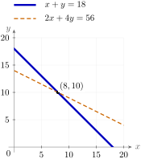
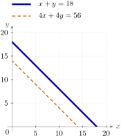
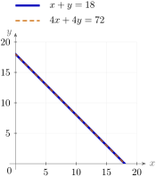
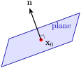
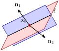

# 2.2 Linear systems {#22-linear-systems}

!!! note "译文与来源"

    本页为教材公开源文件 v0.2 的非官方中文翻译，保留原公式、例题、活动、代码和习题；例题与活动等编号按本地小节重排，解答和证明可点击展开；正文与标题中的数学专有名词保留英文，中文用于解释；术语表保留中英对照以便查阅。原文作者：Jacob Denson、Kaitlyn Phillipson、Sebastien Roch。除另有注明的插图外，译文遵循 [CC BY-NC-SA 4.0](https://creativecommons.org/licenses/by-nc-sa/4.0/)。[阅读英文原文](2-2.md#sec-u2-systems-geometry-row-reduction)。


<a id="sec-u2-systems-geometry-row-reduction"></a>

预览示例有不同的故事：可到达的输出、不可见的更改、冗余特征。从代数上来说，它们都问同一个问题：未知输入 coordinate 中的 linear 方程列表可以求解吗？


<a id="sec-equations-of-lines-and-planes"></a>

## Definitions and examples {#definitions-and-examples}

**定义 2.2.1：linear 方程**


$$
a_1x_1 + a_2x_2 + \cdots + a_nx_n = b
$$

形式的方程称为 linear 方程，其中 $a_1,\dots,a_n,b$ 是 scalar，$x_1,\dots,x_n$ 是变量。实数$a_1,\ldots,a_n$称为 coefficient，$b$称为常数，而变量$x_1,\ldots,x_n$称为未知数。


<a id="def-properties-of-linear-systems"></a>

**定义 2.2.2：linear system**

linear system 或 linear system 是一组 $m$  linear 方程，每个方程都有 $n$ 未知数。 linear system 的形式为 

<a id="me-1-1-linear-equation-archetype"></a>

$$
\begin{array}{ccccccccc}
          a_{11}x_1 & + & a_{12}x_2 & + & \cdots & + & a_{1n}x_n & = & b_1    \\
          a_{21}x_1 & + & a_{22}x_2 & + & \cdots & + & a_{2n}x_n & = & b_2    \\
          \vdots    &   & \vdots    &   &        &   & \vdots    &   & \vdots \\
          a_{m1}x_1 & + & a_{m2}x_2 & + & \cdots & + & a_{mn}x_n & = & b_m
          \end{array}
$$

其中 $a_{11},\dots,a_{mn}$ 和 $b_1,\dots,b_m$ 是常数。

linear system [参见](2-2.md#me-1-1-linear-equation-archetype)的解是$n$数$s_1,\ldots,s_n$的序列，因此当进行替换$x_1 = s_1$、$x_2=s_2,\ldots,x_n=s_n$时，满足[参见](2-2.md#me-1-1-linear-equation-archetype)中的每个方程。


<a id="warn-u2-linear-system-variables"></a>

**注意：变量名**

我们在几何示例中使用$x,y,z$，在一般系统中使用$x_1,\dots,x_n$。

**活动 2.2.1：nonlinear 方程 (U2-LO1)**

哪些方程不是 linear 方程？

??? success "解答"

    这里有四个例子：


    - 由于平方项 $x^2$，$x^2 + y = 1$ 是 nonlinear 的。

    - 由于变量 $xy$ 的乘积，$xy = 2$ 是 nonlinear 的。

    - 由于正弦 function $\sin$，$\sin(x) + y = 0$ 是 nonlinear 的。

    - 由于平方根 $\sqrt{x}$，$\sqrt{x} + y = 1$ 是 nonlinear 的。

在介绍通用算法之前，我们先看看一些可以直接分析方程的小系统。


<a id="ex-1-1-forest-animals-1"></a>

**活动 2.2.2：森林动物（U2-LO1、U2-LO2）**

在威斯康星州的森林里，有知更鸟和獾。它们总共有 $18$ 个头和 $56$ 条腿。森林里有多少只知更鸟和獾？

??? success "解答"

    令 $x$ 为知更鸟的数量，$y$ 为獾的数量。

    人头$x + y = 18$
    腿$2x + 4y = 56$
    重新排列第一个方程，我们找到 $y = 18-x$。将其代入第二个方程：

    
    
    $$
    \begin{aligned}
    2x + 4(18-x) & = 56 \\
    2x + 72 - 4x & = 56 \\
    -2x & = -16 \\
    x & = 8
    \end{aligned}
    $$
    
    

    从$y = 18 - x$和$x = 8$开始，$y = 10$。

    所以森林里有$8$知更鸟，还有$10$獾。

**活动 2.2.3：识别 coefficient、常数和未知数 (U2-LO1)**

找出 [森林动物（U2-LO1、U2-LO2）](2-2.md#ex-1-1-forest-animals-1) 中每个 linear 方程的 coefficient、常数和未知数。

??? success "解答"

    **表 2.2.1：coefficient、常数和未知数表。**


    | 方程 | coefficient | 常数 | 未知数 |
    |---|---|---|---|
    | $x + y = 18$ | $1,1$ | $18$ | $x,y$ |
    | $2x + 4y = 56$ | $2,4$ | $56$ | $x,y$ |


<a id="def-u2-consistency-equivalence"></a>

**定义 2.2.3：相容性与等价性**


- 如果 linear system 无解，则称为不相容。

- 如果一个 linear system 至少有一个解，则称为相容的。注意，具有无穷多个解的方程仍然是相容的！

- 如果两个 linear system 有完全相同的解，则称它们是等价的。


<a id="ex-1-1-forest-animals-3"></a>

**活动 2.2.4：另一个森林问题（U2-LO1、U2-LO2）**

在威斯康星州的另一片森林里，有鹿和獾。它们总共有 $18$ 个头和 $56$ 个腿。森林里有多少只鹿和獾？由此产生的 linear system 是相容的还是不相容的？

??? success "解答"

    令 $x$ 为鹿的数量，$y$ 为獾的数量。

    人头$x + y = 18$
    腿$4x + 4y = 56$
    由第二个方程可得：


    $$
    \begin{aligned}
    4(x + y) & = 56 \\
    x + y & = 56/4 = 14
    \end{aligned}
    $$


    该系统是不相容的，因为第一个方程给出 $x + y = 18$，但第二个方程给出 $x + y = 14$。尝试将第一个方程代入第二个方程。


<a id="subsubsec-u2-geometric-examples"></a>

### \mathbb R^2 和 \mathbb R^3 中的几何例子：建立直觉 {#mathbb-r2-mathbb-r3}

回想一下，平面中穿过点 $P_0(x_0,y_0)$ 并具有 slope $m$ 的线可以写成点 slope 形式，作为求解方程 

$$
y - y_0 = m(x - x_0).
$$

的一组点 $P(x,y)$

**例题 2.2.1：几何角度（U2-LO1、U2-LO2）**

受我们的森林示例启发，请考虑以下三个系统。让我们绘制这些方程定义的线，并检查它如何反映每种情况下的解数。

**问题**

系统1

$$
\begin{aligned}
x + y & = 18 \\
2x + 4y & = 56
\end{aligned}
$$


<a id="fig-u2-geometric-system-1"></a>

*系统 1：两条线相交于 $(8,10)$。*



**问题**

系统2

$$
\begin{aligned}
x + y & = 18 \\
4x + 4y & = 56
\end{aligned}
$$


<a id="fig-u2-geometric-system-3"></a>

*系统2：两条线平行且不同，因此无解。*



**问题**

系统3

$$
\begin{aligned}
x + y & = 18 \\
4x + 4y & = 72
\end{aligned}
$$


<a id="fig-u2-geometric-system-2"></a>

*系统3：两条线重合，给出无穷多个解。*



系统1有一个交点：从$x+2y=28$减去$x+y=18$得到$y=10$，所以$x=8$。系统2给出$x+y=18$和$x+y=14$，所以两条线平行，系统无解。系统3是同一条线两次，由于$4x+4y=72$等价于$x+y=18$，所以它有无穷多个解。

“解”这个词也有几何意义。解集可以是点、线、平面、空或更高维。在三维空间中， linear 方程的解集是一个平面，前提是至少一个变量具有非零 coefficient。为了获得这样一个平面的方程，我们采用了与二维直线所用的点 slope 形式不同的方法。我们使用 normal vector，它与平面垂直，从而给出平面不移动的方向。


<a id="def-1-2-normal-vector-equation"></a>

**定义 2.2.4：平面 normal vector 方程**

normal vector $\mathbf{n}$穿过$P_0(x_0,y_0,z_0)$的平面是所有点$P(x,y,z)$的集合，使得$\mathbf{x} - \mathbf{x}_0$与$\mathbf{n}$ orthogonal。也就是说，

$$
\mathbf{n} \cdot (\mathbf{x} - \mathbf{x}_0) = 0,
$$

或 scalar 形式，如果 $\mathbf{n}=\begin{bmatrix}n_1\\n_2\\n_3\end{bmatrix}$ 和 $\mathbf{x}_0=\begin{bmatrix}x_0\\y_0\\z_0\end{bmatrix}$，

$$
n_1(x - x_0) + n_2(y - y_0) + n_3(z - z_0) = 0.
$$


一般形式下，该方程写为 

$$
ax+by+cz=d,
$$

其中 $a=n_1$、$b=n_2$、$c=n_3$ 和 

$$
d=n_1x_0+n_2y_0+n_3z_0.
$$


<a id="fig-1-2-normal-vector-toplane"></a>

*通过点 $\mathbf{x}_0$ 且 normal vector 为 $\mathbf{n}$ 的平面。*



**活动 2.2.5：由一点和 normal vector 构成的平面 (U2-LO1)**

求通过点 $P(1,0,3)$ 且垂直于 vector $\mathbf{n}=\begin{bmatrix}2\\6\\4\end{bmatrix}$ 的平面的一般形式方程。

??? success "解答"

    描述平面的方程为 
    
    $$
    \mathbf{n}\cdot(\mathbf{x}-\mathbf{x}_0)=0,
    $$
    
    展开为 
    
    $$
    2(x - 1) + 6y + 4(z - 3) = 0
    $$
    
     并简化为 
    
    $$
    2x + 6y + 4z = 14.
    $$
    
    

三维空间中的形状被描述为单个方程的零点，通常是二维的。线被描述为满足两个不同方程的点。如果三维空间中的一条线等于通过点$\mathbf{x}_0$（参见[图 2.2.5](2-2.md#fig-1-2-intersection-of-two-planes)）的两个平面的交集， normal vector 为$\mathbf{n}_1$和$\mathbf{n}_2$，则该线恰好是满足两个方程

$$
\mathbf{n}_1 \cdot (\mathbf{x} - \mathbf{x}_0) = 0
$$

和

$$
\mathbf{n}_2 \cdot (\mathbf{x} - \mathbf{x}_0) = 0.
$$

的点集$\mathbf{x}$


<a id="fig-1-2-intersection-of-two-planes"></a>

*定义为两个平面相交的线，其 normal vector 为 $\mathbf{n}_1$ 和 $\mathbf{n}_2$，穿过公共点 $\mathbf{x}_0$。*




<a id="def-1-2-parametric-equation-for-line"></a>

**定义 2.2.5：直线的 parametric equation**

通过 $P_0(x_0,y_0,z_0)$ 且方向 vector 为 $\mathbf{d}$ 的线是 

$$
\mathbf{x}=\mathbf{x}_0+t\mathbf{d},
$$

形式的点集 $P(x,y,z)$，其中 $\mathbf{x}_0$ 是对应于 $P_0$ 的 vector。在 coordinate 中，如果 $\mathbf{d}=\begin{bmatrix}d_1\\d_2\\d_3\end{bmatrix}$，则表示 

$$
(x,y,z)=(x_0+td_1,y_0+td_2,z_0+td_3).
$$

如果 $d_1,d_2,d_3$ 均非零，我们还可以将线以对称形式写为点集 $P(x,y,z)$，使得 

$$
\frac{x - x_0}{d_1} = \frac{y - y_0}{d_2} = \frac{z - z_0}{d_3}.
$$

该方程中的所有三个值都等于第一个方程中出现的 scalar $t$。


<a id="fig-1-2-parametric-line"></a>

*由方向 vector $\mathbf{d}$ 和点 $P_0$ 定义的线，以及相应的 vector $\mathbf{x}_0$。*


**活动 2.2.6：通过两点的参数线 (U2-LO1)**

求穿过两点 $(3,1,0)$ 和 $(-3,1,4)$ 的直线的 parametric equation。

??? success "解答"

    我们可以选择$\mathbf{d}$等于
    
    $$
    \begin{bmatrix}3\\1\\0\end{bmatrix}
              -
              \begin{bmatrix}-3\\1\\4\end{bmatrix}
              =
              \begin{bmatrix}6\\0\\-4\end{bmatrix}.
    $$
    
    如果我们让$\mathbf{x}_0=\begin{bmatrix}3\\1\\0\end{bmatrix}$，那么 parametric equation 就是
    
    $$
    \mathbf{x}=
              \begin{bmatrix}3\\1\\0\end{bmatrix}
              +t\begin{bmatrix}6\\0\\-4\end{bmatrix}.
    $$
    
    如果我们让$\mathbf{x}_0=\begin{bmatrix}-3\\1\\4\end{bmatrix}$，那么我们得到一个不同的 parameterization，即
    
    $$
    \mathbf{x}=
              \begin{bmatrix}-3\\1\\4\end{bmatrix}
              +t\begin{bmatrix}6\\0\\-4\end{bmatrix}.
    $$
    
    两个 parameterization 定义了同一条线。因为方向 vector 的第二个 component 为零，所以对称方程形式需要单独的警告；上面的参数形式是对该线路的清晰描述。


<a id="act-u2-plane-perpendicular-line"></a>

**活动 2.2.7：垂直于直线的平面 (U2-LO1)**

求通过 $P=(4,2,1)$ 并垂直于线 

$$
x=1+5t,\qquad y=-1+4t,\qquad z=2+3t.
$$

的平面的 scalar 方程

??? success "解答"

    直线的方向 vector 为 
    
    $$
    \mathbf{d}=\begin{bmatrix}5\\4\\3\end{bmatrix}.
    $$
    
     因为平面垂直于直线，所以 $\mathbf{d}$ 是平面的 normal vector。因此
    
    $$
    5(x-4)+4(y-2)+3(z-1)=0.
    $$
    
    


<a id="ex-u2-line-intersection-two-planes"></a>

**例题 2.2.2：两个平面的交线**

我们寻求找到 

$$
x+y+z=1,\qquad -x+2y-3z=-1.
$$

交线的 parametric equation 

第一组$z=0$。然后 

$$
x+y=1,\qquad -x+2y=-1.
$$

将两个方程相加消除 $x$ 并给出 $3y=1+(-1)=0$，因此 $y=0$。代入第一个方程得到 $x=1-y=1$。因此$P(1,0,0)$上线了。

下一组$z=1$。然后 

$$
x+y=0,\qquad -x+2y=2.
$$

将两个方程相加消除 $x$ 并给出 $3y=0+2=2$，因此 $y=\frac23$。代入第一个方程得到 $x=-y=-\frac23$。因此$Q(-\frac23,\frac23,1)$也上线了。

因此，方向 vector 为 

$$
\mathbf{v}=\overrightarrow{PQ}
          =\begin{bmatrix}-\frac23-1\\\frac23-0\\1-0\end{bmatrix}
          =\begin{bmatrix}-\frac53\\\frac23\\1\end{bmatrix}.
$$

因此，一个 parameterization 为 

$$
\mathbf{x}=\begin{bmatrix}1\\0\\0\end{bmatrix}+t\begin{bmatrix}-\frac53\\\frac23\\1\end{bmatrix}.
$$


这个例子展示了如何找到平面的交点自然地导致求解 linear system。


<a id="warn-u2-parallel-planes"></a>

**注意：平行平面**

上述方法假设两个平面相交在一条线上。如果 normal vector 平行，则两个平面要么相同，要么没有相交。

在[理解 linear map：预览](2-1.md#sec-u2-analyzing-linear-map)中，问题“这个输出可以产生吗？”变成了一个系统能否解决的问题。


<a id="u2-act-revisit-target-output-equations"></a>

**活动 2.2.8：将请求的输出重新视为方程（U2-LO1、U2-LO3）**

返回[该映射可以产生所请求的输出吗？ （U2-LO1、U2-LO3）](2-1.md#u2-act-preview-target-output)：

$$
A=
          \begin{bmatrix}
          1&0\\
          0&1\\
          1&1
          \end{bmatrix}.
$$

为两个目标

$$
\mathbf{b}_1=\begin{bmatrix}1\\2\\3\end{bmatrix},
          \qquad
          \mathbf{b}_2=\begin{bmatrix}1\\2\\4\end{bmatrix}.
$$

写出$A\mathbf{x}=\mathbf{b}$ 这两个目标会产生什么方程？哪个目标可以达到？

??? success "解答"

    对于$\mathbf{b}_1$，方程为
    
    $$
    x_1=1,\qquad x_2=2,\qquad x_1+x_2=3.
    $$
    
     这些方程可以同时成立，所以$\mathbf{b}_1$可达。

    对于$\mathbf{b}_2$，方程为
    
    $$
    x_1=1,\qquad x_2=2,\qquad x_1+x_2=4.
    $$
    
     前两个方程强制$x_1+x_2=3$，而不是$4$。所以$\mathbf{b}_2$是无法到达的。


<a id="sec-solutions-elementary-operations"></a>

## Matrix form and row operations {#matrix-form-and-row-operations}

$n$ 未知数中的 $m$ 方程组的 linear system 可以写成一个 matrix 方程 

$$
A\mathbf{x}=\mathbf{b}.
$$

  把 coefficients 排成 matrix $A$，未知数排成 vector $\mathbf{x}$，右端常数排成 vector $\mathbf{b}$，即可写成 matrix equation。根据 [matrix-vector product 的定义](1-3.md#def-2-2-matrix-vector-product)，方程组有解，当且仅当 $\mathbf{b}$ 能写成 $A$ 的 columns 的 linear combination。


<a id="act-u1-matrix-equation-summary"></a>

**活动 2.2.9：linear system 的 matrix 方程 (U2-LO1)**

对于

$$
\begin{array}{ccccccccc}
        x_1 & + & 2x_2 & + & 3x_3 & = & 6\\
        2x_1 & - & 3x_2 & + & 2x_3 & = & 14\\
        3x_1 & + & x_2 & - & x_3 & = & -2,
        \end{array}
$$

将系统写为$A\mathbf{x}=\mathbf{b}$。

??? success "解答"

     matrix 方程为
    
    $$
    \begin{bmatrix}1 & 2 & 3\\2 & -3 & 2\\3 & 1 & -1\end{bmatrix}
            \begin{bmatrix}x_1\\x_2\\x_3\end{bmatrix}
            =
            \begin{bmatrix}6\\14\\-2\end{bmatrix}.
    $$
    
    


<a id="def-1-1-coefficient-matrices"></a>

**定义 2.2.6：linear 方程对应的 matrix**

[参见](2-2.md#me-1-1-linear-equation-archetype)形式的 linear system 的 coefficient matrix 是$m\times n$ matrix 


$$
A = \begin{bmatrix}
      a_{11} & a_{12} & \cdots & a_{1n} \\
      a_{21} & a_{22} & \cdots & a_{2n} \\
      \vdots & \vdots & \ddots & \vdots \\
      a_{m1} & a_{m2} & \cdots & a_{mn}
      \end{bmatrix}
$$


常数 vector 是


$$
\mathbf{b}=\begin{bmatrix} b_1 \\ b_2 \\ \vdots \\ b_m\end{bmatrix}
$$


我们可以将 $\mathbf{b}$ 与 matrix $A$ 相连来创建代表 linear system 的 augmented matrix：


$$
\begin{aligned}
[A \mid \mathbf{b}] & = \left[\begin{array}{cccc|c}
          a_{11} & a_{12} & \cdots & a_{1n} & b_1 \\
          a_{21} & a_{22} & \cdots & a_{2n} & b_2 \\
          \vdots & \vdots & \ddots & \vdots & \vdots \\
          a_{m1} & a_{m2} & \cdots & a_{mn} & b_m
            \end{array}\right]
\end{aligned}
$$


我们将建立一种有效求解大型 linear system 的方法，通过对系统应用几个初等运算中的一个，这不会改变系统的解，希望最终将系统简化为解集明显的系统。


<a id="thm-elementary-operations"></a>

**定义 2.2.7：初等运算**

以下运算（称为初等运算）可以在 linear system 上执行，并生成等效系统。


1. 交换第 $i$ 和 $j$ 方程。

2. 将方程乘以非零常数。

3. 将第 $i$ 方程替换为 $c$ 乘以第 $j$ 方程加上第 $i$ 方程，其中 $i \ne j$，对于某个实数 $c$。


我们可以使用数组/ matrix 来记录 coefficient 和常量来更轻松地跟踪这些操作。

**例题 2.2.3：matrix 的初等运算（U2-LO1、U2-LO2）**

考虑 linear system 

$$
\begin{array}{cccccccccc}
        &   & y  &   & - & z  & = & 4 & \\
        2x &   &    &   & + & 6z & = & 4 & \\
        3x & + & 2y &   & + & 2z & = & -1 &
        \end{array}
$$

该系统使用初等运算简化为更简单的系统。我们找到每个 linear system 的 augmented matrix，并描述用于从前一个 linear system 获得它的操作。

初始系统和 augmented matrix 为


$$
\begin{array}{cccccccccc}
          &   & y  &   & - & z  & = & 4 & \\
          2x &   &    &   & + & 6z & = & 4 & \\
          3x & + & 2y &   & + & 2z & = & -1 &
          \end{array}
$$


$$
\left[\begin{array}{ccc|c}
          0 & 1 & -1 & 4 \\
          2 & 0 & 6 & 4 \\
          3 & 2 & 2 & -1
          \end{array}\right]
$$


互换行$1$和$2$：


$$
\begin{array}{cccccccccc}
          2x &   &    &   & + & 6z & = & 4 & \\
          &   & y  &   & - & z  & = & 4 & \\
          3x & + & 2y &   & + & 2z & = & -1 &
          \end{array}
$$


$$
\left[\begin{array}{ccc|c}
          2 & 0 & 6 & 4 \\
          0 & 1 & -1 & 4 \\
          3 & 2 & 2 & -1
          \end{array}\right]
$$


将第一行除以 $2$：


$$
\begin{array}{cccccccccc}
          x &   &    &   & + & 3z & = & 2 & \\
          &   & y  &   & - & z  & = & 4 & \\
          3x & + & 2y &   & + & 2z & = & -1 &
          \end{array}
$$


$$
\left[\begin{array}{ccc|c}
          1 & 0 & 3 & 2 \\
          0 & 1 & -1 & 4 \\
          3 & 2 & 2 & -1
          \end{array}\right]
$$


将 row $3$ 替换为 row $3 - 3(\text{row}\ 1)$：


$$
\begin{array}{cccccccccc}
          x &   &    &   & + & 3z & = & 2 & \\
          &   & y  &   & - & z  & = & 4 & \\
          & & 2y &   & - & 7z & = & -7 &
          \end{array}
$$


$$
\left[\begin{array}{ccc|c}
          1 & 0 & 3 & 2 \\
          0 & 1 & -1 & 4 \\
          0 & 2 & -7 & -7
          \end{array}\right]
$$


将 row $3$ 替换为 row $3 - 2(\text{row}\ 2)$：


$$
\begin{array}{cccccccccc}
          x &   &    &   & + & 3z & = & 2 & \\
          &   & y  &   & - & z  & = & 4 & \\
          & & &   & & -5z & = & -15 &
          \end{array}
$$


$$
\left[\begin{array}{ccc|c}
          1 & 0 & 3 & 2 \\
          0 & 1 & -1 & 4 \\
          0 & 0 & -5 & -15
          \end{array}\right]
$$


将 row $3$ 乘以 $-1/5$：


$$
\begin{array}{cccccccccc}
          x &   &    &   & + & 3z & = & 2 & \\
          &   & y  &   & - & z  & = & 4 & \\
          & & &   & & z & = & 3 &
          \end{array}
$$


$$
\left[\begin{array}{ccc|c}
          1 & 0 & 3 & 2 \\
          0 & 1 & -1 & 4 \\
          0 & 0 & 1 & 3
          \end{array}\right]
$$


将 row $2$ 替换为 $\text{row}\ 2 + \text{row}\ 3$：


$$
\begin{array}{cccccccccc}
          x &   &    &   & + & 3z & = & 2 & \\
          &   & y  &  & & & = & 7 & \\
          & & &   & & z & = & 3 &
          \end{array}
$$


$$
\left[\begin{array}{ccc|c}
          1 & 0 & 3 & 2 \\
          0 & 1 & 0 & 7 \\
          0 & 0 & 1 & 3
          \end{array}\right]
$$


将 row $1$ 替换为 $\text{row}\ 1 - 3(\text{row}\ 3)$：


$$
\begin{array}{cccccccccc}
          x &   &    &   & & & = & -7 & \\
          &   & y  &   & & & = & 7 & \\
          & & &   & & z & = & 3 &
          \end{array}
$$


$$
\left[\begin{array}{ccc|c}
          1 & 0 & 0 & -7 \\
          0 & 1 & 0 & 7 \\
          0 & 0 & 1 & 3
          \end{array}\right]
$$


注意，当我们将初等运算应用于 linear system 时，其相应 matrix 的相应行也会以类似的方式发生变化。

**定义 2.2.8：elementary row operation**

matrix $M$ 上的 elementary row operation 是以下任意一种运算：


1. 交换两个 rows。

2. 将行乘以非零 scalar。

3. 将一行的倍数添加到另一行。


**定义 2.2.9：row equivalent**

如果可以通过基本 row operation 的有限序列从 $M$ 获得 $N$，则两个相同大小的 matrix $M$ 和 $N$ 是 row equivalent 的。


<a id="warn-u2-row-ops-augmented-matrices"></a>

**注意：augmented matrix**

在前面的两个定义中， matrix $M$和$N$可以是 augmented matrix。在这种情况下，row operations作用于每一个 column，包括右侧 column。


<a id="thm-equivalent-row-ops"></a>

**定理 2.2.1**

考虑两个 linear system，每个 linear system 都有 $n$ 未知数的 $m$ 方程。如果 augmented matrix $[A \mid \mathbf{b}]$ 和 $[C \mid \mathbf{d}]$  row equivalent，则 linear system 等价，即系统具有相同的解。

下一步是系统地选择row operations。


<a id="sec-gaussian-elimination"></a>

## Gaussian elimination {#gaussian-elimination}

替换适用于小例子。 Gaussian elimination 是系统版本：用等效的、更简单的系统替换系统。


<a id="act-back-substitution"></a>

**活动 2.2.10：从 augmented matrix （U2-LO1、U2-LO2）读取解**

以下 augmented matrix （参见 [ linear 方程对应的 matrix ](2-2.md#def-1-1-coefficient-matrices)）表示三个未知数 $x$、$y$ 和 $z$ 的 linear system。写出相应的方程，然后求解系统。


$$
\left[\begin{array}{ccc|c}
          1 & 0 & 0 & -5\\
          0 & 1 & 0 & 2\\
          0 & 0 & 1 & 4
          \end{array}\right]
$$


??? success "解答"

    重写为：
    
    $$
    \begin{aligned}
    x & & & & & & = & & -5 \\
    & & y & & & & = & & 2 \\
    & & & & z & & = & & 4
    \end{aligned}
    $$
    
    

    解：$x = -5$、$y = 2$、$z = 4$。


<a id="ex-u2-back-substitution"></a>

**例题 2.2.4：使用 back-substitution 求解系统（U2-LO1、U2-LO2）**

我们使用 back-substitution 来求解由以下 augmented matrix 表示的系统。


$$
\left[\begin{array}{ccc|c}
          1 & 2 & 1 & 4\\
          0 & 1 & 2 & 2\\
          0 & 0 & 1 & -3
          \end{array}\right]
$$


我们写出相应的方程：


$$
\begin{array}{ccccccc}
          x & + & 2y & + & z  & = & 4\\
          &   & y  & + & 2z & = & 2\\
          &   &    &   & z  & = & -3
          \end{array}
$$


将 $z = -3$ 代入第二个方程：


$$
\begin{array}{ccccccc}
          & & y  & + & 2(-3) & = & 2\\
          & & y  & & & = & 8
          \end{array}
$$


将 $y = 8$ 和 $z = -3$ 代入第一个方程：


$$
\begin{array}{ccccccc}
          x & + & 2(8) & + & (-3) & = & 4\\
          x & & & & & = & -9
          \end{array}
$$


解：$x = -9$、$y = 8$、$z = -3$。


<a id="def-1-2-row-echelon-form"></a>

**定义 2.2.10：row echelon form 与 reduced row echelon form**

如果$m\times n$ matrix $M$满足以下属性，则它是 row echelon form （REF）： 
1. 所有零行（如果有）都出现在 matrix 的底部。

2. 任何非零行中最左边的非零条目都是 1。该条目称为该 row 的leading entry。

3. 从上往下看，各个 nonzero rows 的 leading entries 依次向右移动；每个 leading entry 下方的 entries 均为零。


如果 $M$ 在 REF 中并且还满足： 
- 包含前导的所有 column 不包含其他非零条目。


，我们说 $M$ 是 reduced row echelon form (RREF)

因此，REF 中的 leading entries 呈阶梯状向右下方排列。[图 2.2.7](2-2.md#fig-staircase)展示了这种结构；星号表示可以任意取值的 entries。


<a id="fig-staircase"></a>

* row echelon form matrix 的示意图。*


**活动 2.2.11：识别 REF 和 RREF matrix (U2-LO2)**

对于以下每个 augmented matrix，确定它是否是 row echelon form、 reduced row echelon form、两者都是或都不是。

**问题**


$$
A = \left[\begin{array}{cccc|c}
          1 & 3 & 0 & 0 & 1 \\
          0 & 0 & 1 & 3 & 2 \\
          0 & 0 & 0 & 0 & 0
          \end{array}\right]
$$


??? success "解答"

    REF 和 RREF（阶梯模式， column 中的 0 和前导 0）。

**问题**


$$
B = \left[\begin{array}{ccc|c}
          1 & 4 & 0 & 2 \\
          0 & 0 & 0 & 0 \\
          0 & 0 & 1 & -2
          \end{array}\right]
$$


??? success "解答"

    不是 REF（零行不是底行）。

**问题**


$$
C = \left[\begin{array}{ccc|c}
          1 & 3 & 5 & 7 \\
          0 & 1 & -1 & 5 \\
          0 & 0 & 1 & 10 \\
          0 & 0 & 0 & 0
          \end{array}\right]
$$


??? success "解答"

    REF 但不是 RREF（在leading entry之上有非零条目）。

**问题**


$$
D = \left[\begin{array}{cccc|c}
          1 & 0 & 0 & 0 & -1 \\
          0 & 1 & 0 & 0 & 4 \\
          0 & 0 & 0 & 1 & 6
          \end{array}\right]
$$


??? success "解答"

    REF 和 RREF（前 derivative 字上方和下方都有零）。

**问题**


$$
E = \left[\begin{array}{ccc|c}
          1 & 0 & 4 & 3 \\
          0 & 1 & 2 & 2 \\
          0 & 1 & -5 & 2 \\
          0 & 0 & 0 & 0
          \end{array}\right]
$$


??? success "解答"

    不是 REF（第三个 row 与第二行在同一个 column 中具有leading entry）。

**定义 2.2.11：pivot entry、位置和 column**

对于已经化为 REF 的 matrix $M$，每个 leading entry 称为 pivot entry；它所在的位置称为 pivot position，所在的 column 称为 pivot column。


<a id="thm-unique-rref"></a>

**定理 2.2.2**

每个 matrix $M$ 都有唯一的 RREF 与它 row equivalent。也就是说，不同的合法消元步骤最终会得到同一个 RREF。


<a id="sec-gaussian-elimination-12"></a>

Gaussian elimination 的目标是通过 row operations，把 matrix 化为 REF。计算从左上方开始，逐步确定 pivots，并消去每个 pivot 下方的 entries。


<a id="alg-gaussian-elimination"></a>

**算法 2.2.1：Gaussian elimination 算法**

给定一个 matrix，该算法将计算一个 row echelon form matrix，该 matrix 与原 matrix row equivalent。


1. 如果 matrix 完全由零组成，则停止——它已经是 row echelon form了。

2. 否则，找到包含非零条目 $a$ 的最左边的 column，并将包含该条目的行移动到顶部位置。

3. 现在将新的顶行乘以$1/a$，以便该行有一个前导 row。

4. 用当前 row 的适当倍数消去下方各 rows 中对应的 entries，使 pivot 下方全部为零。


这样就完成了第一行。现在，对包含所有其他 row 的 matrix 重复步骤 1-4。当没有剩余行或剩余行完全由零组成时，该过程停止。


<a id="note-u2-row-operation-shorthand"></a>

**说明：行变换的简写记号**

我们经常对行$i$使用符号$R_i$来记录row operations。符号$R_i \to R_i + cR_j$表示将行$i$替换为行$i$加上$c$乘以行$j$。左侧未命名的所有行保持不变。


- $R_3 \to R_3 - 2R_1$ 表示将 row $3$ 替换为 row $3$ 减去两倍 row $1$。

- $R_2 \to \frac{1}{5}R_2$ 表示行$2$ 乘以$1/5$。

- $R_1 \leftrightarrow R_2$ 表示互换行$1$ 和$2$。


<a id="sec-gaussian-elimination-14"></a>

**活动 2.2.12：寻找行梯队形式（U2-LO2）**

求 augmented matrix $M$的 row echelon form。


$$
M = \left[\begin{array}{ccc|c}
      0 & 0 & 1 & 2 \\
      3 & 3 & 6 & -9 \\
      2 & 3 & 0 & -2
      \end{array}\right]
$$


[在消除便签本中练习此活动](https://math345-games.github.io/TheEliminationScratchpad/the_elimination_scratchpad.html?v=1&activity=2.2.42&m=0%2C0%2C1%2C2~3%2C3%2C6%2C-9~2%2C3%2C0%2C-2&vars=x%2Cy%2Cz&goal=ref&back=https%3A%2F%2Fmath345-textbook.github.io%2Fsec-u2-systems-geometry-row-reduction.html%23sec-gaussian-elimination-14)

??? success "解答"

    第一个非零 column 是第 1 column。交换第 1 row 和第 2 行：$R_1 \leftrightarrow R_2$。


    $$
    \left[\begin{array}{ccc|c}
          3 & 3 & 6 & -9 \\
          0 & 0 & 1 & 2 \\
          2 & 3 & 0 & -2
          \end{array}\right]
    $$


    将第一行乘以$1/3$：$R_1 \to \frac{1}{3}R_1$。


    $$
    \left[\begin{array}{ccc|c}
          1 & 1 & 2 & -3 \\
          0 & 0 & 1 & 2 \\
          2 & 3 & 0 & -2
          \end{array}\right]
    $$


    从第 3 行减去第一行的 2 倍：$R_3 \to R_3 - 2R_1$。


    $$
    \left[\begin{array}{ccc|c}
          1 & 1 & 2 & -3 \\
          0 & 0 & 1 & 2 \\
          0 & 1 & -4 & 4
          \end{array}\right]
    $$


    互换第 2 row 和第 3 行：$R_2 \leftrightarrow R_3$。


    $$
    \left[\begin{array}{ccc|c}
          1 & 1 & 2 & -3 \\
          0 & 1 & -4 & 4 \\
          0 & 0 & 1 & 2
          \end{array}\right]
    $$


    该 augmented matrix 的行相当于$M$，并且位于 REF 中，前导 matrix 位于变量 column 1、2 和 3 中。


<a id="sec-u2-solving-linear-system"></a>

## Solving a linear system {#solving-a-linear-system}


<a id="sec-gaussian-elimination-15"></a>

由于我们可以使用 [使用 back-substitution 求解系统（U2-LO1、U2-LO2）](2-2.md#ex-u2-back-substitution) 中的 back-substitution 来求解其 augmented matrix 为 row echelon form的 linear system，因此 [Gaussian elimination 算法](2-2.md#alg-gaussian-elimination) 给出了求解任何 linear system 的实用方法。


<a id="act-1-1-solving-row-echelon-1"></a>

**活动 2.2.13：使用 row echelon form求解 linear system (U2-LO2)**

使用[Gaussian elimination 算法](2-2.md#alg-gaussian-elimination)求解 linear system 

$$
\begin{array}{ccccccccc}
        x & + & 2y & + & 3z & = & 9\\
        2x& - & y  & + & z  & = & 8\\
        3x&  &    &  - & z  & = & 3
        \end{array}
$$

找到 row echelon form matrix，该 matrix 与 augmented matrix $[A \mid \mathbf{b}]$ row equivalent。

[在消除便签本中练习此活动](https://math345-games.github.io/TheEliminationScratchpad/the_elimination_scratchpad.html?v=1&activity=2.2.43&m=1%2C2%2C3%2C9~2%2C-1%2C1%2C8~3%2C0%2C-1%2C3&vars=x%2Cy%2Cz&goal=ref&back=https%3A%2F%2Fmath345-textbook.github.io%2Fsec-u2-systems-geometry-row-reduction.html%23act-1-1-solving-row-echelon-1)

??? success "解答"

     augmented matrix： 
    
    $$
    \left[\begin{array}{ccc|c}
            1 & 2 & 3 & 9 \\
            2 & -1 & 1 & 8 \\
            3 & 0 & -1 & 3
            \end{array}\right]
    $$
    
     第 2 行减去第 1 row 2 倍，第 3 行减去第 1 row 3 倍： 
    
    $$
    \left[\begin{array}{ccc|c}
            1 & 2 & 3 & 9 \\
            0 & -5 & -5 & -10 \\
            0 & -6 & -10 & -24
            \end{array}\right]
    $$
    
     将第 2 行乘以 $-1/5$： 
    
    $$
    \left[\begin{array}{ccc|c}
            1 & 2 & 3 & 9 \\
            0 & 1 & 1 & 2 \\
            0 & -6 & -10 & -24
            \end{array}\right]
    $$
    
     将第 2 row 与第 3 行相加 6 倍： 
    
    $$
    \left[\begin{array}{ccc|c}
            1 & 2 & 3 & 9 \\
            0 & 1 & 1 & 2 \\
            0 & 0 & -4 & -12
            \end{array}\right]
    $$
    
     将第 3 行乘以$-1/4$: 
    
    $$
    \left[\begin{array}{ccc|c}
            1 & 2 & 3 & 9 \\
            0 & 1 & 1 & 2 \\
            0 & 0 & 1 & 3
            \end{array}\right]
    $$
    
     这个 matrix 是 linear system 
    
    $$
    \begin{array}{ccccccccc}
            x & + & 2y & + & 3z & = & 9\\
            &   & y  & + & z  & = & 2\\
            &   &    &   & z  & = & 3
            \end{array}
    $$
    
    的 augmented matrix 由[定理 2.2.1](2-2.md#thm-equivalent-row-ops)，我们知道这个方程组等价于问题指定的原始方程组。我们现在应用 back-substitution 来求解系统： 求解 $z$ 第 3 行告诉我们$z = 3$。
    求解 $y$ 第 2 行给出 $y + z = 2$，并且从 $z = 3$ 开始，我们计算出 $y = -1$。
    求解 $x$ 第 1 行给出 $x + 2y + 3z = 9$，并且由于 $y = -1$ 和 $z = 3$，我们计算出 $x = 2$。
     因此唯一解由$(x,y,z)=(2,-1,3)$给出。


<a id="sec-gaussian-elimination-17"></a>

**说明**

在 [使用 row echelon form求解 linear system (U2-LO2)](2-2.md#act-1-1-solving-row-echelon-1) 中，每个变量 column 都有一个 pivot。这就是为什么该系统有唯一解。


<a id="def-1-2-echelon-forms"></a>

**定义 2.2.12：linear system 的梯形形式**

如果 linear system 的 augmented matrix 是 row echelon form matrix，则称该 linear system 为阶梯形。具有leading entry的变量 column 对应的变量称为pivot variable（或 basic variable），而其他变量称为 free variable。


<a id="practice-u2-elimination-game"></a>

[在消除游戏中练习高斯消除法。](https://math345-games.github.io/TheEliminationGame/)


<a id="sec-gaussian-elimination-19"></a>

back-substitution 允许我们通过根据 free variable 编写 basic variable 来编写 linear system 的 general solution。


<a id="sec-gaussian-elimination-20"></a>

**例题 2.2.5：使用 free variable 求解 REF 系统 (U2-LO2)**

令 

$$
[C \mid \mathbf{d}] = \left[\begin{array}{ccccc|c}
        1 & 2 & 3 & 4 & 5 & 6 \\
        0 & 1 & 2 & 3 & -1 & 7 \\
        0 & 0 & 1 & 2 & 3 & 7 \\
        0 & 0 & 0 & 1 & 2 & 9
        \end{array}\right]
$$

为 linear system 的 augmented matrix。我们使用 back-substitution 来求解该系统。

matrix 已经是 row echelon form matrix，因此我们只需 back-substitution 即可求解 basic variable。令 $x_1,x_2,x_3,x_4,x_5$ 为变量。那么具有相应 augmented matrix 的 linear system 由 

$$
\begin{array}{ccccccccccc}
        x_1 & + & 2x_2 & + & 3x_3 & + & 4x_4 & + & 5x_5 & = & 6\\
        &   &  x_2 & + & 2x_3 & + & 3x_4 & - &  x_5 & = & 7\\
        &   &      &   &  x_3 & + & 2x_4 & + & 3x_5 & = & 7\\
        &   &      &   &      &   &  x_4 & + & 2x_5 & = & 9
        \end{array}
$$

给出。变量 $x_1$、$x_2$、$x_3$、$x_4$ 是 basic variable，$x_5$ 是 free variable。

将 free variable 写为参数$t$，即写

$$
x_5 = t
$$

最后一行指出$x_4 + 2x_5 = 9$，鉴于$x_5 = t$，可以重新排列为

$$
x_4 = 9 - 2t
$$

第三行指出$x_3 + 2x_4 + 3x_5 = 7$。将$x_4 = 9-2t$和$x_5 = t$代入该方程并重新排列，我们发现

$$
\begin{aligned}
x_3 + 2(9 - 2t) + 3(t) & = 7 \\
x_3 + 18 - 4t + 3t & = 7 \\
x_3 + 18 - t & = 7 \\
x_3 & = -11 + t
\end{aligned}
$$

第二行表示$x_2 + 2x_3 + 3x_4 - x_5 = 7$。将$x_3 = -11 + t$、$x_4 = 9-2t$、$x_5 = t$代入这个方程，重新排列，我们发现

$$
\begin{aligned}
x_2 + 2(-11 + t) + 3(9 - 2t) - (t) & = 7 \\
x_2 - 22 + 2t + 27 - 6t - t & = 7 \\
x_2 + 5 - 5t & = 7 \\
x_2 & = 2 + 5t
\end{aligned}
$$

最后，第一行表示$x_1 + 2x_2 + 3x_3 + 4x_4 + 5x_5 = 6$。将 $x_2 = 2 + 5t$、$x_3 = -11 + t$、$x_4 = 9 - 2t$ 和 $x_5 = t$ 代入该方程并重新排列，我们发现 

$$
\begin{aligned}
x_1 + 2(2 + 5t) + 3(-11 + t) & \\
\qquad{} + 4(9 - 2t) + 5(t) & = 6 \\
x_1 + 4 + 10t - 33 + 3t & \\
\qquad{} + 36 - 8t + 5t & = 6 \\
x_1 + 7 + 10t & = 6 \\
x_1 & = -1 - 10t
\end{aligned}
$$

现在我们有了解。 linear 方程的所有解都可以写为$x_1 = -1 - 10t$、$x_2 = 2 + 5t$、$x_3 = -11 + t$、$x_4 = 9 - 2t$和$x_5 = t$，其中$t$是任何实数。


<a id="sec-gaussian-elimination-21"></a>

**例题 2.2.6：分析不相容系统 (U2-LO2)**

考虑一个具有 augmented matrix 

$$
[C \mid \mathbf{d}] = \left[\begin{array}{cccc|c}
        1 & 2 & -3 & 4 & 5 \\
        0 & 1 & 2 & 1 & -6 \\
        0 & 0 & 0 & 0 & 1
        \end{array}\right]
$$

的 linear system。

最后一行的形式为

$$
[0\ 0\ 0\ 0\mid 1].
$$

它代表方程$0=1$，这是不可能的。因此，系统是不相容的。


<a id="alg-1-2-gaussian-elimination-algorithm"></a>

**算法 2.2.2：通过 Gaussian elimination 求解 A\mathbf{x}=\mathbf{b}**


1. 写出 augmented matrix $[A\mid \mathbf{b}]$。

2. row reduction $[A\mid \mathbf{b}]$为 row echelon form $[C\mid \mathbf{d}]$。

3. 如果一行的形式为

$$
[0\ 0\ \cdots\ 0\mid c],\qquad c\ne 0,
$$

那么系统是不相容的。

4. 否则，垂直线左侧的 pivot column 给出 basic variable。

5. 垂直线左侧的非 pivot column 提供 free variable。

6. 使用 back-substitution 将 basic variable 写成 free variable。


<a id="sec-gaussian-elimination-23"></a>

**说明**

对于 augmented matrix $[A\mid \mathbf{b}]$，只有垂直线左侧的 column 是可变 column。 pivot 位于垂直线右侧意味着系统不相容。


<a id="sec-gaussian-elimination-24"></a>

对于给定的起始 matrix，REF matrix 不是唯一的。例如，


<a id="sec-gaussian-elimination-25"></a>


$$
\left[\begin{array}{ccc|c}
      1 & 3 & 9 & 1 \\
      0 & 1 & -6 & 2 \\
      0 & 0 & 1 & 0
      \end{array}\right]
$$


$$
\left[\begin{array}{ccc|c}
      1 & 3 & 9 & 1 \\
      0 & 1 & 0 & 2 \\
      0 & 0 & 1 & 0
      \end{array}\right]
$$


<a id="sec-gaussian-elimination-26"></a>

它们都是与原 matrix row equivalent 的 REF，但并不相同。虽然 REF 未必唯一，其中的 pivot 数量却始终相同。


<a id="thm-1-2-number-parameters-linear"></a>

**定理 2.2.3**

假设$A\mathbf{x}=\mathbf{b}$是一个具有$n$变量的相容系统。令$r$为$[A\mid \mathbf{b}]$ row echelon form中垂直线左侧的 pivot column 数。然后使用 $n-r$ 个参数描述解集。

特别是：


- 如果$r=n$，则系统有唯一解；

- 如果$r \lt n$，系统有无穷多个解。


<a id="sec-gaussian-elimination-31"></a>

参见[定理 2.2.3](2-2.md#thm-1-2-number-parameters-linear)。与不相容性测试一起，它提供了一种查找任何给定 linear system 的解数的方法。


<a id="sec-gaussian-elimination-32"></a>

**说明：linear system 的解数**

任何 linear system 都属于三个类别之一。


- 无解：当 $[A\mid \mathbf{b}]$ 的 REF 中出现如下矛盾行时，就没有解：

$$
[0\ 0\ \cdots\ 0\mid c],\qquad c\ne 0.
$$


- 唯一解。当系统相容并且每个变量 column （即垂直线左侧的每一个 column）都是 pivot column 时，就会发生这种情况。

- 无穷多个解。当系统相容且至少一个可变 column （即垂直线左侧的 column）不是 pivot column 时，就会发生这种情况。


<a id="sec-gaussian-elimination-34"></a>

**活动 2.2.14：Analyzing solution sets using pivot columns (U2-LO2, U2-LO3)**

If 

$$
C = \left[\begin{array}{ccc|c}
        1 & 1 & 2 & 7 \\
        0 & 1 & 0 & 3 \\
        2 & 1 & 4 & 11
        \end{array}\right]
$$

represents the augmented matrix for a system of 3 equations and 3 variables, what can we say about the solution set of the system?

[在消除便签本中练习此活动](https://math345-games.github.io/TheEliminationScratchpad/the_elimination_scratchpad.html?v=1&activity=2.2.52&m=1%2C1%2C2%2C7~0%2C1%2C0%2C3~2%2C1%2C4%2C11&vars=x%2Cy%2Cz&goal=classify&back=https%3A%2F%2Fmath345-textbook.github.io%2Fsec-u2-systems-geometry-row-reduction.html%23sec-gaussian-elimination-34)

??? success "解答"

    我们应用Gaussian elimination 算法：

    
    
    $$
    R_3 \to R_3 - 2R_1
    $$
    
    

    
    
    $$
    \left[\begin{array}{ccc|c}
                1 & 1 & 2 & 7 \\
                0 & 1 & 0 & 3 \\
                0 & -1 & 0 & -3
                \end{array}\right]
    $$
    
    

    
    
    $$
    R_3 \to R_3 + R_2
    $$
    
    

    
    
    $$
    \left[\begin{array}{ccc|c}
                1 & 1 & 2 & 7 \\
                0 & 1 & 0 & 3 \\
                0 & 0 & 0 & 0
                \end{array}\right]
    $$
    
    

    分隔线左侧有两个 pivot columns，右端 column 没有 pivot，因此方程组相容。共有三个变量，所以有一个 free variable；用它作为参数，可以写出全部解。


<a id="sec-gaussian-elimination-35"></a>

**活动 2.2.15：使用 pivot column 分析解集（续）（U2-LO2、U2-LO3）**

If 

$$
D = \left[\begin{array}{ccc|c}
        1 & 0 & 1 & 2 \\
        0 & 1 & 0 & 3 \\
        2 & 1 & 2 & -1
        \end{array}\right]
$$

represents the augmented matrix for a system of 3 equations and 3 variables, what can we say about the solution set of the system?

[在消除便签本中练习此活动](https://math345-games.github.io/TheEliminationScratchpad/the_elimination_scratchpad.html?v=1&activity=2.2.53&m=1%2C0%2C1%2C2~0%2C1%2C0%2C3~2%2C1%2C2%2C-1&vars=x%2Cy%2Cz&goal=classify&back=https%3A%2F%2Fmath345-textbook.github.io%2Fsec-u2-systems-geometry-row-reduction.html%23sec-gaussian-elimination-35)

??? success "解答"

    先用 Gaussian elimination 将 augmented matrix 化为 REF：

    
    
    $$
    R_3 \to R_3 - 2R_1
    $$
    
    

    
    
    $$
    \left[\begin{array}{ccc|c}
                1 & 0 & 1 & 2 \\
                0 & 1 & 0 & 3 \\
                0 & 1 & 0 & -5
                \end{array}\right]
    $$
    
    

    
    
    $$
    R_3 \to R_3 - R_2
    $$
    
    

    
    
    $$
    \left[\begin{array}{ccc|c}
                1 & 0 & 1 & 2 \\
                0 & 1 & 0 & 3 \\
                0 & 0 & 0 & -8
                \end{array}\right]
    $$
    
    

    
    
    $$
    R_3 \to (-1/8)R_3
    $$
    
    

    
    
    $$
    \left[\begin{array}{ccc|c}
                1 & 0 & 1 & 2 \\
                0 & 1 & 0 & 3 \\
                0 & 0 & 0 & 1
                \end{array}\right]
    $$
    
    

    最后一行的形式为
    
    $$
    [0\ 0\ 0\mid 1].
    $$
    
    这是垂直线右侧的 pivot，因此系统不相容； linear system 无解。


<a id="act-u2-reading-row-reduction-code"></a>

**活动 2.2.16：读取代码中的 row reduction （U2-LO1、U2-LO2）**

SymPy 用于符号计算和精确运算；NumPy 主要用于数值数组计算。例如，SymPy 能在 row reduction 中保留精确分数。下面用 `import sympy as sp` 导入，并用 `sp.Matrix` 构造 matrix；输入整数 entries 可以保留精确算术。

以下代码 row reduction 了两个平面的 augmented matrix 


$$
x+y+z=1,
      \qquad
      -x+2y-3z=-1.
$$


```python
import sympy as sp

M = sp.Matrix([
    [1, 1, 1, 1],
    [-1, 2, -3, -1],
])

M.rref()
```

输出：


```text
(Matrix([
[1, 0,  5/3, 1],
[0, 1, -2/3, 0]]), (0, 1))
```

输出的形式为


```text
(reduced matrix, pivot columns)
```

SymPy 对从 $0$ 开始的 column 进行编号。因此`(0, 1)`表示第一个 column 和第二个 column。

将$M$读取为 augmented matrix $[A\mid \mathbf{b}]$：前三个 columns 是 coefficient column，最后一个 column 是右侧。


1. 哪些变量 column 是 pivot column？

2. 哪个变量 column 不是 pivot column？

3. 让$z=t$。使用简化 matrix 将$x$和$y$写成$t$。

4. 以参数 vector 形式写出解集。

5. 这是什么样的解集？

6. 它如何连接到两个平面的交线？


??? success "解答"

    SymPy 报告 pivot column `(0, 1)`，即数学 column $1$ 和$2$。这些是垂直线左侧的 pivot column，因此 $x$ 和 $y$ 是 basic variable。变量$z$是 free variable。

    简化后的 matrix 表示
    
    $$
    \begin{aligned}
            x+\frac{5}{3}z &= 1,\\
            y-\frac{2}{3}z &= 0.
            \end{aligned}
    $$
    
    

    让$z=t$。然后
    
    $$
    \begin{aligned}
            x &= 1-\frac{5}{3}t,\\
            y &= \frac{2}{3}t,\\
            z &= t.
            \end{aligned}
    $$
    
    

    所以解集是
    
    $$
    \begin{bmatrix}
            x\\
            y\\
            z
            \end{bmatrix}
            =
            \begin{bmatrix}
            1\\
            0\\
            0
            \end{bmatrix}
            +
            t
            \begin{bmatrix}
            -\frac{5}{3}\\
            \frac{2}{3}\\
            1
            \end{bmatrix}.
    $$
    
    

    这是一条线。它是两个平面的交线。


<a id="act-u2-solving-system-numpy"></a>

**活动 2.2.17：使用 NumPy 求解 linear system (U2-LO2)**

当 coefficient matrix $A$ 为 square matrix 并且每个 column 都有一个 pivot 时，NumPy 的 `np.linalg.solve(A, b)` 计算 $A\mathbf{x}=\mathbf{b}$ 的解。我们使用[使用 row echelon form求解 linear system (U2-LO2)](2-2.md#act-1-1-solving-row-echelon-1)的系统：


$$
\begin{aligned}
      x+2y+3z &= 9,\\
      2x-y+z &= 8,\\
      3x-z &= 3.
      \end{aligned}
$$


输入 coefficient matrix 和右侧作为单独的数组。该命令使用浮点运算。


```python
import numpy as np

A = np.array([
    [1., 2., 3.],
    [2., -1., 1.],
    [3., 0., -1.],
])
b = np.array([9., 8., 3.])

solution = np.linalg.solve(A, b)
print(solution)
print(np.allclose(A @ solution, b))
```

输出：


```text
[ 2. -1.  3.]
True
```

命令 `np.allclose` 检查两个数组是否在较小的数值公差范围内一致。


1. `A`、`b`、`solution`是什么形状？

2. 从输出中读取 $x$、$y$ 和 $z$ 的值。在三个方程中验证它们。

3. `A @ solution` 计算什么，输出 `True` 告诉我们什么？

4. 为什么我们不能将`np.linalg.solve`直接应用于[读取代码中的 row reduction （U2-LO1、U2-LO2）](2-2.md#act-u2-reading-row-reduction-code)中的二平面系统？


??? success "解答"

    1. coefficient matrix 的形状为`(3, 3)`。 `b`和`solution`都具有形状`(3,)`；每个都是一个具有三个条目的一维数组。

    2. 输出给出 $x=2$、$y=-1$ 和 $z=3$。替换给出


        $$
        \begin{aligned}
                  2+2(-1)+3(3) &= 9,\\
                  2(2)-(-1)+3 &= 8,\\
                  3(2)-3 &= 3.
                  \end{aligned}
        $$


        这与 row reduction 和 back-substitution 得到的解一致。

    3. matrix-vector product `A @ solution` 计算左侧的三个部分。输出 `True` 确认这些值与 `b` 在数值公差范围内一致。

    4. 二平面系统有一个$2\times 3$ coefficient matrix，它不是 square matrix。它还具有 free variable 和无穷多个解。 `solve`命令需要一个方 coefficient matrix，每个 column 都有一个 pivot；当存在 free variable 时， row reduction 输出让我们能够描述整个解集。


<a id="sec-homogeneous-equations"></a>

## Homogeneous systems and basic solutions {#homogeneous-systems-and-basic-solutions}

[理解 linear map：预览](2-1.md#sec-u2-analyzing-linear-map)中的预览还询问了映射忘记了哪些更改（请参阅[两输入，一输出（U2-LO1、U2-LO6）](2-1.md#u2-act-preview-two-inputs-one-output)）。那就是特殊系统$A\mathbf{x}=\mathbf{0}$。

**定义 2.2.13：homogeneous system**

如果 linear system 的形式为

$$
\begin{array}{ccccccccc}
          a_{11}x_1 & + & a_{12}x_2 & + & \cdots & + & a_{1n}x_n & = & 0    \\
          a_{21}x_1 & + & a_{22}x_2 & + & \cdots & + & a_{2n}x_n & = & 0    \\
          \vdots    &   & \vdots    &   &        &   & \vdots    &   & \vdots \\
          a_{m1}x_1 & + & a_{m2}x_2 & + & \cdots & + & a_{mn}x_n & = & 0
          \end{array}
$$

则称为homogeneous system。


- homogeneous system 总有解 $x_1=x_2=\cdots=x_n=0$，称为 trivial solution。

- 并非所有$x_i$都是$0$的homogeneous system的解称为nontrivial解。


<a id="act-1-3-homogenous-system-1"></a>

**活动 2.2.18：求解 homogeneous system (U2-LO2)**

求解homogeneous system

$$
\begin{aligned}
2x_1 + 4x_3 + 6x_4 & = 0 \\
x_1 + 2x_2 + 7x_4 & = 0
\end{aligned}
$$


[在消除便签本中练习此活动](https://math345-games.github.io/TheEliminationScratchpad/the_elimination_scratchpad.html?v=1&activity=2.2.57&m=2%2C0%2C4%2C6%2C0~1%2C2%2C0%2C7%2C0&vars=x_1%2Cx_2%2Cx_3%2Cx_4&goal=ref&back=https%3A%2F%2Fmath345-textbook.github.io%2Fsec-u2-systems-geometry-row-reduction.html%23act-1-3-homogenous-system-1)

??? success "解答"

    首先写出对应于homogeneous system的 augmented matrix： 
    
    $$
    \left[\begin{array}{cccc|c}
              2 & 0 & 4 & 6 & 0 \\
              1 & 2 & 0 & 7 & 0
              \end{array}\right]
    $$
    
     接下来我们使用 Gaussian elimination （回想一下[Gaussian elimination 算法](2-2.md#alg-gaussian-elimination)）来获得 row echelon form matrix，该 matrix 与 augmented matrix 的 row equivalent ：

    
    
    $$
    R_1 \to (1/2) R_1
    $$
    
    

    
    
    $$
    \left[\begin{array}{cccc|c}
                  1 & 0 & 2 & 3 & 0 \\
                  1 & 2 & 0 & 7 & 0
                  \end{array}\right]
    $$
    
    

    
    
    $$
    R_2 \to R_2 - R_1
    $$
    
    

    
    
    $$
    \left[\begin{array}{cccc|c}
                  1 & 0 & 2 & 3 & 0 \\
                  0 & 2 & -2 & 4 & 0
                  \end{array}\right]
    $$
    
    

    
    
    $$
    R_2 \to (1/2) R_2
    $$
    
    

    
    
    $$
    \left[\begin{array}{cccc|c}
                  1 & 0 & 2 & 3 & 0 \\
                  0 & 1 & -1 & 2 & 0
                  \end{array}\right]
    $$
    
    

    如果我们将这个 augmented matrix 转换回方程组，我们可以（回想一下[ linear system 的梯形形式](2-2.md#def-1-2-echelon-forms)）根据 free variable （$x_3$和$x_4$）写出 matrix 的主导变量（在本例中为$x_1$和$x_2$）：
    
    $$
    \begin{aligned}
    x_1 & = -2x_3 - 3x_4 \\
    x_2 & = x_3 - 2x_4
    \end{aligned}
    $$
    
    所以如果我们让$x_3 = s$和$x_4 = t$，原始 linear system 的所有解都是$x_1 = -2s - 3t$、$x_2 = s - 2t$、$x_3 = s$和$x_4 = t$的形式，其中$s$和$t$是任意实数。


<a id="sec-homogeneous-equations-7"></a>

**说明：齐次方程解的存在性**

如果 $n > m$，即未知数的数量超过方程的数量，则由 $n$ 未知数组成的 $m$  linear system 始终具有nontrivial解。


<a id="sec-homogeneous-equations-8"></a>

**活动 2.2.19：思考homogeneous system (U2-LO2)**

homogeneous system是否需要有比方程更多的变量才能有无穷多个解？

??? success "解答"

    不会。只要有一个 free variable，即当 coefficient matrix 的 row echelon form的 pivot 数少于变量时，这样的系统就有无穷多个解。


<a id="sec-homogeneous-equations-9"></a>

homogeneous system的解集可以写成 vector 形式。


<a id="sec-homogeneous-equations-10"></a>

**活动 2.2.20：linear combination 解（U2-LO2、U2-LO4）**

将 [求解 homogeneous system (U2-LO2)](2-2.md#act-1-3-homogenous-system-1) 的 general solution 重写为涉及某些 column vector 的 linear combination 的表达式。

[在《消除便签本》中重新审视这个系统](https://math345-games.github.io/TheEliminationScratchpad/the_elimination_scratchpad.html?v=1&activity=2.2.60&m=2%2C0%2C4%2C6%2C0~1%2C2%2C0%2C7%2C0&vars=x_1%2Cx_2%2Cx_3%2Cx_4&goal=ref&back=https%3A%2F%2Fmath345-textbook.github.io%2Fsec-u2-systems-geometry-row-reduction.html%23sec-homogeneous-equations-10)

??? success "解答"

    在[求解 homogeneous system (U2-LO2)](2-2.md#act-1-3-homogenous-system-1)中，我们发现了$x_1=-2x_3-3x_4$和$x_2=x_3-2x_4$，其中$x_3$和$x_4$可以自由取值。让$x_3=s$和$x_4=t$。将四个 coordinate 收集到一个 column vector 中给出 
    
    $$
    \begin{bmatrix}x_1 \\ x_2 \\ x_3 \\ x_4\end{bmatrix}
              =\begin{bmatrix}-2s-3t \\ s-2t \\ s \\ t\end{bmatrix}.
    $$
    
    

    将每个 coordinate 中涉及$s$的项与涉及$t$的项分开：
    
    $$
    \begin{bmatrix}-2s-3t \\ s-2t \\ s \\ t\end{bmatrix}
              =\begin{bmatrix}-2s \\ s \\ s \\ 0\end{bmatrix}
              +\begin{bmatrix}-3t \\ -2t \\ 0 \\ t\end{bmatrix}.
    $$
    
    零条目记录$x_3=s$没有$t$项，$x_4=t$没有$s$项。

    从第一个 vector 中分解出$s$，从第二个 vector 中分解出$t$，得到
    
    $$
    \begin{bmatrix}
              x_1 \\ x_2 \\ x_3 \\ x_4
              \end{bmatrix}
              = s\begin{bmatrix}
              -2 \\ 1 \\ 1 \\ 0
              \end{bmatrix}
              + t\begin{bmatrix}
              -3 \\ -2 \\ 0 \\ 1
              \end{bmatrix}
    $$
    
    其中$s,t\in\mathbb R$。因此，每个解都是这两个固定 vector 的 linear combination。


<a id="sec-homogeneous-equations-11"></a>

**事实 2.2.1**

如果我们将homogeneous system的解视为 vector，那么homogeneous system的解的任何 linear combination 也是homogeneous system的解。


<a id="sec-homogeneous-equations-12"></a>

**活动 2.2.21：寻找 basic solution （U2-LO2、U2-LO4）**

考虑homogeneous system，其 augmented matrix 放入 RREF 时为 

$$
[A \mid \mathbf{0}] = \left[\begin{array}{ccccc|c}
          1 & 0 & 0 & 0 & -2 & 0 \\
          0 & 0 & 1 & 0 & 0 & 0 \\
          0 & 0 & 0 & 1 & 5 & 0 \\
          0 & 0 & 0 & 0 & 0 & 0
          \end{array}\right]
$$

求解该系统，并将解写为特定解的 linear combination。

??? success "解答"

    将 RREF matrix 解释为 linear system：
    
    $$
    \begin{aligned}
    x_1 - 2x_5 & = 0 \\
    x_3 & = 0 \\
    x_4 + 5x_5 & = 0
    \end{aligned}
    $$
    
     接下来，求解 pivot variable：
    
    $$
    \begin{aligned}
    x_1 & = 2x_5 \\
    x_3 & = 0 \\
    x_4 & = -5x_5
    \end{aligned}
    $$
    
     将 free variable 表示为参数：

    让$x_2 = s$和$x_5 = t$。然后
    
    $$
    \begin{aligned}
    x_1 & = 2t \\
    x_2 & = s \\
    x_3 & = 0 \\
    x_4 & = -5t \\
    x_5 & = t
    \end{aligned}
    $$
    
    

    将五个 coordinate 收集到一个 column vector 中给出 
    
    $$
    \begin{bmatrix}x_1 \\ x_2 \\ x_3 \\ x_4 \\ x_5\end{bmatrix}
            =\begin{bmatrix}2t \\ s \\ 0 \\ -5t \\ t\end{bmatrix}.
    $$
    
    

    将每个 coordinate 中涉及$s$的项与涉及$t$的项分开：
    
    $$
    \begin{bmatrix}2t \\ s \\ 0 \\ -5t \\ t\end{bmatrix}
            =\begin{bmatrix}0 \\ s \\ 0 \\ 0 \\ 0\end{bmatrix}
            +\begin{bmatrix}2t \\ 0 \\ 0 \\ -5t \\ t\end{bmatrix}.
    $$
    
    

    从第一个 vector 中分解 $s$ 并从第二个 vector 中分解 $t$ 得到 
    
    $$
    \begin{bmatrix}
            x_1 \\ x_2 \\ x_3 \\ x_4 \\ x_5
            \end{bmatrix}
            = s\begin{bmatrix}
            0 \\ 1 \\ 0 \\ 0 \\ 0
            \end{bmatrix}
            + t\begin{bmatrix}
            2 \\ 0 \\ 0 \\ -5 \\ 1
            \end{bmatrix}
    $$
    
    


<a id="def-1-3-homog-basic-solutions"></a>

**定义 2.2.14：homogeneous system 的 basic solution**

Gaussian elimination 算法通过将 free variable 设置为 1，并将所有其他 free variable 设置为 $0$，为每个 free variable 生成齐次方程 $A \mathbf{x} = \mathbf{0}$ 的解。这些解称为 basic solution，每个参数都有一个。每个解都可以唯一地写成 basic solution 的 linear combination。


<a id="sec-homogeneous-equations-14"></a>

**定理 2.2.4**

令$A$有$m$ row 和$n$ column，并令$r$为$A$的 row echelon form中的 pivot 数。考虑 $n$ 变量、$A$ 作为 coefficient matrix 的homogeneous system。然后：


1. 该系统恰好有 $n-r$ 个 basic solution，每个参数一个。注意，当 augmented matrix $[A\mid \mathbf{0}]$ 简化为 row echelon form时，$n-r$ 也是 linear system 的 free variable 数（回想一下 [ linear system 的梯形形式](2-2.md#def-1-2-echelon-forms)）。

2. 每个解都是这些 basic solution 的 linear combination。


<a id="act-u2-plane-through-three-points-no-cross"></a>

**活动 2.2.22：通过三点且无 cross product 的平面（U2-LO1、U2-LO2）**

使用 Gaussian elimination 和 basic solution 来找到包含 

$$
P(1,1,-2),\qquad Q(0,2,1),\qquad R(-1,-1,0),
$$

的平面的方程（不使用 cross product，如果你碰巧知道那是什么）。

??? success "解答"

    首先在平面上找到两个 displacement vector： 
    
    $$
    \mathbf{u}=\overrightarrow{PQ}=\begin{bmatrix}-1\\1\\3\end{bmatrix},
              \qquad
              \mathbf{v}=\overrightarrow{PR}=\begin{bmatrix}-2\\-2\\2\end{bmatrix}.
    $$
    
     令$\mathbf{n}=\begin{bmatrix}a\\b\\c\end{bmatrix}$ 为非零 normal vector。那么 $\mathbf{n}$ 必须垂直于两个 displacement vector：
    
    $$
    -a+b+3c=0,\qquad -2a-2b+2c=0.
    $$
    
    

    [在《消除便签本》中练习这个系统](https://math345-games.github.io/TheEliminationScratchpad/the_elimination_scratchpad.html?v=1&activity=2.2.65&m=-1%2C1%2C3%2C0~-2%2C-2%2C2%2C0&vars=a%2Cb%2Cc&goal=solve&back=https%3A%2F%2Fmath345-textbook.github.io%2Fsec-u2-systems-geometry-row-reduction.html%23act-u2-plane-through-three-points-no-cross)

    将这个homogeneous system写成 augmented matrix： 
    
    $$
    \left[\begin{array}{ccc|c}
              -1 & 1 & 3 & 0 \\
              -2 & -2 & 2 & 0
              \end{array}\right].
    $$
    
     应用 Gaussian elimination，然后清除第二个 pivot 上方的条目以获得 RREF：

    
    
    $$
    R_1\to -R_1
    $$
    
    

    
    
    $$
    \left[\begin{array}{ccc|c}
                  1 & -1 & -3 & 0 \\
                  -2 & -2 & 2 & 0
                  \end{array}\right]
    $$
    
    

    
    
    $$
    R_2\to R_2+2R_1
    $$
    
    

    
    
    $$
    \left[\begin{array}{ccc|c}
                  1 & -1 & -3 & 0 \\
                  0 & -4 & -4 & 0
                  \end{array}\right]
    $$
    
    

    
    
    $$
    R_2\to -\tfrac14 R_2
    $$
    
    

    
    
    $$
    \left[\begin{array}{ccc|c}
                  1 & -1 & -3 & 0 \\
                  0 & 1 & 1 & 0
                  \end{array}\right]
    $$
    
    

    
    
    $$
    R_1\to R_1+R_2
    $$
    
    

    
    
    $$
    \left[\begin{array}{ccc|c}
                  1 & 0 & -2 & 0 \\
                  0 & 1 & 1 & 0
                  \end{array}\right]
    $$
    
    

    主要变量是$a$和$b$，$c$是 free variable。简化后的方程为
    
    $$
    a-2c=0,\qquad b+c=0.
    $$
    
    因此 general solution 为
    
    $$
    \begin{bmatrix}a\\b\\c\end{bmatrix}
              =\begin{bmatrix}2t\\-t\\t\end{bmatrix}
              =t\begin{bmatrix}2\\-1\\1\end{bmatrix},\qquad t\in\mathbb R.
    $$
    
    继[homogeneous system 的 basic solution ](2-2.md#def-1-3-homog-basic-solutions)之后，设置单个 free variable $c=1$以获得 basic solution 
    
    $$
    \mathbf{n}=\begin{bmatrix}2\\-1\\1\end{bmatrix}.
    $$
    
    这个nonzero vector 垂直于两个 displacement vector，因此它是平面的 normal vector。

    使用点$P(1,1,-2)$，平面方程为
    
    $$
    2(x-1)-(y-1)+(z+2)=0,
    $$
    
    或
    
    $$
    2x-y+z=-1.
    $$
    
    


<a id="sec-homogeneous-equations-15"></a>

对于 homogeneous system， row reduction $[A\mid \mathbf{0}]$ 相当于 row reduction $A$，同时记住右侧保持为零。下一节给出 $A\mathbf{x}=\mathbf{0}$ 的解集一个名称，从那时起我们就单独使用 $A$。


<a id="sec-homogeneous-equations-16"></a>

齐次解集在 linear combination 下是封闭的。 [ subspace ](2-3.md#sec-u2-subspaces) 为具有这种行为的集合命名：subspace。

<a id="img-u2-geometric-system-1"></a>

<a id="img-u2-geometric-system-3"></a>

<a id="img-u2-geometric-system-2"></a>

<a id="img-1-2-normal-vector-to-plane"></a>

<a id="img-1-2-intersection-of-two-planes"></a>

<a id="img-1-2-parametric-line"></a>

<a id="matrix-in-row-echelon-form"></a>

<a id="me-1-1-homogenous-equation"></a>
