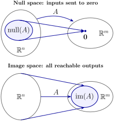

# 2.3 Subspaces {#23-subspaces}

!!! note "译文与来源"

    本页为教材公开源文件 v0.2 的非官方中文翻译，保留原公式、例题、活动、代码和习题；例题与活动等编号按本地小节重排，解答和证明可点击展开；正文与标题中的数学专有名词保留英文，中文用于解释；术语表保留中英对照以便查阅。原文作者：Jacob Denson、Kaitlyn Phillipson、Sebastien Roch。除另有注明的插图外，译文遵循 [CC BY-NC-SA 4.0](https://creativecommons.org/licenses/by-nc-sa/4.0/)。[阅读英文原文](2-3.md#sec-u2-subspaces)。

## Definition and first examples {#definition-and-first-examples}

一个 matrix 的全部可达输出构成 subspace；所有被它映射到零的输入也构成 subspace。先给出 subspace 的定义，再分别研究这两类集合。

直线可以位于平面内，平面也可以位于三维空间内。subspace 用代数条件刻画其中一类特殊集合：它必须包含原点，并且在做 vector addition 和 scalar multiplication 后仍留在集合内。这里使用的 $\mathbb{R}^n$ 记号见 [vector 的定义](1-1.md#def-1-0-scalars-and-vectors)。

**定义 2.3.1：subspace**

$\mathbb{R}^n$ 中 vector 的集合 $U$ 如果满足以下属性，则称为 $\mathbb{R}^n$ 的 subspace： 
- zero vector （写为 $\mathbf{0}$）位于 $U$ 中。

- 如果 $\mathbf{x}$ 在 $U$ 中且 $y$ 在 $U$ 中，则 $\mathbf{x} + \mathbf{y}$ 在 $U$ 中。这意味着 $U$ 在加法下是封闭的。

- 如果 $\mathbf{x}$ 在 $U$ 中，则对于每个 scalar $a$，$a \mathbf{x}$ 在 $U$ 中。这意味着 $U$ 在 scalar multiplication 下是 closed set。

**说明：subspace 在 linear combination 下是封闭的**

令 $U$ 为 subspace。如果$\mathbf{u},\mathbf{v}\in U$和$a,b\in\mathbb{R}$， scalar multiplication 下的闭包给出$a\mathbf{u}\in U$和$b\mathbf{v}\in U$。加法下的闭包则给出 

$$
a\mathbf{u}+b\mathbf{v}\in U.
$$

更一般地，如果$\mathbf{u}_1,\ldots,\mathbf{u}_k\in U$和$c_1,\ldots,c_k\in\mathbb{R}$，则每个 vector $c_i\mathbf{u}_i$位于$U$中。一次将这些 vector 相加表明 

$$
c_1\mathbf{u}_1+\cdots+c_k\mathbf{u}_k\in U.
$$

因此， subspace 中 vector 的每个有限 linear combination 都保留在该 subspace 中。

**例题 2.3.1**

整个集合$\mathbb{R}^n$是它自己的一个 subspace。

**例题 2.3.2**

仅包含 zero vector 的集合，即集合$\{ \mathbf{0} \}$，是$\mathbb{R}^n$的 subspace （称为平凡 subspace 或零 subspace）。

**活动 2.3.1：zero vector 和 subspace 条件 (U2-LO4)**

验证 $\{ \mathbf{0} \}$ 是 $\mathbb{R}^n$ 的 subspace。

??? success "解答"

    要验证$\{ \mathbf{0} \}$是 subspace，我们必须验证三个属性： 包含 zero vector：零$\mathbf{0}$显然是$\{ \mathbf{0} \}$的元素。
    加法下的闭包：如果$\mathbf{x}, \mathbf{y} \in \{ \mathbf{0} \}$，则$\mathbf{x} = 0$和$\mathbf{y} = 0$，所以$\mathbf{x} + \mathbf{y} = 0$，它是$\{ \mathbf{0} \}$的元素。
     scalar multiplication 下的闭包：如果$\mathbf{x} \in \{ \mathbf{0} \}$和$a$是 scalar，则$\mathbf{x} = 0$和$a\mathbf{x} = a \mathbf{0} = 0$在$\{ \mathbf{0} \}$中。
     由于$\{ \mathbf{0} \}$满足所有三个必要条件，因此它是一个 subspace。

**定义 2.3.2：真 subspace**

除$\mathbb{R}^n$或$\{ 0 \}$之外的任何$\mathbb{R}^n$ subspace 都是$\mathbb{R}^n$的真 subspace。

**例题 2.3.3**

$\mathbb{R}^3$中通过原点的平面和直线都是$\mathbb{R}^3$的 subspace。

**例题 2.3.4：通过原点的直线和平面 (U2-LO4)**

**问题**

验证 $\mathbb{R}^3$ 中经过原点的平面都是 $\mathbb{R}^3$ 的真 subspace。

??? success "解答"

    令 $R$ 为通过原点的平面。那么存在 scalar $a,b,c$，不全为零，使得$R$是满足方程$ax + by + cz = 0$的点集$(x,y,z)$。 vector 
    
    $$
    \mathbf{n} = \begin{bmatrix} a \\ b \\ c \end{bmatrix}
    $$
    
    是平面的 normal vector，我们可以将$R$写为 vector $\mathbf{v} \in \mathbb{R}^3$的集合，使得$\mathbf{n} \cdot \mathbf{v} = 0$。

    让我们验证$R$满足作为 subspace 的条件： $\mathbf{0} \in R$因为$\mathbf{n} \cdot \mathbf{0} = 0$。
    
    如果$\mathbf{v} \in R$和$\mathbf{w} \in R$，那么要验证$\mathbf{v} + \mathbf{w} \in R$，我们必须论证$\mathbf{n} \cdot ( \mathbf{v} + \mathbf{w}) = 0$。确实，
    
    $$
    \mathbf{n} \cdot (\mathbf{v} + \mathbf{w}) = \mathbf{n} \cdot \mathbf{v} + \mathbf{n} \cdot \mathbf{w} = 0
    $$
    
    
    如果$\mathbf{v} \in R$和$a$是 scalar，为了验证$a \mathbf{v} \in R$，我们必须论证$\mathbf{n} \cdot (a \mathbf{v}) = 0$。确实，
    
    $$
    \mathbf{n} \cdot (a \mathbf{v}) = a ( \mathbf{n} \cdot \mathbf{v}) = a (0) = 0
    $$
    
    
     我们已经验证了$R$作为 subspace 所需的三个属性。

**问题**

验证 $\mathbb{R}^3$ 中通过原点的线是 $\mathbb{R}^3$ 的 subspace。

??? success "解答"

    令 $L$ 为穿过 $\mathbb{R}^3$ 中原点的线。如果$L$有方向 vector $\mathbf{d}$，则$L = \{ t \mathbf{d}: t \in \mathbb{R} \}$，即线$L$由$\mathbf{d}$的所有 scalar 倍数组成。

    让我们验证 $L$ 满足成为 subspace 的条件： $\mathbf{0} \in L$因为$\mathbf{0} = 0 \mathbf{d}$。
    
    假设$\mathbf{v} \in L$和$\mathbf{w} \in L$。那么$\mathbf{v}$和$\mathbf{w}$都是$\mathbf{d}$的 scalar 倍数，即$\mathbf{v} = t_1 \mathbf{d}$和$\mathbf{w} = t_2 \mathbf{d}$。然后
    
    $$
    \mathbf{v} + \mathbf{w} = t_1 \mathbf{d} + t_2 \mathbf{d} = (t_1 + t_2) \mathbf{d}
    $$
    
    因此$\mathbf{v} + \mathbf{w}$是$\mathbf{d}$的 scalar 倍数，因此$\mathbf{v} + \mathbf{w} \in L$。
    
    如果$\mathbf{v} \in L$和$a$是 scalar，那么我们可以写$\mathbf{v} = t \mathbf{d}$，然后写
    
    $$
    a \mathbf{v} = a (t\mathbf{d}) = (at) \mathbf{d}
    $$
    
    所以$a \mathbf{v}$是$\mathbf{d}$的 scalar 倍数，因此$a \mathbf{v} \in L$。
    
     我们已经验证了 $L$ 成为 subspace 所需的三个属性。

**说明**

$\mathbb{R}^3$中不经过原点的直线和平面不是$\mathbb{R}^3$的 subspace。尽管如此，如果$\Pi$是一个平面，并且我们考虑 displacement vector 

$$
\Delta\Pi = \{ \mathbf{v}_1 - \mathbf{v}_0 : \mathbf{v}_0,\mathbf{v}_1 \in \Pi \}
$$

的集合，那么$\Delta\Pi$形成一个穿过原点的平面，$\mathbb{R}^3$也是一个 subspace。类似的结果适用于由不通过原点的线给出的 displacement vector 集。

**例题 2.3.5：coordinate 上的乘积状况 (U2-LO4)**

证明集合

$$
U = \left\{ \begin{bmatrix} x_1 \\ x_2 \end{bmatrix} : x_1 x_2 = 0 \right\}
$$

不是$\mathbb{R}^2$的 subspace。

??? success "解答"

    只要证明成为 subspace 所需的条件之一不成立就足够了。 $U$确实包含 zero vector，并且$is$在 scalar multiplication 下封闭。但$U$在加法下并不封闭。定义
    
    $$
    \mathbf{x} = \begin{bmatrix} 1 \\ 0 \end{bmatrix} \quad\text{and}\quad \mathbf{y} = \begin{bmatrix} 0 \\ 1 \end{bmatrix}
    $$
    
    然后是$\mathbf{x} \in U$和$\mathbf{y} \in U$。但自$(1)(1) \neq 0$以来，
    
    $$
    \mathbf{x} + \mathbf{y} = \begin{bmatrix} 1 \\ 1 \end{bmatrix}
    $$
    
    不在$U$中。由于$U$在加法下无法闭合，因此它不是$\mathbb{R}^2$的 subspace。

**活动 2.3.2：由两个参数描述的集合 (U2-LO4)**

令$W$为$\mathbb{R}^3$中所有 vector 的集合，其形式为

$$
\begin{bmatrix} r \\ s \\ r + 2s \end{bmatrix}
$$

其中$r,s \in \mathbb{R}$。 $W$ 是 $\mathbb{R}^3$ 的真 subspace 吗？

??? success "解答"

    我们检查所需的属性是否成立才能成为 subspace：$W$
    
    
    
    $$
    \mathbf{0} = \begin{bmatrix} r \\ s \\ r + 2s \end{bmatrix}
    $$
    
    
    
    $r = 0$
    
    $s = 0$
    
    
    
    $$
    \mathbf{v} = \begin{bmatrix} r_1 \\ s_1 \\ r_1 + 2s_1 \end{bmatrix} \quad\text{and}\quad \mathbf{w} = \begin{bmatrix} r_2 \\ s_2 \\ r_2 + 2s_2 \end{bmatrix}
    $$
    
    
    
    
    
    $$
    \begin{aligned}
    \mathbf{v} + \mathbf{w} & = \begin{bmatrix} r_1 + r_2 \\ s_1 + s_2 \\ r_1 + 2s_1 + r_2 + 2s_2 \end{bmatrix} \\
    & = \begin{bmatrix} r_1 + r_2 \\ s_1 + s_2 \\ (r_1 + r_2) + 2(s_1 + s_2) \end{bmatrix} \\
    & = \begin{bmatrix} r \\ s \\ r + 2s \end{bmatrix}
    \end{aligned}
    $$
    
    
    
    $r = r_1 + r_2$
    
    $s = s_1 + s_2$
    
    $\mathbf{v} + \mathbf{w} \in W$
    
    
    
    $$
    \mathbf{v} = \begin{bmatrix} r_1 \\ s_1 \\ r_1 + 2s_1 \end{bmatrix}
    $$
    
    
    
    $c$
    
    
    
    $$
    c \mathbf{v} = \begin{bmatrix} cr_1 \\ cs_1 \\ c(r_1 + 2s_1) \end{bmatrix} = \begin{bmatrix} r \\ s \\ r + 2s \end{bmatrix}
    $$
    
    
    
    $r = cr_1$
    
    $s = cs_1$
    
    $c \mathbf{v} \in W$
    
    因此$W$是$\mathbb{R}^3$的 subspace。

    为了检查$W$是$\mathbb{R}^3$的真 subspace，我们必须证明$W \neq \mathbb{R}^3$和$W \neq \{ \mathbf{0} \}$。 vector 
    
    $$
    \begin{bmatrix} 1 \\ 1 \\ 1 \end{bmatrix}
    $$
    
    不在$W$中，因为如果它的形式为
    
    $$
    \begin{bmatrix} r \\ s \\ r + 2s \end{bmatrix}
    $$
    
    那么$r = 1$和$s = 1$，第三个条目必须是$3$。因此$W$不包含所有 vector，因此不能等于$\mathbb{R}^3$。但它也包含一些nonzero vector，例如
    
    $$
    \begin{bmatrix} 1\\ 1 \\ 3 \end{bmatrix}
    $$
    
    $W \neq \{ \mathbf{0} \}$。

    因此$W$是$\mathbb{R}^3$的真 subspace。

**说明**

要显示集合是 subspace，你往往需要 parameterization 集合的所有元素，以显示它们都满足某些属性（加法或 scalar multiplication 下的闭包），因此你的参数应该使用变量。要证明集合不是 subspace，你需要找到一个或多个反例来表明某些属性并不适用于所有元素；通常一个明确的反例就足够了。

## Null space and image space {#null-space-and-image-space}

以下重要示例代表了描述 subspace 的两种规范方法。

**定义 2.3.3：null space 与 image space**

设 $A$ 是一个 $m \times n$  matrix。$A$ 的 null space 记作 $\operatorname{null}(A)$，由所有满足方程 $A \mathbf{x} = \mathbf{0}$ 的输入 vector $\mathbf{x}$ 组成，这些输入属于 $\mathbb{R}^n$，即 

$$
\operatorname{null}(A) = \{ \mathbf{x} \in \mathbb{R}^n : A \mathbf{x} = \mathbf{0} \}
$$

$A$ 的 image space 记作 $\operatorname{im}(A)$，由所有使 $A\mathbf{x} = \mathbf{y}$ 有解的输出 vector $\mathbf{y}$ 组成，其中这些 vector 属于 $\mathbb{R}^m$，即 

$$
\operatorname{im}(A) = \{ A\mathbf{x} : \mathbf{x} \in \mathbb{R}^n \}
$$

**说明**

null space 位于输入空间中。它记录$A$发送到$\mathbf{0}$的输入方向。

image space 位于输出空间中。它记录了$A$可以达到的输出。

**表 2.3.1**

| 对象 | 住在 | 如何阅读 |
|---|---|---|
| $\operatorname{null}(A)$ | $\mathbb R^n$ | 输入方向$A$发送至$\mathbf{0}$ |
| $\operatorname{im}(A)$ | $\mathbb R^m$ | 输出$A$可以达到 |

* null space 由被映到 zero vector 的输入组成； image space 由输入空间能够到达的所有输出组成。*

**活动 2.3.3：用 subspace 重新描述忽略高度的映射 (U2-LO3)**

返回[忽略高度的映射 (U2-LO1, U2-LO3)](2-1.md#u2-act-preview-forgets-depth)。让

$$
P=
          \begin{bmatrix}
          1&0&0\\
          0&1&0
          \end{bmatrix}.
$$

描述输出 subspace 和$P$发送到$\mathbf{0}$的输入方向 subspace。

??? success "解答"

    
    
    $$
    \mathbf{x}
              =
              \begin{bmatrix}
              x\\
              y\\
              z
              \end{bmatrix},
              \qquad
              P\mathbf{x}
              =
              \begin{bmatrix}
              x\\
              y
              \end{bmatrix}.
    $$
    
    

    由于$x$和$y$自由变化，$\mathbb R^2$中的每个 vector 都作为输出出现。所以
    
    $$
    \operatorname{im}(P)=\mathbb R^2.
    $$
    
    

    $P$发送到$\mathbf{0}$的指令是$P\mathbf{x}=\mathbf{0}$的解。这需要
    
    $$
    x=0,\qquad y=0,
    $$
    
    而$z$是 free variable。因此
    
    $$
    \operatorname{null}(P)
              =
              \left\{
              \begin{bmatrix}
              0\\
              0\\
              t
              \end{bmatrix}
              :
              t\in\mathbb R
              \right\}.
    $$
    
    这个 subspace 记录了高度方向。

**定理 2.3.1**

对于任何$m \times n$ matrix，$A$的 null space 是$\mathbb{R}^n$的 subspace，$A$的 image space 是$\mathbb{R}^m$的 subspace。

??? info "证明"

    我们首先证明 $A$ 的 null space 是一个 subspace。回想一下[原教材相关内容](1-3.md#thm-2-2-distributive-properties)中讨论的属性：$\mathbf{0} \in \operatorname{null}(A)$因为$\mathbf{A} \mathbf{0} = \mathbf{0}$。
    
    假设$\mathbf{v} \in \operatorname{null}(A)$和$\mathbf{w} \in \operatorname{null}(A)$。然后是$A \mathbf{v} = \mathbf{0}$和$A \mathbf{w} = \mathbf{0}$。所以
    
    $$
    A (\mathbf{v} + \mathbf{w}) = A \mathbf{v} + A \mathbf{w} = \mathbf{0} + \mathbf{0} = \mathbf{0}
    $$
    
    因此$\mathbf{v} + \mathbf{w} \in \operatorname{null}(A)$。
    
    如果 $\mathbf{v} \in \operatorname{null}(A)$ 且 $a$ 是 scalar，则 
    
    $$
    A(a \mathbf{v}) = a (A \mathbf{v}) = a \mathbf{0} = \mathbf{0}
    $$
    
    因此$a \mathbf{v} \in \operatorname{null}(A)$。
    
    所以$\operatorname{null}(A)$是$\mathbb{R}^n$的 subspace。

    接下来，我们证明 $\operatorname{im}(A)$ 是一个 subspace。 $\mathbf{0} \in \operatorname{im}(A)$因为$\mathbf{A} \mathbf{0} = \mathbf{0}$。
    
    假设$\mathbf{v} \in \operatorname{im}(A)$和$\mathbf{w} \in \operatorname{im}(A)$。那么方程$A\mathbf{x} = \mathbf{v}$和$A \mathbf{x} = \mathbf{w}$都有解，即存在$\mathbf{x}_1$和$\mathbf{x}_2$使得$A\mathbf{x}_1 = \mathbf{v}$和$A\mathbf{x}_2 = \mathbf{w}$。然后
    
    $$
    A(\mathbf{x}_1 + \mathbf{x}_2) = A\mathbf{x}_1 + A\mathbf{x}_2 = \mathbf{v} + \mathbf{w}
    $$
    
    所以方程$A \mathbf{x} = \mathbf{v} + \mathbf{w}$有解，所以$\mathbf{v} + \mathbf{w} \in \operatorname{im}(A)$。
    
    如果 $\mathbf{v} \in \operatorname{im}(A)$ 和 $a$ 是 scalar，那么我们可以将某些 $\mathbf{x}_1$ 写为 $\mathbf{v} = A\mathbf{x}_1$。但是
    
    $$
    A(a\mathbf{x}_1) = a (A\mathbf{x}_1) = a \mathbf{v}
    $$
    
    所以方程$A\mathbf{x} = a \mathbf{v}$有解，所以$a \mathbf{v} \in \operatorname{im}(A)$。
    
     因此$\operatorname{im}(A)$ 是$\mathbb{R}^m$ 的 subspace。

**注意**

$A\mathbf{x}=\mathbf{0}$的解集是一个 subspace。 $A\mathbf{x}=\mathbf{b}$对于$\mathbf{b}\neq\mathbf{0}$的解集通常不是 subspace；当它非空时，它是$\operatorname{null}(A)$的移位副本。

**事实 2.3.1：linear system 的 general solution**

设$A$为$m\times n$ matrix。如果 $\mathbf{x}_p$ 是 $A\mathbf{x}=\mathbf{b}$ 的一个解，则 

$$
\{\mathbf{x}\in\mathbb R^n:A\mathbf{x}=\mathbf{b}\}=\mathbf{x}_p+\operatorname{null}(A).
$$

即，这些解正是 vector $\mathbf{x}_p+\mathbf{z}$ 与 $\mathbf{z}\in\operatorname{null}(A)$。

??? info "证明"

    由于 $A\mathbf{x}_p=\mathbf{b}$，对于任何 $\mathbf{x}\in\mathbb R^n$，
    
    $$
    \begin{aligned}
    A\mathbf{x}=\mathbf{b}&\Longleftrightarrow A(\mathbf{x}-\mathbf{x}_p)=\mathbf{0} \\
    &\Longleftrightarrow \mathbf{x}-\mathbf{x}_p\in\operatorname{null}(A).
    \end{aligned}
    $$
    
     因此 $A\mathbf{x}=\mathbf{b}$ 恰好当 $\mathbf{x}=\mathbf{x}_p+\mathbf{z}$ 对于某些 $\mathbf{z}\in\operatorname{null}(A)$。

从这里开始，齐次方程发挥了特殊的作用。为了通过 row reduction 来求解$A\mathbf{x}=\mathbf{0}$，我们可以编写 augmented matrix $[A\mid \mathbf{0}]$。由于右侧在整个 row operation 中保持为零，因此 coefficient matrix $A$ 携带了基本信息。

## Spanning Sets {#spanning-sets}

虽然 $\mathbb{R}^n$ 的一个 subspace 通常包含无穷多个 vectors，但只需有限个合适的 vectors，就能通过 linear combinations 表示其中的全部元素。

**活动 2.3.4：将参数形式的集合写成 span (U2-LO4)**

回想一下[由两个参数描述的集合 (U2-LO4)](2-3.md#act-5-1-W-proper-subspace)，

$$
W = \left\{ \begin{bmatrix} r \\ s \\ r + 2s \end{bmatrix} : r,s \in \mathbb{R} \right\}.
$$

表明有两个 vector （明确地描述它们），因此$W$中的每个 vector 都可以写成这两个 vector 的 linear combination。

??? success "解答"

    我们可以写
    
    $$
    \begin{bmatrix} r \\ s \\ r + 2s \end{bmatrix} = r \begin{bmatrix} 1 \\ 0 \\ 1 \end{bmatrix} + s \begin{bmatrix} 0 \\ 1 \\ 2 \end{bmatrix}
    $$
    
    因此$W$中的每个 vector 都可以写成
    
    $$
    \begin{bmatrix} 1 \\ 0 \\ 1 \end{bmatrix}\quad\text{and}\quad \begin{bmatrix} 0 \\ 1 \\ 2 \end{bmatrix}
    $$
    
    的 linear combination。

**定义 2.3.4：vector 组的 span**

$\mathbb{R}^n$中一组 vector $\mathbf{x}_1,\dots,\mathbf{x}_k$的所有 linear combination 的集合称为 vector $\mathbf{x}_1,\dots,\mathbf{x}_k$的 span，并表示为

$$
\operatorname{span} \{ \mathbf{x}_1, \dots, \mathbf{x}_k \} = \{ t_1 \mathbf{x}_1 + \cdots + t_k \mathbf{x}_k : t_1,\dots,t_k \in \mathbb{R} \}
$$

如果$V = \operatorname{span} \{ \mathbf{x}_1, \dots, \mathbf{x}_k \}$，我们说$V$由 vector $\mathbf{x}_1,\dots,\mathbf{x}_k$ span，并且 vector $\mathbf{x}_1,\dots,\mathbf{x}_k$ span $V$。

**例题 2.3.6**

回想一下[原教材相关内容](1-3.md#def-2-2-standard-basis)中$\mathbb{R}^n$的 standard basis $\{ \mathbf{e}_1, \dots, \mathbf{e}_n \}$。注意，如果

$$
\mathbf{x} = \begin{bmatrix} x_1 \\ x_2 \\ \vdots \\ x_n \end{bmatrix}
$$

则

$$
\mathbf{x} = x_1 \mathbf{e}_1 + x_2 \mathbf{e}_2 + \dots + x_n \mathbf{e}_n
$$

这意味着$\mathbb{R}^n = \operatorname{span} \{ \mathbf{e}_1,\dots,\mathbf{e}_n \}$。

对于 image space， span vector 来自 matrix 的 column。如果

$$
A=[\mathbf{a}_1\ \mathbf{a}_2\ \cdots\ \mathbf{a}_n]
$$

和

$$
\mathbf{x}
      =
      \begin{bmatrix}
      x_1\\
      x_2\\
      \vdots\\
      x_n
      \end{bmatrix},
$$

则

$$
A\mathbf{x}
      =
      x_1\mathbf{a}_1+x_2\mathbf{a}_2+\cdots+x_n\mathbf{a}_n.
$$

因此每个输出$A\mathbf{x}$都是$A$ column 的 linear combination。

**活动 2.3.5：image space 的 spanning set （U2-LO3、U2-LO4）**

找到 matrix 

$$
A = \begin{bmatrix} 1 & -2 & -4 & 3 \\ 0 & -1 & -3 & 2 \\ 2 & 1 & 7 & -4 \end{bmatrix}
$$

image space 的 spanning set。

??? success "解答"

    让
    
    $$
    \mathbf{x}
            =
            \begin{bmatrix}
            t_1\\
            t_2\\
            t_3\\
            t_4
            \end{bmatrix}.
    $$
    
    然后
    
    $$
    A\mathbf{x}
            =
            t_1
            \begin{bmatrix}
            1\\
            0\\
            2
            \end{bmatrix}
            +
            t_2
            \begin{bmatrix}
            -2\\
            -1\\
            1
            \end{bmatrix}
            +
            t_3
            \begin{bmatrix}
            -4\\
            -3\\
            7
            \end{bmatrix}
            +
            t_4
            \begin{bmatrix}
            3\\
            2\\
            -4
            \end{bmatrix}.
    $$
    
    

    因此， image space 由$A$的 column span：
    
    $$
    \operatorname{im}(A)
            =
            \operatorname{span}
            \left\{
            \begin{bmatrix}
            1\\
            0\\
            2
            \end{bmatrix},
            \begin{bmatrix}
            -2\\
            -1\\
            1
            \end{bmatrix},
            \begin{bmatrix}
            -4\\
            -3\\
            7
            \end{bmatrix},
            \begin{bmatrix}
            3\\
            2\\
            -4
            \end{bmatrix}
            \right\}.
    $$
    
    

    这是一个 spanning set。它并不声称是最小的。

**活动 2.3.6：null space 的 spanning set （U2-LO3、U2-LO4）**

找到 matrix 

$$
A = \begin{bmatrix} 1 & -2 & -4 & 3 \\ 0 & -1 & -3 & 2 \\ 2 & 1 & 7 & -4 \end{bmatrix}
$$

  null space 的 spanning set。

[在消除便签本中练习此活动](https://math345-games.github.io/TheEliminationScratchpad/the_elimination_scratchpad.html?v=1&activity=2.3.25&m=1%2C-2%2C-4%2C3%2C0~0%2C-1%2C-3%2C2%2C0~2%2C1%2C7%2C-4%2C0&vars=x_1%2Cx_2%2Cx_3%2Cx_4&goal=nullspace&back=https%3A%2F%2Fmath345-textbook.github.io%2Fsec-u2-subspaces.html%23sec-u2-spanning-sets-9)

??? success "解答"

    为了解决这个问题，我们首先找到 linear system $A \mathbf{x} = 0$的 basic solution，其中
    
    $$
    \mathbf{x} = \begin{bmatrix} x_1 \\ x_2 \\ x_3 \\ x_4 \end{bmatrix}
    $$
    
    使用高斯消除算法，我们 row reduction：
    
    $$
    \begin{aligned}
    & \begin{bmatrix} 1 & -2 & -4 & 3 \\ 0 & -1 & -3 & 2 \\ 2 & 1 & 7 & -4 \end{bmatrix} \\
    & \xrightarrow{R_3 \to R_3 - 2R_1} \begin{bmatrix} 1 & -2 & -4 & 3 \\ 0 & -1 & -3 & 2 \\ 0 & 5 & 15 & -10 \end{bmatrix} \\
    & \xrightarrow{R_3 \to R_3 + 5R_2} \begin{bmatrix} 1 & -2 & -4 & 3 \\ 0 & -1 & -3 & 2 \\ 0 & 0 & 0 & 0 \end{bmatrix} \\
    & \xrightarrow{R_2 \to -R_2} \begin{bmatrix} 1 & -2 & -4 & 3 \\ 0 & 1 & 3 & -2 \\ 0 & 0 & 0 & 0 \end{bmatrix} \\
    & \xrightarrow{R_1 \to R_1 + 2R_2} \begin{bmatrix} 1 & 0 & 2 & -1 \\ 0 & 1 & 3 & -2 \\ 0 & 0 & 0 & 0 \end{bmatrix}
    \end{aligned}
    $$
    
     free variable 是$x_3$和$x_4$。设定$x_3 = s$和$x_4 = t$，当$x_1 = -2s + t$和$x_2 = -3s + 2t$时，我们得到$A\mathbf{x} = 0$。因此，该方程的 general solution 由 
    
    $$
    \begin{bmatrix} -2s + t \\ -3s + 2t \\ s \\ t \end{bmatrix} = s \begin{bmatrix} -2 \\ -3 \\ 1 \\ 0 \end{bmatrix} + t \begin{bmatrix} 1 \\ 2 \\ 0 \\ 1 \end{bmatrix}
    $$
    
     给出。因此 null space 的范围为 
    
    $$
    \mathbf{v}_1 = \begin{bmatrix} -2 \\ -3 \\ 1 \\ 0 \end{bmatrix} \quad\text{and}\quad \mathbf{v}_2 = \begin{bmatrix} 1 \\ 2 \\ 0 \\ 1 \end{bmatrix}
    $$
    

总结一下：$A\mathbf{x}=\mathbf{0}$的 basic solution 形成$\operatorname{null}(A)$的 spanning set，$A$的 column 形成$\operatorname{im}(A)$的 spanning set。

**定理 2.3.2**

设$U = \operatorname{span} \{ \mathbf{x}_1,\dots,\mathbf{x}_k \}$为$\mathbb{R}^n$中的集合。然后
- $U$ 是$\mathbb{R}^n$ 的 subspace，包含每个 vector $\mathbf{x}_1,\dots,\mathbf{x}_k$。

- 如果$W$是$\mathbb{R}^n$的 subspace，并且每个 vector $\mathbf{x}_1,\dots,\mathbf{x}_k$都在$W$中，则$U$是$W$的子集，即$U \subseteq W$。

??? info "证明"

    定义一个 $n \times k$  matrix $A$，其中 vector $\mathbf{x}_1,\dots,\mathbf{x}_k$ 作为 column。那么$U = \operatorname{im}(A)$，因此是$\mathbb{R}^n$的 subspace。由于$\mathbf{x}_i = A \mathbf{e}_i$对于$1 \leq i \leq k$，集合$U$包含每个 vector $\mathbf{x}_i$。

    相反，假设$W$是$\mathbb{R}^n$和$\mathbf{x}_1,\dots,\mathbf{x}_k \in W$的 subspace。由于$W$在加法和 scalar multiplication 下是 closed set，$\mathbf{x}_1,\dots,\mathbf{x}_k$的所有 linear combination 都是$W$的元素，因此$U \subseteq W$。

**活动 2.3.7：检验 vector 是否属于 span (U2-LO4)**

在$\mathbb{R}^3$中，考虑两个 vector 

$$
\mathbf{v}_1 = \begin{bmatrix} 2 \\1 \\ 1 \end{bmatrix} \quad\text{and}\quad \mathbf{v}_2 = \begin{bmatrix} 1 \\ -1 \\ 3 \end{bmatrix}
$$

判断 vector 

$$
\mathbf{w} = \begin{bmatrix} 1 \\ 5 \\ -7 \end{bmatrix}
$$

是否属于$\operatorname{span} \{ \mathbf{v}_1, \mathbf{v}_2 \}$。

??? success "解答"

    我们需要确定$\mathbf{w}$是否是 vector $\mathbf{v}_1$和$\mathbf{v}_2$的 linear combination，即是否可以找到 scalar $a$和$b$使得$\mathbf{w} = a \mathbf{v}_1 + b \mathbf{v}_2$。比较方程两边的 vector 项，我们得到$a$和$b$的方程组，即
    
    $$
    \begin{aligned}
    2a + b & = 1 \\
    a - b & = 5 \\
    a + 3b & = -7
    \end{aligned}
    $$
    
    

    [在《消除便签本》中练习这个系统](https://math345-games.github.io/TheEliminationScratchpad/the_elimination_scratchpad.html?v=1&activity=2.3.27&m=2%2C1%2C1~1%2C-1%2C5~1%2C3%2C-7&vars=a%2Cb&goal=ref&back=https%3A%2F%2Fmath345-textbook.github.io%2Fsec-u2-subspaces.html%23sec-u2-spanning-sets-8)

    对 augmented matrix 应用 Gaussian elimination： 
    
    $$
    \left[\begin{array}{cc|c}
              2 & 1 & 1 \\
              1 & -1 & 5 \\
              1 & 3 & -7
              \end{array}\right].
    $$
    
     第 1 column 中的第一个条目已经非零。在[Gaussian elimination 算法](2-2.md#alg-gaussian-elimination)之后，首先缩放第1行以获得前导 row，然后消除其下面的条目。对剩余行重复此过程：
    
    $$
    \begin{aligned}
    R_1\to \tfrac{1}{2}R_1 \quad &
                \left[\begin{array}{cc|c}
                1 & \tfrac{1}{2} & \tfrac{1}{2} \\
                1 & -1 & 5 \\
                1 & 3 & -7
                \end{array}\right] \\
    \substack{R_2\to R_2-R_1\\R_3\to R_3-R_1} \quad &
                \left[\begin{array}{cc|c}
                1 & \tfrac{1}{2} & \tfrac{1}{2} \\
                0 & -\tfrac{3}{2} & \tfrac{9}{2} \\
                0 & \tfrac{5}{2} & -\tfrac{15}{2}
                \end{array}\right] \\
    R_2\to -\tfrac{2}{3}R_2 \quad &
                \left[\begin{array}{cc|c}
                1 & \tfrac{1}{2} & \tfrac{1}{2} \\
                0 & 1 & -3 \\
                0 & \tfrac{5}{2} & -\tfrac{15}{2}
                \end{array}\right] \\
    R_3\to R_3-\tfrac{5}{2}R_2 \quad &
                \left[\begin{array}{cc|c}
                1 & \tfrac{1}{2} & \tfrac{1}{2} \\
                0 & 1 & -3 \\
                0 & 0 & 0
                \end{array}\right].
    \end{aligned}
    $$
    
    

    最后一行代表$0=0$，因此它没有施加任何附加条件。第二行给出$b=-3$。 back-substitution 到第一行$a+\tfrac{1}{2}b=\tfrac{1}{2}$，得到$a=\tfrac{1}{2}-\tfrac{1}{2}b=2$。因此系统是相容的，解$a=2$和$b=-3$。因此$\mathbf{w}=2\mathbf{v}_1-3\mathbf{v}_2$，所以$\mathbf{w}$属于$\operatorname{span}\{\mathbf{v}_1,\mathbf{v}_2\}$。

**活动 2.3.8：检验 vector 是否属于另一个 span (U2-LO4)**

在$\mathbb{R}^3$中，考虑两个 vector 

$$
\mathbf{v}_1 = \begin{bmatrix} 1 \\ 1 \\ 1 \end{bmatrix} \quad\text{and}\quad \mathbf{v}_2 = \begin{bmatrix} 0 \\ 1 \\ 2 \end{bmatrix}
$$

判断 vector 

$$
\mathbf{w} = \begin{bmatrix} 1 \\ 2 \\ 4 \end{bmatrix}
$$

是否属于$\operatorname{span} \{ \mathbf{v}_1, \mathbf{v}_2 \}$。

??? success "解答"

    我们寻找 scalar $a$ 和 $b$ 使得 $\mathbf{w}=a\mathbf{v}_1+b\mathbf{v}_2$。比较 coordinate 给出系统
    
    $$
    \begin{aligned}
    a & = 1 \\
    a+b & = 2 \\
    a+2b & = 4
    \end{aligned}
    $$
    
    

    [在《消除便签本》中练习这个系统](https://math345-games.github.io/TheEliminationScratchpad/the_elimination_scratchpad.html?v=1&activity=2.3.28&m=1%2C0%2C1~1%2C1%2C2~1%2C2%2C4&vars=a%2Cb&goal=ref&back=https%3A%2F%2Fmath345-textbook.github.io%2Fsec-u2-subspaces.html%23u2-act-vector-outside-span)

    对 augmented matrix 应用 Gaussian elimination： 
    
    $$
    \left[\begin{array}{cc|c}
              1 & 0 & 1 \\
              1 & 1 & 2 \\
              1 & 2 & 4
              \end{array}\right].
    $$
    
     在 [Gaussian elimination 算法](2-2.md#alg-gaussian-elimination) 之后，消去第 1 column 和第 2 column 中 pivot 下方的内容： 
    
    $$
    \begin{aligned}
    \substack{R_2\to R_2-R_1\\R_3\to R_3-R_1} \quad &
                \left[\begin{array}{cc|c}
                1 & 0 & 1 \\
                0 & 1 & 1 \\
                0 & 2 & 3
                \end{array}\right] \\
    R_3\to R_3-2R_2 \quad &
                \left[\begin{array}{cc|c}
                1 & 0 & 1 \\
                0 & 1 & 1 \\
                0 & 0 & 1
                \end{array}\right].
    \end{aligned}
    $$
    
    

    最后一行代表$0=1$，所以系统不相容。因此$\mathbf{w}$不属于$\operatorname{span}\{\mathbf{v}_1,\mathbf{v}_2\}$。

**事实 2.3.2：span 与可解性**

令 $A$ 为包含 column $\mathbf{c}_1,\ldots,\mathbf{c}_n$ 的 $m\times n$  matrix。那么$A\mathbf{x}=\mathbf{b}$对于每个$\mathbf{b}\in\mathbb{R}^m$都有一个解当且仅当$\operatorname{span}\{\mathbf{c}_1,\ldots,\mathbf{c}_n\}=\mathbb{R}^m$。

??? info "证明"

    正如[ matrix column 的早期讨论](2-3.md#sec-u2-spanning-sets-5)、
    
    $$
    A\mathbf{x}=x_1\mathbf{c}_1+\cdots+x_n\mathbf{c}_n.
    $$
    
    中所述，因此当$\mathbf{b}$是$A$的 column 的 linear combination 时，$A\mathbf{x}=\mathbf{b}$有一个解。到[ vector 组的 span ](2-3.md#def-5-1-span)，当 column span $\mathbb{R}^m$时，这对于每个$\mathbf{b}\in\mathbb{R}^m$都成立。

下一节研究 spanning set 何时具有冗余 vector 以及如何删除它们。

