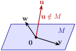
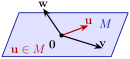
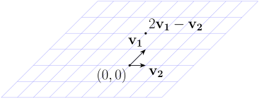

# 2.4 Independence, bases, and dimension {#24-independence-bases-and-dimension}

!!! note "译文与来源"

    本页为教材公开源文件 v0.2 的非官方中文翻译，保留原公式、例题、活动、代码和习题；例题与活动等编号按本地小节重排，解答和证明可点击展开；正文与标题中的数学专有名词保留英文，中文用于解释；术语表保留中英对照以便查阅。原文作者：Jacob Denson、Kaitlyn Phillipson、Sebastien Roch。除另有注明的插图外，译文遵循 [CC BY-NC-SA 4.0](https://creativecommons.org/licenses/by-nc-sa/4.0/)。[阅读英文原文](2-4.md#sec-u2-independence-bases-dimension)。


<a id="sec-u2-independence-bases-dimension"></a>


<a id="sec-u2-linear-independence"></a>

## Linear independence {#linear-independence}

**活动 2.4.1：比较两个 spanning set (U2-LO4)**

在[由两个参数描述的集合 (U2-LO4)](2-3.md#act-5-1-W-proper-subspace)中，我们证明集合

$$
W = \left\{ \begin{bmatrix} r \\ s \\ r + 2s \end{bmatrix} : r,s \in \mathbb{R} \right\}
$$

是一个 subspace。在[将参数形式的集合写成 span (U2-LO4)](2-3.md#act-5-1-W-Span)中，我们证明了集合

$$
S = \left\{ \begin{bmatrix} 1 \\ 0 \\ 1 \end{bmatrix}, \begin{bmatrix} 0 \\ 1 \\ 2 \end{bmatrix} \right\}
$$

是$W$的 spanning set。该集合

$$
T = \left\{ \begin{bmatrix} 1 \\ 0 \\ 1 \end{bmatrix}, \begin{bmatrix} 2 \\ 0 \\ 2 \end{bmatrix}, \begin{bmatrix} 0 \\ 1 \\ 2 \end{bmatrix}, \begin{bmatrix} 1 \\ 1 \\ 3 \end{bmatrix} \right\}
$$

还 span $W$。但为什么$S$“更好”呢？

??? success "解答"

    它使用更少的 vector 来 span 相同的空间。 $T$ 中哪些 vector 是冗余的？ 
    
    $$
    \begin{bmatrix} 2 \\ 0 \\ 2 \end{bmatrix}
              =
              2\begin{bmatrix} 1 \\ 0 \\ 1 \end{bmatrix},
              \qquad
              \begin{bmatrix} 1 \\ 1 \\ 3 \end{bmatrix}
              =
              \begin{bmatrix} 1 \\ 0 \\ 1 \end{bmatrix}
              +
              \begin{bmatrix} 0 \\ 1 \\ 2 \end{bmatrix}.
    $$
    
     所以$T$ span 了$W$，但是它包含了重复的信息。

    例如，$T$中列出的前三个 vector 的和可以重写为
    
    $$
    \begin{bmatrix} 1 \\ 0 \\ 1 \end{bmatrix}
              + \begin{bmatrix} 2 \\ 0 \\ 2 \end{bmatrix}
              + \begin{bmatrix} 0 \\ 1 \\ 2 \end{bmatrix}
              = 3\begin{bmatrix} 1 \\ 0 \\ 1 \end{bmatrix}
              + \begin{bmatrix} 0 \\ 1 \\ 2 \end{bmatrix}.
    $$
    
    右侧是$S$中两个 vector 的 linear combination。

subspace $U$有许多不同的 spanning set。我们使用 linear independence 的概念来确定何时生成 vector 集是“最有效的”。用数据术语来说， linear independence 是指一个特征方向是否已经从其他方向构建出来。


<a id="def-5-2-linear-indepdendence"></a>

**定义 2.4.1：linear independence**

设 $\{ \mathbf{x}_1, \dots, \mathbf{x}_k \}$ 是 $\mathbb{R}^n$ 中的一组 vectors。若方程 $t_1 \mathbf{x}_1 + \dots + t_k \mathbf{x}_k = \mathbf{0}$ 只有 trivial solution $t_1 = \cdots = t_k = 0$，就称这组 vectors linearly independent；若存在 nontrivial solution，则称它们 linearly dependent。

$\mathbb{R}^n$ 中的一组 vector $\{ \mathbf{x}_1, \dots, \mathbf{x}_k \}$ 是 linearly dependent 的，如果它不是 linearly independent 的，即，如果存在 scalar $t_1,\dots,t_k$，但不全为零，使得 $t_1 \mathbf{x}_1 + \cdots + t_k \mathbf{x}_k = \mathbf{0}$。


<a id="rem-u2-zero-vector-dependent"></a>

**注：linearly independent 列表不能包含 zero vector**

任何包含 $\mathbf{0}$ 的列表都是 linearly dependent 的。给出 zero vector coefficient $1$和其他所有 vector coefficient $0$：

$$
1\cdot\mathbf{0}+0\mathbf{x}_2+\cdots+0\mathbf{x}_k=\mathbf{0}.
$$

这个 linear combination 等于 zero vector，但它的 coefficient 不全为零。


<a id="act-u2-independence-two-vectors"></a>

**活动 2.4.2：两个 vector 的相关性 (U2-LO4)**

令$\mathbf{u}$和$\mathbf{v}$为$\mathbb{R}^n$中的两个nonzero vector。解释为什么 $\{\mathbf{u},\mathbf{v}\}$ 是 linearly dependent 的当且仅当 $\mathbf{u}$ 和 $\mathbf{v}$ 平行，即一个 vector 是另一个 vector 的 scalar 倍数。

??? success "解答"

    如果 vector 是平行的，例如 $\mathbf{v}=c\mathbf{u}$，则 
    
    $$
    c\mathbf{u}-\mathbf{v}=\mathbf{0}.
    $$
    
      coefficient $c$ 和 $-1$ 不均为零，因此 vector 是 linearly dependent 的。

    相反，假设 vector 是 linearly dependent 的。然后 
    
    $$
    s\mathbf{u}+t\mathbf{v}=\mathbf{0}
    $$
    
     对于不为零的 scalar $s$ 和 $t$。我们必须有$t\ne 0$：否则$s\mathbf{u}=\mathbf{0}$，并且从$\mathbf{u}\ne\mathbf{0}$开始，这也会强制$s=0$。因此 
    
    $$
    \mathbf{v}=-\frac{s}{t}\mathbf{u},
    $$
    
     所以一个 vector 是另一个 vector 的 scalar 倍数，并且 vector 是平行的。


<a id="sec-u2-linear-independence-5"></a>

**例题 2.4.1：测试三个 dimension 的 linear independence (U2-LO4)**

确定 vector 

$$
\mathbf{v}_1 = \begin{bmatrix} 3 \\ 2 \\ 2 \end{bmatrix} \quad \mathbf{v}_2 = \begin{bmatrix} 1 \\ 3 \\ 0 \end{bmatrix} \quad \mathbf{v}_3 = \begin{bmatrix} -1 \\ 4 \\ -2 \end{bmatrix}
$$

是否 linearly independent。

??? success "解答"

    我们需要确定方程 $t_1 \mathbf{v}_1 + t_2 \mathbf{v}_2 + t_3 \mathbf{v}_3 = \mathbf{0}$ 的解。展开这个方程得到系统
    
    $$
    \begin{aligned}
    3t_1 + t_2 - t_3 & = 0 \\
    2t_1 + 3t_2 + 4t_3 & = 0 \\
    2t_1 + 0t_2 - 2t_3 & = 0
    \end{aligned}
    $$
    

    [在《消除便签本》中练习这个系统](https://math345-games.github.io/TheEliminationScratchpad/the_elimination_scratchpad.html?v=1&activity=2.4.5&m=3%2C1%2C-1%2C0~2%2C3%2C4%2C0~2%2C0%2C-2%2C0&vars=t_1%2Ct_2%2Ct_3&goal=classify&back=https%3A%2F%2Fmath345-textbook.github.io%2Fsec-u2-independence-bases-dimension.html%23sec-u2-linear-independence-5)

    我们使用Gaussian elimination 算法求解这个homogeneous system。首先，我们创建 augmented matrix 
    
    $$
    \left[\begin{array}{ccc|c}
              3 & 1 & -1 & 0 \\
              2 & 3 & 4 & 0 \\
              2 & 0 & -2 & 0
              \end{array}\right]
    $$
    
     我们将 matrix 简化为 row echelon form，在消除其下方的条目之前缩放每个 pivot 行以获得leading entry： 
    
    $$
    \begin{aligned}
    & \left[\begin{array}{ccc|c}
                3 & 1 & -1 & 0 \\
                2 & 3 & 4 & 0 \\
                2 & 0 & -2 & 0
                \end{array}\right] \\
    & \xrightarrow{R_1\to \frac{1}{3}R_1}
                \left[\begin{array}{ccc|c}
                1 & \frac{1}{3} & -\frac{1}{3} & 0 \\
                2 & 3 & 4 & 0 \\
                2 & 0 & -2 & 0
                \end{array}\right] \\
    & \xrightarrow{\substack{R_2\to R_2-2R_1\\R_3\to R_3-2R_1}}
                \left[\begin{array}{ccc|c}
                1 & \frac{1}{3} & -\frac{1}{3} & 0 \\
                0 & \frac{7}{3} & \frac{14}{3} & 0 \\
                0 & -\frac{2}{3} & -\frac{4}{3} & 0
                \end{array}\right] \\
    & \xrightarrow{R_2\to \frac{3}{7}R_2}
                \left[\begin{array}{ccc|c}
                1 & \frac{1}{3} & -\frac{1}{3} & 0 \\
                0 & 1 & 2 & 0 \\
                0 & -\frac{2}{3} & -\frac{4}{3} & 0
                \end{array}\right] \\
    & \xrightarrow{R_3\to R_3+\frac{2}{3}R_2}
                \left[\begin{array}{ccc|c}
                1 & \frac{1}{3} & -\frac{1}{3} & 0 \\
                0 & 1 & 2 & 0 \\
                0 & 0 & 0 & 0
                \end{array}\right]
    \end{aligned}
    $$
    
     该 matrix 对应有一个 free variable，这意味着方程有一个 basic solution，因此系统有一个nontrivial解。因此 vector 不是 linearly independent 的。


<a id="act-u2-dependent-nonparallel-vectors"></a>

**活动 2.4.3：测试三个非平 row vector 的 linear independence (U2-LO4)**

使用 Gaussian elimination 判断 vector 

$$
\mathbf{v}_1=\begin{bmatrix}1\\0\\1\end{bmatrix},
          \qquad
          \mathbf{v}_2=\begin{bmatrix}0\\1\\1\end{bmatrix},
          \qquad
          \mathbf{v}_3=\begin{bmatrix}1\\1\\2\end{bmatrix}
$$

是否 linearly independent。如果它们是相关的，则给出它们的nontrivial linear combination，其等于 $\mathbf{0}$。

[在消除便签本中练习此活动](https://math345-games.github.io/TheEliminationScratchpad/the_elimination_scratchpad.html?v=1&activity=2.4.6&m=1%2C0%2C1%2C0~0%2C1%2C1%2C0~1%2C1%2C2%2C0&vars=t_1%2Ct_2%2Ct_3&goal=classify&back=https%3A%2F%2Fmath345-textbook.github.io%2Fsec-u2-independence-bases-dimension.html%23act-u2-dependent-nonparallel-vectors)

??? success "解答"

    我们确定 $t_1\mathbf{v}_1+t_2\mathbf{v}_2+t_3\mathbf{v}_3=\mathbf{0}$ 是否有nontrivial解。比较 coordinate 得到
    
    $$
    \begin{aligned}
    t_1+t_3&=0 \\
    t_2+t_3&=0 \\
    t_1+t_2+2t_3&=0.
    \end{aligned}
    $$
    
     前两个 pivot 已经是$1$，所以我们只需要消除它们下面的条目：
    
    $$
    \begin{aligned}
    &\left[\begin{array}{ccc|c}
                1&0&1&0\\
                0&1&1&0\\
                1&1&2&0
                \end{array}\right] \\
    &\xrightarrow{R_3\to R_3-R_1}
                \left[\begin{array}{ccc|c}
                1&0&1&0\\
                0&1&1&0\\
                0&1&1&0
                \end{array}\right] \\
    &\xrightarrow{R_3\to R_3-R_2}
                \left[\begin{array}{ccc|c}
                1&0&1&0\\
                0&1&1&0\\
                0&0&0&0
                \end{array}\right].
    \end{aligned}
    $$
    
    

    变量$t_3$是 free variable。设置$t_3=s$给出$t_1=-s$和$t_2=-s$。特别是，选择$s=1$给出nontrivial关系
    
    $$
    -\mathbf{v}_1-\mathbf{v}_2+\mathbf{v}_3=\mathbf{0}.
    $$
    
    因此三个 vector 是 linearly dependent 的，并且$\mathbf{v}_3=\mathbf{v}_1+\mathbf{v}_2$。


<a id="warn-u2-nonparallel-not-independent"></a>

**注意：两两不平行的 vector 仍可能 linearly dependent**

在[测试三个非平 row vector 的 linear independence (U2-LO4)](2-4.md#act-u2-dependent-nonparallel-vectors)中，第三个 vector 与前两个 vector 都不平行：它的第二个条目是$1$，而$\mathbf{v}_1$的每个 scalar 倍数都有第二个条目$0$；它的第一个条目是$1$，而$\mathbf{v}_2$的每个 scalar 倍数都有第一个条目$0$。前两个 vector 也不平行。然而，这三个 vector 是相关的，因为 $\mathbf{v}_3=\mathbf{v}_1+\mathbf{v}_2$。对于三个或更多 vector，检查没有一对是平行的不足以建立 linear independence：一个 vector 可以是其他 vector 的 linear combination，而不是其中任何一个的 scalar 倍数。


<a id="sec-u2-linear-independence-6"></a>

前面的示例和活动演示了一种验证给定 vector 集是否 linearly independent 的算法。


<a id="sec-u2-linear-independence-7"></a>

**算法 2.4.1：linear independence 的检验**

验证$\mathbb{R}^n$中的集合$\{ \mathbf{x}_1,\dots,\mathbf{x}_k \}$是否 linearly independent：
1. 考虑 linear system $t_1 \mathbf{x}_1 + \cdots + t_k \mathbf{x}_k = \mathbf{0}$。

2. 求解所得的homogeneous system。

3. 如果这个方程存在nontrivial解，那么这些 vector linearly dependent；否则，它们 linearly independent。


<a id="sec-u2-linear-independence-8"></a>

matrix 形式：将 vector $\mathbf{x}_1,\dots,\mathbf{x}_k$作为 matrix $M$的 column。那么当$M\mathbf{c}=\mathbf{0}$只有平凡解时，$\{ \mathbf{x}_1,\dots,\mathbf{x}_k \}$是 linearly independent 的，等价于$M$的每一个 column 都是 pivot column。


<a id="sec-u2-linear-independence-9"></a>

**定理 2.4.1**

如果 $\{ \mathbf{x}_1, \dots, \mathbf{x}_k \}$ 是 $\mathbb{R}^n$ 中的一组 linearly independent vector，则其 span 中的每个 vector $\operatorname{span} \{ \mathbf{x}_1, \dots, \mathbf{x}_k \}$ 都有一个唯一的表示形式，即 $\mathbf{x}_i$ 的 linear combination。

??? info "证明"

    令$\mathbf{x}$为$\operatorname{span} \{ \mathbf{x}_1, \dots, \mathbf{x}_k \}$的元素。如果方程 
    
    $$
    \mathbf{x} = a_1 \mathbf{x}_1 + \cdots + a_k \mathbf{x}_k
    $$
    
     有另一个解，即 
    
    $$
    \mathbf{x} = b_1 \mathbf{x}_1 + \cdots + b_k \mathbf{x}_k
    $$
    
    则用一个方程减去另一个方程即可得到 
    
    $$
    (a_1 - b_1) \mathbf{x}_1 + \cdots + (a_k - b_k) \mathbf{x}_k = 0
    $$
    
    因此， coefficient $a_1 - b_1, \dots, a_k - b_k$ 给出了方程 
    
    $$
    t_1 \mathbf{x}_1 + \cdots + t_k \mathbf{x}_k = 0
    $$
    
     的解。但 vector $\mathbf{x}_1,\dots,\mathbf{x}_k$是 linearly independent 的，因此这个方程只有一个平凡的解。因此$a_1 - b_1, \dots, a_k - b_k = 0$，即$a_1 = b_1, \dots, a_k = b_k$，证明$\mathbf{x}$作为 linear combination 的表示是唯一的。


<a id="sec-u2-linear-independence-10"></a>

**活动 2.4.4：测试四个 dimension 的 linear independence (U2-LO4)**

确定 vector 

$$
\mathbf{v}_1 = \begin{bmatrix} 1 \\ 2 \\ 0 \\ 1 \end{bmatrix} \quad \mathbf{v}_2 = \begin{bmatrix} 1 \\ -2 \\ 0 \\ 0 \end{bmatrix}\quad \mathbf{v}_3 = \begin{bmatrix} 0 \\ -3 \\ -1 \\ -1 \end{bmatrix}
$$

是否 linearly independent。

??? success "解答"

    我们必须检查方程 
    
    $$
    t_1 \mathbf{v}_1 + t_2 \mathbf{v}_2 + t_3 \mathbf{v}_3 = 0
    $$
    
     是否有nontrivial解。展开这个方程得到系统 
    
    $$
    \begin{aligned}
    t_1 + t_2 & = 0 \\
    2t_1 - 2t_2 - 3t_3 & = 0 \\
    -t_3 & = 0 \\
    t_1 - t_3 & = 0
    \end{aligned}
    $$
    
    

    [在《消除便签本》中练习这个系统](https://math345-games.github.io/TheEliminationScratchpad/the_elimination_scratchpad.html?v=1&activity=2.4.10&m=1%2C1%2C0%2C0~2%2C-2%2C-3%2C0~0%2C0%2C-1%2C0~1%2C0%2C-1%2C0&vars=t_1%2Ct_2%2Ct_3&goal=classify&back=https%3A%2F%2Fmath345-textbook.github.io%2Fsec-u2-independence-bases-dimension.html%23sec-u2-linear-independence-10)

    我们首先将高斯消除算法应用于 augmented matrix。第一个 pivot 已经是前导 pivot，因此我们消除它下方的 pivot，然后缩放第 2 行并消除其前导 pivot 下方的 pivot：
    
    $$
    \begin{aligned}
    & \left[\begin{array}{ccc|c}
                1 & 1 & 0 & 0 \\
                2 & -2 & -3 & 0 \\
                0 & 0 & -1 & 0 \\
                1 & 0 & -1 & 0
                \end{array}\right] \\
    & \xrightarrow{\substack{R_2\to R_2-2R_1\\R_4\to R_4-R_1}}
                \left[\begin{array}{ccc|c}
                1 & 1 & 0 & 0 \\
                0 & -4 & -3 & 0 \\
                0 & 0 & -1 & 0 \\
                0 & -1 & -1 & 0
                \end{array}\right] \\
    & \xrightarrow{R_2\to -\frac{1}{4}R_2}
                \left[\begin{array}{ccc|c}
                1 & 1 & 0 & 0 \\
                0 & 1 & \frac{3}{4} & 0 \\
                0 & 0 & -1 & 0 \\
                0 & -1 & -1 & 0
                \end{array}\right] \\
    & \xrightarrow{R_4\to R_4+R_2}
                \left[\begin{array}{ccc|c}
                1 & 1 & 0 & 0 \\
                0 & 1 & \frac{3}{4} & 0 \\
                0 & 0 & -1 & 0 \\
                0 & 0 & -\frac{1}{4} & 0
                \end{array}\right]
    \end{aligned}
    $$
    
    

    对于其余 row，缩放第 3 行并消除其leading entry下方的条目： 
    
    $$
    \begin{aligned}
    & \xrightarrow{R_3\to -R_3}
                \left[\begin{array}{ccc|c}
                1 & 1 & 0 & 0 \\
                0 & 1 & \frac{3}{4} & 0 \\
                0 & 0 & 1 & 0 \\
                0 & 0 & -\frac{1}{4} & 0
                \end{array}\right] \\
    & \xrightarrow{R_4\to R_4+\frac{1}{4}R_3}
                \left[\begin{array}{ccc|c}
                1 & 1 & 0 & 0 \\
                0 & 1 & \frac{3}{4} & 0 \\
                0 & 0 & 1 & 0 \\
                0 & 0 & 0 & 0
                \end{array}\right].
    \end{aligned}
    $$
    
      back-substitution 得到 $t_3=0$，然后是 $t_2=0$，最后是 $t_1=0$。因此，唯一的解是平凡解，并且 vector 是 linearly independent 的。

    通过检查原始方程，我们可以更快地得出这个结论。第三个方程立即给出$t_3=0$，第四个方程给出$t_1=0$，第一个方程给出$t_2=0$。


<a id="sec-u2-basis-and-dimension"></a>

## Basis and dimension {#basis-and-dimension}

直线有“$1$ 个独立方向”，平面有“$2$ 个独立方向”。接下来用 basis 把这个直觉转化为 dimension 的严格定义。


<a id="thm-5-2-fundamental-theorem"></a>

**定理 2.4.2：基本定理**

令$U$为$\mathbb{R}^n$的 subspace。如果 $U$ 由 $m$ 个 vector span，并且如果 $U$ 包含 $k$  linearly independent vector，则$k \leq m$。

**活动 2.4.5：三个 dimension 的四个 vector (U2-LO4)**

$\mathbb{R}^3$ 中是否可能存在 $4$  linearly independent vector？

??? success "解答"

    这是不可能的。 $\mathbb{R}^3$ 由 $3$ 个 vector （例如， standard basis vector） span，因此通过 [基本定理](2-4.md#thm-5-2-fundamental-theorem)，$\mathbb{R}^3$ 的任何 linearly independent 子集必须最多包含 $3$ 个 vector。


<a id="sec-5-2-bases"></a>

**定义 2.4.2：vector space 的 basis**

如果$U$是$\mathbb{R}^n$的 subspace，则$U$中的一组 vector $\{ \mathbf{x}_1, \dots, \mathbf{x}_m \}$满足以下两个条件，则称为$U$的 basis： 
- $\{ \mathbf{x}_1, \dots, \mathbf{x}_m \}$ 是 linearly independent 的。

- $U = \operatorname{span} \{ \mathbf{x}_1, \dots, \mathbf{x}_m \}$.


<a id="thm-5-2-invariance-theorem"></a>

**定理 2.4.3：不变性定理**

如果$\{ \mathbf{v}_1, \dots, \mathbf{v}_m \}$和$\{ \mathbf{w}_1, \dots, \mathbf{w}_k \}$都是$\mathbb{R}^n$的 subspace $U$的 basis，则$m = k$。

[不变性定理](2-4.md#thm-5-2-invariance-theorem) 表示，即使 subspace 有许多不同的 basis，所有 basis 都必须具有相同数量的 vector。

**定义 2.4.3：vector space 的 dimension**

$\mathbb{R}^n$ 的非零 subspace $U$ 的 dimension 是 $U$ 的 basis 中 vector 的数量。我们经常将$U$的 dimension 写为$\operatorname{dim}(U)$，如果$\operatorname{dim}(U) = d$，我们说$U$是$d$维。按照惯例，平凡 subspace $\{ \mathbf{0} \}$ 的 dimension 为零。


<a id="tab-u2-spanning-independent-basis-dimension"></a>

**表 2.4.1**


| 期限 | 含义 |
|---|---|
| spanning set | 足够的方向来生成整个 subspace |
| linearly independent 组 | 没有一个方向是多余的 |
| basis | 足够的方向：span 和 linearly independent |
| dimension | 任何 basis 上的方向数 |

**活动 2.4.6：coordinate 空间的 dimension (U2-LO4)**

**问题**

$\mathbb{R}^3$的尺寸是多少？

??? success "解答"

    $\mathbb{R}^3$的 standard basis 是一个 basis，即[原教材相关内容](1-3.md#def-2-2-standard-basis)中定义的三个 vector $\{ \mathbf{e}_1, \mathbf{e}_2, \mathbf{e}_3 \}$的集合是 linearly independent 的并且 span $\mathbb{R}^3$。因此 $\mathbb{R}^3$ 具有 dimension $3$。

**问题**

$\mathbb{R}^4$的尺寸是多少？

??? success "解答"

    $\mathbb{R}^4$的 standard basis $\mathbf{e}_1, \dots, \mathbf{e}_4$是一个 basis，并且是四个 vector 的集合，因此$\operatorname{dim}(\mathbb{R}^4) = 4$。

**问题**

$\mathbb{R}^n$的尺寸是多少？

??? success "解答"

     standard basis 是$\mathbb{R}^n$的 basis，所以$\operatorname{dim}(\mathbb{R}^n) = n$。


<a id="sec-u2-basis-and-dimension-11"></a>

**活动 2.4.7：参数 subspace (U2-LO4) 的 dimension**

求空间

$$
W = \left\{ \begin{bmatrix} r \\ s \\ r + 2s \end{bmatrix} : r,s \in \mathbb{R} \right\}
$$

的尺寸。

??? success "解答"

    集合 
    
    $$
    S = \left\{ \begin{bmatrix} 1 \\ 0 \\ 1 \end{bmatrix}, \begin{bmatrix} 0 \\ 1 \\ 2 \end{bmatrix} \right\}
    $$
    
     是 $W$ 的 basis，因为 $S$ 是 linearly independent 的：$S$ 中的两个 vector 都不是另一个 vector 的 scalar 倍数。事实上，第二个 vector 的每个 scalar 倍数都有第一个条目$0$，而第一个 vector 有第一个条目$1$。类似地，第一个 vector 的每个 scalar 倍数都有第二个条目$0$，而第二个 vector 有第二个条目$1$。因此 vector 相互 linearly independent [两个 vector 的相关性 (U2-LO4)](2-4.md#act-u2-independence-two-vectors)。在[将参数形式的集合写成 span (U2-LO4)](2-3.md#act-5-1-W-Span)的解中，我们证明这些 vector span $W$，因此$S$是$W$的 basis。由于 $S$ 包含两个 vector $\operatorname{dim}(W) = 2$。


<a id="fact-5-2-expanding-linearly-independent"></a>

**事实 2.4.1**

令 $U$ 为 $\mathbb{R}^n$ 的非零 subspace。然后
- $U$ 有 basis，$\operatorname{dim}(U) \leq n$。

- $U$中的任何 linearly independent 的 vector 集合都可以放大（通过在任何固定 basis 上添加一些 vector 子集）以获得$U$的 basis。

- $U$ 的任何 spanning set 都包含构成 $U$  basis 的 vector 子集。


**定理 2.4.4**

令$U$为$\mathbb{R}^n$的 subspace，其中$\operatorname{dim}(U) = m$，并令$B = \{ \mathbf{x}_1, \dots, \mathbf{x}_m \}$为$U$中的一组$m$ vector。那么$B$是 linearly independent 的当且仅当$B$ span $U$。

??? info "证明"

    假设 $B$  linearly independent 且 $|B| = m = \operatorname{dim}(U)$。到[基本定理](2-4.md#thm-5-2-fundamental-theorem)，人们无法向集合$B$添加任何新 vector 并保持 linearly independent。但[事实 2.4.1](2-4.md#fact-5-2-expanding-linearly-independent)表示，如果$B$还不是$U$的 spanning set，则可以从$U$向$B$添加新 vector，并保持 linearly independent。因此$B$必须是一个 basis。

    相反，如果$B$ span $U$，那么通过[事实 2.4.1](2-4.md#fact-5-2-expanding-linearly-independent)我们可以选择$B$的子集，它是$U$的 basis。但是 $B$ 的任何真子集包含少于 $m$ 个 vector，因此通过 [不变性定理](2-4.md#thm-5-2-invariance-theorem)，不能成为 $U$ 的 basis。因此，$B$是其自身唯一可以作为 basis 的子集，并且因为$B$必须包含 basis，所以集合$B$本身也必须是 basis。

**定理 2.4.5**

设 $U$、$W$ 都是 $\mathbb{R}^n$ 的 subspaces，且 $U \subseteq W$，则：
- $\operatorname{dim}(U) \leq \operatorname{dim}(W)$.

- 如果$\operatorname{dim}(U) = \operatorname{dim}(W)$，则$U = W$。


**活动 2.4.8：将 vector 添加到 彼此 linearly independent 的一对 vectors (U2-LO4)**

令$\mathbf{u},\mathbf{v}$和$\mathbf{w}$是$\mathbb{R}^n$中的nonzero vector，其中$\{ \mathbf{v}, \mathbf{w} \}$是 linearly independent 的。解释为什么$\{ \mathbf{u}, \mathbf{v}, \mathbf{w} \}$是 linearly independent 的当且仅当$\mathbf{u}$不在 subspace $M = \operatorname{span} \{ \mathbf{v}, \mathbf{w}\}$中。请参阅[图 2.4.1](2-4.md#fig-5-2-independent)和[图 2.4.2](2-4.md#fig-5-2-dependent)。


<a id="fig-5-2-independent"></a>

*$\{ \mathbf{u}, \mathbf{v}, \mathbf{w} \}$ linearly independent。*




<a id="fig-5-2-dependent"></a>

*$\{ \mathbf{u}, \mathbf{v}, \mathbf{w} \}$ 依赖。*



??? success "解答"

    如果 $\{ \mathbf{u}, \mathbf{v}, \mathbf{w} \}$ 是 linearly independent 的，则假设 $\mathbf{u}$ 在 $M = \operatorname{span} \{ \mathbf{v}, \mathbf{w} \}$ 中，例如，对于某些 scalar $a$ 和 $b$，$\mathbf{u} = a \mathbf{v} + b \mathbf{w}$。然后$1 \mathbf{u} - a \mathbf{v} - b \mathbf{w} = 0$。因此，$\mathbf{u}, \mathbf{v}$和$\mathbf{w}$的nontrivial linear combination 等于零，与$\{ \mathbf{u}, \mathbf{v}, \mathbf{w} \}$的 linear independence 相矛盾。

    另一方面，假设$\mathbf{u}$不在$M$中。我们需要证明 $\{ \mathbf{u}, \mathbf{v}, \mathbf{w} \}$ 是 linearly independent 的。如果$r \mathbf{u} + s \mathbf{v} + t \mathbf{w} = 0$，其中$r$、$s$和$t$不全为零，则$r \neq 0$，否则为$s \mathbf{v} + t \mathbf{w} = 0$，这与$\{ \mathbf{v}, \mathbf{w} \}$的 linear independence 相矛盾。但是$\mathbf{u} = -s/r \mathbf{v} - t/r \mathbf{w}$，这与$\mathbf{u}$不在$M$相矛盾。


<a id="note-5-2-independent-expansion-by-one"></a>

**说明**

更一般地，若 $\{ \mathbf{x}_1, \dots, \mathbf{x}_k \}$ linearly independent，那么加入新 vector $\mathbf{x}_{k+1}$ 后，得到的 $\{ \mathbf{x}_1, \dots, \mathbf{x}_{k+1} \}$ 仍然 linearly independent，当且仅当 $\mathbf{x}_{k+1}$ 不属于原 vectors 的 span。这里所有 vectors 都属于 $\mathbb{R}^n$。

**活动 2.4.9：将一对 vector 扩展到一个 basis (U2-LO4)**

找到包含两个 vector 

$$
\mathbf{v}_1 = \begin{bmatrix} 1 \\ 0 \\ 2 \\ 0 \end{bmatrix} \quad\text{and}\quad \mathbf{v}_2 = \begin{bmatrix} 0 \\ 0 \\ 3 \\ 3 \end{bmatrix}
$$

的 $\mathbb{R}^4$  basis。

??? success "解答"

    由于$\mathbb{R}^4$是四维的，我们必须找到两个 vector $\mathbf{w}_1$和$\mathbf{w}_2$，使得 vector $\{ \mathbf{v}_1, \mathbf{v}_2, \mathbf{w}_1,\mathbf{w}_2 \}$ linearly independent。 [事实 2.4.1](2-4.md#fact-5-2-expanding-linearly-independent)指出我们可以从任何 basis 中选择这些 vector，因此我们不妨从 standard basis $\{ \mathbf{e}_1, \mathbf{e}_2, \mathbf{e}_3, \mathbf{e}_4 \}$中选择它们。

    一种策略是选择一个不包含在集合$\{ \mathbf{v}_1, \mathbf{v}_2 \}$的范围内的 vector $\mathbf{e}_i$，然后选择一个不包含在集合$\{ \mathbf{e}_i, \mathbf{v}_1, \mathbf{v}_2 \}$的范围内的 vector $\mathbf{e}_j$。到 [说明](2-4.md#note-5-2-independent-expansion-by-one) 时，集合 $\{ \mathbf{e}_j, \mathbf{e}_i, \mathbf{v}_1, \mathbf{v}_2 \}$ 是 linearly independent 的。

     vector $\mathbf{e}_2$不包含在集合$\{ \mathbf{v}_1, \mathbf{v}_2 \}$的范围内，因为 vector $\mathbf{v}_1$和$\mathbf{v}_2$的任何 linear combination 中的第二个条目等于0，因此 vector 不能等于$\mathbf{e}_2$。

    我们还声称 vector $\mathbf{e}_1$不包含在集合$\{ \mathbf{e}_2, \mathbf{v}_1, \mathbf{v}_2 \}$的范围内。如果
    
    $$
    \mathbf{e}_1 = a \mathbf{e}_2 + b \mathbf{v}_1 + c \mathbf{v}_2
    $$
    
    则写出 vector 给出
    
    $$
    \begin{bmatrix} 1 \\ 0 \\ 0 \\ 0 \end{bmatrix}
              = a\begin{bmatrix} 0 \\ 1 \\ 0 \\ 0 \end{bmatrix}
              + b\begin{bmatrix} 1 \\ 0 \\ 2 \\ 0 \end{bmatrix}
              + c\begin{bmatrix} 0 \\ 0 \\ 3 \\ 3 \end{bmatrix}.
    $$
    
     检查每个条目，我们得到 linear system 
    
    $$
    \begin{aligned}
    1 & = b \\
    0 & = a \\
    0 & = 2b + 3c \\
    0 & = 3c
    \end{aligned}
    $$
    
    

    [在《消除便签本》中练习这个系统](https://math345-games.github.io/TheEliminationScratchpad/the_elimination_scratchpad.html?v=1&activity=2.4.26&m=0%2C1%2C0%2C1~1%2C0%2C0%2C0~0%2C2%2C3%2C0~0%2C0%2C3%2C0&vars=a%2Cb%2Cc&goal=classify&back=https%3A%2F%2Fmath345-textbook.github.io%2Fsec-u2-independence-bases-dimension.html%23sec-u2-basis-and-dimension-17)

    第一个、第三个和第四个方程立即相互矛盾，因此这样的系统无法求解。

    因此$\{ \mathbf{e}_1, \mathbf{e}_2, \mathbf{v}_1, \mathbf{v}_2 \}$是$\mathbb{R}^4$的 basis。


<a id="fact-5-2-rows-in-row-echelon-independent"></a>

**事实 2.4.2**

row echelon form matrix 的非零行是 linearly independent 的。


<a id="subsec-bases-coordinate-systems"></a>

## Bases and coordinate systems {#bases-and-coordinate-systems}

basis 为 subspace 提供了一套 coordinate system。选定并排好 basis vectors 后，每个 vector 都能唯一写成它们的 linear combination；对应的 coefficients 就是它在这套 basis 下的 coordinates。

**定义 2.4.4：subspace 的 ordered basis**

设$S = \{ \mathbf{b}_1, \dots, \mathbf{b}_n \}$为 subspace $U$的 basis。我们将元组 $B = (\mathbf{b}_1, \dots, \mathbf{b}_n)$ 称为 $U$ 的 ordered basis。

例如，$(\mathbf{e}_1, \mathbf{e}_2)$和$(\mathbf{e}_2, \mathbf{e}_1)$是$\mathbb{R}^2$的两个不同的 ordered basis。两个集合$\{ \mathbf{e}_1, \mathbf{e}_2 \}$和$\{ \mathbf{e}_2, \mathbf{e}_1 \}$相等，因此描述了$\mathbb{R}^2$的相同 basis。


<a id="subsec-bases-coordinate-systems-6"></a>

给定$m$维 subspace $U$的$\mathbb{R}^n$的 ordered basis $B$和任何 vector $\mathbf{v} \in U$，我们可以描述其相对于 basis $B$的“coordinate”，用 vector 识别$\mathbf{v}$ $\mathbb{R}^m$。


<a id="subsec-bases-coordinate-systems-7"></a>

**定义 2.4.5：相对于 basis coordinate vector**

令$U$为$\mathbb{R}^n$的$m$维 subspace，令$B = (\mathbf{b}_1,\dots,\mathbf{b}_m)$为$U$的 ordered basis。通过[定理 2.4.1](2-4.md#sec-u2-linear-independence-9)，给定任何 vector $\mathbf{v} \in U$，存在唯一的 scalar $t_1,\dots,t_m$，使得

$$
\mathbf{v} = t_1 \mathbf{b}_1 + \cdots + t_m \mathbf{b}_m
$$

并且我们将 vector $\mathbf{v} \in U$相对于$B$的 coordinate vector 定义为$m$ vector 

$$
C_B(\mathbf{v}) = \begin{bmatrix} t_1 \\ \vdots \\ t_m \end{bmatrix}
$$


<a id="subsec-bases-coordinate-systems-8"></a>

**说明**

如果$B = (\mathbf{b}_1,\dots,\mathbf{b}_m)$是 subspace $U$的 ordered basis，则$C_B(\mathbf{b}_i) = \mathbf{e}_i$，其中$\mathbf{e_i}$是$\mathbb{R}^m$中的第$i$ standard basis vector。


<a id="fig-5-2-coordinate-basis-diagram"></a>

*由 $B = (\mathbf{v}_1, \mathbf{v}_2)$ 和 $\mathbb{R}^2$ 构建的平行四边形网格。网格上直线交点处的点正是那些 vector $\mathbf{v} \in \mathbb{R}^2$，其中 vector $C_B(\mathbf{v})$的条目是整数。*




<a id="subsec-bases-coordinate-systems-10"></a>

**活动 2.4.10：相对于 ordered basis 的 coordinate (U2-LO4)**

令 $B = (\mathbf{v}_1, \mathbf{v}_2, \mathbf{v}_3)$ 为 $\mathbb{R}^3$ 的 ordered basis，其中 

$$
\mathbf{v}_1 = \begin{bmatrix} 1 \\ 0 \\ 0 \end{bmatrix} \quad \mathbf{v}_2 = \begin{bmatrix} 1 \\ 1 \\ 0 \end{bmatrix} \quad \mathbf{v}_3 = \begin{bmatrix} 2 \\ 0 \\ 1 \end{bmatrix}
$$

如果

$$
\mathbf{v} = \begin{bmatrix} 1 \\ 1 \\ -5 \end{bmatrix}
$$

那么$C_B(\mathbf{v})$是多少。

??? success "解答"

    我们需要找到 scalar $c_1, c_2$ 和 $c_3$ 使得
    
    $$
    \mathbf{v} = c_1 \mathbf{v}_1 + c_2 \mathbf{v}_2 + c_3 \mathbf{v}_3
    $$
    
    比较 vector 的条目给出三个方程组，即 
    
    $$
    \begin{aligned}
    c_1 + c_2 + 2c_3 & = 1 \\
    c_2 & = 1 \\
    c_3 & = -5
    \end{aligned}
    $$
    
    

    [在《消除便签本》中练习这个系统](https://math345-games.github.io/TheEliminationScratchpad/the_elimination_scratchpad.html?v=1&activity=2.4.32&m=1%2C1%2C2%2C1~0%2C1%2C0%2C1~0%2C0%2C1%2C-5&vars=c_1%2Cc_2%2Cc_3&goal=solve&back=https%3A%2F%2Fmath345-textbook.github.io%2Fsec-u2-independence-bases-dimension.html%23subsec-bases-coordinate-systems-10)

    使用 back-substitution，我们立即发现最后一个方程中的$c_3 = -5$，然后是第二个方程中的$c_2 = 1$。将这些值代入第一个方程得出 
    
    $$
    c_1 = 1 - c_2 - 2c_3 = 1 - 1 - 2(-5) = 10.
    $$
    
     这些值给出了该系统的唯一解。因此
    
    $$
    C_B(\mathbf{v}) = \begin{bmatrix} 10 \\ 1 \\ -5 \end{bmatrix}
    $$
    


<a id="sec-rank-of-a-matrix"></a>

## Column and row space {#column-and-row-space}

本节有时将 $\mathbb{R}^n$ 中的 vector 写成 row vector，方便讨论 row space。写成 row 或 column 只是表示方式不同，span、linear independence 和 basis 的含义不变。


<a id="def-5-3-column-and-row-space"></a>

**定义 2.4.6：column space 与 row space**

设

$$
A = \begin{bmatrix} a_{11} & a_{12} & \cdots & a_{1n} \\ a_{21} & a_{22} & \cdots & a_{2n} \\ \vdots & \vdots & \ddots & \vdots \\ a_{m1} & a_{m2} & \cdots & a_{mn} \end{bmatrix}
$$

为$m \times n$ matrix。 
- $A$ 的 column 被视为 $\mathbb{R}^m$ 中的 vector， span $\mathbb{R}^m$ 的 subspace，称为 $A$ 的 column space，表示为 $\operatorname{col}(A)$。

- $A$ 的行被视为 $\mathbb{R}^n$ 中的 vector， span $\mathbb{R}^n$ 的 subspace，称为 $A$ 的 row space，表示为 $\operatorname{row}(A)$。


**说明**

column space 是来自[ null space 与 image space ](2-3.md#def-5-1-null-and-image-space-of-matrix)的 image space，用基于 column 的名称编写：

$$
\operatorname{col}(A)=\operatorname{im}(A).
$$

符号$\operatorname{im}(A)$强调映射$\mathbf{x}\mapsto A\mathbf{x}$的输出。符号 $\operatorname{col}(A)$ 强调 span 这些输出的 column。

**引理 2.4.1**

令 $A$ 和 $B$ 为两个 rows equivalent  $m \times n$  matrix。然后

$$
\operatorname{row}(A) = \operatorname{row}(B).
$$


??? info "证明"

    一次 row operation 会将某个 row 替换为原 rows 的 linear combination，因此新 matrix $A\prime$ 的 row space 包含于原 matrix $A$ 的 row space。每次 row operation 都可以逆转，所以反向也有同样的包含关系；两者的 row space 因而相等。重复任意次 row operations，这个结论仍然成立。


<a id="lem-5-2-row-echelon-basis-row-space"></a>

**引理 2.4.2**

如果$R$是 row echelon form matrix （回想一下[ row echelon form 与 reduced row echelon form ](2-2.md#def-1-2-row-echelon-form)），那么$R$的非零行是$\operatorname{row}(R)$的 basis。

??? info "证明"

    $R$ 的非零 row 与 [事实 2.4.2](2-4.md#fact-5-2-rows-in-row-echelon-independent)  linearly independent，并且根据定义 span $\operatorname{row}(R)$。因此，根据定义，它们构成了$\operatorname{row}(R)$的 basis。


<a id="sec-rank-of-a-matrix-7"></a>

**说明**

若 $A$ 与 REF matrix $R$ row equivalent，则 $\operatorname{row}(A)=\operatorname{row}(R)$。根据 [REF 的非零 rows 构成 row-space basis](2-4.md#lem-5-2-row-echelon-basis-row-space)，$R$ 的 nonzero rows 构成这个空间的 basis。因此 $\operatorname{dim}(\operatorname{row}(A))$ 等于 nonzero rows 的数量，也就是 pivots 的数量。不同的合法消元过程不会改变这个数量。


<a id="act-5-3-basis-for-V"></a>

**活动 2.4.11：求 span 的一组 basis (U2-LO4)**

求 $V = \operatorname{span} \{ \mathbf{v}_1, \mathbf{v}_2, \mathbf{v}_3, \mathbf{v}_4 \}$ 的 basis，其中 

$$
\mathbf{v}_1 = \begin{bmatrix} 2 \\ 1 \\ 0 \end{bmatrix} \quad \mathbf{v}_2 = \begin{bmatrix} 1 \\ 2 \\ -3 \end{bmatrix} \quad \mathbf{v}_3 = \begin{bmatrix} 0 \\ 1 \\ -2 \end{bmatrix} \quad \mathbf{v}_4 = \begin{bmatrix} 1 \\ 1 \\ -1 \end{bmatrix}
$$


??? success "解答"

     subspace $V$是 matrix 
    
    $$
    \begin{bmatrix} 2 & 1 & 0 \\ 1 & 2 & -3 \\ 0 & 1 & -2 \\ 1 & 1 & -1 \end{bmatrix}
    $$
    
    的 row space。


    <a id="act-5-3-basis-for-V-3-3"></a>

    如果我们将这个 matrix 简化为 row echelon form，我们就找到了$V$的 basis。在每个箭头处，从上到下应用row operations： 
    
    $$
    \begin{aligned}
    \begin{bmatrix} 2 & 1 & 0 \\ 1 & 2 & -3 \\ 0 & 1 & -2 \\ 1 & 1 & -1 \end{bmatrix}
                & \xrightarrow{\substack{R_1\to \frac{1}{2}R_1\\R_2\to R_2-R_1\\R_4\to R_4-R_1}}
                \begin{bmatrix} 1 & \frac{1}{2} & 0 \\ 0 & \frac{3}{2} & -3 \\ 0 & 1 & -2 \\ 0 & \frac{1}{2} & -1 \end{bmatrix} \\
    & \xrightarrow{\substack{R_2\to \frac{2}{3}R_2\\R_3\to R_3-R_2\\R_4\to R_4-\frac{1}{2}R_2}}
                \begin{bmatrix} 1 & \frac{1}{2} & 0 \\ 0 & 1 & -2 \\ 0 & 0 & 0 \\ 0 & 0 & 0 \end{bmatrix}.
    \end{aligned}
    $$
    
     因此 
    
    $$
    \left\{ \begin{bmatrix} 1 \\ \frac{1}{2} \\ 0 \end{bmatrix}, \begin{bmatrix} 0 \\ 1 \\ -2 \end{bmatrix} \right\}
    $$
    
     是 $V$ 的 basis。


<a id="thm-5-3-rank-theorem"></a>

**定理 2.4.6：rank 定理**

让 $A$ 表示任意 $m \times n$  matrix。然后

$$
\operatorname{dim}(\operatorname{col}(A)) = \operatorname{dim}(\operatorname{row}(A))
$$

把这个共同的 dimension 记为 $r$。若 $A$ 与 REF matrix $R$ row equivalent，则：
- $R$ 的$r$ leading entry是$\operatorname{row}(A)$ 的 basis。

- 如果 pivot 

    $R$


    $$
    j_1, j_2, \dots, j_r,
    $$


    $j_1,j_2,\dots,j_r$

    $A$

    $\operatorname{col}(A)$


<a id="warn-u2-pivot-columns-original-matrix"></a>

**注意：column space 的 basis 取自原 matrix 的 pivot column**

row reduction 确定 pivot position，但row operations不会保留 $A$ 的原 matrix 的 column。查找 $\operatorname{col}(A)$ 的 basis 时，请使用原 matrix $A$ 的 pivot column，而不是 row reduction matrix 的 column。


<a id="act-u2-sympy-pivot-column-list"></a>

**活动 2.4.12：在 SymPy 中选取原 matrix 的 pivot column (U2-LO3, U2-LO4)**

pivot column 规则直接转换为代码。赋值`R, pivots = A.rref()`分别存储简化 matrix 及其从零开始的 pivot 索引。 row 和 column 从零开始索引：`A[i, j]` 选择一个条目，因此 `A[0, 2]` 是第一行第三个 columns 中的条目。

冒号的意思是“取这个方向的所有条目”：`A[:, j]`选择`j` column 的每一行，而`A[j, :]`选择`j` row 的每一个 column。


```python
import sympy as sp

A = sp.Matrix([
    [2, 4, 0],
    [1, 2, 1],
    [3, 6, 2],
])
R, pivots = A.rref()
R, pivots
```

输出：


```text
(Matrix([
[1, 2, 0],
[0, 0, 1],
[0, 0, 0]]), (0, 2))
```

列表推导式通过评估序列中每个项目的表达式来构建列表。将 `[A[:, j] for j in pivots]` 读作“对于每个 pivot 索引 `j`，取出 `A` 的 column `j` 并将其放入列表中。”


```python
columns = [A[:, j] for j in pivots]
columns
```

这相当于以下循环； `append` 将一项添加到列表末尾。


```python
columns = []
for j in pivots:
    columns.append(A[:, j])
```


1. `A[0, 2]`是什么？

2. 预测`columns`中的两个 column vector。它们来自哪些数学 column？为什么它们构成$\operatorname{col}(A)$的 basis？

3. `[R[:, j] for j in pivots]`会返回什么？这些 vector 会构成 $\operatorname{col}(A)$ 的 basis 吗？解释。

4. `[A[j, :] for j in pivots]`会选择什么？ `[A[:, j+1] for j in pivots]`出了什么问题？


??? success "解答"

    1. 条目 `A[0, 2]` 是 $0$。

    2. 索引 `(0, 2)` 选择数学 column 1 和 3。结果是两个 $3\times1$  column matrix 的列表：


        ```text
        [Matrix([
        [2],
        [1],
        [3]]), Matrix([
        [0],
        [1],
        [2]])]
        ```

        它们是原始的 pivot column，因此前面的定理说它们构成了 $\operatorname{col}(A)$ 的 basis。中间的一个 column 是第一个 column 的两倍。

    3. 该表达式返回一个包含 
    
    $$
    \begin{bmatrix}1\\0\\0\end{bmatrix},\qquad \begin{bmatrix}0\\1\\0\end{bmatrix}.
    $$
    
     的列表，它们构成 $\operatorname{col}(R)$ 的 basis，但不是 $\operatorname{col}(A)$ 的 basis （你可以通过注意到其 span 中的每个 vector 都有第三个 coordinate 零来直接看到这一点，而原 matrix 的 pivot columns 具有第三个 coordinate $3$ 和 $2$）。row operations可以改变 column space。

    4. 行表达式选择第 1 row 和第 3 行作为 $1\times3$  matrix。向 pivot 索引添加 1 需要索引 `1` 和 `3`，但三个 columns matrix 只有索引 `0, 1, 2`。后一个请求会引发 `IndexError`。仅在将索引转换为数学 column 编号时加一，而不是在 Python 中对 matrix 进行索引时加一。


<a id="def-u2-rank-dimension"></a>

**定义 2.4.7：matrix 的 rank**

matrix $A$ 的 rank，表示为 $\operatorname{rank}(A)$，是其 column space 和 row space 的共同的 dimension：

$$
\operatorname{rank}(A)=\operatorname{dim}(\operatorname{col}(A))=\operatorname{dim}(\operatorname{row}(A)).
$$


<a id="tab-u2-row-reduction-basis-guide"></a>

**表 2.4.2**


| 目标 | row reduction 告诉你 | 使用这些 vector |
|---|---|---|
| $\operatorname{row}(A)$的 basis | REF/RREF 的非零 row | 简化 matrix 的 row |
| $\operatorname{col}(A)$的 basis | pivot 柱位置 | 原$A$对应 column |
| $\operatorname{null}(A)$的 basis | free variable | $\mathbb R^n$ 中的 basic solution vector |
| rank | pivot 数 | 一个数字 |
| nullity | free variable 的数量 | 一个数字 |


<a id="sec-rank-of-a-matrix-12"></a>

**事实 2.4.3**

从[ rank 定理](2-4.md#thm-5-3-rank-theorem)得出，对于任何 matrix $A$，$\operatorname{rank} (A) = \operatorname{rank} (A^T)$。事实上，$A^T$的 column 是写为 column vector 的$A$的 row，因此它们的 span 具有相同的 dimension。因此

$$
\operatorname{rank}(A^T) = \operatorname{dim}(\operatorname{col}(A^T)) = \operatorname{dim}(\operatorname{row}(A)) = \operatorname{rank}(A).
$$


<a id="def-1-2-rank"></a>

**定理 2.4.7：通过 row reduction 计算 rank**

matrix $M$ 的 rank 等于其任意 REF 中的 pivot 数量。

??? info "证明"

    到[说明](2-4.md#sec-rank-of-a-matrix-7)， pivot 计数等于$\operatorname{dim}(\operatorname{row}(M))$，即$\operatorname{rank}(M)$乘[ matrix 的 rank ](2-4.md#def-u2-rank-dimension)。


<a id="sec-rank-of-a-matrix-24"></a>

这给出了计算 rank 的算法：使用 [Gaussian elimination 算法](2-2.md#alg-gaussian-elimination) 将 matrix row reduction 为 REF，然后对 pivot 进行计数。


<a id="sec-gaussian-elimination-28"></a>

**活动 2.4.13：求 matrix 的 rank (U2-LO3)**

求 matrix 的 rank 


$$
C = \left[\begin{array}{cccc}
      1 & 1 & 2 & 7 \\
      0 & 1 & 0 & 3 \\
      2 & 1 & 4 & 11
      \end{array}\right]
$$


??? success "解答"

    我们使用 [Gaussian elimination 算法](2-2.md#alg-gaussian-elimination) 将 matrix 转换为 row echelon form。从第 3 行减去第 1 row 的 2 倍：


    $$
    \left[\begin{array}{cccc}
          1 & 1 & 2 & 7 \\
          0 & 1 & 0 & 3 \\
          0 & -1 & 0 & -3
          \end{array}\right]
    $$


    将第 2 行添加到第 3 行：


    $$
    \left[\begin{array}{cccc}
          1 & 1 & 2 & 7 \\
          0 & 1 & 0 & 3 \\
          0 & 0 & 0 & 0
          \end{array}\right]
    $$


     matrix 现在在 REF 中，有 2 个前导 matrix，因此 $C$ 的 rank 为 $2$。


<a id="sec-gaussian-elimination-29"></a>

**活动 2.4.14：求 matrix 的 rank （续）(U2-LO3)**

求 matrix 的 rank 


$$
D = \left[\begin{array}{cccc}
      1 & 0 & 1 & 2 \\
      0 & 1 & 0 & 3 \\
      2 & 1 & 2 & -1
      \end{array}\right]
$$


??? success "解答"

    从第 3 行减去第 1 row 的 2 倍：


    $$
    \left[\begin{array}{cccc}
          1 & 0 & 1 & 2 \\
          0 & 1 & 0 & 3 \\
          0 & 1 & 0 & -5
          \end{array}\right]
    $$


    从第 3 行减去第 2 行：


    $$
    \left[\begin{array}{cccc}
          1 & 0 & 1 & 2 \\
          0 & 1 & 0 & 3 \\
          0 & 0 & 0 & -8
          \end{array}\right]
    $$


    将第 3 行乘以 $(-1/8)$：


    $$
    \left[\begin{array}{cccc}
          1 & 0 & 1 & 2 \\
          0 & 1 & 0 & 3 \\
          0 & 0 & 0 & 1
          \end{array}\right]
    $$


    Matrix 现在在 REF 中领先 3 个，因此$D$ 的 rank 为 $3$。


<a id="sec-rank-of-a-matrix-13"></a>

**活动 2.4.15：matrix 相关 subspace 的 basis 与 dimension (U2-LO3, U2-LO4)**

令 

$$
A = \begin{bmatrix} 2 & 1 & 0 \\ 1 & 2 & -3 \\ 0 & 1 & -2 \\ 1& 1 & -1 \end{bmatrix}
$$

为我们在 [求 span 的一组 basis (U2-LO4)](2-4.md#act-5-3-basis-for-V) 的解中考虑的 matrix。

**问题**

$\operatorname{dim}(\operatorname{row}(A))$是什么？

??? success "解答"

    $A$的 row space dimension 等于$A$的 rank，即$2$（$A$ row echelon form中的非零 row 数，如[求 span 的一组 basis (U2-LO4)](2-4.md#act-5-3-basis-for-V)的解中计算的）。

**问题**

求$A$的 column space 的 basis。

??? success "解答"

    [求 span 的一组 basis (U2-LO4)](2-4.md#act-5-3-basis-for-V)计算出的$A$ row echelon form中的前导1出现在第1个 column 和第2个 column，因此$A$的第1个 column 和第2个 column 构成 column space 的 basis，即
    
    $$
    \left\{ \begin{bmatrix} 2 \\ 1 \\ 0 \\ 1 \end{bmatrix}, \begin{bmatrix} 1 \\ 2 \\ 1 \\ 1 \end{bmatrix} \right\}
    $$
    
    是$\operatorname{col}(A)$的 basis。

**问题**

$\operatorname{dim}(\operatorname{col}(A))$是什么？

??? success "解答"

    $A$的 column space 的 dimension 是二，因为我们在上一个任务中构造了一个包含两个元素的 basis。或者， column space 的 dimension 等于 $A$ 的 rank，我们也计算为 2。


<a id="sec-rank-of-a-matrix-13-6"></a>

**问题**

求 $A$  null space 的 basis。

[在消除便签本中练习 null space 计算](https://math345-games.github.io/TheEliminationScratchpad/the_elimination_scratchpad.html?v=1&activity=2.4.48&m=2%2C1%2C0%2C0~1%2C2%2C-3%2C0~0%2C1%2C-2%2C0~1%2C1%2C-1%2C0&vars=x_1%2Cx_2%2Cx_3&goal=nullspace&back=https%3A%2F%2Fmath345-textbook.github.io%2Fsec-u2-independence-bases-dimension.html%23sec-rank-of-a-matrix-13)

??? success "解答"

    为了找到方程 $A \mathbf{x} = \mathbf{0}$ 解的 basis，我们使用 [求 span 的一组 basis (U2-LO4)](2-4.md#act-5-3-basis-for-V) 中计算的 row echelon form并找到 [homogeneous system 的 basic solution ](2-2.md#def-1-3-homog-basic-solutions) 中的 basic solution。 row echelon form给出方程 $x_1 + \frac{1}{2}x_2 = 0$ 和 $x_2 - 2x_3 = 0$。设置 free variable $x_3 = 1$，我们得到$x_2 = 2$和$x_1 = -1$，所以 basic solution 是
    
    $$
    \begin{bmatrix} -1 \\ 2 \\ 1 \end{bmatrix}
    $$
    
    因此$\left\{ \begin{bmatrix} -1 \\ 2 \\ 1 \end{bmatrix} \right\}$是$A$ null space 的 basis。


<a id="sec-rank-of-a-matrix-14"></a>

**定义 2.4.8**

matrix $A$ 的 nullity 等于 $\operatorname{dim}(\operatorname{null}(A))$。它被表示为$\operatorname{nullity}(A)$。


<a id="sec-rank-of-a-matrix-15"></a>

rank 记录输出中保留下来的 independent 方向数；nullity 记录被映射送到零的 independent 输入方向数。下面先看两个例子，再用 rank–nullity theorem 把它们联系起来。


<a id="sec-rank-of-a-matrix-18"></a>

我们现在可以用 null space 的语言来陈述 2.1 节中在 [两输入，一输出（U2-LO1、U2-LO6）](2-1.md#u2-act-preview-two-inputs-one-output) 中引入的预览模式之一。


<a id="u2-act-same-output-null-space-direction"></a>

**活动 2.4.16：来自 null space 方向的相同输出（U2-LO3、U2-LO6）**

假设$A\mathbf{x}=\mathbf{y}$和$A\mathbf{z}=\mathbf{0}$。计算$A(\mathbf{x}+t\mathbf{z})$，其中$t\in\mathbb R$。这对输出的唯一性有何说明？

??? success "解答"

    
    
    $$
    \begin{aligned}
    A(\mathbf{x}+t\mathbf{z}) & = A\mathbf{x}+tA\mathbf{z} \\
    & = \mathbf{y}+t\mathbf{0} \\
    & = \mathbf{y}.
    \end{aligned}
    $$
    
    

    因此每个 vector $\mathbf{x}+t\mathbf{z}$ 都会给出相同的输出。 null space 中的nonzero vector 创建具有相同输出的整行输入。


<a id="u2-act-revisit-height-rank-nullity"></a>

**活动 2.4.17：用 rank 与 nullity 重新分析忽略高度的映射 (U2-LO3)**

再次返回[忽略高度的映射 (U2-LO1, U2-LO3)](2-1.md#u2-act-preview-forgets-depth)。让 

$$
P=
          \begin{bmatrix}
          1&0&0\\
          0&1&0
          \end{bmatrix}.
$$

求 $P$ 的 column space、 null space、 rank 和 nullity。

??? success "解答"

     column space 是$P$的 column 的 span。它的前两个 columns 是 $\mathbb R^2$ 的 standard basis vector，第三列为零，这不会向 span 添加新 vector。因此
    
    $$
    \operatorname{col}(P)
              =
              \operatorname{span}\left\{
              \begin{bmatrix}1\\0\end{bmatrix},
              \begin{bmatrix}0\\1\end{bmatrix}
              \right\}
              =
              \mathbb R^2,
    $$
    
    所以$\operatorname{rank}(P)=2$。

    要找到 null space，请求解 $P\mathbf{x}=\mathbf{0}$： 
    
    $$
    P\begin{bmatrix}x_1\\x_2\\x_3\end{bmatrix}
            =\begin{bmatrix}x_1\\x_2\end{bmatrix}
            =\begin{bmatrix}0\\0\end{bmatrix}.
    $$
    
     因此 $x_1=x_2=0$，而 $x_3$ 是自由的。设置$x_3=t$给出每个解为
    
    $$
    \mathbf{x}=\begin{bmatrix}0\\0\\t\end{bmatrix}
            =t\begin{bmatrix}0\\0\\1\end{bmatrix},\qquad t\in\mathbb R.
    $$
    
    因此
    
    $$
    \operatorname{null}(P)
              =
              \operatorname{span}\left\{
              \begin{bmatrix}0\\0\\1\end{bmatrix}
              \right\},
    $$
    
    所以$\operatorname{nullity}(P)=1$。


<a id="rem-u2-height-map-dimension-count"></a>

**注**

在[用 rank 与 nullity 重新分析忽略高度的映射 (U2-LO3)](2-4.md#u2-act-revisit-height-rank-nullity)中，我们发现了$\operatorname{rank}(P)=2$和$\operatorname{nullity}(P)=1$，所以

$$
\operatorname{rank}(P)+\operatorname{nullity}(P)=2+1=3.
$$

这两个传输方向和一个被遗忘的高度方向占了所有三个输入方向。下一个定理表明这个 dimension 对于每个 matrix 都成立。


<a id="thm-5-3-rank-nullity"></a>

**定理 2.4.8：rank — nullity 定理**

让 $A$ 表示 rank 为 $r$ 的 $m \times n$  matrix。然后
- 高斯算法提供的方程$A \mathbf{x} = \mathbf{0}$的 basic solution $n - r$是$\operatorname{null}(A)$的 basis，因此$\operatorname{dim}(\operatorname{null}(A)) = n-r$。

- $\operatorname{dim}(\operatorname{im}(A)) = r$.

- $\operatorname{dim}(\operatorname{im}(A)) + \operatorname{dim}(\operatorname{null}(A)) = n$.

- $\operatorname{rank}(A) + \operatorname{nullity}(A) = n$.


<a id="box-u2-rank-nullity-summary"></a>

**说明**


$$
\text{input dimensions}=\text{transmitted dimensions}+\text{forgotten dimensions}
$$

 

$$
n=\operatorname{rank}(A)+\operatorname{nullity}(A)
$$


<a id="sec-rank-of-a-matrix-21"></a>

**活动 2.4.18：来自 RREF 的像和 null space basis （U2-LO3、U2-LO4）**

考虑 matrix 

$$
B = \begin{bmatrix} 3 & -1 & 2 & 0 \\ -6 & 2 & -2 & 6 \end{bmatrix}
$$

你可以使用$B$的 reduced row echelon form是 matrix 

<a id="eq-5-3-reduced-row-echel"></a>

$$
\begin{bmatrix} 1 & -1/3 & 0 & -2 \\ 0 & 0 & 1 & 3 \end{bmatrix}
$$


**问题**

找到$\operatorname{im}(B)$的 basis。

??? success "解答"

    我们使用$\operatorname{im}(B) = \operatorname{col}(B)$这一事实。使用[ rank 定理](2-4.md#thm-5-3-rank-theorem)，由于[参见](2-4.md#eq-5-3-reduced-row-echel)中的RREF在第1个 column 和第3个 column 中具有 pivot，因此$B$的 column space 以及$B$的像，具有由$B$的第1个 column 和第3个 column 给出的 basis，即，我们有一个 basis 
    
    $$
    \left\{ \begin{bmatrix} 3 \\ - 6 \end{bmatrix}, \begin{bmatrix} 2 \\ -2 \end{bmatrix} \right\}
    $$
    

**问题**

找到$\operatorname{null}(B)$的 basis。

[在消除便签本中练习计算此 RREF](https://math345-games.github.io/TheEliminationScratchpad/the_elimination_scratchpad.html?v=1&activity=2.4.55&m=3%2C-1%2C2%2C0%2C0~-6%2C2%2C-2%2C6%2C0&vars=x_1%2Cx_2%2Cx_3%2Cx_4&goal=nullspace&back=https%3A%2F%2Fmath345-textbook.github.io%2Fsec-u2-independence-bases-dimension.html%23sec-rank-of-a-matrix-21)

??? success "解答"

    [参见](2-4.md#eq-5-3-reduced-row-echel) 中 matrix 的第 2 和 4 column 不包含 pivot，因此 $x_2$ 和 $x_4$ 对应于方程中的 free variable，$A\mathbf{x} = \mathbf{0}$ 的解由两个方程 $x_1 = x_2/3 + 2x_4$ 和 $x_3 = -3x_4$ 指定。这两个 basis 解给出了 null space 的 basis，因此我们有一个
    
    $$
    \left\{ \begin{bmatrix} 1/3 \\ 1 \\ 0 \\ 0 \end{bmatrix}, \begin{bmatrix} 2 \\ 0 \\ -3 \\ 1 \end{bmatrix} \right\}
    $$
    
    形式的 basis。


<a id="act-u2-sympy-nullspace-list-product"></a>

**活动 2.4.19：使用 SymPy null space vector （U2-LO3、U2-LO4、U2-LO6）**

在 SymPy 中，命令 `A.nullspace()` 返回基本 vector 的 Python 列表，每个 vector 存储为 SymPy column matrix。对于名为 `basis` 的非空列表，`basis[0]` 选择其第一个 vector，因为列表索引从零开始。 vector 的数量是 `len(basis)`，这给出了 nullity。如果 null space 为$\{\mathbf{0}\}$，则返回的列表为空并且没有第一项。


```python
import sympy as sp

A = sp.Matrix([
    [1, 0, 2],
    [0, 1, -1],
    [2, 1, 3],
])
basis = A.nullspace()
basis
```

输出：


```text
[Matrix([
[-2],
[ 1],
[ 1]])]
```

对于两个数，`*`是普通乘法；通过一个数字和一个 matrix，它可以缩放每个条目。对于两个 SymPy matrix，`*` 表示 matrix multiplication，因此当`z` 是 column matrix 时，`A * z` 是 matrix-vector product。传递给 `sp.Matrix` 的平面列表（例如 `sp.Matrix([-2, 1, 1])`）会创建该 column matrix。这与 NumPy 数组不同，其中 `A @ z` 是 matrix-vector product，`*` 逐项执行。

命令 `sp.ones(3, 1)` 创建一个 $3\times1$  column。属性`z.T`是 transpose，$1\times3$ row，`z.shape`报告`(rows, columns)`对。


```python
z = basis[0]
A * z
```


1. 什么是`len(basis)`和`z.shape`？预测`A * z`。

2. 为什么乘法之前必须选择`basis[0]`，而不是写`A * basis`？

3. 计算 `A * sp.ones(3, 1)` 和 `z.T * A`。解释为什么请求的零 column 都不是。

4. 关于$A(\mathbf{x}+t\mathbf{z})$，零乘积告诉你什么？


??? success "解答"

    1. 该列表包含一个 basis vector，因此 `len(basis)` 是 `1`， nullity 是 $1$。该 vector 有三行一个 column，因此 `z.shape` 是 `(3, 1)`。该乘积是


        ```text
        Matrix([
        [0],
        [0],
        [0]])
        ```

    2. `basis`是一个包含 matrix 的列表；它本身不是 column matrix。 `A * basis` 提高`TypeError`。选择 `basis[0]` 提供乘积所需的 vector。

    3. 这两款乘积分别是


        $$
        A\begin{bmatrix}1\\1\\1\end{bmatrix}=\begin{bmatrix}3\\0\\6\end{bmatrix},\qquad \mathbf{z}^{T}A=\begin{bmatrix}0&2&-2\end{bmatrix}.
        $$


        第一个是非零 column；第二个是非零 row。 transpose null space vector 会改变乘法的顺序和含义。

    4. 从$A\mathbf{z}=\mathbf{0}$开始，对于每个 scalar $t$， linear 给出$A(\mathbf{x}+t\mathbf{z})=A\mathbf{x}$。通过此 null space 方向更改输入将使其输出保持不变。


<a id="ex-redundant-features"></a>

## Redundant features in a data matrix {#redundant-features-in-a-data-matrix}

数据 matrix 可以具有冗余 column。这意味着一个特征 column 是其他特征 column 的 linear combination。


<a id="ex-u2-redundant-house-features"></a>

**例题 2.4.2：房屋数据中的冗余特征**


<a id="ex-redundant-features-3"></a>

下面的行代表房屋。这三个特征的尺寸为

$$
\text{first-level area},\qquad
            \text{second-level area},\qquad
            \text{total area},
$$

以数百平方英尺为单位：

$$
X=
            \begin{bmatrix}
            9&7&16\\
            11&9&20\\
            14&0&14\\
            8&8&16
            \end{bmatrix}.
$$


<a id="ex-redundant-features-4"></a>

令 $\mathbf{v}_1,\mathbf{v}_2,\mathbf{v}_3$ 为 $X$ 的 column。第三个 columns 满足

$$
\mathbf{v}_3=\mathbf{v}_1+\mathbf{v}_2,
$$

因此第三个特征没有携带新的 linearly independent 方向。依赖关系为 

$$
\mathbf{v}_1+\mathbf{v}_2-\mathbf{v}_3=\mathbf{0},
$$

或等效 

$$
X
            \begin{bmatrix}
            1\\
            1\\
            -1
            \end{bmatrix}
            =
            \mathbf{0}.
$$


<a id="ex-redundant-features-5"></a>

null space 方向 

$$
\mathbf{z}
            =
            \begin{bmatrix}
            1\\
            1\\
            -1
            \end{bmatrix}
$$

表示相差 $\mathbf{z}$ 倍数的 coefficient vector 给出相同的预测 vector。


<a id="act-u2-redundant-square-footage-features"></a>

**活动 2.4.20：冗余平方英尺特征 (U2-LO6)**

使用数据 matrix 

$$
X=
              \begin{bmatrix}
              9&7&16\\
              11&9&20\\
              14&0&14\\
              8&8&16
              \end{bmatrix}.
$$


1. 比较 coefficient vector 

$$
\mathbf{c}
                  =
                  \begin{bmatrix}
                  3\\
                  1\\
                  0
                  \end{bmatrix},
                  \qquad
                  \mathbf{c}'
                  =
                  \begin{bmatrix}
                  2\\
                  0\\
                  1
                  \end{bmatrix}.
$$

计算 $X\mathbf{c}$ 和 $X\mathbf{c}'$。

2. 这两个 coefficient vector 讲述了不同的故事。为什么它们会做出同样的预测？

3. 对于询问哪个功能最重要，这给出了什么警告？


??? success "解答"

    <a id="act-u2-redundant-square-footage-features-3-2"></a>

    我们计算
    
    $$
    X\mathbf{c}
                  =
                  \begin{bmatrix}
                  34\\
                  42\\
                  42\\
                  32
                  \end{bmatrix},
                  \qquad
                  X\mathbf{c}'
                  =
                  \begin{bmatrix}
                  34\\
                  42\\
                  42\\
                  32
                  \end{bmatrix}.
    $$
    
    


    <a id="act-u2-redundant-square-footage-features-3-3"></a>

     coefficient vector 不同，但 null space 方向不同： 
    
    $$
    \mathbf{c}-\mathbf{c}'
                  =
                  \begin{bmatrix}
                  1\\
                  1\\
                  -1
                  \end{bmatrix}.
    $$
    
     $X$ 的第三个 columns 是前两个 columns 之和，因此 
    
    $$
    X(\mathbf{c}-\mathbf{c}')=\mathbf{0}.
    $$
    
     根据 linear，$X\mathbf{c}-X\mathbf{c}'=\mathbf{0}$，因此$X\mathbf{c}=X\mathbf{c}'$。


    <a id="act-u2-redundant-square-footage-features-3-4"></a>

    预测相同，但 coefficient 解释不同。一个 coefficient vector 分别对第一级和第二级区域进行加权。另一种则重视一级面积和总面积。对于冗余特征，各个 coefficient 的重要性并不是由数据 matrix 唯一确定的。


<a id="aside-redundant-features"></a>

更多功能冗余示例包括：
- 分钟和秒，其中 $\text{seconds}=60\cdot \text{minutes}$；

- 高度以英寸为单位，高度以厘米为单位，其中 $\text{centimeters}=2.54\cdot \text{inches}$；

- 小计、税费、小费和账单总额，其中 $\text{total}=\text{subtotal}+\text{tax}+\text{tip}$；

- 考试部分和考试总数，其中 $\text{total}=\text{part 1}+\text{part 2}+\text{part 3}$。


<a id="aside-redundant-features-4"></a>

**注意**

这些是 linear 冗余。并非所有特征之间的关系都是 linear 的。例如，矩形面积是宽度乘以高度，而不是宽度和高度的 linear combination。


<a id="act-u2-auditing-redundant-features-code"></a>

**活动 2.4.21：审核代码中的冗余特征（U2-LO3、U2-LO6）**

下面的 matrix 存储了[冗余平方英尺特征 (U2-LO6)](2-4.md#act-u2-redundant-square-footage-features)的房屋特征。


```python
import numpy as np

X = np.array([
    [9., 7., 16.],
    [11., 9., 20.],
    [14., 0., 14.],
    [8., 8., 16.],
])

z = np.array([1., 1., -1.])
c = np.array([3., 1., 0.])
c_alt = np.array([2., 0., 1.])

rank = np.linalg.matrix_rank(X)

X @ z, rank, X @ c, X @ c_alt
```

这里`c_alt`存储 vector $\mathbf{c}'$。

输出：


```text
(array([0., 0., 0., 0.]),
 2,
 array([34., 42., 42., 32.]),
 array([34., 42., 42., 32.]))
```


1. 输出为零是什么意思？

2. rank 对三个特征 column 有何影响？

3. 为什么$X\mathbf{c}$和$X\mathbf{c}'$一致？

4. 当特征冗余时，这对于解释 coefficient 意味着什么？


??? success "解答"

    零输出意味着 $\mathbf{z}$ 是 null space 方向。 rank 为$2$，因此三个特征 column 仅包含两个 linearly independent 的方向。

     vector $\mathbf{c}$和$\mathbf{c}'$相差$\mathbf{z}$和$X\mathbf{z}=\mathbf{0}$。因此它们给出相同的预测 vector。

    当特征冗余时，不同的 coefficient vector 可以做出相同的预测。各个 coefficient 可能没有唯一解释。


<a id="act-u2-difference-matrix-forgets-level"></a>

**活动 2.4.22：差分 matrix 忽略整体水平 (U2-LO3)**

回想一下 [原教材相关内容](1-3.md#act-u1-difference-matrix) 中的差分 matrix。对于四个输入 coordinate，让 

$$
D=\begin{bmatrix}
-1&1&0&0\\
0&-1&1&0\\
0&0&-1&1
\end{bmatrix}.
$$

计算 $D\begin{pmatrix}1\\1\\1\\1\end{pmatrix}$。忘记什么输入方向？

??? success "解答"

    我们得到 
    
    $$
    D\begin{pmatrix}1\\1\\1\\1\end{pmatrix}=\mathbf{0}.
    $$
    
      matrix 记录了连续的差异。向每个条目添加相同的常量不会改变差异，因此常量方向 $(1,1,1,1)$ 被遗忘。


<a id="act-u2-reading-difference-matrix-code"></a>

**活动 2.4.23：读取代码中的差分 matrix （U2-LO3、U2-LO6）**


```python
D = np.array([
    [-1., 1., 0., 0.],
    [0., -1., 1., 0.],
    [0., 0., -1., 1.],
])

x = np.array([2., 5., 9., 10.])
ones = np.ones(4)

D @ x, D @ (x + 10*ones), D @ ones
```

输出：


```text
(array([3., 4., 1.]),
 array([3., 4., 1.]),
 array([0., 0., 0.]))
```


1. `D @ x`测量什么？

2. 为什么前两个输出一致？

3. `D @ ones` 关于映射说了什么？


??? success "解答"

    乘积 `D @ x` 测量连续差异： 
    
    $$
    5-2=3,\qquad 9-5=4,\qquad 10-9=1.
    $$
    
     将 $10$ 添加到每个条目会更改级别，但不会更改差异，因此前两个输出一致。

    输出`D @ ones`是$\mathbf{0}$，所以常数方向是 null space 方向。差分 matrix 忘记了级别。


<a id="ex-redundant-features-12"></a>

冗余特征创建 null space 方向。如果 $X\mathbf{z}=\mathbf{0}$，则对于每个 scalar $t$ 都有 

$$
X(\mathbf{c}+t\mathbf{z})
          =
          X\mathbf{c}
$$

因此，许多 coefficient vector 可以产生相同的预测 vector。 Rank统计剩下多少个 linearly independent 的特征方向； nullity 计算有多少 linearly independent coefficient 变化对于数据 matrix 来说是不可见的。


<a id="u2-row-reduction-reference"></a>

[观看：row reduction 一目了然 (3:57)](https://math345-textbook.github.io/videos/row-reduction-at-a-glance/).

下表收集了[ linear system ](2-2.md#sec-u2-systems-geometry-row-reduction)、[ subspace ](2-3.md#sec-u2-subspaces)以及本节中 row reduction 的使用。设$A$为$m\times n$ matrix。对于给定 vector $\mathbf v_1,\ldots,\mathbf v_k\in\mathbb R^m$，写出$M=[\,\mathbf v_1\ \cdots\ \mathbf v_k\,]$。 REF 就足够了；当需要实际解或 coefficient 时，使用 back-substitution。


<a id="tab-u2-ref-back-substitution-uses"></a>

**表 2.4.3**

*REF 和反向替换的使用。*


| 使用 | 计算 | 结论 |
|---|---|---|
| 求全部解：[REF 求解活动](2-2.md#act-1-1-solving-row-echelon-1)、[homogeneous system 活动](2-2.md#act-1-3-homogenous-system-1)。 | 对 $[A\mid\mathbf b]$ 做 row reduction；若相容，给 free variables 设参数，再 back-substitution。 | 将 pivot variables 用这些参数表示，就得到全部解。 |
| 判断解的数量：[活动一](2-2.md#sec-gaussian-elimination-34)、[活动二](2-2.md#sec-gaussian-elimination-35)。 | 对 $[A\mid\mathbf b]$ 做 row reduction，检查矛盾行及变量 columns 中的 pivots。 | 出现 $[0\ \cdots\ 0\mid d]$ 且 $d\ne0$ 时无解；否则，没有 free variable 时解唯一，有 free variable 时有无穷多解。 |
| 判断是否属于某个 span：[相关活动](2-3.md#sec-u2-spanning-sets-8)。 | 对 $[M\mid\mathbf w]$ 做 row reduction；若相容，再求 coefficients。 | 有解等价于 $\mathbf w\in\operatorname{span}\{\mathbf v_i\}$，也等价于 $\mathbf w\in\operatorname{im}(M)$。求出的 $\mathbf c$ 满足 $\mathbf w=\sum_{i=1}^k c_i\mathbf v_i$。 |
| 检验 linear independence 并找出依赖关系：[相关活动](2-4.md#act-u2-dependent-nonparallel-vectors)。 | 对 $M$ 做 row reduction；若有 free variable，求出 $M\mathbf c=\mathbf0$ 的 nonzero solution。 | 每个 column 都有 pivot 时，columns linearly independent；否则，nonzero solution 给出关系 $\sum_{i=1}^k c_i\mathbf v_i=\mathbf0$。 |
| 检验 spanning set 或 basis：[相关活动](2-4.md#sec-u2-basis-and-dimension-11)。 | 将候选 vectors 排成 matrix $M$ 的 columns，再做 row reduction 并检查 pivots。 | 每个 row 都有 pivot，表示 columns span $\mathbb R^m$；每个 column 都有 pivot，表示 linear independence。同时满足二者，就得到 basis。 |
| 求 ordered-basis coordinates：[相关活动](2-4.md#subsec-bases-coordinate-systems-10)。 | 对 $B=(\mathbf b_1,\ldots,\mathbf b_d)$，把 basis vectors 依次放入 $M$ 的 columns，求解 $[M\mid\mathbf v]$ 对应的方程组。 | 对 $\mathbf v\in\operatorname{span}(B)$，唯一的 coefficient vector 就是 $C_B(\mathbf v)$。 |
| 求 row-space basis 或 span 的另一组 basis：[相关活动](2-4.md#act-5-3-basis-for-V)。 | 把 $A$ 化为 REF $R$。若输入是一组生成 vectors，可先将它们排成各个 rows。 | $R$ 的 nonzero rows 构成原 row space 的 basis。 |
| 计算 rank、 nullity 和 dimension。活动 [求 matrix 的 rank (U2-LO3)](2-4.md#sec-gaussian-elimination-28)、[ matrix 相关 subspace 的 basis 与 dimension (U2-LO3, U2-LO4)](2-4.md#sec-rank-of-a-matrix-13)。 | 将 $A$ 约简为 REF，然后计算其 pivot $r$。 | rank 和行/像尺寸等于 $r$。空值等于 $n-r$， free variable 的数量。 |
| 求 image-space basis，或从 spanning set 中选取 basis：[相关活动](2-4.md#sec-rank-of-a-matrix-13)。 | 对 $A$ 或由生成 vectors 组成的 column matrix $M$ 做 row reduction，找出 pivot positions。 | 取原 matrix 对应的 columns；它们保留原来的 span，并构成 image space 的 basis。 |
| 求 basic solutions 和 null-space basis：[相关活动](2-4.md#sec-rank-of-a-matrix-13)。 | 对 $A$ 做 row reduction；求解 $A\mathbf x=\mathbf0$ 时，依次令一个 free variable 为 $1$、其余 free variables 为 $0$，再 back-substitution。 | 得到的 basic solutions 构成 $\operatorname{null}(A)$ 的 basis；它们的 linear combinations 给出全部 homogeneous solutions。 |

<a id="img-5-2-independent"></a>

<a id="img-5-2-dependent"></a>

<a id="img-5-2-coordinate-basis-diagram"></a>

<a id="act-u2-redundant-square-footage-features-2-2-3"></a>

<a id="act-u2-redundant-square-footage-features-2-2-4"></a>

<a id="act-u2-redundant-square-footage-features-2-2-5"></a>

<a id="aside-redundant-features-3"></a>
