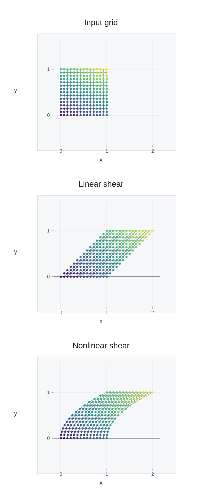
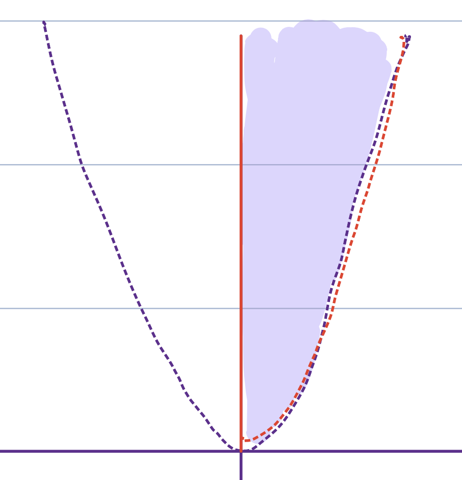
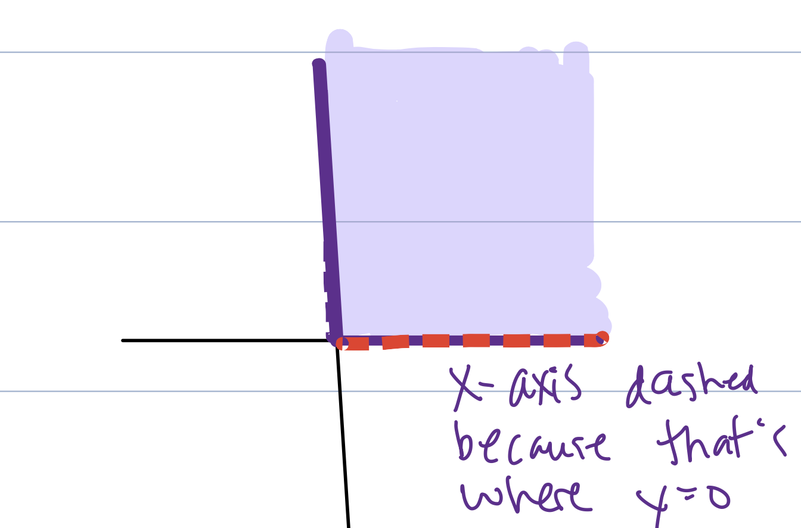
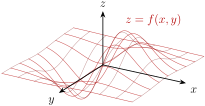
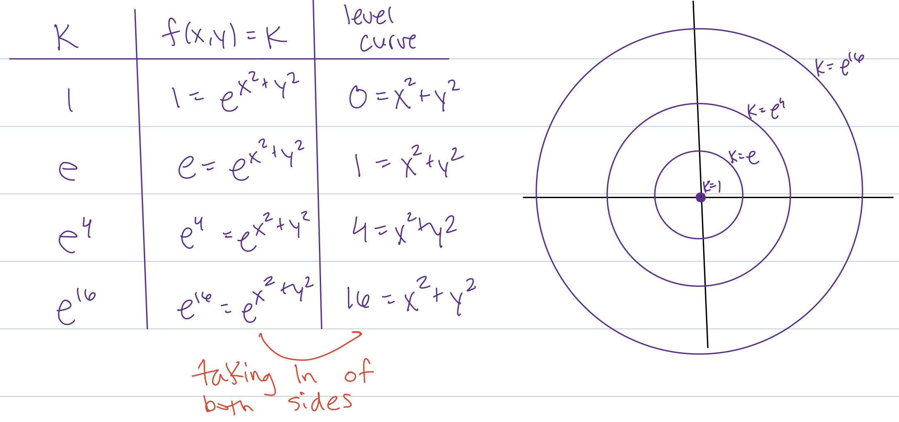
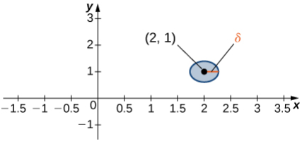
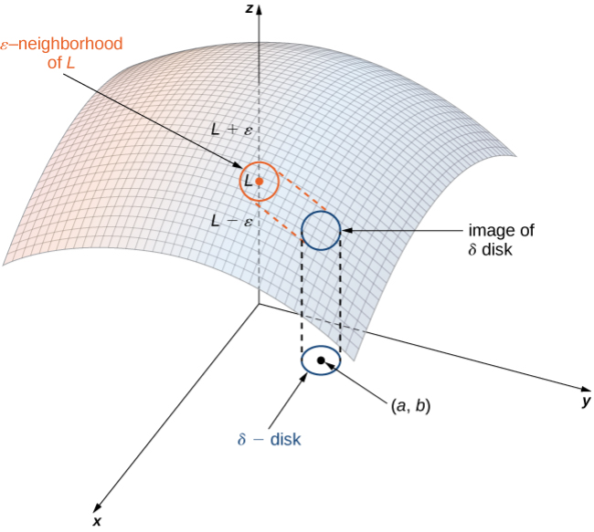
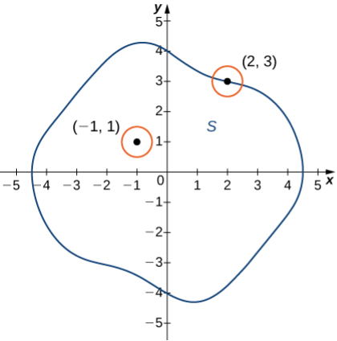

# 3.1 General Functions and Domains {#31-general-functions-and-domains}

!!! note "译文与来源"

    本页为教材公开源文件 v0.2 的非官方中文翻译，保留原公式、例题、活动、代码和习题；为适应网页阅读，例题与活动等编号按本地小节重排，解答可点击展开；正文与标题中的数学专有名词保留英文，中文用于解释；术语表保留中英对照以便查阅。原文作者：Jacob Denson、Kaitlyn Phillipson、Sebastien Roch。译文遵循 [CC BY-NC-SA 4.0](https://creativecommons.org/licenses/by-nc-sa/4.0/)。[阅读英文原文](3-1.md#sec-u3-general-functions-domains)。


<a id="textbook-body"></a>

## 教材正文 {#_5}

<a id="sec-u3-general-functions-domains"></a>


<a id="sec-8-1-general-concepts"></a>

## Function Types and Component Functions {#function-types-and-component-functions}

[第一章](1-index.md)和[第二章](2-index.md)研究了$\mathbf{x}\mapsto A\mathbf{x}$形式的映射。我们现在允许更通用的规则。输出可以是 scalar 或 vector。


<a id="p-u3-prediction-loss-motivation"></a>

在[第二章](2-index.md)中，数据 matrix 将模型 coefficient 转化为预测。这些预测与观测值的匹配程度如何，我们应该如何更改 coefficient 以提高拟合度？测量预测误差的单个数字将为我们提供一个 scalar-valued function，以便在整个单元中进行研究。


<a id="def-8-1-vector-valued-function"></a>

**定义 3.1.1**

vector-valued map通常写作 $F:\mathbb{R}^n\to\mathbb{R}^m$， scalar-valued function 通常写作 $f:\mathbb{R}^n\to\mathbb{R}$。任意 vector-valued map $F:\mathbb{R}^n\to\mathbb{R}^m$ 都有 $m$ 个 component function （Component Functions），也称 coordinate function，即满足 

$$
F(\mathbf{x}) = \begin{bmatrix} F_1(\mathbf{x}) \\ \vdots \\ F_m(\mathbf{x}) \end{bmatrix}
$$

的 scalar-valued function $F_1,\dots,F_m:\mathbb{R}^n\to\mathbb{R}$。更一般地， function 可能只在 $\mathbb{R}^n$ 的某个子集上有定义，而非处处有定义，因此其 domain 可能是 $\mathbb{R}^n$ 的真子集。

换句话说， scalar-valued function 接受输入并输出 scalar， vector-valued function 接受输入并输出 vector （回想一下[ scalar 与 vector 的定义](1-1.md#def-1-0-scalars-and-vectors)）。

**活动 3.1.1：作为 scalar-valued function 的 vector 长度 (U3-LO1)**

如果$\mathbf{x}$是$\mathbb{R}^n$中的一个点，请回忆$\mathbf{x}$的长度，表示为$\| \mathbf{x} \|$，来自[ vector 长度的定义](1-1.md#def-1-1-vector-length)。 vector 的长度定义从 $\mathbb{R}^n$ 到 $\mathbb{R}$ 的 scalar-valued function。找到两个具有相同长度的不同 vector。这说明输出是否决定输入？

??? success "解答"

    人们可以在这里做出许多不同的选择。例如， vector $(3,4)$和 vector $(5,0)$都具有相同的长度。其他示例包括 vector $(1,2)$ 和 $(-1,2)$。

**活动 3.1.2：matrix 映射 (U3-LO1) 的 component function**

令 $A$ 为 $m \times n$  matrix。由 $T(\mathbf{x}) = T_A(\mathbf{x}) = A\mathbf{x}$ 定义的 linear map （回想一下 [ linear transformation 的定义](1-3.md#def-2-4-linear-transformation)）$T: \mathbb{R}^n \to \mathbb{R}^m$ 是一个 vector-valued map。每个 component function 都是 row dot product。

**问题**

如果$\mathbf{a}_1, \dots, \mathbf{a}_m$是$A$的 row，在$\mathbb{R}^n$中视为 vector，$T_1, \dots, T_m$是$T$的 component function，则对于每个$j$，用$\mathbf{a}_j$行表示 function $T_j$。

??? success "解答"

    回顾[ matrix 与 vector 乘法的定义](1-3.md#def-2-2-matrix-vector-product)中 matrix-vector multiplication 的定义，我们可以写成

    $$
    T_j(\mathbf{x}) = a_{j1} x_1 + \cdots + a_{jn} x_n = \mathbf{a}_j \cdot \mathbf{x}
    $$

**问题**

考虑 matrix 

$$
A = \begin{bmatrix} 1 & 2 & -1 \\ 0 & 3 & 4 \end{bmatrix}
$$

它定义了一个 linear map $T_A: \mathbb{R}^3 \to \mathbb{R}^2$。计算通用输入 $\mathbf{x}$ 的 component function，以及特定输入 $\mathbf{x} = (3, -1, 2)$ 的输出。

??? success "解答"

    组件功能为：

    $$
    T_1(\mathbf{x}) = (1,2,-1) \cdot \mathbf{x} = x_1 + 2 x_2 - x_3
    $$

    和

    $$
    T_2(\mathbf{x}) = (0,3,4) \cdot \mathbf{x} = 3x_2 + 4x_3
    $$

    对于输入$\mathbf{x} = (3, -1, 2)$，我们计算出

    $$
    T(\mathbf{x}) = \begin{bmatrix} 1 & 2 & -1 \\ 0 & 3 & 4 \end{bmatrix} \begin{bmatrix} 3 \\ -1 \\2 \end{bmatrix} = \begin{bmatrix} -1 \\ 5 \end{bmatrix}
    $$

<a id="act-u3-corners-not-enough"></a>

**活动 3.1.3：仅观察顶点还不够（U3-LO1）**

[第一章](1-index.md) 对 $2\times 2$  matrix 使用单位平方可视化。对于 nonlinear map，正方形的角并不能说明全部情况。

令 $T,F:\mathbb R^2\to\mathbb R^2$ 由 

$$
T\left(\begin{bmatrix}x\\y\end{bmatrix}\right)
            =
            \begin{bmatrix}
              x+y\\
              y
            \end{bmatrix},
            \qquad
            F\left(\begin{bmatrix}x\\y\end{bmatrix}\right)
            =
            \begin{bmatrix}
              x+y^2\\
              y
            \end{bmatrix}.
$$

定义


1. 计算$T$下单位正方形四个角的 graph。

2. 计算$F$下单位正方形四个角的 graph。

3. 计算$\begin{bmatrix}0\\1/2\end{bmatrix}$在两张映射下的 graph。

4. $F$ 对单位正方形左边缘上的点 $\begin{bmatrix}0\\y\end{bmatrix}$ 有何作用？


??? success "解答"

    四个角分别是

    $$
    \begin{bmatrix}0\\0\end{bmatrix},
                \begin{bmatrix}1\\0\end{bmatrix},
                \begin{bmatrix}1\\1\end{bmatrix},
                \begin{bmatrix}0\\1\end{bmatrix}.
    $$

    

    $T$、

    $$
    \begin{aligned}
    T\left(\begin{bmatrix}0\\0\end{bmatrix}\right)=\begin{bmatrix}0\\0\end{bmatrix},
                  \quad
                  T\left(\begin{bmatrix}1\\0\end{bmatrix}\right)=\begin{bmatrix}1\\0\end{bmatrix}, \\
    T\left(\begin{bmatrix}1\\1\end{bmatrix}\right)=\begin{bmatrix}2\\1\end{bmatrix},
                  \quad
                  T\left(\begin{bmatrix}0\\1\end{bmatrix}\right)=\begin{bmatrix}1\\1\end{bmatrix}.
    \end{aligned}
    $$

    

    对于$F$，四个角 graph 是相同的：

    $$
    \begin{aligned}
    F\left(\begin{bmatrix}0\\0\end{bmatrix}\right)=\begin{bmatrix}0\\0\end{bmatrix},
                  \quad
                  F\left(\begin{bmatrix}1\\0\end{bmatrix}\right)=\begin{bmatrix}1\\0\end{bmatrix}, \\
    F\left(\begin{bmatrix}1\\1\end{bmatrix}\right)=\begin{bmatrix}2\\1\end{bmatrix},
                  \quad
                  F\left(\begin{bmatrix}0\\1\end{bmatrix}\right)=\begin{bmatrix}1\\1\end{bmatrix}.
    \end{aligned}
    $$

    

    对于中点，

    $$
    T\left(\begin{bmatrix}0\\1/2\end{bmatrix}\right)=\begin{bmatrix}1/2\\1/2\end{bmatrix},
                \qquad
                F\left(\begin{bmatrix}0\\1/2\end{bmatrix}\right)=\begin{bmatrix}1/4\\1/2\end{bmatrix}.
    $$

    

    在左边缘，

    $$
    F\left(\begin{bmatrix}0\\y\end{bmatrix}\right)=\begin{bmatrix}y^2\\y\end{bmatrix}.
    $$

     所以$F$ 将左边缘弯曲成曲线。网格比单独的角提供更多的信息。


<a id="note-u3-square-grid-test"></a>

**说明**

matrix 将网格线发送到网格线。 nonlinear map 可以弯曲网格线。方形网格可视化对点和网格线进行采样，而不仅仅是角点。


<a id="act-u3-reading-square-grid-computation"></a>

**活动 3.1.4：读取方格计算结果 (U3-LO1)**

以下代码将 nonlinear map 

$$
F\left(\begin{bmatrix}x\\y\end{bmatrix}\right)
            =
            \begin{bmatrix}
              x+y^2\\
              y
            \end{bmatrix}
$$

应用于存储为 column 的多个输入点。

在 NumPy 中，`**` 表示求幂；例如，`x**2`代表$x^2$。


```python
import numpy as np

def F(P):
    x = P[0, :]
    y = P[1, :]
    return np.vstack([x + y**2, y])

P = np.array([
    [0.0, 1.0, 1.0, 0.0, 0.0],
    [0.0, 0.0, 1.0, 1.0, 0.5],
])

F(P)
```

输出：


```python
array([[0.  , 1.  , 2.  , 1.  , 0.25],
       [0.  , 0.  , 1.  , 1.  , 0.5 ]])
```


1. $P$ 的前四 column 存储了哪些点？

2. $P$的最后一个 column 存储着什么点？

3. 什么输出对应于最后一个 column？

4. 为什么前四 column 没有检测到 $F$ 和剪切力 $T(x,y)=(x+y,y)$ 之间的差异？

5. 为什么网格比四个角提供更多信息？


??? success "解答"

    前四 column 是角

    $$
    \begin{bmatrix}0\\0\end{bmatrix},
                \begin{bmatrix}1\\0\end{bmatrix},
                \begin{bmatrix}1\\1\end{bmatrix},
                \begin{bmatrix}0\\1\end{bmatrix}.
    $$

     最后一个 column 是

    $$
    \begin{bmatrix}
                  0\\
                  1/2
                \end{bmatrix}.
    $$

    

    它的输出是

    $$
    F\left(\begin{bmatrix}0\\1/2\end{bmatrix}\right)
                =
                \begin{bmatrix}
                  1/4\\
                  1/2
                \end{bmatrix}.
    $$

    

    四个角在$F$和$T(x,y)=(x+y,y)$下具有相同的 graph。中点则不然。网格包括边缘点和内部点，因此它可以显示四个角错过的弯曲。


<a id="note-u3-reading-square-grid-diagrams"></a>

**说明：阅读方格图**

方形网格图同时跟踪输入点和输出点。颜色标识原始输入点。网格线显示附近输入点的移动方式。

对于 matrix 图，网格线保持笔直，整个网格由一个 matrix 控制。对于平滑的 nonlinear map，网格线可能会弯曲。

该图的目的不是取代计算。它显示了计算正在做什么。


<a id="fig-u3-square-grid-test"></a>

*$T(x,y)=(x+y,y)$ 和 $F(x,y)=(x+y^2,y)$ 的方格可视化。颜色标识原始输入点。两个贴图在四个角上一致，但 nonlinear map 使网格线弯曲。*




<a id="act-u3-prediction-loss-model"></a>

**活动 3.1.5：从预测到 scalar-valued loss function （U3-LO1、U2-LO1）**

如[第二章的冗余特征活动](2-1.md#u2-act-preview-redundant-features)所示，预测映射的输入是模型 coefficient 的 vector。考虑三个观测值，每个观测值有两个数字特征： 

$$
X=\begin{bmatrix}1&0\\0&1\\1&1\end{bmatrix},
            \qquad \mathbf{y}=\begin{bmatrix}1\\2\\2\end{bmatrix}.
$$

$X$ 的每一行给出一个观测值的特征，$\mathbf{y}$ 的相应条目是其观测到的响应。 $X$ 和 $\mathbf{y}$ 都保持固定。两个可调节重量为$\mathbf{w}=(w_1,w_2)$。

预测 vector 和误差 vector （也称为 residual）为 

$$
P(\mathbf{w})=X\mathbf{w}
            =\begin{bmatrix}w_1\\w_2\\w_1+w_2\end{bmatrix},
            \qquad R(\mathbf{w})=X\mathbf{w}-\mathbf{y}.
$$

使用从 [ vector 长度的定义](1-1.md#def-1-1-vector-length) 开始的 vector 长度，我们通过 squared-error loss 

$$
\mathcal L(\mathbf{w})=\|X\mathbf{w}-\mathbf{y}\|^2
            =(w_1-1)^2+(w_2-2)^2+(w_1+w_2-2)^2.
$$

总结这三个误差。较小的损失意味着更好地拟合这些观测值。


1. 给出 $P$、$R$ 和 $\mathcal L$ 的 domain 和 codomain。哪些是 vector 值，哪些是 scalar 值？哪个映射是 linear 的，哪个是 affine 的？

2. 计算 $\mathbf{w}_0=(1,1)$ 和 $\mathbf{b}=(0,2)$ 处的预测、 residual 和损失。相同的损失是否意味着相同的预测？

3. 任何权重选择都可以使损失为零吗？将这个问题转化为 linear 系统并使用[第二章](2-index.md)的行归约方法。


??? success "解答"

    1. 映射 $P,R:\mathbb{R}^2\to\mathbb{R}^3$ 是 vector 值，而 $\mathcal L:\mathbb{R}^2\to\mathbb{R}$ 是 scalar 值。所有这些都是针对每对实际权重定义的。映射 $P$ 是 linear 的，$R$ 是 affine 的，因为它减去了固定 vector $\mathbf{y}$。损失是一个 nonlinear 二次 function；特别是$\mathcal L(\mathbf{0})=9$，所以它不是 linear 的。

    2. 两个计算给出 

    $$
    \begin{aligned}
    P(1,1)&=\begin{bmatrix}1\\1\\2\end{bmatrix},
                      \quad R(1,1)=\begin{bmatrix}0\\-1\\0\end{bmatrix}, \\
    \mathcal L(1,1)&=1,
    \end{aligned}
    $$

     和 

    $$
    \begin{aligned}
    P(0,2)&=\begin{bmatrix}0\\2\\2\end{bmatrix},
                      \quad R(0,2)=\begin{bmatrix}-1\\0\\0\end{bmatrix}, \\
    \mathcal L(0,2)&=1.
    \end{aligned}
    $$

      scalar 损失记录了误差平方和，因此不同的预测和 residual vector 可以给出相同的损失。

    3. 当每个误差都为零时，平方和恰好为零。因此我们需要$X\mathbf{w}=\mathbf{y}$。 row reduction 给出 

    $$
    \begin{aligned}
    \left[\begin{array}{cc|c}1&0&1\\0&1&2\\1&1&2\end{array}\right]
                      &\xrightarrow{R_3\to R_3-R_1}
                      \left[\begin{array}{cc|c}1&0&1\\0&1&2\\0&1&1\end{array}\right] \\
    &\xrightarrow{R_3\to R_3-R_2}
                      \left[\begin{array}{cc|c}1&0&1\\0&1&2\\0&0&-1\end{array}\right].
    \end{aligned}
    $$

     最后一行表示 $0=-1$，因此不可能精确拟合。即使所有三个预测不能同时正确，这也会通过减少损失来提高拟合度。


<a id="sec-special-cases-functions"></a>

### Special cases of general functions {#special-cases-of-general-functions}

符号$F:\mathbb{R}^n\to\mathbb{R}^m$包括几种情况。如果 $m=1$，则输出为 scalar 值。如果$F(\mathbf{x})=A\mathbf{x}$，则映射是 linear 的。如果$F(\mathbf{x})=A\mathbf{x}+\mathbf{b}$，则映射是 affine 的。

对于一个 scalar 输入，我们写为 $\mathbf{r}:\mathbb{R}\to\mathbb{R}^m$，其中 $m$ 表示输出 dimension。这样的映射描绘出一条曲线。


<a id="sec-calculus-of-vector-valued-functions"></a>

## Domains, Ranges, Graphs, and Level Curves {#domains-ranges-graphs-and-level-curves}


<a id="sec-calculus-of-vector-valued-functions-2-2"></a>

我们在[ linear map 与 affine map ](1-3.md#sec-u1-linear-affine-maps)中遇到了 function 的 domain。我们现在给出更正式的定义并介绍 range。


<a id="sec-calculus-of-vector-valued-functions-2-3"></a>

**定义 3.1.2：domain 与 range （Domain and Range）**

function 的 domain 是所有允许输入组成的集合， range 是所有实际能够取得的输出组成的集合。严格地说，若 function $f$ 的输入来自集合 $X$，输出属于集合 $Y$，那么 $f$ 的 domain 就是 $X$； range 则是所有满足“存在 $x \in X$ 使得 $y = f(x)$”的 $y \in Y$ 组成的集合，可写为 $\{ y \in Y: y = f(x)\ \text{for some}\ x \in X \}$。


<a id="sec-calculus-of-vector-valued-functions-2-4"></a>

微积分中常直接给出表达式，再把所有使表达式有定义的输入作为 domain。例如，写下 $f(x,y) = x/y$ 时，通常默认 domain 为 $\{ (x,y) \in \mathbb{R}^2 : y \neq 0 \}$；这时 range 是 $\mathbb{R}$。如果题目另外指定了 domain，则应以题目为准。


<a id="sec-calculus-of-vector-valued-functions-2-5"></a>

range 只包含 function 实际能够取得的输出；而[ linear map 与 affine map ](1-3.md#sec-u1-linear-affine-maps)中定义的 codomain 是预先指定的输出集合，它可能比 range 更大。


<a id="sec-calculus-of-vector-valued-functions-2-6"></a>

对于两个变量的 scalar-valued function， domain 和 level curve 是平面的子集。这些图片帮助我们了解 function 的定义位置以及其输出如何变化。


<a id="sec-calculus-of-vector-valued-functions-2-7"></a>

**活动 3.1.6：画出 domain （U3-LO1）**

画出下 column function 的 domain：

**问题**

$f(x,y) = \ln(y - x^2) + \sqrt{x}$.

??? success "解答"

    定义 function $f$ 的表达式由两项之和组成，因此要找到 $f$ 的 domain，我们必须确定这两项都被有定义的位置。

    当$\ln$的输入为正数时，即$y - x^2 > 0$时，术语$\ln(y - x^2)$有定义。我们可以将这个不等式重新排列为$y > x^2$

    当$\sqrt{\cdot}$的输入为非负时，即$x \geq 0$时，术语$\sqrt{x}$是有定义的。

    因此，当$y > x^2$和$x \geq 0$时，$f$都是有定义的，因此$f$的 domain 是所有点$(x,y)$的集合，使得$x \geq 0$和$y > x^2$。使用集合表示法，我们还可以将 domain 写为集合

    $$
    \{ (x,y) \in \mathbb{R}^2: x \geq 0\ \text{and}\ y > x^2 \}
    $$

    该集合是平面中从下方以抛物线 $y = x^2$ 为界、左侧以 $y$ 轴为界的区域，如 [图 3.1.2](3-1.md#fig-8-3-domain-of-ln-sqrt) 所示。


    <a id="fig-8-3-domain-of-ln-sqrt"></a>

    *$f(x,y) = \ln(y - x^2) + \sqrt{x}$的 domain。图由Melissa Lindsey绘制。*

    

**问题**

$f(x,y) = e^x \sin y$

??? success "解答"

    定义 function $f$ 的表达式由 $e^x$ 和 $\sin y$ 的乘积组成，因此当 $e^x$ 和 $\sin y$ 都是有定义时，$f$ 也是有定义的。这两个表达式都针对所有输入进行了有定义。所以$f$的 domain 是集合$\mathbb{R}^2$。

**问题**

$f(x,y) = \frac{\sqrt{x}}{\sqrt{y}}$

??? success "解答"

    定义 $f$ 的表达式是分子为 $\sqrt{x}$ 和分母 $\sqrt{y}$ 的分数。因此，当分子和分母都有定义并且分母非零时，该表达式是有定义的。

    当 $x \geq 0$ 时，分子 $\sqrt{x}$ 有定义。分母 $\sqrt{y}$ 在 $y \geq 0$ 时有定义，并且在 $y > 0$ 时不为零。

    因此，$f$ 的 domain 由所有同时满足 $x \geq 0$ 和 $y > 0$ 的 $(x,y) \in \mathbb{R}^2$ 组成，用集合记号表示为 

    $$
    \{(x,y) \in \mathbb{R}^2 : x \geq 0\ \text{ and }\ y > 0\}
    $$

    它位于 $xy$ 平面的第一象限，包含 $y$ 轴的正半轴，但不包含原点以及 $x$ 轴的正半轴，见[图 3.1.3](3-1.md#fig-8-3-domain-of-sqrt-frac-exercse)。


    <a id="fig-8-3-domain-of-sqrt-frac-exercse"></a>

    *$f(x,y) = \frac{\sqrt{x}}{\sqrt{y}}$的 domain。图由Melissa Lindsey绘制。*

    


<a id="sec-calculus-of-vector-valued-functions-3-2"></a>

**定义 3.1.3：function 的 graph （Graph of a Function）**

function $f$ 的 graph 是所有有序对 $(x,f(x))$ 组成的集合，其中 $x$ 属于 $f$ 的 domain。


<a id="sec-calculus-of-vector-valued-functions-3-3"></a>

当$f$是两个变量的 scalar-valued function 时，$f$的图是一组三元组$(x,y,f(x,y))$，因此是$\mathbb{R}^3$的子集，因此可以将其可视化为曲面。有关 function $f(x,y) = x e^{-x^2-y^2}$ 的图形图片，请参阅[图 3.1.4](3-1.md#fig-8-3-figure-example)。


<a id="fig-8-3-figure-example"></a>

* function $f(x,y) = x e^{-x^2-y^2}$ 的图表。*




<a id="sec-calculus-of-vector-valued-functions-3-5"></a>

**定义 3.1.4：level curve 与 contour plot （Level Curves and Contour Plots）**

对于二元 scalar-valued function $f$，固定某个 $c \in \mathbb{R}$，满足方程 $f(x,y) = c$ 的点 $(x,y)$ 所组成的曲线称为 level curve。 contour plot 是在 $\mathbb{R}^2$ 中画出 function $f$ 对应多个不同 $c$ 值的 level curve 而得到的图。


<a id="sec-calculus-of-vector-valued-functions-3-6"></a>

选择在 contour plot 中描绘的 $c$ 的不同值通常（但并非总是）通过公差改变 $c$ 来获得，从而获得“连续” level set。


<a id="sec-calculus-of-vector-valued-functions-3-7"></a>

**活动 3.1.7：绘制 level curve (U3-LO1)**

通过使用 $c = 1$、$c = e$、$c = e^4$ 和 $c = e^9$ 绘制 level curve $f(x,y) = c$，绘制 function 

$$
f(x,y) = e^{x^2 + y^2}
$$

的 contour plot。

??? success "解答"

    *$f(x,y) = e^{x^2+y^2}$ 的 level curve。图由Melissa Lindsey绘制。*

    


<a id="act-u3-prediction-loss-level-curves"></a>

**活动 3.1.8：参数空间中的等误差曲线 (U3-LO1)**

返回[从预测到 scalar-valued loss function （U3-LO1、U2-LO1）](3-1.md#act-u3-prediction-loss-model)的损失：

$$
\mathcal L(w_1,w_2)=(w_1-1)^2+(w_2-2)^2+(w_1+w_2-2)^2.
$$


1. 描述$\mathcal L$图上一点的 coordinate。哪些 coordinate 代表模型权重，哪些 coordinate 代表预测误差？

2. 写出 level curve $\mathcal L=1$的方程。在这条曲线上找到$(1,1)$和$(0,2)$，并在图上给出相应的点。沿着这条 level curve 移动会保留什么？

3. level curve 可以有负损失值吗？这些数据的 level set $\mathcal L=0$非空吗？


??? success "解答"

    1. 该图是$\mathbb{R}^3$中点$(w_1,w_2,\mathcal L(w_1,w_2))$的曲面。它的前两个 coordinate 是可调节的权重；它的高度是总预测误差的平方。输入域是整个参数平面$\mathbb{R}^2$。

    2. level curve 为 

    $$
    (w_1-1)^2+(w_2-2)^2+(w_1+w_2-2)^2=1.
    $$

     $(1,1)$ 和 $(0,2)$ 都满足这个方程。它们的图点是$(1,1,1)$和$(0,2,1)$。在参数平面中查看时，高度 $1$ 处的图形水平切片给出了该 level curve。这两个选择具有相等的误差平方和，尽管它们的预测在 [从预测到 scalar-valued loss function （U3-LO1、U2-LO1）](3-1.md#act-u3-prediction-loss-model) 中计算有所不同。

    3. 每一项都是平方项，因此负 level set 是空的。对于这些数据来说，零 level set 也是空的，因为$X\mathbf{w}=\mathbf{y}$不一致。非负公式不能保证达到零值。


<a id="sec-limits-and-continuity"></a>

## Balls, Limits, and Continuity {#balls-limits-and-continuity}


<a id="sec-limits-and-continuity-2-2"></a>

要描述输入“接近某一点”时的行为，需要先明确“附近”的含义。本节介绍 ball、limit、continuity，以及 interior point、boundary point、closed set 和 bounded set；后面讨论 derivative 和 optimization 时会反复用到这些概念。


<a id="sec-limits-and-continuity-2-3"></a>

回想一下单变量微积分 limit 的定义。对于 function $f: \mathbb{R} \to \mathbb{R}$和$a,b \in \mathbb{R}$，方程

$$
\lim_{x \to a} f(x) = b
$$

成立，如果对于每个$\varepsilon > 0$，存在$\delta > 0$，因此如果$0 \lt |x - a| \lt \delta$，则$|f(x) - b| \lt \varepsilon$。我们可以将这个命题从几何角度解释如下：对于任何以$b$为中心的开区间$J$，都存在一个以$a$为中心的开区间$I$，因此$f$将$I$中的点（不包括$a$本身）映射为$J$。


<a id="sec-limits-and-continuity-2-4"></a>

在$\mathbb{R}^2$中，球是一个圆盘。


<a id="sec-limits-and-continuity-2-5"></a>

**定义 3.1.5：二维实空间中的圆盘（Disk）**

考虑一个点$(a,b) \in \mathbb{R}^2$。以$(a,b)$为中心的$\delta$圆盘是以$(a,b)$为中心、半径为$\delta$的圆所包围的$\mathbb{R}^2$区域，即集合

$$
\left\{ (x,y) \in \mathbb{R}^2 : \sqrt{(x - a)^2 + (y - b)^2} \lt \delta \right\}
$$

<a id="sec-limits-and-continuity-2-6"></a>

有关 $\delta$ 圆盘的描述，请参阅 [图 3.1.6](3-1.md#fig-8-4-delta-disk)。


<a id="fig-8-4-delta-disk"></a>

*一个以点 $(2,1)$ 为中心的 $\delta$ 圆盘。图 4.14 来自 Edwin “Jed” Herman 和 Gilbert Strang，微积分第 3 卷，OpenStax，© 2018 Rice University，已获得 [CC BY-NC-SA 4.0](https://creativecommons.org/licenses/by-nc-sa/4.0/) 许可；来源：[OpenStax 图 4.14](https://openstax.org/books/calculus-volume-3/pages/4-2-limits-and-continuity#CNX_Calc_Figure_14_02_001)。*




<a id="sec-limits-and-continuity-2-8"></a>

现在定义二元 scalar-valued function $f$ 的 limit。等式 

$$
\lim_{(x,y) \to (a,b)} f(x,y) = L
$$

成立，恰好意味着：对于任意以 $L$ 为中心的开区间 $I$，都可以找到以 $(a,b)$ 为中心、半径为 $\delta$ 的圆盘，使圆盘中属于 $f$  domain 的所有点（不包括 $(a,b)$ 本身），都被 $f$ 映到 $I$ 中。


<a id="def-8-4-limit-2d"></a>

**定义 3.1.6：二变量 scalar-valued function 的 limit**

设 $f(x,y)$ 是二元 scalar-valued function。当 $(x,y)$ 趋于 $(a,b)$ 时，$f$ 的 limit 等于 $L$，记作 

$$
\lim_{(x,y) \to (a,b)} f(x,y) = L
$$

意思是：对任意 $\varepsilon > 0$，都存在 $\delta > 0$，使得 $f$  domain 内任何满足 

$$
0 \lt \sqrt{(x - a)^2 + (y - b)^2} \lt \delta
$$

的点，都满足不等式 $|f(x,y) - L| \lt \varepsilon$。


<a id="sec-limits-and-continuity-2-10"></a>

*当 $f(x,y)$ 在 $L$ 的 $\varepsilon$ 之内时，只要 $(x,y)$ 在 $(a,b)$ 的 $\delta$ 之内，$\lim_{(x,y) \to (a,b)} f(x,y) = L$ 成立。图 4.15 来自 Edwin “Jed” Herman 和 Gilbert Strang，微积分第 3 卷，OpenStax，© 2018 Rice University，已获得[CC BY-NC-SA 4.0](https://creativecommons.org/licenses/by-nc-sa/4.0/) 许可；来源：[OpenStax 图 4.15](https://openstax.org/books/calculus-volume-3/pages/4-2-limits-and-continuity#CNX_Calc_Figure_14_02_002)。*




<a id="sec-limits-and-continuity-2-11"></a>

使用 vector 表示法（回顾[ vector 长度的定义](1-1.md#def-1-1-vector-length)），我们可以写一个以点$\mathbf{x}_0 \in \mathbb{R}^2$为中心的$\delta$圆盘作为点集$\mathbf{x} \in \mathbb{R}^2$，从而

$$
\{ \mathbf{x} \in \mathbb{R}^2 : \| \mathbf{x} - \mathbf{x}_0 \| \lt \delta \}
$$

这激发了$\delta$圆盘的更高 dimension 变体：$\delta$球。


<a id="sec-limits-and-continuity-2-12"></a>

**定义 3.1.7：n 维实空间中的球（Ball）**

对于$\mathbf{x}_0 \in \mathbb{R}^n$，以$\mathbf{x}_0$为中心的$\delta$球是集合

$$
\{ \mathbf{x} \in \mathbb{R}^n: \| \mathbf{x} - \mathbf{x}_0 \| \lt \delta \}
$$

<a id="sec-limits-and-continuity-2-13"></a>

在$\mathbb{R}^3$中，以点$(a,b,c)$为中心的$\delta$球恰好是满足方程

$$
(x - a)^2 + (y - b)^2 + (z - c)^2 \lt \delta^2
$$

的点集。它是 $\mathbb{R}^3$ 中以半径为 $\delta$ 的球体为界的区域。


<a id="sec-limits-and-continuity-2-14"></a>

通过用球代替圆盘，我们得到了一般 scalar-valued function 的 limit 的定义。


<a id="sec-limits-and-continuity-2-15"></a>

**定义 3.1.8：scalar-valued function 的 limit**

设 $f$ 是 scalar-valued function。当 $\mathbf{x}$ 趋于 $\mathbf{x}_0$ 时，$f$ 的 limit 等于 $L$，记作 

$$
\lim_{\mathbf{x} \to \mathbf{x}_0} f(\mathbf{x}) = L
$$

意思是：对任意 $\varepsilon > 0$，都存在 $\delta > 0$，使得 $f$  domain 内任何满足 $0 \lt \| \mathbf{x} - \mathbf{x}_0 \| \lt \delta$ 的点，都满足不等式 $|f(\mathbf{x}) - L| \lt \varepsilon$。


<a id="sec-limits-and-continuity-2-16"></a>

**注**

为了使 $f$ 的 limit （当存在时）唯一，点 $\mathbf{x}_0$ 必须具有这样的属性：$f$ 的 domain 包含以 $\mathbf{x}_0$ 为中心的任何 $\delta$ 球中除 $\mathbf{x}_0$ 以外的点。这只是一个小问题，因为微积分中自然出现的任何 function 的 domain 中的每个点都具有此属性。


<a id="sec-limits-and-continuity-2-17"></a>

回想一下单变量的微积分， function $f: \mathbb{R} \to \mathbb{R}$在$\lim_{x \to a} f(x) = f(a)$时在点$a$连续，即，当左侧的 limit 存在并且等于右侧的 limit 时。多个变量 function 的 continuity 以完全相同的方式定义。


<a id="sec-limits-and-continuity-2-18"></a>

**定义 3.1.9**

若 $f$ 在 $\mathbf{x}_0$ 有定义，并且当 $\mathbf{x} \to \mathbf{x}_0$ 时的 limit 存在且满足下面的等式，就称 $f$ 在该点连续：

$$
\lim_{\mathbf{x} \to \mathbf{x}_0} f(\mathbf{x}) = f(\mathbf{x}_0)
$$

则 scalar-valued function $f$ 在其 domain 中的点 $\mathbf{x}_0$ 处连续。


<a id="sec-u3-interior-boundary-closed-sets"></a>

## Interior, Boundary, and Closed Sets {#interior-boundary-and-closed-sets}


<a id="sec-limits-and-continuity-3-2"></a>

这种语言让我们能够区分集合内部的点和集合 boundary 上的点。


<a id="sec-8-4-interior-and-exterior"></a>

**定义 3.1.10：interior point、 boundary 与 closed set （Interior, Boundary, and Closed Sets）**

设 $S$ 是 $\mathbb{R}^n$ 的子集。如果存在以 $\mathbf{x}_0$ 为中心、半径为 $\delta$ 的球，整个球都包含在 $S$ 中，那么 $\mathbf{x}_0 \in S$ 是 interior point。如果每个以 $\mathbf{x}_0$ 为中心的球中，都至少有一个属于 $S$ 的点和一个不属于 $S$ 的点，那么 $\mathbf{x}_0 \in \mathbb{R}^n$ 是 boundary point。集合 $S$ 的所有 boundary point 组成 $S$ 的 boundary。


<a id="sec-limits-and-continuity-3-4"></a>

考虑该图来说明内部点和 boundary point 的示例。


<a id="sec-limits-and-continuity-3-5"></a>

*在所示的集合$S$中，$(-1,1)$是内部点，$(2,3)$是 boundary point。图 4.17 来自 Edwin “Jed” Herman 和 Gilbert Strang，微积分第 3 卷，OpenStax，© 2018 Rice University，已获得 [CC BY-NC-SA 4.0](https://creativecommons.org/licenses/by-nc-sa/4.0/) 许可；来源：[OpenStax 图 4.17](https://openstax.org/books/calculus-volume-3/pages/4-2-limits-and-continuity#CNX_Calc_Figure_14_02_004)。*




<a id="sec-limits-and-continuity-3-6"></a>

**注**

注意，集合$S$的 boundary point 不需要包含在集合$S$中。例如，本节中定义的$\delta$盘不包含其圆形 boundary。包含其 boundary 的集合称为 closed set。


<a id="sec-8-5-closed-sets"></a>

**定义 3.1.11：closed set**

如果集合 $S \subset \mathbb{R}^n$ 包含它的全部 boundary point，就称它为 closed set。如果集合 $S \subset \mathbb{R}^n$ 包含在某个以原点为中心的球中，就称它为 bounded set；等价地，$S$ 中所有点到原点的距离都不超过某个固定的界。


<a id="subsec-u3-derivative-reminders"></a>

## Derivative Reminders {#derivative-reminders}

下表收集了一般规则、三角 derivative 以及指数和对数 derivative。这里$c$是常数，$n$是实数指数，$f$和$g$是 differentiable function。这些公式适用于所显示的表达式已定义且 differentiable 的情况。三角 function 参数以弧度为单位进行测量。


<a id="tab-u3-derivative-reminders"></a>

**表 3.1.1：单变量 derivative 规则**


| 表达式 | derivative |
|---|---|
| 基本公式 | |
| $c$ | $0$ |
| $x^n$ | $nx^{n-1}$ |
| $cf(x)$ | $cf'(x)$ |
| $f(x)+g(x)$ | $f'(x)+g'(x)$ |
| $f(x)-g(x)$ | $f'(x)-g'(x)$ |
| $f(x)g(x)$ | $f'(x)g(x)+f(x)g'(x)$ |
| $\dfrac{f(x)}{g(x)}$ | $\dfrac{g(x)f'(x)-f(x)g'(x)}{[g(x)]^2}$ |
| $f(g(x))$ | $f'(g(x))g'(x)$ |
| 三角 function | |
| $\sin x$ | $\cos x$ |
| $\cos x$ | $-\sin x$ |
| $\tan x$ | $\sec^2 x$ |
| $\cot x$ | $-\csc^2 x$ |
| 指数 function 与对数 function | |
| $e^x$ | $e^x$ |
| $b^x$ | $b^x\ln b$ |
| $\ln x$ | $\dfrac{1}{x}$ |
| $\log_b x$ | $\dfrac{1}{x\ln b}$ |

在商规则中，$g(x)\ne 0$。对于指数和对数公式，$b>0$和$b\ne 1$。 $\ln x$ 和 $\log_b x$ 的公式需要 $x>0$。

<a id="img-8-3-figure-example"></a>
