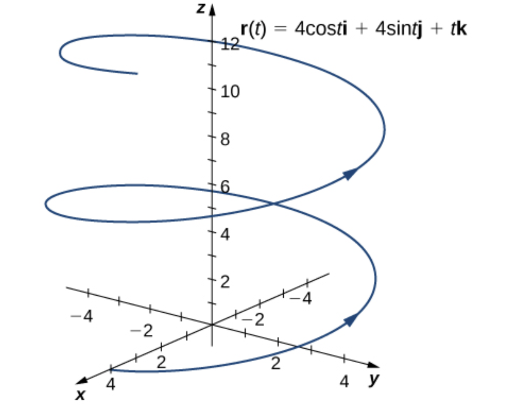
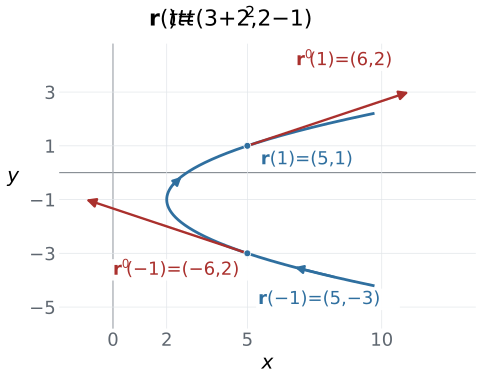

# 3.2 One-parameter Maps and Changes {#32-one-parameter-maps-and-changes}

!!! note "译文与来源"

    本页为教材公开源文件 v0.2 的非官方中文翻译，保留原公式、例题、活动、代码和习题；为适应网页阅读，例题与活动等编号按本地小节重排，解答可点击展开；正文与标题中的数学专有名词保留英文，中文用于解释；术语表保留中英对照以便查阅。原文作者：Jacob Denson、Kaitlyn Phillipson、Sebastien Roch。译文遵循 [CC BY-NC-SA 4.0](https://creativecommons.org/licenses/by-nc-sa/4.0/)。[阅读英文原文](3-2.md#sec-u3-one-parameter-maps-changes)。

## 教材正文 {#_4}

## Vector-valued Functions of One Variable {#vector-valued-functions-of-one-variable}

### Basic Definitions {#basic-definitions}

映射 $\mathbf{r}:\mathbb{R}\to\mathbb{R}^m$ 接收一个 scalar 参数，输出一个 vector。随着参数变化，这个 vector 的端点描出一条 curve。

[第二章](2-index.md) 行是特殊情况$\mathbf{r}(t)=\mathbf{x}_0+t\mathbf{d}$。事实上，我们在讨论直线的 parametric equation 时已经遇到了曲线的 parameterization，如[直线的 parametric equation ](2-2.md#def-1-2-parametric-equation-for-line)所示。

**活动 3.2.1：parameterization 两条线 (U3-LO1)**

线 $L_1$ 经过点 $(3,-2,5)$ 并与 vector $\mathbf{v} = ( 2,-3,4 )$ 平行。

**问题**

找到 row $L_1$ 的 parameterization。

??? success "解答"

    该线经过 $(3,-2,5)$ 并具有方向 vector $(2,-3,4)$，因此它由 function 

    $$
    \mathbf{r}(t) = \begin{bmatrix}3\\-2\\5\end{bmatrix} + t \begin{bmatrix}2\\-3\\4\end{bmatrix} = \begin{bmatrix}3 + 2t\\ -2 - 3t\\ 5 + 4t\end{bmatrix}
    $$

      parameterization。

**问题**

另一条线$L_2$穿过点$(1,3,-1)$并垂直于$L_1$。如果 $L_2$ 也位于平面 $z = -1$ 上，则找到 $L_2$ 的 parameterization。

??? success "解答"

    由于 $L_2$ 位于平面 $z = -1$ 中，$L_2$ 所有点的 $z$  coordinate 相同，因此对于某些 scalar $a$ 和 $b$，$L_2$ 的任何方向 vector 都必须为 $\mathbf{d} = (a,b,0)$ 形式。由于$L_2$垂直于$L_1$，$L_2$的方向 vector 必须垂直于$L_1$的方向 vector，并且由于$L_1$以$(2,-3,4)$作为方向 vector，我们发现

    $$
    \begin{bmatrix}2\\-3\\4\end{bmatrix} \cdot \begin{bmatrix}a\\b\\0\end{bmatrix} = 2a - 3b = 0
    $$

    因此$a = (3/2) b$。

    解这个方程的任何 vector 都会给出$L_2$的方向 vector，因此（为了获得$a$和$b$的整数值）我们可以选择$b = 2$，从而选择$a = 3$。所以$\mathbf{d} = (3,2,0)$是$L_2$的方向 vector，并且由于$L_2$穿过$(1,3,-1)$，我们获得

    $$
    \mathbf{r}(t) = \begin{bmatrix}1\\3\\-1\end{bmatrix} + t \begin{bmatrix}3\\2\\0\end{bmatrix} = \begin{bmatrix}1 + 3t\\3 + 2t\\-1\end{bmatrix}
    $$

    形式的$L_2$ parameterization。

上面给出的直线 parameterization 由 vector-valued function 给出，其 component 是 linear function。但我们也可以使用 nonlinear function 对曲线进行 parameterization。

**例题 3.2.1**

当我们改变 $t$ 超过其允许值时， vector-valued function $\mathbf{r}(t)$ 会在 $\mathbb{R}^m$ 中绘制一条曲线。在本课程中，我们不会手工绘制 function 图。例如，考虑 

$$
\mathbf{r}(t) = 4 \cos t \mathbf{i} + 4 \sin t \mathbf{j} + t \mathbf{k}, \quad 0 \leq t \leq 4\pi
$$

那么它所描绘的曲线如下图所示。

*由 vector-valued function $\mathbf{r}$ 追踪的螺旋。图 3.4 来自 Edwin “Jed” Herman 和 Gilbert Strang，微积分第 3 卷，OpenStax，© 2018 Rice University，已获得 [CC BY-NC-SA 4.0](https://creativecommons.org/licenses/by-nc-sa/4.0/) 许可；来源：[OpenStax 图 3.4](https://openstax.org/books/calculus-volume-3/pages/3-1-vector-valued-functions-and-space-curves#CNX_Calc_Figure_13_01_003)。*

**活动 3.2.2：评估 vector-valued function (U3-LO1)**

回想一下 [ standard basis 的定义](1-3.md#def-2-2-standard-basis) 中 $\mathbb{R}^2$ 中的 vector $\mathbf{i}$ 和 $\mathbf{j}$。考虑由方程 

$$
\mathbf{r}(t) = (t^2-3t)\mathbf{i} + (4t+1)\mathbf{j}
$$

定义的 vector-valued function $\mathbf{r}: \mathbb{R} \to \mathbb{R}^2$，即方程 

$$
\mathbf{r}(t) = \begin{bmatrix}t^2-3t\\4t + 1\end{bmatrix}
$$

**问题**

评估$\mathbf{r}(0)$。

??? success "解答"

    我们用$0$替换上面等式中的$t$，得到

    $$
    \begin{aligned}
    \mathbf{r}(0) & = ((0)^2 - 3(0)) \mathbf{i} + (4(0) + 1) \mathbf{j} \\
    & = 0 \mathbf{i} + 1 \mathbf{j} \\
    & = \mathbf{j}
    \end{aligned}
    $$

    我们还可以将方程 $\mathbf{r}(0) = \mathbf{j}$ 重写为 $\mathbf{r}(0) = (0,1)$。

**问题**

评估$\mathbf{r}(1)$。

??? success "解答"

    我们计算出

    $$
    \begin{aligned}
    \mathbf{r}(1) & = ((1)^2 - 3(1)) \mathbf{i} + (4(1) + 1) \mathbf{j} \\
    & = (1 - 3) \mathbf{i} + (4 + 1) \mathbf{j} \\
    & = -2 \mathbf{i} + 5 \mathbf{j}
    \end{aligned}
    $$

    或者，我们可以写 $\mathbf{r}(1) = (-2,5)$。

**问题**

评估$\mathbf{r}(-4)$。

??? success "解答"

    我们计算出

    $$
    \begin{aligned}
    \mathbf{r}(-4) & = (16 + 12) \mathbf{i} + (-16 + 1) \mathbf{j} \\
    & = 28 \mathbf{i} - 15 \mathbf{j}
    \end{aligned}
    $$

    所以$\mathbf{r}(-4) = (28,-15)$。

我们主要使用 parameterization 来描述沿曲线的位置、速度和切线方向。

### Limits and Continuity {#limits-and-continuity}

**定义 3.2.1：vector-valued function 的 limit**

对于 vector-valued function $\mathbf{r} : \mathbb{R} \to \mathbb{R}^m$，若输入 $t$ 趋于 $a$ 时，输出趋于 vector $\mathbf{v} \in \mathbb{R}^m$，则记为：

$$
\lim_{t \to a}\mathbf{r}(t) = \mathbf{v}
$$

提供 

$$
\lim_{t \to a}\|\mathbf{r}(t) - \mathbf{v}\| = 0
$$

这是 scalar-valued function 的 limit，因此可以使用单变量微积分的方法进行评估。

在实践中，计算和简化表达式$\| \mathbf{r}(t) - \mathbf{v} \|$以计算 limit 

$$
\lim_{t \to a}\|\mathbf{r}(t) - \mathbf{v}\| = 0
$$

可能非常麻烦。相反，以下定理使我们能够更轻松地评估 limit。

**定理 3.2.1：vector-valued function 的 limit**

令 $\mathbf{r}(t): \mathbb{R} \to \mathbb{R}^m$ 为具有 component function $r_1,\dots,r_m: \mathbb{R} \to \mathbb{R}$ 的 function。那么如果

$$
\lim_{t \to a} r_1(t) = v_1 \quad \cdots \quad \lim_{t \to a} r_m(t) = v_m
$$

我们定义 vector $\mathbf{v} = (v_1,\dots,v_m)$，那么

$$
\lim_{t \to a} \mathbf{r}(t) = \mathbf{v}
$$

相当于

$$
\lim_{t \to a} \mathbf{r}(t) =
            \begin{bmatrix}
              \lim_{t \to a} r_1(t)\\
              \vdots\\
              \lim_{t \to a} r_m(t)
            \end{bmatrix}
$$

**定义 3.2.2：vector-valued function 的 continuity**

如果 

$$
\lim_{t \to a}\mathbf{r}(t) = \mathbf{r}(a)
$$

vector-valued function $\mathbf{r}(t)$ 在点 $t = a$ 连续。 也就是说，当 function 的 limit 为 $t$ 接近 $a$ 等于 function 在 $a$ 处的值时， vector-valued function 在点 $t = a$ 连续。

**定理 3.2.2**

具有 component function $r_1, \dots, r_m$ 的 vector-valued function $\mathbf{r}: \mathbb{R} \to \mathbb{R}^m$ 在 $t = a$ 连续，当且仅当每个 component function $r_1,\dots,r_m$ 在 $t = a$ 连续。

### Derivatives {#derivatives}

现在我们定义 vector-valued function 从 $\mathbb{R}$ 到 $\mathbb{R}^m$ 的 derivative。

**定义 3.2.3：vector-valued function 的 derivative**

如果 limit 存在， function $\mathbf{r}: \mathbb{R} \to \mathbb{R}^m$ 的 derivative 是 

$$
\frac{d \mathbf{r}}{dt}(t) = \mathbf{r}'(t) = \lim_{\Delta t \to 0}\frac{\mathbf{r}(t + \Delta t) - \mathbf{r}(t)}{\Delta t},
$$

如果$\mathbf{r}'(t)$存在，那么我们说$\mathbf{r}$在$t$ differentiable。如果$\mathbf{r}'(t)$对于开区间$(a,b)$中的所有$t$都存在，那么我们说$\mathbf{r}$在$(a,b)$上 differentiable。 vector $\mathbf{r}'(t)$称为 function $\mathbf{r}$所描述的曲线在点$\mathbf{r}(t)$处的 tangent vector。

**注**

differentiable function $\mathbf{r}: \mathbb{R} \to \mathbb{R}^m$ 的 derivative $\mathbf{r}': \mathbb{R} \to \mathbb{R}^m$ 也是 vector-valued function。

与单变量微积分一样，我们通常会有更有效的方法来计算 function $\mathbf{r}$ 的 derivative。但你应该能够直接根据简单示例中的定义进行工作。

由于[ vector-valued function 的 limit ](3-2.md#thm-8-2-limit-of-curve)告诉我们求从$\mathbb{R}$到$\mathbb{R}^m$的 function limit 等价于求每个 component function 的 limit，所以求这样一个 function 的 derivative 就等价于求每个 component function 的 derivative。

**定理 3.2.3**

若 $\mathbf{r}: \mathbb{R} \to \mathbb{R}^m$ 的 component functions 为 $r_1,\dots,r_m: \mathbb{R} \to \mathbb{R}$，那么 $\mathbf{r}$ 在 $t$ 处 differentiable，当且仅当每个 component function $r_1,\dots,r_m$ 都在 $t$ 处 differentiable；此时有 

$$
\mathbf{r}'(t) =
            \begin{bmatrix}
              r_1'(t)\\
              \vdots\\
              r_m'(t)
            \end{bmatrix}
$$

**例题 3.2.2：component function 的 vector derivative (U3-LO2)**

我们使用[定理 3.2.3](3-2.md#thm-8-2-differentiation-theorem-componets)来计算 function 

$$
\mathbf{r}(t) = (3t^2 + 2)\mathbf{i} + (2t - 1)\mathbf{j}
$$

的 derivative。

??? success "解答"

    两个 component function 都是多项式，因此对每个 $t \in \mathbb{R}$ 都 differentiable。由[定理 3.2.3](3-2.md#thm-8-2-differentiation-theorem-componets)，逐个 component 求导可得：

    $$
    \begin{aligned}
    r_1'(t) &= \frac{d}{dt}(3t^2 + 2) = 6t, \\
    r_2'(t) &= \frac{d}{dt}(2t - 1) = 2.
    \end{aligned}
    $$

     因而 

    $$
    \mathbf{r}'(t) = 6t\mathbf{i} + 2\mathbf{j}
                = \begin{bmatrix}6t\\2\end{bmatrix}.
    $$

*曲线 $\mathbf{r}(t)=(3t^2+2,2t-1)$ 具有基于曲线上对应点的 tangent vector $\mathbf{r}'(-1)=(-6,2)$ 和 $\mathbf{r}'(1)=(6,2)$。 tangent vector 按其实际长度绘制。曲线上的小箭头表示$t$增加的方向。*

由于[定理 3.2.3](3-2.md#thm-8-2-differentiation-theorem-componets)，我们可以应用单变量微积分中的所有技术来微分从$\mathbb{R}$到$\mathbb{R}^m$的 function。

**活动 3.2.3：对 vector-valued function (U3-LO2) 进行微分**

查找 $\mathbf{r}'(t)$，其中 

$$
\mathbf{r}(t) = e^{2t}\; \mathbf{i} + \ln(1+t)\; \mathbf{j} - (\cos t)\; \mathbf{k}
$$

??? success "解答"

    使用[定理 3.2.3](3-2.md#thm-8-2-differentiation-theorem-componets)，我们计算出

    $$
    \begin{aligned}
    \mathbf{r}'(t) & = (e^{2t})'\; \mathbf{i} + (\ln(1 + t))'\; \mathbf{j} - (\cos t)'\; \mathbf{k} \\
    & = 2 e^{2t}\; \mathbf{i} + \frac{1}{1 + t} \; \mathbf{j} + \sin t\; \mathbf{k}
    \end{aligned}
    $$

如果$\mathbf{r}: \mathbb{R} \to \mathbb{R}^m$，那么$\mathbf{r}': \mathbb{R} \to \mathbb{R}^m$也是同类型的 vector-valued function，所以我们可以考虑二阶 derivative $\mathbf{r}''$，即 function $\mathbf{r}'$的 derivative。

### Differentiation Rules {#differentiation-rules}

**定理 3.2.4**

假设 $\mathbf{u}, \mathbf{v}: \mathbb{R} \to \mathbb{R}^m$  differentiable，$c$ 是 scalar，$a: \mathbb{R} \to \mathbb{R}$ 是 scalar-valued function。求和法则为$(\mathbf{u} + \mathbf{v})'(t) = \mathbf{u}'(t) + \mathbf{v}'(t)$
产品规则$( c \mathbf{u} )'(t) = c \mathbf{u}'(t)$
产品规则$( a \mathbf{u} )'(t) = a'(t) \mathbf{u}(t) + a(t) \mathbf{u}'(t)$
dot product 规则$(\mathbf{u} \cdot \mathbf{v})'(t) = \mathbf{u}'(t) \cdot \mathbf{v}(t) + \mathbf{u}(t) \cdot \mathbf{v}'(t)$

??? info "证明"

    我们在二维情况下证明 dot product 规则。令 

    $$
    \mathbf{u}(t) = u_1(t)\mathbf{i} + u_2(t)\mathbf{j}
    $$

     并令 

    $$
    \mathbf{v}(t) = v_1(t)\mathbf{i} + v_2(t)\mathbf{j}
    $$

    然后

    $$
    \mathbf{u} \cdot \mathbf{v} = u_1 v_1 + u_2 v_2
    $$

    应用从 $\mathbb{R}$ 到 $\mathbb{R}$ 的 function 的求和和乘积规则，我们发现 

    $$
    \begin{aligned}
    (\mathbf{u} \cdot \mathbf{v})' & = (u_1 v_1)' + (u_2 v_2)' \\
    & = (u_1' v_1 + u_1 v_1') + (u_2' v_2 + u_2 v_2') \\
    & = (u_1' v_1 + u_2' v_2) + (u_1 v_1' + u_2 v_2') \\
    & = \mathbf{u}' \cdot \mathbf{v} + \mathbf{u} \cdot \mathbf{v}'
    \end{aligned}
    $$
