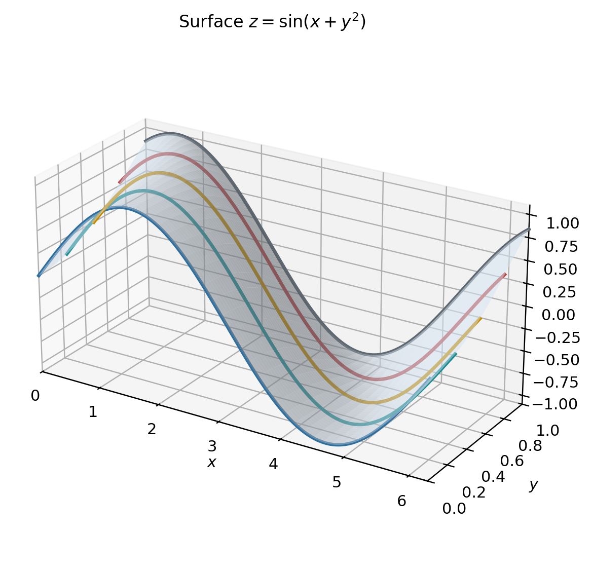
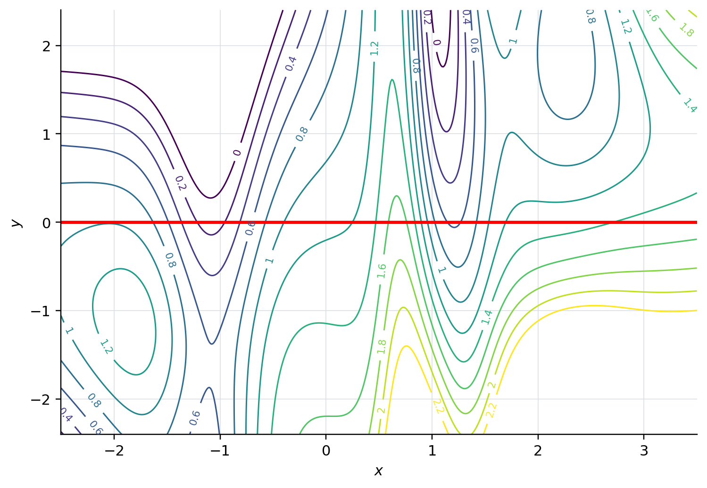
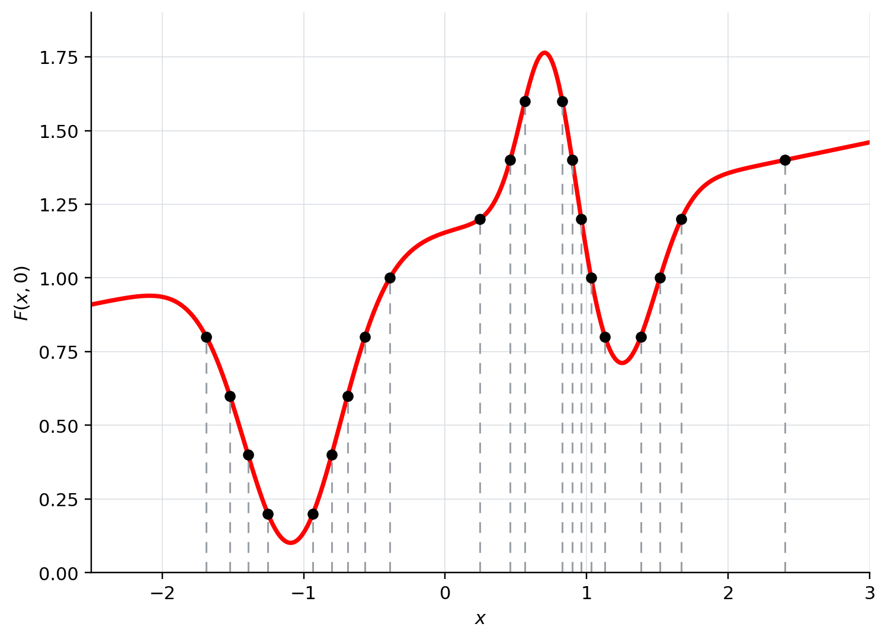
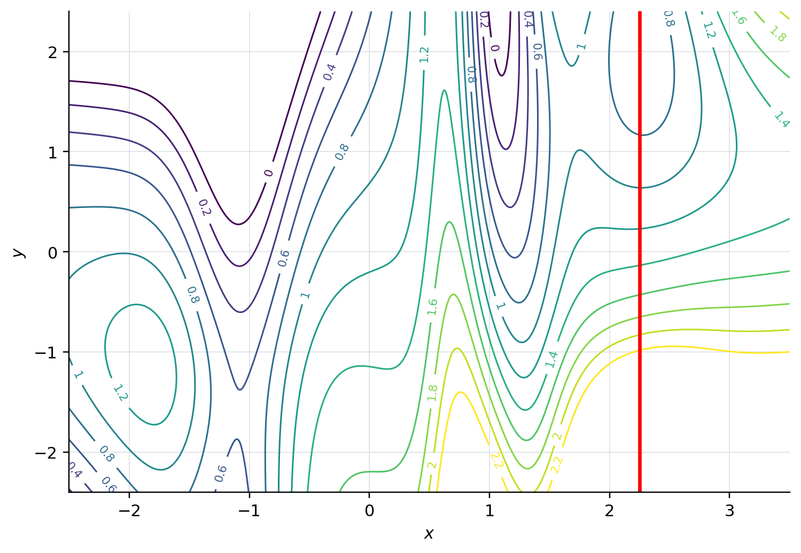
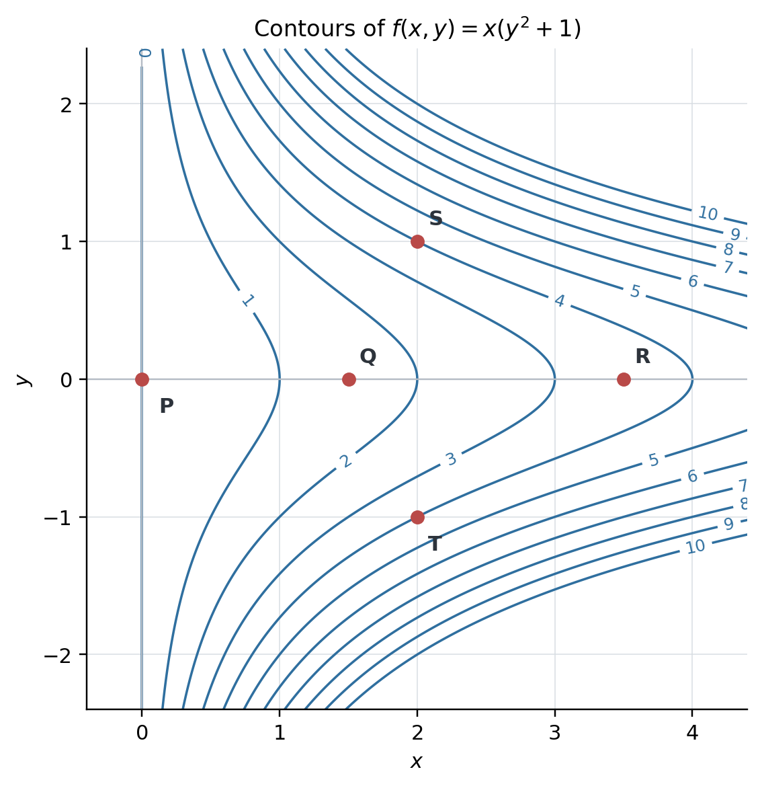

# 3.3 Partial Derivatives, Gradients, Hessians, and Jacobian Matrices {#33-partial-derivatives-gradients-hessians-and-jacobian-matrices}

!!! note "译文与来源"

    本页为教材公开源文件 v0.2 的非官方中文翻译，保留原公式、例题、活动、代码和习题；为适应网页阅读，例题与活动等编号按本地小节重排，解答可点击展开；正文与标题中的数学专有名词保留英文，中文用于解释；术语表保留中英对照以便查阅。原文作者：Jacob Denson、Kaitlyn Phillipson、Sebastien Roch。译文遵循 [CC BY-NC-SA 4.0](https://creativecommons.org/licenses/by-nc-sa/4.0/)。[阅读英文原文](3-3.md#sec-u3-partials-gradients-hessians-jacobians)。


<a id="textbook-body"></a>

## 教材正文 {#_4}

<a id="sec-u3-partials-gradients-hessians-jacobians"></a>


<a id="sec-partial-derivatives"></a>

## Partial Derivatives {#partial-derivatives}

### Definition and basic concepts {#definition-and-basic-concepts}

partial derivative 描述的是：只改变一个输入 coordinate、保持其他输入不变时，function 值的变化率。


<a id="def-u3-partial-derivatives"></a>

**定义 3.3.1：partial derivative**

令 $f(x,y)$ 为两个变量的 scalar-valued function。 $f$ 相对于 $x$ 在 $(a,b)$ 的 partial derivative 是 scalar 

$$
f_x(a,b) = \lim_{h \to 0} \frac{f(a+h,b) - f(a,b)}{h}
$$

前提是存在此 limit。类似地，如果存在 limit，则$f$相对于$y$在$(a,b)$处的 partial derivative 就是

$$
f_y(a,b) = \lim_{h \to 0} \frac{f(a,b+h) - f(a,b)}{h}
$$

我们通过将 $y$ 变量视为常数，并对 $x$ 进行微分，精确计算表达式的 $x$  partial derivative。类似地，我们通过将 $x$ 变量视为常数来计算 $y$ 中的 partial derivative。

**说明**

function $f(x,y)$的 partial derivative 有多种表示法，即，我们可以将$f_x(a,b)$写为

$$
\partial_x f(a,b) \quad \frac{\partial f}{\partial x}(a,b) \quad (D_x f)(a,b) \quad \text{or} \quad (D_1 f)(a,b)
$$

同样，我们将$f_y(a,b)$写为

$$
\partial_y f(a,b) \quad \frac{\partial f}{\partial y}(a,b) \quad (D_y f)(a,b) \quad \text{or} \quad (D_2 f)(a,b)
$$

符号$\partial$是程式化的小写拉丁文$d$，而不是希腊字母。它发音为“部分”，因此 $\frac{\partial f}{\partial x}$ 读作“部分 $f$ 超过部分 $x$”。

**例题 3.3.1：一个变量保持不变的 partial derivative (U3-LO3)**

让 

$$
f(x,y)=x^2-3xy+2y^2-4x+5y-12.
$$

分别求 $f_x(x,y)$ 和 $f_y(x,y)$；每次只对指定变量求导，另一个变量保持不变。

??? success "解答"

    要找到 $f_x(x,y)$，请保持 $y$ 不变。我们在[ general function 与 domain （General Functions and Domains）](3-1.md#sec-u3-general-functions-domains)中使用[单变量 derivative 规则](3-1.md#tab-u3-derivative-reminders)的和、幂、常数倍和常数规则。项 $-3xy$ 具有常数 coefficient $-3y$，而 $2y^2$、$5y$ 和 $-12$ 是常数项。逐项微分给出 

    $$
    \begin{aligned}
    f_x(x,y) &=\frac{\partial f}{\partial x}(x,y) \\
    &=2x-3y+0-4+0-0 \\
    &=2x-3y-4.
    \end{aligned}
    $$

    

    要找到 $f_y(x,y)$，请保持 $x$ 不变。我们使用相同的规则，现在针对 $y$ 进行求导。项 $-3xy$ 具有常数 coefficient $-3x$，而 $x^2$、$-4x$ 和 $-12$ 是常数项。逐项微分给出 

    $$
    \begin{aligned}
    f_y(x,y) &=\frac{\partial f}{\partial y}(x,y) \\
    &=0-3x+4y-0+5-0 \\
    &=-3x+4y+5.
    \end{aligned}
    $$

    

**活动 3.3.1：计算 first partial derivatives (U3-LO3)**

对于每个 function $f(x,y)$，找到$f_x(x,y)$和$f_y(x,y)$。

**问题**

$f(x,y) = 3x^2y+2x-3y$

??? success "解答"

    要查找 $f_x(x,y)$，请将 $y$ 视为常数：

    $$
    \begin{aligned}
    f_x(x,y) & = \frac{\partial}{\partial x}(3x^2y+2x-3y) \\
    & = 3 \cdot 2xy + 2 - 0 \\
    & = 6xy + 2
    \end{aligned}
    $$

    要查找 $f_y(x,y)$，请将 $x$ 视为常数：

    $$
    \begin{aligned}
    f_y(x,y) & = \frac{\partial}{\partial y}(3x^2y+2x-3y) \\
    & = 3x^2 \cdot 1 + 0 - 3 \\
    & = 3x^2 - 3
    \end{aligned}
    $$

**问题**

$f(x,y) = x\sin y + y\sin x$

??? success "解答"

    将$y$视为常数，我们发现

    $$
    \begin{aligned}
    f_x(x,y) & = \frac{\partial}{\partial x}(x\sin y + y\sin x) \\
    & = 1 \cdot \sin y + y \cdot \cos x \\
    & = \sin y + y\cos x
    \end{aligned}
    $$

    将$x$视为常数，我们发现

    $$
    \begin{aligned}
    f_y(x,y) & = \frac{\partial}{\partial y}(x\sin y + y\sin x) \\
    & = x \cdot \cos y + 1 \cdot \sin x \\
    & = x\cos y + \sin x
    \end{aligned}
    $$

**问题**

$f(x,y) = x^2e^{xy}$.

??? success "解答"

    要查找 $f_x(x,y)$，请将 $y$ 视为常数并使用乘积和链式规则：

    $$
    \begin{aligned}
    f_x(x,y) & = \frac{\partial}{\partial x}(x^2e^{xy}) \\
    & = \frac{\partial}{\partial x}(x^2) \cdot e^{xy} + x^2 \cdot \frac{\partial}{\partial x}(e^{xy}) \\
    & = 2x \cdot e^{xy} + x^2 \cdot e^{xy} \cdot \frac{\partial}{\partial x}(xy) \\
    & = 2x \cdot e^{xy} + x^2 \cdot e^{xy} \cdot y \\
    & = 2xe^{xy} + x^2ye^{xy} \\
    & = xe^{xy}(2 + xy)
    \end{aligned}
    $$

    要查找 $f_y(x,y)$，请将 $x$ 视为常数：

    $$
    \begin{aligned}
    f_y(x,y) & = \frac{\partial}{\partial y}(x^2e^{xy}) \\
    & = x^2 \cdot \frac{\partial}{\partial y}(e^{xy}) \\
    & = x^2 \cdot e^{xy} \cdot \frac{\partial}{\partial y}(xy) \\
    & = x^2 \cdot e^{xy} \cdot x \\
    & = x^3e^{xy}
    \end{aligned}
    $$

<a id="act-u3-sympy-first-partials"></a>

**活动 3.3.2：读取 SymPy (U3-LO3) 中的 first partial derivatives**

在 [ row reduction 代码活动](2-2.md#act-u2-reading-row-reduction-code) 中，SymPy 保持了 matrix 计算的精确性。它还可以求导符号表达。命令`sp.symbols("x y")`创建两个独立的符号，`sp.diff(f, x)`求导`f`相对于`x`，保持`y`固定。回想一下我们手工计算中的 function $f(x,y)=3x^2y+2x-3y$。

在 SymPy 中，`**` 表示求幂；例如，`x**2`代表$x^2$。


```python
import sympy as sp

x, y = sp.symbols("x y")
f = 3*x**2*y + 2*x - 3*y
fx = sp.diff(f, x)
fy = sp.diff(f, y)

print((fx, fy))
print((fx.subs({x: 1, y: 2}), fy.subs({x: 1, y: 2})))
```

输出：


```text
(6*x*y + 2, 3*x**2 - 3)
(14, 0)
```

命令 `.subs({x: 1, y: 2})` 将 $x=1$ 和 $y=2$ 替换为表达式。


1. 将第一个输出行中的两个表达式与 $f_x$ 和 $f_y$ 匹配。手动验证每一项。

2. 每个 derivative 中固定的是什么？解释第二个输出行中的两个数字。

3. `sp.diff(f.subs({x: 1, y: 2}), x)`会返回什么？为什么这无法计算$f_x(1,2)$？


??? success "解答"

    保持$y$固定，得到$f_x=6xy+2$；保持$x$固定给出$f_y=3x^2-3$。因此$f_x(1,2)=14$和$f_y(1,2)=0$。这些分别是当$x$随$y=2$变化时以及当$y$随$x=1$变化时$(1,2)$的瞬时变化率。

    首先将两个 coordinate 代入$f$，得到常数$f(1,2)=2$。它对$x$的 derivative 是$0$。要计算一点的 partial derivative，请先对表达式求导，然后代入 coordinate。


<a id="p-u3-prediction-loss-partials"></a>

对于[从预测到 scalar-valued loss function （U3-LO1、U2-LO1）](3-1.md#act-u3-prediction-loss-model)中的预测损失，每个输入 coordinate 都是一个模型权重。 partial derivative 将测量当我们调整一个权重同时保持另一个权重和观测数据固定时误差平方和如何变化。

### Geometric interpretation {#geometric-interpretation}

**定义 3.3.2：function 的切片**

给定 function $f(x,y)$和$b \in \mathbb{R}$， function $f$在平面$y = b$中的切片是由$g(x) = f(x,b)$给出的 function $g: \mathbb{R} \to \mathbb{R}$。类似地，对于$x \in \mathbb{R}$，$f$在平面$x = a$中的切片是由$g(y) = f(a,y)$给出的 function $g: \mathbb{R} \to \mathbb{R}$。

在几何上， function $f$ 在平面 $y = b$ 中的切片对应于将方程 $z = f(x,y)$ 给出的曲面与平面 $y = b$ 相交，从而在该平面中创建一条曲线。

**例题 3.3.2：绘制曲面切片 (U3-LO1)**

在平面 $y = b$ 中绘制 function $f(x,y) = \sin(x + y^2)$ 的切片。

??? success "解答"

    平面$y = b$中的切片是 function 

    $$
    g(x) = f(x,b) = \sin(x + b^2)
    $$

    该切片是一个相移为 $b^2$ 的正弦 function。有关这些切片的草图，请参阅[图 3.3.1](3-3.md#figu-8-5-graph-sin-x-y2-slices)。


    <a id="figu-8-5-graph-sin-x-y2-slices"></a>

    *$f(x,y) = \sin(x + y^2)$ 的图表显示了 $y$ 不同值的切片。每条曲线代表固定值 $y$ 的 function $f(x,y)$。改编自：斯坦福大学MATH 51教科书*

    


<a id="thm-8-5-geometric-interpretation-of-partial"></a>

**定理 3.3.1：几何解释**

如果我们考虑由方程 $z = f(x,y)$ 描述的 $\mathbb{R}^3$ 中的表面，则 
- $f_x(a,b)$是曲面$z = f(x,y)$与垂直平面$y = b$相交所形成的曲线的切线的 slope。

- $f_y(a,b)$是曲面$z = f(x,y)$与垂直平面$x = a$相交所形成的曲线的切线的 slope。


**活动 3.3.3：slope 形式的 partial derivative (U3-LO3)**

让$f(x,y) = 16 - x^2 - y^2$。找到 $f_x(1,2)$ 和 $f_y(1,2)$ 并将这些数字解释为特定曲线的 slope。

??? success "解答"

    我们计算出

    $$
    \begin{aligned}
    f_x(x,y) & = \frac{\partial}{\partial x}(16 - x^2 - y^2) \\
    & = 0 - 2x - 0 \\
    & = -2x
    \end{aligned}
    $$

    所以

    $$
    f_x(1,2) = -2(1) = -2
    $$

    这是通过将曲面 $z = 16 - x^2 - y^2$ 与方程 $y = 2$ 定义的平面在点 $(1,2,11)$ 相交而获得的 $xz$ 平面中的曲线 slope。即，此时曲线的切线由$z - 11 = -2 ( x - 1 )$给出。

    我们计算出

    $$
    \begin{aligned}
    f_y(x,y) & = \frac{\partial}{\partial y}(16 - x^2 - y^2) \\
    & = 0 - 0 - 2y \\
    & = -2y
    \end{aligned}
    $$

    所以

    $$
    f_y(1,2) = -2(2) = -4
    $$

    这是通过将曲面 $z = 16 - x^2 - y^2$ 与方程 $x = 1$ 定义的平面在点 $(1,2,11)$ 相交而获得的 $yz$ 平面中的曲线 slope。即，此时曲线的切线由$z - 11 = -4 ( y - 2 )$给出。


<a id="act-8-5-ex-contour-red-line"></a>

**活动 3.3.4：沿水平线读取 partial derivative (U3-LO3)**

考虑 [图 3.3.2](3-3.md#fig-8-5-contour-plot-example-increment-point2) 中显示的 function $F$ 的 contour plot，其 contour line 增量为 $0.2$。特别是，考虑从切片 $y = 0$ 获得的曲线，如 [图 3.3.2](3-3.md#fig-8-5-contour-plot-example-increment-point2) 中的红线所示。通过解释 level curve 图，我们可以了解该曲线的 slope，或者等效地，该直线上 $F_x$ 的值？


<a id="fig-8-5-contour-plot-example-increment-point2"></a>

*增量为 $0.2$ 的 function 的 contour plot。 $y = 0$ 行以红色表示。改编自：斯坦福大学MATH 51教科书*



??? success "解答"

    以下是我们可以从 level curve 图中读取的一些信息： 
    - 在$x = -1$和$x = 0$之间， level curve 值增加（从大约$0.2$到$1$），表明$F_x > 0$在此区域（function $F$正在增加）。

    - 在$x = 1$附近， level curve 非常接近， level curve 值减小，表明$F_x \lt 0$，并且$F_x$的幅度很大（曲线向下陡峭倾斜）。

    - 在$x = 1.5$和$x = 3$之间， level curve 值增加，表示$F_x > 0$。 （function $F$正在增加）。

    
     请参阅 [图 3.3.3](3-3.md#fig-8-5-slice-red-line) 的曲线图，以检查我们推论的是否正确。


    <a id="fig-8-5-slice-red-line"></a>

    * function $F(x,y)$ 的切片，其中 $y = 0$。虚线对应于 $x$ 轴上 $0.2$ 的增量。改编自：斯坦福大学MATH 51教科书*

    

**活动 3.3.5：沿垂直线读取 partial derivative (U3-LO3)**

考虑 [图 3.3.4](3-3.md#fig-8-5-contour-ex-2)，它与 [图 3.3.2](3-3.md#fig-8-5-contour-plot-example-increment-point2) 中的 contour plot 相同，但用垂直线 $x = 2.25$ 代替。如[沿水平线读取 partial derivative (U3-LO3)](3-3.md#act-8-5-ex-contour-red-line)所示，从 contour plot 中读出 partial derivative $F_y$的行为。


<a id="fig-8-5-contour-ex-2"></a>

*增量为 $0.2$ 的 contour plot，其中垂直线 $x = 2.25$ 以红色突出显示。改编自：斯坦福大学MATH 51教科书*



??? success "解答"

    以下是可以从 level curve 图中推断出的一些信息：
    - 当我们沿着红线增加 $y$ 时， level curve 值总是减小，因此 $F_y \lt 0$ 在这条线上。

    - contour line 在 $y = -1$ 附近最接近，因此 $F_y(2.25,y)$ 将在 $y = -1$ 附近的线上具有最大幅度。

    


一般来说， contour line 的间距对应于 partial derivative 的大小， partial derivative 的符号对应于 function 在该方向上是增加还是减少。

**活动 3.3.6：根据 contour plot 检查 derivative 符号 (U3-LO3)**

考虑 function $f(x,y) = x(y^2 + 1)$，其 level curve 图如[图 3.3.5](3-3.md#fig-8-5-contour-ex-3)所示。图上标记了五个点：$P = (0,0)$、$Q = (3/2,0)$、$R = (7/2,0)$、$S = (2,1)$ 和 $T = (2,-1)$。对于这五个点中的每一个，从 level curve 图中确定 $f_x$ 是正、负还是零，以及 $f_y$ 是正、负还是零。然后准确计算这些 derivative 并检查你的判断是否正确。


<a id="fig-8-5-contour-ex-3"></a>

*$f(x,y) = x(y^2 + 1)$ 的 contour plot，增量为 $1$，并指示五个点 $P$、$Q$、$R$、$S$ 和 $T$。改编自：斯坦福大学MATH 51教科书*



??? success "解答"

    在所有五个点处，$f_x > 0$，因为轮廓值随着$x$值的增加而增加。点$S$和$T$周围的 contour line 比$P$、$Q$和$R$周围的轮廓线更紧密，这表明$f_x$在$S$和$T$的幅度比在$P$的幅度更大， $Q$和$R$。

    在点$P$、$f_y = 0$，因为经过$P$的 contour line 是一条垂直直线。无法确定 $Q$ 和 $R$ 点处 $f_y$ 的符号，但我们知道 $f_y$ 的值一定很小，因为 contour line 比图中其他任何地方都更分散。在点$S$、$f_y > 0$，因为轮廓值随着$y$值的增加而增加。在点$T$、$f_y \lt 0$，因为 level curve 值减小。

    我们现在通过计算 partial derivative 来验证这些观察结果。我们检查

    $$
    \frac{\partial f}{\partial x} = y^2 + 1 \quad\text{and}\quad \frac{\partial f}{\partial y} = 2xy
    $$

    所以
    - $f_x(P) = f_x(0,0) = 1$和$f_y(P) = f_y(0,0) = 0$。

    - $f_x(Q) = f_x(3/2,0) = 1$和$f_y(Q) = f_y(3/2,0) = 0$。

    - $f_x(R) = f_x(7/2,0) = 1$和$f_y(R) = f_y(7/2,0) = 0$。

    - $f_x(S) = f_x(2,1) = 2$和$f_y(S) = f_y(2,1) = 4$。

    - $f_x(T) = f_x(2,-1) = 2$和$f_y(T) = f_y(2,-1) = -4$。

    


### Partial derivatives with more variables {#partial-derivatives-with-more-variables}

partial derivative 的概念自然延伸到两个以上变量的 function。

**定义 3.3.3**

对于 $n$ 变量的 function $f(\mathbf{x}) = f(x_1, \dots, x_n)$，如果存在此 limit，则相对于 $x_i$ 的 partial derivative 定义为 

$$
f_{x_i}(\mathbf{x}) = \lim_{h \to 0} \frac{f(x_1, \dots, x_i+h, \dots, x_n) - f(x_1, \ldots, x_n)}{h}
$$

使用 vector 表示法，我们可以通过编写 

$$
f_{x_i}(\mathbf{x}) = \lim_{h \to 0} \frac{f(\mathbf{x} + h \mathbf{e}_i) - f(\mathbf{x})}{h}
$$

来更清晰地编写这个定义，其中 $\mathbf{e}_1,\dots,\mathbf{e}_n$ 是 standard basis vector （回想一下 [ standard basis 的定义](1-3.md#def-2-2-standard-basis)）。这个 partial derivative 也写为

$$
\frac{\partial f}{\partial x_i} \quad \partial_{x_i} f \quad\text{or}\quad (D_i f)(\mathbf{x})
$$

如果变量$x_1,\dots,x_n$使用不同的符号表示，这些符号也可以用来表示 partial derivative。例如，在$\mathbb{R}^3$中，我们可以将 function 编写为$f(x,y,z)$，然后$f$的三个 partial derivative 可以使用以下四种符号中的任何一种来表示：
- $\frac{\partial f}{\partial x}$、$\frac{\partial f}{\partial y}$、$\frac{\partial f}{\partial z}$。

- $f_x, f_y$和$f_z$。

- $\partial_x f, \partial_y f$和$\partial_z f$。

- $D_1 f$、$D_2 f$、$D_3 f$。


对于两个变量的 function，我们可以通过处理所有变量来计算这些 derivative，但我们将 的 partial derivative 视为常数。

**活动 3.3.7：幂乘积的 partial derivative (U3-LO3)**

如果$f(x,y,z) = 5x^2y^2z^3$，则找到$f_x$、$f_y$和$f_z$。

??? success "解答"

    要查找 $f_x$，请将 $y$ 和 $z$ 视为常量：

    $$
    \begin{aligned}
    f_x(x,y,z) & = \frac{\partial}{\partial x}(5x^2y^2z^3) \\
    & = 5(2x)y^2z^3 \\
    & = 10xy^2z^3
    \end{aligned}
    $$

    

    要查找 $f_y$，请将 $x$ 和 $z$ 视为常量：

    $$
    \begin{aligned}
    f_y(x,y,z) & = \frac{\partial}{\partial y}(5x^2y^2z^3) \\
    & = 5x^2 (2y)z^3 \\
    & = 10x^2yz^3
    \end{aligned}
    $$

    

    要查找 $f_z$，请将 $x$ 和 $y$ 视为常量：

    $$
    \begin{aligned}
    f_z(x,y,z) & = \frac{\partial}{\partial z}(5x^2y^2z^3) \\
    & = 5x^2y^2(3z^2) \\
    & = 15x^2y^2z^2
    \end{aligned}
    $$

    

**活动 3.3.8：三变量多项式的 partial derivative (U3-LO3)**

查找 $f_x$、$f_y$ 和 $f_z$，其中 $f(x,y,z) = xy + yz + xz$。

??? success "解答"


    
    $$
    \begin{aligned}
    f_x(x,y,z) & = \frac{\partial}{\partial x}(xy + yz + xz) \\
    & = y + 0 + z \\
    & = y + z
    \end{aligned}
    $$

    


    
    $$
    \begin{aligned}
    f_y(x,y,z) & = \frac{\partial}{\partial y}(xy + yz + xz) \\
    & = x + z + 0 \\
    & = x + z
    \end{aligned}
    $$

    


    
    $$
    \begin{aligned}
    f_z(x,y,z) & = \frac{\partial}{\partial z}(xy + yz + xz) \\
    & = 0 + y + x \\
    & = x + y
    \end{aligned}
    $$

    

**活动 3.3.9：对数和指数的 partial derivative (U3-LO3)**

查找 $f_x$ 和 $f_y$，其中 $z = f(x,y) = x\ln y + ye^x$。

??? success "解答"


    
    $$
    \begin{aligned}
    f_x(x,y) & = \frac{\partial}{\partial x}(x\ln y + ye^x) \\
    & = \ln y + ye^x \\
    & = \ln y + ye^x
    \end{aligned}
    $$

    


    
    $$
    \begin{aligned}
    f_y(x,y) & = \frac{\partial}{\partial y}(x\ln y + ye^x) \\
    & = x \cdot \frac{1}{y} + 1 \cdot e^x \\
    & = \frac{x}{y} + e^x
    \end{aligned}
    $$

    

### Higher-order partial derivatives {#higher-order-partial-derivatives}

scalar-valued function 的 partial derivative 本身仍是一个 function；只要它还可以求导，就能继续得到 higher-order partial derivatives。

**定义 3.3.4**

如果$f$是两个变量的 function，则$f$的 second partial derivative 定义为： 
- derivative $f_{xx}$或$\frac{\partial^2 f}{\partial x^2}$，通过对$f$在$x$变量中求 partial derivative 两次而获得。

- derivative $f_{xy}=(f_x)_y$或$\frac{\partial^2 f}{\partial y \partial x}$，通过首先对$x$变量中的$f$微分，然后对$y$变量中的$f$微分而获得。

- derivative $f_{yx}=(f_y)_x$或$\frac{\partial^2 f}{\partial x \partial y}$，通过首先对$y$变量中的$f$微分，然后对$x$变量中的$f$微分而获得。

- derivative $f_{yy}$ 或 $\frac{\partial^2 f}{\partial y^2}$，通过对 $y$ 变量对 $f$ 进行两次微分而获得。


更一般地，对于 function $f(x_1,\dots,x_n)$，$1 \leq i,j \leq n$的 second partial derivative 为

$$
f_{x_i x_j}=(f_{x_i})_{x_j}=\frac{\partial^2 f}{\partial x_j \partial x_i}
$$

通过首先对$f$微分获得$x_i$变量，然后在$x_j$变量中。用运算符表示法来说，$f_{x_i x_j}=D_jD_i f$。下标从左到右记录微分顺序；微分运算符从右到左起作用。


<a id="thm-8-5-clairaut-theorem"></a>

**定理 3.3.2：克莱罗定理（Clairaut’s Theorem）**

设 scalar-valued function $f$ 在包含点 $\mathbf{a}$ 的 open ball $B$ 内有定义。如果 $f_{x_i x_j}$ 和 $f_{x_j x_i}$ 在球 $B$ 内都有定义且连续，那么 $f_{x_i x_j}(\mathbf{a}) = f_{x_j x_i}(\mathbf{a})$。

**活动 3.3.10：一阶和 second partial derivative (U3-LO3)**

在本活动中，我们计算 function $f(x,y) = x \ln y + y e^x$ 的所有四个 partial derivative。

**问题**

首先计算$f_x$和$f_y$。

??? success "解答"

    我们计算出

    $$
    f_x(x,y) = \ln y + y e^x
    $$

    和

    $$
    f_y(x,y) = x/y + e^x
    $$

**问题**

接下来，计算 $f_{xx}$ 和 $f_{yy}$。

??? success "解答"

    我们通过对 $x$ 变量中的 function $f_x(x,y) = \ln y + y e^x$求微分来计算$f_{xx}$，即

    $$
    f_{xx}(x,y) = y e^x
    $$

    类似地，我们通过对$y$变量中的 function $f_y(x,y) = x/y + e^x$求微分来计算$f_{yy}$，即

    $$
    f_{yy}(x,y) = -x/y^2
    $$

    

**问题**

现在计算$f_{xy}$和$f_{yx}$。

??? success "解答"

    我们通过对 $y$ 变量中的 function $f_x = \ln y + y e^x$ 求微分来计算 $f_{xy}$，从而得到 

    $$
    f_{xy}(x,y) = 1/y + e^x
    $$

    我们通过对 $x$ 变量中的 function $f_y = x/y + e^x$求微分来计算$f_{yx}$，从而得到

    $$
    f_{yx} = 1/y + e^x
    $$

    注意，正如 [克莱罗定理（Clairaut’s Theorem）](3-3.md#thm-8-5-clairaut-theorem) 所保证的，这两个 function 都是连续的，并且彼此相等。

**说明**

对于实践中遇到的大多数 function $f$， second partial derivative 在定义处是连续的，因此[克莱罗定理（Clairaut’s Theorem）](3-3.md#thm-8-5-clairaut-theorem)适用。然而，有些 function 的 mixed partial derivative 彼此并不相等。

**活动 3.3.11：对数的 second partial derivative (U3-LO3)**

求 function 

$$
f(x,y) = \ln(x^3 + y^2)
$$

的所有四个 second partial derivative。

??? success "解答"

    我们首先使用 chain rule 计算$f_x$和$f_y$，即计算

    $$
    f_x(x,y) = \frac{1}{x^3 + y^2} (3x^2) = \frac{3x^2}{x^3 + y^2}
    $$

    和

    $$
    f_y(x,y) = \frac{1}{x^3 + y^2} (2y) = \frac{2y}{x^3 + y^2}
    $$

    然后商规则告诉我们

    $$
    \begin{aligned}
    f_{xx} & = (f_x)_x \\
    & = \frac{(x^3 + y^2) (6x) - (3x^2) ( 3x^2 )}{(x^3 + y^2)^2} \\
    & = \frac{6x^4 + 6xy^2 - 9x^4}{(x^3 + y^2)^2}
    \end{aligned}
    $$

    $$
    \begin{aligned}
    f_{yy} & = (f_y)_y \\
    & = \frac{(x^3 + y^2) 2 - (2y)(2y)}{(x^3 + y^2)^2} \\
    & = \frac{2x^3 - 2y^2}{(x^3 + y^2)^2}
    \end{aligned}
    $$

    $$
    \begin{aligned}
    f_{yx} & = (f_y)_x \\
    & = \frac{(x^3 + y^2) (0) - (2y)(3x^2)}{(x^3 + y^2)^2} \\
    & = \frac{-6x^2y}{(x^3 + y^2)^2}
    \end{aligned}
    $$

     和

    $$
    \begin{aligned}
    f_{xy} & = (f_x)_y \\
    & = \frac{(x^3 + y^2)(0) - (3x^2)(2y)}{(x^3 + y^2)^2} \\
    & = \frac{-6x^2 y}{(x^3 + y^2)^2}
    \end{aligned}
    $$

<a id="act-u3-sympy-second-partials"></a>

**活动 3.3.12：在 SymPy (U3-LO3) 中读取重复和混合 derivative**

返回 [读取 SymPy (U3-LO3) 中的 first partial derivatives](3-3.md#act-u3-sympy-first-partials) 中的多项式。命令`sp.diff(f, x, 2)`相对于`x`求导两次。命令`sp.diff(f, x, y)`首先对`x`进行微分，然后对`y`进行微分；同样，它计算`sp.diff(sp.diff(f, x), y)`。


```python
import sympy as sp

x, y = sp.symbols("x y")
f = 3*x**2*y + 2*x - 3*y
dxx = sp.diff(f, x, 2)
d_x_then_y = sp.diff(f, x, y)
d_y_then_x = sp.diff(f, y, x)
dyy = sp.diff(f, y, 2)

print((dxx, d_x_then_y, d_y_then_x, dyy))
```

输出：


```text
(6*y, 6*x, 6*x, 0)
```


1. 使用本节的微分顺序约定，将每个输出与 $f_{xx}$、$f_{xy}$、$f_{yx}$ 或 $f_{yy}$ 匹配。

2. 从$f_x=6xy+2$和$f_y=3x^2-3$开始，手动验证四个输出。

3. 为什么[克莱罗定理（Clairaut’s Theorem）](3-3.md#thm-8-5-clairaut-theorem)适用于此功能？匹配输出是否为每个 function 建立了 mixed partial derivative 的相等性？


??? success "解答"

    输出依次为 $f_{xx}=6y$、$f_{xy}=6x$、$f_{yx}=6x$ 和 $f_{yy}=0$。最左侧的下标表示先进行的求导：`d_x_then_y` 表示 $f_{xy}=(f_x)_y$，`d_y_then_x` 表示 $f_{yx}=(f_y)_x$。将 $6xy+2$ 分别对 $x$ 和 $y$ 求导，得到 $6y$ 和 $6x$；将 $3x^2-3$ 分别对 $x$ 和 $y$ 求导，得到 $6x$ 和 $0$。

    该多项式处处具有连续的 second partial derivative，因此克莱洛定理保证了等式。输出检查这个特定的 function；它不会删除该定理对其他 function 的假设。


<a id="subsec-gradient-hessian"></a>

### Gradients and Hessians {#gradients-and-hessians}

gradient 将 scalar-valued function 的各个 first partial derivatives 排成一个 column vector。它同时记录各 coordinate 方向上的一阶变化率。


<a id="sec-8-5-gradient"></a>

**定义 3.3.5：gradient**

令 $f$ 为 $n$ 变量的 scalar-valued function。在$f$的所有 first partial derivatives都存在的点$\mathbf{x}$，$f$的 gradient 是 vector 

$$
(\nabla f)(\mathbf{x}) =
						\begin{bmatrix}
						\dfrac{\partial f}{\partial x_1}(\mathbf{x}) \\
						\vdots \\
						\dfrac{\partial f}{\partial x_n}(\mathbf{x})
						\end{bmatrix}
$$

当这些 vector 在整个域中定义时，它们形成 vector-valued function $\nabla f$。

符号$\nabla$，称为“nabla”（也称为“del”），类似于颠倒的首都三角洲，$\Delta$；它的名字来自希腊语中的竖琴一词。我们将$\nabla f$读作“$f$的 gradient”。


<a id="act-8-5-grad-ex-12"></a>

**活动 3.3.13：三角 function 的 gradient (U3-LO3)**

让$f(x,y) = \sin(x + y^2)$。求 $f$ 的 gradient。

??? success "解答"

    我们使用 chain rule 和[单变量 derivative 规则](3-1.md#tab-u3-derivative-reminders)在[ general function 与 domain （General Functions and Domains）](3-1.md#sec-u3-general-functions-domains)中的正弦 derivative。为了求导内部表达式 $x+y^2$，我们使用同一个表中的求和、幂和常数规则。

    保持$y$固定使得$y^2$成为常数，所以

    $$
    \begin{aligned}
    \dfrac{\partial f}{\partial x}(x,y) & = \cos(x+y^2)\dfrac{\partial}{\partial x}(x+y^2) \\
    & = \cos(x+y^2)(1+0) \\
    & = \cos(x+y^2).
    \end{aligned}
    $$

    

    固定 $x$ 会使 $x$ 成为常数，因此 

    $$
    \begin{aligned}
    \dfrac{\partial f}{\partial y}(x,y) & = \cos(x+y^2)\dfrac{\partial}{\partial y}(x+y^2) \\
    & = \cos(x+y^2)(0+2y) \\
    & = 2y\cos(x+y^2).
    \end{aligned}
    $$

    

    收集这些 partial derivative 得到 

    $$
    \nabla f(x,y) = \begin{bmatrix} \cos(x + y^2) \\ 2y \cos(x + y^2) \end{bmatrix}
    $$

<a id="act-8-5-nabla-f-ex"></a>

**活动 3.3.14：评估一点的 gradient (U3-LO3)**

让$f(x,y) = x^2 + xy + y^2$。计算$\nabla f(1,2)$。

??? success "解答"

    我们在[ general function 与 domain （General Functions and Domains）](3-1.md#sec-u3-general-functions-domains)中使用[单变量 derivative 规则](3-1.md#tab-u3-derivative-reminders)的和、幂、常数倍和常数规则。每个 partial derivative 将其他输入视为常数。

    保持$y$固定，$xy$是$x$的常数倍，而$y^2$是常数。于是

    $$
    \begin{aligned}
    \dfrac{\partial f}{\partial x}(x,y) & = \dfrac{\partial}{\partial x}(x^2)+y\dfrac{\partial}{\partial x}(x)+\dfrac{\partial}{\partial x}(y^2) \\
    & = 2x+y(1)+0 \\
    & = 2x+y.
    \end{aligned}
    $$

    

    保持$x$固定，$x^2$项是常数，$xy$是$y$的常数倍。于是

    $$
    \begin{aligned}
    \dfrac{\partial f}{\partial y}(x,y) & = \dfrac{\partial}{\partial y}(x^2)+x\dfrac{\partial}{\partial y}(y)+\dfrac{\partial}{\partial y}(y^2) \\
    & = 0+x(1)+2y \\
    & = x+2y.
    \end{aligned}
    $$

    

    收集这些 partial derivative 得到

    $$
    \nabla f(x,y) = \begin{bmatrix} 2x + y \\ x + 2y \end{bmatrix}
    $$

    特别是

    $$
    \nabla f(1,2) = \begin{bmatrix} 2(1) + (2) \\ (1) + 2(2) \end{bmatrix} = \begin{bmatrix} 4 \\ 5 \end{bmatrix}
    $$

Hessian matrix 收集 second partial derivative。


<a id="def-8-5-hessian"></a>

**定义 3.3.6**

设 $f$ 是有 $n$ 个变量的 scalar-valued function，且 $f$ 的 second partial derivative 在点 $\mathbf{x}$ 处存在。$f$ 在 $\mathbf{x}$ 处的 Hessian matrix 是由 second partial derivative 组成的 $n \times n$  matrix：

$$
H_f(\mathbf{x}) = \begin{bmatrix} \frac{\partial^2 f}{\partial x_1^2}(\mathbf{x}) & \frac{\partial^2 f}{\partial x_2 \partial x_1}(\mathbf{x}) & \cdots & \frac{\partial^2 f}{\partial x_n \partial x_1}(\mathbf{x}) \\ \frac{\partial^2 f}{\partial x_1 \partial x_2}(\mathbf{x}) & \frac{\partial^2 f}{\partial x_2^2}(\mathbf{x}) & \cdots & \frac{\partial^2 f}{\partial x_n \partial x_2}(\mathbf{x}) \\ \vdots & \vdots & \ddots & \vdots \\ \frac{\partial^2 f}{\partial x_1 \partial x_n}(\mathbf{x}) & \frac{\partial^2 f}{\partial x_2 \partial x_n}(\mathbf{x}) & \cdots & \frac{\partial^2 f}{\partial x_n^2}(\mathbf{x}) \end{bmatrix}
$$

也就是说，$H_f(\mathbf{x})$ 的 $(i,j)$ 元素为 $f_{x_i x_j}(\mathbf{x})$，先对 $x_i$ 求导，再对 $x_j$ 求导。第 $i$ 行是对 $f_{x_i}$ 分别关于各输入变量求导得到的。


<a id="rem-u3-hessian-symmetry"></a>

**注：Hessian matrix 的对称性**

当所有混合 second partial derivative 在$\mathbf{x}$周围的球上连续时， Hessian matrix 在$\mathbf{x}$处为[ symmetric matrix 的定义](1-2.md#def-symmetric-skew-symmetric)。事实上，对于每一对，[克莱罗定理（Clairaut’s Theorem）](3-3.md#thm-8-5-clairaut-theorem)给出$i \ne j$，

$$
\bigl(H_f(\mathbf{x})\bigr)_{ij}
					= \frac{\partial^2 f}{\partial x_j\partial x_i}(\mathbf{x})
					= \frac{\partial^2 f}{\partial x_i\partial x_j}(\mathbf{x})
					= \bigl(H_f(\mathbf{x})\bigr)_{ji}.
$$

因此跨主对角线反射的条目是相等的。 transpose 会交换这些条目并保持对角线不变，因此 

$$
H_f(\mathbf{x})^T = H_f(\mathbf{x}),
$$

正是 symmetric matrix 的定义条件。

特别是，两个变量的 scalar-valued function 的 Hessian matrix 可以写成 

$$
H_f = \begin{bmatrix} \frac{\partial^2 f}{\partial x^2} & \frac{\partial^2 f}{\partial y \partial x} \\ \frac{\partial^2 f}{\partial x \partial y} & \frac{\partial^2 f}{\partial y^2} \end{bmatrix} = \begin{bmatrix} f_{xx} & f_{xy} \\ f_{yx} & f_{yy} \end{bmatrix}
$$

**活动 3.3.15：三角 function 的 Hessian matrix (U3-LO3)**

求 function 

$$
f(x,y) = \sin(x + y^2)
$$

在一般点 $(x,y)$ 处的 Hessian matrix。

??? success "解答"

    我们首先计算 $f$ 的一阶和 second partial derivative。在[三角 function 的 gradient (U3-LO3)](3-3.md#act-8-5-grad-ex-12)中，我们计算出

    $$
    \begin{aligned}
    f_x(x,y) & = \cos(x + y^2), \\
    f_y(x,y) & = 2y \cos(x + y^2)
    \end{aligned}
    $$

    然后我们计算

    $$
    \begin{aligned}
    f_{xx} & = \frac{\partial}{\partial x} \{ f_x \} \\
    & = - \sin(x + y^2)
    \end{aligned}
    $$

    $$
    \begin{aligned}
    f_{yy} & = \frac{\partial}{\partial y} \{ f_y \} \\
    & = \frac{\partial}{\partial y} \{ 2y \cos(x + y^2) \} \\
    & = 2 \cos(x + y^2) - 2y \sin(x + y^2) (2y) \\
    & = 2 \cos(x + y^2) - 4y^2 \sin(x + y^2)
    \end{aligned}
    $$

    对于$f_{yx}$，我们将$f_y$与$x$微分，保持$y$固定。因此 $2y$ 是一个常数因子。我们使用常倍数和 chain rule，以及从[单变量 derivative 规则](3-1.md#tab-u3-derivative-reminders)到[ general function 与 domain （General Functions and Domains）](3-1.md#sec-u3-general-functions-domains)的余弦 derivative。求和和常数规则给出 $\frac{\partial}{\partial x}(x+y^2)=1+0$: 

    $$
    \begin{aligned}
    f_{yx} & = \frac{\partial}{\partial x} \{ f_y \} \\
    & = \frac{\partial}{\partial x} \{ 2y \cos(x + y^2) \} \\
    & = 2y\frac{\partial}{\partial x}\{\cos(x+y^2)\} \\
    & = 2y[-\sin(x+y^2)]\frac{\partial}{\partial x}(x+y^2) \\
    & = -2y\sin(x+y^2)(1+0) \\
    & = -2y \sin(x + y^2)
    \end{aligned}
    $$

    对于$f_{xy}$，我们将$f_x$与$y$微分，保持$x$固定。 chain rule 和[单变量 derivative 规则](3-1.md#tab-u3-derivative-reminders)中余弦的 derivative 给出了外 derivative；和、常数和幂规则给出内 derivative $\frac{\partial}{\partial y}(x+y^2)=0+2y$：

    $$
    \begin{aligned}
    f_{xy} & = \frac{\partial}{\partial y} \{ f_x \} \\
    & = \frac{\partial}{\partial y} \{ \cos(x + y^2) \} \\
    & = - \sin(x + y^2)(2y) \\
    & = -2y \sin(x + y^2)
    \end{aligned}
    $$

    因此

    $$
    \begin{aligned}
    & H_f(x,y) = \begin{bmatrix} f_{xx} & f_{xy} \\ f_{yx} & f_{yy} \end{bmatrix} \\
    & = \begin{bmatrix} - \sin(x + y^2) & - 2y \sin(x + y^2) \\ -2y \sin(x + y^2) & \begin{gathered}2 \cos(x + y^2) \\ {}- 4y^2\sin(x + y^2)\end{gathered} \end{bmatrix}
    \end{aligned}
    $$

**活动 3.3.16：二次 function 的 Hessian matrix (U3-LO3)**

求 function 

$$
f(x,y) = x^2 + xy + y^2
$$

在一般点$(x,y)$处的 Hessian matrix 

??? success "解答"

    我们计算

    $$
    f_{xx} = \frac{\partial}{\partial x} \{ 2x + y \} = 2,
    $$

    $$
    f_{xy} = \frac{\partial}{\partial y} \{ 2x + y \} = 1
    $$

    $$
    f_{yx} = \frac{\partial}{\partial x} \{ x + 2y \} = 1
    $$

    $$
    f_{yy} = \frac{\partial}{\partial y} \{ x + 2y \} = 2
    $$

    所以

    $$
    H_f(x,y) = \begin{bmatrix} f_{xx} & f_{xy} \\ f_{yx} & f_{yy} \end{bmatrix} = \begin{bmatrix} 2 & 1 \\ 1 & 2 \end{bmatrix}
    $$

**活动 3.3.17：三个变量中的 gradient 和 Hessian matrix (U3-LO3)**

让$f(x,y,z) = xy + yz + xz$。计算其在一般点$(x,y,z)$处的 gradient $\nabla f$和 Hessian matrix $H_f$。

??? success "解答"

    我们首先计算 gradient。我们计算

    $$
    f_x(x,y,z) = y + 0 + z
    $$

    $$
    f_y(x,y,z) = x + z + 0
    $$

    以及

    $$
    f_z(x,y,z) = 0 + y + x
    $$

    所以

    $$
    \nabla f(x,y,z) = \begin{bmatrix} y + z \\ x + z \\ y + x \end{bmatrix}
    $$

    接下来，我们计算 $f$ 的二阶 derivative。我们计算 $f_{xx} = f_{yy} = f_{zz} = 0$ 和 $f_{xy} = f_{xz} = f_{yx} = f_{yz} = f_{zx} = f_{zy} = 1$。所以

    $$
    H_f(x,y,z) = \begin{bmatrix} 0 & 1 & 1 \\ 1 & 0 & 1 \\ 1 & 1 & 0 \end{bmatrix}
    $$

<a id="act-u3-sympy-gradient-hessian"></a>

**活动 3.3.18：在 SymPy 中构建 gradient 和 Hessian matrix (U3-LO3)**

将 $f(x,y)=3x^2y+2x-3y$ 的 derivative 收集到 vector 和 matrix 中。与第 2 单元一样，`sp.Matrix([a, b])` 创建一个 column matrix，`.shape` 报告其 row 数和 column 数。命令 `sp.hessian(f, (x, y))` 构造 coordinate 为 $x,y$ 的 Hessian matrix。


```python
import sympy as sp

x, y = sp.symbols("x y")
f = 3*x**2*y + 2*x - 3*y
grad_f = sp.Matrix([sp.diff(f, x), sp.diff(f, y)])
H = sp.hessian(f, (x, y))

print(grad_f)
print(H)
print((grad_f.shape, H.shape))
```

输出：


```text
Matrix([[6*x*y + 2], [3*x**2 - 3]])
Matrix([[6*y, 6*x], [6*x, 0]])
((2, 1), (2, 2))
```


1. 用数学符号写出 gradient 和 Hessian matrix。为什么一个是$2\times1$ column，另一个是$2\times2$ matrix？

2. 预测`grad_f.subs({x: 1, y: 2})`和`H.subs({x: 1, y: 2})`。替换会改变任一形状吗？

3. `H[0, 1]` 中存储着什么 derivative ？解释 `H` 的对称性，以及为什么其右下角为零并不意味着 $f_y$ 完全为零。


??? success "解答"

     gradient 收集两个 first partial derivatives，而 Hessian matrix 收集四个 second partial derivative： 

    $$
    \nabla f(x,y)=\begin{bmatrix}6xy+2\\3x^2-3\end{bmatrix},\qquad H_f(x,y)=\begin{bmatrix}6y&6x\\6x&0\end{bmatrix}.
    $$

     在指定点，

    $$
    \nabla f(1,2)=\begin{bmatrix}14\\0\end{bmatrix},\qquad H_f(1,2)=\begin{bmatrix}12&6\\6&0\end{bmatrix}.
    $$

     评估条目使形状 $2\times1$ 和 $2\times2$ 保持不变。

    SymPy 使用从零开始的索引，因此 `H[0, 1]` 是第一行第二个 column 条目，$f_{xy}=6x$。 mixed partial derivative 一致，因为多项式满足 Clairaut 定理。归零项是$f_{yy}$：$f_y=3x^2-3$独立于$y$，但它不是归零 function。


<a id="act-u3-prediction-loss-derivatives"></a>

**活动 3.3.19：模型权重如何改变损失 (U3-LO3)**

对于[从预测到 scalar-valued loss function （U3-LO1、U2-LO1）](3-1.md#act-u3-prediction-loss-model)、

$$
\mathcal L(w_1,w_2)=(w_1-1)^2+(w_2-2)^2+(w_1+w_2-2)^2.
$$

中的固定数据，我们将继续使用起始权重$\mathbf{w}_0=(1,1)$。


1. 求 first partial derivatives并组装 $\nabla\mathcal L$。评价为$\mathbf{w}_0$。在保持其他重量固定的同时解释每个组件。

2. 计算 Hessian matrix $H_{\mathcal L}$。通过 matrix multiplication 验证数据 matrix $X$等于$2X^TX$。

3. $w_1$ 中的 first partial derivatives在 $\mathbf{w}_0$ 处消失。这是否意味着只要我们改变$w_1$，损失就不会改变？通过展开$\mathcal L(1+t,1)$来检查。


你可以使用 [在 SymPy 中构建 gradient 和 Hessian matrix (U3-LO3)](3-3.md#act-u3-sympy-gradient-hessian) 中的 SymPy 命令检查 derivative 公式。

??? success "解答"

    1. 一次微分一个权重可得到 

    $$
    \begin{aligned}
    \mathcal L_{w_1}(\mathbf{w})&=2(w_1-1)+2(w_1+w_2-2) \\
    &=4w_1+2w_2-6, \\
    \mathcal L_{w_2}(\mathbf{w})&=2(w_2-2)+2(w_1+w_2-2) \\
    &=2w_1+4w_2-8.
    \end{aligned}
    $$

     因此 

    $$
    \begin{aligned}
    \nabla\mathcal L(\mathbf{w})&=\begin{bmatrix}4w_1+2w_2-6\\2w_1+4w_2-8\end{bmatrix}, \\
    \nabla\mathcal L(1,1)&=\begin{bmatrix}0\\-2\end{bmatrix}.
    \end{aligned}
    $$

     在这些权重下，当 $w_2=1$ 固定时，$w_1$ 的瞬时变化率为零。在保持$w_1=1$的同时稍微增加$w_2$，$w_2$每增加一个单位，损失就会减少$2$个单位。

    2. 保持另一个权重固定，对每个权重的每个 first partial derivatives求导： 

    $$
    \begin{aligned}
    \mathcal L_{w_1w_1}(\mathbf{w})&=\frac{\partial}{\partial w_1}(4w_1+2w_2-6)=4, \\
    \mathcal L_{w_1w_2}(\mathbf{w})&=\frac{\partial}{\partial w_2}(4w_1+2w_2-6)=2, \\
    \mathcal L_{w_2w_1}(\mathbf{w})&=\frac{\partial}{\partial w_1}(2w_1+4w_2-8)=2, \\
    \mathcal L_{w_2w_2}(\mathbf{w})&=\frac{\partial}{\partial w_2}(2w_1+4w_2-8)=4.
    \end{aligned}
    $$

     这四个 second partial derivative 是常数，因此 Hessian matrix 为 

    $$
    H_{\mathcal L}(\mathbf{w})=\begin{bmatrix}4&2\\2&4\end{bmatrix}
                    =2\begin{bmatrix}1&0&1\\0&1&1\end{bmatrix}
                    \begin{bmatrix}1&0\\0&1\\1&1\end{bmatrix}
                    =2X^TX.
    $$

     它的条目描述了 first partial derivatives如何随着权重的变化而变化。

    3. 直接代入得到$\mathcal L(1+t,1)=t^2+(-1)^2+t^2=1+2t^2$。零 partial derivative 描述了$t=0$处的速率；二次项会改变每个非零 $t$ 的损失。这并不是[第二章](2-index.md)预测映射的一个完全被遗忘的方向。


<a id="subsec-more-on-jacobian-matrix"></a>

### Jacobian matrices {#jacobian-matrices}

对于 vector-valued map， Jacobian matrix 收集所有 component function 的 partial derivative。

这些行对应于组件功能。这些 column 描述了当一个输入 coordinate 发生变化时输出如何变化。

**定义 3.3.7：Jacobian matrix**

对于由 

$$
F(\mathbf{x}) = \begin{bmatrix} F_1(\mathbf{x}) \\ F_2(\mathbf{x}) \\ \vdots \\ F_m(\mathbf{x}) \end{bmatrix}
$$

给出的 vector-valued map $F: \mathbb{R}^n \to \mathbb{R}^m$，其中 $\mathbf{x} = (x_1, x_2, \ldots, x_n)$，$F$ 的 Jacobian matrix 是 $m \times n$  matrix： 

$$
J_F(\mathbf{x}) =
							\begin{bmatrix}
							\frac{\partial F_1}{\partial x_1} & \frac{\partial F_1}{\partial x_2} & \ldots & \frac{\partial F_1}{\partial x_n} \\
							\frac{\partial F_2}{\partial x_1} & \frac{\partial F_2}{\partial x_2} & \ldots & \frac{\partial F_2}{\partial x_n} \\
							\vdots & \vdots & \ddots & \vdots \\
							\frac{\partial F_m}{\partial x_1} & \frac{\partial F_m}{\partial x_2} & \ldots & \frac{\partial F_m}{\partial x_n}
							\end{bmatrix}
$$


Jacobian matrix 将 derivative 的概念推广到多个变量的 vector-valued map。它提供了 function 的所有 first partial derivatives的紧凑表示。

**活动 3.3.20：scalar-valued function 的 Jacobian matrix (U3-LO3)**

求 $f(x,y,z) = xy + yz + xz$ 的 Jacobian matrix。

??? success "解答"

    首先计算每个 partial derivative，保持其他两个变量固定：

    $$
    \begin{aligned}
    \frac{\partial f}{\partial x}(x,y,z) &= \frac{\partial}{\partial x}(xy+yz+xz) \\
    &= y+0+z=y+z, \\
    \frac{\partial f}{\partial y}(x,y,z) &= \frac{\partial}{\partial y}(xy+yz+xz) \\
    &= x+z+0=x+z, \\
    \frac{\partial f}{\partial z}(x,y,z) &= \frac{\partial}{\partial z}(xy+yz+xz) \\
    &= 0+y+x=x+y.
    \end{aligned}
    $$

    

    对于 scalar-valued function $f: \mathbb{R}^n \to \mathbb{R}$， Jacobian matrix 是 gradient 的 transpose，即$J_f = (\nabla f)^T$。将三个 partial derivative 按可变顺序 $x,y,z$：

    $$
    \begin{aligned}
    J_f(x,y,z) &= \begin{bmatrix} \dfrac{\partial f}{\partial x}(x,y,z) & \dfrac{\partial f}{\partial y}(x,y,z) & \dfrac{\partial f}{\partial z}(x,y,z) \end{bmatrix} \\
    &= \begin{bmatrix} y + z & x + z & x + y \end{bmatrix}.
    \end{aligned}
    $$

     排成一行

**活动 3.3.21：三 component 映射的 Jacobian matrix (U3-LO3)**

计算 $F(x,y) = ( x^2 - y^2, 2xy, x+y )$ 的 Jacobian matrix。

??? success "解答"

    我们计算出

    $$
    \begin{aligned}
    J_F & = \begin{bmatrix} \dfrac{\partial F_1}{\partial x} & \dfrac{\partial F_1}{\partial y} \\[6pt] \dfrac{\partial F_2}{\partial x} & \dfrac{\partial F_2}{\partial y} \\[6pt] \dfrac{\partial F_3}{\partial x} & \dfrac{\partial F_3}{\partial y} \end{bmatrix} \\
    & = \begin{bmatrix} 2x & -2y \\ 2y & 2x \\ 1 & 1 \end{bmatrix}
    \end{aligned}
    $$

**活动 3.3.22：gradient Jacobian matrix (U3-LO3)**

计算 $f(x,y) = x^2 + xy + y^2$ 的 gradient function $\nabla f(x,y)$ 的 Jacobian matrix。

??? success "解答"

    先计算 $f(x,y) = x^2 + xy + y^2$ 的 gradient：

    $$
    \begin{aligned}
    \frac{\partial f}{\partial x} &= 2x + y \\
    \frac{\partial f}{\partial y} &= x + 2y
    \end{aligned}
    $$

     因而 $\nabla f(x,y) = \begin{bmatrix} 2x + y \\ x + 2y \end{bmatrix}$。该 gradient 的 Jacobian matrix 是 

    $$
    \begin{aligned}
    J_{\nabla f} & = \begin{bmatrix} \dfrac{\partial (\nabla f)_1}{\partial x} & \dfrac{\partial (\nabla f)_1}{\partial y} \\[6pt] \dfrac{\partial (\nabla f)_2}{\partial x} & \dfrac{\partial (\nabla f)_2}{\partial y} \end{bmatrix} \\
    & = \begin{bmatrix} \dfrac{\partial}{\partial x}(2x+y) & \dfrac{\partial}{\partial y}(2x+y) \\[6pt] \dfrac{\partial}{\partial x}(x+2y) & \dfrac{\partial}{\partial y}(x+2y) \end{bmatrix} \\
    & = \begin{bmatrix} 2 & 1 \\ 1 & 2 \end{bmatrix}
    \end{aligned}
    $$

    也就是 $f$ 的 Hessian matrix，回顾[定义 3.3.6](3-3.md#def-8-5-hessian)。一般地，$J_{\nabla f}$ 的 $(i,j)$ 元素为 $(f_{x_i})_{x_j}=f_{x_i x_j}$，所以只要这些元素存在，就有 $J_{\nabla f}=H_f$。


<a id="note-u3-jacobian-gradient-hessian"></a>

**说明：Jacobian matrix、 gradient matrix 和 Hessian matrix**

对于 scalar-valued function $f:\mathbb{R}^n\to\mathbb{R}$， Jacobian matrix 只有一行，而[ gradient ](3-3.md#sec-8-5-gradient)中的 gradient 是 column vector。只要存在 first partial derivatives，

$$
J_f(\mathbf{x})
          =\begin{bmatrix}\dfrac{\partial f}{\partial x_1}(\mathbf{x}) & \cdots & \dfrac{\partial f}{\partial x_n}(\mathbf{x})\end{bmatrix}
          =\bigl(\nabla f(\mathbf{x})\bigr)^T.
$$

等价地，$\nabla f(\mathbf{x})=J_f(\mathbf{x})^T$。

如果 second partial derivative 也存在， gradient 的 Jacobian matrix 就是 Hessian matrix：

$$
J_{\nabla f}(\mathbf{x})=H_f(\mathbf{x}).
$$

因为 $\nabla f$ 的第 $i$ 个 component 是 $\partial f/\partial x_i$，所以其 Jacobian matrix 第 $i$  row、第 $j$  column 的元素，由[定义 3.3.6](3-3.md#def-8-5-hessian)可知是 

$$
\begin{aligned}
\bigl[J_{\nabla f}(\mathbf{x})\bigr]_{ij} & =\dfrac{\partial}{\partial x_j}\left(\dfrac{\partial f}{\partial x_i}\right)(\mathbf{x}) \\
& =\dfrac{\partial^2 f}{\partial x_j\partial x_i}(\mathbf{x})=\bigl[H_f(\mathbf{x})\bigr]_{ij},
\end{aligned}
$$

因此 $J_f$ 的 dimension 为 $1\times n$，$\nabla f$ 的 dimension 为 $n\times1$，$J_{\nabla f}=H_f$ 的 dimension 为 $n\times n$。


<a id="fact-u3-jacobian-affine-map"></a>

**事实 3.3.1：affine map 的 Jacobian matrix**

令$A$为$m\times n$ matrix，$\mathbf{b}\in\mathbb{R}^m$为固定 vector。来自 [ affine 的（Affine）](1-3.md#def-u1-affine-map)、

$$
F:\mathbb{R}^n\to\mathbb{R}^m,\qquad F(\mathbf{x})=A\mathbf{x}+\mathbf{b},
$$

的 affine map 具有常数 Jacobian matrix 

$$
J_F(\mathbf{x})=A.
$$

特别是， linear map $T(\mathbf{x})=A\mathbf{x}$ 具有 $J_T(\mathbf{x})=A$。对于 scalar 值 linear function $f(\mathbf{x})=\mathbf{c}\cdot\mathbf{x}$，这变为 

$$
J_f(\mathbf{x})=\mathbf{c}^T,\qquad \nabla f(\mathbf{x})=\mathbf{c}.
$$


??? info "证明"

    首先考虑 linear function。到[ linear function 与 dot product ](1-3.md#note-u1-linear-functions-dot-products)，它的形式为$f(\mathbf{x})=c_1x_1+\cdots+c_nx_n$。保持其他变量固定给出$\partial f/\partial x_j=c_j$，因此

    $$
    J_f(\mathbf{x})=\begin{bmatrix}c_1&\cdots& c_n\end{bmatrix}=\mathbf{c}^T.
    $$

    到[ Jacobian matrix、 gradient matrix 和 Hessian matrix ](3-3.md#note-u3-jacobian-gradient-hessian)，它的 gradient 就是 transpose $\nabla f(\mathbf{x})=\mathbf{c}$。

     linear map $T(\mathbf{x})=A\mathbf{x}$的 component function 本身就是 linear function：

    $$
    T_i(\mathbf{x})=a_{i1}x_1+\cdots+a_{in}x_n.
    $$

    将 scalar 结果应用于每个 component 给出$\partial T_i/\partial x_j=a_{ij}$。因此$J_T$的行$i$是$A$的行$i$，所以$J_T(\mathbf{x})=A$。

    最后， affine map的每个 component 都是$F_i=T_i+b_i$。常数 $b_i$ 的 partial derivative 为零，因此 $J_F(\mathbf{x})=J_T(\mathbf{x})=A$。


<a id="act-u3-sympy-jacobian-of-gradient"></a>

**活动 3.3.23：检查 SymPy (U3-LO3) 中 gradient 的 Jacobian matrix**

命令 `F.jacobian([x, y])` 求导 SymPy column matrix `F` 的每个 component。行遵循 `F` 中的组件顺序； column 遵循变量顺序 `[x, y]`。将 scalar-valued function $f(x,y)=3x^2y+2x-3y$ 与其 vector 值 gradient 进行比较。在 SymPy 中，`.jacobian()` 是 `Matrix` 方法，因此我们将 scalar 表达式 `f` 包装在单项 matrix `sp.Matrix([f])` 中。


```python
import sympy as sp

x, y = sp.symbols("x y")
f = 3*x**2*y + 2*x - 3*y
grad_f = sp.Matrix([sp.diff(f, x), sp.diff(f, y)])
J_f = sp.Matrix([f]).jacobian([x, y])
J_grad = grad_f.jacobian([x, y])
H = sp.hessian(f, (x, y))

print(J_f)
print(J_grad)
print(J_grad - H)
```

输出：


```text
Matrix([[6*x*y + 2, 3*x**2 - 3]])
Matrix([[6*y, 6*x], [6*x, 0]])
Matrix([[0, 0], [0, 0]])
```


1. 为什么`J_f`有一行，而`J_grad`有两行？给出每个映射的输入与输出的 dimension。

2. `J_f` 与 `grad_f` 有什么关系？解释`J_grad`的第一行第二个 column。

3. zero matrix 验证什么身份？这是某一点的比较还是该多项式的符号比较？


??? success "解答"

    映射 $f:\mathbb{R}^2\to\mathbb{R}$ 有一个 component，因此 $J_f$ 具有形状 $1\times2$。映射 $\nabla f:\mathbb{R}^2\to\mathbb{R}^2$ 有两个组件，因此 $J_{\nabla f}$ 具有形状 $2\times2$。 scalar Jacobian matrix 是 gradient 的 transpose：$J_f=(\nabla f)^T$，用`grad_f.T`表示。

    $J_{\nabla f}$ 的第一个 row，来自对第一个 component $f_x=6xy+2$ 分别关于 $x$、$y$ 求导。它的第二个 column，则收集各 components 关于 $y$ 的 partial derivatives。结果分别是 $\begin{bmatrix}6y&6x\end{bmatrix}$ 和 $\begin{bmatrix}6x\\0\end{bmatrix}$。

    零差验证了该多项式的$J_{\nabla f}=H_f$。没有点被替换：对于所有 $(x,y)\in\mathbb{R}^2$，符号差异的每个条目都为零。
