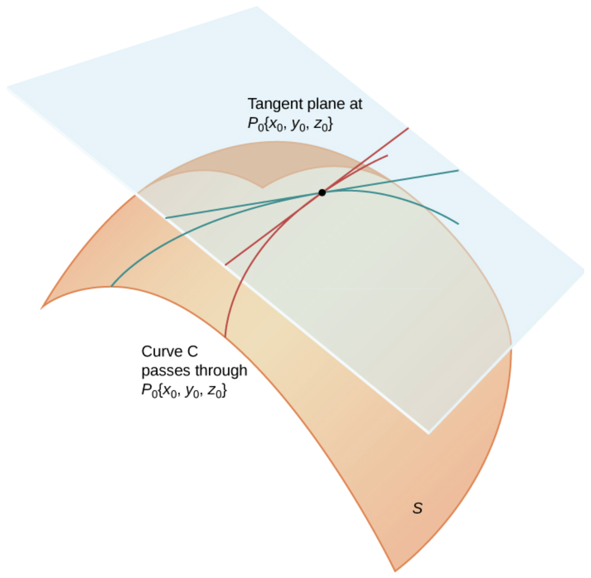
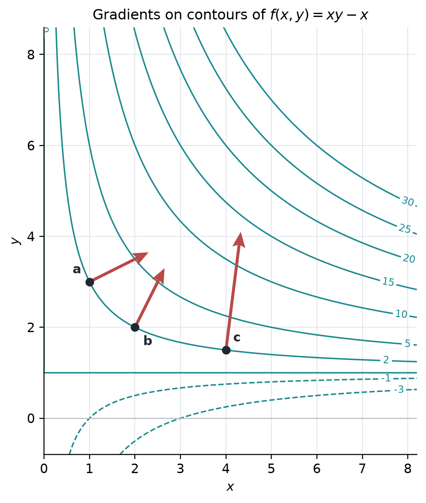
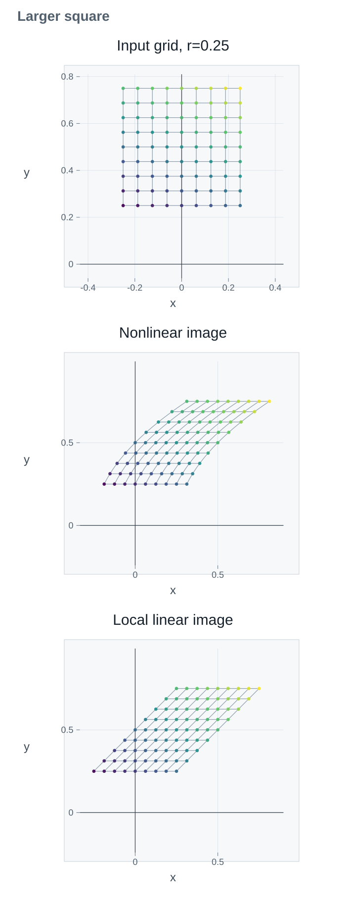
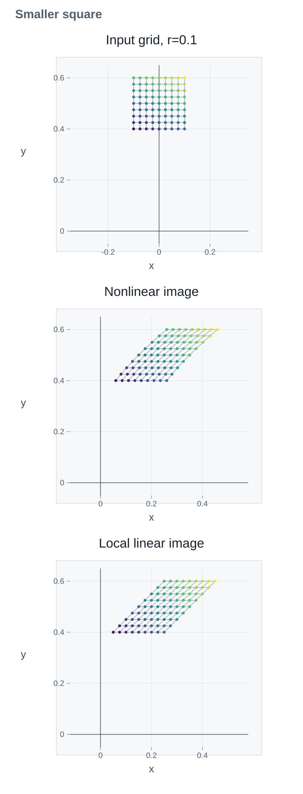

# 3.4 Local Linearization and Differentiability {#34-local-linearization-and-differentiability}

!!! note "译文与来源"

    本页为教材公开源文件 v0.2 的非官方中文翻译，保留原公式、例题、活动、代码和习题；为适应网页阅读，例题与活动等编号按本地小节重排，解答可点击展开；正文与标题中的数学专有名词保留英文，中文用于解释；术语表保留中英对照以便查阅。原文作者：Jacob Denson、Kaitlyn Phillipson、Sebastien Roch。译文遵循 [CC BY-NC-SA 4.0](https://creativecommons.org/licenses/by-nc-sa/4.0/)。[阅读英文原文](3-4.md#sec-u3-local-linearization-differentiability)。


<a id="textbook-body"></a>

## 教材正文 {#_5}

<a id="sec-u3-local-linearization-differentiability"></a>


<a id="sec-tangent-planes"></a>

## Tangent planes and scalar local linearization {#tangent-planes-and-scalar-local-linearization}

### Linear Approximations and Differentiability {#linear-approximations-and-differentiability}

回顾单变量情形：function $f: \mathbb{R} \to \mathbb{R}$ 在 $a$ 附近，可以用 affine function $L(x) = f(a) + f\prime(a) (x - a)$ 近似。它经过原 graph 上的点，并在该点具有相同的 slope：

$$
f(x) \approx f(a) + f'(a)(x-a).
$$

同样， function 的 partial derivative 可用于定义多个变量 function 的局部逼近。


<a id="def-9-1-linear-approximation"></a>

**定义 3.4.1：linear approximation**

给定 scalar-valued function $f$，设 $\mathbf{a}$ 是 $f$  domain 中的一点，且 $f$ 的 partial derivative 在此处存在。$f$ 在点 $\mathbf{a}$ 处的 linear approximation 是 affine function 

$$
L(\mathbf{x}) = f(\mathbf{a}) + (\nabla f)(\mathbf{a})^T(\mathbf{x} - \mathbf{a}) = f(\mathbf{a}) + (\nabla f)(\mathbf{a}) \cdot (\mathbf{x} - \mathbf{a})
$$

展开 dot product，可得到 

$$
L(\mathbf{x}) = f(\mathbf{a}) + \sum_{i = 1}^n \dfrac{\partial f}{\partial x_i}(\mathbf{a}) (x_i - a_i)
$$

特别是，两个变量 $f(x,y)$ 在点 $(a,b)$ 的 scalar-valued function 的 linear approximation 由 

$$
L(x,y) = f(a,b) + \frac{\partial f}{\partial x}(a,b) (x - a) + \frac{\partial f}{\partial y}(a,b) (y - b)
$$

给出。

$\mathbf{x}$中的近似值为[ affine 的（Affine）](1-3.md#def-u1-affine-map)；它的 linear 部分是小输入变化上的映射$\mathbf{h} \mapsto (\nabla f)(\mathbf{a})^T\mathbf{h}$。


<a id="note-u3-linear-part-dot-product"></a>

**说明**


<a id="p-u3-linear-part-dot-product"></a>

固定参考点 $\mathbf{a}$ 后，gradient $\nabla f(\mathbf{a})$ 也是固定 vector。根据 [linear function 与 dot product 的关系](1-3.md#note-u1-linear-functions-dot-products)，将输入变化 $\mathbf{h}$ 与它做 dot product，就得到关于 $\mathbf{h}$ 的 [linear function](1-3.md#def-u1-linear-function)：

$$
\ell_{\mathbf{a}}(\mathbf{h})=\nabla f(\mathbf{a})\cdot\mathbf{h}.
$$

这是近似的 linear 部分。取$\mathbf{x}=\mathbf{a}+\mathbf{h}$，我们可以写出

$$
L(\mathbf{a}+\mathbf{h})=f(\mathbf{a})+\ell_{\mathbf{a}}(\mathbf{h}).
$$


现在假设单个变量的 scalar-valued function $f$ 在点 $a$ 处 differentiable，即存在 limit 

$$
f'(a) = \lim_{x \to a} \frac{f(x) - f(a)}{x - a}
$$

对于$x\ne a$，从差商中减去$f'(a)$并使用公分母$x-a$得出

$$
\begin{aligned}
\frac{f(x)-f(a)}{x-a}-f'(a) &= \frac{f(x)-f(a)}{x-a}-\frac{f'(a)(x-a)}{x-a} \\
&= \frac{f(x)-f(a)-f'(a)(x-a)}{x-a}.
\end{aligned}
$$

因此，

$$
\lim_{x \to a} \frac{f(x) - f(a) - f'(a)(x - a)}{x - a} = 0
$$

或者将分子识别为$f(x)-L(x)$，

$$
\lim_{x \to a} \frac{f(x) - L(x)}{x - a} = 0
$$

其中$L(x) = f(a) + f'(a)(x - a)$ 是 $f$ 在 $a$ 的 linear approximation。当相同的性质成立时，多个变量的 function 是 differentiable 的，并且 linear approximation 由 function 的 partial derivative 给出。


<a id="def-9-1-differentiability"></a>

**定义 3.4.2：differentiability**

scalar-valued function $f$ 在点 $\mathbf{a}$ 处 differentiable，是指 $f$ 的 gradient 在 $\mathbf{a}$ 处有定义，并且 

$$
\lim_{\mathbf{x} \to \mathbf{a}} \frac{f(\mathbf{x}) - L(\mathbf{x})}{\| \mathbf{x} - \mathbf{a} \|} = 0
$$

其中 

$$
L(\mathbf{x}) = f(\mathbf{a}) + (\nabla f)(\mathbf{a})^T(\mathbf{x} - \mathbf{a}) = f(\mathbf{a}) + (\nabla f)(\mathbf{a}) \cdot (\mathbf{x} - \mathbf{a})
$$

是 $f$ 在 $\mathbf{a}$ 处的 linear approximation。 vector-valued function 在某点 differentiable，当且仅当它的每个 component function 都在该点 differentiable。

**说明**

仅当$L$是$\mathbf{a}$附近$f$的良好 linear approximation 时，方程

$$
\lim_{\mathbf{x} \to \mathbf{a}} \frac{f(\mathbf{x}) - L(\mathbf{x})}{\| \mathbf{x} - \mathbf{a} \|} = 0
$$

才能成立，因此当$\mathbf{x}$接近$\mathbf{a}$时，分子的大小远小于分母的大小，即，当$\| \mathbf{x} - \mathbf{a} \|$很小。

以下定理是我们确定 function 是否 differentiable 的主要方法。


<a id="thm-9-1-continuity-of-partials-difeferntiability"></a>

**定理 3.4.1：first partial derivatives连续蕴含 differentiability （Continuity of First Partials Implies Differentiability）**

设 $f$ 是 scalar-valued function，$\mathbf{a}$ 是 $f$ 及其各 partial derivative domain 的 interior point， interior point 的定义见[ interior point、 boundary 与 closed set （Interior, Boundary, and Closed Sets）](3-1.md#sec-8-4-interior-and-exterior)。再假设所有 partial derivative $f_{x_1}, \dots, f_{x_n}$ 在 $\mathbf{a}$ 处连续，那么 $f$ 在 $\mathbf{a}$ 处 differentiable。

??? info "证明"

    这是两个变量的直觉。要从 $(a,b)$ 移动到附近的点 $(a+h,b+k)$，请一次更改一个 coordinate： 

    $$
    (a,b) \longrightarrow (a+h,b) \longrightarrow (a+h,b+k).
    $$

     每一步只改变一个变量，因此都能使用单变量的 linear approximation。由于 partial derivatives 连续，这些短路径上的 slope 都接近参考点处的值。于是：

    $$
    \begin{aligned}
    f(a+h,b)-f(a,b) &\approx f_x(a,b)h, \\
    f(a+h,b+k)-f(a+h,b) &\approx f_y(a,b)k.
    \end{aligned}
    $$

    

    将两个变化相加会取消中间点处的值，并给出 

    $$
    f(a+h,b+k)-f(a,b) \approx f_x(a,b)h+f_y(a,b)k.
    $$

     在两侧添加 $f(a,b)$ 会给出新点处的值的近似值： 

    $$
    f(a+h,b+k) \approx f(a,b)+f_x(a,b)h+f_y(a,b)k.
    $$

     这就解释了近似式中的各个 coefficients：每个 partial derivative 给出相应 coordinate 方向上的单位变化率。由 continuity，可用参考点的 slope 近似附近的 slope；而 slope 的误差还要乘上很小的输入变化，所以最终只留下更高阶的误差。

    在$n$变量中，同样的想法使用$n$ coordinate step size。将它们的贡献相加得到 linear approximation 

    $$
    \begin{aligned}
    L(\mathbf{a}+\mathbf{h}) &= f(\mathbf{a})+\sum_{i=1}^n f_{x_i}(\mathbf{a})h_i \\
    &= f(\mathbf{a})+\nabla f(\mathbf{a})\cdot\mathbf{h}.
    \end{aligned}
    $$

    

**活动 3.4.1：三个变量的 linear approximation (U3-LO4)**

考虑 function 

$$
f(x,y,z) = x^2y + yz^2
$$

**问题**

求 $f$ 在点 $(1,2,0)$ 的 linear approximation。

??? success "解答"

    我们首先找到 $f$ 在 $(1,2,0)$ 的 gradient。我们计算

    $$
    \frac{\partial f}{\partial x} = 2xy
    $$

    $$
    \frac{\partial f}{\partial y} = x^2 + z^2
    $$

    和

    $$
    \frac{\partial f}{\partial z} = 2yz
    $$

    因此，在 $(1,2,0)$ 处评估这些数量，我们发现 

    $$
    \nabla f(1,2,0) = \begin{bmatrix} 2(1)(2) \\ (1)^2 + (0)^2 \\ 2(2)(0) \end{bmatrix} = \begin{bmatrix} 4 \\ 1 \\ 0 \end{bmatrix}
    $$

    我们还计算出

    $$
    f(1,2,0) = (1)^2(2) + (2)(0)^2 = 2
    $$

    因此，在 $(1,2,0)$ 处$f$ 的 linear approximation 是 function 

    $$
    \begin{aligned}
    L(x,y,z) & = 2 + \begin{bmatrix} 4 & 1 & 0 \end{bmatrix} \begin{bmatrix} x-1 \\ y-2 \\ z-0 \end{bmatrix} \\
    & = 2 + 4(x-1) + 1(y - 2) \\
    & = 4x + y - 4
    \end{aligned}
    $$

**问题**

使用前面求出的 linear approximation 值来近似值 $f(1.04,1.97,0.05)$。

??? success "解答"

    我们计算$f$的 linear approximation 是 function 

    $$
    L(x,y,z) = 2 + 4(x-1) + (y - 2)
    $$

    所以

    $$
    \begin{aligned}
    f(1.04,1.97,0.05) & \approx L(1.04,1.97,0.05) \\
    & = 2 + 4(0.04) + (-0.03) \\
    & = 2 + 0.16 - 0.03 \\
    & = 2.13
    \end{aligned}
    $$

<a id="act-u3-prediction-loss-linearization"></a>

**活动 3.4.2：预测拟合误差的变化 (U3-LO4)**

对于[从预测到 scalar-valued loss function （U3-LO1、U2-LO1）](3-1.md#act-u3-prediction-loss-model)中的预测损失，[模型权重如何改变损失 (U3-LO3)](3-3.md#act-u3-prediction-loss-derivatives)给出

$$
\mathcal L(\mathbf{w}_0)=1,\qquad \nabla\mathcal L(\mathbf{w}_0)=\begin{bmatrix}0\\-2\end{bmatrix},\qquad \mathbf{w}_0=(1,1).
$$

假设我们将两个权重都增加$1/10$，因此$\mathbf{h}=(1/10,1/10)$。


1. 求 $\mathbf{w}_0$ 附近的 affine 近似 $\widehat{\mathcal L}(\mathbf{w})$。用它来预测损失的变化和$\mathbf{w}_0+\mathbf{h}$处的新损失。

2. 计算新的预测 $X(\mathbf{w}_0+\mathbf{h})$、 residual 和精确损失。将精确损失与 affine 预测进行比较。

3. 对于任意更改$\mathbf{h}=(h_1,h_2)$，请展开$\mathcal L(\mathbf{w}_0+\mathbf{h})$。证明近似误差为 $\|X\mathbf{h}\|^2$。如果变化减半，这个错误会发生什么？


??? success "解答"

    1. 近似值是

    $$
    \widehat{\mathcal L}(\mathbf{w})
                    =1+\begin{bmatrix}0&-2\end{bmatrix}
                    \begin{bmatrix}w_1-1\\w_2-1\end{bmatrix}
                    =1-2(w_2-1).
    $$

    预测的变化是$-2/10=-1/5$，预测的新损失是$4/5=0.8$。

    2. 在新权重 $(11/10,11/10)$、

    $$
    \begin{aligned}
    X(\mathbf{w}_0+\mathbf{h})&=\begin{bmatrix}11/10\\11/10\\11/5\end{bmatrix}, \\
    R(\mathbf{w}_0+\mathbf{h})&=\begin{bmatrix}1/10\\-9/10\\1/5\end{bmatrix}.
    \end{aligned}
    $$

     下，确切的损失是 $1/100+81/100+1/25=43/50=0.86$。损失减少了，但 affine 近似将新损失低估了 $3/50=0.06$。

    3. 将三个 residual 平方展开得到 

    $$
    \begin{aligned}
    \mathcal L(\mathbf{w}_0+\mathbf{h})&=h_1^2+(-1+h_2)^2+(h_1+h_2)^2 \\
    &=1-2h_2+h_1^2+h_2^2+(h_1+h_2)^2.
    \end{aligned}
    $$

     前两项给出 affine 近似。剩下的项是 

    $$
    \left\|\begin{bmatrix}h_1\\h_2\\h_1+h_2\end{bmatrix}\right\|^2
                    =\|X\mathbf{h}\|^2.
    $$

     将 $\mathbf{h}$ 减半 $X\mathbf{h}$，因此其平方长度被四等分。单元 1 的 matrix-vector product 给出了精确的预测变化；损失变化也包含这些二次项。


<a id="subsubsec-u3-tangent-planes"></a>

### Tangent planes {#tangent-planes}


<a id="act-9-1-find-plane-generated-by-lines"></a>

**活动 3.4.3：包含两条线的平面 (U2-LO1)**

找到包含线 $L_1$ 和 $L_2$ 的平面方程，其中 $L_1$ 是由 function 

$$
\mathbf{r}_1(t) =
							\begin{bmatrix} 1 \\ 1 \\ -2 \end{bmatrix}
							+ t
							\begin{bmatrix} 2 \\ 3 \\ 1 \end{bmatrix}
$$

  parameterization 的线，而 $L_2$ 是由 function 

$$
\mathbf{r}_2(s) =
							\begin{bmatrix} 1 \\ 1 \\ -2 \end{bmatrix}
							+ s
							\begin{bmatrix} -3 \\ 1 \\ 4 \end{bmatrix}
$$

  parameterization 的线。

??? success "解答"

    我们使用类似于[过三个点的平面](2-2.md#act-u2-plane-through-three-points-no-cross)中的方法。回想一下 [ normal vector 方程的定义](2-2.md#def-1-2-normal-vector-equation)，它通过 $\mathbf{n} \cdot (\mathbf{x} - \mathbf{x}_0) = 0$ 形式的方程指定一个平面，其中 $\mathbf{n}$ 是垂直于平面的 vector，$\mathbf{x}_0$ 是平面上的点。我们可以拿$\mathbf{x}_0 = (1,1,-2)$。为了使$\mathbf{n}$成为包含$L_1$和$L_2$的平面的法线 vector，它必须垂直于两个方向 vector $(2,3,1)$和$(-3,1,4)$，即，我们必须有$\mathbf{n} \cdot (2,3,1) = \mathbf{n} \cdot (-3,1,4) = 0$。如果我们写 $\mathbf{n} = (a,b,c)$，那么扩展这些 dot product 就会得到一个homogeneous system 

    $$
    \begin{aligned}
    2a + 3b + c & = 0 \\
    -3a + b + 4c & = 0
    \end{aligned}
    $$

    将左侧转换为 matrix 形式，即将homogeneous system写为 

    $$
    \begin{bmatrix} 2 & 3 & 1 \\ -3 & 1 & 4 \end{bmatrix} \begin{bmatrix} a \\ b \\ c \end{bmatrix} = \mathbf{0}
    $$

    回想一下[ homogeneous system ](2-2.md#sec-homogeneous-equations)，我们通过对左边的 matrix 进行row operations来求解这个homogeneous system，从中我们得到

    $$
    \begin{aligned}
    & \begin{bmatrix}
    						2 & 3 & 1\\
    						-3 & 1 & 4
    						\end{bmatrix} \xrightarrow[\text{$R_2 \to R_2 + \frac{3}{2}R_1$}]{\text{$R_1 \to \frac{1}{2}R_1$}}
    						\begin{bmatrix}
    						1 & \frac{3}{2} & \frac{1}{2}\\
    						0 & \frac{11}{2} & \frac{11}{2}
    						\end{bmatrix} \\
    & \quad \xrightarrow[\text{$R_1 \to R_1 - \frac{3}{11}R_2$}]{\text{$R_2 \to \frac{2}{11}R_2$}}
    						\begin{bmatrix}
    						1 & 0 & -1\\
    						0 & 1 & 1
    						\end{bmatrix}
    \end{aligned}
    $$

    这个行约简告诉我们，上面的homogeneous system等价于系统

    $$
    \begin{aligned}
    a - c & = 0 \\
    b + c & = 0
    \end{aligned}
    $$

    设置$c = 1$给出 normal vector $\mathbf{n} = (1,-1,1)$，齐次方程的任何解都是该 vector 的 scalar 倍数（回顾[ homogeneous system 的 basic solution ](2-2.md#def-1-3-homog-basic-solutions)中的术语，它是一个基本解）。因此，方程

    $$
    \begin{bmatrix} 1 \\ -1 \\ 1 \end{bmatrix}
    							\cdot
    							\left(
    								\mathbf{x} -
    								\begin{bmatrix} 1 \\ 1 \\ -2 \end{bmatrix}
    							\right)
    							= 0
    $$

    是平面方程，如果我们写成$\mathbf{x} = (x,y,z)$，它可以展开为

    $$
    (1)(x - 1) + (-1)(y - 1) + (1)(z + 2) = 0
    $$

    我们可以简化为

    $$
    x - y + z = -2
    $$

**定义 3.4.3：tangent plane**

设 $S$ 是曲面，$\mathbf{x}_0$ 是曲面上的点。若存在一个平面，使所有位于 $S$ 上、经过 $\mathbf{x}_0$ 的 differentiable curves 在该点的 tangent lines 都包含于其中，就称它为 $S$ 在 $\mathbf{x}_0$ 处的 tangent plane。


<a id="fig-tangent"></a>



*曲面 $S$ 在点 $P_0$ 的 tangent plane 包含 $S$ 中穿过 $P_0$ 的曲线的所有切线。图 4.27 来自 Edwin “Jed” Herman 和 Gilbert Strang，微积分第 3 卷，OpenStax，© 2018 Rice University，已获得[CC BY-NC-SA 4.0](https://creativecommons.org/licenses/by-nc-sa/4.0/) 许可；来源：[OpenStax 图 4.27](https://openstax.org/books/calculus-volume-3/pages/4-4-tangent-planes-and-linear-approximations#CNX_Calc_Figure_14_04_001)。*


<a id="thm-9-1-equation-of-graph-tangent-plane"></a>

**定理 3.4.2：tangent plane 方程**

设 $S$ 是 function $f(x,y)$ 的 graph，且该 function 在点 $(x_0,y_0)$ 处 differentiable。那么 $S$ 的 tangent plane 存在且唯一，其方程为 

$$
z = f(x_0,y_0) + f_x(x_0,y_0) ( x - x_0 ) + f_y(x_0,y_0) (y - y_0)
$$

这个平面恰好是 $f$ 在 $(x_0,y_0)$ 处的 linear approximation function $L$ 的 graph。

??? info "证明"

    我们验证上面方程描述的平面是唯一可能的 tangent plane。回想一下[几何解释](3-3.md#thm-8-5-geometric-interpretation-of-partial)，$S$与平面$y=y_0$的交点是曲线$z=f(x,y_0)$，其在$x=x_0$处的 slope 为$f_x(x_0,y_0)$。因此它的切线有方程 

    $$
    y=y_0,\qquad z=f(x_0,y_0)+f_x(x_0,y_0)(x-x_0).
    $$

    

    设置$t=x-x_0$，使得$x=x_0+t$。然后，该线可以 parameterization 为 

    $$
    \mathbf{r}_1(t)=\begin{bmatrix}x_0\\y_0\\f(x_0,y_0)\end{bmatrix}+t\begin{bmatrix}1\\0\\f_x(x_0,y_0)\end{bmatrix}.
    $$

     与 $t$ 相乘的 vector 是一个方向 vector：$x$ 中$t$ 的变化使 $y$ 保持不变，并且将 $z$ 更改为 $f_x(x_0,y_0)t$。这给出了方向 vector $(1,0,f_x(x_0,y_0))$。

    同样，与$x=x_0$的交点是曲线$z=f(x_0,y)$，其切线有方程

    $$
    x=x_0,\qquad z=f(x_0,y_0)+f_y(x_0,y_0)(y-y_0).
    $$

    取$s=y-y_0$得出 parameterization 

    $$
    \mathbf{r}_2(s)=\begin{bmatrix}x_0\\y_0\\f(x_0,y_0)\end{bmatrix}+s\begin{bmatrix}0\\1\\f_y(x_0,y_0)\end{bmatrix}.
    $$

    这里$x$保持固定，而$y$改变$s$并且$z$改变$f_y(x_0,y_0)s$，所以方向 vector 为$(0,1,f_y(x_0,y_0))$。

    按照[包含两条线的平面 (U2-LO1)](3-4.md#act-9-1-find-plane-generated-by-lines)的方法，写一个 normal vector 为$\mathbf{n}=(a,b,c)$，并要求它垂直于两个方向 vector。取两个 dot product 得到homogeneous system

    $$
    \begin{aligned}
    a+f_x(x_0,y_0)c &=0, \\
    b+f_y(x_0,y_0)c &=0.
    \end{aligned}
    $$

    变量的顺序为$a,b,c$，其 augmented matrix 为

    $$
    \left[\begin{array}{ccc|c}
    						1 & 0 & f_x(x_0,y_0) & 0\\
    						0 & 1 & f_y(x_0,y_0) & 0
    						\end{array}\right].
    $$

    

    这个 matrix 已经是 RREF，无需继续做 row operations。前两个 columns 是 pivot columns，因此 $a$、$b$ 是 pivot variables，$c$ 是 free variable。读出方程可得：

    $$
    a=-f_x(x_0,y_0)c,\qquad b=-f_y(x_0,y_0)c.
    $$

     设置 free variable $c=1$ 给出基本解 

    $$
    \mathbf{n}=\begin{bmatrix}-f_x(x_0,y_0)\\-f_y(x_0,y_0)\\1\end{bmatrix}.
    $$

     该 vector 非零且垂直于两个切线方向，因此它是包含两条线的平面的法向 vector。

    因此，$S$在$(x_0,y_0,f(x_0,y_0))$的 tangent plane 必须用方程

    $$
    (-f_x(x_0,y_0),- f_y(x_0,y_0),1) \cdot ( x - x_0, y - y_0, z - f(x_0,y_0) ) = 0
    $$

    来描述，我们可以将这个方程重新排列为

    $$
    z = f(x_0,y_0) + f_x(x_0,y_0) ( x - x_0 ) + f_y(x_0,y_0) ( y - y_0 )
    $$

<a id="video-thm-3-4-11-tangent-plane"></a>

[ tangent plane 方程](3-4.md#thm-9-1-equation-of-graph-tangent-plane)的视频证明：[观看：tangent plane 方程 (1:21)](https://math345-textbook.github.io/videos/thm-3-4-11-tangent-plane/)。

**活动 3.4.4：曲面的 tangent plane (U3-LO4)**

求曲面 

$$
z = e^x\cos y
$$

在 $(0,\frac{\pi}{2},0)$ 处的 tangent plane 方程。

??? success "解答"

    该曲面是方程$f(x,y) = e^x \cos y$的图，所以我们可以用[ tangent plane 方程](3-4.md#thm-9-1-equation-of-graph-tangent-plane)求 tangent plane 的方程。首先，我们计算

    $$
    f(0,\pi/2) = e^0 \cos(\pi/2) = 0
    $$

    接下来，我们计算

    $$
    f_x(x,y) = e^x \cos y \quad\text{and}\quad f_y(x,y) = - e^x \sin y
    $$

    因此$f_x(0,\pi/2) = e^0 \cos(\pi/2) = 0$和$f_y(0,\pi/2) = - e^0 \sin(\pi/2) = -1$。这意味着描述 tangent plane 的方程由 

    $$
    z - 0 = 0 (x - 0) + (-1) ( y - \pi/2 )
    $$

     给出，简化为 

    $$
    z + y = \pi/2
    $$

function 在一点处的 gradient 的一个重要性质是它是垂直于 function level curve 的 vector。我们现在可以使用 tangent plane 来解释这个属性。


<a id="thm-8-5-level-curve-perpendicular"></a>

**定理 3.4.3**

设 $f(x,y)$ 有连续的 partial derivative。若在点 $(a,b)$ 处满足 $\nabla f(a,b) \neq \mathbf{0}$，那么 $\nabla f(a,b)$ 垂直于经过点 $(a,b)$ 的 $f$  level curve。

??? info "证明"

    由[ first partial derivatives连续蕴含 differentiability （Continuity of First Partials Implies Differentiability）](3-4.md#thm-9-1-continuity-of-partials-difeferntiability)，连续 partial derivative 使得$f$在$(a,b)$ differentiable。让$c=f(a,b)$。到[ tangent plane 方程](3-4.md#thm-9-1-equation-of-graph-tangent-plane)，$f$图在$(a,b,c)$的 tangent plane 有方程

    $$
    z=c+\dfrac{\partial f}{\partial x}(a,b)(x-a)+\dfrac{\partial f}{\partial y}(a,b)(y-b).
    $$

    

    沿着 level curve $f(x,y)=c$，高度是恒定的。因此，将该曲线提升到 $f$ 的图形上，使其完全位于 level surface $z=c$ 中。如果 $\mathbf{v}=(v_1,v_2)$ 是 level curve 在 $(a,b)$ 的非零切线方向，则提升曲线具有切线方向 $(v_1,v_2,0)$：没有垂直变化。

    提升曲线的切线经过$(a,b,c)$，有方向 vector $(v_1,v_2,0)$，因此其 vector parameterization 为

    $$
    \mathbf{r}(t)=\begin{bmatrix}a\\b\\c\end{bmatrix}
    						+t\begin{bmatrix}v_1\\v_2\\0\end{bmatrix},\qquad t\in\mathbb{R}.
    $$

    该线位于 tangent plane 内，因此其 coordinate $x=a+tv_1$、$y=b+tv_2$、$z=c$满足平面方程。代入这些表达式并从两边减去 $c$ 得到 

    $$
    0=t\left(\dfrac{\partial f}{\partial x}(a,b)v_1+\dfrac{\partial f}{\partial y}(a,b)v_2\right).
    $$

     对于 $t\ne 0$，除以 $t$ 得到 

    $$
    \nabla f(a,b)\cdot\mathbf{v}
    						=\dfrac{\partial f}{\partial x}(a,b)v_1+\dfrac{\partial f}{\partial y}(a,b)v_2=0.
    $$

     零 dot product 意味着 gradient 垂直于 level curve 的切线方向。


<a id="video-thm-3-4-13-gradient-level-curve"></a>

[定理 3.4.3](3-4.md#thm-8-5-level-curve-perpendicular)的视频证明：[观看：gradient 和 level curve (1:24)](https://math345-textbook.github.io/videos/thm-3-4-13-gradient-level-curve/)。

有关 [定理 3.4.3](3-4.md#thm-8-5-level-curve-perpendicular) 的图形示例，请参阅 [图 3.4.2](3-4.md#fig-8-5-gradient-level-curves)。


<a id="fig-8-5-gradient-level-curves"></a>

* function $f(x,y) = xy - x$ 的 contour plot，其中 gradient vector 位于三个点 $\mathbf{a} = (1,3)$、$\mathbf{b} = (2,2)$ 和 $\mathbf{c} = (4,3/2)$。改编自：斯坦福大学MATH 51教科书*




<a id="sec-u3-vector-valued-local-linearization"></a>

## Vector-valued Local Linearization {#vector-valued-local-linearization}


<a id="sec-linear-maps-reappear-locally"></a>

### Linear Maps Reappear Locally {#linear-maps-reappear-locally}

nonlinear map 通常在全局上不是 linear 的。然而，在一个输入附近， differentiability 用 linear map 代替小的输入变化：

$$
F(\mathbf{a}+\mathbf{h})\approx F(\mathbf{a})+J_F(\mathbf{a})\mathbf{h}.
$$

$\mathbf{x}\mapsto F(\mathbf{a})+J_F(\mathbf{a})(\mathbf{x}-\mathbf{a})$在$\mathbf{x}$中 affine。 $\mathbf{h}\mapsto J_F(\mathbf{a})\mathbf{h}$ 是输入变化的 linear map。

**定义 3.4.4：vector-valued function 的 linear 逼近**

令 $F: \mathbb{R}^n \to \mathbb{R}^m$ 为 vector-valued function。假设$F$各 component 的 partial derivative 都存在于$\mathbf{a}$，因此 Jacobian matrix $J_F$是有定义的，则$F$在$\mathbf{a}$的 linear 逼近就是 vector-valued affine function 

$$
L(\mathbf{x}) =
            F(\mathbf{a}) + J_F(\mathbf{a})(\mathbf{x} - \mathbf{a})
$$

其中$J_F(\mathbf{a}) (\mathbf{x} - \mathbf{a})$ 是 $F$ 在 $\mathbf{a}$ 处计算的 Jacobian matrix，然后应用于 vector $\mathbf{x} - \mathbf{a}$。在 $\mathbf{x}$ 上近似 affine；它的 linear 部分是小输入变化上的映射$\mathbf{h} \mapsto J_F(\mathbf{a})\mathbf{h}$。


<a id="note-u3-one-parameter-linear-approximation"></a>

**说明：单参数情况下的 linear approximation**

对于 differentiable 的 one-parameter map $\mathbf{r}:\mathbb{R}\to\mathbb{R}^m$， Jacobian matrix 有 $m$  row 和一个 column： 

$$
J_{\mathbf{r}}(a)
          =\begin{bmatrix}r_1'(a)\\\vdots\\r_m'(a)\end{bmatrix}
          =\mathbf{r}'(a).
$$

输入变化 $t-a$ 是 scalar，因此 linear approximation 变为 

$$
L(t)=\mathbf{r}(a)+(t-a)\mathbf{r}'(a).
$$

当 $\mathbf{r}'(a)\ne\mathbf{0}$ 时，此 parameterization 曲线在 处的切线$\mathbf{r}(a)$。在 scalar 值的情况下，它简化为熟悉的公式$L(t)=f(a)+f'(a)(t-a)$。


<a id="note-u3-two-variable-scalar-linear-approximation"></a>

**说明：二变量 scalar 值情况下的 linear approximation**

对于 partial derivative 存在于 $(a,b)$ 的 scalar-valued function $f:\mathbb{R}^2\to\mathbb{R}$， Jacobian matrix 具有一行两个 columns： 

$$
J_f(a,b)=\begin{bmatrix}f_x(a,b) & f_y(a,b)\end{bmatrix}.
$$

将此行乘以输入变化 column 得到 

$$
\begin{aligned}
L(x,y) &=f(a,b)+\begin{bmatrix}f_x(a,b) & f_y(a,b)\end{bmatrix}\begin{bmatrix}x-a\\y-b\end{bmatrix} \\
&=f(a,b)+f_x(a,b)(x-a)+f_y(a,b)(y-b).
\end{aligned}
$$

因此， Jacobian matrix 可恢复 [ linear approximation ](3-4.md#def-9-1-linear-approximation) 中的二变量公式。如果$f$在$(a,b)$ differentiable，则图$z=L(x,y)$是那里$z=f(x,y)$的 tangent plane。


<a id="note-u3-componentwise-linear-approximation"></a>

**说明：component linear approximation**

回想一下[ Jacobian matrix ](3-3.md#subsec-more-on-jacobian-matrix)，$J_F(\mathbf{a})$是$m\times n$ matrix，其$(i,j)$条目是$\frac{\partial F_i}{\partial x_j}(\mathbf{a})$。它的第$i$行是 component function $F_i$的 gradient transpose：

$$
\begin{bmatrix}
            \dfrac{\partial F_i}{\partial x_1}(\mathbf{a}) & \cdots & \dfrac{\partial F_i}{\partial x_n}(\mathbf{a})
          \end{bmatrix}
          = (\nabla F_i)(\mathbf{a})^T.
$$


将该行乘以 $\mathbf{x}-\mathbf{a}$ 得到 $J_F(\mathbf{a})(\mathbf{x}-\mathbf{a})$ 的第 $i$ 个 component，因此 

$$
L_i(\mathbf{x}) = F_i(\mathbf{a}) + (\nabla F_i)(\mathbf{a})^T(\mathbf{x}-\mathbf{a})
          = F_i(\mathbf{a}) + (\nabla F_i)(\mathbf{a})\cdot(\mathbf{x}-\mathbf{a}).
$$

因此 $L$ 的 component 正是 $F$  component 的 scalar 值 linear approximation。

**活动 3.4.5：近似一个双 component 映射（U3-LO5）**

让$F(x,y) = ( x^2y, xe^y )$。求$F$在点$(1,0)$的 linear approximation，并用它来近似$F(1.1, -0.2)$。

??? success "解答"

    我们计算出

    $$
    \begin{aligned}
    J_F & = \begin{bmatrix} \frac{\partial}{\partial x} \{ x^2 y \} & \frac{\partial}{\partial y} \{ x^2 y \} \\ \frac{\partial}{\partial x} \{ xe^y \} & \frac{\partial}{\partial y} \{ xe^y \} \end{bmatrix} \\
    & = \begin{bmatrix} 2xy & x^2 \\ e^y & xe^y \end{bmatrix}
    \end{aligned}
    $$

    特别是

    $$
    J_F(1,0) = \begin{bmatrix} 2(1)(0) & (1)^2 \\ e^{(0)} & (1)e^{(0)} \end{bmatrix} = \begin{bmatrix} 0 & 1 \\ 1 & 1 \end{bmatrix}
    $$

    从

    $$
    F(1,0) = \begin{bmatrix} (1)^2(0) \\ (1)e^{(0)} \end{bmatrix} = \begin{bmatrix} 0 \\ 1 \end{bmatrix}
    $$

    开始。因此 $F$ 在 $(1,0)$ 的 linear approximation 是 function 

    $$
    \begin{aligned}
    L \begin{bmatrix} x \\ y \end{bmatrix} & = \begin{bmatrix} 0 \\ 1 \end{bmatrix} + \begin{bmatrix} 0 & 1 \\ 1 & 1 \end{bmatrix} \begin{bmatrix} x - 1 \\ y \end{bmatrix} \\
    & = \begin{bmatrix} 1y \\ 1 + (x - 1) + y \end{bmatrix} \\
    & = \begin{bmatrix} y \\ x + y \end{bmatrix}
    \end{aligned}
    $$

    所以

    $$
    \begin{aligned}
    F(1.1,-0.2) & \approx L(1.1,-0.2) \\
    & = \begin{bmatrix} -0.2 \\ 1.1 - 0.2 \end{bmatrix} \\
    & = \begin{bmatrix} -0.2 \\ 0.9 \end{bmatrix}
    \end{aligned}
    $$

<a id="act-u3-local-square-grid-test"></a>

**活动 3.4.6：局部正方形网格的可视化（U3-LO5）**

返回

$$
F\left(\begin{bmatrix}x\\y\end{bmatrix}\right)
            =
            \begin{bmatrix}
              x+y^2\\
              y
            \end{bmatrix}.
$$


Jacobian matrix 为 

$$
J_F(x,y)
            =
            \begin{bmatrix}
              1&2y\\
              0&1
            \end{bmatrix}.
$$

令 

$$
\mathbf{a}
            =
            \begin{bmatrix}
              0\\
              1/2
            \end{bmatrix}.
$$


1. 计算$J_F(\mathbf{a})$。

2. 让$\mathbf{h}=\begin{bmatrix}h_1\\h_2\end{bmatrix}$。计算$F(\mathbf{a}+\mathbf{h})-F(\mathbf{a})$。

3. 计算$J_F(\mathbf{a})\mathbf{h}$。

4. 计算误差

$$
F(\mathbf{a}+\mathbf{h})-F(\mathbf{a})-J_F(\mathbf{a})\mathbf{h}.
$$


5. 如果$0 \leq h_2 \leq r$，误差的第一个 coordinate 可以有多大？

6. 当 $r$ 变小时，局部方形网格图片会发生什么？


??? success "解答"

    从 $a_2=1/2$ 开始，

    $$
    J_F(\mathbf{a})
                =
                \begin{bmatrix}
                  1&1\\
                  0&1
                \end{bmatrix}.
    $$

     这是单元 1 的水平剪切 matrix。

    现在

    $$
    \mathbf{a}+\mathbf{h}
                =
                \begin{bmatrix}
                  h_1\\
                  1/2+h_2
                \end{bmatrix}.
    $$

    因此

    $$
    \begin{aligned}
    F(\mathbf{a}+\mathbf{h})
                & =
                \begin{bmatrix}
                  h_1+(1/2+h_2)^2\\
                  1/2+h_2
                \end{bmatrix} \\
    & =
                \begin{bmatrix}
                  h_1+1/4+h_2+h_2^2\\
                  1/2+h_2
                \end{bmatrix}.
    \end{aligned}
    $$

    还有

    $$
    F(\mathbf{a})
                =
                \begin{bmatrix}
                  1/4\\
                  1/2
                \end{bmatrix}.
    $$

    

    因此

    $$
    F(\mathbf{a}+\mathbf{h})-F(\mathbf{a})
                =
                \begin{bmatrix}
                  h_1+h_2+h_2^2\\
                  h_2
                \end{bmatrix}.
    $$

     Jacobian matrix 预测为

    $$
    J_F(\mathbf{a})\mathbf{h}
                =
                \begin{bmatrix}
                  1&1\\
                  0&1
                \end{bmatrix}
                \begin{bmatrix}
                  h_1\\
                  h_2
                \end{bmatrix}
                =
                \begin{bmatrix}
                  h_1+h_2\\
                  h_2
                \end{bmatrix}.
    $$

    

    所以错误是

    $$
    F(\mathbf{a}+\mathbf{h})-F(\mathbf{a})-J_F(\mathbf{a})\mathbf{h}
                =
                \begin{bmatrix}
                  h_2^2\\
                  0
                \end{bmatrix}.
    $$

     如果$0 \leq h_2 \leq r$，则$0 \leq h_2^2 \leq r^2$。随着$\mathbf{a}$周围的正方形缩小， nonlinear graph 和局部 linear graph 变得更接近。

    局部 linear map 作用于变化 vector $\mathbf{h}$，而不是作用于原始输入 vector $\mathbf{x}$。


<a id="note-u3-local-square-grid-test"></a>

**说明**

网格可视化展示的是某个参考点附近的 linear approximation；它并不意味着整个 nonlinear map 都能由一个固定 matrix 表示。换一个参考点，Jacobian 也可能改变。

要可视化 nonlinear map 如何变换点网格，请打开 [剪切疯狂](https://math345-games.github.io/ShearMadness/) 并选择 Jacobian 破碎镜。


<a id="fig-u3-local-square-grid-test-large"></a>

*对于较大的输入正方形 $r=0.25$，在 $\mathbf{a}=\begin{bmatrix}0\\1/2\end{bmatrix}$ 附近进行局部正方形网格可视化。三个面板显示输入网格、 nonlinear graph 和勾选轴上的局部 linear graph。*




<a id="fig-u3-local-square-grid-test-small"></a>

*对于较小的输入正方形 $r=0.1$，在 $\mathbf{a}=\begin{bmatrix}0\\1/2\end{bmatrix}$ 附近进行局部正方形网格可视化。与较大正方形可视化相比， nonlinear graph 更接近局部 linear graph。*




<a id="act-u3-sympy-local-linear-prediction"></a>

**活动 3.4.7：读取 SymPy (U3-LO5) 中的局部 linear 预测**

使用 SymPy 重新审视 [局部正方形网格的可视化（U3-LO5）](3-4.md#act-u3-local-square-grid-test) 的 nonlinear 剪切 $F(x,y)=(x+y^2,y)$。我们评估其 Jacobian matrix 为$\mathbf{a}=(0,1/2)$，然后使用该 matrix 来预测小输入变化后的输出。命令 `sp.Rational(p, q)` 准确地表示分数 $p/q$。如[ null space 计算活动](2-4.md#act-u2-sympy-nullspace-list-product)，SymPy matrix 之间的`*` 表示 matrix multiplication。


```python
import sympy as sp

x, y = sp.symbols("x y")
F = sp.Matrix([x + y**2, y])
a = sp.Matrix([0, sp.Rational(1, 2)])
h = sp.Matrix([sp.Rational(1, 10), -sp.Rational(1, 10)])

J = F.jacobian([x, y])
Ja = J.subs({x: a[0], y: a[1]})
Fa = F.subs({x: a[0], y: a[1]})
prediction = Fa + Ja*h
actual = F.subs({x: a[0] + h[0], y: a[1] + h[1]})

print(Ja)
print(Ja*h)
print(prediction)
print(actual)
print(actual - prediction)
```

输出：


```text
Matrix([[1, 1], [0, 1]])
Matrix([[0], [-1/10]])
Matrix([[1/4], [2/5]])
Matrix([[13/50], [2/5]])
Matrix([[1/100], [0]])
```


1. `Ja`、`h`、`Ja*h`是什么形状？从 [水平剪切活动](1-3.md#act-u1-horizontal-shear) 中识别剪切 matrix。为什么`Ja*h`代表预测的变化而不是预测的输出？

2. 写出`Fa + Ja*h`表示的 matrix 计算。针对该输入变化准确预测哪个输出 coordinate，另一个 coordinate 的误差是多少？

3. 如果在计算`prediction`和`actual`之前将`h`替换为`h/2`，则预测新的误差。使用 [局部正方形网格的可视化（U3-LO5）](3-4.md#act-u3-local-square-grid-test) 中的误差公式解释这一变化。


??? success "解答"

    1. 形状为 `(2, 2)`、`(2, 1)` 和 `(2, 1)`。 matrix $J_F(\mathbf{a})=\begin{bmatrix}1&1\\0&1\end{bmatrix}$ 是单元 1 的水平剪切，现在作用于输入变化 $\mathbf{h}$。其乘积 $\mathbf{h}$ 预测为 $F(\mathbf{a}+\mathbf{h})-F(\mathbf{a})$。要预测输出本身，请添加起始输出 $F(\mathbf{a})$。

    2. affine 预测为

    $$
    \begin{bmatrix}1/4\\1/2\end{bmatrix}
                    +\begin{bmatrix}1&1\\0&1\end{bmatrix}
                    \begin{bmatrix}1/10\\-1/10\end{bmatrix}
                    =\begin{bmatrix}1/4\\2/5\end{bmatrix}.
    $$

    实际输出为$F(1/10,2/5)=(13/50,2/5)$。第二个 coordinate 是准确的；第一个被低估了$1/100$。

    3. 该映射的误差为 $(h_2^2,0)$。将 $\mathbf{h}$ 替换为 $\mathbf{h}/2$ 会产生误差 $(1/400,0)$，即原始误差的四分之一。这与较小正方形可视化中的更接近的拟合一致。


<a id="act-u3-sympy-local-nullspace"></a>

**活动 3.4.8：解释 SymPy 中的 Jacobian null space （U3-LO5、U2-LO3）**

在[ null space 计算活动](2-4.md#act-u2-sympy-nullspace-list-product)中， null space vector 描述了 linear map 忘记的输入变化。将相同的工具应用于 $F(x,y)=(x+y,x^2+y^2)$ $\mathbf{a}=(1,1)$ 处的局部 linear map。回想一下，`.rref()`返回简化 matrix 和从零开始的 pivot column 索引，而`.nullspace()`返回基础 column matrix 的列表。


```python
import sympy as sp

x, y = sp.symbols("x y")
F = sp.Matrix([x + y, x**2 + y**2])
J = F.jacobian([x, y])
Ja = J.subs({x: 1, y: 1})

R, pivots = Ja.rref()
basis = Ja.nullspace()
v = basis[0]

print(Ja)
print(R, pivots)
print(len(basis), v)
print(Ja*v)
```

输出：


```text
Matrix([[1, 1], [2, 2]])
Matrix([[1, 1], [0, 0]]) (0,)
1 Matrix([[-1], [1]])
Matrix([[0], [0]])
```


1. `Ja` 的 rank 和 nullity 分别是多少？选取它的 pivot columns，说明哪些一阶输出变化 $J_F(\mathbf{a})\mathbf{h}$ 可以达到。

2. 让$\mathbf{v}=(-1,1)$。当 $t$ 很小时，局部 linear approximation 对$F(\mathbf{a}+t\mathbf{v})$ 的预测是什么？

3. 将$\mathbf{a}+t\mathbf{v}=(1-t,1+t)$直接代入$F$。零乘积`Ja*v`是否意味着 nonlinear 输出完全保持恒定？求$t=1/10$时的实际变化。

4. 预测`J.subs({x: 1, y: 0}).nullspace()`。这告诉你局部 linear map 如何依赖于 参考点？


??? success "解答"

    1. row operation $R_2\to R_2-2R_1$ 给出 

    $$
    \begin{bmatrix}1&1\\2&2\end{bmatrix}
                    \longrightarrow
                    \begin{bmatrix}1&1\\0&0\end{bmatrix}.
    $$

     有 1 个 pivot 和 1 个 free variable，因此 rank 和空值都是 $1$。 pivot 索引`0`选择原 matrix 的第一个 column $(1,2)$。因此，自 $J_F(\mathbf{a})\mathbf{h}=(h_1+h_2)(1,2)$ 起，可能的一阶输出会从 $\operatorname{span}\{(1,2)\}$ 变化。

    2. 自 $J_F(\mathbf{a})\mathbf{v}=\mathbf{0}$ 起，预测为 

    $$
    F(\mathbf{a}+t\mathbf{v})
                    \approx F(\mathbf{a})+tJ_F(\mathbf{a})\mathbf{v}
                    =\begin{bmatrix}2\\2\end{bmatrix}.
    $$

     以相反的量更改两个输入 coordinate 不会在此 参考点处产生一阶输出变化。

    3. 直接代入得到 

    $$
    \begin{aligned}
    F(1-t,1+t)&=\begin{bmatrix}(1-t)+(1+t)\\(1-t)^2+(1+t)^2\end{bmatrix} \\
    &=\begin{bmatrix}2\\2+2t^2\end{bmatrix}.
    \end{aligned}
    $$

     实际变化是$(0,2t^2)$，当$t=1/10$时等于$(0,1/50)$。单元 2 的恒等式 $A(\mathbf{x}+t\mathbf{v})=A\mathbf{x}$ 在 $A\mathbf{v}=\mathbf{0}$ 时准确成立。这里 null space 计算描述了$F$在$\mathbf{a}$的一阶行为；二次项仍然会改变第二个输出 coordinate。

    4. 在 $(1,0)$ 时， Jacobian matrix 为 $\begin{bmatrix}1&1\\2&0\end{bmatrix}$。 row reduction 其homogeneous system给出 

    $$
    \begin{aligned}
    & \left[\begin{array}{cc|c}1&1&0\\2&0&0\end{array}\right]
                    \xrightarrow{R_2\to R_2-2R_1}
                    \left[\begin{array}{cc|c}1&1&0\\0&-2&0\end{array}\right] \\
    & \quad \xrightarrow{R_2\to-\frac12R_2}
                    \left[\begin{array}{cc|c}1&1&0\\0&1&0\end{array}\right].
    \end{aligned}
    $$

      back-substitution 得到 $v_2=0$，再得 $v_1=0$，所以 null space 只有 zero vector。命令返回空列表 `[]`，表示不需要任何 nonzero basis vectors；此时 rank 为 $2$。因此，同一个 nonlinear map 的 Jacobian rank 和 null space 可以随参考点变化。


<a id="sec-two-kinds-approximation"></a>

### Two kinds of approximation {#two-kinds-of-approximation}

本章的 approximation 都是局部的：当输入靠近参考点 $\mathbf{a}$ 时，differentiable function 可以用下面的 affine map 近似：

$$
F(\mathbf{a}+\mathbf{h})\approx F(\mathbf{a})+J_F(\mathbf{a})\mathbf{h}.
$$

第 4 单元研究了一种不同类型的近似： 

$$
\min_x\|Ax-b\|.
$$

这是 subspace 中 vector 的全局 best approximation。第 3 单元询问 nonlinear function 在一点附近是什么样子；第 4 单元询问哪个允许 vector 总体上最接近。
