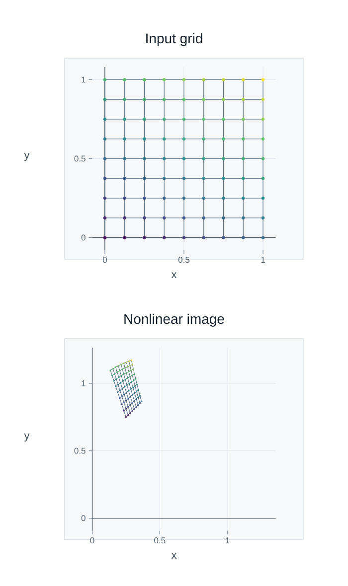
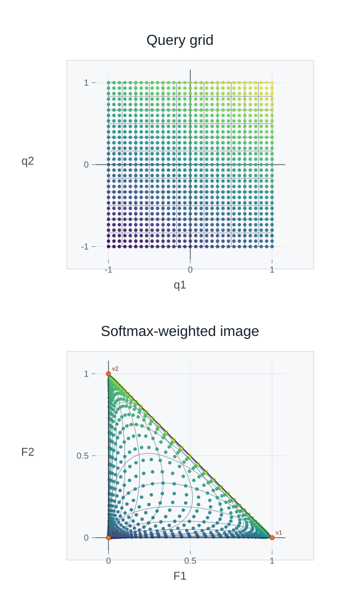

# 3.5 Chain Rule as Matrix Multiplication {#35-chain-rule-as-matrix-multiplication}

!!! note "译文与来源"

    本页为教材公开源文件 v0.2 的非官方中文翻译，保留原公式、例题、活动、代码和习题；为适应网页阅读，例题与活动等编号按本地小节重排，解答可点击展开；正文与标题中的数学专有名词保留英文，中文用于解释；术语表保留中英对照以便查阅。原文作者：Jacob Denson、Kaitlyn Phillipson、Sebastien Roch。译文遵循 [CC BY-NC-SA 4.0](https://creativecommons.org/licenses/by-nc-sa/4.0/)。[阅读英文原文](3-5.md#sec-u3-chain-rule-matrix-multiplication)。


<a id="textbook-body"></a>

## 教材正文 {#_6}

<a id="sec-u3-chain-rule-matrix-multiplication"></a>

[第一章](1-index.md)用 matrix multiplication 表示 linear maps 的 composition：先作用 $B$，再作用 $A$，结果为 $A(B\mathbf{x})=(AB)\mathbf{x}$。differentiable nonlinear maps 在局部也有相同结构：先分别用 linear maps 近似，再将它们复合，因此对应的 Jacobian matrices 相乘。


<a id="sec-the-chain-rule"></a>

## The chain rule {#the-chain-rule}

chain rule 描述了 composite function 的 derivative。

### Compositions {#compositions}

**定义 3.5.1：composite function**

如果$G : \mathbb{R}^n \to \mathbb{R}^p$和$F : \mathbb{R}^p \to \mathbb{R}^m$是多变量 function，我们可以如下构造一个新的 composite function。在$\mathbb{R}^n$中取一个输入，然后将$G$应用于该输入以获得$\mathbb{R}^p$中的 vector。对这个 vector 应用$F$，得到 vector $\mathbb{R}^m$。这是 composite function 的输出。换句话说，我们的输入是通过下图

$$
\mathbb{R}^n \xrightarrow{G} \mathbb{R}^p \xrightarrow{F} \mathbb{R}^m
$$

提供的。我们将 composite function 写为$F \circ G$（符号$\circ$应读作“由...组成”）。在符号中， composite function 定义为

$$
(F \circ G)(\mathbf{x}) = F(G(\mathbf{x}))
$$

**说明**

注意，复合$F \circ G$仅在$G$的输出是$F$的可能输入时定义，即$G$的输出是$\mathbb{R}^p$，它是$F$的输入空间。

**活动 3.5.1：复合两个 matrix 映射（U1-LO5、U1-LO6）**

令$T_1: \mathbb{R}^2 \to \mathbb{R}^3$和$T_2: \mathbb{R}^3 \to \mathbb{R}^2$是由它们的 component function 定义的 linear map，如下：

$$
T_1(x,y) = \begin{bmatrix} 2x-y \\ 3y \\ x+y \end{bmatrix} \qquad
						T_2(u,v,w) = \begin{bmatrix} u + v - w \\ 2u - v \end{bmatrix}
$$

**问题**

找到与这些映射关联的 matrix $A_1$ 和 $A_2$，从而得到 $T_1 = T_{A_1}$ 和 $T_2 = T_{A_2}$（回想一下 [ matrix 变换的定义](1-3.md#def-3-2-matrix-transformation) 中的符号）。

??? success "解答"

    我们回忆一下[ linear transformation 的 matrix 表示定理](1-3.md#thm-linear-transformation-matrix)的方法。特别是，我们从$T_1(\mathbf{e}_1)$的条目中获取$A_1$的第一个 column，从$T_1(\mathbf{e}_2)$的条目中获取第二个 column。我们计算 

    $$
    T_1(\mathbf{e}_1) = T_1(1,0) = \begin{bmatrix} 2 \cdot 1 - 0 \\ 3 \cdot 0 \\ 1 + 0 \end{bmatrix} = \begin{bmatrix} 2 \\ 0 \\ 1 \end{bmatrix}
    $$

     和 

    $$
    T_1(\mathbf{e}_2) = T_1(0,1) = \begin{bmatrix} 2 \cdot 0 - 1 \\ 3 \cdot 1 \\ 0 + 1 \end{bmatrix} = \begin{bmatrix} -1 \\ 3 \\ 1 \end{bmatrix}
    $$

    所以 matrix $A_1$等于

    $$
    A_1 = \begin{bmatrix}
    							2 & -1 \\
    							0 & 3 \\
    							1 & 1
    							\end{bmatrix}
    $$

    同样，我们计算 

    $$
    T_2(\mathbf{e}_1) = T_2(1,0,0) = \begin{bmatrix} 1 + 0 - 0 \\ 2 \cdot 1 - 0 \end{bmatrix} = \begin{bmatrix} 1 \\ 2 \end{bmatrix}
    $$

    $$
    T_2(\mathbf{e}_2) = T_2(0,1,0) = \begin{bmatrix} 0 + 1 - 0 \\ 2 \cdot 0 - 1 \end{bmatrix} = \begin{bmatrix} 1 \\ -1 \end{bmatrix}
    $$

     和

    $$
    T_2(\mathbf{e}_3) = T_2(0,0,1) = \begin{bmatrix} 0 + 0 - 1 \\ 2 \cdot 0 - 0 \end{bmatrix} = \begin{bmatrix} -1 \\ 0 \end{bmatrix}
    $$

    因此 matrix $A_2$ 由 

    $$
    A_2 = \begin{bmatrix}
    							1 & 1 & -1 \\
    							2 & -1 & 0
    							\end{bmatrix}
    $$

     给出。

**问题**

计算 composition $T_2 \circ T_1$，并将其表示为从$\mathbb{R}^2$到$\mathbb{R}^2$的 matrix 映射。

??? success "解答"

    回想一下[ matrix 复合的例子](1-4.md#act-3-3-composition-matrix)，我们有$T_2 \circ T_1 = T_{A_2 A_1}$。现在

    $$
    \begin{aligned}
    A_2 \cdot A_1 &= \begin{bmatrix}
    								1 & 1 & -1 \\
    								2 & -1 & 0
    								\end{bmatrix}
    								\begin{bmatrix}
    								2 & -1 \\
    								0 & 3 \\
    								1 & 1
    								\end{bmatrix} \\
    &= \begin{bmatrix}
    								\begin{gathered}1 \cdot 2 + 1 \cdot 0 \\ {}+ (-1) \cdot 1\end{gathered} & \begin{gathered}1 \cdot (-1) + 1 \cdot 3 \\ {}+ (-1) \cdot 1\end{gathered} \\[0.6em]
    								\begin{gathered}2 \cdot 2 + (-1) \cdot 0 \\ {}+ 0 \cdot 1\end{gathered} & \begin{gathered}2 \cdot (-1) + (-1) \cdot 3 \\ {}+ 0 \cdot 1\end{gathered}
    								\end{bmatrix} \\
    &= \begin{bmatrix}
    								2 + 0 - 1 & -1 + 3 - 1 \\
    								4 + 0 + 0 & -2 - 3 + 0
    								\end{bmatrix} \\
    &= \begin{bmatrix}
    								1 & 1 \\
    								4 & -5
    								\end{bmatrix}
    \end{aligned}
    $$

     因此，合成图$T_2 \circ T_1: \mathbb{R}^2 \to \mathbb{R}^2$可以表示为： 

    $$
    (T_2 \circ T_1) \begin{bmatrix} x \\ y \end{bmatrix} = \begin{bmatrix}
    							1 & 1 \\
    							4 & -5
    							\end{bmatrix} \begin{bmatrix} x \\ y \end{bmatrix} = \begin{bmatrix} x + y \\ 4x - 5y \end{bmatrix}
    $$

    

这是两个 function 复合的 nonlinear 示例。

**活动 3.5.2：复合二次 nonlinear map (U3-LO1)**

考虑由 

$$
F(u, v) = (uv, u + v) \quad\text{and}\quad G(x, y) = (e^{xy}, x - y)
$$

定义的 $F : \mathbb{R}^2 \to \mathbb{R}^2$ 和 $G : \mathbb{R}^2 \to \mathbb{R}^2$。查找 $(F \circ G)(x, y)$ 和 $(G \circ F)(u, v)$ 的表达式。

??? success "解答"

    我们计算出

    $$
    \begin{aligned}
    (F \circ G)(x, y) &= F(G(x, y)) \\
    &= F(e^{xy}, x - y) \\
    &= (e^{xy}(x - y), e^{xy} + (x - y)) \\
    &= (e^{xy}x - e^{xy}y, e^{xy} + x - y)
    \end{aligned}
    $$

    以及

    $$
    \begin{aligned}
    (G \circ F)(u, v) &= G(F(u, v)) \\
    &= G(uv, u + v) \\
    &= (e^{uv(u+v)}, uv - (u + v)) \\
    &= (e^{u^2v + uv^2}, uv - u - v)
    \end{aligned}
    $$

**注意**

注意，$F \circ G$ 和 $G \circ F$ 是非常不同的 function。因此，我们必须小心以正确的顺序 composite function。

顺序很重要。最右边的 Jacobian matrix 首先作用于输入变化。

**活动 3.5.3：具有 parameterization 曲线的复合 (U3-LO1)**

考虑由 

$$
\mathbf{r}(t) = (t, \cos(t), \sin(t)) \quad\text{and}\quad \mathbf{p}(x, y, z) = (y, z)
$$

定义的 $\mathbf{r} : \mathbb{R} \to \mathbb{R}^3$ 和 $\mathbf{p} : \mathbb{R}^3 \to \mathbb{R}^2$

**问题**

找出 $(\mathbf{p} \circ \mathbf{r})(t)$ 的表达式。

??? success "解答"

    我们计算出

    $$
    \begin{aligned}
    (\mathbf{p} \circ \mathbf{r})(t) &= \mathbf{p}(\mathbf{r}(t)) \\
    &= \mathbf{p}(t, \cos(t), \sin(t)) \\
    &= (\cos(t), \sin(t))
    \end{aligned}
    $$

**问题**

$\mathbf{r} \circ \mathbf{p}$ 的成分是否已定义？为什么或为什么不呢？

??? success "解答"

    为了定义复合$\mathbf{r} \circ \mathbf{p}$，$\mathbf{p}$的输出必须包含在$\mathbf{r}$的输入中。但是$\mathbf{p}$输出$\mathbb{R}^2$中的点，而$\mathbf{r}$接收$\mathbb{R}$中的点作为输入，因此复合没有意义。

### Chain rule for one-parameter inputs {#chain-rule-for-one-parameter-inputs}

回想一下单变量微积分的 chain rule，对于两个 function $f: \mathbb{R} \to \mathbb{R}$和$g: \mathbb{R} \to \mathbb{R}$，我们有

$$
(f \circ g)'(t) = (f' \circ g)(t) g'(t)
$$

下一个定理给出了 component 和 gradient 形式的 chain rule。

回想一下 function $f(x,y)$、$f_x = \frac{\partial f}{\partial x}$ 和 $f_y = \frac{\partial f}{\partial y}$。


<a id="sec-9-2-chain-rule-1"></a>

**定理 3.5.1：一个 independent variable 的 chain rule**

设 $f: \mathbb{R}^2 \to \mathbb{R}$ 是二元 scalar-valued function，$\mathbf{r}: \mathbb{R} \to \mathbb{R}^2$ 是由一个参数决定的 vector-valued function。它们的 composition $f \circ \mathbf{r}: \mathbb{R} \to \mathbb{R}$ 只有一个 independent variable。若 $\mathbf{r}$ 在 $t_0$ 处 differentiable，且 $f$ 在 $\mathbf{r}(t_0)$ 处 differentiable，则 $f \circ \mathbf{r}$ 在 $t_0$ 处也 differentiable，并满足：

$$
(f \circ \mathbf{r})'(t_0) = f_x(\mathbf{a}) r_1'(t_0) + f_y(\mathbf{a}) r_2'(t_0) = \nabla f(\mathbf{a}) \cdot \mathbf{r}'(t_0)
$$

  differentiable，其中 $\mathbf{a} = \mathbf{r}(t_0)$，并且$r_1$和$r_2$是$\mathbf{r}$的组成部分。

??? info "证明"

    让$\mathbf{a}=\mathbf{r}(t_0)$。对于参数中的小 scalar 变化$h$，来自[单参数情况下的 linear approximation ](3-4.md#note-u3-one-parameter-linear-approximation)的曲线的局部 linear approximation 给出

    $$
    \mathbf{r}(t_0+h)\approx\mathbf{a}+\mathbf{r}'(t_0)h.
    $$

    因此$f$的输入变化约为$\mathbf{r}'(t_0)h$。

    正如[ first partial derivatives连续蕴含 differentiability （Continuity of First Partials Implies Differentiability）](3-4.md#thm-9-1-continuity-of-partials-difeferntiability)的证明中所解释的，$f$在$\mathbf{a}$附近的局部 linear approximation 为

    $$
    f(\mathbf{a}+\mathbf{k})\approx f(\mathbf{a})+\nabla f(\mathbf{a})\cdot\mathbf{k}.
    $$

    代入实际输入变化$\mathbf{k}=\mathbf{r}(t_0+h)-\mathbf{a}$，然后使用曲线的近似：

    $$
    \begin{aligned}
    (f\circ\mathbf{r})(t_0+h)&\approx f(\mathbf{a})+\nabla f(\mathbf{a})\cdot\bigl(\mathbf{r}(t_0+h)-\mathbf{a}\bigr) \\
    &\approx f(\mathbf{a})+\bigl(\nabla f(\mathbf{a})\cdot\mathbf{r}'(t_0)\bigr)h.
    \end{aligned}
    $$

    

    我们得到了局部 affine 近似

    $$
    L(t)=f(\mathbf{a})+\bigl(\nabla f(\mathbf{a})\cdot\mathbf{r}'(t_0)\bigr)(t-t_0).
    $$

    它的 linear 部分将参数变化乘以$\nabla f(\mathbf{a})\cdot\mathbf{r}'(t_0)$。读出该 coefficient 得出 

    $$
    (f\circ\mathbf{r})'(t_0)=f_x(\mathbf{a})r_1'(t_0)+f_y(\mathbf{a})r_2'(t_0)=\nabla f(\mathbf{a})\cdot\mathbf{r}'(t_0).
    $$

      differentiability 确保忽略的误差小于 $h$ 中的一阶，因此它们不会更改该 coefficient。

**活动 3.5.4：沿曲线对 function 求微分 (U3-LO6)**

如果$f(x,y) = x^2 + y^2$和$\mathbf{r}(t) = (\sin t, \cos(2t))$，则找到$(f \circ \mathbf{r})'(t)$。

??? success "解答"

    我们计算 

    $$
    \nabla f(x,y) = \begin{bmatrix} 2x \\ 2y \end{bmatrix}
    $$

     和 

    $$
    \mathbf{r}'(t) = \begin{bmatrix} \cos t \\ - 2 \sin(2t) \end{bmatrix}
    $$

    现在

    $$
    \nabla f \circ \mathbf{r}(t) = \nabla f(\sin t, \cos(2t)) = \begin{bmatrix} 2 \sin t \\ 2 \cos(2t) \end{bmatrix}
    $$

    因此

    $$
    \begin{aligned}
    (f \circ \mathbf{r})'(t) & = \nabla f(\mathbf{r}(t)) \cdot \mathbf{r}'(t) \\
    & = \begin{bmatrix} 2 \sin t \\ 2 \cos(2t) \end{bmatrix} \cdot \begin{bmatrix} \cos t \\ -2 \sin(2t) \end{bmatrix} \\
    & = 2 \sin t \cos t - 4 \sin(2t) \cos(2t)
    \end{aligned}
    $$

**说明**

有用的助记符来自于编写$z = f(x,y)$，以及$x = x(t)$和$y = y(t)$。在这种表示法中， chain rule 为

$$
\frac{dz}{dt} = \frac{\partial z}{\partial x} \frac{dx}{dt} + \frac{\partial z}{\partial y} \frac{dy}{dt}
$$

因此右侧分子中的符号$dx$和$dy$，以及分母中出现的符号$\partial x$和$\partial y$就像分数相乘时一样“取消”。

**活动 3.5.5：通过两个中间变量（U3-LO6）进行求导**

假设 $z = x^2y - y^2x$，其中 $x = \sin t$ 和 $y = e^t$。计算$dz/dt$。

??? success "解答"

    首先，我们需要计算 

    $$
    \begin{aligned}
    \frac{\partial z}{\partial x} &= \frac{\partial}{\partial x}(x^2y - y^2x) = 2xy - y^2 \\
    \frac{\partial z}{\partial y} &= \frac{\partial}{\partial y}(x^2y - y^2x) = x^2 - 2yx \\
    \frac{dx}{dt} &= \frac{d}{dt}(\sin t) = \cos t \\
    \frac{dy}{dt} &= \frac{d}{dt}(e^t) = e^t
    \end{aligned}
    $$

     现在我们将它们代入 chain rule 公式： 

    $$
    \begin{aligned}
    \frac{dz}{dt} &= (2xy - y^2) \cdot \cos t + (x^2 - 2yx) \cdot e^t \\
    &= (2 \sin t \cdot e^t - e^{2t}) \cdot \cos t \\
    &\quad + (\sin^2 t - 2e^t \cdot \sin t) \cdot e^t \\
    &= 2 \sin t \cdot e^t \cdot \cos t - e^{2t} \cdot \cos t \\
    &\quad + e^t \sin^2 t - 2e^{2t} \sin t
    \end{aligned}
    $$

     如果需要，我们可以进一步简化： 

    $$
    \begin{aligned}
    \frac{dz}{dt} &= 2 e^t \sin t \cos t - e^{2t} \cos t + e^t \sin^2 t - 2e^{2t} \sin t \\
    &= e^t (\sin^2 t + 2\sin t \cos t) - e^{2t}(\cos t + 2\sin t) \\
    &= e^t (\sin^2 t + \sin 2t) - e^{2t}(\cos t + 2\sin t)
    \end{aligned}
    $$

     因此， 

    $$
    \frac{dz}{dt} = e^t (\sin^2 t + \sin 2t) - e^{2t}(\cos t + 2\sin t)
    $$

    

### Chain rule for two independent variables {#chain-rule-for-two-independent-variables}


<a id="thm-chain-rule-2"></a>

**定理 3.5.2：两个 independent variable 的 chain rule**

假设 $f: \mathbb{R}^2 \to \mathbb{R}$ 是 scalar-valued function，$G: \mathbb{R}^2 \to \mathbb{R}^2$ 是 vector-valued function。那么$f \circ G: \mathbb{R}^2 \to \mathbb{R}$是一个 scalar-valued function，两个方程

$$
(f \circ G)_x = (f_x \circ G) (G_1)_x + (f_y \circ G) (G_2)_x
$$

和

$$
(f \circ G)_y = (f_x \circ G) (G_1)_y + (f_y \circ G) (G_2)_y
$$

成立。

??? info "证明"

    固定一个 参考点$\mathbf{a}=(x_0,y_0)$并写入$\mathbf{b}=G(\mathbf{a})=(b_1,b_2)$。对于较小的输入变化 $\mathbf{h}=(h_1,h_2)$，使用 [ component linear approximation ](3-4.md#note-u3-componentwise-linear-approximation) 来近似 $G$ 的每个 component： 

    $$
    G_i(\mathbf{a}+\mathbf{h})\approx b_i+(G_i)_x(\mathbf{a})h_1+(G_i)_y(\mathbf{a})h_2,\qquad i=1,2.
    $$

    

    $f$ 的输入的实际变化为 $\mathbf{k}=G(\mathbf{a}+\mathbf{h})-\mathbf{b}$。在 $\mathbf{b}$ 附近，$f$ 的局部 linear approximation 给出 

    $$
    f(\mathbf{b}+\mathbf{k})\approx f(\mathbf{b})+f_x(\mathbf{b})k_1+f_y(\mathbf{b})k_2.
    $$

    从 $G$ 的两个 component 中取出 $k_1$ 和 $k_2$ 的近似式代入，再合并关于 $h_1$ 和 $h_2$ 的项：

    $$
    \begin{aligned}
    (f\circ G)(\mathbf{a}+\mathbf{h})&\approx f(\mathbf{b})+\bigl[f_x(\mathbf{b})(G_1)_x(\mathbf{a})+f_y(\mathbf{b})(G_2)_x(\mathbf{a})\bigr]h_1 \\
    &\quad+\bigl[f_x(\mathbf{b})(G_1)_y(\mathbf{a})+f_y(\mathbf{b})(G_2)_y(\mathbf{a})\bigr]h_2.
    \end{aligned}
    $$

    

    这是 affine 近似：常数项是 $f(\mathbf{b})=(f\circ G)(\mathbf{a})$，其余项在输入变化中呈 linear。 $h_1$ 的 coefficient 给出关于第一个输入的 partial derivative，$h_2$ 的 coefficient 给出关于第二个输入的 partial derivative。读出这些 coefficient 得出 

    $$
    \begin{aligned}
    (f\circ G)_x(\mathbf{a})&=f_x(\mathbf{b})(G_1)_x(\mathbf{a})+f_y(\mathbf{b})(G_2)_x(\mathbf{a}), \\
    (f\circ G)_y(\mathbf{a})&=f_x(\mathbf{b})(G_1)_y(\mathbf{a})+f_y(\mathbf{b})(G_2)_y(\mathbf{a}).
    \end{aligned}
    $$

     由于 $\mathbf{b}=G(\mathbf{a})$ 并且 参考点是任意的，这是定理中的两个公式。 differentiability 确保忽略的误差小于 $\mathbf{h}$ 中的一阶误差，因此它们不会改变 linear 部分。

**注**

回想一下[ partial derivative、 gradient、 Hessian matrix 与 Jacobian matrix （Partial Derivatives, Gradients, Hessians, and Jacobian Matrices）](3-3.md#sec-u3-partials-gradients-hessians-jacobians)， Jacobian matrix 收集 vector-valued map的 partial derivative。对于$G$，这给出

$$
J_G = \begin{bmatrix} \dfrac{\partial G_1}{\partial x} & \dfrac{\partial G_1}{\partial y} \\[6pt] \dfrac{\partial G_2}{\partial x} & \dfrac{\partial G_2}{\partial y} \end{bmatrix}
$$

然后我们可以将[两个 independent variable 的 chain rule ](3-5.md#thm-chain-rule-2)中的一对方程写为单 vector 方程

$$
\nabla (f \circ G) = J_G^T (\nabla f \circ G)
$$

其中我们将$\nabla f$解释为 column vector。 transpose 并使用 $J_f=(\nabla f)^T$ 给出等效的 Jacobian 形式 

$$
J_{f\circ G}=(J_f\circ G)J_G
$$

**活动 3.5.6：chain rule 作为 Jacobian 积 (U3-LO6)**

使用 chain rule 的 Jacobian matrix 版本计算 function $f \circ G$ 的 partial derivative，其中 $f(x,y) = 3x^2 - 2xy + y^2$ 和 $G(u,v) = (3u + 2v, 4u - v)$。

??? success "解答"

    我们计算 

    $$
    \nabla f(x,y) = \begin{bmatrix} 6x - 2y \\ -2x + 2y \end{bmatrix}
    $$

     和 

    $$
    J_G = \begin{bmatrix} \dfrac{\partial}{\partial u}(3u + 2v) & \dfrac{\partial}{\partial v}(3u + 2v) \\[6pt] \dfrac{\partial}{\partial u}(4u - v) & \dfrac{\partial}{\partial v}(4u - v) \end{bmatrix} = \begin{bmatrix} 3 & 2 \\ 4 & -1 \end{bmatrix}
    $$

     自 

    $$
    \begin{aligned}
    \nabla f(3u + 2v, 4u - v) & = \begin{bmatrix} 6(3u + 2v) - 2 (4u - v) \\ -2(3u + 2v) + 2(4u - v) \end{bmatrix} \\
    & = \begin{bmatrix} 10u + 14v \\ 2u - 6v \end{bmatrix}
    \end{aligned}
    $$

     以来，我们发现 

    $$
    \begin{aligned}
    \nabla (f \circ G) & = \begin{bmatrix} 3 & 2 \\ 4 & -1 \end{bmatrix}^T \begin{bmatrix} 10u + 14v \\ 2u - 6v \end{bmatrix} \\
    & = \begin{bmatrix} 3 & 4 \\ 2 & -1 \end{bmatrix} \begin{bmatrix} 10 u + 14v \\ 2u - 6v \end{bmatrix} \\
    & = \begin{bmatrix} (3)(10u + 14v) + (4)(2u - 6v) \\ (2)(10u + 14v) + (-1) (2u - 6v) \end{bmatrix} \\
    & = \begin{bmatrix} 38u + 18v \\ 18u + 34v \end{bmatrix}
    \end{aligned}
    $$

<a id="act-u3-sympy-chain-rule-check"></a>

**活动 3.5.7：检查 SymPy (U3-LO6) 中的 chain rule**

重新访问前面计算中的 $f(x,y)=3x^2-2xy+y^2$ 和 $G(u,v)=(3u+2v,4u-v)$。该代码以两种方式计算 $J_{f\circ G}$：Jacobian matrix 相乘和直接对复合表达式求微分。与[检查 SymPy (U3-LO3) 中 gradient 的 Jacobian matrix ](3-3.md#act-u3-sympy-jacobian-of-gradient)一样，我们将 scalar 表达式放入单项 matrix 中以使用`.jacobian()`。命令`sp.simplify`简化了符号表达式，包括 matrix 的条目。


```python
import sympy as sp

x, y, u, v = sp.symbols("x y u v")
f = 3*x**2 - 2*x*y + y**2
G = sp.Matrix([3*u + 2*v, 4*u - v])

Jf = sp.Matrix([f]).jacobian([x, y])
JG = G.jacobian([u, v])
Jf_at_G = Jf.subs({x: G[0], y: G[1]})
chain = sp.simplify(Jf_at_G * JG)

f_of_G = f.subs({x: G[0], y: G[1]})
direct = sp.Matrix([f_of_G]).jacobian([u, v])

print(Jf_at_G.shape, JG.shape, chain.shape)
print(chain)
print(sp.simplify(direct - chain))
print(chain.subs({u: 1, v: 0}))
```

输出：


```text
(1, 2) (2, 2) (1, 2)
Matrix([[38*u + 18*v, 18*u + 34*v]])
Matrix([[0, 0]])
Matrix([[38, 18]])
```


1. 解释第一条输出行中的三个形状。使用[ composition ](1-4.md#subsec-u1-composition)的合成规则，解释为什么`JG`是右手因子。逆积`JG * Jf_at_G`会被定义吗？

2. 为什么我们要将`G`的 component 替换为`Jf`？在$(u,v)=(1,0)$，外部 Jacobian matrix 必须在哪里求值？通过将两个评估 matrix 相乘来验证最后的输出 row。

3. 第三输出行中的 zero matrix 为这些 function 建立了什么？第二个输出行中的 row 与手动找到的 column gradient $\nabla(f\circ G)$有何关系？


??? success "解答"

    1. 外部 function 有一个输出和两个输入，因此 $J_f(G(u,v))$ 的形状为 $1\times2$。内部映射有两个输出和两个输入，因此$J_G$具有形状$2\times2$。它们的乘积具有形状 $1\times2$，符合 scalar-valued function $u,v$ 的 Jacobian matrix 所需。 matrix $J_G$首先作用于输入变化； $J_f(G(u,v))$ 然后对中间变化起作用。逆积未定义，因为其内侧 dimension为 $2$ 和 $1$。

    2. 外层 function 的输入是 $G(u,v)$，因此必须在这个输入处计算它的 derivative。在 $(u,v)=(1,0)$ 处，有 $G(1,0)=(3,4)$。所以 

    $$
    \begin{aligned}
    J_{f\circ G}(1,0)&=J_f(3,4)J_G(1,0) \\
    &=\begin{bmatrix}10&2\end{bmatrix}\begin{bmatrix}3&2\\4&-1\end{bmatrix} \\
    &=\begin{bmatrix}38&18\end{bmatrix}.
    \end{aligned}
    $$

    如果改为在 $(1,0)$ 处计算 $J_f$，就用错了外层 function 的输入。

    3. 对于所有 $u,v$，符号差异简化为零 row，验证这些多项式 function 的直 derivative 和 chain rule 积是否一致。该行是 gradient 的 transpose：

    $$
    \nabla(f\circ G)(u,v)
                    =\begin{bmatrix}38u+18v\\18u+34v\end{bmatrix}.
    $$

     transpose $J_{f\circ G}=J_f(G)J_G$给出等效的 column 公式$\nabla(f\circ G)=J_G^T(\nabla f\circ G)$。


<a id="rem-u3-two-variable-chain-rule-mnemonic"></a>

**注**

可以用 differential notation 帮助记忆 chain rule。将 $G$ 的输入记为 $u$、$v$，将 $G(u,v)$ 的两个 components 记为 $x$、$y$，再令 $z=f(x,y)$，也就是 $z=(f \circ G)(u,v)$。此时 chain rule 写成：

$$
\frac{\partial f}{\partial u} = \frac{\partial f}{\partial x} \frac{\partial x}{\partial u} + \frac{\partial f}{\partial y} \frac{\partial y}{\partial u}
$$

和

$$
\frac{\partial f}{\partial v} = \frac{\partial f}{\partial x} \frac{\partial x}{\partial v} + \frac{\partial f}{\partial y} \frac{\partial y}{\partial v}
$$

这样分子和分母中的偏项又显示为“取消”。

**活动 3.5.8：通过改变变量进行 partial derivative (U3-LO6)**

假设

$$
z = x^2 + xy - y^2
$$

$x = e^{2s + t}$、以及$y = \ln(t/s)$。计算

$$
\frac{\partial z}{\partial s} \quad\text{and}\quad \frac{\partial z}{\partial t}
$$

**问题**

首先计算$z$在$x$和$y$的 partial derivative，以及$x$和$y$在$t$和$s$的 partial derivative。

??? success "解答"

    我们计算

    $$
    \frac{\partial z}{\partial x} = \frac{\partial}{\partial x}(x^2 + xy - y^2) = 2x + y
    $$

    $$
    \frac{\partial z}{\partial y} = \frac{\partial}{\partial y}(x^2 + xy - y^2) = x - 2y
    $$

    $$
    \frac{\partial x}{\partial s} = \frac{\partial}{\partial s}(e^{2s+t}) = 2e^{2s+t}
    $$

    $$
    \frac{\partial x}{\partial t} = \frac{\partial}{\partial t}(e^{2s+t}) = e^{2s+t}
    $$

    $$
    \frac{\partial y}{\partial s} = \frac{\partial}{\partial s}\left(\ln\left(\frac{t}{s}\right)\right) = \frac{\partial}{\partial s}(\ln(t) - \ln(s)) = -\frac{1}{s}
    $$

    $$
    \frac{\partial y}{\partial t} = \frac{\partial}{\partial t}\left(\ln\left(\frac{t}{s}\right)\right) = \frac{1}{t}
    $$

    

**问题**

现在使用 chain rule 计算$z$在$s$和$t$的 partial derivative。

??? success "解答"

    现在我们应用 chain rule，得出结论： 

    $$
    \begin{aligned}
    \frac{\partial z}{\partial s} &= \frac{\partial z}{\partial x}\frac{\partial x}{\partial s} + \frac{\partial z}{\partial y}\frac{\partial y}{\partial s} \\
    &= (2x + y) \cdot 2e^{2s+t} + (x - 2y) \cdot (-1/s) \\
    &= 4xe^{2s+t} + 2ye^{2s+t} - (x/s) + (2y/s)
    \end{aligned}
    $$

     替换 $x = e^{2s+t}$ 和 $y = \ln(t/s)$： 

    $$
    \begin{aligned}
    \frac{\partial z}{\partial s} &= 4e^{2s+t} \cdot e^{2s+t} + 2 \ln(t/s) \cdot e^{2s+t} \\
    &\quad - \frac{e^{2s+t}}{s} + \frac{2\ln(t/s)}{s} \\
    &= 4e^{4s+2t} + 2e^{2s+t}\ln(t/s) - \frac{e^{2s+t}}{s} + \frac{2\ln(t/s)}{s}
    \end{aligned}
    $$

     类似地，$\frac{\partial z}{\partial t}$： 

    $$
    \begin{aligned}
    \frac{\partial z}{\partial t} &= \frac{\partial z}{\partial x}\frac{\partial x}{\partial t} + \frac{\partial z}{\partial y}\frac{\partial y}{\partial t} \\
    &= (2x + y) \cdot e^{2s+t} + (x - 2y) \cdot \frac{1}{t} \\
    &= 2xe^{2s+t} + ye^{2s+t} + \frac{x}{t} - \frac{2y}{t}
    \end{aligned}
    $$

     替换 $x = e^{2s+t}$ 和 $y = \ln(t/s)$： 

    $$
    \begin{aligned}
    \frac{\partial z}{\partial t} &= 2e^{2s+t} \cdot e^{2s+t} + \ln(t/s) \cdot e^{2s+t} \\
    &\quad + \frac{e^{2s+t}}{t} - \frac{2\ln(t/s)}{t} \\
    &= 2e^{4s+2t} + e^{2s+t}\ln(t/s) + \frac{e^{2s+t}}{t} - \frac{2\ln(t/s)}{t}
    \end{aligned}
    $$

    

### Generalized chain rule {#generalized-chain-rule}

在乘 Jacobian matrix 之前，请检查每个映射的输入和输出 dimension。

**定理 3.5.3：广义 chain rule**

假设 $F: \mathbb{R}^p \to \mathbb{R}^m$ 和 $G: \mathbb{R}^n \to \mathbb{R}^p$ 是 differentiable function。那么 $F \circ G: \mathbb{R}^n \to \mathbb{R}^m$ 是 differentiable 的，

$$
J_{F \circ G}(\mathbf{x}) = J_F(G(\mathbf{x})) J_G(\mathbf{x})
$$

是 differentiable 的，其中右侧由 matrix multiplication 定义。将$F$的输入 coordinate 写入$y_1,\ldots,y_p$。同样，对于 $1 \leq i \leq m$ 和 $1 \leq j \leq n$，

$$
\frac{\partial(F_i\circ G)}{\partial x_j}(\mathbf{x}) = \sum_{k=1}^p \frac{\partial F_i}{\partial y_k}(G(\mathbf{x}))\frac{\partial G_k}{\partial x_j}(\mathbf{x})
$$

??? info "证明"

    固定一个 参考点$\mathbf{a}$并写入$\mathbf{b}=G(\mathbf{a})$。对于较小的输入变化$\mathbf{h}$，$G$的局部 linear approximation 给出

    $$
    G(\mathbf{a}+\mathbf{h})\approx\mathbf{b}+J_G(\mathbf{a})\mathbf{h}.
    $$

    因此$F$的输入变化约为$J_G(\mathbf{a})\mathbf{h}$。

    在$\mathbf{b}$附近，$F$的局部 linear approximation 为

    $$
    F(\mathbf{b}+\mathbf{k})\approx F(\mathbf{b})+J_F(\mathbf{b})\mathbf{k}.
    $$

    代入实际中间变化$\mathbf{k}=G(\mathbf{a}+\mathbf{h})-\mathbf{b}$，然后使用从$G$开始的近似：

    $$
    \begin{aligned}
    (F\circ G)(\mathbf{a}+\mathbf{h})&\approx F(\mathbf{b})+J_F(\mathbf{b})\bigl(G(\mathbf{a}+\mathbf{h})-\mathbf{b}\bigr) \\
    &\approx F(\mathbf{b})+J_F(\mathbf{b})J_G(\mathbf{a})\mathbf{h}.
    \end{aligned}
    $$

    

    我们得到了局部 affine 近似

    $$
    L(\mathbf{x})=F(\mathbf{b})+J_F(\mathbf{b})J_G(\mathbf{a})(\mathbf{x}-\mathbf{a}).
    $$

    它的 linear 部分将$\mathbf{h}$发送到$J_F(\mathbf{b})J_G(\mathbf{a})\mathbf{h}$。读出该 linear 部分的 matrix 给出 

    $$
    J_{F\circ G}(\mathbf{a})=J_F(G(\mathbf{a}))J_G(\mathbf{a}).
    $$

     最右边的 matrix 首先起作用：$J_G(\mathbf{a})$ 预测中间变化，$J_F(\mathbf{b})$ 预测最终的输出变化。 differentiability 确保忽略的误差小于 $\mathbf{h}$ 中的一阶误差，因此它们不会改变这个 linear 部分。

**说明**

广义 chain rule 表明局部 linear map 是构成的。 matrix 公式通过以正确的顺序乘以 Jacobian matrix 来记录该复合。

顺序很重要。最右边的 Jacobian matrix 首先作用于输入变化。

**说明**

如果$f$是一个 scalar-valued function，那么广义 chain rule 告诉我们

$$
J_{f\circ G}=(J_f\circ G)J_G
$$

transpose 并使用 $J_f=(\nabla f)^T$ 会得到 

$$
\nabla (f \circ G) = J_G^T (\nabla f \circ G)
$$

就像在二变量情况下一样。

**活动 3.5.9：通过三 component 映射的 chain rule (U3-LO6)**

假设$f(x,y,z) = 3x^2 - 2xy + 4z^2$，还有$G(u,v) = (e^u \sin v, e^u \cos v, e^u )$。计算 $f \circ G$ 的 partial derivative。

??? success "解答"

    由于 $f$ 是 scalar 值，因此其 gradient 是其 Jacobian matrix 的 transpose：$\nabla f=J_f^T$。我们计算

    $$
    J_f(x,y,z) = \begin{bmatrix} 6x - 2y & -2x & 8z \end{bmatrix}
    $$

    从而得到

    $$
    J_f(G(u,v)) = e^u \begin{bmatrix} 6\sin v - 2 \cos v & -2 \sin v & 8 \end{bmatrix}
    $$

    现在

    $$
    \begin{aligned}
    J_G(u,v)&=\begin{bmatrix}e^u\sin v& e^u\cos v\\e^u\cos v&-e^u\sin v\\e^u&0\end{bmatrix} \\
    &=e^u\begin{bmatrix}\sin v&\cos v\\\cos v&-\sin v\\1&0\end{bmatrix}
    \end{aligned}
    $$

    因此

    $$
    \begin{aligned}
    & J_{f\circ G}(u,v) \\
    & = J_f(G(u,v))J_G(u,v) \\
    & = (e^u)^2 \begin{bmatrix} \begin{gathered}6 \sin v \\ {}- 2 \cos v\end{gathered} & -2 \sin v & 8 \end{bmatrix} \begin{bmatrix} \sin v & \cos v \\ \cos v & -\sin v \\ 1 & 0 \end{bmatrix} \\
    & = e^{2u} \begin{bmatrix} \begin{gathered}6 (\sin v)^2 \\ {}- 2 \sin v \cos v \\ {}- 2 \sin v \cos v + 8\end{gathered} & \begin{gathered}6 \sin v \cos v \\ {}- 2 (\cos v)^2 \\ {}+ 2 (\sin v)^2\end{gathered} \end{bmatrix} \\
    & = e^{2u} \begin{bmatrix} \begin{gathered}6 (\sin v)^2 \\ {}- 4 \sin v \cos v + 8\end{gathered} & \begin{gathered}4 (\sin v)^2 \\ {}+ 6 \sin v \cos v - 2\end{gathered} \end{bmatrix}
    \end{aligned}
    $$

    该 Jacobian row 的两个条目分别是关于 $u$ 和 $v$ 的 partial derivative。因此，第一个变量中$f \circ G$的 partial derivative 等于

    $$
    e^{2u} ( 6 (\sin v)^2 - 4 \sin v \cos v + 8 )
    $$

    第二个变量中的 partial derivative 为

    $$
    e^{2u} ( 4 (\sin v)^2 + 6 \sin v \cos v - 2 )
    $$

<a id="act-u3-prediction-loss-chain-rule"></a>

**活动 3.5.10：通过预测求导损失 (U3-LO6)**

[从预测到 scalar-valued loss function （U3-LO1、U2-LO1）](3-1.md#act-u3-prediction-loss-model) 中的 squared-error loss 是一个复合： 

$$
\mathbf{w}\longmapsto R(\mathbf{w})=X\mathbf{w}-\mathbf{y}
            \longmapsto q(R(\mathbf{w})),\qquad q(\mathbf{r})=\|\mathbf{r}\|^2=\mathbf{r}^T\mathbf{r}.
$$

因此 $\mathcal L=q\circ R$。固定数据仍然是$X=\begin{bmatrix}1&0\\0&1\\1&1\end{bmatrix}$和$\mathbf{y}=(1,2,2)$。


1. 找到 $J_R(\mathbf{w})$ 和 $J_q(\mathbf{r})$，包括它们的形状。哪个映射是 affine 的，哪个是 nonlinear 的？

2. 利用 matrix chain rule 得到$J_{\mathcal L}(\mathbf{w})$， transpose 得到$\nabla\mathcal L(\mathbf{w})$。在$\mathbf{w}_0=(1,1)$进行评估并与[模型权重如何改变损失 (U3-LO3)](3-3.md#act-u3-prediction-loss-derivatives)进行比较。

3. 让$\mathbf{w}(t)=(1,1)+t(1,1)$。使用 chain rule 求 $\frac{d}{dt}\mathcal L(\mathbf{w}(t))$。首先代入损失，然后对所得的一变量多项式进行微分来进行检查。


??? success "解答"

    1. residual 映射$R:\mathbb{R}^2\to\mathbb{R}^3$是 affine 的，与

    $$
    J_R=X=\begin{bmatrix}1&0\\0&1\\1&1\end{bmatrix}.
    $$

    其形状为$3\times2$。平方长度 function $q:\mathbb{R}^3\to\mathbb{R}$ 是 nonlinear 的，其中 $J_q(\mathbf{r})=2\mathbf{r}^T$ 为 $1\times3$  row。

    2. 计算 residual 处的外 derivative，然后乘以： 

    $$
    \begin{aligned}
    J_{\mathcal L}(\mathbf{w})&=2(X\mathbf{w}-\mathbf{y})^TX, \\
    \nabla\mathcal L(\mathbf{w})&=2X^T(X\mathbf{w}-\mathbf{y}).
    \end{aligned}
    $$

     行积的形状为 $(1\times3)(3\times2)=1\times2$； gradient 是$2\times1$柱。在$\mathbf{w}_0$， residual 为$(0,-1,0)$，所以

    $$
    \nabla\mathcal L(\mathbf{w}_0)
                    =2\begin{bmatrix}1&0&1\\0&1&1\end{bmatrix}
                    \begin{bmatrix}0\\-1\\0\end{bmatrix}
                    =\begin{bmatrix}0\\-2\end{bmatrix}.
    $$

     这与微分扩展损失一致。每个 gradient component 使用相应的特征 column 组合来自观察的误差。

    3. 沿参数线的 chain rule 给出 

    $$
    \begin{aligned}
    &\frac{d}{dt}\mathcal L(\mathbf{w}(t)) \\
    &=\nabla\mathcal L(1+t,1+t)^T\begin{bmatrix}1\\1\end{bmatrix} \\
    &=\begin{bmatrix}6t&-2+6t\end{bmatrix}\begin{bmatrix}1\\1\end{bmatrix} \\
    &=-2+12t.
    \end{aligned}
    $$

     直接代入得到$\mathcal L(1+t,1+t)=1-2t+6t^2$，其 derivative 相同。 $t=0$时，汇率为$-2$；乘以一个小的参数变化$t=1/10$可以恢复从[预测拟合误差的变化 (U3-LO4)](3-4.md#act-u3-prediction-loss-linearization)预测的损失变化$-1/5$。


<a id="sec-tiny-nn-forward"></a>

## A Tiny Sigmoid Block {#sigmoid-a-tiny-sigmoid-block}

这个小型 neural network 可以看成三个步骤的 composition：先做一次 affine map，再对各个 components 分别应用 nonlinear function，最后再做一次 affine map。


<a id="optional-u3-relu-locally-linear"></a>

**说明：Sigmoid 及其 derivative**

令

$$
\sigma(t)=\frac{1}{1+e^{-t}}.
$$

derivative 为

$$
\sigma'(t)=\sigma(t)(1-\sigma(t)).
$$


当 $\sigma$ 应用于 vector 时，它会逐个 coordinate 地应用。


<a id="act-u3-relu-square-grid-test"></a>

**活动 3.5.11：一个小型 Sigmoid 模块（U3-LO5、U3-LO6、U3-LO7）**

设 

$$
W_1=
            \begin{bmatrix}
              1&0\\
              0&1\\
              1&1
            \end{bmatrix},
            \qquad
            W_2=
            \begin{bmatrix}
              1&0&-1/2\\
              0&1&1/2
            \end{bmatrix},
$$

并设 $\mathbf{b}_1=\mathbf{0}$ 和 $\mathbf{b}_2=\mathbf{0}$。

定义 

$$
\mathbf{s}=W_1\mathbf{x}+\mathbf{b}_1,
            \qquad
            \mathbf{u}=\sigma(\mathbf{s}),
            \qquad
            N(\mathbf{x})=W_2\mathbf{u}+\mathbf{b}_2,
$$

其中 $\sigma$ 按 coordinate 应用。

在 参考点 

$$
\mathbf{a}
            =
            \begin{bmatrix}
              0\\
              0
            \end{bmatrix},
$$

执行以下操作。


1. 计算预激活 vector $\mathbf{s}_{\mathbf{a}}=W_1\mathbf{a}+\mathbf{b}_1$。

2. 计算隐藏 vector $\mathbf{u}_{\mathbf{a}}=\sigma(\mathbf{s}_{\mathbf{a}})$。

3. 计算$N(\mathbf{a})$。

4. 使用$\sigma'(0)=1/4$计算

$$
D_{\mathbf{a}}
                =
                \operatorname{diag}\bigl(\sigma'((\mathbf{s}_{\mathbf{a}})_1),\sigma'((\mathbf{s}_{\mathbf{a}})_2),\sigma'((\mathbf{s}_{\mathbf{a}})_3)\bigr).
$$


5. 使用 chain rule 计算

$$
J_N(\mathbf{a})=W_2D_{\mathbf{a}}W_1.
$$


6. 使用 

$$
N(\mathbf{a}+\mathbf{h})\approx N(\mathbf{a})+J_N(\mathbf{a})\mathbf{h}
$$

来预测微小的输入变化 $\mathbf{h}$ 引起的输出变化。


??? success "解答"

    自$\mathbf{a}=\mathbf{0}$和$\mathbf{b}_1=\mathbf{0}$、

    $$
    \mathbf{s}_{\mathbf{a}}
                =
                W_1\mathbf{a}+\mathbf{b}_1
                =
                \begin{bmatrix}
                  0\\
                  0\\
                  0
                \end{bmatrix}
    $$

    

    因此

    $$
    \mathbf{u}_{\mathbf{a}}
                =
                \sigma(\mathbf{s}_{\mathbf{a}})
                =
                \begin{bmatrix}
                  1/2\\
                  1/2\\
                  1/2
                \end{bmatrix}.
    $$

    

    自$\mathbf{b}_2=\mathbf{0}$、

    $$
    N(\mathbf{a})
                =
                W_2\mathbf{u}_{\mathbf{a}}
                =
                \begin{bmatrix}
                  1&0&-1/2\\
                  0&1&1/2
                \end{bmatrix}
                \begin{bmatrix}
                  1/2\\
                  1/2\\
                  1/2
                \end{bmatrix}
                =
                \begin{bmatrix}
                  1/4\\
                  3/4
                \end{bmatrix}.
    $$

    

    自 $\sigma'(0)=1/4$、

    $$
    D_{\mathbf{a}}
                =
                \begin{bmatrix}
                  1/4&0&0\\
                  0&1/4&0\\
                  0&0&1/4
                \end{bmatrix}.
    $$

     因此 

    $$
    \begin{aligned}
    & J_N(\mathbf{a})=W_2D_{\mathbf{a}}W_1 \\
    &=\begin{bmatrix}1&0&-1/2\\0&1&1/2\end{bmatrix}\begin{bmatrix}1/4&0&0\\0&1/4&0\\0&0&1/4\end{bmatrix}\begin{bmatrix}1&0\\0&1\\1&1\end{bmatrix} \\
    &=\begin{bmatrix}1/8&-1/8\\1/8&3/8\end{bmatrix}.
    \end{aligned}
    $$

    


    
    $$
    N(\mathbf{a}+\mathbf{h})
                \approx
                \begin{bmatrix}
                  1/4\\
                  3/4
                \end{bmatrix}
                +
                \begin{bmatrix}
                  1/8&-1/8\\
                  1/8&3/8
                \end{bmatrix}
                \mathbf{h}.
    $$

     这给出了预期的局部预测：复合的 Jacobian matrix 是局部 matrix 的乘积。


<a id="warn-u3-relu-kink-lines"></a>

**说明：为什么这里使用 sigmoid**

sigmoid function 是平滑的，因此该块的 Jacobian matrix 在每个输入处定义。一些 neural network 模型使用非平滑激活规则。这些需要额外的案例分析。这里的重点是 Jacobian matrix 的 chain rule。


<a id="fig-u3-relu-square-grid-test"></a>

*双输出 sigmoid 块的方格可视化。映射很光滑。由于 sigmoid derivative 随输入而变化，网格会弯曲和压缩。在一个 参考点附近， Jacobian matrix 给出局部 linear approximation。*




<a id="act-u3-attention-square-grid-test"></a>

**活动 3.5.12：单查询 Softmax 权重映射（U3-LO7、U1-LO8）**

单查询 attention 型图可以被视为 nonlinear vector 值图。

让

$$
K=
            \begin{bmatrix}
              3&0\\
              0&3\\
              -3&-3
            \end{bmatrix},
            \qquad
            V=
            \begin{bmatrix}
              1&0\\
              0&1\\
              0&0
            \end{bmatrix}.
$$


对于 query vector 

$$
\mathbf{q}
            =
            \begin{bmatrix}
              q_1\\
              q_2
            \end{bmatrix},
$$

定义得分 vector 

$$
\mathbf{s}=K\mathbf{q},
$$

softmax 权重 vector 

$$
\boldsymbol{\alpha}(\mathbf{q})=\operatorname{softmax}(\mathbf{s}),
$$

和输出

$$
F(\mathbf{q})=V^T\boldsymbol{\alpha}(\mathbf{q}).
$$


1. 根据 $q_1$ 和 $q_2$ 计算 $\mathbf{s}=K\mathbf{q}$。

2. $V$ 有哪几行？

3. 解释为什么$F(\mathbf{q})$是$V$ row 的加权平均值。

4. 计算 $\boldsymbol{\alpha}(\mathbf{0})$ 和 $F(\mathbf{0})$。

5. 解释为什么 $F$ 不是 linear map。

6. 什么运算使$F$ nonlinear ？


??? success "解答"

    得分 vector 为 

    $$
    \mathbf{s}
                =
                K\mathbf{q}
                =
                \begin{bmatrix}
                  3q_1\\
                  3q_2\\
                  -3q_1-3q_2
                \end{bmatrix}.
    $$

    

    $V$ 的行是 value vector 

    $$
    \mathbf{v}_1=
                \begin{bmatrix}
                  1\\
                  0
                \end{bmatrix},
                \qquad
                \mathbf{v}_2=
                \begin{bmatrix}
                  0\\
                  1
                \end{bmatrix},
                \qquad
                \mathbf{v}_3=
                \begin{bmatrix}
                  0\\
                  0
                \end{bmatrix}.
    $$

    

    softmax vector 

    $$
    \boldsymbol{\alpha}(\mathbf{q})
                =
                \begin{bmatrix}
                  \alpha_1(\mathbf{q})\\
                  \alpha_2(\mathbf{q})\\
                  \alpha_3(\mathbf{q})
                \end{bmatrix}
    $$

     其中每个 entry 都为正，且所有 entries 的和为 $1$。因此：

    $$
    F(\mathbf{q})
                =
                V^T\boldsymbol{\alpha}(\mathbf{q})
                =
                \alpha_1(\mathbf{q})\mathbf{v}_1
                +
                \alpha_2(\mathbf{q})\mathbf{v}_2
                +
                \alpha_3(\mathbf{q})\mathbf{v}_3
    $$

    是 value vector 的加权平均值。

    在 $\mathbf{q}=\mathbf{0}$ 时，分数 vector 为 

    $$
    \mathbf{s}
                =
                \begin{bmatrix}
                  0\\
                  0\\
                  0
                \end{bmatrix}.
    $$

     所有三个分数都相等，因此 

    $$
    \boldsymbol{\alpha}(\mathbf{0})
                =
                \begin{bmatrix}
                  1/3\\
                  1/3\\
                  1/3
                \end{bmatrix}.
    $$

     因此 

    $$
    F(\mathbf{0})
                =
                V^T
                \begin{bmatrix}
                  1/3\\
                  1/3\\
                  1/3
                \end{bmatrix}
                =
                \begin{bmatrix}
                  1/3\\
                  1/3
                \end{bmatrix}.
    $$

    

     linear map 必须将 $\mathbf{0}$ 发送到 $\mathbf{0}$。自$F(\mathbf{0})\ne \mathbf{0}$以来，映射$F$不是 linear 的。

     matrix multiplication $K\mathbf{q}$在$\mathbf{q}$中是 linear 的。如果权重已经固定，则最终加权平均值与权重呈 linear 关系。 nonlinear 步骤是将分数转化为权重的softmax规则。


<a id="note-u3-attention-output-triangle"></a>

**说明：Softmax 输出保持在值三角形中**

输出始终位于由三个 value vector 组成的三角形中。 query vector 不选择固定权重。它改变了分数，softmax 规则一起改变了所有权重。


<a id="fig-u3-attention-square-grid-test"></a>

* attention 式映射的方格可视化$\mathbf{q}\mapsto V^T\operatorname{softmax}(K\mathbf{q})$。输出位于由 value vector 组成的三角形中。网格会弯曲和压缩，因为 softmax 权重 nonlinear 地依赖于查询。*




<a id="ai-u3-transformer-block-nonlinear"></a>

**说明：attention 式 nonlinear 模块**

第一章将 attention 视为三个可见的操作：

$$
\text{dot-product scores}\longrightarrow \text{weights}\longrightarrow \text{weighted averages}.
$$


对于存储为 matrix $X$  row 的token vector 序列，固定权重 matrix 产生 

$$
Q=XW_Q,\qquad K=XW_K,\qquad V=XW_V.
$$

得分 matrix 为 

$$
S=QK^T.
$$


条目$S_{ij}$将 token $i$的查询与 token $j$的键进行比较。加权规则，例如 row-wise softmax，将 $S$ 的每一行转换为权重。将得到的 attention weight matrix 写为 $A_{\mathrm{att}}$。 attention output 为

$$
H=A_{\mathrm{att}}V.
$$


如果$A_{\mathrm{att}}$是固定的，那么$V\mapsto A_{\mathrm{att}}V$将是一个 linear map：$H$的每一行将是$V$的 row 的加权平均值。注意，$A_{\mathrm{att}}$不是固定的。它是从 $X$ 到 $Q$、$K$、scores 和 softmax 计算的。因此，完整的规则$X\mapsto H$通常是 nonlinear 的。

第三章的问题是局部问题。在一个固定输入$X_0$附近， nonlinear 规则可以用 linear map 来近似。将$X$和$H$的条目排列为 vector 后，该局部 linear map 由 Jacobian matrix 表示。


<a id="act-u3-linear-nonlinear-pieces"></a>

**活动 3.5.13：取决于什么输入？ （U3-LO5、U3-LO7）**

假设权重 matrix $W_Q$、$W_K$和$W_V$是固定的。输入是 token matrix $X$。定义 

$$
Q=XW_Q,\qquad K=XW_K,\qquad V=XW_V,
$$


$$
S=QK^T,\qquad
            A_{\mathrm{att}}=\operatorname{softmax}_{\mathrm{rows}}(S),
            \qquad
            H=A_{\mathrm{att}}V.
$$


1. 在选择输入 $X$ 之前，哪些对象是固定的？

2. 哪些对象是根据 $X$ 计算出来的？

3. 当$W_Q$固定时，为什么$X\mapsto XW_Q$是 linear map ？

4. 为什么$S=QK^T$在两个地方依赖于$X$？

5. 如果 $A_{\mathrm{att}}$ 被修复，$H=A_{\mathrm{att}}V$ 会对 $V$ 的行做什么？

6. 在实际 attention 中，为什么完整的规则$X\mapsto H$不仅仅是一个 linear map ？

7. 哪个 Unit 3 对象描述了固定输入 $X_0$ 附近的局部 linear approximation ？


??? success "解答"

     matrix $W_Q$、$W_K$ 和 $W_V$ 是固定的。 matrix $Q$、$K$、$V$、$S$、$A_{\mathrm{att}}$ 和 $H$ 是根据 $X$ 计算得出的。

    规则 $X\mapsto XW_Q$ 是 linear 的，因为 $W_Q$ 是固定的，并且与固定 matrix 的右乘分布在和和 scalar 倍数上。

    分数 matrix $S=QK^T$ 取决于 $X$ 到 $Q$ 以及$K$。 $S$ 的条目是查询 row 和关键行之间的 dot product，并且两组行都是根据$X$ 计算的。

    如果$A_{\mathrm{att}}$是固定的，那么$H=A_{\mathrm{att}}V$将形成$V$的 row 的加权平均值。这在 $V$ 中是 linear 的。

    注意，$A_{\mathrm{att}}$不是固定的。权重是通过分数和 softmax 根据输入计算得出的。值 $V$ 还取决于 $X$。因此，完整规则$X\mapsto H$通常是 nonlinear 的。

    在固定输入$X_0$附近，将输入和输出 matrix 的条目排列为 vector 后，局部 linear approximation 由 Jacobian matrix 表示。

**注意：指定输入**

在询问规则是否 linear 之前，首先要说明什么是可变的，什么是固定的。当$A_{\mathrm{att}}$固定时，规则$V\mapsto A_{\mathrm{att}}V$是 linear 的。 attention 规则$X\mapsto A_{\mathrm{att}}(X)V(X)$通常是 nonlinear 的，因为权重和值都取决于$X$。


<a id="act-u3-comparing-square-grid-tests"></a>

**活动 3.5.14：比较方形网格可视化（U3-LO1、U3-LO5、U3-LO7、U1-LO8）**

该单元使用了三个方格可视化：来自[仅观察顶点还不够（U3-LO1）](3-1.md#act-u3-corners-not-enough)的 nonlinear 剪切、来自[一个小型 Sigmoid 模块（U3-LO5、U3-LO6、U3-LO7）](3-5.md#act-u3-relu-square-grid-test)的Sigmoid 模块以及来自[单查询 Softmax 权重映射（U3-LO7、U1-LO8）](3-5.md#act-u3-attention-square-grid-test)的 attention 式softmax映射。

映射A：

$$
F\left(\begin{bmatrix}x\\y\end{bmatrix}\right)
            =
            \begin{bmatrix}
              x+y^2\\
              y
            \end{bmatrix}.
$$


映射 B：一个双输出 sigmoid 块 

$$
\mathbf{s}=W_1\mathbf{x}+\mathbf{b}_1,
            \qquad
            \mathbf{u}=\sigma(\mathbf{s}),
            \qquad
            N(\mathbf{x})=W_2\mathbf{u}+\mathbf{b}_2.
$$


映射 C：attention 式 Softmax 映射 

$$
F_{\mathrm{att}}(\mathbf{q})
            =
            V^T\operatorname{softmax}(K\mathbf{q}).
$$


1. 哪张映射在四个角上符合 linear 剪切，但在边缘中点不符合？

2. 哪个映射是由 affine map 构建的，并且它们之间有一个 coordinate sigmoid 曲线？

3. $W_2D_{\mathbf{a}}W_1$ 计算的局部 matrix 是哪张映射的？

4. 哪个映射在由 value vector 组成的三角形内产生输出？

5. 对于哪个映射， nonlinear 步骤来自取决于输入的 softmax 权重？

6. 在所有三个示例中，方形网格可视化显示仅四个角可能会错过什么？


??? success "解答"

    映射 A 是 nonlinear 剪切。它可以与选定点上的 linear 剪切一致，但它们之间有所不同。

    映射 B 是 Sigmoid 模块。它在某个 参考点附近的 Jacobian matrix 具有形式 $W_2D_{\mathbf{a}}W_1$，其中 $D_{\mathbf{a}}$ 记录 Sigmoid 在该 参考点处的 derivative。由于这些 derivative 随 参考点变化，局部 matrix 也会随位置变化。

    映射 C 是 attention 形式的 Softmax 映射。其输出是 $V$ 的各 row 的加权平均，因此始终落在这些 value vector span 的三角形内。Softmax 权重随输入变化。

    方形网格可视化可以显示仅四个角可能会错过的弯曲、压缩和变化的局部行为。
