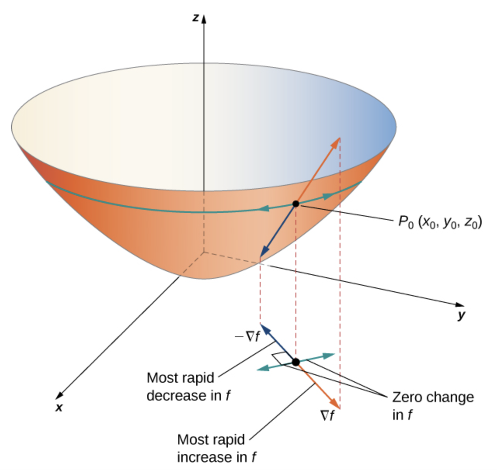
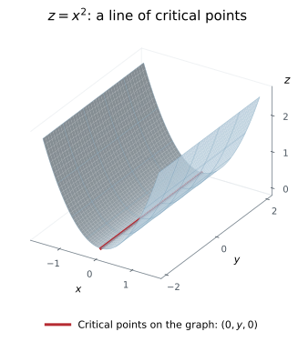
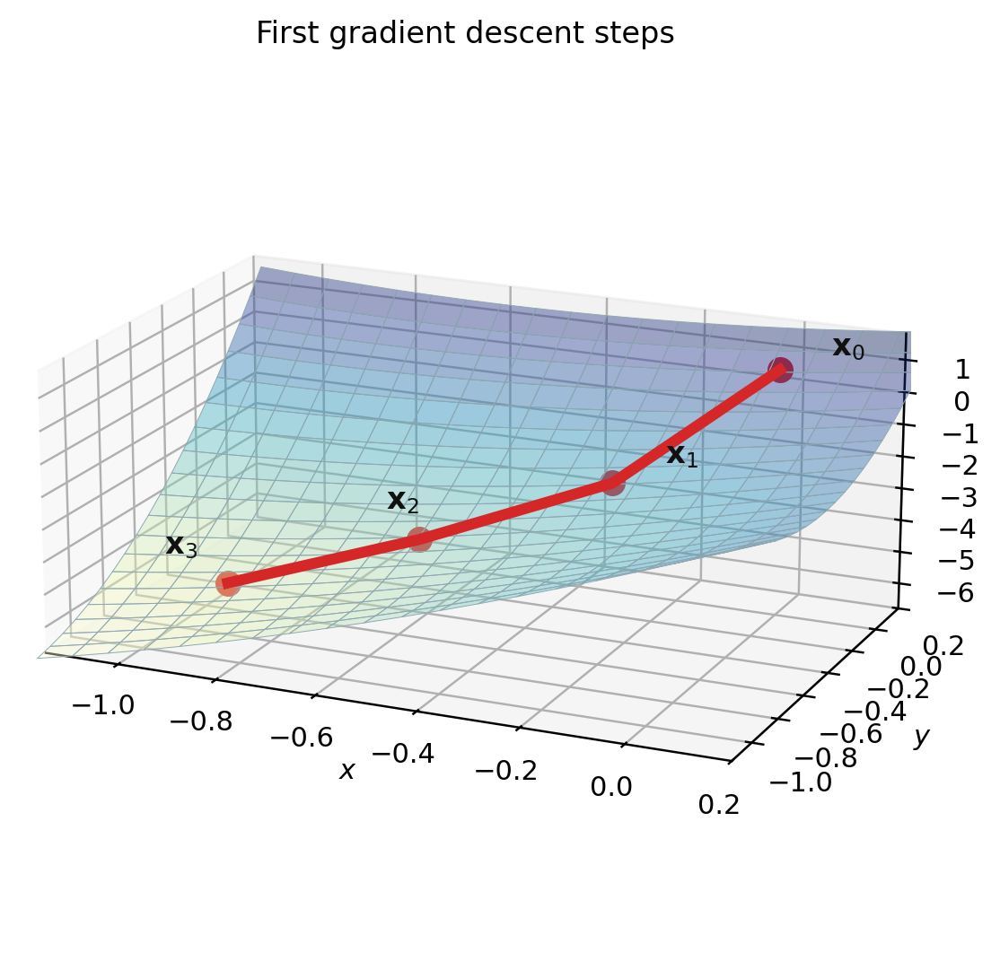

# 3.6 Directional Derivatives, Critical Points, and Gradient Descent {#36-directional-derivatives-critical-points-and-gradient-descent}

!!! note "译文与来源"

    本页为教材公开源文件 v0.2 的非官方中文翻译，保留原公式、例题、活动、代码和习题；为适应网页阅读，例题与活动等编号按本地小节重排，解答可点击展开；正文与标题中的数学专有名词保留英文，中文用于解释；术语表保留中英对照以便查阅。原文作者：Jacob Denson、Kaitlyn Phillipson、Sebastien Roch。译文遵循 [CC BY-NC-SA 4.0](https://creativecommons.org/licenses/by-nc-sa/4.0/)。[阅读英文原文](3-6.md#sec-u3-directional-derivatives)。


<a id="textbook-body"></a>

## 教材正文 {#_5}

<a id="sec-u3-directional-derivatives"></a>


<a id="subsec-u3-directional-derivatives"></a>

## Directional Derivatives {#directional-derivatives}


<a id="sec-u3-directional-derivatives-2"></a>

由[ linear approximation ](3-4.md#def-9-1-linear-approximation)， scalar-valued function 在 $\mathbf a$ 附近的一阶变化为 

$$
f(\mathbf a+\mathbf h)-f(\mathbf a)\approx\nabla f(\mathbf a)^T\mathbf h.
$$

为了研究沿单位方向 $\mathbf v$ 的变化，将输入限制在直线 

$$
\mathbf c(t)=\mathbf a+t\mathbf v.
$$

上。由此得到的一元变化率就是 directional derivative。


<a id="sec-u3-directional-derivatives-3"></a>

[一个 independent variable 的 chain rule ](3-5.md#sec-9-2-chain-rule-1) 中单参数输入的 chain rule 给出了下面的 gradient 公式。


<a id="def-10-1-directional-derivative"></a>

**定义 3.6.1**

令 $f$ 为 scalar-valued function。那么，如果$\mathbf{v}$是 unit vector，则$f$在 vector $\mathbf{v}$方向上的 directional derivative （表示为$D_{\mathbf{v}} f$）定义为

$$
D_{\mathbf{v}} f(\mathbf{a}) = \lim_{h \to 0} \frac{f(\mathbf{a} + h \mathbf{v}) - f(\mathbf{a})}{h}
$$

前提是存在 limit。


<a id="sec-u3-directional-derivatives-5"></a>

directional derivative 表示 function $f$在点$\mathbf{a}$在 unit vector $\mathbf{v}$方向上的变化率。对于二变量 function $f(x,y)$， directional derivative $D_{\mathbf{v}} f(\mathbf{a})$是曲面$z = f(x,y)$与包含以方向 vector $\mathbf{v}$穿过$\mathbf{a}$的直线和$z$轴的平面相交所获得的曲线的切线的 slope。


<a id="sec-u3-directional-derivatives-6"></a>

**注**

partial derivative 是 directional derivative 的特例，即我们有 

$$
\frac{\partial f}{\partial x_i} = D_{\mathbf{e}_i} f
$$

<a id="sec-u3-directional-derivatives-7"></a>

尽管 partial derivative 是 directional derivative 的特殊情况，但在大多数情况下，我们可以使用 partial derivative 或等效的 gradient 来计算 directional derivative。


<a id="thm-10-1-direction-in-terms-of-gradient"></a>

**定理 3.6.1**

假设$f$是一个在点$\mathbf{a}$ differentiable 的 function。然后对于每个 unit vector $\mathbf{v}$，$D_{\mathbf{v}} f(\mathbf{a}) = \nabla f(\mathbf{a}) \cdot \mathbf{v}$。

??? info "证明"

    定义路径$\mathbf{c}(t)=\mathbf{a}+t\mathbf{v}$和单变量 function $g(t)=f(\mathbf{c}(t))=f(\mathbf{a}+t\mathbf{v})$。从 $\mathbf{c}(0)=\mathbf{a}$ 开始，我们就有了 $g(0)=f(\mathbf{a})$。因此， directional derivative 的定义给出 

    $$
    \begin{aligned}
    D_{\mathbf{v}}f(\mathbf{a}) &= \lim_{h\to 0}\frac{f(\mathbf{a}+h\mathbf{v})-f(\mathbf{a})}{h} \\
    &=\lim_{h\to 0}\frac{g(h)-g(0)}{h} \\
    &=g'(0).
    \end{aligned}
    $$

    

    写下$\mathbf{a}=(a_1,\ldots,a_n)$和$\mathbf{v}=(v_1,\ldots,v_n)$。 $\mathbf{c}(t)$的第$i$ coordinate 是$c_i(t)=a_i+tv_i$，所以$c_i'(0)=v_i$。因为$g=f\circ\mathbf{c}$， chain rule （[一个 independent variable 的 chain rule ](3-5.md#sec-9-2-chain-rule-1)）给出

    $$
    \begin{aligned}
    g'(0) &= \sum_{i=1}^n \frac{\partial f}{\partial x_i}(\mathbf{c}(0))c_i'(0) \\
    &=\sum_{i=1}^n \frac{\partial f}{\partial x_i}(\mathbf{a})v_i \\
    &=\nabla f(\mathbf{a})\cdot\mathbf{v}.
    \end{aligned}
    $$

     结合两个计算证明$D_{\mathbf{v}}f(\mathbf{a})=\nabla f(\mathbf{a})\cdot\mathbf{v}$。


<a id="sec-u3-directional-derivatives-9"></a>

[定理 3.6.1](3-6.md#thm-10-1-direction-in-terms-of-gradient)大大简化了 directional derivative 的计算。


<a id="sec-u3-directional-derivatives-11"></a>

**例题 3.6.1：directional derivative 和单位方向 (U3-LO8)**

让$f(x,y) = x^2 y + y^2$。

**问题**

计算 directional derivative $D_{\mathbf{v}} f(1,2)$，其中 $\mathbf{v} = (1/\sqrt{2}, 1/\sqrt{2})$ 和 $f(x,y) = x^2y + y^2$。

??? success "解答"

    我们首先计算 $f$ 在 $(1,2)$ 的 gradient。我们有

    $$
    f_x(x,y) = 2xy \quad\text{and}\quad f_y(x,y) = x^2 + 2y
    $$

    所以$\nabla f(x,y) = (2xy, x^2 + 2y)$，特别是

    $$
    \nabla f(1,2) = \begin{bmatrix} 2(1)(2) \\ (1)^2 + 2 (2) \end{bmatrix} = \begin{bmatrix} 4 \\ 5 \end{bmatrix}
    $$

    给定的 vector $\mathbf{v}$已经是 unit vector 了，因为

    $$
    \|\mathbf{v}\|=\sqrt{\left(\frac{1}{\sqrt{2}}\right)^2+\left(\frac{1}{\sqrt{2}}\right)^2}=1.
    $$

    因此，我们可以直接应用 directional derivative 公式：

    $$
    D_{\mathbf{v}} f(1,2) = \nabla f(1,2) \cdot \mathbf{v} = \begin{bmatrix} 4 \\ 5 \end{bmatrix} \cdot \begin{bmatrix} 1/\sqrt{2} \\ 1/\sqrt{2} \end{bmatrix} = 9 / \sqrt{2}
    $$

**问题**

求 $f$ 在点 $(-1,3)$ 沿 vector $(-1,\sqrt{3})$ 方向的 directional derivative。即计算$D_{\mathbf{v}} f(-1,3)$，其中$\mathbf{v}$是$(-1,\sqrt{3})$方向的 unit vector。

??? success "解答"

     vector 

    $$
    \begin{bmatrix}
                    -1\\
                    \sqrt{3}
                    \end{bmatrix}
    $$

     的 norm 为 

    $$
    \sqrt{(-1)^2+(\sqrt{3})^2}=2
    $$

    所以这个方向的 unit vector 是

    $$
    \mathbf{v}
                    =
                    \frac12
                    \begin{bmatrix}
                    -1\\
                    \sqrt{3}
                    \end{bmatrix}
                    =
                    \begin{bmatrix}
                    -1/2\\
                    \sqrt{3}/2
                    \end{bmatrix}
    $$

    对于 

    $$
    f(x,y)=x^2y+y^2,
    $$

    我们有 

    $$
    \nabla f(x,y)=
                    \begin{bmatrix}
                    2xy\\
                    x^2+2y
                    \end{bmatrix}.
    $$

     因此 

    $$
    \nabla f(-1,3)=
                    \begin{bmatrix}
                    -6\\
                    7
                    \end{bmatrix}.
    $$

     因此 

    $$
    \begin{aligned}
    D_{\mathbf{v}}f(-1,3)&=\nabla f(-1,3)\cdot\mathbf{v} \\
    &=\begin{bmatrix}-6\\7\end{bmatrix}\cdot\begin{bmatrix}-1/2\\\sqrt{3}/2\end{bmatrix} \\
    &=3+\frac{7\sqrt{3}}{2}=\frac{6+7\sqrt{3}}{2}
    \end{aligned}
    $$

<a id="sec-u3-directional-derivatives-12"></a>

**活动 3.6.1：两点之间的 directional derivative (U3-LO8)**

求 $f$ 在 $(2,1)$ 上从 $(2,1)$ 到 $(3,5)$ 的 directional derivative。

??? success "解答"

    从 $(2,1)$ 指向 $(3,5)$ 的 unit vector，与 vector $(3-2,5-1) = (1,4)$ 同向。后者的长度为 $\sqrt{1^2 + 4^2} = \sqrt{17}$，因此这个方向的 unit vector 为 

    $$
    \mathbf{v} =
                \begin{bmatrix}
                1/\sqrt{17}\\
                4/\sqrt{17}
                \end{bmatrix}
    $$

    又有 

    $$
    \nabla f(x,y) =
                \begin{bmatrix}
                3x^2 y\\
                x^3
                \end{bmatrix}
    $$

    特别地 

    $$
    \nabla f(2,1) =
                \begin{bmatrix}
                3(2)^2 (1)\\
                (2)^3
                \end{bmatrix}
                =
                \begin{bmatrix}
                12\\
                8
                \end{bmatrix}
    $$

    所以 

    $$
    \begin{aligned}
    D_{\mathbf{v}}f(2,1)&=\nabla f(2,1)\cdot\mathbf{v} \\
    &=\begin{bmatrix}12\\8\end{bmatrix}\cdot\begin{bmatrix}1/\sqrt{17}\\4/\sqrt{17}\end{bmatrix} \\
    &=\frac{12+32}{\sqrt{17}}=\frac{44}{\sqrt{17}}
    \end{aligned}
    $$

<a id="sec-u3-directional-derivatives-13"></a>

**活动 3.6.2：向指定点改变方向 (U3-LO8)**

让$f(x,y)=x^2e^y$。求 $f$ 在 $(2,0)$ 上从 $(2,0)$ 到 $(3,0)$ 的 directional derivative。

??? success "解答"

    从$(2,0)$指向$(3,0)$的 vector 是

    $$
    \mathbf{d}=
                \begin{bmatrix}
                3-2\\
                0-0
                \end{bmatrix}
                =
                \begin{bmatrix}
                1\\
                0
                \end{bmatrix}.
    $$

    它的 norm 是

    $$
    \|\mathbf{d}\|=\sqrt{1^2+0^2}=1.
    $$

    因此这个 vector 已经是 unit vector 了。因此所需的方向是 

    $$
    \mathbf{v}=\mathbf{d}=
                \begin{bmatrix}
                1\\
                0
                \end{bmatrix}
                =\mathbf{e}_1.
    $$

     接下来是

    $$
    \nabla f(x,y)=
                \begin{bmatrix}
                2xe^y\\
                x^2e^y
                \end{bmatrix},
                \qquad
                \nabla f(2,0)=
                \begin{bmatrix}
                4\\
                4
                \end{bmatrix}.
    $$

     因此

    $$
    \begin{aligned}
    D_{\mathbf{v}}f(2,0) &= \nabla f(2,0)\cdot\mathbf{v} \\
    &=\begin{bmatrix}4\\4\end{bmatrix}\cdot\begin{bmatrix}1\\0\end{bmatrix} \\
    &=4\cdot 1+4\cdot 0=4.
    \end{aligned}
    $$

    


<a id="act-u5-dot-product-controls-direction"></a>

**活动 3.6.3：与 gradient 对齐（U3-LO8、U1-LO1）**

假设 

$$
\nabla f(\mathbf{a})=\begin{bmatrix}3\\4\end{bmatrix}.
$$

计算以下每个 unit vector 的 $D_{\mathbf{v}}f(\mathbf{a})$： 

$$
\mathbf{v}_1=\begin{bmatrix}1\\0\end{bmatrix},
            \qquad
            \mathbf{v}_2=\begin{bmatrix}0\\1\end{bmatrix},
            \qquad
            \mathbf{v}_3=\frac15\begin{bmatrix}3\\4\end{bmatrix},
            \qquad
            \mathbf{v}_4=-\frac15\begin{bmatrix}3\\4\end{bmatrix}.
$$


列出的哪个方向增幅最大？哪个下降幅度最大？

??? success "解答"

    由[定理 3.6.1](3-6.md#thm-10-1-direction-in-terms-of-gradient)、

    $$
    D_{\mathbf v_1}f(\mathbf a)=\begin{bmatrix}3\\4\end{bmatrix}\cdot\begin{bmatrix}1\\0\end{bmatrix}=3,
    $$

     和 

    $$
    D_{\mathbf v_2}f(\mathbf a)=\begin{bmatrix}3\\4\end{bmatrix}\cdot\begin{bmatrix}0\\1\end{bmatrix}=4.
    $$

     此外，

    $$
    D_{\mathbf v_3}f(\mathbf a)=\begin{bmatrix}3\\4\end{bmatrix}\cdot\frac15\begin{bmatrix}3\\4\end{bmatrix}=5,
    $$

     而 

    $$
    D_{\mathbf v_4}f(\mathbf a)=-5.
    $$

     列出的最大增量发生在方向 $\mathbf v_3$，该方向与 gradient 对齐。列出的最大下降发生在方向 $\mathbf v_4$，该方向与 gradient 相反。


<a id="thm-10-1-directional-derivative-extrema"></a>

**定理 3.6.2**

假设 function $f$在点$\mathbf{a}$ differentiable。 
- 如果$\nabla f(\mathbf{a}) = 0$，则$D_{\mathbf{v}} f(\mathbf{a}) = 0$对于任何 unit vector $\mathbf{v}$。

- 如果

    $\nabla f(\mathbf{a})\ne \mathbf{0}$

    $D_{\mathbf{v}}f(\mathbf{a})$

    $\mathbf{v}$


    $$
    \mathbf{v}=\frac{\nabla f(\mathbf{a})}{\|\nabla f(\mathbf{a})\|}.
    $$


    $$
    \mathbf{v}=-\frac{\nabla f(\mathbf{a})}{\|\nabla f(\mathbf{a})\|}.
    $$


    $\|\nabla f(\mathbf{a})\|$

    $-\|\nabla f(\mathbf{a})\|$


??? info "证明"

    如果$\nabla f(\mathbf a)=\mathbf 0$，则[定理 3.6.1](3-6.md#thm-10-1-direction-in-terms-of-gradient)对于每个 unit vector $\mathbf v$给出

    $$
    D_{\mathbf v}f(\mathbf a)=0
    $$

    现在假设$\nabla f(\mathbf a)\neq\mathbf 0$，并令$\theta$为$\nabla f(\mathbf a)$和 unit vector $\mathbf v$之间的角度。 [定理 3.6.1](3-6.md#thm-10-1-direction-in-terms-of-gradient)、[ vector 夹角定理](1-1.md#thm-u1-angle-between-vectors)、

    $$
    D_{\mathbf v}f(\mathbf a)=\nabla f(\mathbf a)\cdot\mathbf v=\|\nabla f(\mathbf a)\|\cos\theta.
    $$

    

    当$\mathbf v$指向 gradient 方向时，$\cos\theta$的最大可能值为$1$。最小可能值是 $-1$，当 $\mathbf v$ 指向相反方向时获得。因此，在 

    $$
    \mathbf v=\frac{\nabla f(\mathbf a)}{\|\nabla f(\mathbf a)\|}\quad\text{and}\quad\mathbf v=-\frac{\nabla f(\mathbf a)}{\|\nabla f(\mathbf a)\|},
    $$

     处获得的最大和最小 directional derivative 分别为 

    $$
    \|\nabla f(\mathbf a)\|\quad\text{and}\quad-\|\nabla f(\mathbf a)\|,
    $$

<a id="note-u3-level-curves-steepest-change"></a>

**说明：level curve 和最陡变化**

对于具有连续 partial derivative 和$\mathbf a$处非零 gradient 的两个变量的 function，[定理 3.4.3](3-4.md#thm-8-5-level-curve-perpendicular)告诉我们$\nabla f(\mathbf a)$垂直于通过$\mathbf a$的 level curve。沿着该曲线移动会使 $f$ 保持不变，因此切线方向不会给 $f$ 带来一阶变化。

这给出了[定理 3.6.2](3-6.md#thm-10-1-directional-derivative-extrema)的几何解释。对于单位速度的运动，任何切向 component 都会使用部分运动，而不会影响 directional derivative。因此，当运动在 gradient 方向上完全垂直于 level curve 时，会出现最大的增加；最大的下降发生在相反的方向。 dot product 公式确定哪条路是上坡：gradient 方向的 unit vector 给出正率$\|\nabla f(\mathbf a)\|$。


<a id="fig-u3-gradient-directions"></a>

* gradient 表示某一点的 directional derivative 的最大值和最小值。图 4.41 来自 Edwin “Jed” Herman 和 Gilbert Strang，微积分第 3 卷，OpenStax，© 2018 Rice University，已获得[CC BY-NC-SA 4.0](https://creativecommons.org/licenses/by-nc-sa/4.0/) 许可；来源：[OpenStax 图 4.41](https://openstax.org/books/calculus-volume-3/pages/4-6-directional-derivatives-and-the-gradient#CNX_Calc_Figure_14_06_007)。*




<a id="sec-u3-directional-derivatives-16"></a>

**活动 3.6.4：寻找增幅最大的方向（U3-LO8）**

求 $f(x,y) = 3x^2 - 4xy + 2y^2$ 在 $(-2,3)$ 处的 directional derivative 最大的方向。 directional derivative 的最大值是多少？

??? success "解答"

    首先，我们计算

    $$
    \nabla f(x,y) =
                \begin{bmatrix}
                6x - 4y\\
                -4x + 4y
                \end{bmatrix}
    $$

    所以

    $$
    \nabla f(-2,3) =
                \begin{bmatrix}
                6(-2) - 4(3)\\
                -4(-2) + 4(3)
                \end{bmatrix}
                =
                \begin{bmatrix}
                -24\\
                20
                \end{bmatrix}
    $$

    [定理 3.6.2](3-6.md#thm-10-1-directional-derivative-extrema)告诉我们，当$\mathbf{v}$是指向$(-24,20)$方向的 unit vector 时， directional derivative $D_{\mathbf{v}} f$最大化。由于$(-24,20)$的大小为$\sqrt{(-24)^2 + (20)^2} = \sqrt{976}$，我们看到 directional derivative 最大化的方向是

    $$
    \mathbf{v} =
                \begin{bmatrix}
                -24/\sqrt{976}\\
                20/\sqrt{976}
                \end{bmatrix}
    $$

    并且该方向上的 directional derivative 的值等于 gradient 的大小，即

    $$
    \sqrt{976}
    $$

<a id="sec-u3-directional-derivatives-17"></a>

**活动 3.6.5：三个变量的 directional derivative (U3-LO8)**

对于 function 

$$
f(x,y,z) = 5x^2 - 2xy + y^2 - 4yz + z^2 + 3xz.
$$

沿$\mathbf{v} = -\mathbf{i} + 2\mathbf{j} + 2\mathbf{k}$方向计算$D_{\mathbf{u}}f(1, -2, 3)$

??? success "解答"

    我们计算出 

    $$
    \begin{aligned}
    \|\mathbf{v}\| & = \sqrt{(-1)^2 + (2)^2 + (2)^2} = \sqrt{9} = 3
    \end{aligned}
    $$

     那么$\mathbf{v}$方向上的 unit vector 就是 vector 

    $$
    \begin{aligned}
    \mathbf{u} & = \frac{\mathbf{v}}{\|\mathbf{v}\|} = -\frac{1}{3}\mathbf{i} + \frac{2}{3}\mathbf{j} + \frac{2}{3}\mathbf{k}
    \end{aligned}
    $$

     利用 directional derivative 的公式，我们发现

    $$
    \begin{aligned}
    D_{\mathbf{u}}f(x,y,z) & = \nabla f(x,y,z) \cdot \mathbf{u} \\
    & = \begin{bmatrix}10x - 2y + 3z\\ -2x + 2y - 4z\\ -4y + 2z + 3x\end{bmatrix} \cdot \mathbf{u} \\
    & = - \frac{10x - 2y + 3z}{3} \\
    &\quad + 2 \frac{-2x + 2y - 4z}{3} \\
    &\quad + 2 \frac{-4y + 2z + 3x}{3}
    \end{aligned}
    $$

    在点$(1, -2, 3)$，我们评估

    $$
    \begin{aligned}
    D_{\mathbf{u}}f(1,-2,3)&=(23)\left(-\frac{1}{3}\right) \\
    &\quad+(-18)\left(\frac{2}{3}\right)+(17)\left(\frac{2}{3}\right) \\
    &=\frac{-25}{3}
    \end{aligned}
    $$

    


<a id="sec-u3-directional-derivatives-18"></a>

在 [ orthogonal complement 与 projection ](4-2.md#sec-orthogonal-complements-and-projections) 中，相同的 dot product 将被解释为 gradient 到所选方向的带符号 projection coefficient。


<a id="sec-maxima-minima-problems"></a>

## Optimization problems and critical points {#optimization-problems-and-critical-points}


<a id="sec-u3-critical-points-gradient-descent-2-1"></a>

directional derivative 给出沿指定方向的一阶变化率。接下来用它寻找 local extrema 的候选点，并说明如何通过反复调整输入，使 function 值逐步减小。


<a id="sec-maxima-minima-problems-2-2"></a>

在本章中，我们应用多元微积分来解决 optimization problem。


<a id="def-8-1-optimization"></a>

**定义 3.6.2：optimization problem**

令 $f: \mathbb{R}^n \to \mathbb{R}$ 为 scalar-valued function，并考虑集合 $U \subseteq \mathbb{R}^n$。那么我们可以考虑两个 optimization problem，其中$f$为问题的 objective function，$U$为 optimization problem 的可行域：
- $U$上的$f$最小化问题是找到$\mathbf{x}^* \in U$使得$f(\mathbf{x}^*)$的值在$U$的所有元素中最小的问题（因此 function 在$U$上最小化为$\mathbf{x}^*$）。

- $f$在$U$上的最大化问题是找到$\mathbf{x}^* \in U$使得值$f(\mathbf{x}^*)$在$U$的所有元素中最大的问题（因此 function 在$U$上通过$\mathbf{x}^*$最大化）。


<a id="sec-maxima-minima-problems-3-2"></a>

**定义 3.6.3：最小值和最大值**

假设 $f$ 是 scalar-valued function。 $f$ domain 中的点$\mathbf{a}$是
- global minimum 点：对 $f$  domain 中的所有 $\mathbf{x}$，都有 $f(\mathbf{a}) \leq f(\mathbf{x})$。此时 $f(\mathbf{a})$ 称为 function $f$ 的 global minimum，也称绝对最小值。

- global maximum 点：对 $f$  domain 中的所有 $\mathbf{x}$，都有 $f(\mathbf{a}) \geq f(\mathbf{x})$。此时 $f(\mathbf{a})$ 称为 function $f$ 的 global maximum，也称绝对最大值。

- local minimum 点：存在以 $\mathbf{a}$ 为中心的一个球，使得只要 $\mathbf{x}$ 在球内且属于 $f$ 的 domain，就有 $f(\mathbf{a}) \leq f(\mathbf{x})$。换句话说，只需 $\mathbf{x}$ 足够接近 $\mathbf{a}$，并且属于 $f$ 的 domain。此时 $f(\mathbf{a})$ 称为 function $f$ 的 local minimum。

- local maximum 点：存在以 $\mathbf{a}$ 为中心的一个球，使得只要 $\mathbf{x}$ 在球内且属于 $f$ 的 domain，就有 $f(\mathbf{a}) \geq f(\mathbf{x})$。换句话说，只需 $\mathbf{x}$ 足够接近 $\mathbf{a}$，并且属于 $f$ 的 domain。此时 $f(\mathbf{a})$ 称为 function $f$ 的 local maximum。


  local minimum 或 local maximum 也称为 local extremum。


<a id="sec-maxima-minima-problems-3-3"></a>

**注**

function $-f$的图形是通过将 function $f$的图形反映在输出轴上而得到的。此操作将局部和 global maximum 转换为局部和 global minimum，反之亦然。因此，寻找 general function 最小值的方法通常会给出寻找最大值的方法，这使得两个问题通常是等价的。


<a id="def-u3-critical-point"></a>

**定义 3.6.4：critical point**

假设 $f$ 是一个 scalar-valued function，在点 $\mathbf{a}$ 处 differentiable。那么如果$\nabla f(\mathbf{a}) = \mathbf{0}$，我们就说$\mathbf{a}$是一个 critical point。


<a id="sec-maxima-minima-problems-3-5"></a>

对于两个变量的 scalar-valued function，例如 $f(x,y)$， critical point 是两个方程 $f_x(x,y) = 0$ 和 $f_y(x,y) = 0$ 的解。


<a id="sec-maxima-minima-problems-3-6"></a>

正如单个变量的 scalar-valued function 的 derivative 有助于识别 local minimum 和最大值一样， partial derivative 提供有关可能的 local minimum /最大值的信息。


<a id="sec-maxima-minima-problems-3-7"></a>

**定理 3.6.3**

假设 $f$ 在其 domain 的 [ interior point ](3-1.md#sec-8-4-interior-and-exterior) $\mathbf a$ 处 differentiable。如果$\mathbf a$是$f$的 local extremum，则

$$
\nabla f(\mathbf a)=\mathbf 0.
$$


??? info "证明"

    设$\mathbf v$为 unit vector，并定义

    $$
    g(t)=f(\mathbf a+t\mathbf v).
    $$

    因为$\mathbf a$是$f$的内部 local extremum，所以 function $g$在$t=0$处有一个 local extremum。因此

    $$
    g'(0)=0.
    $$

    通过[定理 3.6.1](3-6.md#thm-10-1-direction-in-terms-of-gradient)，

    $$
    g'(0)=D_{\mathbf v}f(\mathbf a)=\nabla f(\mathbf a)\cdot\mathbf v.
    $$

    这对于每个 unit vector $\mathbf v$都成立。如果$\nabla f(\mathbf a)\neq\mathbf 0$，选择

    $$
    \mathbf v=\frac{\nabla f(\mathbf a)}{\|\nabla f(\mathbf a)\|}.
    $$

    则

    $$
    \nabla f(\mathbf a)\cdot\mathbf v=\|\nabla f(\mathbf a)\|>0,
    $$

    矛盾。因此$\nabla f(\mathbf a)=\mathbf0$。


<a id="warning-u3-critical-point-necessary-not-sufficient"></a>

**注意：必要条件并不充分**

对于在 interior point $\mathbf a$ differentiable 的 function，[定理 3.6.3](3-6.md#sec-maxima-minima-problems-3-7)表示$\nabla f(\mathbf a)=\mathbf0$是 local extremum 的必要条件，但还不够。 critical point 不必是 local minimum 或 local maximum。


<a id="warning-u3-number-of-critical-points"></a>

**注意：不一定只有一个 critical point**

differentiable function 可以没有 critical point、一个或多个 critical point 或无穷多个 critical point。例如，考虑 $\mathbb R^2$ 上的这些 function：


- 对于$f(x,y)=x$，我们到处都有$f_x=1$，所以没有 critical point。

- 对于 $g(x,y)=(x^2-1)^2+y^2$， critical point 方程为 $4x(x^2-1)=0$ 和 $2y=0$。共有三个 critical point：$(-1,0)$、$(0,0)$、$(1,0)$。

- 对于 $h(x,y)=x^2$，我们有 $h_x=2x$ 和 $h_y=0$。因此，$x=0$ 线上的每个点都是一个 critical point：$\nabla h(0,y)=\mathbf0$ 对于每个实数$y$。


在最后一个例子中， critical point 组成整条直线，并非孤立的点。在曲面 $z=x^2$ 上，它们对应于[图 3.6.2](3-6.md#fig-u3-critical-line-x-squared)中标出的直线 $(0,y,0)$。每个点都是 global minimum 点，因为处处都有 $x^2\geq0$。


<a id="fig-u3-critical-line-x-squared"></a>

*$h(x,y)=x^2$的图表。红线$(0,y,0)$对应于输入平面中的无穷多个 critical point $(0,y)$。这条线对于所有真实的 $y$ 来说都是延续的。*




<a id="act-u3-critical-point-saddle-quadratic"></a>

**例题 3.6.2：平方差的 critical point (U3-LO9)**

找到$f(x,y) = x^2 - y^2$的 critical point。

??? success "解答"

    我们计算$f_x(x,y) = 2x$和$f_y(x,y) = -2y$。唯一能满足 $f_x(x,y) = 2x = 0$ 和 $f_y(x,y) = -2y = 0$ 的$(x,y)$ 是 $(0,0)$。这是唯一的 critical point。


<a id="act-u3-critical-point-quadratic-minimum"></a>

**活动 3.6.6：二次 function 的 critical point (U3-LO9)**

找到 function 

$$
f(x,y) = x^2 + y^2 - 2x + 4y
$$

的 critical point。

??? success "解答"

    为了找到 critical point，我们计算 partial derivative 并将其设置为零。我们发现

    $$
    f_x(x,y) = 2x - 2 \quad\text{and}\quad f_y(x,y) = 2y + 4
    $$

     critical point 是同时求解方程 $2x - 2 = 0$ 和 $2y + 4 = 0$ 的对 $(x,y)$。所以唯一的 critical point 是$(1, -2)$。


<a id="act-u3-critical-points-row-reduction"></a>

**活动 3.6.7：用 row reduction 求 critical point （Critical Points via Row Reduction，U3-LO9、U2-LO2）**

求出

$$
f(x,y,z)=x^2+xy+yz+z^2-x-2y-z.
$$

的所有 critical point，将 critical point 方程写成 augmented matrix，用 Gaussian elimination 得到行梯形形式，最后用 back-substitution 法完成。

??? success "解答"

    多项式$f$处处 differentiable，其 gradient 为

    $$
    \nabla f(x,y,z)=
                \begin{bmatrix}
                  2x+y-1\\
                  x+z-2\\
                  y+2z-1
                \end{bmatrix}.
    $$

    因此其 critical point 正是

    $$
    \begin{cases}
                  2x+y=1,\\
                  x+z=2,\\
                  y+2z=1.
                \end{cases}
    $$

    的解

    在[ Gaussian elimination ](2-2.md#alg-gaussian-elimination)之后，我们首先交换行以获得$1$的前导 pivot。然后我们消除下面的每个 pivot 并标准化最终的 pivot：

    $$
    \begin{aligned}
    \left[\begin{array}{ccc|c}
                    2&1&0&1\\
                    1&0&1&2\\
                    0&1&2&1
                  \end{array}\right]
                  &\xrightarrow{R_1\leftrightarrow R_2}
                  \left[\begin{array}{ccc|c}
                    1&0&1&2\\
                    2&1&0&1\\
                    0&1&2&1
                  \end{array}\right] \\
    &\xrightarrow{R_2\to R_2-2R_1}
                  \left[\begin{array}{ccc|c}
                    1&0&1&2\\
                    0&1&-2&-3\\
                    0&1&2&1
                  \end{array}\right] \\
    &\xrightarrow{R_3\to R_3-R_2}
                  \left[\begin{array}{ccc|c}
                    1&0&1&2\\
                    0&1&-2&-3\\
                    0&0&4&4
                  \end{array}\right] \\
    &\xrightarrow{R_3\to\frac14R_3}
                  \left[\begin{array}{ccc|c}
                    1&0&1&2\\
                    0&1&-2&-3\\
                    0&0&1&1
                  \end{array}\right].
    \end{aligned}
    $$

    

    最后一行给出$z=1$。 back-substitution 到第二行$y-2z=-3$，然后第一行$x+z=2$，得到

    $$
    \begin{aligned}
    y&=-3+2z=-3+2(1)=-1, \\
    x&=2-z=2-1=1.
    \end{aligned}
    $$

     每个变量 column 都有一个 pivot，并且没有不一致的 row，因此系统有唯一解。因此$f$唯一的 critical point 是$(1,-1,1)$。

下一个 critical point 系统导出二次方程。回想一下，当$a\ne0$时，$at^2+bt+c=0$的实数解由提供$b^2-4ac\ge0$的二次公式

$$
t=\frac{-b\pm\sqrt{b^2-4ac}}{2a},
$$

给出。如果$b^2-4ac<0$，则没有真正的解决方案。


<a id="act-u3-critical-points-quadratic-formula"></a>

**活动 3.6.8：使用二次公式 (U3-LO9) 的 critical point**

找到 

$$
f(x,y)=x^3+2xy+y^2-2x.
$$

的所有 critical point 使用二次公式求解得到的二次方程。

??? success "解答"

     partial derivative 为 

    $$
    f_x(x,y)=3x^2+2y-2,\qquad f_y(x,y)=2x+2y.
    $$

     将它们设置为零则得到 

    $$
    \begin{cases}
                  3x^2+2y-2=0,\\
                  2x+2y=0.
                \end{cases}
    $$

    

    第二个方程给出$y=-x$。代入第一个方程得到 

    $$
    3x^2-2x-2=0.
    $$

     对于 $a=3$、$b=-2$ 和 $c=-2$，二次公式得出 

    $$
    x=\frac{2\pm\sqrt{(-2)^2-4(3)(-2)}}{2(3)}=\frac{2\pm\sqrt{28}}{6}=\frac{1\pm\sqrt7}{3}.
    $$

    

    对于每个根，使用 $y=-x$。因此，两个 critical point 是 

    $$
    \left(\frac{1+\sqrt7}{3},\frac{-1-\sqrt7}{3}\right)
                \quad\text{and}\quad
                \left(\frac{1-\sqrt7}{3},\frac{-1+\sqrt7}{3}\right).
    $$

     这些都是 critical point，因为系统的每个解都必须满足 $y=-x$ 和上面两个二次根之一。

当 critical point 方程因子为$(x-a)(y-b)=0$时，至少有一个因子必须为零：$x=a$或$y=b$，也可能两者兼而有之。将它们视为两种情况，将每种情况代入剩余的方程中，然后组合解，仅列出任何重复点一次。除以任一因子而不考虑它何时为零可能会丢弃有效的解决方案。


<a id="act-u3-critical-points-zero-product"></a>

**活动 3.6.9：分类讨论求 critical point （Critical Points by Splitting into Cases，U3-LO9）**

找到

$$
f(x,y)=(x-1)^2(y-2)+y^2-8y.
$$

的所有 critical point 

??? success "解答"

     partial derivative 为 

    $$
    \begin{aligned}
    f_x(x,y)&=2(x-1)(y-2), \\
    f_y(x,y)&=(x-1)^2+2y-8.
    \end{aligned}
    $$

     将它们设置为零并将第一个方程除以 $2$ 得到 

    $$
    \begin{cases}
                  (x-1)(y-2)=0,\\
                  (x-1)^2+2y-8=0.
                \end{cases}
    $$

     第一个方程给出两种情况，并且在每种情况下第二个方程也必须成立。


    - 如果$x=1$，第二个方程就变成$2y-8=0$，所以$y=4$。这给出了 critical point $(1,4)$。

    - 如果$y=2$，第二个方程变为

    $$
    (x-1)^2-4=0.
    $$

    因此$x-1=\pm2$，给出$x=-1$或$x=3$。这给出了 critical point $(-1,2)$和$(3,2)$。


    因此，所有 critical point 都是 

    $$
    (1,4),\qquad (-1,2),\qquad (3,2).
    $$

     每个点都满足两个方程，并且这两种情况耗尽了第一个方程的解。


<a id="warning-critical-points-candidates"></a>

**注意：critical point 只是极值的候选点（Critical Points Are Candidates）**

方程 $\nabla f=0$ 找到 local extremum 的候选者。它本身不会找到 boundary 极值、约束极值或绝对极值。始终将 critical point 信息与域和 boundary 条件结合起来。


<a id="act-u3-prediction-loss-flat-direction"></a>

**活动 3.6.10：冗余特征给出了损失的平坦方向（U3-LO6、U2-LO6）**

回想一下[第二章](2-index.md)在[第二章的冗余特征活动](2-1.md#u2-act-preview-redundant-features)中的冗余特征示例。通过对原始两个特征 column 求和，向我们的数据添加第三个特征： 

$$
\widetilde X=\begin{bmatrix}1&0&1\\0&1&1\\1&1&2\end{bmatrix},
            \qquad \mathbf{y}=\begin{bmatrix}1\\2\\2\end{bmatrix}.
$$

现在有三个权重 $\boldsymbol\theta=(\theta_1,\theta_2,\theta_3)$，损失为 

$$
\widetilde{\mathcal L}(\boldsymbol\theta)=\|\widetilde X\boldsymbol\theta-\mathbf{y}\|^2.
$$

预测仅取决于两个组合 $w_1=\theta_1+\theta_3$ 和 $w_2=\theta_2+\theta_3$，因此 $\widetilde{\mathcal L}(\boldsymbol\theta)=\mathcal L(\theta_1+\theta_3,\theta_2+\theta_3)$。


1. 验证 $\mathbf{z}=(-1,-1,1)$ 是否位于 $\widetilde X$ 的 null space 中。

2. 证明对于每个实数 $t$ 都有 $\widetilde{\mathcal L}(\boldsymbol\theta+t\mathbf{z})=\widetilde{\mathcal L}(\boldsymbol\theta)$。沿着 $\boldsymbol\theta_0=(1,1,0)$ 评估这个恒定损失。

3. $\frac{d}{dt}\widetilde{\mathcal L}(\boldsymbol\theta+t\mathbf{z})$是什么？如果找到一个最小化权 vector，它是否是唯一的最小化权 vector？


??? success "解答"

    1. 直接乘法验证给定方向： 

    $$
    \widetilde X\mathbf{z}
                    =\begin{bmatrix}-1+1\\-1+1\\-1-1+2\end{bmatrix}
                    =\mathbf{0}.
    $$

     将每个原始权重减少 $t$ 并将冗余特征权重增加 $t$ 使两个有效权重保持不变。

    2. 单元 2 的 linear 恒等式给出 

    $$
    \widetilde X(\boldsymbol\theta+t\mathbf{z})-\mathbf{y}
                    =\widetilde X\boldsymbol\theta-\mathbf{y}
                      +t\widetilde X\mathbf{z}
                    =\widetilde X\boldsymbol\theta-\mathbf{y}.
    $$

     取平方长度证明每个 $t$ 的损失相等。在$\boldsymbol\theta_0$，预测为$(1,1,2)$，损失为$1$。每个点 $(1-t,1-t,t)$ 都会给出相同的预测和相同的损失。

    3. 沿线的损失是恒定的，因此对于每个$t$，其 derivative 为零。根据 chain rule，$\nabla\widetilde{\mathcal L}(\boldsymbol\theta)^T\mathbf{z}=0$。如果 $\boldsymbol\theta_*$ 最小化损失，则所有不同的 vector $\boldsymbol\theta_*+t\mathbf{z}$ 也会最小化它。因此，数据无法唯一地识别这三个权重。


<a id="note-u3-exact-invariance-first-order-change"></a>

**说明：精确不变性和一阶变化**

对于 linear 预测映射$\boldsymbol\theta\mapsto\widetilde X\boldsymbol\theta$，任何满足$\widetilde X\mathbf z=\mathbf 0$的方向$\mathbf z$都会使预测和损失沿整条线$\boldsymbol\theta+t\mathbf z$保持不变。这正是 [冗余特征给出了损失的平坦方向（U3-LO6、U2-LO6）](3-6.md#act-u3-prediction-loss-flat-direction) 中所示的不变性。

对于 differentiable nonlinear map $F$，条件 $J_F(\mathbf a)\mathbf z=\mathbf 0$ 仅保证 $\mathbf a$ 处的一阶变化为零。输出 $F(\mathbf a+t\mathbf z)$ 仍可能随 $t$ 变化，如 [解释 SymPy 中的 Jacobian null space （U3-LO5、U2-LO3）](3-4.md#act-u3-sympy-local-nullspace) 所示。此外，相等的损失值并不一定意味着相等的预测：不同的预测 vector 可以具有相同的平方误差，如[从预测到 scalar-valued loss function （U3-LO1、U2-LO1）](3-1.md#act-u3-prediction-loss-model)所示。


<a id="sec-directional-derivatives"></a>

## Gradient descent {#gradient-descent}


<a id="act-10-1-solve-equation"></a>

**例题 3.6.3：三变量 critical point 方程 (U3-LO9)**

找到满足 function 

$$
f(x,y,z) = x^2e^{yz} + y\sin(xz) + z\cos(xy)
$$

  critical point 的方程组。

??? success "解答"

    我们计算

    $$
    f_x(x,y,z)=2xe^{yz}+yz\cos(xz)-yz\sin(xy)
    $$

    $$
    f_y(x,y,z)=x^2ze^{yz}+\sin(xz)-xz\sin(xy)
    $$

     和

    $$
    f_z(x,y,z)=x^2ye^{yz}+xy\cos(xz)+\cos(xy)
    $$

    所以$f$的 critical point 就是方程组

    $$
    \begin{cases}
    						2xe^{yz}+yz\cos(xz)-yz\sin(xy)=0,\\
    						x^2ze^{yz}+\sin(xz)-xz\sin(xy)=0,\\
    						x^2ye^{yz}+xy\cos(xz)+\cos(xy)=0.
    						\end{cases}
    $$

    的解

使用我们开发的微积分，通常可以很容易地写出 critical point 必须满足的方程。 [三变量 critical point 方程 (U3-LO9)](3-6.md#act-10-1-solve-equation)也说明了问题：这些方程可能是 nonlinear 的，很难或不可能精确求解。这与第二章中的 linear 系统不同，其中 Gaussian elimination 给出了系统的精确方法。

当 critical point 方程无法直接求解时，通常采用数值方法。到[定理 3.6.2](3-6.md#thm-10-1-directional-derivative-extrema)，负 gradient 给出了局部下降最陡的方向。

在当前点$\mathbf x_k$，选择

$$
\mathbf h=-\alpha\nabla f(\mathbf x_k),\qquad \alpha>0.
$$

到[ linear approximation ](3-4.md#def-9-1-linear-approximation)，

$$
\begin{aligned}
f(\mathbf x_k+\mathbf h)-f(\mathbf x_k) &\approx \nabla f(\mathbf x_k)^T\mathbf h \\
&=-\alpha\|\nabla f(\mathbf x_k)\|^2.
\end{aligned}
$$

除非 gradient 为零，否则局部模型预测会下降。这是局部预测，而不是收敛定理。它激发了 gradient descent 更新

$$
\mathbf x_{k+1}=\mathbf x_k-\alpha\nabla f(\mathbf x_k).
$$


gradient descent 算法重复这个局部步骤。


1. 从初始点$\mathbf{x}_0$开始。

2. 计算 gradient $\nabla f(\mathbf{x}_0)$。

3. 向负 gradient 方向移动：设置$\mathbf{x}_1 = \mathbf{x}_0 - \alpha_0 \nabla f(\mathbf{x}_0)$，其中$\alpha_0 > 0$是 step size （或 learning rate）参数。

4. 以 step size $\alpha_1, \alpha_2, \dots$重复步骤2-3，依次定义点$\mathbf{x}_2 = \mathbf{x}_1 - \alpha_1 \nabla f(\mathbf{x}_1)$、$\mathbf{x}_3 = \mathbf{x}_2 - \alpha_2 \nabla f(\mathbf{x}_2)$等，希望这些点收敛到 local minimum。


在数据和建模问题中，最小化的 objective function 通常称为损失。

直观上， gradient descent 之所以有效，是因为每个连续值 $\mathbf{x}_k$ 都是通过将前一个值 $\mathbf{x}_{k-1}$ 向 function $f$ 下降最快的方向移动而获得的。在 function 和 learning rate 的附加假设下， gradient descent 可能会收敛到 local minimum。下面的示例说明了可能的行为；它们不能证明收敛性。

**活动 3.6.11：三个 gradient descent 步骤 (U3-LO9)**

使用 gradient descent 找到由 

$$
f(x, y) = x^2 - 3xy + 3y^2 + 5y + 2x
$$

定义的 function $f : \mathbb{R}^2 \to \mathbb{R}$ 的近似最小值。使用起始点$\mathbf{x}_0 = (0,0)$，恒定 step size $0.1$，计算完$\mathbf{x}_3$后停止。你可以使用计算器来执行这些计算。

??? success "解答"

    首先，我们计算 gradient：

    $$
    \nabla f(x, y) = \begin{bmatrix} 2x - 3y + 2 \\ -3x + 6y + 5 \end{bmatrix}
    $$

     从$\mathbf{x}_0 = (0,0)$开始，我们依次计算

    $$
    \nabla f(0,0) = \begin{bmatrix} 2 \\ 5 \end{bmatrix}
    $$

    所以

    $$
    \mathbf{x}_1  = \begin{bmatrix}0\\0\end{bmatrix} - 0.1\begin{bmatrix} 2 \\ 5 \end{bmatrix} = \begin{bmatrix} -0.2 \\ -0.5 \end{bmatrix}
    $$

    然后我们计算

    $$
    \begin{aligned}
    &\nabla f(-0.2,-0.5) \\
    &=\begin{bmatrix}-0.4-(-1.5)+2\\-3(-0.2)+6(-0.5)+5\end{bmatrix} \\
    &=\begin{bmatrix}3.1\\2.6\end{bmatrix}
    \end{aligned}
    $$

    即

    $$
    \mathbf{x}_2 = \begin{bmatrix} -0.2 \\ -0.5 \end{bmatrix} - 0.1\begin{bmatrix} 3.1 \\ 2.6 \end{bmatrix} = \begin{bmatrix} -0.51 \\ -0.76 \end{bmatrix}
    $$

    最后，我们计算出

    $$
    \begin{aligned}
    &\nabla f(-0.51,-0.76) \\
    &=\begin{bmatrix}2(-0.51)-3(-0.76)+2\\-3(-0.51)+6(-0.76)+5\end{bmatrix} \\
    &=\begin{bmatrix}3.26\\1.97\end{bmatrix}
    \end{aligned}
    $$

    即

    $$
    \mathbf{x}_3 = \begin{bmatrix} -0.51 \\ -0.76 \end{bmatrix} - 0.1\begin{bmatrix} 3.26 \\ 1.97 \end{bmatrix} = \begin{bmatrix} -0.836 \\ -0.957 \end{bmatrix}
    $$

    在[第五章的二次 function 分类活动](5-4.md#act-u5-classify-gradient-descent-quadratic)中，我们精确计算出唯一 critical point 为

    $$
    \left(-9,-\frac{16}{3}\right)
    $$

    并在开发二阶工具后对其进行分类。因此 $\mathbf x_3$ 还不是一个好的近似值。如果我们继续迭代，例如 $k\geq1000$ 的点 $\mathbf x_k$ 非常接近该 critical point。

*以 $\mathbf{x}_0 = (0, 0)$ 为起点的 $f(x,y)=x^2-3xy+3y^2+5y+2x$  gradient descent 的初始步骤。对于$k=1,2,3$，点$\mathbf{x}_k$由规则$\mathbf{x}_k = \mathbf{x}_{k-1} - (0.1) \nabla f(\mathbf{x}_{k-1})$确定。改编自斯坦福大学 MATH 51 教科书。*




<a id="act-u3-sympy-gradient-descent-step"></a>

**活动 3.6.12：从符号 gradient 到下降步骤 (U3-LO9)**

使用 SymPy 检查 

$$
f(x,y)=x^2-3xy+3y^2+5y+2x.
$$

前面计算的第一步，我们将 gradient 计算为 Jacobian matrix 的 transpose，如 [ Jacobian matrix、 gradient matrix 和 Hessian matrix ](3-3.md#note-u3-jacobian-gradient-hessian) 所示，在起始点对其进行评估，并应用 gradient descent 更新。 learning rate `sp.Rational(1, 10)`正好代表$0.1$。

由于`.jacobian()`是一种`Matrix`方法，我们将`f`包装在单项 matrix `sp.Matrix([f])`中。调用 `.jacobian([x, y])` 产生$1\times2$  row partial derivative； `.T` 将其 transpose 到$2\times1$  gradient column 中。


```python
import sympy as sp

x, y = sp.symbols("x y")
f = x**2 - 3*x*y + 3*y**2 + 5*y + 2*x
grad_f = sp.Matrix([f]).jacobian([x, y]).T

p0 = sp.Matrix([0, 0])
g0 = grad_f.subs({x: p0[0], y: p0[1]})
alpha = sp.Rational(1, 10)
p1 = p0 - alpha*g0
f0 = f.subs({x: p0[0], y: p0[1]})
f1 = f.subs({x: p1[0], y: p1[1]})

print(grad_f)
print(g0)
print(p1)
print(f0, f1)
print((g0.T * (p1 - p0))[0], f1 - f0)
```

输出：


```text
Matrix([[2*x - 3*y + 2], [-3*x + 6*y + 5]])
Matrix([[2], [5]])
Matrix([[-1/5], [-1/2]])
0 -241/100
-29/10 -241/100
```

最后一行中，`g0.T * (p1 - p0)`是$1\times1$ matrix。索引`[0]`提取其 scalar 条目，即$f$变化的局部 linear 预测。


1. `grad_f` 和 `g0` 有什么区别？ `p0`、`g0` 和 `p1` 必须具有哪些形状才能使更新有意义？

2. 编写产生 `p1` 的数 value vector 更新。 function 值是否减少了？使用 [ linear approximation ](3-4.md#def-9-1-linear-approximation) 的 scalar linear approximation 将预测变化与实际变化进行比较。

3. 预测`grad_f.subs({x: p1[0], y: p1[1]})`。 `p1`是 critical point 吗？解释哪些符号表达式可以在下一步中重用，以及哪些评估 vector 必须重新计算。

4. 如果将`alpha`更改为`1`并重新运行后续 row，`p1`和`f1`是什么？这个比较显示了什么关于 learning rate 的信息？


??? success "解答"

    1. matrix `grad_f`包含作为$x,y$ function 的两个 partial derivative 的表达式； `g0` 是它们在 $(0,0)$ 时的值。每个点和评估的 gradient 都是一个 $2\times1$  column，因此可以从 `p0` 中减去 scalar 倍数 `alpha*g0`。

    2. 更新为

    $$
    \mathbf{p}_1
                    =\begin{bmatrix}0\\0\end{bmatrix}
                    -\frac{1}{10}\begin{bmatrix}2\\5\end{bmatrix}
                    =\begin{bmatrix}-1/5\\-1/2\end{bmatrix}.
    $$

     function 值从$0$减少到$-241/100=-2.41$。局部 linear approximation 预测 

    $$
    \nabla f(\mathbf{p}_0)^T(\mathbf{p}_1-\mathbf{p}_0)
                    =-\frac{1}{10}(2^2+5^2)
                    =-\frac{29}{10}.
    $$

     实际变化为 $-241/100$。两者都是负值，但实际减少量小于预测，因为 linear approximation 忽略了 nonlinear 项。

    3. 在新点进行评估会得到 

    $$
    \nabla f(-1/5,-1/2)
                    =\begin{bmatrix}31/10\\13/5\end{bmatrix},
    $$

    因此 $\mathbf{p}_1$ 不是 critical point。符号表达式`grad_f`可以重复使用，无需再次微分。它的值必须在新的点重新计算；重用旧 vector `g0`不会在该点实现 gradient descent。

    4. 有了$\alpha=1$，新的点是$(-2,-5)$和$f(-2,-5)=20$，比$0$有所增加。本地模型预测变化为$-29$，但这个较大的 step size 对于该预测来说太过分了，无法确保减少。负 gradient 方向并不能保证每个正 learning rate 都会下降。


<a id="act-u3-numpy-gradient-descent-step"></a>

**活动 3.6.13：NumPy 中的 gradient descent 步骤 (U3-LO9)**

使用 NumPy 对 

$$
f(x,y)=x^2-3xy+3y^2+5y+2x.
$$

重复 [从符号 gradient 到下降步骤 (U3-LO9)](3-6.md#act-u3-sympy-gradient-descent-step) 中的计算，这里 `f` 和 `grad_f` 是在数值输入处计算的 Python function。我们提供在前面的活动中找到的 partial derivative 公式； NumPy 不会求导此代码中的表达式。点和 gradient 由一维数组表示。


```python
import numpy as np

def f(p):
    x, y = p
    return x**2 - 3*x*y + 3*y**2 + 5*y + 2*x

def grad_f(p):
    x, y = p
    return np.array([2*x - 3*y + 2, -3*x + 6*y + 5])

p0 = np.array([0.0, 0.0])
g0 = grad_f(p0)
alpha = 0.1
p1 = p0 - alpha*g0
f0 = f(p0)
f1 = f(p1)

print(p0.shape, g0.shape, p1.shape)
print(g0)
print(p1)
print(np.round(f0, 2), np.round(f1, 2))
print(np.round(g0 @ (p1 - p0), 2), np.round(f1 - f0, 2))
```

输出：


```text
(2,) (2,) (2,)
[2. 5.]
[-0.2 -0.5]
0.0 -2.41
-2.9 -2.41
```

对于一维数组，`@` 计算 dot product 并返回 scalar。对 `np.round` 的调用将显示的 scalar 结果四舍五入到小数点后两位；它们不会更改存储的点或 gradient。


1. 比较两个活动中的`grad_f`。哪个版本以符号方式计算 derivative，哪个版本评估我们提供的 derivative 公式？ `grad_f(p0)` 如何替换 SymPy 替换步骤？

2. 为什么 NumPy 数组的形状为 `(2,)`，而 SymPy 点 matrix 和 gradient matrix 的形状为 `(2, 1)`？解释为什么`g0 @ (p1 - p0)`取代`(g0.T * (p1 - p0))[0]`。 `g0 * (p1 - p0)` 在 NumPy 中会给出相同的结果吗？

3. 编写产生 `p1` 的 vector 更新，并将新点、 function 值和预测变化与精确的 SymPy 结果进行比较。当`sp.Rational(1, 10)`替换为`0.1`时，会发生什么变化？

4. 预测 `grad_f(p1)` 并将其与相应的 SymPy 替换进行比较。 `p1`是 critical point 吗？在每个版本中，哪些内容可以重用，哪些内容必须在下一步中再次评估？

5. 再次从`p0`开始，将`alpha`更改为`1.0`。找出两个版本中的新点和 function 值。 function 值的增加是浮点误差，还是 learning rate 的结果？


??? success "解答"

    1. 在 SymPy 活动中，`grad_f` 是通过对 `f` 求导得到的符号表达式 matrix。这里它是一个可调用的 Python function，用于计算其定义中已提供的两个 derivative 公式。调用`grad_f(p0)`将`p0`的条目分配给局部变量`x, y`并返回它们的数值 gradient，扮演`grad_f.subs({x: p0[0], y: p0[1]})`的角色。

    2. 每个 NumPy 数组都有一个长度为 2 的轴，因此其形状为 `(2,)`；它没有单独的行轴和 column 轴。每个 SymPy matrix 都是一个 column，包含两个 rows 和一个 column。两种表示都允许按组件更新`p0 - alpha*g0`。对于 NumPy 数组，`@` 对相应条目的乘积求和并直接返回 scalar。 transpose 一维数组不会改变其形状。 NumPy 的 `*` 相反返回元素乘积，此处为 `[-0.4, -2.5]`，其总和是预测变化$-2.9$。

    3. 数学更新为 

    $$
    \mathbf{p}_1
                    =\begin{bmatrix}0\\0\end{bmatrix}
                    -0.1\begin{bmatrix}2\\5\end{bmatrix}
                    =\begin{bmatrix}-0.2\\-0.5\end{bmatrix}.
    $$

     这些 coordinate 与精确的 SymPy 值 $-1/5$ 和 $-1/2$ 一致。 function 从$0$减小到$-2.41=-241/100$，而 linear 预测为$-2.9=-29/10$。 SymPy 保持有理算术的精确性。 NumPy 在这里使用浮点运算，`0.1` 只是二进制浮点中$1/10$ 的近似值。四舍五入的输出与准确的结果一致，但对显示进行四舍五入并不会使底层算术变得精确。

    4. NumPy 调用返回大约 `[3.1, 2.6]`，与精确的 SymPy gradient $(31/10,13/5)$ 匹配。这是非零的，因此新点并不重要。重用 NumPy function 或 SymPy 符号 matrix，但在下次更新之前在新点对其进行评估。旧的数 value vector `g0`不是`p1`处的 gradient。

    5. 与起始值 $0$ 相比，两个版本都给出了新点 $(-2,-5)$ 和 function 值 $20$。这种增加也发生在精确的 SymPy 算术中，因此它不是浮点错误。即使负 gradient 指向局部减小的方向， learning rate 也会产生太大的 step size。

**注**

手工迭代很麻烦，但当 gradient 可用时，在计算机上很容易重复。


<a id="act-u3-prediction-loss-descent"></a>

**活动 3.6.14：一步改进模型的预测（U3-LO8、U3-LO9）**

返回[从预测到 scalar-valued loss function （U3-LO1、U2-LO1）](3-1.md#act-u3-prediction-loss-model)的三个观测值和损失

$$
\mathcal L(w_1,w_2)=(w_1-1)^2+(w_2-2)^2+(w_1+w_2-2)^2.
$$

在起始权重$\mathbf{w}_0=(1,1)$处，损失为$1$， gradient 为$(0,-2)$。在此模型中，训练步骤会调整权重，而特征 $X$ 和观测值 $\mathbf{y}$ 保持固定。


1. 求 $\mathbf{w}_0$ 处最大减少的单位方向及其 directional derivative。采取 learning rate $\alpha=1/10$的 gradient descent 步骤。

2. 计算新的预测 vector、 residual 和损失。将实际变化与一阶预测$-\alpha\|\nabla\mathcal L(\mathbf{w}_0)\|^2$进行比较。

3. 评估新权重下的 gradient。这一步已经到了 critical point 了吗？

4. 再次从$\mathbf{w}_0$开始，如果$\alpha=1$会发生什么？解释为什么相同的下降方向会导致损失增加。


??? success "解答"

    1. 负 gradient 为$(0,2)$，因此其单位方向为$(0,1)$。 directional derivative 为$(0,-2)\cdot(0,1)=-2$。 gradient descent 使用非标准化 gradient：

    $$
    \mathbf{w}_1
                    =\begin{bmatrix}1\\1\end{bmatrix}
                    -\frac{1}{10}\begin{bmatrix}0\\-2\end{bmatrix}
                    =\begin{bmatrix}1\\6/5\end{bmatrix}.
    $$

    

    2. 新的预测和 residual 为

    $$
    X\mathbf{w}_1=\begin{bmatrix}1\\6/5\\11/5\end{bmatrix},
                    \qquad R(\mathbf{w}_1)=\begin{bmatrix}0\\-4/5\\1/5\end{bmatrix}.
    $$

    损失为$16/25+1/25=17/25=0.68$，低于$1$。预测变化为$-(1/10)(4)=-2/5$，而实际变化为$-8/25$。它们的差值 $2/25$ 是 $X(\mathbf{w}_1-\mathbf{w}_0)=(0,1/5,1/5)$ 的长度平方，如 [预测拟合误差的变化 (U3-LO4)](3-4.md#act-u3-prediction-loss-linearization) 所示。

    3. [通过预测求导损失 (U3-LO6)](3-5.md#act-u3-prediction-loss-chain-rule) 的 gradient 公式给出 

    $$
    \nabla\mathcal L(\mathbf{w}_1)
                    =2X^T\begin{bmatrix}0\\-4/5\\1/5\end{bmatrix}
                    =\begin{bmatrix}2/5\\-6/5\end{bmatrix}.
    $$

     它是非零的，因此新的权重不是 critical point。该步骤改善了拟合，但没有完成最小化。

    4. 对于$\alpha=1$，新权重为$(1,3)$，预测为$(1,3,4)$， residual 为$(0,1,2)$。损失变为$5$，大于起始值。负 gradient 指定局部减小的方向； learning rate 决定了我们走多远。太大的 step size 会增加损失，就像[从符号 gradient 到下降步骤 (U3-LO9)](3-6.md#act-u3-sympy-gradient-descent-step)一样。


<a id="p-u3-prediction-loss-unit4"></a>

这些示例使用 derivative 来改进拟合并解释保持拟合不变的方向。 [第四章](4-index.md#u4-orthogonality-least-squares) 开发了通用 least squares 来寻找最佳拟合预测 vector 及其几何解释。
