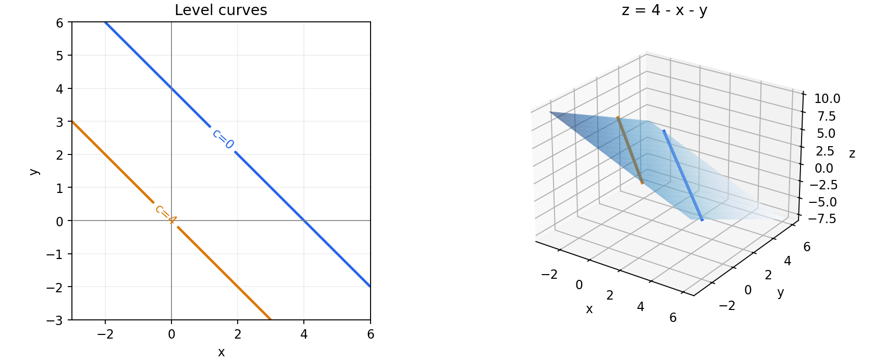
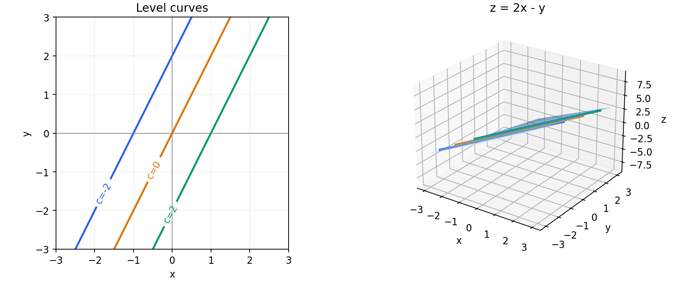
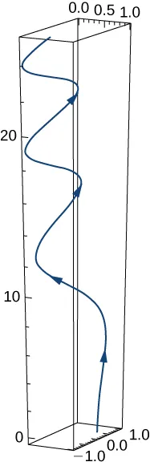
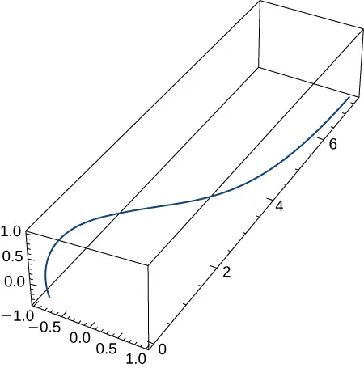

# 3.8 练习 {#38-exercises}

!!! note "译文与来源"

    本页为教材公开源文件 v0.2 的非官方中文翻译，保留原公式、例题、活动、代码和习题；为适应网页阅读，例题与活动等编号按本地小节重排，解答可点击展开；正文与标题中的数学专有名词保留英文，中文用于解释；术语表保留中英对照以便查阅。原文作者：Jacob Denson、Kaitlyn Phillipson、Sebastien Roch。译文遵循 [CC BY-NC-SA 4.0](https://creativecommons.org/licenses/by-nc-sa/4.0/)。[阅读英文原文](https://math345-textbook.github.io/u3-exercises.html)。


!!! info "指定练习题面已补全"

    本页所选 Nicholson 与 OpenStax 练习已直接列出中文题面，保留原题号和指定子题，并补齐读题必需的共享说明、跨题数据与配图。数学术语保留英文；每道题的解答可点击展开。来源统一列于本页说明，原有本书自编练习继续保留。

    外部题面于 2026 年 11 月 7 日读取。Nicholson 题目来源于 W. Keith Nicholson 的 *Linear Algebra with Applications*（LibreTexts / Lyryx）；OpenStax 题目来源于 Gilbert Strang、Edwin “Jed” Herman 的 *Calculus Volume 3*（Rice University）。按原页面 [CC BY-NC-SA 4.0](https://creativecommons.org/licenses/by-nc-sa/4.0/) 许可翻译与排版。

<a id="textbook-body"></a>

## 教材正文 {#_2}

<a id="sec-u3-exercises"></a>


<a id="u3-exercises"></a>


<a id="u3-exercises-sec-calculus-of-vector-valued-functions"></a>

## General Functions and Domains {#general-functions-and-domains}


### OpenStax 4.1 #7 {#exercise-openstax-4-1-7}

对于以下练习，求出 function 的 domain。

$$
f(x,y)=4 \text{ln}({y}^{2}-x)
$$

??? success "解答"

    $\ln$ 的输入必须严格大于零，所以

    $$
    y^2-x>0\quad\Longleftrightarrow\quad x<y^2
    $$

    Domain 为 $\{(x,y)\in\mathbb R^2:x<y^2\}$，不包含边界 $x=y^2$。


### OpenStax 4.1 #9 {#exercise-openstax-4-1-9}

对于以下练习，求出 function 的 domain。

$$
z(x,y)={y}^{2}-{x}^{2}
$$

??? success "解答"

    这是 polynomial，没有分母、根号或 logarithm 的限制，所以 domain 为整个 $\mathbb R^2$。


### OpenStax 4.1 #17 {#exercise-openstax-4-1-17}

求给定 function 在指定 $c$ 值对应的 level curves，并画图说明这个 function。

$$
g(x,y)=4-x-y;c=0,4
$$

??? success "解答"

    令 $4-x-y=c$，得到 $y=4-c-x$。因此

    $$
    c=0:\ y=4-x,\qquad c=4:\ y=-x
    $$

    两条 level curves 是平行直线；function 的 graph 是平面 $z=4-x-y$。

    


### OpenStax 4.1 #19 {#exercise-openstax-4-1-19}

求给定 function 在指定 $c$ 值对应的 level curves，并画图说明这个 function。

$$
h(x,y)=2x-y;c=0,−2,2
$$

??? success "解答"

    令 $2x-y=c$，得到 $y=2x-c$。因此

    $$
    c=0:\ y=2x,\qquad c=-2:\ y=2x+2,\qquad c=2:\ y=2x-2
    $$

    三条 level curves 是平行直线；function 的 graph 是平面 $z=2x-y$。

    


<a id="u3-exercises-sec-vector-valued-functions-space-curves"></a>

## One-parameter Maps and Changes {#one-parameter-maps-and-changes}


### OpenStax 3.2 #43 {#exercise-openstax-3-2-43}

求下列 vector -valued function 的 derivative。

$\text{r}(t)={e}^{\text{−}t} \text{i}+\text{sin}(3t)\text{​} \text{j}+10\sqrt{t} \text{k}.$ graph 的草图如下所示。注意 graph 不同的周期性质。



??? success "解答"

    Vector-valued function 按 component 求 derivative：

    $$
    \mathbf r'(t)=-e^{-t}\mathbf i+3\cos(3t)\mathbf j+\frac5{\sqrt t}\mathbf k,\qquad t>0
    $$

    原 function 在 $t=0$ 有定义，但 $\sqrt t$ 在该处没有有限的右 derivative。


### OpenStax 3.2 #49 {#exercise-openstax-3-2-49}

求下列 vector -valued function 的 derivative。

$$
\text{r}(t)=3 \text{i}+4 \text{sin}(3t) \text{j}+t \text{cos}(t) \text{k}
$$

??? success "解答"

    常数 component 的 derivative 为零；最后一个 component 使用 product rule：

    $$
    \mathbf r'(t)=12\cos(3t)\mathbf j+(\cos t-t\sin t)\mathbf k
    $$


### OpenStax 3.2 #61 {#exercise-openstax-3-2-61}

设 $\text{r}(t)=t \text{i}+{t}^{2} \text{j}-{t}^{4} \text{k}$，$\text{s}(t)=\text{sin}(t) \text{i}+{e}^{t} \text{j}+\text{cos}(t) \text{k}.$。下图展示这个 function 的 graph：



计算下列表达式：

$$
\frac{d}{dt}[\text{r}(t)\cdot \text{s}(t)]
$$

??? success "解答"

    先作 dot product，再求 derivative：

    $$
    \mathbf r(t)\cdot\mathbf s(t)=t\sin t+t^2e^t-t^4\cos t
    $$

    因此

    $$
    \frac{d}{dt}(\mathbf r\cdot\mathbf s)
    =\sin t+t\cos t+(2t+t^2)e^t-4t^3\cos t+t^4\sin t
    $$

    也可用 $\mathbf r'\cdot\mathbf s+\mathbf r\cdot\mathbf s'$，得到相同结果。


<a id="u3-exercises-sec-partial-derivatives"></a>

## Partial Derivatives, Gradients, Hessians, and Jacobian Matrices {#partial-derivatives-gradients-hessians-and-jacobian-matrices}


### OpenStax 4.3 #119 {#exercise-openstax-4-3-119}

对于以下练习，计算 partial derivatives。

$\frac{\partial z}{\partial y}$ 为 $z=\text{sin}(3x)\text{cos}(3y)$

??? success "解答"

    对 $y$ 求 partial derivative 时，把 $\sin(3x)$ 当作常数：

    $$
    z_y=-3\sin(3x)\sin(3y)
    $$


### OpenStax 4.3 #121 {#exercise-openstax-4-3-121}

对于以下练习，计算 partial derivatives。

$\frac{\partial z}{\partial x}$ 和 $\frac{\partial z}{\partial y}$ 对于 $z=\text{ln}({x}^{6}+{y}^{4})$

??? success "解答"

    使用 $\ln u$ 的 chain rule：

    $$
    z_x=\frac{6x^5}{x^6+y^4},\qquad
    z_y=\frac{4y^3}{x^6+y^4}
    $$

    定义条件为 $(x,y)\ne(0,0)$。


### OpenStax 4.3 #135 {#exercise-openstax-4-3-135}

求出指定的高阶 partial derivatives。

${f}_{xy}$ 为 $z=\text{ln}(x-y)$

??? success "解答"

    先对 $x$ 求 derivative，再对 $y$ 求 derivative：

    $$
    f_x=\frac1{x-y},\qquad
    f_{xy}=\frac1{(x-y)^2},\qquad x>y
    $$

    第二步中，$(x-y)^{-1}$ 的幂次求导产生一个负号，内层对 $y$ 求导又产生一个负号，因此结果为正。


### OpenStax 4.3 #137 {#exercise-openstax-4-3-137}

求出指定的高阶 partial derivatives。

设 $z={x}^{2}+3xy+2{y}^{2}.$，求 $\frac{{\partial }^{2}z}{\partial {x}^{2}}$ 和 $\frac{{\partial }^{2}z}{\partial {y}^{2}}.$。

??? success "解答"

    $$
    z_x=2x+3y,\qquad z_y=3x+4y
    $$

    再分别对相同变量求一次 derivative：

    $$
    z_{xx}=2,\qquad z_{yy}=4
    $$


<a id="u3-exercises-sec-tangent-planes"></a>

## Local linearization and tangent planes {#local-linearization-and-tangent-planes}


### OpenStax 4.4 #171 {#exercise-openstax-4-4-171}

求曲面在指定点处的 tangent plane 方程。（提示：先把 $z$ 表示成 $x$、$y.)$ 的函数。）

$$
z=−9{x}^{2}-3{y}^{2},P(2,1,−39)
$$

??? success "解答"

    $f_x=-18x,f_y=-6y$，在 $(2,1)$ 处分别为 $-36,-6$。代入 tangent plane 公式：

    $$
    z=-39-36(x-2)-6(y-1)=39-36x-6y
    $$


### OpenStax 4.4 #173 {#exercise-openstax-4-4-173}

求曲面在指定点处的 tangent plane 方程。（提示：先把 $z$ 表示成 $x$、$y.)$ 的函数。）

$$
z=\text{ln}(10{x}^{2}+2{y}^{2}+1),P(0,0,0)
$$

??? success "解答"

    $$
    f_x=\frac{20x}{10x^2+2y^2+1},\qquad
    f_y=\frac{4y}{10x^2+2y^2+1}
    $$

    在 $(0,0)$ 处，function value 和两个 partial derivatives 都为零，因此 tangent plane 为 $z=0$。


<a id="u3-exercises-sec-the-chain-rule"></a>

## Chain Rule as Matrix Multiplication {#chain-rule-as-matrix-multiplication}


### OpenStax 4.5 #215 {#exercise-openstax-4-5-215}

对于以下练习，请使用提供的信息来解决问题。

设 $w(x,y,z)=xy \text{cos} z,$，其中 $x=t,y={t}^{2},$、$z=\text{arcsin} t.$。求 $\frac{dw}{dt}.$。

??? success "解答"

    先代入得到 $w(t)=t^3\sqrt{1-t^2}$，因此

    $$
    \frac{dw}{dt}=3t^2\sqrt{1-t^2}-\frac{t^4}{\sqrt{1-t^2}}
    =\frac{t^2(3-4t^2)}{\sqrt{1-t^2}},\qquad -1<t<1
    $$

    用 chain rule 也可写成 $w_xx'+w_yy'+w_zz'$，其中 $w_x=y\cos z,w_y=x\cos z,w_z=-xy\sin z$。


### OpenStax 4.5 #217 {#exercise-openstax-4-5-217}

对于以下练习，请使用提供的信息来解决问题。

已知 $w=5{x}^{2}+2{y}^{2},x=−3s+t,$ 且 $y=s-4t,$，求 $\frac{\partial w}{\partial s}$ 和 $\frac{\partial w}{\partial t}.$。

??? success "解答"

    先求 $w_x=10x,w_y=4y$，再沿各个输入路径相加：

    $$
    \begin{aligned}
    w_s&=(10x)(-3)+(4y)(1)=94s-46t\\
    w_t&=(10x)(1)+(4y)(-4)=-46s+74t
    \end{aligned}
    $$

    最后一步代入了 $x=-3s+t,y=s-4t$。


### OpenStax 4.5 #219 {#exercise-openstax-4-5-219}

对于以下练习，请使用提供的信息来解决问题。

已知 $f(x,y)=xy,x=r \text{cos} θ,$ 且 $y=r \text{sin} θ,$，求 $\frac{\partial f}{\partial r}$，并把答案表示为 $r$、$θ.$ 的函数。

??? success "解答"

    $f_x=y,f_y=x$，且 $x_r=\cos\theta,y_r=\sin\theta$，所以

    $$
    f_r=y\cos\theta+x\sin\theta
    =2r\sin\theta\cos\theta=r\sin(2\theta)
    $$


### OpenStax 4.5 #227 {#exercise-openstax-4-5-227}

对于以下练习，使用 chain rule 和直接替换求 $\frac{df}{dt}$。

设 $w(x,y,z)={x}^{2}+{y}^{2}+{z}^{2},$、$x=\text{cos} t,y=\text{sin} t,$、$z={e}^{t}.$。先把 $w$ 写成关于 $t$ 的 function，直接求出 $\frac{dw}{dt}$；再使用 chain rule 求出 $\frac{dw}{dt}$，比较两种方法。

??? success "解答"

    直接代入：

    $$
    w(t)=\cos^2t+\sin^2t+e^{2t}=1+e^{2t},\qquad w'(t)=2e^{2t}
    $$

    Chain rule 给出

    $$
    w'(t)=2\cos t(-\sin t)+2\sin t\cos t+2e^te^t=2e^{2t}
    $$

    两种方法一致。


<a id="u5-exercises-sec-directional-derivatives"></a>

## Directional Derivatives {#directional-derivatives}


### OpenStax 4.6 #281 {#exercise-openstax-4-6-281}

对于以下练习，求出 gradient。

求$f(x,y,z)=xy+yz+xz$在点$P(1,2,3).$的 gradient

??? success "解答"

    $$
    \nabla f=(y+z,x+z,x+y)^T,\qquad
    \nabla f(1,2,3)=\begin{bmatrix}5\\4\\3\end{bmatrix}
    $$


### OpenStax 4.6 #283 {#exercise-openstax-4-6-283}

对于以下练习，请求出 gradient。

$$
f(x,y,z)=4{x}^{5}{y}^{2}{z}^{3},\begin{matrix}P(2,−1,1), & u=\frac{1}{3}i+\frac{2}{3}j-\frac{2}{3}k\end{matrix}
$$

??? success "解答"

    $$
    \nabla f=\begin{bmatrix}20x^4y^2z^3\\8x^5yz^3\\12x^5y^2z^2\end{bmatrix},\qquad
    \nabla f(2,-1,1)=\begin{bmatrix}320\\-256\\384\end{bmatrix}
    $$

    题目还给出了 unit direction $\mathbf u=(1,2,-2)^T/3$。若计算相应的 directional derivative，则

    $$
    D_{\mathbf u}f(P)=\nabla f(P)\cdot\mathbf u
    =\frac{320-512-768}{3}=-320
    $$


### OpenStax 4.6 #285 {#exercise-openstax-4-6-285}

求 function 在点 $P$ 处、朝向点 $Q$ 的方向的 directional derivative。

$$
f(x,y,z)=\frac{y}{x+z},\begin{matrix}P(2,1,−1), & Q(−1,2,0)\end{matrix}
$$

??? success "解答"

    这里的方向是**从点 $P$ 朝向点 $Q$**，所以先作差并归一化：

    $$
    \mathbf u=\frac{Q-P}{\|Q-P\|}=\frac1{\sqrt{11}}(-3,1,1)^T
    $$

    而

    $$
    \nabla f=\left(-\frac y{(x+z)^2},\frac1{x+z},-\frac y{(x+z)^2}\right)^T,
    \qquad \nabla f(P)=(-1,1,-1)^T
    $$

    所以

    $$
    D_{\mathbf u}f(P)=\frac{3+1-1}{\sqrt{11}}=\frac3{\sqrt{11}}
    $$


### OpenStax 4.6 #297 {#exercise-openstax-4-6-297}

对于以下练习，求出 function 的 derivative。

对于 $f(x,y,z)=\text{ln}(xy+yz+zx)$，求点 $(−9,−18,−27)$ 处沿 function 增长最快方向的 derivative。

??? success "解答"

    增速最大的 unit direction 是 normalized gradient，最大 directional derivative 是 gradient 的 norm。

    $$
    \nabla f=\frac{(y+z,x+z,x+y)^T}{xy+yz+zx}
    $$

    在给定点处，分母为 $891$，因此

    $$
    \nabla f=\frac1{99}(-5,-4,-3)^T
    $$

    最大 derivative 为 $5\sqrt2/99$，对应 unit direction 为 $(-5,-4,-3)^T/\sqrt{50}$。


<a id="u3-exercises-applied-computational"></a>

## Additional exercises {#additional-exercises}

这些练习补充了 OpenStax 练习未充分涵盖的第三章内容：scalar-valued function 和 vector-valued function、 domain、局部性质的描述、 derivative、 gradient、 Hessian matrix、 Jacobian matrix、 tangent plane、局部 linear 预测、 chain rule、 directional derivative、 critical point、 gradient descent 及代码解读。解答集中在附录[第三章应用习题解答（英文）](app-solutions-3.md#app-u3-applied-solutions)中。


<a id="ex-u5-directional-derivative-dot-product"></a>

**练习 3.8.1：作为 dot product 的 directional derivative**

假设

$$
\nabla f(\mathbf{a})=
              \begin{bmatrix}
              6\\
              8
              \end{bmatrix}.
$$


让

$$
\mathbf{v}_1=
              \begin{bmatrix}
              1\\
              0
              \end{bmatrix},
              \qquad
              \mathbf{v}_2=
              \begin{bmatrix}
              0\\
              1
              \end{bmatrix},
              \qquad
              \mathbf{v}_3=
              \frac{1}{5}
              \begin{bmatrix}
              3\\
              4
              \end{bmatrix},
              \qquad
              \mathbf{v}_4=
              -\frac{1}{5}
              \begin{bmatrix}
              3\\
              4
              \end{bmatrix}.
$$


1. 计算 $i=1,2,3,4$ 的$D_{\mathbf{v}_i}f(\mathbf{a})$。

2. 哪个列出的方向给出最大的 directional derivative？

3. 哪个列出的方向给出最小的 directional derivative？

4. 解释它如何使用 1 单元 dot product。


??? success "解答"

    使用

    $$
    D_{\mathbf{v}}f(\mathbf{a})=\nabla f(\mathbf{a})\cdot \mathbf{v}.
    $$

     然后

    $$
    D_{\mathbf{v}_1}f(\mathbf{a})=6,
              \qquad
              D_{\mathbf{v}_2}f(\mathbf{a})=8.
    $$

     另外，

    $$
    D_{\mathbf{v}_3}f(\mathbf{a})
              =
              \begin{bmatrix}
              6\\
              8
              \end{bmatrix}
              \cdot
              \frac15
              \begin{bmatrix}
              3\\
              4
              \end{bmatrix}
              =
              \frac{18+32}{5}=10,
    $$


    $$
    D_{\mathbf{v}_4}f(\mathbf{a})=-10.
    $$


    在列出的方向中，沿 $\mathbf{v}_3$ 的 directional derivative 最大，沿 $\mathbf{v}_4$ 的最小。这里用到了第一章的 dot product：它反映方向之间的一致程度。方向与 gradient 一致时， derivative 最大；与 gradient 相反时最小。

<a id="ex-u5-critical-points-candidates"></a>

**练习 3.8.2：critical point 只是极值的候选点（Critical Points Are Candidates）**

让

$$
f(x,y)=x^2-y^2.
$$


1. 找出$f$的所有 critical point。

2. 评估 $f(t,0)$ 和 $f(0,t)$。

3. 解释为什么 critical point 不是 local minimum 或 local maximum。


??? success "解答"

    我们有

    $$
    \nabla f(x,y)=
              \begin{bmatrix}
              2x\\
              -2y
              \end{bmatrix}.
    $$

    因此唯一的 critical point 是$(0,0)$。

    沿 $x$ 轴，

    $$
    f(t,0)=t^2,
    $$

     为 $t\ne 0$ 的正值。沿 $y$ 轴，

    $$
    f(0,t)=-t^2,
    $$

     为 $t\ne 0$ 的负值。因此，附近点出现在 $f(0,0)=0$ 的上方和下方。 critical point 是 saddle point，而不是 local minimum 或 local maximum。

<a id="ex-u5-gradient-descent-loop"></a>

**练习 3.8.3：读取 gradient descent 循环**

假设 `grad_f(x)` 计算 $\nabla f(\mathbf{x})$。考虑代码：


```python
x = x0
for k in range(num_steps):
    x = x - alpha * grad_f(x)
```


1. 代表什么数学更新规则？

2. learning rate 是多少？

3. `grad_f(x)` 必须具有什么形状？

4. 如果减号是加号，会发生什么变化？

5. 这段代码是否证明已经找到了最小值？


??? success "解答"

    该循环代表

    $$
    \mathbf{x}_{k+1}=\mathbf{x}_k-\alpha\nabla f(\mathbf{x}_k).
    $$

    learning rate 是`alpha`。 vector `grad_f(x)` 必须具有与 `x` 相同的 shape。用加号替换减号将朝着最急剧增加的方向而不是最急剧减少的方向移动。该代码并不证明已找到最小值。仅仅描述了更新规则；收敛取决于 function、起点、 learning rate 和停止规则。

<a id="ex-u5-learning-rate-diagnosis"></a>

**练习 3.8.4：learning rate 诊断**

对于$f(x)=x^2$，从$x_0=4$开始并使用

$$
x_{k+1}=x_k-\alpha f'(x_k).
$$


该表显示了三个 learning rate 的损失值$f(x_k)$。

$$
\begin{array}{c|ccc}
              k & \alpha=0.05 & \alpha=0.20 & \alpha=1.05\\
              \hline
              0 & 16.000 & 16.000 & 16.000\\
              1 & 12.960 & 5.760 & 19.360\\
              2 & 10.498 & 2.074 & 23.426\\
              3 & 8.503 & 0.746 & 28.345
              \end{array}
$$


1. 哪个 learning rate 正在缓慢但稳定地进步？

2. 哪个 learning rate 能取得更快的有用进展？

3. 哪个 learning rate 显得不稳定？

4. 递减损失表是否证明已找到 global minimum？


??? success "解答"

    learning rate $\alpha=0.05$ 正在缓慢但稳定地取得进展。 learning rate $\alpha=0.20$ 正在取得更快的有用进展。由于 loss 增加， learning rate $\alpha=1.05$ 显得不稳定。

    递减的 loss 表并不能证明 global minimum 已经找到。它仅报告显示的迭代发生的情况。

<a id="ex-u3-checkpoint-function-type-components"></a>

**练习 3.8.5：function 类型和 component function**

让

$$
F(x,y)=
              \begin{bmatrix}
                x^2+y\\
                e^{x-y}\\
                x-y
              \end{bmatrix}.
$$


1. $F$ 是 scalar 值还是 vector 值？

2. 什么是域和辅域？

3. 编写 component function $F_1,F_2,F_3$。

4. 计算$F(1,0)$。

5. $J_F(1,0)$ 应该是什么形状？


??? success "解答"

    function 的值为 vector：

    $$
    F:\mathbb R^2\to\mathbb R^3.
    $$

     其 component functions 为

    $$
    F_1(x,y)=x^2+y,\qquad F_2(x,y)=e^{x-y},\qquad F_3(x,y)=x-y.
    $$


    我们有

    $$
    F(1,0)=\begin{bmatrix}1\\e\\1\end{bmatrix}.
    $$

     由于输出有三个分量，输入有两个变量，所以 $J_F(1,0)$ 有 shape $3\times2$。

<a id="ex-u3-checkpoint-domain-boundary-closed-bounded"></a>

**练习 3.8.6：domain、 boundary、闭性与有界性**

让

$$
D=\{(x,y)\in\mathbb R^2:x\ge 0,\ y>x^2\}.
$$


1. 解释一下为什么这是$f(x,y)=\ln(y-x^2)+\sqrt{x}$的 domain。

2. 给出一个 interior point $D$。

3. 给出一个$D$的 boundary point。

4. $D$关门了吗？

5. $D$ 有界吗？


??? success "解答"

    对数需要$y-x^2>0$，平方根需要$x\ge 0$。因此 domain 是

    $$
    D=\{(x,y)\in\mathbb R^2:x\ge0,\ y>x^2\}.
    $$


    1 个 interior point 就是$(1,2)$。 Boundary 点包括$y=x^2$上与$x\ge0$的点，例如$(1,1)$，以及$x=0$上与$y\ge0$的点，例如$(0,1)$。该集合不是闭集，因为它不包含抛物线 $y=x^2$。它没有边界，因为 $D$ 中的点可以具有任意大的 coordinates。

<a id="ex-u3-checkpoint-one-parameter-tangent-vector"></a>

**练习 3.8.7：one-parameter map 和 tangent vector**

让

$$
\mathbf r(t)=
              \begin{bmatrix}
                1\\
                0\\
                -1
              \end{bmatrix}
              +t
              \begin{bmatrix}
                2\\
                -1\\
                3
              \end{bmatrix}.
$$


1. 计算$\mathbf r(2)$。

2. 计算$\mathbf r'(t)$。

3. $\mathbf r'(t)$ 曲线说明了什么？

4. 这与直线的第 2 单元 parametric equation 有何联系？


??? success "解答"

    我们有

    $$
    \mathbf r(2)=
              \begin{bmatrix}1\\0\\-1\end{bmatrix}
              +2\begin{bmatrix}2\\-1\\3\end{bmatrix}
              =
              \begin{bmatrix}5\\-2\\5\end{bmatrix}.
    $$


     derivative 是常数：

    $$
    \mathbf r'(t)=\begin{bmatrix}2\\-1\\3\end{bmatrix}.
    $$

     这是线的方向 vector，与单元 2 参数线形式点加上 parameter 乘以方向相匹配。

<a id="ex-u3-checkpoint-gradient-hessian"></a>

**练习 3.8.8：gradient 与 Hessian matrix （Gradient and Hessian）**

让

$$
f(x,y)=x^2+xy+2y^2.
$$


1. 计算 $f_x$ 和 $f_y$。

2. 计算$\nabla f(1,-1)$。

3. 计算$H_f(x,y)$。

4. Hessian matrix 是对称的吗？

5. $\nabla f(1,-1)$的每个条目测量什么？


??? success "解答"

    第一部分 derivatives 是

    $$
    f_x=2x+y,\qquad f_y=x+4y.
    $$

     因此

    $$
    \nabla f(x,y)=\begin{bmatrix}2x+y\\x+4y\end{bmatrix},
              \qquad
              \nabla f(1,-1)=\begin{bmatrix}1\\-3\end{bmatrix}.
    $$


     Hessian 是

    $$
    H_f=\begin{bmatrix}2&1\\1&4\end{bmatrix},
    $$

    即 symmetric。 $\nabla f(1,-1)$ 的条目测量$f$ 对此时$x$ 和$y$ 方向变化的敏感度。

<a id="ex-u3-checkpoint-jacobian-rows-columns"></a>

**练习 3.8.9：Jacobian matrix 的 row 和 column**

让

$$
F(x,y)=
              \begin{bmatrix}
                x^2y\\
                xe^y
              \end{bmatrix},
              \qquad
              \mathbf a=
              \begin{bmatrix}
                1\\
                0
              \end{bmatrix}.
$$


1. 计算$J_F(x,y)$。

2. 计算$J_F(\mathbf a)$。

3. 输入与输出的 dimension是多少？

4. 哪一行对应$F$的第二个 component？

5. $J_F(\mathbf a)$ 的两个 columns 测量什么？


??? success "解答"

    Jacobian matrix 是

    $$
    J_F(x,y)=
              \begin{bmatrix}
                2xy&x^2\\
                e^y&xe^y
              \end{bmatrix}.
    $$

     在 $\mathbf a=(1,0)$、

    $$
    J_F(\mathbf a)=
              \begin{bmatrix}
                0&1\\
                1&1
              \end{bmatrix}.
    $$


    输入和输出 dimensions 都是$2$。第二个 row 对应于第二个 component $F_2(x,y)=xe^y$。 columns 测量更改第一个和第二个输入 coordinates 时预测的输出变化。

<a id="ex-u3-checkpoint-tangent-plane-unit2-plane"></a>

**练习 3.8.10：tangent plane 作为第 2 单元平面**

让

$$
f(x,y)=x^2+xy.
$$


1. 计算 $f(1,2)$、$f_x(1,2)$ 和 $f_y(1,2)$。

2. 将 tangent plane 写入 $(1,2,f(1,2))$ 处的 $z=f(x,y)$。

3. 将 tangent plane 重写为

$$
\mathbf n\cdot
                  \begin{bmatrix}
                    x-1\\
                    y-2\\
                    z-f(1,2)
                  \end{bmatrix}
                  =0.
$$


的形式

4. 识别 normal vector $\mathbf n$。

5. 第 2 单元的哪个想法被重用？


??? success "解答"

    我们有 $f(1,2)=3$、$f_x(1,2)=4$ 和 $f_y(1,2)=1$。 tangent plane 是

    $$
    z-3=4(x-1)+(y-2).
    $$


    等价地，

    $$
    \begin{bmatrix}-4\\-1\\1\end{bmatrix}\cdot
              \begin{bmatrix}
                x-1\\
                y-2\\
                z-3
              \end{bmatrix}
              =0.
    $$

     A normal vector 是 $\mathbf n=(-4,-1,1)^T$。被重用的单元 2 的想法是一个由点和 normal vector 描述的平面。

<a id="ex-u3-checkpoint-scalar-local-linear-prediction"></a>

**练习 3.8.11：scalar 局部 linear 预测**

在

$$
\mathbf a=
              \begin{bmatrix}
                1\\
                2
              \end{bmatrix},
              \qquad
              \mathbf h=
              \begin{bmatrix}
                0.1\\
                -0.2
              \end{bmatrix}.
$$


使用相同的 function $f(x,y)=x^2+xy$


1. 计算$f(\mathbf a)$。

2. 计算$\nabla f(\mathbf a)$。

3. 计算局部 linear 预测$f(\mathbf a)+\nabla f(\mathbf a)^T\mathbf h$。

4. 计算实际值$f(\mathbf a+\mathbf h)$。

5. 将实际值与预测值进行比较。


??? success "解答"

    从之前的 function、$f(\mathbf a)=f(1,2)=3$和

    $$
    \nabla f(\mathbf a)=\begin{bmatrix}4\\1\end{bmatrix}.
    $$

    本地 linear 预测为

    $$
    3+\begin{bmatrix}4&1\end{bmatrix}
              \begin{bmatrix}0.1\\-0.2\end{bmatrix}
              =3+0.2=3.2.
    $$


    实际值是

    $$
    f(1.1,1.8)=1.1^2+1.1(1.8)=3.19.
    $$

    误差实际减去预测是$3.19-3.2=-0.01$。

<a id="ex-u3-checkpoint-vector-local-linear-prediction"></a>

**练习 3.8.12：vector 值局部 linear 预测**

使用

$$
F(x,y)=
              \begin{bmatrix}
                x^2y\\
                xe^y
              \end{bmatrix},
              \qquad
              \mathbf a=
              \begin{bmatrix}
                1\\
                0
              \end{bmatrix},
              \qquad
              \mathbf h=
              \begin{bmatrix}
                0.1\\
                -0.2
              \end{bmatrix}.
$$


1. 计算$F(\mathbf a)$。

2. 使用[ Jacobian matrix 的 row 和 column ](3-8.md#ex-u3-checkpoint-jacobian-rows-columns)中的$J_F(\mathbf a)$。

3. 计算$F(\mathbf a)+J_F(\mathbf a)\mathbf h$。

4. 计算$F(\mathbf a+\mathbf h)$。

5. 误差 vector 衡量什么？


??? success "解答"

    我们有

    $$
    F(\mathbf a)=F(1,0)=\begin{bmatrix}0\\1\end{bmatrix}
    $$

    并且根据之前的 Jacobian matrix 练习，

    $$
    J_F(\mathbf a)\mathbf h=
              \begin{bmatrix}
                0&1\\
                1&1
              \end{bmatrix}
              \begin{bmatrix}0.1\\-0.2\end{bmatrix}
              =
              \begin{bmatrix}-0.2\\-0.1\end{bmatrix}.
    $$


    因此，局部预测为

    $$
    F(\mathbf a)+J_F(\mathbf a)\mathbf h=\begin{bmatrix}-0.2\\0.9\end{bmatrix}.
    $$

     实际值约为

    $$
    F(1.1,-0.2)=\begin{bmatrix}-0.242\\0.9006\end{bmatrix}.
    $$

     误差 vector 测量实际输出减去预测输出。

<a id="ex-u3-checkpoint-locally-forgotten-direction"></a>

**练习 3.8.13：局部忘记方向**

假设

$$
J_F(\mathbf a)=
              \begin{bmatrix}
                1&2\\
                2&4
              \end{bmatrix}.
$$


1. 找到一个nonzero vector $\mathbf h$ 使得 $J_F(\mathbf a)\mathbf h=\mathbf 0$。

2. 这对局部 linear map 意味着什么？

3. 这如何连接到第 2 单元 null space？

4. 这是否准确地证明了$F(\mathbf a+\mathbf h)=F(\mathbf a)$？解释。


??? success "解答"

    一个选择是

    $$
    \mathbf h=\begin{bmatrix}-2\\1\end{bmatrix},
    $$

    因为

    $$
    \begin{bmatrix}1&2\\2&4\end{bmatrix}
              \begin{bmatrix}-2\\1\end{bmatrix}
              =
              \begin{bmatrix}0\\0\end{bmatrix}.
    $$


    这个方向在 Jacobian matrix 的 null space 中，所以本地 linear map 忘记了它是第一顺序。这直接连接到单元 2 零空间。它并不能准确证明$F(\mathbf a+\mathbf h)=F(\mathbf a)$，因为 Jacobian matrix 只给出局部 linear approximation。

<a id="ex-u3-checkpoint-chain-rule-shape-check"></a>

**练习 3.8.14：chain rule 形状检查**

假设

$$
G:\mathbb R^2\to\mathbb R^3,
              \qquad
              F:\mathbb R^3\to\mathbb R^2.
$$


1. $J_G(\mathbf a)$是什么形状？

2. $J_F(G(\mathbf a))$是什么形状？

3. $J_{F\circ G}(\mathbf a)$是什么形状？

4. 哪种产品提供$J_{F\circ G}(\mathbf a)$？

5. 为什么相反的顺序不正确？


??? success "解答"

    由于$G:\mathbb R^2\to\mathbb R^3$， Jacobian matrix $J_G(\mathbf a)$有 shape $3\times2$。由于$F:\mathbb R^3\to\mathbb R^2$， Jacobian matrix $J_F(G(\mathbf a))$有 shape $2\times3$。

    因此

    $$
    J_{F\circ G}(\mathbf a)=J_F(G(\mathbf a))J_G(\mathbf a)
    $$

    有 shape $2\times2$。相反的顺序是不正确的，因为 shapes 与 composition 的顺序不匹配，并且一般情况下 Jacobian matrix 产品不能交换。

<a id="ex-u3-checkpoint-tiny-nonlinear-block"></a>

**练习 3.8.15：解读一个小型 Sigmoid 模块**

考虑代码：


```python
def sigmoid(t):
    return 1 / (1 + np.exp(-t))

s = W1 @ x + b1
u = sigmoid(s)
D = np.diag(u * (1 - u))
y = W2 @ u + b2
J_at_x = W2 @ D @ W1
```


1. 哪些线是 affine map？

2. 哪一行包含 coordinate nonlinear 步骤？

3. 哪些变量代表 vector？

4. $D$存储什么？

5. 哪一行计算 $\mathbf{x}$ 处块的 Jacobian matrix？

6. 为什么整个块通常不是一个 linear map？


??? success "解答"

    行

    $$
    \mathbf{s}=W_1\mathbf{x}+\mathbf{b}_1,\qquad \mathbf{y}=W_2\mathbf{u}+\mathbf{b}_2
    $$

     是 affine maps。行 `u = sigmoid(s)` 包含坐标方向 nonlinear 步骤。

    变量 `x`、`s`、`u`、`b1`、`b2` 和 `y` 都表示 vectors。 matrix $D$ 的对角线上存放的是 sigmoid 在 $\mathbf{s}$ 各个 coordinate 处的 derivative。代码 `J_at_x = W2 @ D @ W1` 计算的是 $\mathbf{x}$ 处的 Jacobian matrix。由于含有 bias 项以及逐个坐标计算 sigmoid 的步骤，整个模块通常并不是单个 linear map。

<a id="ex-u3-square-grid-corners-not-enough"></a>

**练习 3.8.16：仅观察顶点还不够**

让

$$
T\left(\begin{bmatrix}x\\y\end{bmatrix}\right)
              =
              \begin{bmatrix}
                x+y\\
                y
              \end{bmatrix},
              \qquad
              F\left(\begin{bmatrix}x\\y\end{bmatrix}\right)
              =
              \begin{bmatrix}
                x+y^2\\
                y
              \end{bmatrix}.
$$


1. 计算$T$下单位正方形四个角的 graph。

2. 计算$F$下单位正方形四个角的 graph。

3. 计算$\begin{bmatrix}0\\1/2\end{bmatrix}$在两张映射下的 graph。

4. 解释为什么四个角不能证明两张映射是相同的。

5. 解释为什么网格比四个角提供更多信息。


??? success "解答"

    两个地图都将四个角发送到相同的四个输出：

    $$
    \begin{bmatrix}0\\0\end{bmatrix}\mapsto\begin{bmatrix}0\\0\end{bmatrix},
              \quad
              \begin{bmatrix}1\\0\end{bmatrix}\mapsto\begin{bmatrix}1\\0\end{bmatrix},
              \quad
              \begin{bmatrix}1\\1\end{bmatrix}\mapsto\begin{bmatrix}2\\1\end{bmatrix},
              \quad
              \begin{bmatrix}0\\1\end{bmatrix}\mapsto\begin{bmatrix}1\\1\end{bmatrix}.
    $$


    但是

    $$
    T\left(\begin{bmatrix}0\\1/2\end{bmatrix}\right)
              =
              \begin{bmatrix}1/2\\1/2\end{bmatrix},
              \qquad
              F\left(\begin{bmatrix}0\\1/2\end{bmatrix}\right)
              =
              \begin{bmatrix}1/4\\1/2\end{bmatrix}.
    $$

     所以角点测试忽略了差异。网格采样更多点，包括边缘和内部点，并且可以显示弯曲。

<a id="ex-u3-local-square-grid-error"></a>

**练习 3.8.17：局部方格误差**

让

$$
F\left(\begin{bmatrix}x\\y\end{bmatrix}\right)
              =
              \begin{bmatrix}
                x+y^2\\
                y
              \end{bmatrix},
              \qquad
              \mathbf{a}
              =
              \begin{bmatrix}
                0\\
                1/2
              \end{bmatrix}.
$$


1. 计算$J_F(x,y)$。

2. 计算$J_F(\mathbf{a})$。

3. 让$\mathbf{h}=\begin{bmatrix}h_1\\h_2\end{bmatrix}$。计算$F(\mathbf{a}+\mathbf{h})-F(\mathbf{a})$。

4. 计算$J_F(\mathbf{a})\mathbf{h}$。

5. 计算误差

$$
F(\mathbf{a}+\mathbf{h})-F(\mathbf{a})-J_F(\mathbf{a})\mathbf{h}.
$$


6. 如果$|h_2|\le r$，请解释为什么误差为零，即$r\to 0$。


??? success "解答"

    Jacobian matrix 是

    $$
    J_F(x,y)
              =
              \begin{bmatrix}
                1&2y\\
                0&1
              \end{bmatrix}.
    $$

     在

    $$
    \mathbf{a}
              =
              \begin{bmatrix}
                0\\
                1/2
              \end{bmatrix},
    $$

     我们得到

    $$
    J_F(\mathbf{a})
              =
              \begin{bmatrix}
                1&1\\
                0&1
              \end{bmatrix}.
    $$


    对于

    $$
    \mathbf{h}
              =
              \begin{bmatrix}
                h_1\\
                h_2
              \end{bmatrix},
    $$

    我们有

    $$
    F(\mathbf{a}+\mathbf{h})-F(\mathbf{a})
              =
              \begin{bmatrix}
                h_1+h_2+h_2^2\\
                h_2
              \end{bmatrix}
    $$


    $$
    J_F(\mathbf{a})\mathbf{h}
              =
              \begin{bmatrix}
                h_1+h_2\\
                h_2
              \end{bmatrix}.
    $$


    因此，如果$|h_2|\le r$，则

    $$
    F(\mathbf{a}+\mathbf{h})-F(\mathbf{a})-J_F(\mathbf{a})\mathbf{h}
              =
              \begin{bmatrix}
                h_2^2\\
                0
              \end{bmatrix}.
    $$

    则$h_2^2\le r^2$，因此随着正方形缩小，误差将为零。

<a id="ex-u3-code-square-grid-arrays"></a>

**练习 3.8.18：代码解读：方格数组**

考虑代码：


```python
import numpy as np

def F(P):
    x = P[0, :]
    y = P[1, :]
    return np.vstack([x + y**2, y])

P = np.array([
    [0.0, 1.0, 1.0, 0.0, 0.0],
    [0.0, 0.0, 1.0, 1.0, 0.5],
])

Q = F(P)
Q
```


1. $P$是什么形状？

2. 输入点存储为行还是 column？

3. 哪一个 column 存储$\begin{bmatrix}0\\1/2\end{bmatrix}$？

4. $Q$对应的输出 column 是什么？

5. 表达式 `np.vstack([x + y**2, y])` 构造什么？

6. 为什么这个计算不是 matrix multiplication？


??? success "解答"

    数组$P$有 shape $2\times 5$。它的 columns 是输入点。最后一个 column 是

    $$
    \begin{bmatrix}
                0\\
                1/2
              \end{bmatrix}.
    $$


    对应的输出 column 是

    $$
    \begin{bmatrix}
                1/4\\
                1/2
              \end{bmatrix}.
    $$

    表达式`np.vstack([x + y**2, y])`将$F$的两个输出分量构建为新$2\times 5$数组的 rows。这不是 matrix multiplication，因为第一个输出 component 包含 $y^2$，即 nonlinear 操作。

<a id="ex-u3-relu-activation-pattern-local-matrix"></a>

**练习 3.8.19：Sigmoid derivative 和局部 matrix**

让

$$
\sigma(t)=\frac{1}{1+e^{-t}},
              \qquad
              \sigma'(t)=\sigma(t)(1-\sigma(t)),
$$


按 coordinate 应用。定义

$$
W_1=
              \begin{bmatrix}
                1&0\\
                0&1\\
                1&1
              \end{bmatrix},
              \qquad
              \mathbf{b}_1=
              \begin{bmatrix}
                0\\
                0\\
                0
              \end{bmatrix},
$$


$$
W_2=
              \begin{bmatrix}
                1&0&-1/2\\
                0&1&1/2
              \end{bmatrix},
              \qquad
              \mathbf{b}_2=
              \begin{bmatrix}
                0\\
                0
              \end{bmatrix}.
$$


$$
\mathbf{x}
              =
              \begin{bmatrix}
                x\\
                y
              \end{bmatrix},
$$


套装

$$
N(\mathbf{x})=W_2\sigma(W_1\mathbf{x}+\mathbf{b}_1)+\mathbf{b}_2.
$$


让

$$
\mathbf{a}
              =
              \begin{bmatrix}
                0\\
                0
              \end{bmatrix}.
$$


1. 计算$\mathbf{s}_{\mathbf a}=W_1\mathbf{a}+\mathbf{b}_1$。

2. 计算$\mathbf{u}_{\mathbf a}=\sigma(\mathbf{s}_{\mathbf a})$。

3. 计算$D_{\mathbf a}=\operatorname{diag}(\sigma'((\mathbf{s}_{\mathbf a})_1),\sigma'((\mathbf{s}_{\mathbf a})_2),\sigma'((\mathbf{s}_{\mathbf a})_3))$。

4. 计算局部 matrix $W_2D_{\mathbf a}W_1$。

5. 这个局部 matrix invertible 吗？

6. 让$\mathbf{c}=\begin{bmatrix}1\\0\end{bmatrix}$。 $D_{\mathbf c}$ 的哪些条目与 $D_{\mathbf a}$ 的条目不同？

7. 为什么局部 matrix 可以从一个 参考点变化到另一个 参考点？


??? success "解答"

    在

    $$
    \mathbf{a}
              =
              \begin{bmatrix}
                0\\
                0
              \end{bmatrix},
    $$

    我们得到

    $$
    \mathbf{s}_{\mathbf a}=W_1\mathbf a+\mathbf b_1
              =
              \begin{bmatrix}
                0\\
                0\\
                0
              \end{bmatrix}.
    $$


    因此

    $$
    \mathbf{u}_{\mathbf a}
              =
              \sigma(\mathbf{s}_{\mathbf a})
              =
              \begin{bmatrix}
                1/2\\
                1/2\\
                1/2
              \end{bmatrix},
              \qquad
              D_{\mathbf a}
              =
              \operatorname{diag}(1/4,1/4,1/4).
    $$

     因此

    $$
    W_2D_{\mathbf a}W_1
              =
              \begin{bmatrix}
                1&0&-1/2\\
                0&1&1/2
              \end{bmatrix}
              \begin{bmatrix}
                1/4&0&0\\
                0&1/4&0\\
                0&0&1/4
              \end{bmatrix}
              \begin{bmatrix}
                1&0\\
                0&1\\
                1&1
              \end{bmatrix}
              =
              \begin{bmatrix}
                1/8&-1/8\\
                1/8&3/8
              \end{bmatrix}.
    $$


    它的 determinant 是

    $$
    (1/8)(3/8)-(-1/8)(1/8)=1/16,
    $$

    所以这个本地 matrix 是 invertible。

    对于$\mathbf c=\begin{bmatrix}1\\0\end{bmatrix}$，我们得到

    $$
    \mathbf{s}_{\mathbf c}
              =
              \begin{bmatrix}
                1\\
                0\\
                1
              \end{bmatrix},
              \qquad
              D_{\mathbf c}=\operatorname{diag}(d,1/4,d),
              \qquad
              d=\sigma(1)(1-\sigma(1)).
    $$

     由于$d\ne 1/4$，$D_{\mathbf c}$的第一个和第三个条目与$D_{\mathbf a}$的相应条目不同。该块是平滑的，但 sigmoid derivative 随输入变化，因此 Jacobian matrix 可以随基点变化。

<a id="ex-u3-code-relu-block-arrays"></a>

**练习 3.8.20：代码解读：sigmoid块数组**

考虑代码：


```python
import numpy as np

W1 = np.array([
    [1.0, 0.0],
    [0.0, 1.0],
    [1.0, 1.0],
])

b1 = np.zeros((3, 1))

W2 = np.array([
    [1.0, 0.0, -0.5],
    [0.0, 1.0, 0.5],
])

b2 = np.zeros((2, 1))

def sigmoid(Z):
    return 1 / (1 + np.exp(-Z))

def N(P):
    S = W1 @ P + b1
    U = sigmoid(S)
    return W2 @ U + b2

P = np.array([
    [0.0, 1.0, 0.0],
    [0.0, 0.0, 1.0],
])

Q = N(P)
Q
```


1. $P$是什么形状？

2. 输入点存储为行还是 column？

3. $S=W_1P+\mathbf{b}_1$是什么形状？

4. $U=\sigma(S)$是什么形状？

5. 哪一行应用了 nonlinear 运算？

6. 计算 $Q$ 的第一个 column。

7. 为什么完整计算不是一次 matrix multiplication $AP$？


??? success "解答"

    数组$P$有 shape $2\times 3$。它的 columns 是输入点。由于$W_1$有 shape $3\times 2$，因此数组$S=W_1P+\mathbf{b}_1$有 shape $3\times 3$。数组$U=\sigma(S)$具有相同的 shape。

     nonlinear 运算是


    ```python
    U = sigmoid(S)
    ```

    $P$ 的第一个 column 是

    $$
    \begin{bmatrix}
                0\\
                0
              \end{bmatrix}.
    $$

     对于此输入，

    $$
    \mathbf{s}=
              \begin{bmatrix}
                0\\
                0\\
                0
              \end{bmatrix},
              \qquad
              \mathbf{u}=
              \begin{bmatrix}
                1/2\\
                1/2\\
                1/2
              \end{bmatrix}.
    $$


    因此，第一个输出 column 是

    $$
    W_2\mathbf{u}+\mathbf{b}_2
              =
              \begin{bmatrix}
                1/4\\
                3/4
              \end{bmatrix}.
    $$

     完整计算不是 matrix multiplication $AP$，因为 sigmoid 步长是 nonlinear。

<a id="ex-u3-softmax-weights-data-dependent"></a>

**练习 3.8.21：Softmax 权重取决于数据**

让

$$
K=
              \begin{bmatrix}
                3&0\\
                0&3\\
                -3&-3
              \end{bmatrix},
              \qquad
              V=
              \begin{bmatrix}
                1&0\\
                0&1\\
                0&0
              \end{bmatrix}.
$$


对于

$$
\mathbf{q}
              =
              \begin{bmatrix}
                q_1\\
                q_2
              \end{bmatrix},
$$


定义

$$
\mathbf{s}=K\mathbf{q},
              \qquad
              \boldsymbol{\alpha}(\mathbf{q})=\operatorname{softmax}(\mathbf{s}),
              \qquad
              F(\mathbf{q})=V^T\boldsymbol{\alpha}(\mathbf{q}).
$$


1. 根据 $q_1$ 和 $q_2$ 计算 $\mathbf{s}$。

2. 计算$\boldsymbol{\alpha}(\mathbf{0})$。

3. 计算$F(\mathbf{0})$。

4. 解释为什么 $F$ 不是 linear 的。

5. 解释为什么 $F(\mathbf{q})$ 始终是 $V$ row 的加权平均值。

6. 哪一步是 nonlinear 的？


??? success "解答"

    得分 vector 为

    $$
    \mathbf{s}
              =
              K\mathbf{q}
              =
              \begin{bmatrix}
                3q_1\\
                3q_2\\
                -3q_1-3q_2
              \end{bmatrix}.
    $$


    在 $\mathbf{q}=\mathbf{0}$、

    $$
    \mathbf{s}
              =
              \begin{bmatrix}
                0\\
                0\\
                0
              \end{bmatrix}.
    $$

     三个分数相等，因此 softmax 权重为

    $$
    \boldsymbol{\alpha}(\mathbf{0})
              =
              \begin{bmatrix}
                1/3\\
                1/3\\
                1/3
              \end{bmatrix}.
    $$


    因此

    $$
    F(\mathbf{0})
              =
              V^T
              \begin{bmatrix}
                1/3\\
                1/3\\
                1/3
              \end{bmatrix}
              =
              \begin{bmatrix}
                1/3\\
                1/3
              \end{bmatrix}.
    $$


    由于 linear map 必须将$\mathbf{0}$发送到$\mathbf{0}$，因此映射$F$不是 linear。

     softmax 项是正数，并添加到 $1$，因此 $F(\mathbf{q})$ 始终是 $V$ 的 rows 的 weighted average。 nonlinear 步骤是将分数转化为权重的 softmax 规则。

<a id="ex-u3-code-softmax-square-grid-arrays"></a>

**练习 3.8.22：代码解读：softmax方格数组**

考虑代码：


```python
import numpy as np

K = np.array([
    [3.0, 0.0],
    [0.0, 3.0],
    [-3.0, -3.0],
])

V = np.array([
    [1.0, 0.0],
    [0.0, 1.0],
    [0.0, 0.0],
])

def softmax_columns(S):
    S_shifted = S - S.max(axis=0, keepdims=True)
    E = np.exp(S_shifted)
    return E / E.sum(axis=0, keepdims=True)

def F(P):
    S = K @ P
    Alpha = softmax_columns(S)
    return V.T @ Alpha

P = np.array([
    [0.0, 1.0, 0.0, -1.0],
    [0.0, 0.0, 1.0, -1.0],
])

Q = F(P)
Q
```


1. $P$是什么形状？

2. query vector 存储为行还是 column？

3. $S=KP$是什么形状？

4. `Alpha`是什么形状？

5. $Q$是什么形状？

6. 哪一行应用了 nonlinear 运算？

7. 为什么完整计算不是一次 matrix multiplication $AP$？


??? success "解答"

    数组$P$有 shape $2\times 4$。它的 columns 是 query vectors。由于 $K$ 有 shape $3\times 2$，因此乘积

    $$
    S=KP
    $$

     有 shape $3\times 4$。数组`Alpha`还有 shape $3\times 4$，每个 column 中有一个 softmax 权重 vector。

    由于 $V^T$ 有 shape $2\times 3$，因此乘积

    $$
    Q=V^T\mathrm{Alpha}
    $$

     有 shape $2\times 4$。其 columns 输出 vectors。

     nonlinear 运算是


    ```python
    Alpha = softmax_columns(S)
    ```

    完整的计算不是一个 matrix multiplication $AP$，因为 softmax 步骤使用指数和 column 和。权重与分数非线性相关，而分数取决于 $P$。

<a id="ex-u3-reading-square-grid-behavior"></a>

**练习 3.8.23：解读正方形网格的变化**

方形网格图显示输入网格及其在映射下的 graph。将每个行为与最可能的映射类型进行匹配。

行为：


1. 由于 $y^2$ 项，网格线平滑弯曲。

2. 网格可以平滑地弯曲和压缩，因为 sigmoid derivative 随输入而变化。

3. 输出点位于由三个 value vector 形成的三角形内。

4. 四个角与 linear 剪切匹配，但边中点则不匹配。

5. 局部 matrix 的形式为$W_2D_{\mathbf a}W_1$。

6. nonlinear 步骤来自于取决于输入的 softmax 权重。


映射类型：


1. nonlinear 剪切

$$
F\left(\begin{bmatrix}x\\y\end{bmatrix}\right)
                  =
                  \begin{bmatrix}
                    x+y^2\\
                    y
                  \end{bmatrix}.
$$


2. 双输出 sigmoid 模块

$$
N(\mathbf{x})=W_2\sigma(W_1\mathbf{x}+\mathbf{b}_1)+\mathbf{b}_2.
$$


3. attention 式 Softmax 映射

$$
F_{\mathrm{att}}(\mathbf{q})
                  =
                  V^T\operatorname{softmax}(K\mathbf{q}).
$$


1. 将每个行为与映射 A、映射 B 或映射 C 相匹配。

2. 哪张图最能说明为什么仅四个角就会错过 nonlinear 行为？

3. 哪张图最能显示 Jacobian matrix 的 chain rule？

4. 哪张映射最能显示 attention 型加权平均值？

5. 方形网格可视化可以显示仅四个角可能会遗漏的什么内容？


??? success "解答"

    地图A是 nonlinear shear。由于$y^2$项，它可以平滑地弯曲网格线，并且可以在四个角上与 linear shear 一致，但在边缘和内部点上有所不同。

    **Map B is the sigmoid block**: 其本地 matrix 的形式为 $W_2D_{\mathbf a}W_1$，其中 $D_{\mathbf a}$ 存储 sigmoid derivatives。它的网格可以弯曲和压缩，因为那些 derivatives 取决于输入。

    映射 C 是 attention 式 softmax 地图。输出为

    $$
    V^T\boldsymbol{\alpha},
    $$

    其中 $\boldsymbol{\alpha}$ 的条目为正，添加到 $1$，并取决于输入。因此，输出是 value vectors 的 weighted average 并保持在它们形成的三角形内。

    因此，行为 1 和 4 与映射 A 匹配，行为 2 和 5 与映射 B 匹配，行为 3 和 6 与映射 C 匹配。映射 A 最好地说明了为什么仅四个角就会错过 nonlinear 行为。地图 B 最好地显示了 Jacobian matrices 的 chain rule。地图C最好地展示了 attention 风格的 weighted averages。方形网格可视化可以显示仅四个角可能会错过的弯曲、压缩和变化的局部行为。

<a id="ex-u5-rank-one-update"></a>

**练习 3.8.24：最后一层的 rank 一更新（Final-layer Rank-one Update）**

让

$$
\mathbf{g}=
              \begin{bmatrix}
              1\\
              -2\\
              3
              \end{bmatrix},
              \qquad
              \mathbf{h}=
              \begin{bmatrix}
              4\\
              0
              \end{bmatrix}.
$$


1. 计算$\mathbf{g}\mathbf{h}^T$。

2. $\mathbf{g}\mathbf{h}^T$是什么形状？

3. 解释为什么 $\mathbf{g}\mathbf{h}^T$ 的 rank 至多为 1。

4. 解读更新$W_{\mathrm{new}}=W-\alpha \mathbf{g}\mathbf{h}^T$。

5. 在 NumPy 中，为什么当 `g` 和 `h` 存储为一维数组时，`np.outer(g, h)` 合适？


??? success "解答"

    outer product 是

    $$
    \mathbf{g}\mathbf{h}^T
              =
              \begin{bmatrix}
              1\\
              -2\\
              3
              \end{bmatrix}
              \begin{bmatrix}
              4&0
              \end{bmatrix}
              =
              \begin{bmatrix}
              4&0\\
              -8&0\\
              12&0
              \end{bmatrix}.
    $$

    它的 shape 是$3\times 2$。由于每个 column 都是 $\mathbf{g}$ scalar 的倍数，因此 column space 最多有 dimension 1，因此 rank 最多 1。

    更新

    $$
    W_{\mathrm{new}}=W-\alpha \mathbf{g}\mathbf{h}^T
    $$

    通过减去缩放后的 rank -1 matrix 来更改$W$。在 NumPy 中，当 `g` 和 `h` 存储为一维数组时，`np.outer(g, h)` 是合适的，因为它显式形成 matrix $\mathbf{g}\mathbf{h}^T$。

    更新 matrix 最多有 rank 一个。这并不意味着更新后的 matrix $W_{\mathrm{new}}$ 最多有 rank 一个。
