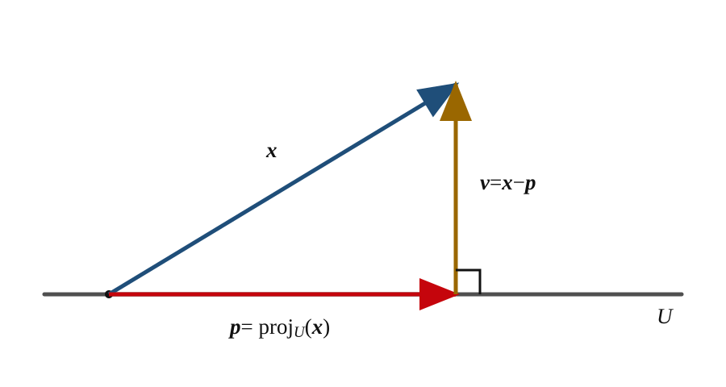

# 4.2 Orthogonal Projection {#42-orthogonal-projection}

!!! note "译文与来源"

    本页为教材公开源文件 v0.2 的非官方中文翻译（2026 年 11 月 2 日读取），保留原公式、例题、活动、代码和习题；例题、活动等编号按本地小节重排，证明与解答可展开；正文与标题中的数学专有名词保留英文，中文用于解释；术语表保留中英对照以便查阅。原文作者：Jacob Denson、Kaitlyn Phillipson、Sebastien Roch。译文遵循 [CC BY-NC-SA 4.0](https://creativecommons.org/licenses/by-nc-sa/4.0/)。[阅读英文原文](https://math345-textbook.github.io/sec-orthogonal-complements-and-projections.html)。


<a id="textbook-body"></a>

## 教材正文 {#_6}

<a id="sec-orthogonal-complements-and-projections"></a>

先介绍 orthogonal projection，再用它推导 Gram–Schmidt 算法。


<a id="subsec-orthogonal-projections"></a>

## Definition and Formula {#definition-and-formula}


<a id="def-orthogonal-complement"></a>

**定义 4.2.1：subspace 的 orthogonal complement**

若 $U$ 是 $\mathbb{R}^n$ 的 subspace，则 $U$ 的 orthogonal complement 是 $\mathbb{R}^n$ 的以下子集：

$$
U^\perp = \{\mathbf{x} \text{ in } \mathbb{R}^n \mid \mathbf{x} \cdot \mathbf{y} = 0 \text{ for all } \mathbf{y} \text{ in } U\}
$$


<a id="thm-6-2-orthogonal-complement-properties"></a>

**定理 4.2.1：orthogonal complement 的性质**

[ orthogonal complement ](4-2.md#def-orthogonal-complement) 具有以下性质：
1. 对 $\mathbb{R}^n$ 的任意 subspace $U$，$U^\perp$ 都是 $\mathbb{R}^n$ 的 subspace。

2. $\{\mathbf{0}\}^\perp = \mathbb{R}^n$，并且 $(\mathbb{R}^n)^\perp = \{\mathbf{0}\}$

3. 若

    $U = \operatorname{span} \{\mathbf{x}_1,\ldots,\mathbf{x}_k\}$


    $$
    U^\perp = \{\mathbf{x} \text{ in } \mathbb{R}^n \mid \mathbf{x} \cdot \mathbf{x}_i = 0 \text{ for } i=1,2,\ldots,k\}
    $$


**活动 4.2.1：求 orthogonal complement （U4-LO2）**

求 $U^\perp$，其中 $\mathbb{R}^3$ 中的 $U = \operatorname{span} \{(1,1,0), (0,1,1)\}$。

??? success "解答"

    由 [ orthogonal complement 的性质](4-2.md#thm-6-2-orthogonal-complement-properties) 的第三条性质， vector $\mathbf{w} = (x,y,z)$ 属于 $U^\perp$，当且仅当它同时 orthogonal 于 $(1,1,0)$ 和 $(0,1,1)$。计算这两个 dot product 得到 

    $$
    \begin{aligned}
    \mathbf{w}\cdot(1,1,0)=x+y & = 0 \\
    \mathbf{w}\cdot(0,1,1)=y+z & = 0.
    \end{aligned}
    $$

    

     column 按 $x,y,z$ 排列， augmented matrix 为 

    $$
    \left[\begin{array}{ccc|c}
                  1 & 1 & 0 & 0 \\
                  0 & 1 & 1 & 0
                \end{array}\right].
    $$

    此 matrix 已经是 pivot 为 1 的 row echelon form，无需进行Gaussian elimination的行变换。 pivot variable 为 $x$ 和 $y$，$z$ 是 free variable。方程组相容，由第二个 row back-substitution 得到 $y=-z$，再由第一行得到 $x=-y=z$。

    因此每个解都具有形式 

    $$
    \mathbf{w}=\begin{bmatrix}z\\-z\\z\end{bmatrix}=z\begin{bmatrix}1\\-1\\1\end{bmatrix}, \qquad z\in\mathbb{R},
    $$

    且 

    $$
    U^\perp = \operatorname{span} \left\{ \begin{bmatrix}1\\-1\\1\end{bmatrix} \right\} = \left\{ \begin{bmatrix}z\\-z\\z\end{bmatrix}: z \in \mathbb{R} \right\}.
    $$

    


<a id="lemma-6-2-orthogonal"></a>

**事实 4.2.1：减去 component 后的 orthogonality**

设 $\{\mathbf{q}_1, \mathbf{q}_2, \ldots, \mathbf{q}_m\}$ 是 $\mathbb{R}^n$ 中的 orthonormal set。对 $\mathbb{R}^n$ 中给定的 $\mathbf{x}$，定义 

$$
\mathbf{v} = \mathbf{x} - (\mathbf{x}\cdot\mathbf{q}_1)\mathbf{q}_1 - (\mathbf{x}\cdot\mathbf{q}_2)\mathbf{q}_2 - \cdots - (\mathbf{x}\cdot\mathbf{q}_m)\mathbf{q}_m.
$$

则对 $k = 1,2,\ldots,m$ 有 $\mathbf{v} \cdot \mathbf{q}_k = 0$。等价地，$\mathbf{v}$ 属于该 span 的 orthogonal complement：

$$
\mathbf{v}\in\left(\operatorname{span}\{\mathbf{q}_1,\ldots,\mathbf{q}_m\}\right)^\perp.
$$


??? info "证明"

    对每个 $i$，令 $c_i = \mathbf{x} \cdot \mathbf{q}_i$。给定 $1 \leq k \leq m$，计算得 

    $$
    \begin{aligned}
    \mathbf{v} \cdot \mathbf{q}_k & = (\mathbf{x} - c_1\mathbf{q}_1 - c_2\mathbf{q}_2 - \cdots - c_m\mathbf{q}_m) \cdot \mathbf{q}_k \\
    & = \mathbf{x} \cdot \mathbf{q}_k - c_1(\mathbf{q}_1 \cdot \mathbf{q}_k) - \cdots - c_k(\mathbf{q}_k \cdot \mathbf{q}_k) - \cdots - c_m(\mathbf{q}_m \cdot \mathbf{q}_k)
    \end{aligned}
    $$

    因该集合 orthonormal，当 $i \neq k$ 时有 $\mathbf{q}_i \cdot \mathbf{q}_k = 0$，且 $\mathbf{q}_k \cdot \mathbf{q}_k=1$。因此 

    $$
    \begin{aligned}
    \mathbf{v} \cdot \mathbf{q}_k & = \mathbf{x} \cdot \mathbf{q}_k - c_k \\
    & = \mathbf{x} \cdot \mathbf{q}_k - \mathbf{x} \cdot \mathbf{q}_k = 0
    \end{aligned}
    $$

    


<a id="remark-u4-expanding-within-span"></a>

**注：当 vector 已经属于 span 时**

若 $\mathbf{x}\in\operatorname{span}\{\mathbf{q}_1,\ldots,\mathbf{q}_m\}$， expansion theorem （[ expansion theorem ](4-1.md#thm-u4-orthogonal-expansion)）给出 

$$
\mathbf{x}=(\mathbf{x}\cdot\mathbf{q}_1)\mathbf{q}_1+\cdots+(\mathbf{x}\cdot\mathbf{q}_m)\mathbf{q}_m.
$$

因此 [减去 component 后的 orthogonality ](4-2.md#lemma-6-2-orthogonal) 中的 vector $\mathbf{v}$ 就是 $\mathbf{0}$。


<a id="def-orthogonal-projection"></a>

**定义 4.2.2：向 subspace 的 orthogonal projection**

设 $U$ 是 $\mathbb{R}^n$ 的 subspace。 vector $\mathbf{x} \in \mathbb{R}^n$ 在 $U$ 上的 orthogonal projection，是其中距离 $\mathbf{x}$ 最近的 vector $\mathbf{y}=\operatorname{proj}_U(\mathbf{x}) \in U$，即对满足 $\mathbf{z} \neq \mathbf{y}$ 的任意 $\mathbf{z} \in U$ 都有 $\| \mathbf{x} - \mathbf{y} \| \lt \| \mathbf{x} - \mathbf{z} \|$。

以下定理提供了计算 orthogonal projection 的实用方法。


<a id="thm-6-2projection"></a>

**定理 4.2.2：projection theorem**

设 $U$ 是 $\mathbb{R}^n$ 的 subspace，其 orthonormal basis 为 $\{\mathbf{q}_1,\ldots,\mathbf{q}_m\}$。对任意 $\mathbf{x} \in \mathbb{R}^n$，定义 

$$
\mathbf{p} = (\mathbf{x}\cdot\mathbf{q}_1)\mathbf{q}_1 + (\mathbf{x}\cdot\mathbf{q}_2)\mathbf{q}_2 + \cdots + (\mathbf{x}\cdot\mathbf{q}_m)\mathbf{q}_m.
$$

则 $\mathbf{p}=\operatorname{proj}_U(\mathbf{x})$。差 vector 

$$
\mathbf{v}=\mathbf{x}-\mathbf{p}=\mathbf{x}-\operatorname{proj}_U(\mathbf{x})
$$

称为 residual，且属于 $U^\perp$。特别地，若 $\mathbf{x}$ 已经属于 $U$，则 $\mathbf{x}$ 等于 $\mathbf{p}$。

??? info "证明"

    设 $\{ \mathbf{q}_1, \dots, \mathbf{q}_m \}$ 是 $U$ 的 orthonormal basis，并定义 

    $$
    \mathbf{p} = (\mathbf{x}\cdot\mathbf{q}_1)\mathbf{q}_1 + (\mathbf{x}\cdot\mathbf{q}_2)\mathbf{q}_2 + \cdots + (\mathbf{x}\cdot\mathbf{q}_m)\mathbf{q}_m,
    $$

    因为 $\mathbf{p}$ 是 basis vector 的 linear combination，所以 $\mathbf{p}\in U$。由 [减去 component 后的 orthogonality ](4-2.md#lemma-6-2-orthogonal)，$\mathbf{x}-\mathbf{p}$ 与每个 basis vector orthogonal，因此 $\mathbf{x}-\mathbf{p}\in U^\perp$。于是当 $\mathbf{z} \in U$ 且 $\mathbf{z} \neq \mathbf{p}$ 时，勾股定理（[勾股定理（Pythagoras’ Theorem）](4-1.md#thm-6-1-pythagoras-theorem)）给出 

    $$
    \begin{aligned}
    \| \mathbf{x} - \mathbf{z} \|^2 & = \| (\mathbf{x} - \mathbf{p}) + (\mathbf{p} - \mathbf{z}) \|^2 \\
    & = \| \mathbf{x} - \mathbf{p} \|^2 + \| \mathbf{p} - \mathbf{z} \|^2
    \end{aligned}
    $$

    因为 $\mathbf{p} \neq \mathbf{z}$，所以 

    $$
    \| \mathbf{x} - \mathbf{z} \|^2 \gt \| \mathbf{x} - \mathbf{p} \|^2
    $$

    两边开平方得 

    $$
    \| \mathbf{x} - \mathbf{z} \| \gt \| \mathbf{x} - \mathbf{p} \|
    $$

    因此上述定义的 $\mathbf{p}$ 等于 $\operatorname{proj}_U(\mathbf{x})$。又已验证 $\mathbf{x} - \mathbf{p} = \mathbf{x} - \operatorname{proj}_U(\mathbf{x})$ 属于 $U^\perp$，定理得证。


<a id="video-thm-4-2-7-projection"></a>

[ projection theorem ](4-2.md#thm-6-2projection) 的视频讲解：[观看：projection theorem （1 分 15 秒）](https://math345-textbook.github.io/videos/thm-4-2-7-projection/)。

orthogonal projection 把原 vector 分解为 subspace 中的 vector，以及垂直于 subspace 的 residual。


<a id="fig-u4-projection-residual"></a>

* projection 与 residual：orthogonal projection 将 vector 写为 $\mathbf{x}=\mathbf{p}+\mathbf{v}$，其中 $\mathbf{p}\in U$ 且 $\mathbf{v}\in U^\perp$。*




<a id="warning-u4-projection-orthonormal"></a>

**注意：使用 projection 公式前先 normalization**

[ projection theorem ](4-2.md#thm-6-2projection) 中的公式要求 orthonormal basis，仅两两 orthogonal 不够。若只有 span $U$ 的 orthogonal set $\{\mathbf{f}_1,\ldots,\mathbf{f}_m\}$，先对每个 vector 进行 [ normalization ](1-1.md#def-u1-unit-vector-normalization)：

$$
\mathbf{q}_i=\frac{\mathbf{f}_i}{\|\mathbf{f}_i\|},\qquad i=1,\ldots,m.
$$

所得 $\mathbf{q}_i$ 构成相同 subspace 的 orthonormal basis，应使用这些 unit vector 代入 projection 公式。


<a id="note-u4-expansion-versus-projection"></a>

**说明：展开与 projection 的区别（Expansion versus Projection）**

[ expansion theorem ](4-1.md#thm-u4-orthogonal-expansion) 与 [ projection theorem ](4-2.md#thm-6-2projection) 使用相同的 orthonormal basis 和 coefficient 公式，但假设不同：expansion theorem 要求 $\mathbf{x}\in U=\operatorname{span}\{\mathbf{q}_1,\ldots,\mathbf{q}_m\}$，所以求和结果就是 $\mathbf{x}$ 本身； projection theorem 允许任意 $\mathbf{x}\in\mathbb{R}^n$，求和得到 $\operatorname{proj}_U(\mathbf{x})$，不一定等于 $\mathbf{x}$。当 $\mathbf{x}\in U$ 时， projection 等于 $\mathbf{x}$， residual 为零，便回到 expansion theorem。


<a id="ex-u4-projection-span"></a>

**例题 4.2.1：向 span projection （U4-LO3）**

求 $\operatorname{proj}_U \mathbf{x}$，其中 $U = \operatorname{span} \{(1,1,0), (1,-1,0)\}$，且 $\mathbb{R}^3$ 中的 $\mathbf{x} = (2,0,1)$。

??? success "解答"

     vector $\mathbf{f}_1 = (1,1,0)$ 与 $\mathbf{f}_2 = (1,-1,0)$ 已经 orthogonal，因为 

    $$
    \mathbf{f}_1 \cdot \mathbf{f}_2 = 1 \cdot 1 + 1 \cdot (-1) + 0 \cdot 0 = 0
    $$

    两者长度均为 $\sqrt{2}$，先 normalization：

    $$
    \mathbf{q}_1=\frac{1}{\sqrt{2}}\begin{bmatrix}1\\1\\0\end{bmatrix},\qquad \mathbf{q}_2=\frac{1}{\sqrt{2}}\begin{bmatrix}1\\-1\\0\end{bmatrix}.
    $$

    它们构成 $U$ 的 orthonormal basis。 projection coefficient 为 

    $$
    \begin{aligned}
    \mathbf{x}\cdot\mathbf{q}_1 & =\frac{2\cdot1+0\cdot1+1\cdot0}{\sqrt{2}}=\sqrt{2}, \\
    \mathbf{x}\cdot\mathbf{q}_2 & =\frac{2\cdot1+0\cdot(-1)+1\cdot0}{\sqrt{2}}=\sqrt{2}.
    \end{aligned}
    $$

    由 [ projection theorem ](4-2.md#thm-6-2projection) 得 

    $$
    \begin{aligned}
    \operatorname{proj}_U \mathbf{x} & =(\mathbf{x}\cdot\mathbf{q}_1)\mathbf{q}_1+(\mathbf{x}\cdot\mathbf{q}_2)\mathbf{q}_2 \\
    & =\sqrt{2}\,\mathbf{q}_1+\sqrt{2}\,\mathbf{q}_2 \\
    & =\begin{bmatrix}1\\1\\0\end{bmatrix}+\begin{bmatrix}1\\-1\\0\end{bmatrix}=\begin{bmatrix}2\\0\\0\end{bmatrix}.
    \end{aligned}
    $$

    


<a id="act-u4-projection-plane-zero-coefficient"></a>

**活动 4.2.2：向平面 projection （U4-LO3）**

求 $\operatorname{proj}_U\mathbf{x}$，其中 $U=\operatorname{span}\{(1,0,1),(1,0,-1)\}$，且 $\mathbb{R}^3$ 中的 $\mathbf{x}=(1,2,1)$。

??? success "解答"

     vector $\mathbf{f}_1=(1,0,1)$ 与 $\mathbf{f}_2=(1,0,-1)$  orthogonal，因为 

    $$
    \mathbf{f}_1\cdot\mathbf{f}_2=1\cdot1+0\cdot0+1\cdot(-1)=0.
    $$

    两者 norm 均为 $\sqrt{2}$， normalization 后得到 $U$ 的 orthonormal basis：

    $$
    \mathbf{q}_1=\frac{1}{\sqrt{2}}\begin{bmatrix}1\\0\\1\end{bmatrix},\qquad \mathbf{q}_2=\frac{1}{\sqrt{2}}\begin{bmatrix}1\\0\\-1\end{bmatrix}.
    $$

    projection coefficient 为 

    $$
    \begin{aligned}
    \mathbf{x}\cdot\mathbf{q}_1 & =\frac{1\cdot1+2\cdot0+1\cdot1}{\sqrt{2}}=\sqrt{2}, \\
    \mathbf{x}\cdot\mathbf{q}_2 & =\frac{1\cdot1+2\cdot0+1\cdot(-1)}{\sqrt{2}}=0.
    \end{aligned}
    $$

    由 [ projection theorem ](4-2.md#thm-6-2projection)，

    $$
    \begin{aligned}
    \mathbf{p}=\operatorname{proj}_U\mathbf{x} & =(\mathbf{x}\cdot\mathbf{q}_1)\mathbf{q}_1+(\mathbf{x}\cdot\mathbf{q}_2)\mathbf{q}_2 \\
    & =\sqrt{2}\,\mathbf{q}_1+0\,\mathbf{q}_2=\begin{bmatrix}1\\0\\1\end{bmatrix}.
    \end{aligned}
    $$

    由于 $\mathbf{x}\cdot\mathbf{q}_2=0$，在 $\operatorname{span}\{\mathbf{q}_2\}$ 上的 projection 为 zero vector。


<a id="act-u4-projection-line"></a>

**活动 4.2.3：向直线 projection （U4-LO3）**

设 

$$
\mathbf{f}=\begin{bmatrix}3\\4\end{bmatrix},\qquad
            \mathbf{x}=\begin{bmatrix}2\\5\end{bmatrix},\qquad
            L=\operatorname{span}\{\mathbf{f}\}.
$$


1. 计算 $\operatorname{proj}_L(\mathbf{x})$。

2. 计算 residual $\mathbf{v}=\mathbf{x}-\operatorname{proj}_L(\mathbf{x})$。

3. 检查 $\mathbf{v}\cdot\mathbf{f}=0$。


??? success "解答"

    首先有 $\|\mathbf{f}\|=\sqrt{3^2+4^2}=5$，所以 unit vector 

    $$
    \mathbf{q}=\frac{\mathbf{f}}{5}=\begin{bmatrix}3/5\\4/5\end{bmatrix}
    $$

     构成 $L$ 的 orthonormal basis $\{\mathbf{q}\}$。有 $\mathbf{x}\cdot\mathbf{q}=2(3/5)+5(4/5)=26/5$。由 [ projection theorem ](4-2.md#thm-6-2projection)，

    $$
    \operatorname{proj}_L(\mathbf{x})
                =
                (\mathbf{x}\cdot\mathbf{q})\mathbf{q}
                =
                \frac{26}{25}\begin{bmatrix}3\\4\end{bmatrix}
                =
                \begin{bmatrix}78/25\\104/25\end{bmatrix}.
    $$

    residual 为 

    $$
    \mathbf{v}
                =
                \begin{bmatrix}2\\5\end{bmatrix}
                -
                \begin{bmatrix}78/25\\104/25\end{bmatrix}
                =
                \begin{bmatrix}-28/25\\21/25\end{bmatrix}.
    $$

    最后有 

    $$
    \mathbf{v}\cdot\mathbf{f}
                =
                \left(-\frac{28}{25}\right)3+\left(\frac{21}{25}\right)4
                =
                0.
    $$

    


<a id="act-u4-projection-line-code"></a>

**活动 4.2.4：用代码向直线 projection （U4-LO3，U4-LO7）**

下面的代码先对方向 vector 进行 normalization，再计算与上一活动相同的 projection 和 residual。


```python
import numpy as np

f = np.array([3.0, 4.0])
x = np.array([2.0, 5.0])

q = f / np.linalg.norm(f)
p = (x @ q) * q
v = x - p

p, v, v @ f
```


1. 哪个变量保存 projection？

2. 哪个变量保存 residual？

3. 为什么 `v @ f` 应接近零？

4. `q = f / np.linalg.norm(f)` 完成了什么？为什么计算 `(x @ q) * q` 前需要这一步？


??? success "解答"

    变量 `p` 保存 projection，`v` 保存 residual。`v @ f` 检查 residual 是否与直线方向 orthogonal，因此应接近零。赋值 `q = f / np.linalg.norm(f)` 使 `q` 成为与 `f`  span 同一直线的 unit vector。[ projection theorem ](4-2.md#thm-6-2projection) 的 dot product 公式要求 orthonormal basis，因此需要 normalization。随后 `(x @ q) * q` 计算 

    $$
    \operatorname{proj}_L(\mathbf{x})=(\mathbf{x}\cdot\mathbf{q})\mathbf{q},\qquad L=\operatorname{span}\{\mathbf{q}\}=\operatorname{span}\{\mathbf{f}\}.
    $$

    

### Projection as an Optimization Problem {#projection-as-an-optimization-problem}

[ projection 的最近点定义](4-2.md#def-orthogonal-projection) 自然引出 projection 的 optimization problem。


<a id="act-u5-projection-as-optimization"></a>

**活动 4.2.5：作为优化的 projection （U4-LO3，U3-LO9）**

设 

$$
W=\operatorname{span}\left\{
            \begin{bmatrix}
            1\\
            0
            \end{bmatrix}
            \right\}
            \subseteq \mathbb{R}^2,
            \qquad
            \mathbf{b}=
            \begin{bmatrix}
            2\\
            3
            \end{bmatrix}.
$$

$W$ 中的一般点具有形式 

$$
\mathbf{w}(t)=
            \begin{bmatrix}
            t\\
            0
            \end{bmatrix}.
$$


1. 写出距离平方 $g(t)=\|\mathbf{b}-\mathbf{w}(t)\|^2$。

2. 计算 $g'(t)$，并求 $g$ 的 critical point。

3. 用 $g''(t)$ 判别 critical point。（回顾二阶 derivative 判别法：若 $g'(t_0)=0$，且 $g''$ 在 $t_0$ 附近连续，则 $g''(t_0)\gt 0$ 表示局部极小，$g''(t_0)\lt 0$ 表示局部极大，而 $g''(t_0)=0$ 不能判定；见 [OpenStax《微积分》第 1 卷，第 4.5 节](https://openstax.org/books/calculus-volume-1/pages/4-5-derivatives-and-the-shape-of-a-graph)。）

4. $W$ 中哪个点距离 $\mathbf{b}$ 最近？

5. 这与 [图 4.2.1](4-2.md#fig-u4-projection-residual) 及 [ projection theorem ](4-2.md#thm-6-2projection) 如何一致？


??? success "解答"

    有 

    $$
    \mathbf{b}-\mathbf{w}(t)=
                \begin{bmatrix}
                2-t\\
                3
                \end{bmatrix},
    $$

    所以 

    $$
    g(t)=\|\mathbf{b}-\mathbf{w}(t)\|^2=(2-t)^2+9.
    $$

    求导得 

    $$
    g'(t)=2(t-2).
    $$

    唯一 critical point 为 $t=2$。由于 

    $$
    g''(t)=2>0,
    $$

    该点是局部极小点。$g$ 是开口向上的二次 function，因此该点也是唯一全局极小点。所以 $W$ 中的最近点为 

    $$
    \widehat{\mathbf{b}}=
                \begin{bmatrix}
                2\\
                0
                \end{bmatrix}.
    $$

    这与 [图 4.2.1](4-2.md#fig-u4-projection-residual) 和 [ projection theorem ](4-2.md#thm-6-2projection) 一致：residual 为 

    $$
    \mathbf{b}-\widehat{\mathbf{b}}=
                \begin{bmatrix}
                0\\
                3
                \end{bmatrix}.
    $$

    对每个 $\mathbf{w}(t)\in W$ 都有 

    $$
    (\mathbf{b}-\widehat{\mathbf{b}})\cdot\mathbf{w}(t)
                =
                \begin{bmatrix}
                0\\
                3
                \end{bmatrix}
                \cdot
                \begin{bmatrix}
                t\\
                0
                \end{bmatrix}
                =0\cdot t+3\cdot 0=0.
    $$

    因此 residual orthogonal 于 $W$。

**例题 4.2.2：通过 critical point 推导 projection 公式**

设 $\mathbf{x}\in\mathbb{R}^n$，并设 $B=(\mathbf{q}_1,\ldots,\mathbf{q}_m)$ 是 $U$ 的有序 orthonormal basis，因此 

$$
U=\operatorname{span}\{\mathbf{q}_1,\ldots,\mathbf{q}_m\}.
$$

$U$ 中每个 vector 都能唯一写成 

$$
\mathbf{u}(\mathbf{c})=c_1\mathbf{q}_1+\cdots+c_m\mathbf{q}_m,
          \qquad
          \mathbf{c}=\begin{bmatrix}c_1\\\vdots\\c_m\end{bmatrix}\in\mathbb{R}^m.
$$

回顾 [ coordinate vector ](2-4.md#subsec-bases-coordinate-systems-7)：$\mathbf{c}=C_B(\mathbf{u}(\mathbf{c}))$ 是 $\mathbf{u}(\mathbf{c})$ 关于 ordered basis $B$ 的 coordinate vector。因此，寻找距离 $\mathbf{x}$ 最近的 vector，等价于选择 $\mathbf{c}$ 使 

$$
g(\mathbf{c})=\|\mathbf{x}-\mathbf{u}(\mathbf{c})\|^2.
$$

最小。将距离平方不会改变哪个 vector 最近，并能得到便于求导的多项式。

先使用 norm 平方的定义，再对 dot product 使用分配律：

$$
\begin{aligned}
g(\mathbf{c}) & = (\mathbf{x}-\mathbf{u}(\mathbf{c}))\cdot(\mathbf{x}-\mathbf{u}(\mathbf{c})) \\
& = (\mathbf{x}-c_1\mathbf{q}_1-\cdots-c_m\mathbf{q}_m) \\
&\qquad\cdot(\mathbf{x}-c_1\mathbf{q}_1-\cdots-c_m\mathbf{q}_m) \\
& = \mathbf{x}\cdot\mathbf{x}-\mathbf{x}\cdot\mathbf{u}(\mathbf{c}) \\
&\qquad -\mathbf{u}(\mathbf{c})\cdot\mathbf{x}+\mathbf{u}(\mathbf{c})\cdot\mathbf{u}(\mathbf{c}) \\
& = \|\mathbf{x}\|^2-2\mathbf{x}\cdot\mathbf{u}(\mathbf{c})+\mathbf{u}(\mathbf{c})\cdot\mathbf{u}(\mathbf{c}).
\end{aligned}
$$

最后一个等式使用 dot product 的对称性：$\mathbf{u}(\mathbf{c})\cdot\mathbf{x}=\mathbf{x}\cdot\mathbf{u}(\mathbf{c})$。

为展开中间项，把 $\mathbf{u}(\mathbf{c})$ 的 linear combination 代入，使用分配律，并将 scalar coefficient 提出：

$$
\begin{aligned}
\mathbf{x}\cdot\mathbf{u}(\mathbf{c}) & = \mathbf{x}\cdot(c_1\mathbf{q}_1+\cdots+c_m\mathbf{q}_m) \\
& = c_1(\mathbf{x}\cdot\mathbf{q}_1)+\cdots+c_m(\mathbf{x}\cdot\mathbf{q}_m).
\end{aligned}
$$


对最后一项，先计算每个 basis vector 与 $\mathbf{u}(\mathbf{c})$ 的 dot product。对任意 $i=1,\ldots,m$，有 

$$
\begin{aligned}
\mathbf{q}_i\cdot\mathbf{u}(\mathbf{c}) & = \mathbf{q}_i\cdot(c_1\mathbf{q}_1+\cdots+c_m\mathbf{q}_m) \\
& = c_1(\mathbf{q}_i\cdot\mathbf{q}_1)+\cdots+c_m(\mathbf{q}_i\cdot\mathbf{q}_m).
\end{aligned}
$$

这里正是使用 orthonormal 性的地方：当 $j\ne i$ 时， orthogonality 给出 $\mathbf{q}_i\cdot\mathbf{q}_j=0$，因此除了第 $i$ 项，其余项全为零。单位长度条件给出 $\mathbf{q}_i\cdot\mathbf{q}_i=\|\mathbf{q}_i\|^2=1$，于是 

$$
\mathbf{q}_i\cdot\mathbf{u}(\mathbf{c})=c_i(\mathbf{q}_i\cdot\mathbf{q}_i)=c_i\cdot1=c_i.
$$

再次使用分配律得 

$$
\begin{aligned}
\mathbf{u}(\mathbf{c})\cdot\mathbf{u}(\mathbf{c}) & = (c_1\mathbf{q}_1+\cdots+c_m\mathbf{q}_m)\cdot\mathbf{u}(\mathbf{c}) \\
& = c_1(\mathbf{q}_1\cdot\mathbf{u}(\mathbf{c}))+\cdots+c_m(\mathbf{q}_m\cdot\mathbf{u}(\mathbf{c})) \\
& = c_1c_1+\cdots+c_mc_m \\
& = c_1^2+\cdots+c_m^2.
\end{aligned}
$$

所以， orthogonality 消去不同 basis vector 之间的交叉项， normalization 则使每个 $c_i^2$ 的 coefficient 等于 1。

将上述两次 dot product 计算代入 $g$ 的公式，得到 

$$
\begin{aligned}
g(\mathbf{c}) & = \|\mathbf{x}\|^2-2\bigl[c_1(\mathbf{x}\cdot\mathbf{q}_1)+\cdots+c_m(\mathbf{x}\cdot\mathbf{q}_m)\bigr] \\
&\qquad +c_1^2+\cdots+c_m^2 \\
& = \|\mathbf{x}\|^2+\bigl[c_1^2-2c_1(\mathbf{x}\cdot\mathbf{q}_1)\bigr] \\
&\qquad +\cdots+\bigl[c_m^2-2c_m(\mathbf{x}\cdot\mathbf{q}_m)\bigr].
\end{aligned}
$$


现在固定 $i$，对 $c_i$ 求 partial derivative。 vector $\mathbf{x}$ 和所有 basis vector 都固定，因此它们的 dot product 是常数。求 partial derivative 时，满足 $j\ne i$ 的其他 coordinate $c_j$ 也保持不变。因此 

$$
\frac{\partial}{\partial c_i}\|\mathbf{x}\|^2=0,
$$

并且 

$$
\frac{\partial}{\partial c_i}\bigl[c_j^2-2c_j(\mathbf{x}\cdot\mathbf{q}_j)\bigr]=0
          \qquad\text{if }j\ne i.
$$

只有包含 $c_i$ 的那一项有贡献。由求导的 linear 性和 power rule，

$$
\begin{aligned}
\frac{\partial g}{\partial c_i} & = \frac{\partial}{\partial c_i}\bigl[c_i^2-2c_i(\mathbf{x}\cdot\mathbf{q}_i)\bigr] \\
& = \frac{\partial c_i^2}{\partial c_i}-2(\mathbf{x}\cdot\mathbf{q}_i)\frac{\partial c_i}{\partial c_i} \\
& = 2c_i-2(\mathbf{x}\cdot\mathbf{q}_i)\cdot1 \\
& = 2c_i-2(\mathbf{x}\cdot\mathbf{q}_i).
\end{aligned}
$$

对每个 $i=1,\ldots,m$ 都成立。令这些 partial derivative 全部为零，得到唯一的 [ critical point ](3-6.md#def-u3-critical-point) $\mathbf{c}^*$，其 component 为 

$$
c_i^*=\mathbf{x}\cdot\mathbf{q}_i,\qquad i=1,\ldots,m.
$$


为说明该 critical point 是唯一的全局极小点，进行“配方”。对每个 $i$，同时加上再减去 $(c_i^*)^2$：

$$
\begin{aligned}
c_i^2-2c_ic_i^* & = c_i^2-2c_ic_i^*+(c_i^*)^2-(c_i^*)^2 \\
& = (c_i-c_i^*)^2-(c_i^*)^2.
\end{aligned}
$$

由于 $c_i^*=\mathbf{x}\cdot\mathbf{q}_i$，把这个恒等式代入 $g$ 的展开式，得到 

$$
\begin{aligned}
g(\mathbf{c}) & = \|\mathbf{x}\|^2-\bigl[(c_1^*)^2+\cdots+(c_m^*)^2\bigr] \\
&\qquad +(c_1-c_1^*)^2+\cdots+(c_m-c_m^*)^2.
\end{aligned}
$$

在 $\mathbf{c}=\mathbf{c}^*$ 时，所有平方差项为零，因此 

$$
g(\mathbf{c}^*)=\|\mathbf{x}\|^2-\bigl[(c_1^*)^2+\cdots+(c_m^*)^2\bigr].
$$

所以 

$$
g(\mathbf{c})=g(\mathbf{c}^*)+(c_1-c_1^*)^2+\cdots+(c_m-c_m^*)^2.
$$

新增各项非负，且恰在 $\mathbf{c}=\mathbf{c}^*$ 时同时为零。因此，$U$ 中的最近 vector 是 

$$
\begin{aligned}
\mathbf{p}=\mathbf{u}(\mathbf{c}^*) & = c_1^*\mathbf{q}_1+\cdots+c_m^*\mathbf{q}_m \\
& = (\mathbf{x}\cdot\mathbf{q}_1)\mathbf{q}_1+\cdots+(\mathbf{x}\cdot\mathbf{q}_m)\mathbf{q}_m \\
& = \operatorname{proj}_U(\mathbf{x}).
\end{aligned}
$$

通过最小化距离平方，我们重新得到了 [ projection theorem ](4-2.md#thm-6-2projection) 的公式。


<a id="connection-u4-directional-derivatives-projection"></a>

### directional derivative 作为 projection coefficient {#_7}

设 $\mathbf v$ 为 unit vector。由 [ projection theorem ](4-2.md#thm-6-2projection)，

$$
\operatorname{proj}_{\operatorname{span}\{\mathbf v\}}\bigl(\nabla f(\mathbf a)\bigr)=\bigl(\nabla f(\mathbf a)\cdot\mathbf v\bigr)\mathbf v.
$$

由 [ directional derivative 的 gradient 公式](3-6.md#thm-10-1-direction-in-terms-of-gradient)，

$$
\operatorname{proj}_{\operatorname{span}\{\mathbf v\}}\bigl(\nabla f(\mathbf a)\bigr)=D_{\mathbf v}f(\mathbf a)\mathbf v.
$$

因此，$D_{\mathbf v}f(\mathbf a)$ 是 gradient 沿有向单位方向 $\mathbf v$ 的带符号 projection coefficient；其绝对值是 projection 长度。


<a id="act-u4-directional-derivative-projection-coefficient"></a>

**活动 4.2.6：directional derivative 作为 projection coefficient （U4-LO3，U3-LO8）**

回顾 [ directional derivative 活动](3-6.md#act-u5-dot-product-controls-direction) 中的 gradient 与 unit vector：

$$
\nabla f(\mathbf a)=\begin{bmatrix}3\\4\end{bmatrix},
$$


$$
\begin{aligned}
\mathbf v_1=\begin{bmatrix}1\\0\end{bmatrix},\qquad
              \mathbf v_2=\begin{bmatrix}0\\1\end{bmatrix}, \\
\mathbf v_3=\frac15\begin{bmatrix}3\\4\end{bmatrix},\qquad
              \mathbf v_4=-\frac15\begin{bmatrix}3\\4\end{bmatrix}.
\end{aligned}
$$

对每个 unit vector $\mathbf v_i$，计算 

$$
\operatorname{proj}_{\operatorname{span}\{\mathbf v_i\}}\bigl(\nabla f(\mathbf a)\bigr)=D_{\mathbf v_i}f(\mathbf a)\mathbf v_i.
$$


1. 哪些 projection coefficient 为正，哪些为负？

2. 为什么 $\mathbf v_3$ 与 $\mathbf v_4$ 给出相同的 projection vector，却有相反的 directional derivative ？


??? success "解答"

    由 [ directional derivative 活动](3-6.md#act-u5-dot-product-controls-direction)，

    $$
    \begin{aligned}
    D_{\mathbf v_1}f(\mathbf a)&=3,\qquad D_{\mathbf v_2}f(\mathbf a)=4, \\
    D_{\mathbf v_3}f(\mathbf a)&=5,\qquad D_{\mathbf v_4}f(\mathbf a)=-5.
    \end{aligned}
    $$

    因此 

    $$
    \operatorname{proj}_{\operatorname{span}\{\mathbf v_1\}}\bigl(\nabla f(\mathbf a)\bigr)=3\mathbf v_1=\begin{bmatrix}3\\0\end{bmatrix},
    $$

     

    $$
    \operatorname{proj}_{\operatorname{span}\{\mathbf v_2\}}\bigl(\nabla f(\mathbf a)\bigr)=4\mathbf v_2=\begin{bmatrix}0\\4\end{bmatrix},
    $$

    且 

    $$
    \operatorname{proj}_{\operatorname{span}\{\mathbf v_3\}}\bigl(\nabla f(\mathbf a)\bigr)=5\mathbf v_3=\begin{bmatrix}3\\4\end{bmatrix}.
    $$

    因为 $\mathbf v_4=-\mathbf v_3$，所以 

    $$
    \operatorname{proj}_{\operatorname{span}\{\mathbf v_4\}}\bigl(\nabla f(\mathbf a)\bigr)=(-5)\mathbf v_4=\begin{bmatrix}3\\4\end{bmatrix}.
    $$

    vector $\mathbf v_3$ 与 $\mathbf v_4$  span 同一直线，向这条直线的 projection 相同；但两个 unit vector 赋予直线相反的方向，所以 directional derivative 符号相反。

## Gram–Schmidt Orthonormalization {#gramschmidt-gramschmidt-orthonormalization}

Gram–Schmidt 逐一处理输入 vectors：先减去沿已有方向的 projections，再对剩余部分进行 normalization。这样得到的 orthonormal basis 与原 basis 的 span 相同。


<a id="fact-u4-extending-orthonormal-set"></a>

**事实 4.2.2：扩充 orthonormal set**

设 $\{\mathbf{q}_1,\ldots,\mathbf{q}_m\}$ 是 $\mathbb{R}^n$ 中的 orthonormal set，且 $\mathbf{x}\in\mathbb{R}^n$ 不属于它的 span。定义 

$$
\mathbf{v}=\mathbf{x}-(\mathbf{x}\cdot\mathbf{q}_1)\mathbf{q}_1-\cdots-(\mathbf{x}\cdot\mathbf{q}_m)\mathbf{q}_m.
$$

则 $\mathbf{v}\neq\mathbf{0}$。令 

$$
\mathbf{q}_{m+1}=\frac{\mathbf{v}}{\|\mathbf{v}\|}.
$$

将其 normalization，扩充后的集合 $\{\mathbf{q}_1,\ldots,\mathbf{q}_m,\mathbf{q}_{m+1}\}$  orthonormal，且保持 span：

$$
\operatorname{span}\{\mathbf{q}_1,\ldots,\mathbf{q}_m,\mathbf{q}_{m+1}\}=\operatorname{span}\{\mathbf{q}_1,\ldots,\mathbf{q}_m,\mathbf{x}\}.
$$


??? info "证明"

    若 $\mathbf{v}=\mathbf{0}$，则 $\mathbf{x}=(\mathbf{x}\cdot\mathbf{q}_1)\mathbf{q}_1+\cdots+(\mathbf{x}\cdot\mathbf{q}_m)\mathbf{q}_m$ 属于原 span，与假设矛盾。因此 $\mathbf{v}\neq\mathbf{0}$，可以 normalization。由 [减去 component 后的 orthogonality ](4-2.md#lemma-6-2-orthogonal)，$\mathbf{v}$ 与每个 $\mathbf{q}_k$  orthogonal。$\mathbf{q}_{m+1}$ 的 norm 为 1，且仍与每个 $\mathbf{q}_k$  orthogonal，所以扩充后的集合 orthonormal。

    $\mathbf{q}_{m+1}$ 的公式将其表示为 $\mathbf{q}_1,\ldots,\mathbf{q}_m,\mathbf{x}$ 的 linear combination。反过来，

    $$
    \mathbf{x}=(\mathbf{x}\cdot\mathbf{q}_1)\mathbf{q}_1+\cdots+(\mathbf{x}\cdot\mathbf{q}_m)\mathbf{q}_m+\|\mathbf{v}\|\mathbf{q}_{m+1}.
    $$

    因此两组 vector 互相 span， span 相同。


<a id="subsec-orthogonal-projections-7"></a>

**活动 4.2.7：将 orthonormal set 扩充为 basis （U4-LO2）**

先 normalization orthogonal vector 

$$
\mathbf{f}_1 = \begin{bmatrix}1\\1\\0\end{bmatrix} \quad\text{and}\quad \mathbf{f}_2 = \begin{bmatrix}1\\-1\\0\end{bmatrix}
$$

得到 $\mathbb{R}^3$ 中的 orthonormal set $\{\mathbf{q}_1,\mathbf{q}_2\}$。用 [扩充 orthonormal set ](4-2.md#fact-u4-extending-orthonormal-set) 和 $\mathbf{x}=(1,1,2)$ 将其扩充为 orthonormal basis $\{\mathbf{q}_1,\mathbf{q}_2,\mathbf{q}_3\}$。

??? success "解答"

    两个给定 vector norm 均为 $\sqrt{2}$，先令 

    $$
    \begin{aligned}
    \mathbf{q}_1 & = \frac{1}{\sqrt{2}}\begin{bmatrix}1\\1\\0\end{bmatrix}, \\
    \mathbf{q}_2 & = \frac{1}{\sqrt{2}}\begin{bmatrix}1\\-1\\0\end{bmatrix}.
    \end{aligned}
    $$

    它们 dot product 为零，因此构成 orthonormal set。计算 

    $$
    \begin{aligned}
    \mathbf{x}\cdot\mathbf{q}_1 & = \frac{1+1}{\sqrt{2}}=\sqrt{2}, \\
    \mathbf{x}\cdot\mathbf{q}_2 & = \frac{1-1}{\sqrt{2}}=0.
    \end{aligned}
    $$

    由 [减去 component 后的 orthogonality ](4-2.md#lemma-6-2-orthogonal) 得 

    $$
    \begin{aligned}
    \mathbf{v} & = \mathbf{x}-(\mathbf{x}\cdot\mathbf{q}_1)\mathbf{q}_1-(\mathbf{x}\cdot\mathbf{q}_2)\mathbf{q}_2 \\
    & = \begin{bmatrix}1\\1\\2\end{bmatrix}-\sqrt{2}\left(\frac{1}{\sqrt{2}}\begin{bmatrix}1\\1\\0\end{bmatrix}\right)-0\mathbf{q}_2=\begin{bmatrix}0\\0\\2\end{bmatrix}.
    \end{aligned}
    $$

    由于 $\|\mathbf{v}\|=2$，再 normalization：

    $$
    \mathbf{q}_3=\frac{\mathbf{v}}{\|\mathbf{v}\|}=\begin{bmatrix}0\\0\\1\end{bmatrix}.
    $$

    由 [减去 component 后的 orthogonality ](4-2.md#lemma-6-2-orthogonal)，$\mathbf{q}_3$ 与 $\mathbf{q}_1$、$\mathbf{q}_2$  orthogonal。因为 $\|\mathbf{q}_3\|=1$，集合 $\{\mathbf{q}_1,\mathbf{q}_2,\mathbf{q}_3\}$  orthonormal。由 [ orthogonal set 的 linear independence （Linear Independence of Orthogonal Sets）](4-1.md#thm-6-1-orthogonality-independent)，三个 vector linearly independent，因此构成 $\mathbb{R}^3$ 的 orthonormal basis。

这里使用原 matrix 的 column $\mathbf{a}_j$、其 projection $\mathbf{p}_j$、 orthogonal residual $\mathbf{v}_j$、新的单位方向 $\mathbf{q}_j$，以及 coefficient $r_{ij}$。对已 normalization 的 vector $\mathbf{q}_i$ 反复使用 [扩充 orthonormal set ](4-2.md#fact-u4-extending-orthonormal-set)，得到下述算法。


<a id="alg-u4-gram-schmidt"></a>

**算法 4.2.1：Gram–Schmidt 算法（Gram–Schmidt Algorithm）**

输入： 具有 full column rank 的 matrix 

$$
A=
            \begin{bmatrix}
            \mathbf{a}_1 & \mathbf{a}_2 & \cdots & \mathbf{a}_n
            \end{bmatrix}
$$

<!-- punctuation omitted -->
对 $j=1,\ldots,n$：


1. 当前 column：从 $\mathbf{a}_j$ 开始。

2. projection：对每个 $i \lt j$，计算 

$$
r_{ij}=\mathbf{q}_i^T\mathbf{a}_j.
$$

再组合成 

$$
\mathbf{p}_j=\sum_{i \lt j}r_{ij}\mathbf{q}_i.
$$

第一个 column 对应 $\mathbf{p}_1=\mathbf{0}$。

3. 相减：

$$
\mathbf{v}_j=\mathbf{a}_j-\mathbf{p}_j.
$$


4. 测量：

$$
r_{jj}=\|\mathbf{v}_j\|.
$$


5. normalization：

$$
\mathbf{q}_j=\frac{\mathbf{v}_j}{r_{jj}}.
$$


输出：vector $\mathbf{q}_1,\ldots,\mathbf{q}_n$  orthonormal，且每一步都满足 

$$
\operatorname{span}\{\mathbf{q}_1,\ldots,\mathbf{q}_j\}
            =
            \operatorname{span}\{\mathbf{a}_1,\ldots,\mathbf{a}_j\}
$$

<!-- punctuation omitted -->
<a id="practice-u4-perfectly-normal"></a>

[在 Perfectly Normal 中通过几何方式练习 Gram–Schmidt。](https://math345-games.github.io/PerfectlyNormal/)


<a id="warn-u4-gram-schmidt-zero-residual"></a>

**注意**

若 $r_{jj}=0$，说明 $\mathbf{a}_j$ 已属于前面 columns 的 span；输入 vectors 因而存在 linear dependence，当前步骤不能产生新的独立方向，也不能对零 residual 进行 normalization。

以下定理概括 [Gram–Schmidt 算法（Gram–Schmidt Algorithm）](4-2.md#alg-u4-gram-schmidt) 生成 vector 的性质。


<a id="thm-6-2-gram-schmidt"></a>

**定理 4.2.3：Gram–Schmidt 输出的性质**

对 具有 full column rank 的 matrix $A=[\mathbf{a}_1\ \cdots\ \mathbf{a}_n]$ 使用 [Gram–Schmidt 算法（Gram–Schmidt Algorithm）](4-2.md#alg-u4-gram-schmidt)，并令 $U=\operatorname{span}\{\mathbf{a}_1,\ldots,\mathbf{a}_n\}$。每个 $k=1,\ldots,n$ 写作 $U_k=\operatorname{span}\{\mathbf{a}_1,\ldots,\mathbf{a}_k\}$。进行到第 $k$ 步时，输出满足：


- 保持 span：

$$
\operatorname{span}\{\mathbf{v}_1,\ldots,\mathbf{v}_k\}=\operatorname{span}\{\mathbf{q}_1,\ldots,\mathbf{q}_k\}=U_k.
$$


- 对 residuals 进行 normalization 后，$\{\mathbf{q}_1,\ldots,\mathbf{q}_k\}$ 构成 $U_k$ 的 orthonormal basis。


特别地，$\{\mathbf{q}_1,\ldots,\mathbf{q}_n\}$ 是 $U$ 的 orthonormal basis。


<a id="act-u4-gram-schmidt-row-space"></a>

**例题 4.2.3：column space 的 Gram–Schmidt orthogonalization （U4-LO2）**

对 $A$ 的 column 应用 Gram–Schmidt 算法，其中 

$$
A = \begin{bmatrix} 1 & 3 & 1 \\ 1 & 2 & 0 \\ -1 & 0 & 1 \\ -1 & 1 & 0 \end{bmatrix}
$$

每步记录 projection coefficient、 projection、 residual、 residual 长度和 normalization 方向。给出 $\operatorname{col}(A)$ 的一组 orthogonal basis 和一组 orthonormal basis （回顾 [ column space 的定义](2-4.md#def-5-3-column-and-row-space)）。


1. 计算 $\mathbf{v}_1$、$r_{11}$ 和 $\mathbf{q}_1$。

2. 计算 $r_{12}$、$\mathbf{p}_2$、$\mathbf{v}_2$、$r_{22}$ 和 $\mathbf{q}_2$。

3. 计算 $r_{13}$、$r_{23}$、$\mathbf{p}_3$、$\mathbf{v}_3$、$r_{33}$ 和 $\mathbf{q}_3$。

4. 用 residual 给出 $\operatorname{col}(A)$ 的 orthogonal basis。

5. 用 unit vector 给出 $\operatorname{col}(A)$ 的 orthonormal basis。

6. 解释为什么两组 basis 都 span $\operatorname{col}(A)$。


??? success "解答"

    记 $A$ 的列为 

    $$
    \begin{aligned}
    \mathbf{a}_1 & = \begin{bmatrix}1\\1\\-1\\-1\end{bmatrix}, \\
    \mathbf{a}_2 & = \begin{bmatrix}3\\2\\0\\1\end{bmatrix}, \\
    \mathbf{a}_3 & = \begin{bmatrix}1\\0\\1\\0\end{bmatrix}.
    \end{aligned}
    $$

    第一个 column 得到 

    $$
    \begin{aligned}
    \mathbf{v}_1 & = \mathbf{a}_1 = \begin{bmatrix}1\\1\\-1\\-1\end{bmatrix}, \\
    r_{11} & = \|\mathbf{v}_1\|=2, \\
    \mathbf{q}_1 & = \frac{\mathbf{v}_1}{r_{11}}=\frac12\begin{bmatrix}1\\1\\-1\\-1\end{bmatrix}.
    \end{aligned}
    $$

    第二个 column 得到 

    $$
    \begin{aligned}
    r_{12} & = \mathbf{q}_1^T\mathbf{a}_2=2, \\
    \mathbf{p}_2 & = r_{12}\mathbf{q}_1=\begin{bmatrix}1\\1\\-1\\-1\end{bmatrix}, \\
    \mathbf{v}_2 & = \mathbf{a}_2-\mathbf{p}_2=\begin{bmatrix}2\\1\\1\\2\end{bmatrix}, \\
    r_{22} & = \|\mathbf{v}_2\|=\sqrt{10}, \\
    \mathbf{q}_2 & = \frac{\mathbf{v}_2}{r_{22}}=\frac1{\sqrt{10}}\begin{bmatrix}2\\1\\1\\2\end{bmatrix}.
    \end{aligned}
    $$

    第三个 columns 得到 

    $$
    \begin{aligned}
    r_{13} & = \mathbf{q}_1^T\mathbf{a}_3=0, \\
    r_{23} & = \mathbf{q}_2^T\mathbf{a}_3=\frac3{\sqrt{10}}, \\
    \mathbf{p}_3 & = r_{13}\mathbf{q}_1+r_{23}\mathbf{q}_2=\frac3{10}\begin{bmatrix}2\\1\\1\\2\end{bmatrix}, \\
    \mathbf{v}_3 & = \mathbf{a}_3-\mathbf{p}_3=\frac1{10}\begin{bmatrix}4\\-3\\7\\-6\end{bmatrix}, \\
    r_{33} & = \|\mathbf{v}_3\|=\frac{\sqrt{110}}{10}, \\
    \mathbf{q}_3 & = \frac{\mathbf{v}_3}{r_{33}}=\frac1{\sqrt{110}}\begin{bmatrix}4\\-3\\7\\-6\end{bmatrix}.
    \end{aligned}
    $$

    <!-- punctuation omitted -->
    由 residual 得到的 orthogonal basis 为 

    $$
    \{\mathbf{v}_1,\mathbf{v}_2,\mathbf{v}_3\}=
                \left\{
                \begin{bmatrix}1\\1\\-1\\-1\end{bmatrix},
                \begin{bmatrix}2\\1\\1\\2\end{bmatrix},
                \frac1{10}\begin{bmatrix}4\\-3\\7\\-6\end{bmatrix}
                \right\}.
    $$

    相应 orthonormal basis 为 

    $$
    \{\mathbf{q}_1,\mathbf{q}_2,\mathbf{q}_3\}=
                \left\{
                \frac12\begin{bmatrix}1\\1\\-1\\-1\end{bmatrix},
                \frac1{\sqrt{10}}\begin{bmatrix}2\\1\\1\\2\end{bmatrix},
                \frac1{\sqrt{110}}\begin{bmatrix}4\\-3\\7\\-6\end{bmatrix}
                \right\}.
    $$

    原 matrix 的 column $\mathbf{a}_1,\mathbf{a}_2,\mathbf{a}_3$  span $\operatorname{col}(A)$。由 [Gram–Schmidt 输出的性质](4-2.md#thm-6-2-gram-schmidt)，Gram–Schmidt 保持每一步的 span。因此 residual 构成 $\operatorname{col}(A)$ 的 orthogonal basis， normalization 后的 vector 构成 $\operatorname{col}(A)$ 的 orthonormal basis。

**活动 4.2.8：平面上的最近点（U4-LO3）**

求方程 $x - y - 2z = 0$ 所定义平面上距离 $(1,2,-1)$ 最近的点。

??? success "解答"

    设平面为 $U$。由方程解出 $x$，得 $x=y+2z$。令 $y=s$、$z=t$，则 $U$ 中每个 vector 都有形式 

    $$
    \begin{aligned}
    \begin{bmatrix}s+2t\\s\\t\end{bmatrix}
                  & = s\begin{bmatrix}1\\1\\0\end{bmatrix}
                  + t\begin{bmatrix}2\\0\\1\end{bmatrix}.
    \end{aligned}
    $$

    因此 

    $$
    U=\operatorname{span}\left\{
                \begin{bmatrix}1\\1\\0\end{bmatrix},
                \begin{bmatrix}2\\0\\1\end{bmatrix}
                \right\}.
    $$

    

    令 

    $$
    \mathbf{u}_1=\begin{bmatrix}1\\1\\0\end{bmatrix}
                \quad\text{and}\quad
                \mathbf{u}_2=\begin{bmatrix}2\\0\\1\end{bmatrix}.
    $$

    应用 [Gram–Schmidt 算法（Gram–Schmidt Algorithm）](4-2.md#alg-u4-gram-schmidt) 中的 Gram–Schmidt 过程得到 

    $$
    \begin{aligned}
    \mathbf{v}_1 & = \mathbf{u}_1
                  = \begin{bmatrix}1\\1\\0\end{bmatrix}, \\
    \mathbf{v}_2 & = \mathbf{u}_2
                  -\frac{\mathbf{u}_2\cdot\mathbf{v}_1}{\|\mathbf{v}_1\|^2}\mathbf{v}_1 \\
    & = \begin{bmatrix}2\\0\\1\end{bmatrix}
                  -\frac{2}{2}\begin{bmatrix}1\\1\\0\end{bmatrix}
                  = \begin{bmatrix}1\\-1\\1\end{bmatrix}.
    \end{aligned}
    $$

    因此 $\{\mathbf{v}_1,\mathbf{v}_2\}$ 是 $U$ 的 orthogonal basis。

    先 normalization 这组 basis：

    $$
    \begin{aligned}
    \mathbf{q}_1 & = \frac{\mathbf{v}_1}{\|\mathbf{v}_1\|}=\frac{1}{\sqrt{2}}\begin{bmatrix}1\\1\\0\end{bmatrix}, \\
    \mathbf{q}_2 & = \frac{\mathbf{v}_2}{\|\mathbf{v}_2\|}=\frac{1}{\sqrt{3}}\begin{bmatrix}1\\-1\\1\end{bmatrix}.
    \end{aligned}
    $$

    对给定点 $\mathbf{x}=(1,2,-1)$，

    $$
    \mathbf{x}\cdot\mathbf{q}_1=\frac{3}{\sqrt{2}},\qquad \mathbf{x}\cdot\mathbf{q}_2=-\frac{2}{\sqrt{3}}.
    $$

    将此 orthonormal basis 代入 [ projection theorem ](4-2.md#thm-6-2projection) 得 

    $$
    \begin{aligned}
    \operatorname{proj}_U(\mathbf{x}) & =
                  (\mathbf{x}\cdot\mathbf{q}_1)\mathbf{q}_1
                  +(\mathbf{x}\cdot\mathbf{q}_2)\mathbf{q}_2 \\
    & = \frac{3}{\sqrt{2}}\mathbf{q}_1-\frac{2}{\sqrt{3}}\mathbf{q}_2 \\
    & = \frac{3}{2}\begin{bmatrix}1\\1\\0\end{bmatrix}
                  -\frac{2}{3}\begin{bmatrix}1\\-1\\1\end{bmatrix}
                  = \begin{bmatrix}5/6\\13/6\\-2/3\end{bmatrix}.
    \end{aligned}
    $$

    因此平面上距离 $(1,2,-1)$ 最近的点是 $(5/6,13/6,-2/3)$。


---

[← 上一节](4-1.md) · [第四章目录](4-index.md) · [下一节 →](4-3.md)
