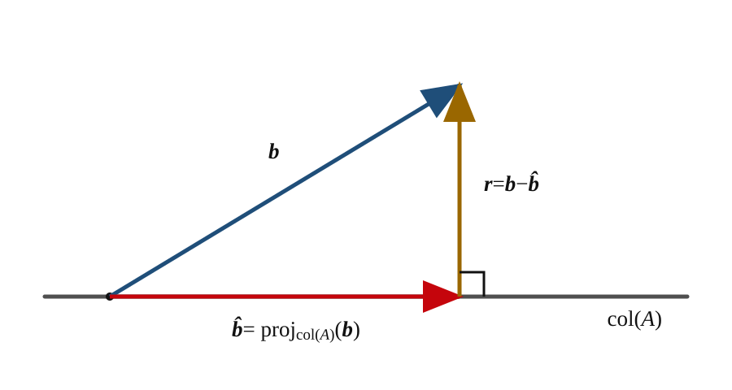
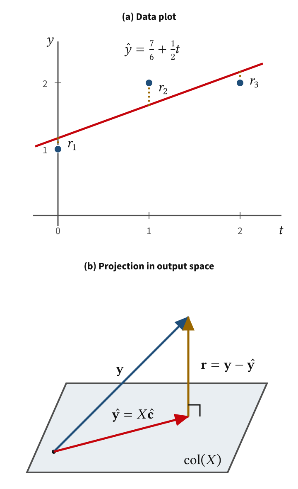

# 4.3 Least Squares as Projection {#43-least-squares-as-projection}

!!! note "译文与来源"

    本页为教材公开源文件 v0.2 的非官方中文翻译（2026 年 11 月 2 日读取），保留原公式、例题、活动、代码和习题；例题、活动等编号按本地小节重排，证明与解答可展开；正文与标题中的数学专有名词保留英文，中文用于解释；术语表保留中英对照以便查阅。原文作者：Jacob Denson、Kaitlyn Phillipson、Sebastien Roch。译文遵循 [CC BY-NC-SA 4.0](https://creativecommons.org/licenses/by-nc-sa/4.0/)。[阅读英文原文](https://math345-textbook.github.io/sec-u4-least-squares-as-projection.html)。


<a id="textbook-body"></a>

## 教材正文 {#_7}

<a id="sec-u4-least-squares-as-projection"></a>


<a id="sec-projection-as-optimization"></a>

[第二章的目标输出活动](2-2.md#u2-act-revisit-target-output-equations) 曾问目标 vector $\mathbf{b}$ 能否表示为 $A\mathbf{x}$。回顾该活动中的 matrix 和目标：

$$
A=
        \begin{bmatrix}
        1& 0\\
        0& 1\\
        1& 1
        \end{bmatrix},
        \qquad
        \mathbf{b}=
        \begin{bmatrix}
        1\\
        2\\
        4
        \end{bmatrix}.
$$

对 

$$
\mathbf{x}=
        \begin{bmatrix}
        x_1\\
        x_2
        \end{bmatrix},
$$

有 

$$
A\mathbf{x}
        =
        \begin{bmatrix}
        x_1\\
        x_2\\
        x_1+x_2
        \end{bmatrix}.
$$

因此每个可达输出的第三个 coordinate 都等于前两个 coordinate 之和。由于 $4\neq 1+2$，目标 $\mathbf{b}$ 不可达。

一般地，当 $\mathbf{b}\notin\operatorname{col}(A)$ 时，没有输入能精确达到目标。 least squares 用最近的可达输出代替这个不可达目标。


<a id="sec-least-squares-projection"></a>

**定义 4.3.1：least-squares solution、 fitted vector 与 residual （Least-squares Solution, Fitted Vector, and Residual）**

设 $A$ 是 $m\times n$  matrix，$\mathbf{b}\in\mathbb{R}^m$。使 

$$
\|A\mathbf{x}-\mathbf{b}\|^2
$$

在所有 $\mathbf{x}\in\mathbb{R}^n$ 中达到最小的 vector $\widehat{\mathbf{x}}\in\mathbb{R}^n$ 称为 least-squares solution。 vector 

$$
\widehat{\mathbf{b}}=A\widehat{\mathbf{x}}
$$

称为 fitted vector， vector 

$$
\mathbf{r}
            =
            \mathbf{b}-\widehat{\mathbf{b}}
            =
            \mathbf{b}-A\widehat{\mathbf{x}}
$$

称为 residual。


$$
\|A\mathbf{x}-\mathbf{b}\|^2
        =
        \sum_{i=1}^m
        \bigl((A\mathbf{x})_i-b_i\bigr)^2
$$

是各 coordinate 误差的平方和，这解释了“least squares”的名称。最小化 norm 或其平方，会得到相同的极小点。若 $\mathbf{b}\in\operatorname{col}(A)$，最小误差为 $0$， least squares 就等同于精确求解 $A\mathbf{x}=\mathbf{b}$。若目标不可达， fitted vector $\widehat{\mathbf{b}}$ 就是最近的可达输出。


<a id="fig-u4-least-squares-projection-residual"></a>

*目标 vector $\mathbf{b}$、它在 $\operatorname{col}(A)$ 中的 fitted vector $\widehat{\mathbf{b}}$，以及垂直 residual $\mathbf{r}$。*



residual 为 

$$
\mathbf{r}
        =
        \mathbf{b}-\widehat{\mathbf{b}}.
$$


[ projection theorem ](4-2.md#thm-6-2projection) 保证存在最近 vector $\widehat{\mathbf{b}}\in\operatorname{col}(A)$。因为 $\widehat{\mathbf{b}}$ 属于 column space，所以至少存在一个 coefficient vector $\widehat{\mathbf{x}}$，满足 

$$
A\widehat{\mathbf{x}}=\widehat{\mathbf{b}}.
$$


因此， least squares fitted vector 是 

$$
\widehat{\mathbf{b}}
        =
        A\widehat{\mathbf{x}}
        =
        \operatorname{proj}_{\operatorname{col}(A)}(\mathbf{b}).
$$

其 residual 

$$
\mathbf{r}
        =
        \mathbf{b}-A\widehat{\mathbf{x}}
$$

  orthogonal 于 $\operatorname{col}(A)$。


<a id="note-col-null-orthogonal-complement"></a>

**事实 4.3.1：用 $A^T$ 检查与 column 的 orthogonality **

写成 

$$
A=
            \begin{bmatrix}
            \mathbf{a}_1&\cdots&\mathbf{a}_n
            \end{bmatrix}.
$$

对任意 vector $\mathbf{r}\in\mathbb{R}^m$，有 

$$
A^T\mathbf{r}
            =
            \begin{bmatrix}
            \mathbf{a}_1^T\mathbf{r}\\
            \vdots\\
            \mathbf{a}_n^T\mathbf{r}
            \end{bmatrix}.
$$

因此 

$$
A^T\mathbf{r}=\mathbf{0}
$$

当且仅当 $\mathbf{r}$ 与 $A$ 的每一个 column orthogonal。等价地，

$$
\operatorname{col}(A)^\perp
            =
            \operatorname{null}(A^T).
$$


<a id="thm-normal-equations-residual-orthogonality"></a>

**定理 4.3.1：least squares 与 normal equations**

vector $\widehat{\mathbf{x}}$ 是 least-squares solution，当且仅当 residual 

$$
\mathbf{r}
            =
            \mathbf{b}-A\widehat{\mathbf{x}}
$$

  orthogonal 于 $\operatorname{col}(A)$。等价地，

$$
A^T
            \bigl(
            \mathbf{b}-A\widehat{\mathbf{x}}
            \bigr)
            =
            \mathbf{0}.
$$

因此， least-squares solution 恰好是 normal equations 

$$
A^TA\widehat{\mathbf{x}}
            =
            A^T\mathbf{b}.
$$

的解。

??? info "证明"

    每个候选 fitted vector $A\mathbf{x}$ 都属于 $\operatorname{col}(A)$。由 [ projection theorem ](4-2.md#thm-6-2projection)，$A\widehat{\mathbf{x}}$ 距离 $\mathbf{b}$ 最近，当且仅当 

    $$
    \mathbf{b}-A\widehat{\mathbf{x}}
                \in
                \operatorname{col}(A)^\perp.
    $$

    根据 [事实 4.3.1](4-3.md#note-col-null-orthogonal-complement)，这等价于 

    $$
    A^T
                \bigl(
                \mathbf{b}-A\widehat{\mathbf{x}}
                \bigr)
                =
                \mathbf{0}.
    $$

    展开整理得到 

    $$
    A^T\mathbf{b}
                -
                A^TA\widehat{\mathbf{x}}
                =
                \mathbf{0},
    $$

    即 

    $$
    A^TA\widehat{\mathbf{x}}
                =
                A^T\mathbf{b}.
    $$

    


<a id="warning-u4-least-squares-uniqueness"></a>

**注意：fitted vector 唯一， coefficient 可能不唯一**

subspace 上的 orthogonal projection 唯一，因此 fitted vector $\widehat{\mathbf{b}}$ 唯一。 coefficient vector $\widehat{\mathbf{x}}$ 却未必唯一：对任意 $\mathbf{z}\in\operatorname{null}(A)$，有 

$$
A
          \bigl(
          \widehat{\mathbf{x}}+\mathbf{z}
          \bigr)
          =
          A\widehat{\mathbf{x}}.
$$

当 $A$ 的 columns 彼此 linearly independent 时，由 [ linear independence 的 matrix 判据](2-4.md#sec-u2-linear-independence-8) 可知 $\operatorname{null}(A)=\{\mathbf{0}\}$，此时 least squares coefficient vector 唯一。


<a id="act-u4-ata-invertible-independent-columns"></a>

**事实 4.3.2：columns 彼此 linearly independent 与 $A^TA$**

设 $A$ 是 $m\times n$  matrix。$A^TA$ 为 [ invertible ](2-5.md#sec-matrix-inverses-2-2)，当且仅当 $A$ 的 columns 彼此 linearly independent。

??? info "证明"

    若 

    $$
    A^TA\mathbf{x}=\mathbf{0},
    $$

    则 

    $$
    0
                =
                \mathbf{x}^TA^TA\mathbf{x}
                =
                \|A\mathbf{x}\|^2.
    $$

    因此 $A\mathbf{x}=\mathbf{0}$。如果 $A$ 的 columns 彼此 linearly independent，则 

    $$
    \operatorname{null}(A)=\{\mathbf{0}\},
    $$

    所以 $\mathbf{x}=\mathbf{0}$。于是 $\operatorname{null}(A^TA)=\{\mathbf{0}\}$， square matrix $A^TA$  invertible。

    反过来，假设 $A^TA$  invertible，且 

    $$
    A\mathbf{x}=\mathbf{0}.
    $$

    乘以 $A^T$ 得 

    $$
    A^TA\mathbf{x}=\mathbf{0}.
    $$

    由于 $A^TA$  invertible，$\mathbf{x}=\mathbf{0}$。因此 

    $$
    \operatorname{null}(A)=\{\mathbf{0}\},
    $$

    所以 $A$ 的 columns 彼此 linearly independent。


<a id="act-u4-unit2-target-revisited"></a>

**例题 4.3.1：重访第二章的目标 vector （U4-LO4，U4-LO5）**

设 

$$
A=
            \begin{bmatrix}
            1& 0\\
            0& 1\\
            1& 1
            \end{bmatrix},
            \qquad
            \mathbf{b}=
            \begin{bmatrix}
            1\\
            2\\
            4
            \end{bmatrix}.
$$


1. 回顾为什么 $A\mathbf{x}=\mathbf{b}$ 没有精确解。

2. 构造 $A^TA$ 和 $A^T\mathbf{b}$。

3. 解 normal equations，求 $\widehat{\mathbf{x}}$。

4. 计算 fitted vector 

$$
\widehat{\mathbf{b}}
                =
                A\widehat{\mathbf{x}}
$$

与 residual 

$$
\mathbf{r}
                =
                \mathbf{b}-\widehat{\mathbf{b}}.
$$


5. 检查 

$$
A^T\mathbf{r}=\mathbf{0}.
$$


6. 计算 $\|\mathbf{r}\|^2$。

7. 哪个是最近的可达输出：$\widehat{\mathbf{x}}$ 还是 $\widehat{\mathbf{b}}$？

8. residual 非零，为什么不意味着 least squares 失败？


??? success "解答"

    对 

    $$
    \mathbf{x}
                =
                \begin{bmatrix}
                x_1\\
                x_2
                \end{bmatrix},
    $$

     有 

    $$
    A\mathbf{x}
                =
                \begin{bmatrix}
                x_1\\
                x_2\\
                x_1+x_2
                \end{bmatrix}.
    $$

    $A\mathbf{x}=\mathbf{b}$ 的前两个 coordinate 要求 $x_1=1$、$x_2=2$，但这样第三个 coordinate 为 $3$，而非 $4$。因此目标无法精确达到。

     normal equations 使用 

    $$
    A^TA
                =
                \begin{bmatrix}
                2& 1\\
                1& 2
                \end{bmatrix},
                \qquad
                A^T\mathbf{b}
                =
                \begin{bmatrix}
                5\\
                6
                \end{bmatrix}.
    $$

    

    为求解 

    $$
    \begin{bmatrix}
                2& 1\\
                1& 2
                \end{bmatrix}
                \widehat{\mathbf{x}}
                =
                \begin{bmatrix}
                5\\
                6
                \end{bmatrix},
    $$

    回顾 [二阶 matrix 的 determinant 与求逆公式](2-5.md#thm-2-5-determinant-of-two-by-two) 中的 $2\times 2$  matrix 求逆公式：

    $$
    \begin{bmatrix}a& b\\c& d\end{bmatrix}^{-1}
                =
                \frac{1}{ad-bc}
                \begin{bmatrix}d& -b\\-c& a\end{bmatrix},
                \qquad ad-bc\neq 0.
    $$

    这里 $2\cdot 2-1\cdot 1=3\neq 0$，所以 

    $$
    (A^TA)^{-1}
                =
                \frac{1}{2\cdot 2-1\cdot 1}
                \begin{bmatrix}2& -1\\-1& 2\end{bmatrix}
                =
                \frac{1}{3}
                \begin{bmatrix}2& -1\\-1& 2\end{bmatrix}.
    $$

    将 normal equations 两边乘以此 inverse matrix，得 

    $$
    \begin{aligned}
    \widehat{\mathbf{x}}
                  &=(A^TA)^{-1}A^T\mathbf{b}
                  =\frac{1}{3}
                  \begin{bmatrix}2& -1\\-1& 2\end{bmatrix}
                  \begin{bmatrix}5\\6\end{bmatrix} \\
    &=\frac{1}{3}
                  \begin{bmatrix}2\cdot 5-6\\-5+2\cdot 6\end{bmatrix}
                  =\frac{1}{3}\begin{bmatrix}4\\7\end{bmatrix}
                  =\begin{bmatrix}4/3\\7/3\end{bmatrix}.
    \end{aligned}
    $$

    

     fitted vector 为 

    $$
    \widehat{\mathbf{b}}
                =
                A\widehat{\mathbf{x}}
                =
                \begin{bmatrix}
                4/3\\
                7/3\\
                11/3
                \end{bmatrix},
    $$

    residual 为 

    $$
    \mathbf{r}
                =
                \mathbf{b}-\widehat{\mathbf{b}}
                =
                \begin{bmatrix}
                -1/3\\
                -1/3\\
                1/3
                \end{bmatrix}.
    $$

    

     orthogonality 检查得到 

    $$
    A^T\mathbf{r}
                =
                \begin{bmatrix}
                1& 0& 1\\
                0& 1& 1
                \end{bmatrix}
                \begin{bmatrix}
                -1/3\\
                -1/3\\
                1/3
                \end{bmatrix}
                =
                \begin{bmatrix}
                0\\
                0
                \end{bmatrix}.
    $$

    

    另外，

    $$
    \|\mathbf{r}\|^2
                =
                \frac{1}{9}
                +
                \frac{1}{9}
                +
                \frac{1}{9}
                =
                \frac{1}{3}.
    $$

    

     coefficient vector 为 $\widehat{\mathbf{x}}$，最近的可达输出是 fitted vector 

    $$
    \widehat{\mathbf{b}}
                =
                A\widehat{\mathbf{x}}.
    $$

    

     residual 非零是因为原目标不可达。 least squares 没有失败：它找到了距离 $\mathbf{b}$ 最近的可达输出，且 residual orthogonal 于 column space。


<a id="act-u4-least-squares-orthogonality-practice"></a>

**活动 4.3.1：least squares 与 residual orthogonality （U4-LO4，U4-LO5）**

设 

$$
A=\begin{bmatrix}1& 0\\0& 1\\1& 2\end{bmatrix},
            \qquad
            \mathbf{b}=\begin{bmatrix}1\\2\\2\end{bmatrix}.
$$


1. 通过求解 normal equations，求 least-squares solution $\widehat{\mathbf{x}}$。

2. 计算 residual $\mathbf{r}=\mathbf{b}-A\widehat{\mathbf{x}}$，检查它是否与 $A$ 的每个 column orthogonal。


??? success "解答"

    计算得 

    $$
    A^TA=\begin{bmatrix}2& 2\\2& 5\end{bmatrix},
                \qquad
                A^T\mathbf{b}=\begin{bmatrix}3\\6\end{bmatrix}.
    $$

    因此 normal equations 为 

    $$
    \begin{bmatrix}2& 2\\2& 5\end{bmatrix}
                \widehat{\mathbf{x}}=\begin{bmatrix}3\\6\end{bmatrix}.
    $$

    因为 $2\cdot 5-2\cdot 2=6\neq 0$，由 [二阶 matrix 的 determinant 与求逆公式](2-5.md#thm-2-5-determinant-of-two-by-two) 中的求逆公式得到 

    $$
    (A^TA)^{-1}=\frac{1}{6}\begin{bmatrix}5& -2\\-2& 2\end{bmatrix}.
    $$

    所以 

    $$
    \begin{aligned}
    \widehat{\mathbf{x}}
                  &=(A^TA)^{-1}A^T\mathbf{b}
                  =\frac{1}{6}\begin{bmatrix}5& -2\\-2& 2\end{bmatrix}
                  \begin{bmatrix}3\\6\end{bmatrix} \\
    &=\frac{1}{6}\begin{bmatrix}5\cdot 3-2\cdot 6\\-2\cdot 3+2\cdot 6\end{bmatrix}
                  =\frac{1}{6}\begin{bmatrix}3\\6\end{bmatrix}
                  =\begin{bmatrix}1/2\\1\end{bmatrix}.
    \end{aligned}
    $$

    

     residual 为 

    $$
    \mathbf{r}=\mathbf{b}-A\widehat{\mathbf{x}}
                =\begin{bmatrix}1\\2\\2\end{bmatrix}
                -\begin{bmatrix}1/2\\1\\5/2\end{bmatrix}
                =\begin{bmatrix}1/2\\1\\-1/2\end{bmatrix}.
    $$

    检查 orthogonality，计算 

    $$
    \begin{aligned}
    A^T\mathbf{r}
                  &=\begin{bmatrix}1& 0& 1\\0& 1& 2\end{bmatrix}
                  \begin{bmatrix}1/2\\1\\-1/2\end{bmatrix} \\
    &=\begin{bmatrix}1/2-1/2\\1-1\end{bmatrix}
                  =\begin{bmatrix}0\\0\end{bmatrix}.
    \end{aligned}
    $$

    根据 [事实 4.3.1](4-3.md#note-col-null-orthogonal-complement)， residual 与 $A$ 的每个 column orthogonal。


<a id="act-u4-least-squares-three-unknowns"></a>

**活动 4.3.2：三个未知数的 least squares （U4-LO4，U4-LO5）**

设 

$$
A=\begin{bmatrix}
            1& 0& 0\\
            0& 1& 0\\
            0& 0& 1\\
            1& 1& 1
            \end{bmatrix},
            \qquad
            \mathbf{b}=\begin{bmatrix}1\\2\\3\\4\end{bmatrix}.
$$


求 least-squares solution $\widehat{\mathbf{x}}$。

??? success "解答"

     normal equations 使用 

    $$
    A^TA=\begin{bmatrix}2& 1& 1\\1& 2& 1\\1& 1& 2\end{bmatrix},
                \qquad
                A^T\mathbf{b}=\begin{bmatrix}5\\6\\7\end{bmatrix}.
    $$

    对 augmented matrix 

    $$
    \left[\begin{array}{ccc|c}
                2& 1& 1& 5\\
                1& 2& 1& 6\\
                1& 1& 2& 7
                \end{array}\right].
    $$

     进行 [Gaussian elimination](2-2.md#alg-gaussian-elimination)

    用 $R_1\to\frac12 R_1$ 将第一个 pivot 化为 1：

    $$
    \left[\begin{array}{ccc|c}
                1& 1/2& 1/2& 5/2\\
                1& 2& 1& 6\\
                1& 1& 2& 7
                \end{array}\right].
    $$

    用 $R_2\to R_2-R_1$、$R_3\to R_3-R_1$ 消去下方元素：

    $$
    \left[\begin{array}{ccc|c}
                1& 1/2& 1/2& 5/2\\
                0& 3/2& 1/2& 7/2\\
                0& 1/2& 3/2& 9/2
                \end{array}\right].
    $$

    

    用 $R_2\to\frac23 R_2$ 将第二个 pivot 化为 1：

    $$
    \left[\begin{array}{ccc|c}
                1& 1/2& 1/2& 5/2\\
                0& 1& 1/3& 7/3\\
                0& 1/2& 3/2& 9/2
                \end{array}\right].
    $$

    用 $R_3\to R_3-\frac12 R_2$ 消去下方元素：

    $$
    \left[\begin{array}{ccc|c}
                1& 1/2& 1/2& 5/2\\
                0& 1& 1/3& 7/3\\
                0& 0& 4/3& 10/3
                \end{array}\right].
    $$

    最后，用 $R_3\to\frac34 R_3$ 将第三个 pivot 化为 1：

    $$
    \left[\begin{array}{ccc|c}
                1& 1/2& 1/2& 5/2\\
                0& 1& 1/3& 7/3\\
                0& 0& 1& 5/2
                \end{array}\right].
    $$

    这已是 row echelon form， coefficient matrix 每个 column 都有 pivot。

     back-substitution 得到 

    $$
    \begin{aligned}
    \widehat{x}_3&=\frac52, \\
    \widehat{x}_2&=\frac73-\frac13\widehat{x}_3
                  =\frac73-\frac56=\frac32, \\
    \widehat{x}_1&=\frac52-\frac12\widehat{x}_2-\frac12\widehat{x}_3
                  =\frac52-\frac34-\frac54=\frac12.
    \end{aligned}
    $$

    所以 least-squares solution 为 

    $$
    \widehat{\mathbf{x}}=\begin{bmatrix}1/2\\3/2\\5/2\end{bmatrix}.
    $$

    


<a id="ex-regression-three-points"></a>

## Linear Regression {#linear-regression}

least squares 的重要实际应用是 linear regression：对观测数据拟合 linear 模型，以描述关系并作预测。设数据点为 

$$
(t_1,y_1),\ldots,(t_m,y_m).
$$


直线模型的预测为 

$$
\widehat y=c_0+c_1t.
$$


coefficient $c_0$ 是 intercept，$c_1$ 是 slope。在输入 $t_i$ 处，预测值为 

$$
\widehat y_i=c_0+c_1t_i.
$$


第 $i$ 个数据点的 residual 为 

$$
r_i=y_i-\widehat y_i.
$$


linear regression 选择 $c_0$、$c_1$，使 

$$
r_1^2+\cdots+r_m^2
$$

尽可能小。

linear regression 与 [重访第二章的目标 vector （U4-LO4，U4-LO5）](4-3.md#act-u4-unit2-target-revisited) 是同一种“最近可达输出”问题，只是现在 matrix 的各 column 代表模型特征。


<a id="act-u4-line-model-as-matrix"></a>

**例题 4.3.2：将直线模型写成 matrix product （U4-LO4）**

考虑数据点 

$$
(0,1),\qquad(1,2),\qquad(2,2),
$$

与直线模型 

$$
\widehat y=c_0+c_1t.
$$


1. 用 $c_0$、$c_1$ 写出三个预测值。

2. 定义 

$$
\mathbf{c}
                =
                \begin{bmatrix}
                c_0\\
                c_1
                \end{bmatrix},
                \qquad
                \mathbf{y}
                =
                \begin{bmatrix}
                1\\
                2\\
                2
                \end{bmatrix}.
$$

构造 matrix $X$，使 $X\mathbf{c}$ 是预测 value vector。

3. $X$ 的第一个 column 代表什么？

4. $X$ 的第二个 column 代表什么？

5. 写出 residual vector 

$$
\mathbf{r}
                =
                \mathbf{y}-X\mathbf{c}.
$$


6. 解释为什么 

$$
\|\mathbf{r}\|^2
                =
                \sum_{i=1}^3
                (y_i-\widehat y_i)^2
$$

是数据图中竖直误差的平方和。


??? success "解答"

    三个预测值为 

    $$
    \widehat y_1=c_0,
                \qquad
                \widehat y_2=c_0+c_1,
                \qquad
                \widehat y_3=c_0+2c_1.
    $$

    

    因此 

    $$
    X
                =
                \begin{bmatrix}
                1&0\\
                1&1\\
                1&2
                \end{bmatrix},
    $$

    因为 

    $$
    X\mathbf{c}
                =
                \begin{bmatrix}
                1&0\\
                1&1\\
                1&2
                \end{bmatrix}
                \begin{bmatrix}
                c_0\\
                c_1
                \end{bmatrix}
                =
                \begin{bmatrix}
                c_0\\
                c_0+c_1\\
                c_0+2c_1
                \end{bmatrix}.
    $$

    

    第一个 column 是常数特征：它记录 intercept $c_0$ 的 coefficient。第二个 column 是 $t$ 特征：它记录输入值 $0,1,2$。

     residual vector 为 

    $$
    \mathbf{r}
                =
                \mathbf{y}-X\mathbf{c}
                =
                \begin{bmatrix}
                1-c_0\\
                2-(c_0+c_1)\\
                2-(c_0+2c_1)
                \end{bmatrix}.
    $$

    

    其 norm 平方为 

    $$
    \begin{aligned}
    \|\mathbf{r}\|^2&=(1-c_0)^2+\bigl(2-(c_0+c_1)\bigr)^2 \\
    &\quad+\bigl(2-(c_0+2c_1)\bigr)^2.
    \end{aligned}
    $$

    

    每个 component 都是同一输入处的观测输出减去预测输出，因此是数据图中的竖直误差。

数据点、拟合直线与竖直 residual 见 [图 4.3.2](4-3.md#fig-u4-regression-two-views)。

对一般数据 $(t_i,y_i)$，定义 design matrix 

$$
X
        =
        \begin{bmatrix}
        1& t_1\\
        \vdots&\vdots\\
        1& t_m
        \end{bmatrix},
        \qquad
        \mathbf{c}
        =
        \begin{bmatrix}
        c_0\\
        c_1
        \end{bmatrix},
        \qquad
        \mathbf{y}
        =
        \begin{bmatrix}
        y_1\\
        \vdots\\
        y_m
        \end{bmatrix}.
$$


则 $X\mathbf{c}$ 为预测 value vector。 linear regression 就是 least squares 问题 

$$
\min_{\mathbf{c}}
        \|X\mathbf{c}-\mathbf{y}\|^2.
$$


matrix $X$ 称为 design matrix，每一个 column 代表模型使用的一个特征。

**注意：两幅不同的几何图景**

projection 发生在 $\mathbb{R}^m$ 中：

$$
\widehat{\mathbf{y}}
          =
          X\widehat{\mathbf{c}}
          =
          \operatorname{proj}_{\operatorname{col}(X)}(\mathbf{y}).
$$


在通常的 $t$–$y$ 数据图中， residual 是竖直差值 

$$
r_i=y_i-\widehat y_i.
$$

一般不是图上数据点到拟合直线的垂直距离。


<a id="act-u4-fit-line-three-points"></a>

**活动 4.3.3：为三个数据点拟合直线（U4-LO4，U4-LO5）**

继续使用 [将直线模型写成 matrix product （U4-LO4）](4-3.md#act-u4-line-model-as-matrix) 中的 design matrix 与数据 vector。回顾数据点 

$$
(0,1),\qquad(1,2),\qquad(2,2).
$$


1. 利用 [ least squares 与 normal equations ](4-3.md#thm-normal-equations-residual-orthogonality) 构造 

$$
X^TX\widehat{\mathbf{c}}
                =
                X^T\mathbf{y}.
$$


2. 求解 

$$
\widehat{\mathbf{c}}
                =
                \begin{bmatrix}
                \widehat c_0\\
                \widehat c_1
                \end{bmatrix}.
$$


3. 写出拟合直线。

4. 计算拟合 value vector 

$$
\widehat{\mathbf{y}}
                =
                X\widehat{\mathbf{c}}
$$

与 residual vector 

$$
\mathbf{r}
                =
                \mathbf{y}-\widehat{\mathbf{y}}.
$$


5. 检查 

$$
X^T\mathbf{r}
                =
                \mathbf{0}.
$$


6. 写出 $X^T\mathbf{r}=\mathbf{0}$ 包含的两个 scalar 方程。

7. 计算 

$$
\|\mathbf{r}\|^2.
$$


8. 哪个对象是 fitted vector：$\widehat{\mathbf{c}}$ 还是 $\widehat{\mathbf{y}}$？

9. 在 $t$–$y$ 图中， residual 线段是竖直的，还是垂直于拟合直线的？


??? success "解答"

    有 

    $$
    X^TX
                =
                \begin{bmatrix}
                3&3\\
                3&5
                \end{bmatrix},
                \qquad
                X^T\mathbf{y}
                =
                \begin{bmatrix}
                5\\
                6
                \end{bmatrix}.
    $$

    

    因此 normal equations 为 

    $$
    \begin{bmatrix}
                3&3\\
                3&5
                \end{bmatrix}
                \widehat{\mathbf{c}}
                =
                \begin{bmatrix}
                5\\
                6
                \end{bmatrix}.
    $$

    

    回顾 [二阶 matrix 的 determinant 与求逆公式](2-5.md#thm-2-5-determinant-of-two-by-two) 中的 $2\times 2$  matrix 求逆公式：

    $$
    \begin{bmatrix}a& b\\c& d\end{bmatrix}^{-1}
                =
                \frac{1}{ad-bc}
                \begin{bmatrix}d& -b\\-c& a\end{bmatrix},
                \qquad ad-bc\neq 0.
    $$

    这里 $3\cdot 5-3\cdot 3=6\neq 0$，所以 

    $$
    (X^TX)^{-1}
                =\frac{1}{3\cdot 5-3\cdot 3}
                \begin{bmatrix}5& -3\\-3& 3\end{bmatrix}
                =\frac{1}{6}
                \begin{bmatrix}5& -3\\-3& 3\end{bmatrix}.
    $$

    将 normal equations 两边乘以此 inverse matrix，得 

    $$
    \begin{aligned}
    \widehat{\mathbf{c}}
                  &=(X^TX)^{-1}X^T\mathbf{y}
                  =\frac{1}{6}
                  \begin{bmatrix}5& -3\\-3& 3\end{bmatrix}
                  \begin{bmatrix}5\\6\end{bmatrix} \\
    &=\frac{1}{6}
                  \begin{bmatrix}5\cdot 5-3\cdot 6\\-3\cdot 5+3\cdot 6\end{bmatrix}
                  =\frac{1}{6}\begin{bmatrix}7\\3\end{bmatrix}
                  =\begin{bmatrix}7/6\\1/2\end{bmatrix}.
    \end{aligned}
    $$

    

    拟合直线为 

    $$
    \widehat y
                =
                \frac{7}{6}
                +
                \frac{1}{2}t.
    $$

    

    拟合 value vector 为 

    $$
    \widehat{\mathbf{y}}
                =
                X\widehat{\mathbf{c}}
                =
                \begin{bmatrix}
                7/6\\
                5/3\\
                13/6
                \end{bmatrix},
    $$

    residual vector 为 

    $$
    \mathbf{r}
                =
                \mathbf{y}-\widehat{\mathbf{y}}
                =
                \begin{bmatrix}
                -1/6\\
                1/3\\
                -1/6
                \end{bmatrix}.
    $$

    

     residual orthogonality 检查为 

    $$
    X^T\mathbf{r}
                =
                \begin{bmatrix}
                1&1&1\\
                0&1&2
                \end{bmatrix}
                \begin{bmatrix}
                -1/6\\
                1/3\\
                -1/6
                \end{bmatrix}
                =
                \begin{bmatrix}
                0\\
                0
                \end{bmatrix}.
    $$

    

    两个 scalar 方程为 

    $$
    r_1+r_2+r_3=0
    $$

     与 

    $$
    0r_1+1r_2+2r_3=0.
    $$

    

    第一个方程表示 residual 之和为零，第二个表示以输入值为权重的 residual 加权和为零。

     residual norm 平方为 

    $$
    \|\mathbf{r}\|^2
                =
                \frac{1}{36}
                +
                \frac{1}{9}
                +
                \frac{1}{36}
                =
                \frac{1}{6}.
    $$

    

     coefficient vector 为 $\widehat{\mathbf{c}}$， fitted vector 为 

    $$
    \widehat{\mathbf{y}}
                =
                X\widehat{\mathbf{c}}.
    $$

    

    数据图中的 residual 线段是竖直的，一般不垂直于拟合直线。


<a id="fig-u4-regression-two-views"></a>

*同一直线拟合的两种视角：(a) 数据图中的 residual 是竖直差值 $r_i=y_i-\widehat y_i$；(b) 在 $\mathbb{R}^3$ 中， fitted vector $\widehat{\mathbf{y}}=X\widehat{\mathbf{c}}$ 是 $\mathbf{y}$ 在 $\operatorname{col}(X)$ 上的 projection，且 $\mathbf{r}\perp\operatorname{col}(X)$。*



[图 4.3.2](4-3.md#fig-u4-regression-two-views) 的两个面板展示不同空间：上图 (a) 是 $t$–$y$ 数据图，下图 (b) 是输出空间 $\mathbb{R}^3$。


<a id="sec-u4-apps-computation"></a>

**活动 4.3.4：阅读回归代码（U4-LO4，U4-LO7）**


<a id="sec-u4-code-residual"></a>

以下代码重复 [为三个数据点拟合直线（U4-LO4，U4-LO5）](4-3.md#act-u4-fit-line-three-points) 的直线拟合。表达式 `np.ones_like(t)` 创建一个形状和数据类型都与 `t` 相同的全 1 数组。对下面的数组 `t`，它产生 `array([1., 1., 1.])`。调用 `np.column_stack([np.ones_like(t), t])` 将这两个数组作为 design matrix 的 column：第一列为 1，第二个 column 包含 `t` 的输入值。因此 

$$
X
          =
          \begin{bmatrix}
          1&0\\
          1&1\\
          1&2
          \end{bmatrix}.
$$

NumPy function `np.linalg.lstsq(X, y, rcond=None)` 返回一个元组，包含 least squares coefficient vector、 residual 平方和数组、$X$ 的 rank，以及奇异值（将在 [第五章](5-index.md#u5-optimization-training) 讨论）。使用 `[0]` 取出第一项，即 coefficient vector。参数 `rcond` 控制判断 matrix rank 的相对数值阈值；`rcond=None` 使用 NumPy 的默认阈值。


```python
import numpy as np

t = np.array([0.0, 1.0, 2.0])
y = np.array([1.0, 2.0, 2.0])

X = np.column_stack([np.ones_like(t), t])

c = np.linalg.lstsq(X, y, rcond=None)[0]
yhat = X @ c
r = y - yhat

X, c, yhat, r, X.T @ r, np.linalg.norm(r)**2
```


1. `X` 的形状是什么？

2. 为什么 `c` 有两个 component ？

3. `yhat` 和 `r` 分别保存什么数学对象？

4. 为什么 residual 检查应使用 `X.T @ r`，而不是 `X @ r`？

5. `X.T @ r` 应接近什么？

6. residual vector 非零是否说明代码失败？

7. `np.linalg.norm(r)**2` 计算什么量？


??? success "解答"

     matrix `X` 的形状为 `(3, 2)`。

     vector `c` 有两个 component，因为 design matrix 有两个 columns：一个 column 是常数特征，另一个 column 是 $t$ 特征。

    变量 `yhat` 保存 fitted vector 

    $$
    \widehat{\mathbf{y}}
              =
              X\widehat{\mathbf{c}},
    $$

    `r` 保存 residual vector 

    $$
    \mathbf{r}
              =
              \mathbf{y}-\widehat{\mathbf{y}}.
    $$

    

    乘积 `X.T @ r` 计算 residual 与 $X$ 各 column 的 dot product，检查 residual 是否 orthogonal 于 column space。`X @ r` 不是正确操作，而且本例中形状不兼容。

    输出 `X.T @ r` 应接近


    ```python
    array([0., 0.])
    ```

    允许存在 roundoff error。

    非零 residual 不代表代码失败。数据 vector 不完全属于 column space，所以最近拟合具有非零 residual。

    最后，


    ```python
    np.linalg.norm(r)**2
    ```

    计算 residual 平方和，其值在 roundoff error 范围内为 

    $$
    \frac{1}{6}
    $$

    <!-- punctuation omitted -->
通过 [Residual Squares 小游戏](https://math345-games.github.io/ResidualSquares/) 交互探索 least squares。


---

[← 上一节](4-2.md) · [第四章目录](4-index.md) · [下一节 →](4-4.md)
