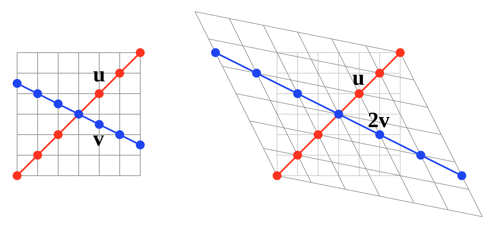

# 5.1 eigenvalues、eigenvectors 与 diagonalization

!!! note "译文与来源"

    本页依据 2026 年 11 月 3 日读取的官方 v0.2 源文件制作。数学术语保留英文；原书公式、代码、例题、活动、证明与解答保留。译稿使用机器辅助翻译并进行数学与排版检查，未经原作者审定。原作者：Jacob Denson、Kaitlyn Phillipson、Sebastien Roch。除原书另有注明外，遵循 [CC BY-NC-SA 4.0](https://creativecommons.org/licenses/by-nc-sa/4.0/)。 [阅读英文原文](https://math345-textbook.github.io/sec-eigenvalues-eigenvectors-diagonalization.html)。

设 $A$ 是一个  square matrix 。所谓  eigenvector ，就是一个  nonzero vector ：它经过 $A$ 变换后，仍留在原来那条直线上。$A$ 可以拉伸  vector 、使其反向，或将其压缩为零，却不会把  vector  转到这条直线以外的方向。 Eigenvectors  是理解  matrix  作用的通用工具，并不局限于某一种应用。

## 基本定义

**定义 5.1.1**

设 $A$ 是一个 $n \times n$ 的  matrix 。若 $\mathbf{v}$ 是 $\mathbb{R}^n$ 中的  nonzero vector ，且存在  scalar  $\lambda$（可以等于 $0$）使得：

$$
A \mathbf{v} = \lambda \mathbf{v}
$$

那么称 $\lambda$ 为 $A$ 的  eigenvalue ，称 $\mathbf{v}$ 为 $A$ 对应于  eigenvalue  $\lambda$ 的  eigenvector 。

**活动 5.1.1：检查  eigenvectors  及其  eigenvalues  (U5-LO1)**

检查 matrix 

$$
A= \begin{bmatrix} 3 & -1\\ 6 & -4 \end{bmatrix}
$$

的

$$
\mathbf{v}_1=\begin{bmatrix} 1 \\ 1 \end{bmatrix}\quad\text{and}\quad \mathbf{v}_2=\begin{bmatrix} 1 \\ 6 \end{bmatrix}
$$

是否为 eigenvectors ，并找到对应的 eigenvalues 。

??? success "解答"

    我们将$\mathbf{v}_1$代入 matrix $A$，并计算出

    $$
    \begin{aligned}
    A\mathbf{v}_1 & = \begin{bmatrix} 3 & -1 \\ 6 & -4 \end{bmatrix}\begin{bmatrix} 1 \\ 1 \end{bmatrix} \\
    & = \begin{bmatrix} 3(1) + (-1)(1) \\ 6(1) + (-4)(1) \end{bmatrix} \\
    & = \begin{bmatrix} 2 \\ 2 \end{bmatrix} \\
    & = 2\begin{bmatrix} 1 \\ 1 \end{bmatrix} = 2\mathbf{v}_1
    \end{aligned}
    $$

    由于$A\mathbf{v}_1 = 2 \mathbf{v}_1$， vector $\mathbf{v}_1$是与 eigenvalue $2$关联的$A$的 eigenvector 。

    接下来，我们插入$\mathbf{v}_2$，并检查

    $$
    \begin{aligned}
    A\mathbf{v}_2 & = \begin{bmatrix} 3 & -1 \\ 6 & -4 \end{bmatrix}\begin{bmatrix} 1 \\ 6 \end{bmatrix} \\
    & = \begin{bmatrix} 3(1) + (-1)(6) \\ 6(1) + (-4)(6) \end{bmatrix} \\
    & = \begin{bmatrix} -3 \\ -18 \end{bmatrix} \\
    & = -3\begin{bmatrix} 1 \\ 6 \end{bmatrix} = -3\mathbf{v}_2
    \end{aligned}
    $$

    由于 $A\mathbf{v}_2 = -3 \mathbf{v}_2$，$\mathbf{v}_2$ 是与  eigenvalue  $-3$ 关联的 $A$ 的  eigenvector 。

**活动 5.1.2：寻找  eigenvalues  和  eigenvectors  (U5-LO1)**

设

$$
A=\begin{bmatrix} 3 & 0 \\ -1 & -4 \end{bmatrix}
$$

为 matrix 。求 $A$ 的  eigenvalues  和  eigenvectors 。

??? success "解答"

    我们需要求解方程 $A\mathbf{v} = \lambda \mathbf{v}$，其中 $\lambda$ 和 $\mathbf{v} \neq 0$ 都是未知的。

    该方程等价于方程$(\lambda I - A) \mathbf{v} = \mathbf{0}$。对于每个$\lambda$，为了使该方程有非平凡解$\mathbf{v}$， matrix $\lambda I - A$必须是 singular ，即$\det(\lambda I - A) = 0$。这使我们能够暂时从问题中消除$\mathbf{v}$，确定具有解决方案$\mathbf{v}$的$\lambda$值。

    我们计算出

    $$
    \begin{aligned}
    \det(\lambda I - A) & = \det\begin{bmatrix} \lambda - 3 & 0 \\ 1 & 4 + \lambda \end{bmatrix} \\
    & = (\lambda - 3)(\lambda + 4)
    \end{aligned}
    $$

    因此当$(\lambda - 3)(\lambda + 4) = 0$时，即$\lambda = 3$或$\lambda = -4$时，$\det(\lambda I - A) = 0$精确成立，因此这两个值是$A$的两个 eigenvalues 。剩下的工作就是找到每个  eigenvalues  的  eigenvectors 。

    现在我们找到了方程 $(A - \lambda I) \mathbf{v} = \mathbf{0}$ 对于 $\lambda = 3$ 和 $\lambda = -4$ 的非平凡解。其中每一个都是可以解决的 linear system ，可以使用[ linear map  的解剖](2-index.md#u2-anatomy-linear-map)的方法，或者更多的临时方法，这可能会更快，因为我们正在处理的 matrices 很小。

    对于$\lambda = 3$，我们计算

    $$
    A - 3I = \begin{bmatrix} 0 & 0 \\ -1 & -7 \end{bmatrix}
    $$

    因此，$(A - 3I) \mathbf{v} = 0$的解由$-v_1 - 7v_2 = 0$或$v_1 = -7v_2$给出。因此，该方程的解由  basic solution  

    $$
    \begin{bmatrix} -7 \\ 1 \end{bmatrix}
    $$

     的非零倍数给出。这些都是 $A$ 的  eigenvectors  和  eigenvalue  $3$。

    对于$\lambda = -4$，我们计算

    $$
    A + 4 I = \begin{bmatrix} 7 & 0 \\ -1 & 0 \end{bmatrix}
    $$

    因此，$(A + 4I) \mathbf{v} = 0$的解是 vectors $\mathbf{v}$，使得$v_1 = 0$，因此$A$和 eigenvalue $-4$的 eigenvectors 由 basic solution 

    $$
    \begin{bmatrix} 0 \\ 1 \end{bmatrix}
    $$

    的非零倍数给出。

    总而言之， matrix $A$中的两个 eigenvalues 是$\lambda = 3$和$\lambda = -4$。与 eigenvalue  $\lambda = 3$关联的$A$的所有 eigenvectors 的集合由表达式

    $$
    \left\{ \begin{bmatrix} -7t \\ t \end{bmatrix} : t \neq 0 \right\}
    $$

    给出，与 eigenvalue $\lambda = -4$关联的$A$的 eigenvectors 的集合由

    $$
    \left\{ \begin{bmatrix} 0 \\ t \end{bmatrix} : t \neq 0 \right\}
    $$

    给出。

**定义 5.1.2**

设 $A = [a_{ij}]$ 是一个 $n \times n$ 的  matrix 。表达式：

$$
\det(\lambda I_n-A) = \det\begin{bmatrix}
            \lambda- a_{11} & -a_{12} & \cdots & -a_{1n} \\
            -a_{21} & \lambda-a_{22} & \cdots & -a_{2n} \\
            \vdots & \vdots & \ddots & \vdots \\
            -a_{n1} & -a_{n2} & \cdots & \lambda-a_{nn}
            \end{bmatrix}
$$

称为 $A$ 的  characteristic polynomial ，也记为 $c_A(\lambda)$。方程：

$$
\det \left( \lambda I_n- A \right)=0
$$

称为 $A$ 的  characteristic equation 。

**注**

一些作者将characteristic polynomial定义为$\det(A - \lambda I_n)$而不是$\det(\lambda I_n - A)$。

**定理 5.1.1**

设 $A$ 是一个 $n \times n$ 的  matrix 。$A$ 的  eigenvalues  就是 $A$ 的 characteristic polynomial 的所有根。

回顾一下：若某个数 $r$ 满足 $p(r)=0$，就称它为 polynomial $p$ 的 root。

**活动 5.1.3：计算characteristic polynomial (U5-LO1)**

如果

$$
A = \begin{bmatrix} 1 & 2 & -1 \\ 1 & 0 & 1 \\ 4 & -4 & 5 \end{bmatrix}
$$

求$A$的characteristic polynomial。

??? success "解答"

    我们计算出

    $$
    \begin{aligned}
    \lambda I_3 - A& = \begin{bmatrix} \lambda-1 & -2 & 1 \\ -1 & \lambda-0 & -1 \\ -4 & 4 & \lambda-5 \end{bmatrix} \\
    & = \begin{bmatrix} \lambda-1 & -2 & 1 \\ -1 & \lambda & -1 \\ -4 & 4 & \lambda-5 \end{bmatrix}
    \end{aligned}
    $$

    characteristic polynomial因此为

    $$
    \begin{aligned}
    \det(\lambda I_3 - A) & = \det\begin{bmatrix} \lambda-1 & -2 & 1 \\ -1 & \lambda & -1 \\ -4 & 4 & \lambda-5 \end{bmatrix} \\
    & = (\lambda-1)\det\begin{bmatrix} \lambda & -1 \\ 4 & \lambda-5 \end{bmatrix} \\
    &\quad\quad - (-2)\det\begin{bmatrix} -1 & -1 \\ -4 & \lambda-5 \end{bmatrix} \\
    &\quad\quad + (1)\det\begin{bmatrix} -1 & \lambda \\ -4 & 4 \end{bmatrix} \\
    & = (\lambda-1)[\lambda(\lambda-5) - (-1)(4)] \\
    &\quad\quad - (-2)[(-1)(\lambda-5) - (-1)(-4)] \\
    &\quad\quad + (1)[(-1)(4) - (\lambda)(-4)] \\
    & = (\lambda-1)[\lambda^2-5\lambda + 4] \\
    &\quad\quad - (-2)[-\lambda+1] + (1)[4\lambda-4] \\
    & = (\lambda-1)[\lambda^2-5\lambda + 4] \\
    &\quad\quad + (\lambda-1) [-2] + (\lambda-1) [4] \\
    & = (\lambda-1) [\lambda^2 - 5 \lambda +6] \\
    & = \lambda^3-6\lambda^2+11\lambda-6
    \end{aligned}
    $$

**说明：查找  matrix  $A$ 的  eigenvalues  和  eigenvectors **

1. 确定characteristic polynomial$c_A(\lambda)= \det \left( \lambda I_n - A \right)$的根。这些是 $A$ 的  eigenvalues 。

2. 对于每个  eigenvalue  $\lambda$，找到  homogeneous system  $(\lambda I_n - A) \mathbf{x} = \mathbf{0}$ 的所有非平凡解。这些是与 $\lambda$ 关联的 $A$ 的  eigenvectors 。

**定义 5.1.3**

homogeneous equation $(\lambda I_n - A) \mathbf{x} = \mathbf{0}$ 的一个 [basic solution](2-2.md#def-1-3-homog-basic-solutions)，称为对应于  eigenvalue  $\lambda$ 的  basic eigenvector 。

**注意**

一个常见错误是：先对 $A$ 做  row  reduction 得到 RREF，再求这个 RREF  matrix  的  eigenvalues  和  eigenvectors 。对  matrix  $A$ 做  Row  operations，并不能保留原来的 eigenvalue 与 basic eigenvector 信息；它保留的是 homogeneous equation $A\mathbf{v} = \mathbf{0}$ 的解集。

如果 $\mathbf{v}$ 是  matrix  $A$ 对应于  eigenvalue  $\lambda$ 的  eigenvector ，那么 $\mathbf{v}$ 的任意非零  scalar  倍数，也都是对应于同一个  eigenvalue  $\lambda$ 的  eigenvector 。事实上，若 $\mathbf{w} = c\mathbf{v}$，其中  scalar  $c \neq 0$，就有：

$$
\begin{aligned}
A\mathbf{w} & = A(c\mathbf{v}) \\
& = c(A\mathbf{v}) \quad \text{(by linearity of matrix multiplication)} \\
& = c(\lambda\mathbf{v}) \quad \text{(since } \mathbf{v} \text{ is an eigenvector with eigenvalue } \lambda\text{)} \\
& = \lambda(c\mathbf{v}) \\
& = \lambda\mathbf{w}
\end{aligned}
$$

换句话说，整条线$\text{span}(\mathbf{v})$在$A$定义的地图下是“不变的”，该线中的每个 vector 都被因子$\lambda$拉伸（或压缩）。

**定义 5.1.4： Eigenspaces   matrix **

设 $A$ 是一个  square matrix 。对于任意  scalar  $\lambda$，集合：

$$
E_\lambda(A) = \{ \mathbf{x} \in \mathbb{R}^n: A \mathbf{x} = \lambda \mathbf{x} \}
$$

称为 $A$ 对应于 $\lambda$ 的  eigenspace 。

**定理 5.1.2**

设 $A$ 是一个  square matrix ，且 $\lambda \in \mathbb{R}$。那么 $E_\lambda(A)$ 是 $\mathbb{R}^n$ 的一个  subspace 。

??? info "证明"

    请注意，$\mathbf{x} \in E_\lambda(A)$恰好在$\mathbf{x}$求解方程$(A - \lambda I) \mathbf{x} = \mathbf{0}$时出现。因此$E_\lambda(A)$正是 matrix $A - \lambda I$的 null space ，定理由[定理](2-3.md#thm-5-1-null-space-is-a-space)推出。

**活动 5.1.4： Eigenvalues  和  eigenspace   bases  (U5-LO1)**

求 matrix 

$$
A=\begin{bmatrix} 2 & 1 & 0 \\ 0 & 2 & 0 \\ 0 & 0 & 2 \end{bmatrix}
$$

的 eigenvalues 和基本 eigenvectors 。

??? success "解答"

    我们首先计算$A$的characteristic polynomial，即

    $$
    \det(\lambda I_3 - A) = \det\begin{bmatrix} \lambda-2 & -1 & 0 \\ 0 & \lambda-2 & 0 \\ 0 & 0 & \lambda-2 \end{bmatrix}
    $$

    由于 matrix 是上三角， determinant 是对角线项的乘积，所以characteristic polynomial是$c_A(\lambda) = (\lambda - 2)^3$。该多项式只有一个零，即 $\lambda = 2$，因此 $\lambda = 2$ 是 $A$ 中唯一的  eigenvalue 。

    为了找到$A$和 eigenvalue $2$的基本 eigenvectors ，我们求解系统$(2 I - A) \mathbf{x} = \mathbf{0}$，即

    $$
    \begin{bmatrix} 0 & -1 & 0 \\ 0 & 0 & 0 \\ 0 & 0 & 0 \end{bmatrix} \begin{bmatrix} x_1 \\ x_2 \\ x_3 \end{bmatrix} = \begin{bmatrix} 0 \\ 0 \\ 0 \end{bmatrix}
    $$

    因此解由$x_2 = 0$给出，$x_1$和$x_3$为 free variables 。因此，基本 eigenvectors 的集合由

    $$
    \left\{ \begin{bmatrix} 1 \\ 0 \\ 0 \end{bmatrix}, \begin{bmatrix} 0 \\ 0 \\ 1 \end{bmatrix} \right\}
    $$

    给出。

##  Diagonalization 

 Eigenvalues  描述个别特殊方向。  Diagonalization 询问是否有足够的独立 eigenvectors 来组成 basis 。在 eigenvector  coordinates 中， matrix 分别通过 scaling 和 coordinate 起作用。

**定义 5.1.5**

对于 $n\times n$ 的  matrix  $A$，如果存在一个  invertible  的 $n \times n$  matrix  $P$，使得 $P^{-1}AP$ 是  diagonal matrix ，就称它是  diagonalizable （可回顾 [三角形和对角线  Matrices ](2-5.md#def-4-1-triangular-matrices)）。这里的  matrix  $P$ 称为 $A$ 的  diagonalizing matrix 。

**活动 5.1.5： Diagonalization  和 matrix  功率 (U5-LO2)**

假设

$$
A=\begin{bmatrix} 3 & 1 \\ -2 & 0 \end{bmatrix}
$$

**问题**

计算$P^{-1}AP$，其中

$$
P=\begin{bmatrix} -1/2 & -1 \\ 1 & 1 \end{bmatrix}
$$

您可以使用

$$
P^{-1}=\begin{bmatrix} 2 & 2 \\ -2 & -1 \end{bmatrix}
$$

这一事实。这个计算对  matrix  $A$ 有何说明？

??? success "解答"

    我们首先计算

    $$
    \begin{aligned}
    AP & = \begin{bmatrix} (3)(-1/2) + (1)(1) & (3)(-1) + (1)(1) \\ (-2)(-1/2) + (0)(1) & (-2)(-1) + (0)(1) \end{bmatrix} \\
    & = \begin{bmatrix} -1/2 & -2 \\ 1 & 2 \end{bmatrix}
    \end{aligned}
    $$

    从而计算

    $$
    \begin{aligned}
    P^{-1}AP & = \begin{bmatrix} 2 & 2 \\ -2 & -1 \end{bmatrix} \begin{bmatrix} -1/2 & -2 \\ 1 & 2 \end{bmatrix} \\
    & = \begin{bmatrix} (2)(-1/2) + (2)(1) & (2)(-2) + (2)(2) \\ (-2)(-1/2) + (-1)(1) & (-2)(-2) + (-1)(2) \end{bmatrix} \\
    & = \begin{bmatrix} 1 & 0 \\ 0 & 2 \end{bmatrix}
    \end{aligned}
    $$

    因为$P^{-1}AP$是 diagonal matrix ，所以 matrix $A$是 diagonalizable 。

**问题**

使用之前的计算来计算$A^5$。

??? success "解答"

    让我们从计算 $A$ 的较小幂开始。我们发现

    $$
    \begin{aligned}
    A^2 & = A \cdot A = (PDP^{-1})(PDP^{-1}) \\
    & = PD(P^{-1}P)DP^{-1} = PD^2P^{-1}
    \end{aligned}
    $$

    和

    $$
    \begin{aligned}
    A^3 & = A \cdot A^2 = (PDP^{-1})(PD^2P^{-1}) \\
    & = PD(P^{-1}P)D^2P^{-1} = PD^3P^{-1}
    \end{aligned}
    $$

    继续这个计算，注意模式，我们得出$A^5 = PD^5P^{-1}$的结论。

    对角线 matrices 相乘很容易，即

    $$
    \begin{bmatrix} a_1 & 0 \\ 0 & b_1 \end{bmatrix} \begin{bmatrix} a_2 & 0 \\ 0 & b_2 \end{bmatrix} \cdots \begin{bmatrix} a_m & 0 \\ 0 & b_m \end{bmatrix} = \begin{bmatrix} a_1 \cdots a_m & 0 \\ 0 & b_1 \cdots b_m \end{bmatrix}
    $$

    因此

    $$
    D^5 = \begin{bmatrix} 1 & 0 \\ 0 & 2 \end{bmatrix}^5 = \begin{bmatrix} 1^5 & 0 \\ 0 & 2^5 \end{bmatrix} = \begin{bmatrix} 1 & 0 \\ 0 & 32 \end{bmatrix}
    $$

    我们使用此计算来计算 $A^5$，即，我们计算 

    $$
    PD^5 = \begin{bmatrix} -1/2 & -1 \\ 1 & 1 \end{bmatrix} \begin{bmatrix} 1 & 0 \\ 0 & 32 \end{bmatrix} = \begin{bmatrix} -1/2 & -32 \\ 1 & 32 \end{bmatrix}
    $$

    从而计算 

    $$
    \begin{aligned}
    PD^5P^{-1} & = \begin{bmatrix} -1/2 & -32 \\ 1 & 32 \end{bmatrix} \begin{bmatrix} 2 & 2 \\ -2 & -1 \end{bmatrix} \\
    & = \begin{bmatrix} 63 & 31 \\ -62 & -30 \end{bmatrix}
    \end{aligned}
    $$

[The previous activity](5-1.md#act-u5-diagonalization-powers) 说明了为什么diagonalization  matrix  可能有用。但是给定  matrix  $A$，我们如何可能找到 $P$ 使得 $P^{-1}AP$ 是  diagonal matrix ？

**活动 5.1.6：解释  diagonalization  中的 columns （U5-LO1、U5-LO2）**

假设 $P^{-1}AP = D$ 对于某些  diagonal matrix  $D = \operatorname{diag}(\lambda_1,\dots,\lambda_n)$。令$\mathbf{v}_1, \dots, \mathbf{v}_n$为$P$的 columns 。请注意，当且仅当 $AP = PD$ 时，方程 $P^{-1} A P = D$ 成立。

**问题**

当我服用 $PD$ 时会发生什么？

??? success "解答"

    $$
    \begin{aligned}
    PD & = [\mathbf{v}_1 \mathbf{v}_2 \cdots \mathbf{v}_n] \begin{bmatrix} \lambda_1 & 0 & \cdots & 0 \\ 0 & \lambda_2 & \cdots & 0 \\ \vdots & \vdots & \ddots & \vdots \\ 0 & 0 & \cdots & \lambda_n \end{bmatrix}
    \end{aligned}
    $$

      Matrix multiplication  给我们： 

    $$
    PD = [\lambda_1\mathbf{v}_1 \; \lambda_2\mathbf{v}_2 \; \cdots \; \lambda_n\mathbf{v}_n]
    $$

     所以 $PD$ 是  matrix ，其  columns  是  vectors  $\mathbf{v}_i$ 按相应的 $\lambda_i$ 值缩放。

**问题**

根据 vectors  $\mathbf{v}_1,\dots,\mathbf{v}_n$、 scalars  $\lambda_1,\dots,\lambda_n$ 和 matrix  $A$ 计算$AP$ 和$PD$。

??? success "解答"

    当我们取$AP$时，我们计算出

    $$
    AP = A \begin{bmatrix} \mathbf{v}_1 & \mathbf{v}_2 & \cdots & \mathbf{v}_n \end{bmatrix} = \begin{bmatrix} A\mathbf{v}_1 & A\mathbf{v}_2 & \cdots & A\mathbf{v}_n \end{bmatrix}
    $$

    当我们计算$PD$时，我们也计算

    $$
    \begin{aligned}
    PD & = \begin{bmatrix} \mathbf{v}_1 & \mathbf{v}_2 & \cdots & \mathbf{v}_n \end{bmatrix} \begin{bmatrix} \lambda_1 & 0 & \cdots & 0 \\ 0 & \lambda_2 & \cdots & 0 \\ \vdots & \vdots & \ddots & \vdots \\ 0 & 0 & \cdots & \lambda_n \end{bmatrix} \\
    & = \begin{bmatrix} \lambda_1 \mathbf{v}_1 & \cdots & \lambda_n \mathbf{v}_n \end{bmatrix}
    \end{aligned}
    $$

**问题**

那么$P$和$D$的哪些条件对于方程$AP = PD$成立是必要且充分的呢？

??? success "解答"

    为了使方程 $AP = PD$ 成立，每个 $i$ 都需要 $A \mathbf{v}_i = \lambda_i \mathbf{v}_i$。因此，我们需要$P$的每个 column 都是$A$的 eigenvector ，其 eigenvalue 是 diagonal matrix $D$的对应条目。

为了以不同的方式看待这一点，假设 $P^{-1}AP$ 是一个带有对角线条目 $\lambda_1,\dots,\lambda_n$ 的  diagonal matrix 。然后对于每个 standard basis  vector （回想一下[ Standard basis ](1-3.md#def-2-2-standard-basis)）$P^{-1}AP \mathbf{e}_i = \lambda_i \mathbf{e}_i$。将此方程乘以左侧的$P$并设置$\mathbf{v}_i = P \mathbf{e}_i$，我们得到

$$
A \mathbf{v}_i = P(P^{-1}AP \mathbf{e}_i) = P(\lambda_i \mathbf{e}_i) = \lambda_i \mathbf{v}_i
$$

因此，$\mathbf{v}_i$ 是与 eigenvalue  $\lambda_i$ 关联的 matrix  $A$ 的 eigenvector 。

**定理 5.1.3**

一个 $n \times n$ 的  matrix  $A$ 是  diagonalizable ，当且仅当 $A$ 有 $n$ 个  eigenvectors  $\mathbf{v}_1, \mathbf{v}_2, \ldots, \mathbf{v}_n$，使得以 $\mathbf{v}_1,\dots,\mathbf{v}_n$ 为  columns  的  matrix  $P$ 是  invertible 。此时 $P^{-1}AP=D$，其中 $D$ 是一个  diagonal matrix ；$D$ 的主对角线元素就是 $A$ 的相应  eigenvalues 。

**注**

回想一下[ Invertibility  标准](2-5.md#fact-5-2-invertibility-criteria)，[定理 5.1.3](5-1.md#thm-7-1-diagonalizability)中的 matrix $P$是 invertible 当且仅当 vectors $\mathbf{v}_1,\dots,\mathbf{v}_n$形成$\mathbb{R}^n$的 basis 。

如果$\mathbb{R}^n$的 basis 为 eigenvectors $\mathbf{v}_1,\ldots,\mathbf{v}_n$，对应 eigenvalues $\lambda_1,\ldots,\lambda_n$，那么每个 vector $\mathbf{v} \in \mathbb{R}^n$都可以写成这些 eigenvectors 的 linear combination ，即存在常量$a_1,\dots,a_n$使得

$$
\mathbf{v} = a_1 \mathbf{v}_1 + a_2 \mathbf{v}_2 + \cdots + a_n \mathbf{v}_n
$$

因此 

$$
\begin{aligned}
T_A (\mathbf{v}) & = A \mathbf{v} \\
& = A(a_1 \mathbf{v}_1 + a_2 \mathbf{v}_2 + \cdots + a_n \mathbf{v}_n) \\
& = a_1 A \mathbf{v}_1 + a_2 A\mathbf{v}_2 + \cdots + a_n A \mathbf{v}_n \\
& = a_1 \lambda_1 \mathbf{v}_1 + a_2 \lambda_2 \mathbf{v}_2 + \cdots + a_n \lambda_n \mathbf{v}_n \\
& = \lambda_1 (a_1 \mathbf{v}_1) + \lambda_2 (a_2 \mathbf{v}_2) + \cdots + \lambda_n (a_n \mathbf{v}_n)
\end{aligned}
$$

 换句话说，$T_A$ 将 $\mathbf{v}$ 的分量沿着每个  eigenvector “拉伸”相应的  eigenvalue 。

**活动 5.1.7：检查提议的  eigenvector  对 (U5-LO1)**

考虑 matrix 

$$
M = \begin{bmatrix} 5/3 & -2/3 \\ -1/3 & 4/3 \end{bmatrix}
$$

验证

$$
\mathbf{u} = \begin{bmatrix} 1 \\ 1 \end{bmatrix} \quad\text{and}\quad \mathbf{v} = \begin{bmatrix} 1 \\ -1/2 \end{bmatrix}
$$

是$M$的 eigenvectors 对应于不同的 eigenvalues 。  eigenvalues 是什么？

??? success "解答"

    我们计算

    $$
    \begin{aligned}
    M\mathbf{u} & = \begin{bmatrix} 5/3 & -2/3 \\ -1/3 & 4/3 \end{bmatrix}\begin{bmatrix} 1 \\ 1 \end{bmatrix} \\
    & = \begin{bmatrix} 5/3 - 2/3 \\ -1/3 + 4/3 \end{bmatrix} \\
    & = \begin{bmatrix} 1 \\ 1 \end{bmatrix} \\
    & = 1 \cdot \mathbf{u}
    \end{aligned}
    $$

    和

    $$
    \begin{aligned}
    M\mathbf{v} & = \begin{bmatrix} 5/3 & -2/3 \\ -1/3 & 4/3 \end{bmatrix}\begin{bmatrix} 1 \\ -1/2 \end{bmatrix} \\
    & = \begin{bmatrix} 5/3 - 2/3 \cdot (-1/2) \\ -1/3 + 4/3 \cdot (-1/2) \end{bmatrix} \\
    & = \begin{bmatrix} 5/3 + 1/3 \\ -1/3 - 2/3 \end{bmatrix} \\
    & = \begin{bmatrix} 2 \\ -1 \end{bmatrix} \\
    & = 2 \cdot \begin{bmatrix} 1 \\ -1/2 \end{bmatrix} \\
    & = 2 \cdot \mathbf{v}
    \end{aligned}
    $$

    因此，$\mathbf{u}$是 eigenvalue $\lambda_1 = 1$的 eigenvector ，$\mathbf{v}$是 eigenvalue $\lambda_2 = 2$的 eigenvector 。

[图 5.1.1](5-1.md#fig-7-1-eigenvector-transformation)说明了[检查提议的  eigenvector  对 (U5-LO1)](5-1.md#ex-eigenvector-verification)中的 matrix $M$对$\mathbb{R}^2$网格的影响。特别是，它强调了 eigenvectors 和 eigenvalues 的重要几何解释；当我们将 matrix $M$定义的 linear map 应用到$\mathbb{R}^2$中的任何 vector 时， matrix 地图将按其 eigenvalues 拉伸 eigenvector 方向。

*网格上 [检查提议的  eigenvector  对 (U5-LO1)](5-1.md#ex-eigenvector-verification) 的  matrix  $M$ 动作的可视化。沿着 eigenvector $\mathbf{u}$的红线没有改变，因为$\mathbf{u}$有 eigenvalue $1$。沿着  eigenvector  $\mathbf{v}$ 的蓝线被拉伸 $2$ 倍，因为 $\mathbf{v}$ 有  eigenvalue  $2$。改编自：斯坦福大学 MATH 51 教科书。*

??? info "图像说明"

    左侧面板显示了一个方形  coordinate  网格，其中一条红线位于 $\mathbf{u}=(1,1)$ 方向，一条蓝线位于 $\mathbf{v}=(1,-1/2)$ 方向。右侧面板显示$M$下的网格图像。红色方向不变，而蓝色方向拉伸到原来长度的两倍。

**注：非 diagonalizable  matrices **

考虑  rotation   matrix  

$$
A_\theta = \begin{bmatrix} \cos\theta & -\sin\theta \\ \sin\theta & \cos\theta \end{bmatrix}
$$

其中 $\theta$ 不是 $180°$ 的倍数。对于任意  nonzero vector  $\mathbf{v} \in \mathbb{R}^2$， vector  $A_\theta\mathbf{v}$ 是通过将 $\mathbf{v}$ 逆时针旋转角度 $\theta$ 得到的，因此 $A_\theta\mathbf{v}$ 永远不会在 $\mathbf{v}$ 所跨越的直线上。因此，$A_\theta\mathbf{v}=\lambda\mathbf{v}$不能适用于任何实数 scalar $\lambda$和任何非零$\mathbf{v}$。

因此  matrix  $A_\theta$ 没有实数  eigenvalues  或实数  eigenvectors 。因此，它不是  diagonalizable  超过 $\mathbb{R}$。这具有几何意义：我们无法在$\mathbb{R}^2$中找到特殊方向，因此在平面中旋转 vectors 是通过在这些方向上拉伸来获得的。

[非 diagonalizable  matrices ](5-1.md#rem-non-diagonalizable-matrices)说明了为什么不是每个 matrix 都是 diagonalizable 。当  matrix  的  basis  为  eigenvectors  时，它恰好是  diagonalizable ，但这并不总是可能的。

**活动 5.1.8：测试  matrix  的可diagonalization性 (U5-LO2)**

让

$$
A=\begin{bmatrix} 3 & 0 \\ -1 & -4 \end{bmatrix}
$$

是$A$ diagonalizable 吗？

??? success "解答"

    我们需要检查 $A$ 的  basis  是否为  eigenvectors 。在[寻找  eigenvalues  和  eigenvectors  (U5-LO1)](5-1.md#act-7-1-find-eigenvalues)中，我们证明了$A$有 eigenvectors 

    $$
    \mathbf{v}_1 = \begin{bmatrix} -7 \\ 1 \end{bmatrix} \quad\text{and}\quad \mathbf{v}_2 = \begin{bmatrix} 0 \\ 1 \end{bmatrix}
    $$

    两个 vectors 是 linearly independent ，因为它们不平行，因此形成$\mathbb{R}^2$的 basis 。因此，$A$为 diagonalizable 。

**活动 5.1.9：第二次diagonalization测试（U5-LO2）**

让

$$
A = \begin{bmatrix} 4 & 1 \\ 0 & 4 \end{bmatrix}
$$

是$A$ diagonalizable 吗？

??? success "解答"

    我们首先计算$A$的characteristic polynomial，即

    $$
    \det(\lambda I - A) = \det\begin{bmatrix} \lambda-4 & -1 \\ 0 & \lambda-4 \end{bmatrix} = (\lambda-4)^2
    $$

    因此$\lambda = 4$是$A$中唯一的 eigenvalue 。

    为了找到 $A$ 的  eigenvectors ，我们求解方程 $(4I - A)\mathbf{v} = \mathbf{0}$，并将其展开为 

    $$
    \begin{bmatrix} 0 & 1 \\ 0 & 0 \end{bmatrix}\begin{bmatrix} v_1 \\ v_2 \end{bmatrix} = \begin{bmatrix} 0 \\ 0 \end{bmatrix}
    $$

    该方程只有一个  basic solution ，即 

    $$
    \begin{bmatrix} 1 \\ 0 \end{bmatrix}
    $$

    因此，$A$的每个 eigenvector 都是该 vector 的非零 scalar 倍数。所以$A$不能有 basis 等于 eigenvectors ，所以$A$不是 diagonalizable 。

