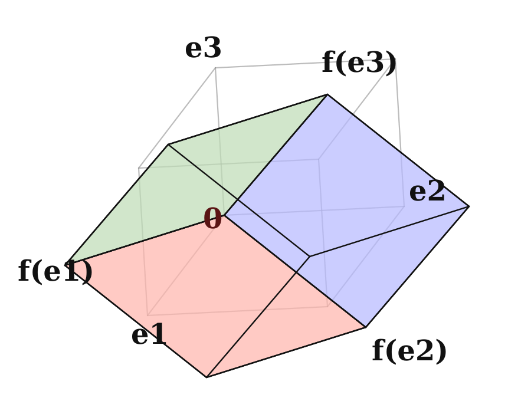
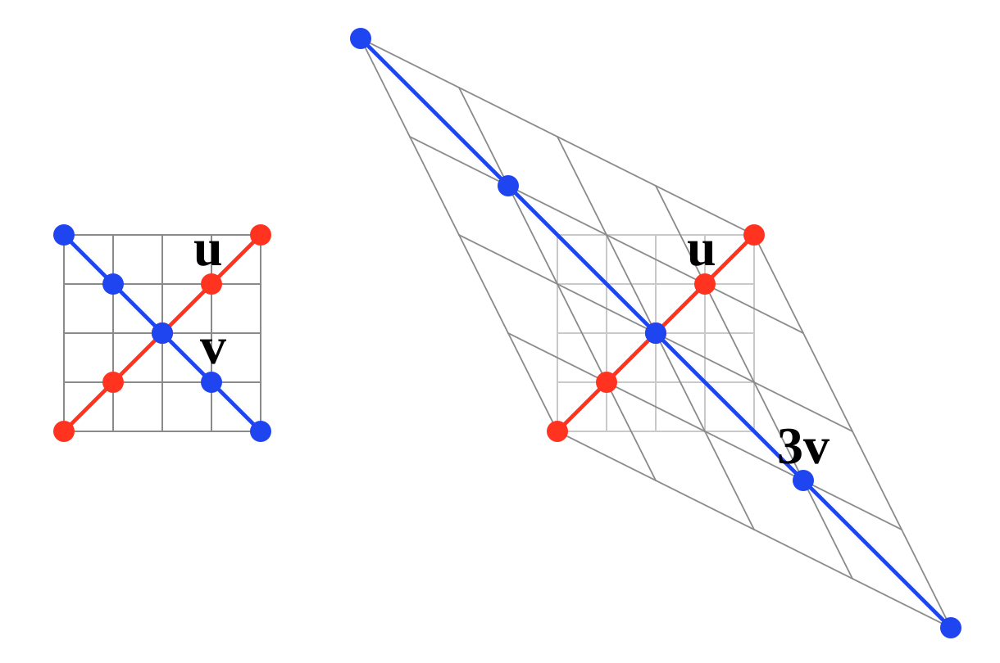

# 5.2 symmetric matrices 与 orthogonal diagonalization

!!! note "译文与来源"

    本页依据 2026 年 11 月 3 日读取的官方 v0.2 源文件制作。数学术语保留英文；原书公式、代码、例题、活动、证明与解答保留。译稿使用机器辅助翻译并进行数学与排版检查，未经原作者审定。原作者：Jacob Denson、Kaitlyn Phillipson、Sebastien Roch。除原书另有注明外，遵循 [CC BY-NC-SA 4.0](https://creativecommons.org/licenses/by-nc-sa/4.0/)。 [阅读英文原文](https://math345-textbook.github.io/sec-orthogonal-diagonalization.html)。

[ Symmetric   matrices ](1-2.md#def-symmetric-skew-symmetric) 中定义的  symmetric matrix  具有特别好的性质：可以选出一组  eigenvectors ，使它们组成  orthonormal basis （回顾 [ Orthogonal  和  orthonormal  组](4-1.md#def-u4-orthogonal-orthonormal-sets)）。因此，这里的  diagonalization  可以通过保持  dot products  和长度不变的  coordinates  变换来实现。本节先解释这一结构，再将它用于  quadratic forms 。

##  eigenvectors 、 orthogonal   matrices  和  orthogonal diagonalization  中的 Orthogonality 

 symmetric  的  matrices  有一个  key  性质：对于任意两个  vectors  $\mathbf{x}$ 和 $\mathbf{y}$，都有 $(A \mathbf{x}) \cdot \mathbf{y} = \mathbf{x} \cdot (A\mathbf{y})$。直接计算可得：

$$
\begin{aligned}
(A\mathbf{x}) \cdot \mathbf{y} & = (A\mathbf{x})^T\mathbf{y} \\
& = \mathbf{x}^TA^T\mathbf{y} \\
& = \mathbf{x}^TA\mathbf{y} \quad \text{(since } A^T = A\text{)} \\
& = \mathbf{x} \cdot (A\mathbf{y})
\end{aligned}
$$

这个性质将帮助我们证明关于  symmetric  的  matrices  的  eigenvectors  的一个基本结论。

**定理 5.2.1： Orthogonality  /  Eigenvectors **

如果 $A$ 是  symmetric matrix ，那么 $A$ 对应于不同  eigenvalues  的  eigenvectors  彼此  orthogonal 。

??? info "证明"

    设$A\mathbf{x} = \lambda\mathbf{x}$和$A\mathbf{y} = \mu\mathbf{y}$，其中$\lambda \neq \mu$。使用上面的属性： 

    $$
    \begin{aligned}
    \lambda(\mathbf{x} \cdot \mathbf{y}) & = (\lambda\mathbf{x}) \cdot \mathbf{y} \\
    & = (A\mathbf{x}) \cdot \mathbf{y} \\
    & = \mathbf{x} \cdot (A\mathbf{y}) \\
    & = \mathbf{x} \cdot (\mu\mathbf{y}) \\
    & = \mu(\mathbf{x} \cdot \mathbf{y})
    \end{aligned}
    $$

     这给了我们$(\lambda - \mu)(\mathbf{x} \cdot \mathbf{y}) = 0$。由于$\lambda \neq \mu$，我们必须有$\mathbf{x} \cdot \mathbf{y} = 0$，这意味着 eigenvectors 是 orthogonal 。

正如我们将看到的，事实证明，对于任何 symmetric matrix ，都存在 eigenvectors 的成对 orthogonal set ，它们形成$\mathbb{R}^n$的 basis 。特别是，每个 symmetric matrix 都是 diagonalizable 。

回想一下 [ Orthogonal   Matrices ](2-5.md#def-4-2-orthogonal)，如果$Q^T = Q^{-1}$， square matrix  $Q$ 就是  orthogonal 。

**定理 5.2.2： Orthogonal   Matrices  的等效条件**

设 $Q$ 是一个 $n \times n$ 的  matrix 。以下条件彼此等价：
1. $Q$ 是  invertible ，并且 $Q^{-1} = Q^T$。

2. $Q$的 rows 是 orthonormal 。

3. $Q$的 columns 是 orthonormal 。

??? info "证明"

    让我们首先证明第一个属性与第三个属性等效。假设$Q$是 invertible ，$Q^{-1} = Q^T$。令$\mathbf{v}_1, \dots, \mathbf{v}_n$为$Q$的 columns 。回想一下[定理](1-4.md#thm-3-3-matrix-multiplication-dot-product)，$Q^T Q$的$(i,j)$条目等于 dot product $\mathbf{v}_i \cdot \mathbf{v}_j$。从$Q^{-1} = Q^T$、$Q^T Q = I$开始，对于$i \neq j$、$\mathbf{v}_i \cdot \mathbf{v}_j = 0$，以及每个$i$、$\mathbf{v}_i \cdot \mathbf{v}_i = 1$。因此  column   vectors  $\mathbf{v}_1,\dots,\mathbf{v}_n$ 是  orthonormal 。相反，如果  column   vectors  $\mathbf{v}_1,\dots,\mathbf{v}_n$ 是 orthonormal ，那么我们立即看到$Q^T Q = I$。

    第一个属性等价于第二个属性的证明非常相似，使用$Q$的 rows 而不是 columns ，并且如果$Q^T Q = I$，则$Q Q^T = I$，反之亦然。

**引理 5.2.1**

设 $Q$ 是一个 $n \times n$ 的  orthogonal matrix ，则：
1. $Q$ 保持  dot products  不变：对于任意  vectors  $\mathbf{v},\mathbf{w} \in \mathbb{R}^n$，都有 $(Q\mathbf{v}) \cdot (Q\mathbf{w}) = \mathbf{v} \cdot \mathbf{w}$。

2. $Q$ 保持长度不变：对于任意  vector  $\mathbf{v} \in \mathbb{R}^n$，都有 $\|Q\mathbf{v}\| = \|\mathbf{v}\|$。

??? info "证明"

    令$\mathbf{v}$和$\mathbf{w}$为 column  vectors 。回顾[ matrix multiplication 的性质](1-4.md#thm-2-3-matrix-multiplication-properties)的第五个属性，我们计算出

    $$
    \begin{aligned}
    (Q\mathbf{v}) \cdot (Q\mathbf{w}) & = (Q\mathbf{v})^T(Q\mathbf{w}) \\
    & = \mathbf{v}^T Q^T Q \mathbf{w} \\
    & = \mathbf{v}^T I_n \mathbf{w} \\
    & = \mathbf{v}^T \mathbf{w} \\
    & = \mathbf{v} \cdot \mathbf{w}
    \end{aligned}
    $$

    因此$Q$保留了 dot products 。

    接下来，使用$Q$保留 dot products ，以及[说明](1-1.md#rem-1-1-length-as-dot-product)，我们找到

    $$
    \| Q\mathbf{v} \|^2 = (Q \mathbf{v}) \cdot (Q \mathbf{v}) = \mathbf{v} \cdot \mathbf{v} = \| \mathbf{v} \|^2
    $$

    对该方程两边求平方根，得到 $\|Q\mathbf{v}\| = \|\mathbf{v}\|$。

[图 5.2.1](5-2.md#fig-orthogonal-transformation) 提供 orthogonal   coordinates  变化的可视化。

*将  linear map  $\mathbf{f}(\mathbf{x}) = Q\mathbf{x}$ 应用于立方体的效果，其中 $Q$ 为  orthogonal 。请注意，贴图是“刚性的”，即，将贴图应用于立方体会产生具有相同  dimensions  的立方体。改编自：斯坦福大学 MATH 51 教科书。*

??? info "图像说明"

    灰色参考立方体显示在通过应用  orthogonal matrix  $Q$ 获得的彩色图像立方体后面。彩色立方体有红色、蓝色和绿色面，并标有图像 $f(\mathbf{e}_1)$、$f(\mathbf{e}_2)$ 和 $f(\mathbf{e}_3)$。图像立方体相对于灰色立方体旋转，但其边缘长度和角度被保留。

**定义 5.2.1： Orthogonal  diagonalization性**

对于  matrix  $A$，如果存在  orthogonal matrix  $Q$，使得 $Q^{-1}A Q$ 是  diagonal matrix ，就称它是  orthogonally diagonalizable 。由于 $Q^{-1} = Q^T$，这个条件也可以写成：$Q^T A Q$ 是  diagonal matrix 。

**活动 5.2.1：检查  eigenvectors  和  orthogonality （U5-LO1、U4-LO1）**

考虑  symmetric matrix  

$$
A = \begin{bmatrix} 2 & -1 \\ -1 & 2 \end{bmatrix}
$$

 检查  vectors  

$$
\mathbf{u} = \begin{bmatrix} 1 \\ 1 \end{bmatrix} \quad\text{and}\quad \mathbf{v} = \begin{bmatrix} 1 \\ -1 \end{bmatrix}
$$

 是 $A$ 的  eigenvectors ，它们彼此之间是  orthogonal 。对应的 eigenvalues 是什么？

??? success "解答"

    vectors $\mathbf{u}$和$\mathbf{v}$分别是$A$的 eigenvectors 与 eigenvalues $\lambda_1 = 1$和$\lambda_2 = 3$，因为

    $$
    A\mathbf{u} = \begin{bmatrix} 2 & -1 \\ -1 & 2 \end{bmatrix} \begin{bmatrix} 1 \\ 1 \end{bmatrix} = \begin{bmatrix} 1 \\ 1 \end{bmatrix} = 1\mathbf{u}
    $$

    和

    $$
    A\mathbf{v} = \begin{bmatrix} 2 & -1 \\ -1 & 2 \end{bmatrix}\begin{bmatrix} 1 \\ -1 \end{bmatrix} = \begin{bmatrix} 3 \\ -3 \end{bmatrix} = 3\mathbf{v}
    $$

    我们还计算

    $$
    \mathbf{u} \cdot \mathbf{v} = 1 \cdot 1 + 1 \cdot (-1) = 0
    $$

    因此，两个 vectors 、$\mathbf{u}$和$\mathbf{v}$是 orthogonal 。

*网格上 [检查  eigenvectors  和  orthogonality （U5-LO1、U4-LO1）](5-2.md#ex-symmetric-matrix-2x2)  matrix  $A$ 动作的可视化。沿  eigenvector  $\mathbf{u}$ 的红线保持不变（因为 $\mathbf{u}$ 是  eigenvector ， eigenvalue  1），而沿  eigenvector  $\mathbf{v}$ 的蓝线拉伸了 3 倍（因为 $\mathbf{v}$ 是  eigenvector ，  eigenvalue 3）。改编自：斯坦福大学 MATH 51 教科书。*

??? info "图像说明"

    左侧面板显示了一个方形  coordinate  网格，其中一条红线位于 $\mathbf{u}=(1,1)$ 方向，一条蓝线位于 $\mathbf{v}=(1,-1)$ 方向。右图显示了$A$下的网格图像：红色方向不变，而蓝色方向拉伸至原始长度的三倍。红色和蓝色  eigenvector  方向在两个面板中保持垂直。

[图 5.2.2](5-2.md#fig-matrix-transformation) 应与 [图 5.1.1](5-1.md#fig-7-1-eigenvector-transformation) 进行比较。请注意，由于[检查  eigenvectors  和  orthogonality （U5-LO1、U4-LO1）](5-2.md#ex-symmetric-matrix-2x2)中的 matrix $A$是 symmetric ，因此[图 5.2.2](5-2.md#fig-matrix-transformation)中的红线和蓝线以直角相交，因为 vectors $\mathbf{u}$和$\mathbf{v}$是 orthogonal ，而[图 5.1.1](5-1.md#fig-7-1-eigenvector-transformation)中的红线和蓝线不以直角相交角度，因为该示例中的  eigenvectors  彼此之间不是  orthogonal 。

**活动 5.2.2： Orthogonal diagonalization  分成两个  dimensions  (U5-LO3)**

考虑 matrix 

$$
A = \begin{bmatrix} 1 & 1 \\ 1 & -1 \end{bmatrix}
$$

找到一个  orthogonal matrix  $Q$ 使得 $Q^{-1} A Q$ 是对角线。

??? success "解答"

    我们按照[解释  diagonalization  中的 columns （U5-LO1、U5-LO2）](5-1.md#act-7-1-construction-of-diagonalizable)的方式进行，即找到$A$的 eigenvectors 的 basis ，并通过将那些 columns 作为 eigenvectors 来定义$Q$。到[ Orthogonal   Matrices  的等效条件](5-2.md#thm-equivalent-conditions-orthogonal)时，只要 eigenvectors 是 orthonormal ， matrix $Q$就会是 orthogonal 。我们首先通过计算其characteristic polynomial来找到 $A$ 的  eigenvalues 。我们计算出

    $$
    \begin{aligned}
    c_A(\lambda) & = \det\begin{bmatrix} 1-\lambda & 1 \\ 1 & -1-\lambda \end{bmatrix} \\
    & = (1-\lambda)(-1-\lambda) - 1 \\
    & = \lambda^2 - 2 \\
    & = (\lambda - \sqrt{2})(\lambda + \sqrt{2})
    \end{aligned}
    $$

    因此，$c_A(\lambda) = 0$的解由$\lambda = \pm \sqrt{2}$给出，因此$\lambda_1 = \sqrt{2}$和$\lambda_2 = - \sqrt{2}$是$A$的两个 eigenvalues 。

    为了用  eigenvalue  $\sqrt{2}$ 计算  eigenvector ，我们求解系统 

    $$
    \begin{bmatrix} 1-\sqrt{2} & 1 \\ 1 & -1-\sqrt{2} \end{bmatrix}\begin{bmatrix} v_1 \\ v_2 \end{bmatrix} = \begin{bmatrix} 0 \\ 0 \end{bmatrix}
    $$

    展开左侧并读出结果  vector  的第二个条目，得到 

    $$
    v_1 + (-1 - \sqrt{2}) v_2 = 0
    $$

    因为$\sqrt{2}$是 eigenvalue ，所以 matrix $A-\sqrt{2}I$是 singular 。显示的 matrix 非零，因此其 rank 为$1$。因此有一个 pivot variable 和一个 free variable 。设定$v_2 = 1$，求解$v_1$，得到基本的 eigenvector 

    $$
    \begin{bmatrix} 1 + \sqrt{2} \\ 1 \end{bmatrix}
    $$

    我们正在寻找  eigenvectors  的  orthonormal basis ，因此特别是，我们选择作为  basis  的  eigenvectors  必须全部具有 $1$ 的长度。因此，我们考虑长度为 $1$ 的基本  eigenvector  的倍数。由于基本  eigenvector  的长度为 

    $$
    \sqrt{ (1 + \sqrt{2})^2 + (1)^2 } = \sqrt{ 4 + 2\sqrt{2} }
    $$

    因此  vector  

    $$
    \mathbf{v} = \frac{1}{\sqrt{4 + 2 \sqrt{2}}} \begin{bmatrix} 1 + \sqrt{2} \\ 1 \end{bmatrix} = \begin{bmatrix} \frac{1 + \sqrt{2}}{\sqrt{4 + 2 \sqrt{2}}} \\ \frac{1}{\sqrt{4 + 2 \sqrt{2}}} \end{bmatrix}
    $$

     的长度为 $1$。这将是我们的  basis  中的第一个  vector 。

    使用类似的技术，可以找到基本的  eigenvector  和  eigenvalue  $- \sqrt{2}$。就是 vector 

    $$
    \begin{bmatrix} 1 - \sqrt{2} \\ 1 \end{bmatrix}
    $$

    标准化得到  vector  

    $$
    \mathbf{w} = \frac{1}{\sqrt{4 - 2 \sqrt{2}}} \begin{bmatrix} 1 - \sqrt{2} \\ 1 \end{bmatrix} = \begin{bmatrix} \frac{1 - \sqrt{2}}{\sqrt{4 - 2 \sqrt{2}}} \\ \frac{1}{\sqrt{4 - 2 \sqrt{2}}} \end{bmatrix}
    $$

    其长度为 $1$。这是我们的 basis 中的第二个 vector 。

    使用[ Orthogonality  /  Eigenvectors ](5-2.md#thm-orthogonality-eigenvectors)，由于$A$是 symmetric ，$\mathbf{v}$和$\mathbf{w}$是 orthogonal ，因此，通过[ orthogonal  组中 Linear independence ](4-1.md#thm-6-1-orthogonality-independent)，是 linearly independent ，从而形成 basis 。但这意味着 matrix 

    $$
    Q = \begin{bmatrix}
                \frac{1 + \sqrt{2}}{\sqrt{4+2\sqrt{2}}} & \frac{1 - \sqrt{2}}{\sqrt{4-2\sqrt{2}}} \\
                \frac{1}{\sqrt{4+2\sqrt{2}}} & \frac{1}{\sqrt{4-2\sqrt{2}}}
                \end{bmatrix}
    $$

    是 orthogonal ，而

    $$
    Q^{-1}AQ = \begin{bmatrix} \sqrt{2} & 0 \\ 0 & - \sqrt{2} \end{bmatrix}
    $$

    是对角线。

**活动 5.2.3：重写  orthogonal diagonalization  (U5-LO3)**

假设$A$与 diagonalizable 正交，即我们可以找到 orthogonal matrix $Q$使得$Q^TAQ = D$，其中$D$是对角线。解释一下为什么$A = QDQ^T$。

??? success "解答"

    我们计算出

    $$
    QDQ^T = Q(Q^TAQ)Q^T = (QQ^T) A (QQ^T) = I A I = A
    $$

**注**

因式分解 $A = QDQ^T$ 将 $A$ 写为三个  matrices  的乘积： orthogonal matrix 、 diagonal matrix  和  orthogonal matrix  的  transpose 。该产品有时被称为  symmetric matrix  $A$ 的  spectral decomposition 。

##  Principal axes theorem 

回想一下[定理 5.1.3](5-1.md#thm-7-1-diagonalizability)。该定理告诉我们，如果 $A$ 与  diagonalizable  正交，其中 $Q^{-1} A Q$ 是对角线，那么 $Q$ 的  columns  必定是 $A$ 的  linearly independent   eigenvectors 。此外，为了使$Q$成为 orthogonal ，[ Orthogonal   Matrices  的等效条件](5-2.md#thm-equivalent-conditions-orthogonal)告诉我们，构成$Q$的 columns 的 eigenvectors 必须是 orthonormal 。

值得注意的是，所有  symmetric   matrices  都是正交的  diagonalizable 。

**定理 5.2.3： Principal Axes Theorem **

设 $A$ 是任意一个 $n \times n$ 的  matrix 。以下条件彼此等价：
1. $A$ 有 $n$ 个  eigenvectors ，它们组成一个  orthonormal set 。

2. $A$ 可以 orthogonally  diagonalizable 。

3. $A$ 是  symmetric

对于  symmetric matrix  $A$，一组  orthonormal  的  eigenvectors  称为 $A$ 的一组  principal axes 。

??? info "证明"

    我们不证明该定理的“困难”部分（第三个属性暗示第二个属性）。但第二个性质暗示第三个性质的证明更简单（参见[ Orthogonal diagonalization  和对称性 (U5-LO3)](5-2.md#ex-orthogonal-diag-implies-symmetric)）。

**注**

[ Principal Axes Theorem ](5-2.md#thm-principal-axes)也称为 symmetric  matrices 的 Spectral Theorem （ matrix 的 eigenvalues 的集合通常称为 matrix 的 spectrum ）。

我们不证明这个定理的“难”部分，即（3）蕴涵（2）。然而，让我们检查一下 (2) 是否蕴含 (3)。

**活动 5.2.4： Orthogonal diagonalization  和对称性 (U5-LO3)**

证明如果 $A$ 与  diagonalizable  正交，则 $A$ 是  symmetric 。

??? success "解答"

    假设$A$正交于 diagonalizable 。那么存在 orthogonal matrix $Q$和 diagonal matrix $D$使得$Q^TAQ = D$。 [重写  orthogonal diagonalization  (U5-LO3)](5-2.md#ex-orthogonal-diagonalization-factorization)告诉我们$A = QDQ^T$。但现在我们检查

    $$
    \begin{aligned}
    A^T & = (QDQ^T)^T \\
    & = (Q^T)^T D^T Q^T \\
    & = Q D Q^T = A
    \end{aligned}
    $$

    等式 $A^T = A$ 恰好意味着 $A$ 是  symmetric 。

**活动 5.2.5： Orthogonal diagonalization  三 dimensions  (U5-LO3)**

让

$$
A = \begin{bmatrix} 1 & 0 & -1 \\ 0 & 1 & 2 \\ -1 & 2 & 5 \end{bmatrix}
$$

找到一个 orthogonal matrix $Q$，使得$Q^{-1} A Q$是对角线。

??? success "解答"

    首先，计算  eigenvalues 。我们计算出

    $$
    \begin{aligned}
    \det(A - \lambda I) & = \det\begin{bmatrix}
                  1-\lambda & 0 & -1 \\
                  0 & 1-\lambda & 2 \\
                  -1 & 2 & 5-\lambda
                  \end{bmatrix} \\
    & = (1- \lambda) [(1 -\lambda)(5 - \lambda) - 4]
                  + (-1)[0 - (1-\lambda)(-1)] \\
    & = (1- \lambda) [(1 -\lambda)(5 - \lambda) - 4]
                  - (1-\lambda) \\
    & = (1- \lambda)[(1 -\lambda)(5 - \lambda) - 4 - 1] \\
    & = (1- \lambda)[-6 \lambda + \lambda^2] \\
    & = -\lambda(\lambda-1)(\lambda-6)
    \end{aligned}
    $$

     这个计算验证了$A$的 eigenvalues 是$\lambda_1 = 0$、$\lambda_2 = 1$和$\lambda_3 = 6$。现在我们继续为每个 eigenvalues 找到一个 eigenvector 。

    对于 eigenvalue $\lambda_1 = 0$，我们求解方程$A\mathbf{v}_1 = \mathbf{0}$，将其展开为

    $$
    \begin{bmatrix}
                1 & 0 & -1 \\
                0 & 1 & 2 \\
                -1 & 2 & 5
                \end{bmatrix}
                \begin{bmatrix} v_1 \\ v_2 \\ v_3 \end{bmatrix} =
                \begin{bmatrix} 0 \\ 0 \\ 0 \end{bmatrix}
    $$

    通过观察，我们看到第一个和第二个 columns 将在左侧 matrix 的 reduced row echelon form 中包含 pivots ，因此设置$v_3 = 1$给出了基本 eigenvector 

    $$
    \begin{bmatrix} 1 \\ -2 \\ 1 \end{bmatrix}
    $$

    标准化给出标准化的 eigenvector 

    $$
    \mathbf{v}_1 = \frac{1}{\sqrt{6}} \begin{bmatrix} 1 \\ -2 \\ 1 \end{bmatrix} = \begin{bmatrix} 1/\sqrt{6} \\ -2/\sqrt{6} \\ 1/\sqrt{6} \end{bmatrix}
    $$

    这将是我们的 basis 中的第一个 vector 。

    对于  eigenvalue  $\lambda_2 = 1$，我们求解方程 $(A - I)\mathbf{v}_2 = \mathbf{0}$，将其展开为 

    $$
    \begin{bmatrix}
                0 & 0 & -1 \\
                0 & 0 & 2 \\
                -1 & 2 & 4
                \end{bmatrix}
                \begin{bmatrix} v_1 \\ v_2 \\ v_3 \end{bmatrix} =
                \begin{bmatrix} 0 \\ 0 \\ 0 \end{bmatrix}
    $$

     我们现在看到，当我们  row  减少这个  matrix  时，第一个和第三个  columns  将包含  pivots ，因此设置 $v_2 = 1$ 并求解得到基本的  eigenvector  

    $$
    \begin{bmatrix} 2 \\ 1 \\ 0 \end{bmatrix}
    $$

    标准化给出  eigenvector  

    $$
    \mathbf{v}_2 = \frac{1}{\sqrt{5}} \begin{bmatrix} 2 \\ 1 \\ 0 \end{bmatrix} = \begin{bmatrix} 2/\sqrt{5} \\ 1/\sqrt{5} \\ 0 \end{bmatrix}
    $$

    这将是我们的 basis 中的第二个 vector 。

    对于$\lambda_3 = 6$，我们求解$(A - 6I)\mathbf{v}_3 = \mathbf{0}$，即

    $$
    \begin{bmatrix}
                -5 & 0 & -1 \\
                0 & -5 & 2 \\
                -1 & 2 & -1
                \end{bmatrix}
                \begin{bmatrix} v_1 \\ v_2 \\ v_3 \end{bmatrix} =
                \begin{bmatrix} 0 \\ 0 \\ 0 \end{bmatrix}
    $$

     前两个方程给出$v_1 = -\frac{1}{5}v_3$和$v_2 = \frac{2}{5}v_3$。设置$v_3 = 1$给出基本的 eigenvector 

    $$
    \begin{bmatrix} -1/5 \\ 2/5 \\ 1 \end{bmatrix}
    $$

    乘以 $5$（以防止使用分数）得到整数  eigenvector  

    $$
    \begin{bmatrix} -1 \\ 2 \\ 5 \end{bmatrix}
    $$

     标准化得到  eigenvector  

    $$
    \mathbf{v}_3 = \frac{1}{\sqrt{30}} \begin{bmatrix} -1 \\ 2 \\ 5 \end{bmatrix} = \begin{bmatrix} -1/\sqrt{30} \\ 2/\sqrt{30} \\ 5/\sqrt{30} \end{bmatrix}
    $$

    这将是我们的 basis 中的第三个也是最后一个 vector 。

    我们现在设置

    $$
    Q = \begin{bmatrix} 1/\sqrt{6} & 2/\sqrt{5} & -1/\sqrt{30} \\ -2/\sqrt{6} & 1/\sqrt{5} & 2/\sqrt{30} \\ 1/\sqrt{6} & 0 & 5/\sqrt{30} \end{bmatrix}
    $$

    然后

    $$
    Q^{-1}AQ = \begin{bmatrix} 0 & 0 & 0 \\ 0 & 1 & 0 \\ 0 & 0 & 6 \end{bmatrix}
    $$

    因此我们找到了 matrix $A$的 orthogonal diagonalization 。

在 [ Orthogonal diagonalization  三 dimensions  (U5-LO3)](5-2.md#act-3x3-orthogonal-diagonalization) 中，$A$ 的  eigenvalues  是不同的。对于一般策略，回想一下 [eigenspace](5-1.md#subsec-principal-axes-theorem-10) $E_\lambda(A)$ 是满足 $A\mathbf{x}=\lambda\mathbf{x}$ 的  vectors  $\mathbf{x}$ 的集合。它是$\mathbb{R}^n$乘[定理 5.1.2](5-1.md#subsec-principal-axes-theorem-11)的 subspace ，所以我们可以找到它的 orthonormal basis 。

**说明：orthogonal diagonalization  symmetric matrix  $A$ 的过程**

1. 求 $A$ 的  eigenvalues 。

2. 对于$A$的每个 eigenvalue $\lambda$，找到$E_\lambda(A)$的 basis ，并根据需要使用 Gram-Schmidt  orthogonalization 过程将其转换为 orthonormal basis （请参见[ Gram-Schmidt  输出的属性](4-2.md#thm-6-2-gram-schmidt)）。

3. 收集每个  eigenspaces  的  orthonormal   bases  给出 $A$ 的  orthonormal basis   eigenvectors 。将这些  eigenvectors  作为  matrix  $Q$ 的  columns  给出  orthogonal matrix ，使得 $Q^{-1}AQ$ 是对角线。

**活动 5.2.6：来自  eigenspace  数据的  Orthogonal diagonalization  (U5-LO3)**

如果

$$
A = \begin{bmatrix} 8 & -2 & 2 \\ -2 & 5 & 4 \\ 2 & 4 & 5 \end{bmatrix},
$$

计算$A$的 orthonormal  diagonalization 。您可以使用$A$的characteristic polynomial是$\lambda (\lambda - 9)^2$，并且$A$的 null space 由 vector 

$$
\begin{bmatrix} 1 \\ 2 \\ -2 \end{bmatrix}
$$

跨越。

??? success "解答"

    eigenvalues  是$\lambda_1 = 0$ 和$\lambda_2 = 9$。由于$A$的 null space 被 vector 

    $$
    \begin{bmatrix} 1 \\ 2 \\ -2 \end{bmatrix}
    $$

    跨越，$A$的 eigenvectors 和 eigenvalue $0$都是这个 vector 的倍数。因此，$E_0(A)$的 orthonormal basis 由

    $$
    \left\{ \begin{bmatrix} 1/3 \\ 2/3 \\ -2/3 \end{bmatrix} \right\}
    $$

    给出。另一方面，为了找到 $E_9(A)$ 的  orthonormal basis ，我们形成  matrix  

    $$
    9I - A = \begin{bmatrix} 9 & 0 & 0 \\ 0 & 9 & 0 \\ 0 & 0 & 9 \end{bmatrix} - \begin{bmatrix} 8 & -2 & 2 \\ -2 & 5 & 4 \\ 2 & 4 & 5 \end{bmatrix} = \begin{bmatrix} 1 & 2 & -2 \\ 2 & 4 & -4 \\ -2 & -4 & 4 \end{bmatrix}
    $$

    使用 row 运算$R_2 \rightarrow R_2 - 2R_1$和$R_3 \rightarrow R_3 + 2R_1$，我们获得 matrix $9I - A$的 reduced row echelon form ： matrix 

    $$
    \begin{bmatrix} 1 & 2 & -2 \\ 0 & 0 & 0 \\ 0 & 0 & 0 \end{bmatrix}
    $$

    这样我们就得到了两个基本解

    $$
    \mathbf{v}_1 = \begin{bmatrix} -2 \\ 1 \\ 0 \end{bmatrix} \quad\text{and}\quad \mathbf{v}_2 = \begin{bmatrix} 2 \\ 0 \\ 1 \end{bmatrix}
    $$

    我们现在将 Gram-Schmidt 应用于这对 vectors ，形成$E_9(A)$的 basis ，以获得 orthogonal basis 。我们定义

    $$
    \mathbf{w}_1=\mathbf{v}_1
                \qquad\text{and}\qquad
                \mathbf{w}_2=\mathbf{v}_2-\frac{\mathbf{v}_2\cdot\mathbf{w}_1}{\mathbf{w}_1\cdot\mathbf{w}_1}\mathbf{w}_1.
    $$

    我们计算

    $$
    \frac{\mathbf{v}_2 \cdot \mathbf{w}_1}{\mathbf{w}_1 \cdot \mathbf{w}_1} = \frac{-4}{5}
    $$

    从而计算

    $$
    \mathbf{w}_2 = \begin{bmatrix} 2 \\ 0 \\ 1 \end{bmatrix} + \frac45 \begin{bmatrix} -2 \\ 1 \\ 0 \end{bmatrix} = \begin{bmatrix} 2/5 \\ 4/5 \\ 1 \end{bmatrix}
    $$

    标准化给出 $E_9(A)$ 的 orthonormal basis  

    $$
    \left\{ \frac{\mathbf{w}_1}{\| \mathbf{w}_1 \|}, \frac{\mathbf{w}_2}{\| \mathbf{w}_2 \|} \right\} = \left\{ \begin{bmatrix} -2/\sqrt(5) \\ 1/\sqrt{5} \\ 0 \end{bmatrix}, \begin{bmatrix} 2/\sqrt{45} \\ 4/\sqrt{45} \\ 5/\sqrt{45} \end{bmatrix} \right\}
    $$

    将我们计算出的两个 orthonormal  bases 结合起来，得到由 eigenvectors 组成的$\mathbb{R}^n$的 orthonormal basis 

    $$
    \left\{ \begin{bmatrix} 1/3 \\ 2/3 \\ -2/3 \end{bmatrix}, \begin{bmatrix} -2/\sqrt{5} \\ 1/\sqrt{5} \\ 0 \end{bmatrix}, \begin{bmatrix} 2/\sqrt{45} \\ 4/\sqrt{45} \\ 5/\sqrt{45} \end{bmatrix} \right\}
    $$

    因此，如果我们定义

    $$
    Q = \begin{bmatrix} 1/3 & -2/\sqrt{5} & 2/\sqrt{45} \\ 2/3 & 1/\sqrt{5} & 4/\sqrt{45} \\ -2/3 & 0 & 5/\sqrt{45} \end{bmatrix}
    $$

    则

    $$
    Q^{-1}AQ = \begin{bmatrix} 0 & 0 & 0 \\ 0 & 9 & 0 \\ 0 & 0 & 9 \end{bmatrix}
    $$

    给出$A$的 orthogonal diagonalization 。

