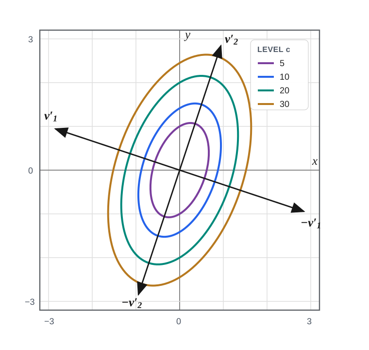
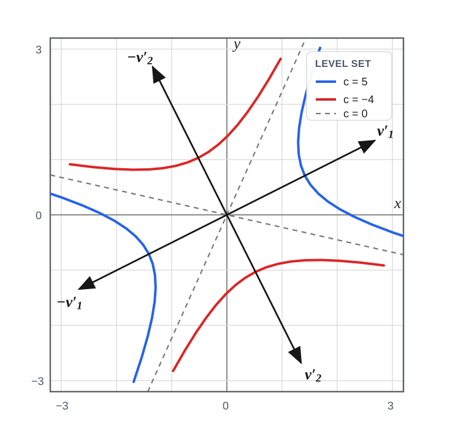

# 5.3 quadratic forms 与 definiteness

!!! note "译文与来源"

    本页依据 2026 年 11 月 3 日读取的官方 v0.2 源文件制作。数学术语保留英文；原书公式、代码、例题、活动、证明与解答保留。译稿使用机器辅助翻译并进行数学与排版检查，未经原作者审定。原作者：Jacob Denson、Kaitlyn Phillipson、Sebastien Roch。除原书另有注明外，遵循 [CC BY-NC-SA 4.0](https://creativecommons.org/licenses/by-nc-sa/4.0/)。 [阅读英文原文](https://math345-textbook.github.io/subsec-u5-quadratic-forms-definiteness.html)。

前面我们用  matrix  $A$ 定义了 [matrix map](1-3.md#def-3-2-matrix-transformation)：

$$
\mathbf{x}\longmapsto A\mathbf{x},
$$

它的输出是  vector 。同一个  matrix  也可以定义一个  scalar-valued function ：

$$
q_A(\mathbf{x})=\mathbf{x}^TA\mathbf{x}.
$$

这个  function  是二次的，而不是  linear  的。虽然输入在表达式中出现了两次，我们仍然可以利用  eigenvectors  与 [orthogonal diagonalization theorem](5-2.md#thm-principal-axes)，把这个  function  写成容易分析的形式。

**定义 5.3.1**

对于一个 $n \times n$ 的  matrix  $A$，与它对应的  quadratic form  是定义在 $\mathbb{R}^n$ 上的  scalar-valued function  $q_A$，其表达式为 $q_A(\mathbf{x}) = \mathbf{x}^T A \mathbf{x}$。

**活动 5.3.1： Linear  和二次  scaling  (U5-LO4)**

令$A$为$n\times n$ matrix ，令$\mathbf{x}\in\mathbb R^n$，令$t\in\mathbb R$。

1. 将 $A(t\mathbf{x})$ 与 $tA\mathbf{x}$ 进行比较。

2. 将 $q_A(t\mathbf{x})$ 与 $tq_A(\mathbf{x})$ 进行比较。

3. function  是 $\mathbf{x}$ 中的 linear ？哪个  function  是二次方？

??? success "解答"

    Matrix multiplication  是 linear ，所以

    $$
    A(t\mathbf{x})=tA\mathbf{x}.
    $$

     对于 quadratic form ，

    $$
    \begin{aligned}
    q_A(t\mathbf{x}) \\
    &=(t\mathbf{x})^TA(t\mathbf{x}) \\
    &=t^2\mathbf{x}^TA\mathbf{x} \\
    &=t^2q_A(\mathbf{x}).
    \end{aligned}
    $$

     因此$\mathbf{x}\mapsto A\mathbf{x}$ 是 linear ，而$\mathbf{x}\mapsto q_A(\mathbf{x})$ 是二次方。

接下来，我们用由  eigenvector  组成的  orthogonal   basis  消去交叉项，从而判断  quadratic form  的正负。

下一个定义记录将控制  quadratic form  符号的  eigenvalue  符号模式。

**定义 5.3.2： Positive definite 、 negative definite 、 indefinite   matrices **

如果一个  symmetric matrix  的所有  eigenvalues  都严格大于零，就称它为  positive definite ；如果所有  eigenvalues  都严格小于零，就称它为  negative definite ；如果至少有一个严格为正的  eigenvalue ，同时至少有一个严格为负的  eigenvalue ，就称它为  indefinite 。

**活动 5.3.2：A  quadratic form  作为曲率 (U5-LO4)**

让

$$
H=
						\begin{bmatrix}
						4&0\\
						0&1
						\end{bmatrix}.
$$

1. 计算 

    $$
    \mathbf{h}=
    								\begin{bmatrix}
    								1\\
    								0
    								\end{bmatrix},
    								\qquad
    								\mathbf{h}=
    								\begin{bmatrix}
    								0\\
    								1
    								\end{bmatrix},
    								\qquad
    								\mathbf{h}=
    								\begin{bmatrix}
    								1\\
    								1
    								\end{bmatrix}.
    $$

     的 $\mathbf{h}^T H\mathbf{h}$

2. 写 $\mathbf{h}^T H\mathbf{h}$ 为一般  vector  

    $$
    \mathbf{h}=
    								\begin{bmatrix}
    								h_1\\
    								h_2
    								\end{bmatrix}.
    $$

3. quadratic form 在 coordinate 哪个方向更大？

??? success "解答"

    我们计算

    $$
    \begin{bmatrix}
    						1\\
    						0
    						\end{bmatrix}^T
    						H
    						\begin{bmatrix}
    						1\\
    						0
    						\end{bmatrix}
    						=4,
    $$

    $$
    \begin{bmatrix}
    						0\\
    						1
    						\end{bmatrix}^T
    						H
    						\begin{bmatrix}
    						0\\
    						1
    						\end{bmatrix}
    						=1,
    $$

    和

    $$
    \begin{bmatrix}
    						1\\
    						1
    						\end{bmatrix}^T
    						H
    						\begin{bmatrix}
    						1\\
    						1
    						\end{bmatrix}
    						=5.
    $$

    对于一般的 vector 、

    $$
    \mathbf{h}^T H\mathbf{h}=4h_1^2+h_2^2.
    $$

    quadratic form 在第一个 coordinate 方向比在第二个 coordinate 方向更大。对于 Hessians，这种比较测量不同方向的曲率。

如果我们能理解 quadratic forms ，我们就能理解 functions 在critical point的quadratic approximation。

**活动 5.3.3：将  quadratic form  扩展到三个变量 (U5-LO4)**

对于 symmetric $3 \times 3$ matrix $A = [A_{ij}]$，根据$A$的条目和$\mathbf{x} = (x_1, x_2, x_3)$的分量显式写出 quadratic form $q_A(\mathbf{x}) = \mathbf{x}^T A \mathbf{x}$。

??? success "解答"

    $$
    \begin{aligned}
    q_A(\mathbf{x}) & = \begin{bmatrix} x_1 & x_2 & x_3 \end{bmatrix}
    							\begin{bmatrix}
    							A_{11} & A_{12} & A_{13} \\
    							A_{21} & A_{22} & A_{23} \\
    							A_{31} & A_{32} & A_{33}
    							\end{bmatrix}
    							\begin{bmatrix} x_1 \\ x_2 \\ x_3 \end{bmatrix} \\
    & = \begin{bmatrix} x_1 & x_2 & x_3 \end{bmatrix}
    							\begin{bmatrix}
    							A_{11}x_1 + A_{12}x_2 + A_{13}x_3 \\
    							A_{21}x_1 + A_{22}x_2 + A_{23}x_3 \\
    							A_{31}x_1 + A_{32}x_2 + A_{33}x_3
    							\end{bmatrix} \\
    & = x_1(A_{11}x_1 + A_{12}x_2 + A_{13}x_3) \\
    & + x_2(A_{21}x_1 + A_{22}x_2 + A_{23}x_3) \\
    & + x_3(A_{31}x_1 + A_{32}x_2 + A_{33}x_3) \\
    & = A_{11}x_1^2 + A_{22}x_2^2 + A_{33}x_3^2 \\
    & + A_{12}x_1x_2 + A_{13}x_1x_3 + A_{21}x_2x_1 \\
    & + A_{23}x_2x_3 + A_{31}x_3x_1 + A_{32}x_3x_2
    \end{aligned}
    $$

     由于 $A$ 是  symmetric ，因此对于所有 $i, j$，我们都有 $A_{ij} = A_{ji}$。使用此属性：

    $$
    \begin{aligned}
    & q_A(\mathbf{x}) = A_{11}x_1^2 + A_{22}x_2^2 + A_{33}x_3^2 + (A_{12} + A_{21})x_1x_2 \\
    & + (A_{13} + A_{31})x_1x_3 + (A_{23} + A_{32})x_2x_3 \\
    & = A_{11}x_1^2 + A_{22}x_2^2 + A_{33}x_3^2 \\
    & + 2A_{12}x_1x_2 + 2A_{13}x_1x_3 + 2A_{23}x_2x_3
    \end{aligned}
    $$

**注**

更一般地，对于  symmetric  $n \times n$  matrix  $A = [A_{ij}]$， quadratic form  $q_A(\mathbf{x}) = \mathbf{x}^T A \mathbf{x}$ 可以写成： 

$$
q_A(\mathbf{x}) = \mathbf{x}^T A \mathbf{x}
					= \sum_{i=1}^n \sum_{j=1}^n A_{ij} x_i x_j
					= \sum_{i=1}^n A_{ii}x_i^2 + 2\sum_{1 \leq i \lt j \leq n} A_{ij}x_i x_j
$$

 特别注意，如果 $A$ 是  diagonal matrix ，则

$$
q_A(\mathbf{x}) = A_{11} x_1^2 + \cdots + A_{nn} x_n^2
$$

 很容易理解。我们将使用谱理论来证明 coordinate system 的 rotation 将 quadratic form 减少为由 diagonal matrix 定义的 quadratic form 。对角线条目的符号将告诉我们  critical point  的行为。

回想一下 [orthogonal diagonalization theorem](5-2.md#thm-principal-axes)，它说存在一个  orthogonal matrix  $Q$，因此 $Q^T A Q$ 是  diagonal matrix  $D$。

**定理 5.3.1： Diagonalization 定理**

考虑由  symmetric matrix  $A$ 定义的  quadratic form  $q_A$。设 $Q$ 是满足下式的  orthogonal matrix ：

$$
Q^TAQ=D=\operatorname{diag}(\lambda_1,\ldots,\lambda_n).
$$

作变量替换 $\mathbf{x}=Q\mathbf{y}$，就得到：

$$
q_A(\mathbf{x})=\lambda_1y_1^2+\cdots+\lambda_ny_n^2.
$$

??? info "证明"

    由于$\mathbf{x}=Q\mathbf{y}$，我们有

    $$
    \begin{aligned}
    q_A(\mathbf{x})
    							& = \mathbf{x}^TA\mathbf{x} \\
    & = (Q\mathbf{y})^TA(Q\mathbf{y}) \\
    & = \mathbf{y}^TQ^TAQ\mathbf{y} \\
    & = \mathbf{y}^TD\mathbf{y} \\
    & = \lambda_1y_1^2+\cdots+\lambda_ny_n^2.
    \end{aligned}
    $$

**定义 5.3.3：principal axes**

如果 $A$ 是一个  symmetric  的 $n \times n$  matrix ，那么由 $A$ 的  eigenvectors  组成的一个  orthonormal basis ，称为  quadratic form  $q_A$ 的一组  principal axes 。

**活动 5.3.4：principal axes  coordinates  上的 A  quadratic form （U5-LO1、U5-LO4）**

考虑 quadratic form $q(x,y) = 13x^2 - 6xy + 5y^2$。

**问题**

找到  symmetric matrix  $A$ 使得 $q = q_A$，即，使得 

$$
q(x,y) = \begin{bmatrix} x & y \end{bmatrix} A \begin{bmatrix} x \\ y \end{bmatrix}
$$

??? success "解答"

    如果

    $$
    A = \begin{bmatrix} a & b \\ b & c \end{bmatrix}
    $$

    则

    $$
    q_A(x,y)=ax^2+2bxy+cy^2.
    $$

    所以$a = 13$、$b = -3$、$c = 5$，即

    $$
    A = \begin{bmatrix} 13 & -3 \\ -3 & 5 \end{bmatrix}
    $$

**问题**

找到 $A$ 的  eigenvalues  和  eigenvectors  的  basis 。

??? success "解答"

    $A$（回想一下[定义 5.1.2](5-1.md#def-7-1-char-polynomial)）的characteristic polynomial由

    $$
    \begin{aligned}
    c_A(\lambda) & = \det(\lambda I_2 - A) \\
    & = \det \begin{bmatrix} \lambda - 13 & 3 \\ 3 & \lambda - 5 \end{bmatrix} \\
    & = (\lambda - 13) (\lambda - 5) - 9 \\
    & = \lambda^2 - 18 \lambda + 56 \\
    & = (\lambda - 14)(\lambda - 4)
    \end{aligned}
    $$

    给出。所以$\lambda = 4$和$\lambda = 14$是$A$的两个 eigenvalues 。

    对于 eigenvalue $\lambda_1 = 14$，我们求解$(A - \lambda_1 I)\mathbf{v}_1 = \mathbf{0}$：

    $$
    \begin{bmatrix} -1 & -3 \\ -3 & -9 \end{bmatrix}\begin{bmatrix} v_1 \\ v_2 \end{bmatrix} = \begin{bmatrix} 0 \\ 0 \end{bmatrix}
    $$

    即$v_1 = -3v_2$。取$v_2 = 1$，我们得到$v_1 = -3$。所以$\lambda_1$的 eigenvector 是

    $$
    \mathbf{v}_1 = \begin{bmatrix} -3 \\ 1 \end{bmatrix}
    $$

    对于 eigenvalue $\lambda_2 = 4$，我们求解$(A - \lambda_2 I)\mathbf{v}_2 = \mathbf{0}$：

    $$
    \begin{bmatrix} 9 & -3 \\ -3 & 1 \end{bmatrix}\begin{bmatrix} v_1 \\ v_2 \end{bmatrix} = \begin{bmatrix} 0 \\ 0 \end{bmatrix}
    $$

    即$v_2 = 3v_1$。取$v_1 = 1$，我们得到$v_2 = 3$。所以$\lambda_2$的 eigenvector 是

    $$
    \mathbf{v}_2 = \begin{bmatrix} 1 \\ 3 \end{bmatrix}
    $$

**问题**

应用前面的定理，用消除交叉项的新  coordinates  $y_1$ 和 $y_2$ 来表示 $q(x_1, x_2)$。

??? success "解答"

    我们首先将  eigenvectors  归一化得到： 

    $$
    \begin{aligned}
    \mathbf{v}'_1 & = \frac{\mathbf{v}_1}{||\mathbf{v}_1||} = \frac{\begin{bmatrix} -3 \\ 1 \end{bmatrix}}{\sqrt{(-3)^2 + 1^2}} = \frac{1}{\sqrt{10}}\begin{bmatrix} -3 \\ 1 \end{bmatrix} \\
    \mathbf{v}'_2 & = \frac{\mathbf{v}_2}{||\mathbf{v}_2||} = \frac{\begin{bmatrix} 1 \\ 3 \end{bmatrix}}{\sqrt{1^2 + 3^2}} = \frac{1}{\sqrt{10}}\begin{bmatrix} 1 \\ 3 \end{bmatrix}
    \end{aligned}
    $$

      orthogonal matrix  $Q$ 与这些单位  eigenvectors  作为  columns  diagonalization $A$。当我们表达 vector $\mathbf{x} = Q\mathbf{y} = y_1\mathbf{v}'_1 + y_2\mathbf{v}'_2$时， quadratic form 就变成：

    $$
    \begin{aligned}
    q(\mathbf{x}) = \mathbf{x}^T A \mathbf{x} & = \mathbf{y}^T Q^T A Q \mathbf{y} \\
    & = \mathbf{y}^T
    								\begin{bmatrix}
    								\lambda_1 & 0 \\
    								0 & \lambda_2
    								\end{bmatrix}
    								\mathbf{y} \\
    & = \lambda_1 y_1^2 + \lambda_2 y_2^2 \\
    & = 14 y_1^2 + 4 y_2^2.
    \end{aligned}
    $$

*$q(x,y)=13x^2-6xy+5y^2$ 的电平曲线。principal axes方向$\mathbf{v}'_1$和$\mathbf{v}'_2$分别是$A$的 orthonormal  eigenvectors 以及 eigenvalues $14$和$4$。*

??? info "图像说明"

    以原点为中心的四个嵌套椭圆显示 $c=5,10,20,30$ 的水平集 $q(x,y)=c$。第一principal axes$\mathbf{v}'_1=(-3,1)/\sqrt{10}$从左上到右下，第二principal axes$\mathbf{v}'_2=(1,3)/\sqrt{10}$从左下到右上。每个椭圆在 $\mathbf{v}'_1$ 方向较短，具有  eigenvalue  $14$，在 $\mathbf{v}'_2$ 方向较长，具有  eigenvalue  $4$。

**活动 5.3.5：principal axes和水平曲线（U5-LO1、U5-LO4）**

考虑 quadratic form 

$$
q(x,y) = x^2 + 4xy - 2y^2
$$

**问题**

找到  symmetric matrix  $A$ 使得 $q = q_A$。

??? success "解答"

    matrix  是 

    $$
    A = \begin{bmatrix} 1 & 2 \\ 2 & -2 \end{bmatrix}
    $$

**问题**

找到$A$的 eigenvalues 和对应的 eigenvectors 。

??? success "解答"

    characteristic polynomial为

    $$
    \begin{aligned}
    \det(A-\lambda I)
    								& =
    								\det
    								\begin{bmatrix}
    								1-\lambda & 2\\
    								2 & -2-\lambda
    								\end{bmatrix} \\
    & =
    								(1-\lambda)(-2-\lambda)-4 \\
    & =
    								\lambda^2+\lambda-6 \\
    & =
    								(\lambda-2)(\lambda+3).
    \end{aligned}
    $$

    因此 eigenvalues 为$2$和$-3$。对于 eigenvalue $\lambda_1 = 2$，我们求解$(A - \lambda_1 I)\mathbf{v}_1 = \mathbf{0}$：

    $$
    \begin{bmatrix} -1 & 2 \\ 2 & -4 \end{bmatrix}\begin{bmatrix} v_1 \\ v_2 \end{bmatrix} = \begin{bmatrix} 0 \\ 0 \end{bmatrix}
    $$

    即$v_1 = 2v_2$。取$v_2 = 1$，我们得到$v_1 = 2$。所以

    $$
    \mathbf{v}_1 = \begin{bmatrix} 2 \\ 1 \end{bmatrix}
    $$

    是$\lambda_1$的 eigenvector 。对于 eigenvalue $\lambda_2 = -3$，我们求解$(A - \lambda_2 I)\mathbf{v}_2 = \mathbf{0}$：

    $$
    \begin{bmatrix} 4 & 2 \\ 2 & 1 \end{bmatrix}\begin{bmatrix} v_1 \\ v_2 \end{bmatrix} = \begin{bmatrix} 0 \\ 0 \end{bmatrix}
    $$

    即$v_2 = -2v_1$。取$v_1 = 1$，我们得到$v_2 = -2$。所以$\lambda_2$的 eigenvector 是$\mathbf{v}_2 = \begin{bmatrix} 1 \\ -2 \end{bmatrix}$。

**问题**

应用前面的定理，用消除交叉项的新的 coordinates 、$y_1$和$y_2$来表示$q(x_1, x_2)$，并对不同的$c$值对水平曲线$q(x_1, x_2) = c$进行分类。

??? success "解答"

    我们首先将  eigenvectors  归一化得到： 

    $$
    \begin{aligned}
    \mathbf{v}'_1 & = \frac{\mathbf{v}_1}{||\mathbf{v}_1||} = \frac{\begin{bmatrix} 2 \\ 1 \end{bmatrix}}{\sqrt{2^2 + 1^2}} = \frac{1}{\sqrt{5}}\begin{bmatrix} 2 \\ 1 \end{bmatrix} \\
    \mathbf{v}'_2 & = \frac{\mathbf{v}_2}{||\mathbf{v}_2||} = \frac{\begin{bmatrix} 1 \\ -2 \end{bmatrix}}{\sqrt{1^2 + (-2)^2}} = \frac{1}{\sqrt{5}}\begin{bmatrix} 1 \\ -2 \end{bmatrix}
    \end{aligned}
    $$

      orthogonal matrix  $Q$ 与这些单位  eigenvectors  作为  columns  diagonalization $A$。当我们表达 vector $\mathbf{x} = Q\mathbf{y} = y_1\mathbf{v}'_1 + y_2\mathbf{v}'_2$时， quadratic form 就变成：

    $$
    \begin{aligned}
    q(\mathbf{x}) = \mathbf{x}^T A \mathbf{x} & = \mathbf{y}^T Q^T A Q \mathbf{y} \\
    & = \mathbf{y}^T
    								\begin{bmatrix}
    								\lambda_1 & 0 \\
    								0 & \lambda_2
    								\end{bmatrix}
    								\mathbf{y} \\
    & = \lambda_1 y_1^2 + \lambda_2 y_2^2 \\
    & = 2 y_1^2 - 3 y_2^2
    \end{aligned}
    $$

*$q(x,y)=x^2+4xy-2y^2$ 的电平曲线。在principal axes  coordinates 、$q=2y_1^2-3y_2^2$ 上。*

??? info "图像说明"

    蓝色分支是 level set $q(x,y)=5$并沿$\mathbf{v}'_1=(2,1)/\sqrt{5}$开放， eigenvector 带有正 eigenvalue $2$。红色分支是 level set $q(x,y)=-4$并沿$\mathbf{v}'_2=(1,-2)/\sqrt{5}$开放， eigenvector 带有负 eigenvalue $-3$。两条虚线表示零 level set $q(x,y)=0$；这些线是双曲线的渐近线。

**定理 5.3.2**

对于  symmetric matrix  $A$，它是  positive definite ，当且仅当 $\mathbb{R}^n$ 中每个  vector  $\mathbf{x} \neq \mathbf{0}$ 都满足 $\mathbf{x}^T A \mathbf{x} > 0$；它是  negative definite ，当且仅当每个  vector  $\mathbf{x} \neq \mathbf{0}$ 都满足 $\mathbf{x}^T A \mathbf{x} \lt 0$。

??? info "证明"

    到[ Diagonalization 定理](5-3.md#thm-10-1-diagonalization-theorem)，存在 orthogonal matrix $Q$使得

    $$
    Q^TAQ=D=\operatorname{diag}(\lambda_1,\ldots,\lambda_n)
    $$

    其中$\lambda_1,\ldots,\lambda_n$是$A$的 eigenvalues 。设置$\mathbf{y}=Q^T\mathbf{x}$，所以$\mathbf{x}=Q\mathbf{y}$。因为$Q$是 invertible ，所以$\mathbf{x}\neq\mathbf{0}$当且仅当$\mathbf{y}\neq\mathbf{0}$。  diagonalization 定理给出

    $$
    \mathbf{x}^TA\mathbf{x}
    						=
    						\lambda_1y_1^2+\cdots+\lambda_ny_n^2.
    $$

    首先假设$A$是 positive definite 。那么每个 $\lambda_i$ 都是严格正的。如果$\mathbf{x}\neq\mathbf{0}$，则$\mathbf{y}\neq\mathbf{0}$，因此至少有一个 coordinate $y_i$非零。因此$\lambda_1y_1^2+\cdots+\lambda_ny_n^2>0$，因此$\mathbf{x}^TA\mathbf{x}>0$。

    相反，假设每个$\mathbf{x}\neq\mathbf{0}$都有$\mathbf{x}^TA\mathbf{x}>0$。对于每个$i$，取$\mathbf{y}=\mathbf{e}_i$和$\mathbf{x}=Q\mathbf{e}_i$。然后是$\mathbf{x}\neq\mathbf{0}$和

    $$
    \mathbf{x}^TA\mathbf{x}=\lambda_i>0
    $$

    因此，$A$的每个 eigenvalue 都是严格正数，因此$A$是 positive definite 。

    **The negative-definite case is analogous**: 如果每个$\lambda_i\lt 0$，则每个$\mathbf{y}\neq\mathbf{0}$有$\lambda_1y_1^2+\cdots+\lambda_ny_n^2\lt 0$，因此每个$\mathbf{x}\neq\mathbf{0}$有$\mathbf{x}^TA\mathbf{x}\lt 0$。相反，如果对于每个非零 $\mathbf{x}$， quadratic form  严格为负，则对于每个 $i$，取 $\mathbf{x}=Q\mathbf{e}_i$ 会得到 $\lambda_i\lt 0$。因此$A$是 negative definite 。

