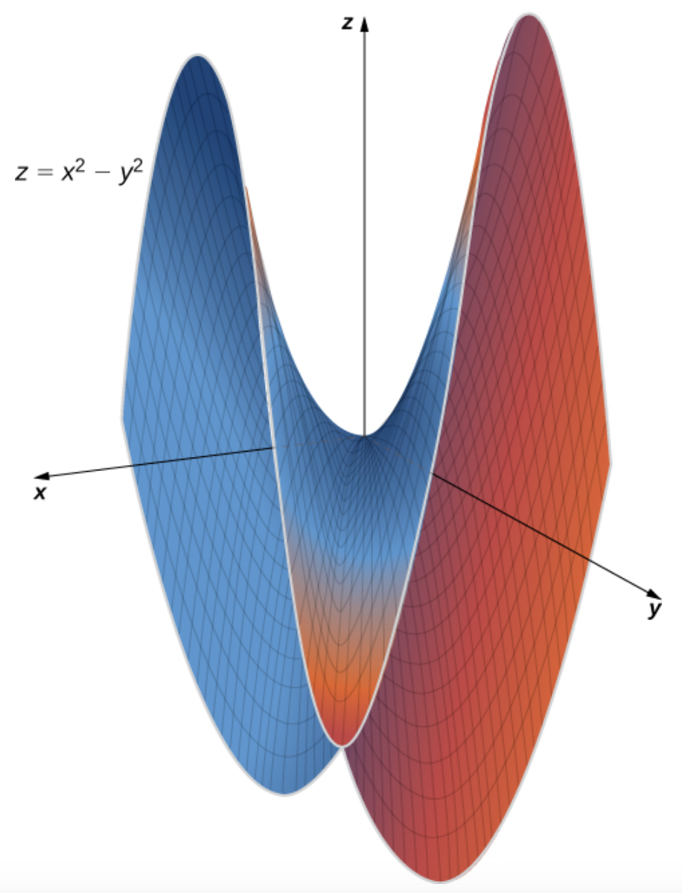
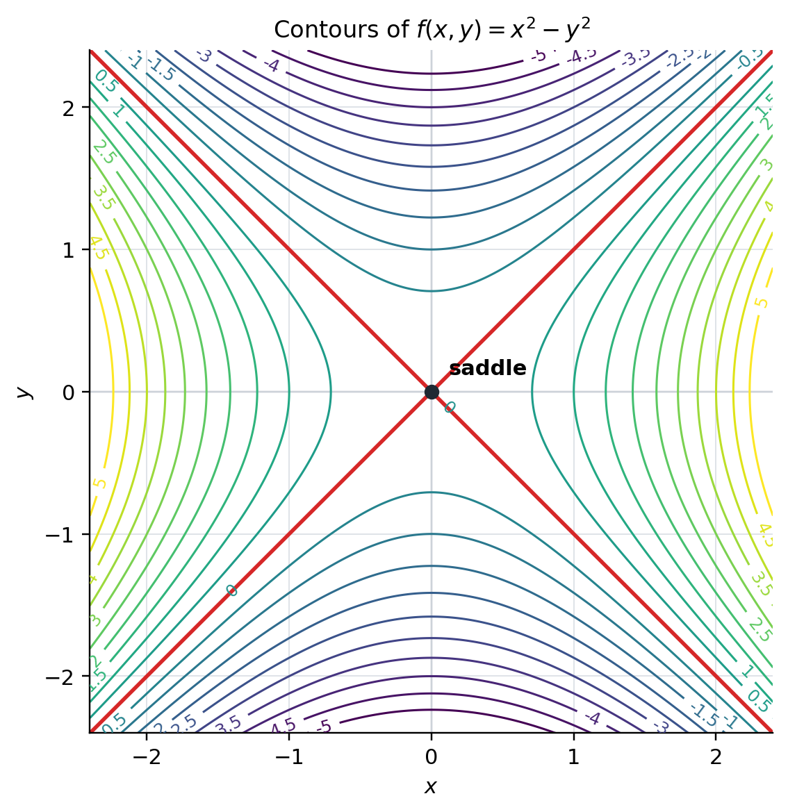
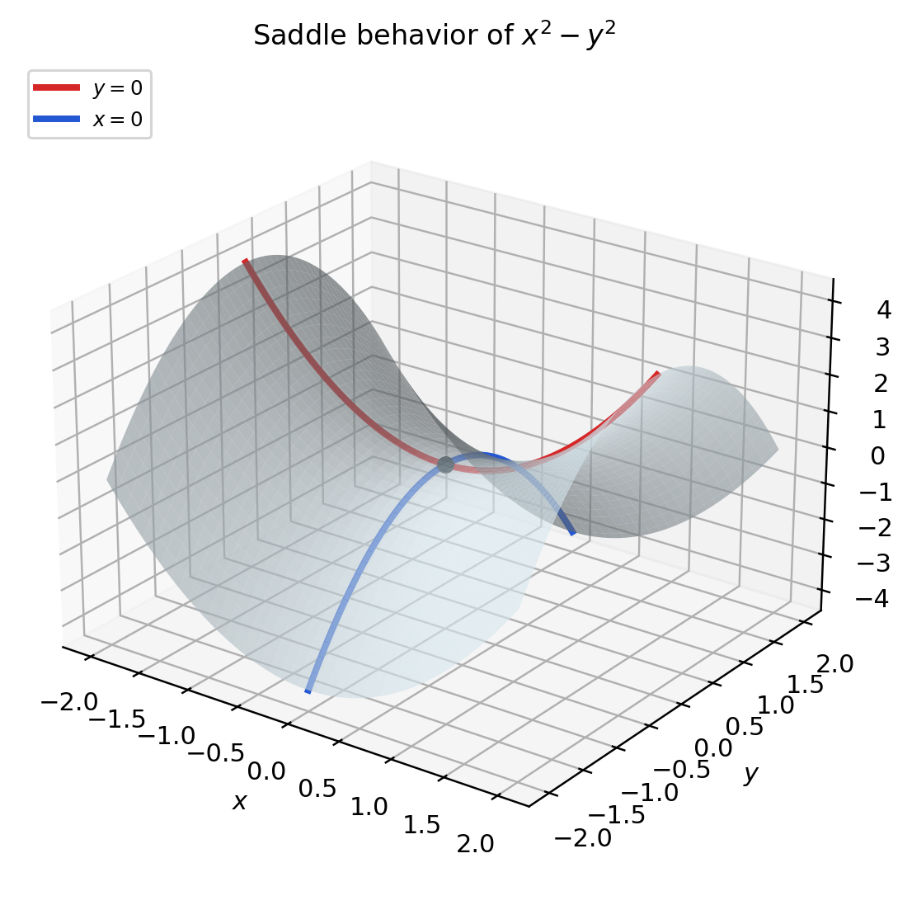
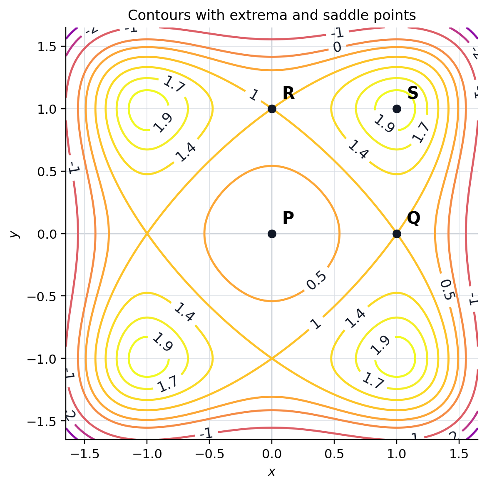

# 5.4 Hessian 与 second derivative test

!!! note "译文与来源"

    本页依据 2026 年 11 月 3 日读取的官方 v0.2 源文件制作。数学术语保留英文；原书公式、代码、例题、活动、证明与解答保留。译稿使用机器辅助翻译并进行数学与排版检查，未经原作者审定。原作者：Jacob Denson、Kaitlyn Phillipson、Sebastien Roch。除原书另有注明外，遵循 [CC BY-NC-SA 4.0](https://creativecommons.org/licenses/by-nc-sa/4.0/)。 [阅读英文原文](https://math345-textbook.github.io/sec-second-derivative-test-and-saddle-points.html)。

在 [方向 derivatives 、critical point和 gradient descent ](3-6.md#sec-u3-directional-derivatives) 中，我们通过求解下式寻找 critical point：

$$
\nabla f(\mathbf a)=\mathbf 0.
$$

这个条件使局部近似中的  linear  项消失，却不能告诉我们 $\mathbf a$ 究竟是  local minimum 、 local maximum ，还是  saddle point 。因此，需要继续观察二次项。在 [ Quadratic forms  和  definiteness ](5-3.md#subsec-u5-quadratic-forms-definiteness) 中，我们已经学过如何用  eigenvalues  判断  quadratic form  的正负；现在把这一  linear  algebra 方法应用到  Hessian 。

## 局部行为和quadratic approximation

 critical point  不一定是  local extremum 。我们先介绍第三种可能性，再回顾一元  Taylor polynomial ，最后把它推广到多元情形。

**定义 5.4.1**

如果一个  function  的  critical point  既不是  local minimum ，也不是  local maximum ，就称它为  saddle point 。

* saddle point 位于 function $f(x,y) = y^2 - x^2$的原点。请注意，沿 $x$ 轴 ($y = 0$)， function  在 $x = 0$ 处具有  global maximum ，而沿 $y$ 轴 ($x = 0$)， function  在 $y = 0$ 处具有  global minimum 。这种一个方向上的最大值和另一个方向上的最小值的组合是saddle point的特征。图 4.48 来自 Edwin “Jed” Herman 和 Gilbert Strang，Calculus Volume 3，OpenStax，© 2018 Rice University，已获得 [CC BY-NC-SA 4.0](https://creativecommons.org/licenses/by-nc-sa/4.0/) 许可；来源：[OpenStax Figure 4.48](https://openstax.org/books/calculus-volume-3/pages/4-7-maxima-minima-problems#CNX_Calc_Figure_14_07_002)。*

??? info "图像说明"

    显示 $z=y^2-x^2$ 的 3D  graph ，其中  saddle point  位于原点。一个横截面像山谷一样向上弯曲，而垂直横截面像山脊一样向下弯曲。表面一侧为蓝色，另一侧为红色，使相反的曲率可见。

**The second-order approximation explains this local behavior**: 我们从单变量的情况开始。

如需复习，可参阅 Strang 和 Herman 的Calculus Volume 2中的 [Section 6.3: Taylor and Maclaurin Series](https://openstax.org/books/calculus-volume-2/pages/6-3-taylor-and-maclaurin-series)。

回想一下，如果单变量  function  $f$ 在 $x = a$ 处有 $n$  derivatives ，则 $f$ 在 $a$ 处的第 $n$  Taylor polynomial  是  function  

$$
\begin{aligned}
p_n(x) & = f(a) + f'(a)(x - a) + \frac{f''(a)}{2!}(x - a)^2 + \cdots + \frac{f^{(n)}(a)}{n!}(x - a)^n \\
& = \sum_{k=0}^n \frac{f^{(k)}(a)}{k!}(x - a)^k
\end{aligned}
$$

特别是，对于$n = 1$，我们获得$f$的 linear approximation 

$$
p_1(x) = f(a) + f'(a) (x - a)
$$

对于$n = 2$，我们获得quadratic approximation

$$
p_2(x) = f(a) + f'(a) (x - a) + f''(a) \frac{(x-a)^2}{2}
$$

Taylor polynomial  $p_n(x)$ 近似于 $x = a$ 附近的  function  $f(x)$，随着 $n$ 的增加，近似值也随之提高。

**活动 5.4.1：立方根  function  (U5-LO5) 的Taylor polynomial**

考虑 function $f(x) = \sqrt[3]{x}$。

求 $x = 8$ 处 $f$ 的第一个和第二个Taylor polynomial。

??? success "解答"

    对于 $f(x) = \sqrt[3]{x}$， function  及其前两个  derivatives  在 $x = 8$ 的值如下： 

    $$
    \begin{aligned}
    f(x) & = \sqrt[3]{x} & f(8) & = 2 \\
    f'(x) & = \frac{1}{3x^{2/3}} & f'(8) & = \frac{1}{12} \\
    f''(x) & = \frac{-2}{9x^{5/3}} & f''(8) & = -\frac{1}{144}
    \end{aligned}
    $$

     因此，$x = 8$ 处的第一个和第二个Taylor polynomial由下式给出： 

    $$
    \begin{aligned}
    p_1(x) & = f(8) + f'(8)(x - 8) \\
    & = 2 + \frac{1}{12}(x - 8) \\
    p_2(x) & = f(8) + f'(8)(x - 8) + \frac{f''(8)}{2!}(x - 8)^2 \\
    & = 2 + \frac{1}{12}(x - 8) - \frac{1}{288}(x - 8)^2
    \end{aligned}
    $$

**活动 5.4.2：使用Taylor polynomial (U5-LO5)**

使用这两个多项式来估计 $\sqrt[3]{11}$。

??? success "解答"

    使用$x = 8$处的第一个 Taylor polynomial ，我们可以估计： 

    $$
    \begin{aligned}
    \sqrt[3]{11} \approx p_1(11) & = 2 + \frac{1}{12}(11 - 8) \\
    & = 2.25
    \end{aligned}
    $$

     使用$x = 8$处的第二个 Taylor polynomial ，我们得到： 

    $$
    \begin{aligned}
    \sqrt[3]{11} \approx p_2(11) & = 2 + \frac{1}{12}(11 - 8) - \frac{1}{288}(11 - 8)^2 \\
    & = 2 + \frac{1}{4} - \frac{1}{32} \\
    & = 2.21875
    \end{aligned}
    $$

如果$a$是$f$的 critical point ，则$f$的quadratic approximation由表达式

$$
f(a) + f''(a) \frac{(x-a)^2}{2}
$$

给出。如果$f''(a) \gt 0$，则$f$的quadratic approximation是顶点位于$(a,f(a))$的向上抛物线。该近似在该顶点处具有最小值，这说明 $a$ 是  function  $f$ 的  local minimum （因为 $f$ 通过其quadratic approximation非常接近）。同样，如果 $f''(a) \lt 0$，则quadratic approximation是一个向下的抛物线，最大值为 $(a,f(a))$，这解释了为什么 $a$ 是  function  $f$ 的  local maximum 。

在多个变量中，[gradient](3-3.md#sec-8-5-gradient) 替换第一个  derivative ，[Hessian](3-3.md#def-8-5-hessian) 替换第二个  derivative 。

**定义 5.4.2：quadratic approximation**

scalar-valued function  $f$ 在点 $\mathbf{a}$ 附近的  quadratic approximation ，是由下式定义的  function  $Q(\mathbf{x})$：

$$
Q(\mathbf{x})
						=
						f(\mathbf{a})
						+
						\nabla f(\mathbf{a})\cdot(\mathbf{x}-\mathbf{a})
						+
						\frac12(\mathbf{x}-\mathbf{a})^T H_f(\mathbf{a})(\mathbf{x}-\mathbf{a})
$$

**注**

function  $f$ 的quadratic approximation通过我们之前遇到的  gradient  细化了  linear approximation 。特别是，如果$f$的第二个 derivatives 是连续的，则

$$
\lim_{\mathbf{x} \to \mathbf{a}} \frac{f(\mathbf{x}) - Q(\mathbf{x})}{\| \mathbf{x} - \mathbf{a} \|^2} = 0
$$

如果 $\mathbf{x}$ 接近 $\mathbf{a}$，则 $\| \mathbf{x} - \mathbf{a} \|^2$ 远小于 $\| \mathbf{x} - \mathbf{a} \|$，因此 $Q(\mathbf{x})$ 到 $f$ 的quadratic approximation通常比  linear approximation  $L(\mathbf{x})$ 更好。

**活动 5.4.3：对数  function  的quadratic approximation（U5-LO5、U3-LO3）**

计算$(x, y) = (1, 2)$点处 function  $f(x, y) = \ln(xy - 1)$的 gradient 和 Hessian ，使用这些值确定$(1,2)$点处$f$的quadratic approximation，然后使用quadratic approximation来估计$(1.2, 1.8)$处$f$的值。

??? success "解答"

    我们计算出

    $$
    f_x = \frac{y}{xy - 1} \quad\text{and}\quad f_y = \frac{x}{xy - 1}
    $$

    所以$(\nabla f)(1,2) = (2,1)$。接下来，我们计算 

    $$
    \begin{aligned}
    f_{xx} & = \frac{-y^2}{(xy - 1)^2} &
    							f_{yy} & = \frac{-x^2}{(xy - 1)^2} &
    							f_{xy} & = f_{yx} = \frac{-1}{(xy - 1)^2}
    \end{aligned}
    $$

    评估$(1, 2)$，我们发现

    $$
    H_f(1, 2) = \begin{bmatrix}
    						\frac{-4}{1} & \frac{-1}{1} \\
    						\frac{-1}{1} & \frac{-1}{1}
    						\end{bmatrix} = \begin{bmatrix}
    						-4 & -1 \\
    						-1 & -1
    						\end{bmatrix}
    $$

    由于

    $$
    f(1,2) = \ln(1) = 0
    $$

    使用 Hessian 和 gradient ，我们发现$f$在$(1,2)$附近的quadratic approximation由

    $$
    \begin{aligned}
    Q(x,y) & =
    							(2,1) \cdot ( x - 1, y - 2 ) + \frac{1}{2} \begin{bmatrix} x - 1 & y - 2 \end{bmatrix} \begin{bmatrix}
    							-4 & -1 \\
    							-1 & -1
    							\end{bmatrix} \begin{bmatrix} x - 1 \\ y - 2 \end{bmatrix} \\
    & = 2(x - 1) + (y-2) - 2 (x - 1)^2 - (x-1)(y-2) - (1/2) (y-2)^2
    \end{aligned}
    $$

    给出。所以

    $$
    \begin{aligned}
    Q(1.2,1.8) & = 2(0.2) + (-0.2) - 2 (0.2)^2 - (0.2)(-0.2) - (1/2) (-0.2)^2 \\
    & = 0.4 - 0.2 - 0.08 + 0.04 - 0.02 \\
    & = 0.14
    \end{aligned}
    $$

    实际值为$f(1.2,1.8)\approx0.1484$，而quadratic approximation值为$0.14$。因此quadratic approximation是相当准确的。为了进行比较，$(1,2)$处的 linear approximation $L$由

    $$
    L(x,y) =2(0.2) + (-0.2) = 0.2
    $$

    给出，其准确度要低得多。

**活动 5.4.4：三角函数  function  的quadratic approximation（U5-LO5、U3-LO3）**

让$f(x, y) = \cos(x/y)$。使用  gradient  和  Hessian  获得 $\mathbf{a} = (0, 1)$ 附近的  function  $f(x, y)$ 的quadratic approximation。

??? success "解答"

    我们计算

    $$
    \nabla f(x,y) = \left( - \frac{\sin(x/y)}{y}, \frac{x \sin(x/y)}{y^2} \right)
    $$

    特别是$\nabla f(0,1) = (0,0)$。接下来，我们计算 

    $$
    \begin{aligned}
    & f_{xx} = -\frac{1}{y^2}\cos\left(\frac{x}{y}\right), \quad   f_{yy} = \frac{x}{y^4}\left(2y\sin\left(\frac{x}{y}\right) + x\cos\left(\frac{x}{y}\right)\right) \\
    & f_{xy} = f_{yx} = \frac{1}{y^3}\left(y\sin\left(\frac{x}{y}\right) + x\cos\left(\frac{x}{y}\right)\right)
    \end{aligned}
    $$

     所以 

    $$
    H_f(0,1) = \begin{bmatrix} -1 & 0 \\ 0 & 0 \end{bmatrix}
    $$

     自 $f(0,1) = \cos(0) = 1$ 起，$f$ 在 $(0,1)$ 的quadratic approximation由 

    $$
    Q(x,y) = 1 - x^2/2
    $$

     给出。

##  Hessian   eigenvalues  和一般 second derivative test 

假设$\mathbf a$是[critical point](3-6.md#def-u3-critical-point)。然后

$$
\nabla f(\mathbf a)=\mathbf 0,
$$

因此[quadratic approximation](5-4.md#def-u5-quadratic-approximation)变成

$$
f(\mathbf a+\mathbf h)\approx f(\mathbf a)+\frac12\mathbf h^T H_f(\mathbf a)\mathbf h.
$$

因此局部行为由与 Hessian 关联的[quadratic form](5-3.md#def-u5-quadratic-form)控制。由于  Hessian  为  symmetric ，因此 [the spectral theorem](5-2.md#thm-principal-axes) 给出的  orthonormal basis  为  eigenvectors 。相应的 eigenvalues 的符号决定了二次项的符号。

**定理 5.4.1： Second derivative test **

设 $f:\mathbb{R}^n\to\mathbb{R}$ 在  critical point  $\mathbf a$ 附近二阶连续  differentiable ，并记：

$$
H=H_f(\mathbf a).
$$

1. 如果 $H$ 的每个  eigenvalue  都  strictly positive ，那么 $\mathbf a$ 是  strict local minimum 。

2. 如果 $H$ 的每个  eigenvalue  都 严格小于零，那么 $\mathbf a$ 是  strict local maximum 。

3. 如果 $H$ 至少有一个严格为正的  eigenvalue ，并且至少有一个严格为负的  eigenvalue ，那么 $\mathbf a$ 是  saddle point 。

其余情况下，这个判别法无法得出结论，需要进一步分析。

??? info "证明"

    由于$\mathbf a$是 critical point ，

    $$
    f(\mathbf a+\mathbf h)-f(\mathbf a)=\frac12\mathbf h^TH\mathbf h+r(\mathbf h),
    $$

    其中

    $$
    \frac{r(\mathbf h)}{\|\mathbf h\|^2}\longrightarrow0\qquad\text{as }\mathbf h\longrightarrow\mathbf0.
    $$

    首先假设$H$的每个 eigenvalue 都是正数，并令$\mu>0$为最小的 eigenvalue 。由 [the quadratic-form diagonalization theorem](5-3.md#thm-10-1-diagonalization-theorem), 

    $$
    \mathbf h^TH\mathbf h\geq\mu\|\mathbf h\|^2.
    $$

     对于足够小的非零 $\mathbf h$, 

    $$
    |r(\mathbf h)|\leq\frac{\mu}{4}\|\mathbf h\|^2.
    $$

     因此 

    $$
    f(\mathbf a+\mathbf h)-f(\mathbf a)\geq\frac{\mu}{2}\|\mathbf h\|^2-\frac{\mu}{4}\|\mathbf h\|^2>0.
    $$

     因此 $\mathbf a$ 是严格的  local minimum 。通过将相同的参数应用于$-f$，可以得出负 eigenvalue 的情况。

    最后，假设$H$有一个正的 eigenvalue $\lambda_+$，单位为 eigenvector $\mathbf v_+$，以及一个负的 eigenvalue $\lambda_-$，单位为 eigenvector $\mathbf v_-$。沿着两条线穿过 $\mathbf a$、

    $$
    f(\mathbf a+t\mathbf v_+)-f(\mathbf a)=\frac12\lambda_+t^2+o(t^2)>0
    $$

     和 

    $$
    f(\mathbf a+t\mathbf v_-)-f(\mathbf a)=\frac12\lambda_-t^2+o(t^2)\lt0
    $$

    得到所有足够小的非零 $t$。因此，邻近值出现在 $f(\mathbf a)$ 的两侧，因此 $\mathbf a$ 是  saddle point 。

**注意**

零  Hessian   eigenvalue  不会对  critical point  进行分类。这意味着quadratic approximation具有平坦方向，因此高阶项可能很重要。

**活动 5.4.5：从  Hessian   eigenvalues  (U5-LO5) 进行预测**

假设$\mathbf{a}$是 scalar-valued function $f$的 critical point 。对于$H_f(\mathbf{a})$的每个 eigenvalues 列表，将 critical point 分类为 local minimum 、 local maximum 、 saddle point 或不确定。

1. $3,5$

2. $-2,-7$

3. $4,-1$

4. $0,2$

??? success "解答"

    如果 eigenvalues 是$3,5$，那么 Hessian 就是 positive definite ，所以 critical point 就是 local minimum 。

    如果 eigenvalues 是$-2,-7$，那么 Hessian 就是 negative definite ，所以 critical point 就是 local maximum 。

    如果 eigenvalues 是$4,-1$，那么 Hessian 就是 indefinite ，所以 critical point 就是 saddle point 。

    如果  eigenvalues  是 $0,2$，则测试不确定。零  eigenvalue  意味着二阶近似具有平坦方向，因此  second derivative test  本身并不能决定局部行为。

**活动 5.4.6：三变量二次方程的critical point（U5-LO5、U3-LO9）**

考虑 function $f(x,y,z) = x^2 + y^2 - xz$。找到$f$的所有critical point并确定每个 critical point 附近$f$的行为。

**问题**

首先找到critical point。

??? success "解答"

    我们计算$\nabla f(x,y,z) = ( 2x - z, 2y, -x )$，它仅在$(0,0,0)$处消失，这是唯一的 critical point 。

**问题**

现在对每个 critical point 进行分类。

??? success "解答"

    Hessian  是常数  matrix  

    $$
    H_f = \begin{bmatrix} 2 & 0 & -1 \\ 0 & 2 & 0 \\ -1 & 0 & 0 \end{bmatrix}
    $$

    关联的 quadratic form 是

    $$
    \begin{aligned}
    \mathbf{h}^T H_f\mathbf{h}
    								& =
    								2h_1^2+2h_2^2-2h_1h_3.
    \end{aligned}
    $$

    这个 quadratic form 既可以取正值，也可以取负值。例如，

    $$
    \begin{bmatrix}0\\1\\0\end{bmatrix}^T
    							H_f
    							\begin{bmatrix}0\\1\\0\end{bmatrix}
    							=2>0,
    $$

     但

    $$
    \begin{bmatrix}1\\0\\3\end{bmatrix}^T
    							H_f
    							\begin{bmatrix}1\\0\\3\end{bmatrix}
    							=
    							2-6=-4\lt 0.
    $$

     因此$H_f$ 是 indefinite 。通过 second derivative test ， critical point $(0,0,0)$是 saddle point 。

**活动 5.4.7：三次方的三个变量的critical point（U5-LO5、U3-LO9）**

使用 second derivative test 对 function $f(x,y,z) = xy + yz + xz + xyz$的critical point进行分类。

??? success "解答"

    我们计算

    $$
    \nabla f(x,y,z) =
    						\begin{bmatrix}
    						y + z + yz\\
    						x + z + xz\\
    						x + y + xy
    						\end{bmatrix}
    $$

    请注意，$\nabla f(x,-1,z) = ( -1, x + z + xz, -1 )$ 是非消失的，因此平面 $y = -1$ 上不存在critical point。现在假设$\nabla f(x,y,z) = 0$和$y \neq -1$。第三个条目告诉我们$x = -y/(1 + y)$。将其代入第二个方程得出 $-y/(1+y) + z - yz/(1+y) = 0$，即 $z = y$。将其代入第一个方程得出 $y^2 + 2y = 0$，即 $y = 0$ 或 $y = -2$。代回得到$f$的两个critical point，即$(0,0,0)$和$(-2,-2,-2)$。

    接下来，我们对这些critical point进行分类。我们计算出$f$的 Hessian 为

    $$
    H_f(x,y,z) = \begin{bmatrix} 0 & 1 + z & 1 + y \\ 1 + z & 0 & 1 + x \\ 1 + y & 1 + x & 0 \end{bmatrix}
    $$

    特别是

    $$
    H_f(0,0,0) = \begin{bmatrix} 0 & 1 & 1 \\ 1 & 0 & 1 \\ 1 & 1 & 0 \end{bmatrix}
    $$

    它具有characteristic polynomial

    $$
    \begin{aligned}
    \det \begin{bmatrix} \lambda & -1 & -1 \\ -1 & \lambda & -1 \\ -1 & -1 & \lambda \end{bmatrix} & = \lambda( \lambda^2 - 1) - (-1) (-\lambda - 1) + (-1) (1 + \lambda) \\
    & = \lambda^3 - 3\lambda - 2 \\
    & = (\lambda + 1)(\lambda^2 - \lambda - 2) \\
    & = (\lambda + 1)^2( \lambda - 2 )
    \end{aligned}
    $$

    所以$H_f(0,0,0)$有 eigenvalues $-1$和$2$， indefinite 也是如此，所以$f$在$(0,0,0)$有一个 saddle point 。我们有

    $$
    H_f(-2,-2,-2) = \begin{bmatrix} 0 & -1 & -1 \\ -1 & 0 & -1 \\ -1 & -1 & 0 \end{bmatrix}
    $$

    它有characteristic polynomial

    $$
    \begin{aligned}
    \det \begin{bmatrix} \lambda & 1 & 1 \\ 1 & \lambda & 1 \\ 1 & 1 & \lambda \end{bmatrix} & = \lambda( \lambda^2 - 1) - (\lambda - 1) + (1 - \lambda) \\
    & = \lambda^3 - 3 \lambda + 2 \\
    & = (\lambda - 1)(\lambda^2 + \lambda - 2) \\
    & = (\lambda - 1)^2(\lambda + 2)
    \end{aligned}
    $$

    所以$H_f(-2,-2,-2)$有 eigenvalues $1$和$-2$，因此是 indefinite  matrix 。所以$(-2,-2,-2)$也是$f$的 saddle point 。

## 二元变量 second derivative test 

对于两个变量的 function ， critical point 处的 Hessian 具有

$$
H_f(a,b)=\begin{bmatrix}f_{xx}(a,b)& f_{xy}(a,b)\\f_{xy}(a,b)& f_{yy}(a,b)\end{bmatrix}.
$$

的形式，它的 determinant 是

$$
D(a,b)=f_{xx}(a,b)f_{yy}(a,b)-f_{xy}(a,b)^2.
$$

由于 determinant 是两个 eigenvalues 的乘积，$D$检测它们的符号是否一致。因此，标准二变量检验是一般  Hessian  检验的快捷方式。

**活动 5.4.8：$2\times2$  definiteness  标准 (U5-LO4)**

证明 matrix 

$$
A = \begin{bmatrix} a & b \\ b & d \end{bmatrix}
$$

是 positive definite 当且仅当$ad - b^2$为正且$a > 0$， negative definite 当且仅当$ad - b^2$为正且$a \lt 0$，以及 indefinite 当且仅当$ad - b^2$为负。由此可见，二变量检验是一般 second derivative test 的特例。

??? success "解答"

    令$\lambda_1$和$\lambda_2$为$A$的 eigenvalues 。直接计算得到 

    $$
    \begin{aligned}
    c_A(\lambda)
    							&=\det(\lambda I_2-A) \\
    &=(\lambda-a)(\lambda-d)-b^2 \\
    &=\lambda^2-(a+d)\lambda+(ad-b^2).
    \end{aligned}
    $$

     另一方面，characteristic polynomial是一元多项式并且有根 $\lambda_1$ 和 $\lambda_2$，因此 

    $$
    \begin{aligned}
    c_A(\lambda)
    							&=(\lambda-\lambda_1)(\lambda-\lambda_2) \\
    &=\lambda^2-(\lambda_1+\lambda_2)\lambda+\lambda_1\lambda_2.
    \end{aligned}
    $$

     比较  coefficients  得到 

    $$
    a+d=\lambda_1+\lambda_2,
    						\qquad
    						ad-b^2=\lambda_1\lambda_2.
    $$

    首先假设$A$是 positive definite 。然后$\lambda_1,\lambda_2>0$，所以$ad-b^2=\lambda_1\lambda_2>0$。另外，通过[定理 5.3.2](5-3.md#thm-10-1-positive-negative-definite-inequlaily)，

    $$
    a=\mathbf{e}_1^T A\mathbf{e}_1>0.
    $$

     相反，假设$ad-b^2>0$和$a>0$。然后$ad>b^2\geq 0$，所以$d>0$也是如此。因此

    $$
    \lambda_1+\lambda_2=a+d>0,
    						\qquad
    						\lambda_1\lambda_2=ad-b^2>0.
    $$

    的正积意味着两个 eigenvalues 具有相同的符号，正和意味着该符号为正。因此 eigenvalues 都是正数，所以$A$是 positive definite 。

    **The negative-definite case is analogous**: 如果$A$是 negative definite ，那么$\lambda_1,\lambda_2\lt 0$，所以$ad-b^2>0$，[定理 5.3.2](5-3.md#thm-10-1-positive-negative-definite-inequlaily)给出$a=\mathbf{e}_1^T A\mathbf{e}_1\lt 0$。相反，如果$ad-b^2>0$和$a\lt 0$，则$d\lt 0$。因此  eigenvalues  的乘积为正，和为负，因此  eigenvalues  都是负数，$A$ 是  negative definite 。

    最后，当且仅当两个 eigenvalues 具有相反的符号时，$A$才是 indefinite 。当且仅当$\lambda_1\lambda_2\lt 0$成立时，通过上面的 coefficient 比较，当且仅当$ad-b^2\lt 0$成立。

**定理 5.4.2：二变量 second derivative test **

设 $f:\mathbb{R}^2\to\mathbb{R}$ 在  critical point  $(a,b)$ 附近二阶连续  differentiable 。定义：

$$
D(a,b)=f_{xx}(a,b)f_{yy}(a,b)-f_{xy}(a,b)^2.
$$

- 如果同时满足 $D(a,b)>0$ 和 $f_{xx}(a,b)>0$，那么 $(a,b)$ 是  local minimum 。

- 如果同时满足 $D(a,b)>0$ 和 $f_{xx}(a,b)\lt0$，那么 $(a,b)$ 是  local maximum 。

- 如果$D(a,b)\lt0$，则$(a,b)$是 saddle point 。

- 如果 $D(a,b)=0$，这个判别法无法得出结论。

??? info "证明"

    将[$2\times2$  definiteness  标准 (U5-LO4)](5-4.md#act-10-1-second-derivative-test-two-variables)应用到 Hessian matrix $H_f(a,b)$，然后应用[ Second derivative test ](5-4.md#thm-u5-general-second-derivative-test)。

**活动 5.4.9：对二次方程的  critical point  进行分类 (U5-LO5)**

使用 [the two-variable second derivative test](5-4.md#thm-u5-two-variable-second-derivative-test) 确定在 [the earlier activity](3-6.md#act-u3-critical-point-quadratic-minimum) 中找到的 $f(x,y) = x^2 + y^2 - 2x + 4y$ 的  critical point  $(1,-2)$ 是否为  local maximum 、 local minimum  或  saddle point 。

??? success "解答"

    我们应用 second derivative test 。我们计算 $f$ 的二阶部分  derivatives 。我们计算出

    $$
    f_{xx}(x,y) = 2 \quad f_{yy} = 2 \quad\text{and} \quad f_{xy}(x,y) = 0
    $$

    所以判别式是常数 function 

    $$
    D = f_{xx} f_{yy} - f_{xy}^2 = (2)(2) - (0)^2 = 4
    $$

    由于判别式为正，根据 second derivative test ， critical point $(1,-2)$是 local minimum 。

**活动 5.4.10：对二次方程 (U5-LO5) 的原点进行分类**

使用[the two-variable second derivative test](5-4.md#thm-u5-two-variable-second-derivative-test)分析[the earlier activity](3-6.md#act-u3-critical-point-saddle-quadratic)中找到的$f(x,y) = x^2 - y^2$的 critical point $(0,0)$。

??? success "解答"

    我们需要计算二阶部分 derivatives ：

    $$
    f_{xx} = 2 \quad f_{yy} = -2 \quad \text{and} \quad f_{xy} = 0
    $$

    所以判别式也是常数 function 

    $$
    D = f_{xx} f_{yy} - f_{xy}^2 = (2)(-2) - (0)^2 = -4
    $$

    由于判别式为负， second derivative test 告诉我们$(0,0)$是$f$的 saddle point 。

**活动 5.4.11：具有交叉项的二次方程的critical point（U5-LO5、U3-LO9）**

查找  function  

$$
f(x,y) = x^2 + xy + y^2 - 6x + 6
$$

 的所有局部最大值、局部最小值和saddle point。

??? success "解答"

    我们首先找到 $f$ 的critical point。我们计算出

    $$
    f_x(x,y)=2x+y-6
    						\qquad\text{and}\qquad
    						f_y(x,y)=x+2y
    $$

    所以critical point满足 

    $$
    2x+y-6=0
    						\qquad\text{and}\qquad
    						x+2y=0.
    $$

     第二个方程给出 $x=-2y$。代入第一个方程可得到 

    $$
    2(-2y)+y-6=0,
    $$

    因此 $-3y=6$，从而得到 $y=-2$。因此$x=4$，唯一的 critical point 是$(4,-2)$。

    为了对 critical point 进行分类，我们应用 second derivative test 。我们计算出

    $$
    f_{xx}(x,y)=2,\qquad f_{yy}(x,y)=2,\qquad f_{xy}(x,y)=1
    $$

    所以判别式是常数

    $$
    D = f_{xx} f_{yy} - f_{xy}^2 = (2)(2) - (1)^2 = 3
    $$

    由于$D>0$和$f_{xx}>0$， critical point $(4,-2)$是 local minimum 。

**活动 5.4.12：重温  gradient  下降二次方程（U5-LO5、U3-LO9）**

考虑 function 

$$
f(x,y)=x^2-3xy+3y^2+5y+2x.
$$

找到$f$的所有critical point，并将每个critical point分类为 local minimum 、 local maximum 或 saddle point 。

??? success "解答"

    我们通过求解$\nabla f(x,y)=\mathbf{0}$找到critical point。由于

    $$
    f_x(x,y)=2x-3y+2
    						\qquad\text{and}\qquad
    						f_y(x,y)=-3x+6y+5,
    $$

    critical point满足

    $$
    2x-3y+2=0
    						\qquad\text{and}\qquad
    						-3x+6y+5=0.
    $$

     第一个方程给出$x=(3y-2)/2$。将此表达式代入第二个方程可得出 

    $$
    \begin{aligned}
    -3\left(\frac{3y-2}{2}\right)+6y+5 &=0, \\
    \frac{3y}{2} &=-8, \\
    y &=-\frac{16}{3}.
    \end{aligned}
    $$

     由此可知 

    $$
    x=\frac{3(-16/3)-2}{2}=-9,
    $$

    因此唯一的  critical point  为 $(-9,-16/3)$。

     Hessian matrix  是常数  matrix  

    $$
    H_f(x,y)=
    						\begin{bmatrix}
    							2 & -3 \\
    							-3 & 6
    						\end{bmatrix}.
    $$

     因此判别式是 

    $$
    D=f_{xx}f_{yy}-f_{xy}^2=(2)(6)-(-3)^2=3>0.
    $$

     由于$D>0$和$f_{xx}=2>0$， second derivative test 告诉我们$(-9,-16/3)$是$f$的 local minimum 。

在前面的示例中，判别式是常数，因为 $f$ 是二次方  function 。让我们考虑一个判别式是非常数的例子。

**活动 5.4.13：两个变量中三次方的critical point（U5-LO5、U3-LO9）**

查找  function  $f(x,y) = x^3 + y^2 + 2xy - 4x - 3y + 5$ 的所有局部最大值、局部最小值和saddle point。

??? success "解答"

    我们首先找到  critical point 。我们计算出

    $$
    f_x(x,y) = 3x^2 + 2y - 4 \quad\text{and}\quad f_y(x,y) = 2y + 2x - 3
    $$

    将两者设置为零即可得到方程对 

    $$
    3x^2 + 2y - 4 = 0 \quad\text{and}\quad 2y + 2x - 3 = 0
    $$

    我们求解 $y$ 的第二个方程，即 $y = 3/2 - x$，然后将其代入第一个方程，得到方程 

    $$
    3x^2 + 2(3/2 - x) - 4 = 0
    $$

    从而简化为二次方程 

    $$
    3x^2 - 2x - 1 = 0
    $$

    二次方程告诉我们，该方程的根由公式 

    $$
    x = \frac{-(-2) \pm \sqrt{(-2)^2 - 4 (3)(-1)}}{2(3)} = 1/3 \pm \frac{\sqrt{16}}{6} = 1/3 \pm 2/3
    $$

     给出。所以$x = 1$或$x = -1/3$。对于每个这样的$x$，设置$y = 3/2 - x$可以为$f$提供一个 critical point ，因此$f$有两个critical point，即$(1,1/2)$和$(-1/3,11/6)$。

    为了将 second derivative test 应用于每个 critical point ，我们计算$f$的判别式。我们发现

    $$
    f_{xx} = 6x \quad f_{yy} = 2 \quad \text{and}\quad f_{xy} = 2
    $$

    所以判别式是 function 

    $$
    D(x,y) = f_{xx}(x,y) f_{yy}(x,y) - f_{xy}(x,y)^2 = (6x)(2) - (2)^2 = 12x - 4
    $$

    所以

    $$
    D(1,1/2) = 12(1) - 4 = 8 \quad\text{and}\quad D(-1/3,11/6) = 12(-1/3) - 4 = -8
    $$

    由于 $D(1,1/2)$ 为正，并且 $f_{xx}(1,1/2) = 6$ 为正，因此  critical point  $(1,1/2)$ 是  function  $f$ 的 local minimum 。由于$D(-1/3,11/6)$是负数，这告诉我们$(-1/3,11/6)$是 function $f$的 saddle point 。

**注**

以下活动解释了为什么我们只在  second derivative test  的前两种情况下查看 $f_{xx}$。

**活动 5.4.14：第二个 derivatives (U5-LO5)的判别式和符号**

对或错：如果 $D > 0$，则 $f_{xx}$ 和 $f_{yy}$ 具有相同的符号。

??? success "解答"

    **True**: 如果$D = f_{xx}f_{yy} - (f_{xy})^2 > 0$，则$f_{xx}f_{yy} > (f_{xy})^2 \geq 0$，所以$f_{xx} f_{yy} > 0$。由于$f_{xx} f_{yy}$是正数，这意味着$f_{xx}$和$f_{yy}$都是正数，或者$f_{xx}$和$f_{yy}$都是负数。因此，当判别式为正时，$f_{xx}$ 和 $f_{yy}$ 始终具有相同的符号。

## contour plot和saddle point

 Hessian  测试以代数方式对局部行为进行分类。等高线图和线的限制在几何上显示出相同的行为。

**说明**

检测  saddle point  的一种常见方法是找到通过该点的两个方向，使得  function  在一个方向上增加，在另一个方向上减少。这并不是所有可能的  saddle point  的完整定义；在许多例子中这是一个有用的测试。

例如， function  

$$
f(x,y)=x^2-y^2
$$

 在 $(0,0)$ 处有一个  saddle point 。沿着线 $y=0$、

$$
f(x,0)=x^2,
$$

在 $x=0$ 处有  local minimum 。沿着线 $x=0$、

$$
f(0,y)=-y^2,
$$

在 $y=0$ 处有  local maximum 。下面的  contour plot  显示了相同的行为。

在此示例中，表面积在一个  coordinate  方向上增大，在另一个方向上减小。这是鞍座  shape  建议的行为。

* contour plot  $f(x,y) = x^2 - y^2$。改编自：斯坦福大学 MATH 51 教科书。*

??? info "图像说明"

    contour plot  显示$f(x,y)=x^2-y^2$ 的电平曲线。零轮廓由两条在原点交叉的对角线组成。正负轮廓值在四个区域中交替，表示  saddle point  位于 $(0,0)$。

**注**

更正式地说，如果这些线由 

$$
\{\mathbf{a}+t\mathbf{d}_1\}
						\qquad\text{and}\qquad
						\{\mathbf{a}+t\mathbf{d}_2\},
$$

 以参数形式给出，那么一变量限制 

$$
g(t)=f(\mathbf{a}+t\mathbf{d}_1)
						\qquad\text{and}\qquad
						h(t)=f(\mathbf{a}+t\mathbf{d}_2)
$$

 可以在 $t=0$ 处表现出相反的局部行为。在上面的示例中，这验证了附近的点出现在 $f(\mathbf{a})$ 的两侧。

*在$f(x,y)=x^2-y^2$的 saddle point 处，沿$y=0$有一个 local minimum ，沿$x=0$有一个 local maximum 。*

??? info "图像说明"

    显示了 $z=x^2-y^2$ 的半透明鞍形表面。沿 $y=0$ 的红色曲线向上开口，在原点处具有  local minimum ，而沿 $x=0$ 的蓝色曲线向下开口并在原点处具有  local maximum 。

**活动 5.4.15：根据轮廓对critical point进行分类 (U5-LO5)**

对于下图中的每个点，请指出它是 local maximum 、 local minimum 还是 saddle point 。

*具有多种类型critical point的 contour plot 。*

??? info "图像说明"

    contour plot 示出了示例性 function $g(x,y)=2-(x^2-1)^2-(y^2-1)^2$的水平曲线。点 $P$ 位于嵌套低值轮廓的中心，点 $S$ 位于嵌套高值轮廓的中心，点 $Q$ 和 $R$ 位于轮廓图案像马鞍一样变化的位置。

??? success "解答"

    如果我们查看以 $S$ 为中心的嵌套椭圆的集合，并检查标记水平集的数值，我们会看到这些数字严格增加。这些椭圆似乎正在磨削一个点 $S$，即  local maximum 。同样，靠近 $P$ 的嵌套椭圆集合的  function  值呈递减方向，表明 $P$ 是  local minimum 。我们还在$R$和$Q$处看到saddle point。当我们向东北方向远离$R$时， function 值会增加，而向东南方向远离 function 值会减少。在saddle point附近， contour plot  形成一个“X” shape ，将空间划分为 $4$ 区域。  Function  值在一对相对区域中增加，而在另一对中减少。在局部极值附近，水平集形成类似于椭圆的椭圆形 shapes 。

