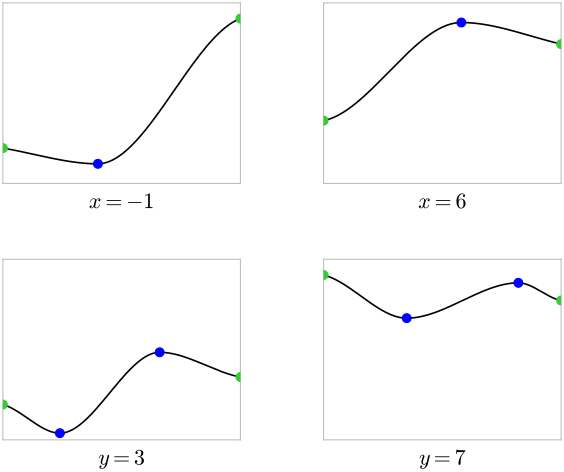

# 6.1 closed bounded region 上的 absolute extrema

!!! note "译文与来源"

    本页依据 2026 年 11 月 3 日读取的官方 v0.2 源文件制作。数学术语保留英文；原书公式、代码、例题、活动、证明与解答保留。译稿使用机器辅助翻译并进行数学与排版检查，未经原作者审定。原作者：Jacob Denson、Kaitlyn Phillipson、Sebastien Roch。除原书另有注明外，遵循 [CC BY-NC-SA 4.0](https://creativecommons.org/licenses/by-nc-sa/4.0/)。 [阅读英文原文](https://math345-textbook.github.io/sec-absolute-maxima.html)。

回顾 [内部、 boundary 和闭集](3-1.md#sec-8-4-interior-and-exterior)：如果以点 $\mathbf{x}_0 \in \mathbb{R}^n$ 为中心的任意 open ball，都同时含有 $S$ 内的点和 $S$ 外的点，那么就称这个点为集合 $S$ 的  boundary point ，这里 open ball 的中心就是 $\mathbf{x}_0$。$S$ 的  boundary  是所有  boundary  points 组成的集合。根据 [闭集](3-1.md#sec-8-5-closed-sets)，当 $S$ 包含自己的全部  boundary  时，就称它为 closed set。

**活动 6.1.1：检查区域是否闭合（U6-LO1）**

确定每个给定区域是否闭合。

**问题**

区域$A = \{(x,y) : x^2 + y^2 \lt 1\}$。

??? success "解答"

    集合$A$是单位圆盘的内部，不包括圆$x^2 + y^2 = 1$上的任何点，这些点是集合的 boundary 点。

**问题**

地区$B = \{(x,y) : x^2 + y^2 = 1\}$

??? success "解答"

    集合$B$是闭集，因为$B$的 boundary 点的集合等于$B$本身。

**问题**

$C = \{(x,y) : 1 \leq x \leq 2, 1 \leq y \leq 2\}$

??? success "解答"

    集合$C$是闭集。  boundary  点是点$(x,y)$ 的集合，使得
    - $x = 1$ 和 $1 \leq y \leq 2$。

    - $x = 2$ 和 $1 \leq y \leq 2$。

    - $1 \leq x \leq 2$ 和 $y = 1$。

    - $1 \leq x \leq 2$ 和 $y = 2$。

     集合$C$ 包含所有这样的点，因此是闭集。

**问题**

套装$D = \{(x,y) : x > 1\}$

??? success "解答"

    集合$D$不是闭集。 $D$的 boundary 点的集合是集合$\{ (x,y): x = 1 \}$，它不包含在$D$中。

**定理 6.1.1**

如果  scalar-valued function  $f$ 在一个 closed 且  bounded set  $D$ 上连续，那么 $f$ 一定能在 $D$ 上取得  absolute maximum  和  absolute minimum 。

 second derivative test  告诉我们 critical point 是 local maximum 、 local minimum 还是 saddle point 。但是，它不能识别全局（绝对）极值。对于定义在闭合有界区域上的 functions ，我们可以使用以下过程来查找 absolute extrema ，前提是该区域的 boundary 点具有适当的简单性质。

**算法 6.1.1**

给定一个  function  $f$，在闭合的  bounded set  $D$ 上连续，该算法在 $D$ 上找到 $f$ 的  absolute extrema 。

1. 找出$D$内部$f$的所有critical point。

2. 找到所有 boundary 候选者。在每个  boundary  块上，尽可能减少为单变量问题，并包括端点和角点。

3. 对前两步中的每个候选者进行 $f$ 评估。

4. 最大值为  absolute maximum  值，最小值为  absolute minimum  值。

如果$D$的 boundary 由一条或多条曲线组成，我们通常可以参数化每条曲线并使用单变量微积分找到 boundary 候选。端点和角点仍必须单独检查。

*在矩形  domain  上查找  absolute extrema  的示意图。顶部面板显示了一个矩形的表面，其中内部候选为红色， boundary 候选为蓝色，角为绿色。下面的四个面板显示单变量  boundary  切片，端点为绿色， boundary  critical point为蓝色。改编自：斯坦福大学 MATH 51 教科书。*

![顶部表面面板显示矩形 $[-1,6\]\times[3,7\]$ 上方的半透明表面。两个红点出现在曲面内部，蓝点沿着四个  boundary  曲线出现，绿点标记四个角。](images/u6-absolute-extrema-schematic-main.svg)

??? info "图像说明"

    顶部表面面板显示矩形 $[-1,6]\times[3,7]$ 上方的半透明表面。两个红点出现在曲面内部，蓝点沿着四个  boundary  曲线出现，绿点标记四个角。

??? info "图像说明"

    下面的  boundary  切片面板显示四个单变量图，标记为 $x=-1$、$x=6$、$y=3$ 和 $y=7$。绿点标记每个切片的端点，蓝点标记沿  boundary  的单变量critical point。

**活动 6.1.2： Absolute extrema  在正方形上 (U6-LO1)**

考虑单位正方形 

$$
D = \{(x, y) \in \mathbb{R}^2 : -1 \leq x \leq 1, -1 \leq y \leq 1\}.
$$

 上的  function  

$$
f(x, y) = 3x^2 - 2y^2 + 2x + 2y - 1
$$

求 $D$ 上的  absolute maximum  和 $f$ 的最小值。

??? success "解答"

    集合$D$是闭有界的，所以我们可以应用[算法 6.1.1](6-1.md#alg-10-1-finding-maxima-and-minima)。

    我们首先在$D$内部（即集合

    $$
    \operatorname{int}(D)=\{(x,y)\in \mathbb{R}^2 : -1 \lt x \lt 1,\ -1 \lt y \lt 1\}
    $$

    上）找到$f$的critical point。我们计算

    $$
    f_x = 6x + 2 \quad\text{and}\quad f_y = -4y + 2
    $$

    这两个量在$(-1/3,1/2)$点同时消失，因此这是$f$中唯一的 critical point 。此时

    $$
    \begin{aligned}
    f(-1/3,1/2) & = 3(-1/3)^2 - 2(1/2)^2 + 2(-1/3) + 2(1/2) - 1 \\
    & = -5/6
    \end{aligned}
    $$

    现在我们检查$D$的 boundary 。  boundary 是四条曲线的并集，因此我们可以对这些曲线进行参数化，并找到 parameterization 的critical point，以确定这些曲线上潜在的绝对最小值和最大值（单独处理$D$的角点）。

    在底部边缘 $y = -1$， function  采用

    $$
    f(x,-1) = 3x^2 - 2(-1)^2 + 2x + 2(-1) - 1 = 3x^2 + 2x - 5
    $$

     的形式。表达式 $3x^2 + 2x - 5$ 中唯一的  critical point  出现在 $x = -1/3$ 和 

    $$
    f(-1/3,-1) = 3(-1/3)^2 + 2(-1/3) - 5 = -16/3
    $$

     处。同样，在顶部边缘 $y = 1$， function  采用形式 

    $$
    f(x,1) = 3x^2 - 2(1)^2 + 2x + 2(1) - 1 = 3x^2 + 2x - 1
    $$

    至于底边，表达式$3x^2 + 2x - 1$中唯一的 critical point 出现在$x = -1/3$和

    $$
    f(-1/3,1) = 3(-1/3)^2 + 2(-1/3) - 1 = -4/3
    $$

    处。在左边缘 $x = -1$， function  采用

    $$
    f(-1,y) = 3(-1)^2 - 2y^2 + 2(-1) + 2y - 1 = - 2y^2 + 2y
    $$

     的形式。表达式$-2y^2 + 2y$中唯一的 critical point 出现在$y = 1/2$和

    $$
    f(-1,1/2) = 2(1/2) - 2(1/2)^2 = 1/2
    $$

    时。同样，在右边缘 $x = 1$， function  采用

    $$
    f(1,y) = 3(1)^2 - 2y^2 + 2(1) + 2y - 1 = -2y^2 + 2y + 4
    $$

     的形式。该表达式中唯一的  critical point  出现在 $y = 1/2$ 和 

    $$
    f(1,1/2) = -2(1/2)^2 + 2(1/2) + 4 = 9/2
    $$

     时。在 boundary critical point中，最小值出现在$(-1/3,-1)$，其中$f$的值为$-16/3$，最大值出现在$(1,1/2)$，其中$f$的值为$9/2$。

    最后，我们必须检查 $(-1,-1)$、$(-1,1)$、$(1,-1)$ 和 $(1,1)$ 四个角的  function  的值。我们计算$f(-1, -1) = -4$、$f(-1, 1) = 0$、$f(1, -1) = 0$和$f(1, 1) = 4$。

    比较所有值，我们发现$D$上$f$的 absolute maximum 出现在$(1,1/2)$，最大值为$9/2$， absolute minimum 出现在$(-1/3,-1)$，最小值$-16/3$。

*$f(x,y)=3x^2-2y^2+2x+2y-1$ $D$ 上的critical point： interior point （红色）、边缘点（蓝色）、角点（绿色）。改编自：斯坦福大学 MATH 51 教科书。*

![$f(x,y)=3x^2-2y^2+2x+2y-1$ 的  graph  显示在正方形 $[-1,1\]\times[-1,1\]$ 上方。红点标记内部 critical point $(-1/3,1/2)$，蓝点标记四个边缘critical point，绿点标记四个角。](images/u6-absolute-extrema-example-points.svg)

??? info "图像说明"

    $f(x,y)=3x^2-2y^2+2x+2y-1$ 的  graph  显示在正方形 $[-1,1]\times[-1,1]$ 上方。红点标记内部 critical point $(-1/3,1/2)$，蓝点标记四个边缘critical point，绿点标记四个角。

**活动 6.1.3： Absolute extrema  在矩形 (U6-LO1) 上**

在本练习中，我们计算 $0 \leq x \leq 4$ 和 $0 \leq y \leq 3$ 的  function  $f(x,y) = 2x - 2xy + y^2$ 的  absolute extrema 。

**问题**

首先找到  domain  内部的所有critical point，我们试图在这些点上优化 $f$。

??? success "解答"

    内部区域由方程 $0 \lt x \lt 4$ 和 $0 \lt y \lt 3$ 定义。我们计算出

    $$
    f_x = 2 - 2y \quad\text{and}\quad f_y = -2x + 2y
    $$

    因此唯一的 critical point 出现在点$(1,1)$。这里我们有$f(1,1) = 2(1) - 2(1)(1) + (1)^2 = 1$。

**问题**

接下来，找到该区域的  boundary  曲线内部以及该区域的角上的最大值和最小值。

??? success "解答"

    boundary  曲线由以下四个区域组成： 
    - 底边：$y = 0$、$0 \leq x \leq 4$

    - 右边缘：$x = 4$、$0 \leq y \leq 3$

    - 顶边：$y = 3$、$0 \leq x \leq 4$

    - 左边缘：$x = 0$、$0 \leq y \leq 3$

     一旦参数化，我们首先计算曲线内部的critical point。

    在底部边缘$y = 0$，我们有$f(x,y) = 2x$，一个没有critical point的表达式。在顶部边缘$y = 3$，我们有$f(x,3) = 2x - 2x(3) + 3^2 = 9 - 4x$，它也没有critical point。在左边缘$x = 0$，我们有$f(0,y) = y^2$，它在$y = 0$处有一个 critical point ，但这不在曲线的内部。在右边缘$x = 4$，我们有$f(4,y) = 8 - 8y + y^2$，当$y = 4$时，它有一个 critical point ，它不在区域$D$中。因此  boundary  曲线内部不存在critical point。

    尽管如此，我们还必须直接计算四个角上的  function  值。我们有 $f(0,0) = 0$、$f(0,3) = 9$、$f(4,0) = 8$ 和 $f(4,3) = 8 - 24 + 9 = -7$。

**问题**

最后，比较所有值。

??? success "解答"

    比较我们收集的所有可能的最小值和最大值，我们发现$D$上的 function $f$的 absolute maximum 出现在$(0,3)$，其中$f(0,3) = 9$，并且 function 的 absolute minimum 出现在$(4,3)$，其中$f(4,3) = -7$。

在矩形上，每个  boundary  块都由一个简单的方程（例如 $x=a$ 或 $y=b$）给出，因此 [算法 6.1.1](6-1.md#alg-10-1-finding-maxima-and-minima) 的步骤 2 简化为一变量微积分。曲线 boundary 可以改为由方程

$$
g(\mathbf{x})=k.
$$

隐式给出，参数化这样的 boundary 可能不方便。  Lagrange multipliers  提供了一种直接在上面寻找候选点的方法。

更一般地说，许多优化问题从一开始就包含  constraint ，例如固定预算、总计、面积或  vector  长度。因此 Lagrange multipliers 既是针对封闭区域的 boundary 方法，又是针对自然约束问题的方法。

