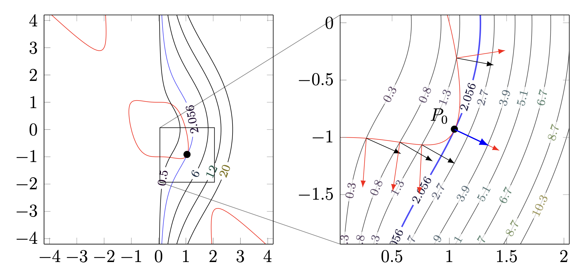

# 6.2 Lagrange multipliers

!!! note "译文与来源"

    本页依据 2026 年 11 月 3 日读取的官方 v0.2 源文件制作。数学术语保留英文；原书公式、代码、例题、活动、证明与解答保留。译稿使用机器辅助翻译并进行数学与排版检查，未经原作者审定。原作者：Jacob Denson、Kaitlyn Phillipson、Sebastien Roch。除原书另有注明外，遵循 [CC BY-NC-SA 4.0](https://creativecommons.org/licenses/by-nc-sa/4.0/)。 [阅读英文原文](https://math345-textbook.github.io/sec-lagrange-multipliers.html)。

回想一下[优化问题](3-6.md#def-8-1-optimization)， optimization problem 有一个 objective function 和一个 feasible region 。  constrained optimization 问题限制了 feasible region 。我们从一个等式 constraint 开始。

**定义 6.2.1： Constrained optimization  等于  constraint **

设 $f:\mathbb{R}^n\to\mathbb{R}$ 是要优化的  objective function ，另有 $g:\mathbb{R}^n\to\mathbb{R}$ 和 $k\in\mathbb{R}$。在条件：

$$
g(\mathbf{x})=k
$$

下求 $f(\mathbf{x})$ 的最大值或最小值，就是把 $f$ 的优化范围限制在  feasible region ：

$$
S=\{\mathbf{x}\in\mathbb{R}^n:g(\mathbf{x})=k\}.
$$

方程 $g(\mathbf{x})=k$ 称为  constraint ；$S$ 中的点称为 feasible point。

假设 $\mathbf{a}\in S$ 是 $f$ 在 $S$ 上的  local extremum 。在 $\mathbf{a}$ 处，允许的移动方向必须沿着 $S$ 的 tangent directions。沿这些方向，$f$ 的一阶变化必须为零，因此 $\nabla f(\mathbf{a})$ 垂直于 $S$ 的切方向。同样， vector  $\nabla g(\mathbf{a})$ 也垂直于  level set  $g(\mathbf{x})=k$ 的切方向。如果：

$$
\nabla g(\mathbf{a})\neq\mathbf{0},
$$

就可以推测，这两个 gradient 应当平行。

**定义 6.2.2：受约束  critical point **

设 $f,g:\mathbb{R}^n\to\mathbb{R}$ 都  differentiable ，并令：

$$
S=\{\mathbf{x}\in\mathbb{R}^n:g(\mathbf{x})=k\}.
$$

假设对于每个 $\mathbf{x}\in S$ 都有：

$$
\nabla g(\mathbf{x})\neq\mathbf{0}
$$

考虑位于 $f$ 的  domain  内部的点 $\mathbf{a}\in S$。如果存在 $\lambda\in\mathbb{R}$，使得：

$$
\nabla f(\mathbf{a})=\lambda\nabla g(\mathbf{a}).
$$

就称这个点为 $f$ 在 $S$ 上的 constrained  critical point 。 scalar  $\lambda$ 称为  Lagrange multiplier 。

## Lagrange公式

相同的方程可以封装在一个 function 中。定义Lagrange

$$
L(\mathbf{x},\lambda)
				=
				f(\mathbf{x})-\lambda\bigl(g(\mathbf{x})-k\bigr).
$$

 然后

$$
\nabla_{\mathbf{x}}L(\mathbf{x},\lambda)
				=
				\nabla f(\mathbf{x})-\lambda\nabla g(\mathbf{x}),
$$

 和

$$
\frac{\partial L}{\partial\lambda}(\mathbf{x},\lambda)
				=
				-\bigl(g(\mathbf{x})-k\bigr).
$$

 因此方程

$$
\nabla_{\mathbf{x}}L(\mathbf{x},\lambda)=\mathbf{0},
				\qquad
				\frac{\partial L}{\partial\lambda}(\mathbf{x},\lambda)=0
$$

 正是方程

$$
\nabla f(\mathbf{x})=\lambda\nabla g(\mathbf{x}),
				\qquad
				g(\mathbf{x})=k.
$$

 Lagrange不会取代 constraint 。它将并行 gradient 方程和 constraint 方程封装到一个critical point系统中。

 Lagrange multipliers 的方法解决了该系统寻找约束critical point的问题。下一个定理解释了为什么这些候选者中会出现约束极值。

**定理 6.2.1： Lagrange multiplier 定理**

考虑由  constraint  定义的集合：

$$
S=\{\mathbf{x}\in \mathbb R^n : g(\mathbf{x})=k\},
$$

假设 $\nabla g$ 在 $S$ 上处处非零。如果 $\mathbf{a}\in S$ 是  differentiable  的  function  $f$ 在 $S$ 上的  local extremum ，且 $\mathbf{a}$ 是 $f$ 的  domain  的  interior point ，那么 $\mathbf{a}$ 必定是 $f$ 在 $S$ 上的 constrained  critical point 。

特别地，如果 $S$ 是 closed 且 bounded 的，$f$ 在 $S$ 上连续，那么 $f$ 在 $S$ 上一定能取得  absolute extrema 。若还满足上述  differentiability  和  gradient  非零的条件，则 $f$ 在 $S$ 上的每一个 absolute extremum 都包含在 constrained critical points 中。

??? info "证明"

    假设$\mathbf{a}$是$f$在$S$上的 local extremum 。对于每个  unit vector  $\mathbf{v}$ 在 $\mathbf{a}$ 处与 $S$ 相切， directional derivative  

    $$
    D_{\mathbf{v}}f(\mathbf{a})
    $$

     必须是 $0$。否则，沿着$S$朝$\mathbf{v}$或$-\mathbf{v}$方向移动将会增加或减少$f$。

    由 [从  gradient  方向  derivatives ](3-6.md#thm-10-1-direction-in-terms-of-gradient), 

    $$
    D_{\mathbf{v}}f(\mathbf{a})
    					=
    					\nabla f(\mathbf{a})\cdot\mathbf{v}.
    $$

     因此 $\nabla f(\mathbf{a})$ 垂直于 $S$ 的每个切线方向。由于 $S$ 是  level set  

    $$
    g(\mathbf{x})=k,
    $$

    因此  vector  $\nabla g(\mathbf{a})$ 也垂直于每个切线方向。因此，这两个梯度是平行的：

    $$
    \nabla f(\mathbf{a})
    					=
    					\lambda\nabla g(\mathbf{a})
    $$

    对于某些$\lambda\in\mathbb{R}$。

    最终的陈述来自[定理 6.1.1](6-1.md#thm-u6-extreme-value)。如果$S$闭有界且$f$连续，则 absolute extrema 存在。任何绝对极值也是 $S$ 上的  local extremum ，因此它一定是受约束的  critical point 。

*假设我们优化一个轮廓为红色曲线的 function ，并服从蓝色曲线所示的 constraint 。受约束的critical point出现在目标轮廓与  constraint  曲线相切的位置，因此它们的法线  vectors  是平行的。出自：斯坦福大学 MATH 51 教科书*

??? info "图像说明"

    该图显示了带有红色目标轮廓的  contour plot  和蓝色  constraint  曲线。蓝色曲线上的黑点在缩放面板中被放大。在缩放面板中，箭头指示目标轮廓和该点处  constraint  曲线的法线方向，说明法线在受约束的  critical point  处平行。

**算法 6.2.1： Lagrange multipliers  与 1 个  constraint **

给定  differentiable   scalar  值  functions  $f$ 和 $g$，寻找 $f(\mathbf{x})$ 极值的候选者，服从 

$$
g(\mathbf{x})=k:
$$

1. 计算 $\nabla f$ 和 $\nabla g$。

2. 与 

    $$
    g(\mathbf{x})=k.
    $$

     一起求解 

    $$
    \nabla f(\mathbf{x})=\lambda\nabla g(\mathbf{x})
    $$

3. 对每个候选点评估$f$。

4. 当需要  absolute extrema  时比较这些值。

如果$\nabla g(\mathbf{x})=\mathbf{0}$位于可行点，则[ Lagrange multiplier 定理](6-2.md#thm-u6-lagrange-multiplier)不适用于该点，因此请单独检查该点。当 constraint 描述较大区域的一块 boundary 时，将这些候选者与[算法 6.1.1](6-1.md#alg-10-1-finding-maxima-and-minima)所需的其他候选者组合起来。

**活动 6.2.1：圆上的  linear  目标 (U6-LO2)**

根据 constraint $x^2 + y^2 = 10$求$f(x,y) = 3x + y$的 absolute extrema 。

??? success "解答"

    写$g(x,y) = x^2 + y^2$。然后我们在表面 

    $$
    S = \{ (x,y): g(x,y) = 10 \}
    $$

     上找到 $f$ 的极值。我们计算出

    $$
    \nabla f(x,y) = (3,1) \quad\text{and}\quad \nabla g(x,y) = (2x,2y)
    $$

    因此，$f$在$S$上的受约束critical point是存在$\lambda$且

    $$
    (3,1) = \lambda (2x,2y)
    $$

    的点$(x,y) \in S$，即满足三个方程

    $$
    \begin{aligned}
    x^2 + y^2 & = 10 \\
    2 \lambda x = 3 \\
    2 \lambda y = 1
    \end{aligned}
    $$

    的点。如果第二个和第三个方程成立，则$\lambda$不能为零，我们可以将方程两边除以$\lambda$得到$x = \frac{3}{2\lambda}$和$y = \frac{1}{2\lambda}$。将其代入第一个方程，我们发现

    $$
    \left(\frac{3}{2\lambda}\right)^2 + \left(\frac{1}{2\lambda}\right)^2 = 10
    $$

    它简化为$1/4 = \lambda^2$，因此要么是$\lambda = 1/2$，要么是$\lambda = -1/2$。如果$\lambda = 1/2$，则$x = 3$和$y = 1$，如果$\lambda = -1/2$，则$x = -3$和$y = -1$。所以$(3,1)$和$(-3,-1)$这两个点就是$f$在$S$上的两个约束critical point。由于 $S$ 是一个圆并且是封闭且有界的，因此  absolute maximum  和最小值出现在这两点之间。我们有

    $$
    f(3,1) = 10 \quad\text{and}\quad f(-3,-1) = -10
    $$

    所以$(3,1)$是$f$在$S$上的 absolute maximum ，$(-3,-1)$是$f$在$S$上的 absolute minimum 。

**活动 6.2.2：球体上的二次物镜 (U6-LO2)**

求 function $f(x,y,z) = x^2 + 2y^2 + 3z^2$的 absolute extrema ，服从 constraint $x^2 + y^2 + z^2 = 1$。

??? success "解答"

    让$g(x,y,z) = x^2 + y^2 + z^2$。然后是$\nabla f(x,y,z) = (2x,4y,6z)$和$\nabla g(x,y,z) = (2x,2y,2z)$。仅当存在$\lambda \in \mathbb{R}$时，点$(x,y,z)$才是球$S = \{ (x,y,z): x^2 + y^2 + z^2 = 1 \}$上$f$的约束 critical point ，使得两个方程

    $$
    \nabla f(x,y,z) = \lambda \nabla g(x,y,z) \quad\text{and}\quad x^2 + y^2 + z^2 = 1
    $$

    同时成立，展开为四个方程

    $$
    \begin{aligned}
    2x = 2\lambda x \\
    4y = 2\lambda y \\
    6z = 2\lambda z \\
    x^2 + y^2 + z^2 = 1
    \end{aligned}
    $$

    由于$x^2 + y^2 + z^2 = 1$，$x \neq 0$（将第一个方程除以$x$，得到$\lambda = 1$）、$y \neq 0$（将第二个方程除以$\lambda = 2$）或$z \neq 0$（将第三个方程除以$z$，得到$\lambda = 3$）。当$\lambda = 1$时，第一个方程自动成立，第二、第三个方程只有在$y = z = 0$时才成立。因此第四个方程变成$x^2 = 1$，所以$x = \pm 1$。类似地，当$\lambda = 2$时，我们有$x = z = 0$和$y = \pm 1$，当$\lambda = 3$时，我们有$x = y = 0$和$z = \pm 1$。因此 function $f$在$S$上有六个约束critical point，分别位于点$(\pm 1,0 ,0)$、$(0,\pm 1, 0)$和$(0,0,\pm 1)$。我们有

    $$
    f(\pm 1,0,0) = 1 \qquad f(0,\pm 1, 0) = 2 \qquad f(0,0,\pm 1) = 3
    $$

    因此 $f$ 的绝对最小值出现在 $(\pm 1, 0, 0)$ 处，$f$ 的绝对最大值出现在 $(0,0,\pm 1)$ 处。

**活动 6.2.3： Absolute extrema  在磁盘上（U6-LO1、U6-LO2）**

让

$$
f(x,y)=x^2+y^2+4x-6y
$$

在闭盘

$$
D=\{(x,y):x^2+y^2\leq 16\}.
$$

上找到$f$在$D$上的 absolute extrema ，用 Lagrange multipliers 分析圆 boundary 。

**问题**

找到$D$内部$f$的critical point，并在每个critical point评估$f$。

??? success "解答"

    内部critical point满足 

    $$
    \nabla f(x,y)=(2x+4,2y-6)=(0,0).
    $$

     因此 $(x,y)=(-2,3)$。由于$(-2)^2+3^2=13\lt 16$，该点位于$D$的内部。它的 function 值为

    $$
    f(-2,3)=4+9-8-18=-13.
    $$

**问题**

使用  Lagrange multipliers  查找并评估  boundary  $x^2+y^2=16$ 上的所有候选点。

??? success "解答"

    让$g(x,y)=x^2+y^2$。在 boundary 上， Lagrange multiplier 方程为

    $$
    \nabla f(x,y)=\lambda\nabla g(x,y),
    						\qquad
    						x^2+y^2=16.
    $$

     自$\nabla g(x,y)=(2x,2y)$起， gradient 方程变为

    $$
    \begin{aligned}
    2x+4 &=2\lambda x, \\
    2y-6 &=2\lambda y.
    \end{aligned}
    $$

    等价地，

    $$
    (1-\lambda)x=-2,
    						\qquad
    						(1-\lambda)y=3.
    $$

    值$\lambda=1$不能满足这些方程。设置$\mu=1-\lambda$。然后

    $$
    x=-\frac{2}{\mu},
    						\qquad
    						y=\frac{3}{\mu}.
    $$

    代入 constraint 给出

    $$
    \frac{13}{\mu^2}=16,
    $$

    所以$\mu=\pm\sqrt{13}/4$。因此， boundary 候选者是

    $$
    \left(-\frac{8}{\sqrt{13}},\frac{12}{\sqrt{13}}\right)
    						\quad\text{and}\quad
    						\left(\frac{8}{\sqrt{13}},-\frac{12}{\sqrt{13}}\right).
    $$

    在 boundary 、$x^2+y^2=16$上，所以$f(x,y)=16+4x-6y$。因此对应的值为

    $$
    \begin{aligned}
    f\left(-\frac{8}{\sqrt{13}},\frac{12}{\sqrt{13}}\right)
    							&=16-8\sqrt{13}, \\
    f\left(\frac{8}{\sqrt{13}},-\frac{12}{\sqrt{13}}\right)
    							&=16+8\sqrt{13}.
    \end{aligned}
    $$

**问题**

比较内部和 boundary 候选者以识别$D$上$f$的 absolute maximum 和 absolute minimum 。

??? success "解答"

    圆盘$D$是闭有界的，$f$是连续的，因此极值定理保证 absolute extrema 存在。候选值是 

    $$
    -13,
    						\qquad
    						16-8\sqrt{13},
    						\qquad
    						16+8\sqrt{13}.
    $$

     由于$16-8\sqrt{13}\approx -12.84$， absolute minimum 在$(-2,3)$处是$-13$。  absolute maximum  $16+8\sqrt{13}$ 

    $$
    \left(\frac{8}{\sqrt{13}},-\frac{12}{\sqrt{13}}\right).
    $$

## 几个相等  constraints 

**Some feasible sets are intersections of several level sets**: 令 

$$
f,g_1,\ldots,g_m:\mathbb{R}^n\to\mathbb{R}
$$

 为  differentiable   scalar  值 functions 。在

$$
g_1(\mathbf{x})=k_1,\quad\ldots,\quad g_m(\mathbf{x})=k_m
$$

的基础上优化$f(\mathbf{x})$意味着在 feasible set 

$$
S=
				\left\{
				\mathbf{x}\in\mathbb{R}^n:
				g_1(\mathbf{x})=k_1,\ldots,g_m(\mathbf{x})=k_m
				\right\}.
$$

上优化$f$

**定义 6.2.3：用多个  constraints  约束  critical point **

这是 [受约束  critical point ](6-2.md#def-u6-constrained-critical-point) 在多个约束下的推广。令：

$$
S=
					\left\{
					\mathbf{x}\in\mathbb{R}^n:
					g_1(\mathbf{x})=k_1,\ldots,g_m(\mathbf{x})=k_m
					\right\}.
$$

考虑位于 $f$ 的  domain  内部的 feasible point $\mathbf{a}\in S$。如果存在  scalars ：

$$
\lambda_1,\ldots,\lambda_m
$$

使得：

$$
\nabla f(\mathbf{a})
					=
					\lambda_1\nabla g_1(\mathbf{a})
					+\cdots+
					\lambda_m\nabla g_m(\mathbf{a}).
$$

就称这个点为 $f$ 在 $S$ 上的 constrained  critical point 。这些  scalars  $\lambda_1,\ldots,\lambda_m$ 称为  Lagrange multipliers 。

通过[一组 Vectors 的 Span ](2-3.md#def-5-1-span)，条件表示

$$
\nabla f(\mathbf{a})
			\in
			\operatorname{span}
			\left\{
			\nabla g_1(\mathbf{a}),\ldots,\nabla g_m(\mathbf{a})
			\right\}.
$$

 对于一个 constraint ，这个 span 是一条线，因此条件简化为平行梯度。

## Lagrange公式

定义

$$
L(\mathbf{x},\lambda_1,\ldots,\lambda_m)
				=
				f(\mathbf{x})
				-
				\sum_{j=1}^m
				\lambda_j\bigl(g_j(\mathbf{x})-k_j\bigr).
$$

然后定义

$$
\nabla_{\mathbf{x}}L
				=
				\nabla f
				-
				\sum_{j=1}^m\lambda_j\nabla g_j,
$$

同时定义

$$
\frac{\partial L}{\partial\lambda_j}
				=
				-\bigl(g_j(\mathbf{x})-k_j\bigr)
$$

为$j=1,\ldots,m$。因此，$L$的critical point方程恰好是

$$
\nabla f
				=
				\lambda_1\nabla g_1+\cdots+\lambda_m\nabla g_m
$$

和

$$
g_1(\mathbf{x})=k_1,\quad\ldots,\quad g_m(\mathbf{x})=k_m.
$$

一起，正如在1- constraint 情况下一样，Lagrange方程将 gradient 方程和所有 constraint 方程打包到一个系统中。

**定理 6.2.2：具有多个 constraints 的 Lagrange multiplier 定理**

令：

$$
S=
					\left\{
					\mathbf{x}\in\mathbb{R}^n:
					g_1(\mathbf{x})=k_1,\ldots,g_m(\mathbf{x})=k_m
					\right\}.
$$

假设 $\mathbf{a}\in S$ 是 $f$ 在 $S$ 上的  local extremum ，并且各个  constraint  的 gradient：

$$
\nabla g_1(\mathbf{a}),\ldots,\nabla g_m(\mathbf{a})
$$

都是  linearly independent （见 [ Linear Independence ](2-4.md#def-5-2-linear-indepdendence)）。那么一定存在  scalars ：

$$
\lambda_1,\ldots,\lambda_m
$$

使得：

$$
\nabla f(\mathbf{a})
					=
					\lambda_1\nabla g_1(\mathbf{a})
					+\cdots+
					\lambda_m\nabla g_m(\mathbf{a}).
$$

??? info "证明"

    与 $S$ 在 $\mathbf{a}$ 相切的  unit vector  必须与每个  constraint   level set  相切。因此它垂直于每个

    $$
    \nabla g_1(\mathbf{a}),\ldots,\nabla g_m(\mathbf{a}).
    $$

    在 constrained  local extremum  处，沿任何允许的 tangent direction，$f$ 的  directional derivative  都必须为零。根据 [从  gradient  方向  derivatives ](3-6.md#thm-10-1-direction-in-terms-of-gradient)：

    $$
    D_{\mathbf{v}}f(\mathbf{a})
    					=
    					\nabla f(\mathbf{a})\cdot\mathbf{v},
    $$

    因此，$\nabla f(\mathbf{a})$ 垂直于  feasible set  的所有切方向。

    当 constraint 梯度为 linearly independent 时，它们 span 是交点的法线方向。因此$\nabla f(\mathbf{a})$是 constraint 梯度的 linear combination 。

**算法 6.2.2： Lagrange multipliers  与多个  constraints **

寻找满足 

$$
g_1(\mathbf{x})=k_1,\quad\ldots,\quad g_m(\mathbf{x})=k_m:
$$

 的 $f(\mathbf{x})$ 极值的候选者

1. 计算

    $$
    \nabla f,\quad\nabla g_1,\quad\ldots,\quad\nabla g_m.
    $$

2. 求解 

    $$
    \nabla f
    							=
    							\lambda_1\nabla g_1+\cdots+\lambda_m\nabla g_m
    $$

     以及所有 $m$  constraint  方程。

3. 对每个候选点评估$f$。

4. 当需要  absolute extrema  时比较这些值。

如果在可行点处  constraint  梯度为  linearly dependent ，则该定理不适用。分别检查这些点。

**活动 6.2.4：球体和平面（U6-LO3、U2-LO4、U4-LO1）**

根据

$$
x^2+y^2+z^2=1
$$

和

$$
x+y+z=0.
$$

求出 absolute maximum 和

$$
f(x,y,z)=x
$$

的最小值

1. 用几何方式描述 feasible set 。为什么 absolute extrema 存在？

2. 证明两个  constraint  梯度在每个可行点处都是  linearly independent 。

3. 使用乘数 $\lambda$ 和 $\mu$ 形成Lagrange函数。

4. 求解Lagrange方程。

5. 评估候选点的$f$并确定 absolute extrema 。

??? success "解答"

    feasible set 是unit sphere与平面

    $$
    x+y+z=0.
    $$

    的交线，是一个圆。特别是，它是闭有界的，因此  absolute extrema  与 [定理 6.1.1](6-1.md#thm-u6-extreme-value) 存在。

    令 

    $$
    g_1(x,y,z)=x^2+y^2+z^2,
    					\qquad
    					g_2(x,y,z)=x+y+z.
    $$

     然后

    $$
    \nabla g_1=
    					2
    					\begin{bmatrix}
    					x\\
    					y\\
    					z
    					\end{bmatrix},
    					\qquad
    					\nabla g_2=
    					\begin{bmatrix}
    					1\\
    					1\\
    					1
    					\end{bmatrix}.
    $$

     在可行点，

    $$
    \nabla g_1\cdot\nabla g_2
    					=
    					2(x+y+z)
    					=
    					0.
    $$

      feasible set  上的两个梯度均非零。因此它们是 orthogonal set ，因此 linearly independent 乘[ orthogonal  组中 Linear independence ](4-1.md#thm-6-1-orthogonality-independent)。

    定义 

    $$
    L(x,y,z,\lambda,\mu)
    					=
    					x
    					-
    					\lambda(x^2+y^2+z^2-1)
    					-
    					\mu(x+y+z).
    $$

     critical point方程为 

    $$
    1=2\lambda x+\mu,
    $$

    $$
    0=2\lambda y+\mu,
    $$

    $$
    0=2\lambda z+\mu,
    $$

     和 

    $$
    x^2+y^2+z^2=1,
    					\qquad
    					x+y+z=0.
    $$

    我们不能有$\lambda=0$，因为第二个和第三个方程会给出$\mu=0$，与第一个方程相矛盾。因此$\lambda\neq 0$。减去第二个和第三个方程得到

    $$
    y=z.
    $$

    写$y=z=t$。平面  constraint  给出 

    $$
    x=-2t.
    $$

     球体  constraint  变为 

    $$
    4t^2+t^2+t^2=1,
    $$

     所以 

    $$
    t=\pm\frac1{\sqrt6}.
    $$

     候选者是 

    $$
    \frac1{\sqrt6}
    					\begin{bmatrix}
    					2\\
    					-1\\
    					-1
    					\end{bmatrix}
    					\qquad\text{and}\qquad
    					\frac1{\sqrt6}
    					\begin{bmatrix}
    					-2\\
    					1\\
    					1
    					\end{bmatrix}.
    $$

     他们的 $f$ 值是 

    $$
    \frac2{\sqrt6}
    					\qquad\text{and}\qquad
    					-\frac2{\sqrt6}.
    $$

    因此 absolute maximum 在

    $$
    \frac1{\sqrt6}
    					\begin{bmatrix}
    					2\\
    					-1\\
    					-1
    					\end{bmatrix},
    $$

    处是

    $$
    \frac2{\sqrt6}
    $$

    absolute minimum 在

    $$
    \frac1{\sqrt6}
    					\begin{bmatrix}
    					-2\\
    					1\\
    					1
    					\end{bmatrix}.
    $$

    处是

    $$
    -\frac2{\sqrt6}
    $$

