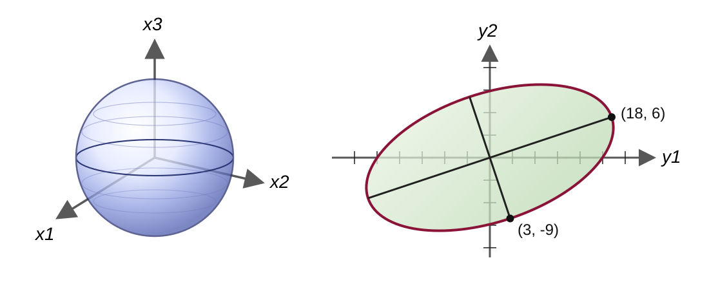

# 6.5 singular value decomposition（SVD）

!!! note "译文与来源"

    本页依据 2026 年 11 月 3 日读取的官方 v0.2 源文件制作。数学术语保留英文；原书公式、代码、例题、活动、证明与解答保留。译稿使用机器辅助翻译并进行数学与排版检查，未经原作者审定。原作者：Jacob Denson、Kaitlyn Phillipson、Sebastien Roch。除原书另有注明外，遵循 [CC BY-NC-SA 4.0](https://creativecommons.org/licenses/by-nc-sa/4.0/)。 [阅读英文原文](https://math345-textbook.github.io/sec-singular-value-decomposition.html)。

[ Quadratic forms  和  maximum stretch ](6-3.md#sec-maximum-stretch-svd)从 symmetric matrix $A^TA$找到 singular values 。 [ Principal component analysis ](6-4.md#sec-u6-principal-component-analysis) 对  centered data   matrix  $Z$ 使用相同的结构，因为 

$$
C=\frac1nZ^TZ.
$$

 本节将输入方向、输出方向和拉伸因子打包到一个分解中。

## 定义和属性

 singular value decomposition  可以看作  orthogonal diagonalization  向矩形情形的推广。 Orthogonal diagonalization  为一个  symmetric  的  square matrix  选择一组  orthonormal  的  eigenvector  作为  basis ； SVD  则分别在输入空间和输出空间中选取  orthonormal basis  与  orthonormal basis ，适用于任意实数  matrix 。

**定义 6.5.1： Singular value decomposition **

设 $A$ 是一个 $m\times n$ 的  matrix ，并令 $p=\min(m,n)$。$A$ 的  singular value decomposition （简称  SVD ）是如下分解：

$$
A=U\Sigma V^T,
$$

其中 $U$ 是 $m\times m$ 的  orthogonal matrix ，$V$ 是 $n\times n$ 的  orthogonal matrix ，而 $\Sigma$ 是 $m\times n$ 的  diagonal matrix 。它的对角线元素均非负，并按从大到小排列：

$$
\sigma_1\geq \sigma_2\geq \cdots \geq \sigma_p\geq 0
$$

数值 $\sigma_i$ 称为 $A$ 的  singular values 。$U$ 的各个  columns ：

$$
\mathbf{u}_1,\ldots,\mathbf{u}_m
$$

称为 left  singular vectors ；$V$ 的各个  columns ：

$$
\mathbf{v}_1,\ldots,\mathbf{v}_n
$$

称为 right  singular vectors 。

如果$r$是正 singular values 的个数，则

$$
A\mathbf{v}_i=\sigma_i\mathbf{u}_i
          \qquad
          \text{for }1\leq i\leq r,
$$

和

$$
A\mathbf{v}_i=\mathbf{0}
          \qquad
          \text{for }i>r.
$$

**说明： SVD  的表示法**

一些参考文献编写了与 

$$
A=P\Sigma Q^T.
$$

 相同的分解，在本书中我们使用 

$$
A=U\Sigma V^T
$$

因为它与 NumPy 输出名称 `U, s, Vt = np.linalg.svd(A)` 匹配。角色相同：$U$存储左侧 singular vectors ，$V$存储右侧 singular vectors ，$\Sigma$存储 singular values 。上面的定义使用了完整的 SVD ； NumPy 与 `full_matrices=False` 返回  matrix product  所需的约简因子。

### 输入方向、拉伸和输出方向

从右向左写

$$
U=
        \begin{bmatrix}
        \mathbf{u}_1 & \cdots & \mathbf{u}_m
        \end{bmatrix},
        \qquad
        V=
        \begin{bmatrix}
        \mathbf{v}_1 & \cdots & \mathbf{v}_n
        \end{bmatrix}.
$$

读

$$
A=U\Sigma V^T
$$

1. vector $V^T\mathbf{x}$给出了$\mathbf{x}$的 coordinates 在右 singular vectors 的 orthonormal basis 中。

2. matrix  $\Sigma$ 将$i$-第 coordinate  乘以$\sigma_i$。零  singular value  会擦除该方向。

3. matrix  $U$ 使用左侧  singular vectors  组合所得的  coordinates 。

通过 [ Expansion theorem ](4-1.md#thm-u4-orthogonal-expansion)，如果 $r$  singular values  为正，则 

$$
A\mathbf{x}
        =
        \sum_{i=1}^r
        \sigma_i
        (\mathbf{v}_i\cdot\mathbf{x})
        \mathbf{u}_i.
$$

  dot product  $\mathbf{v}_i\cdot\mathbf{x}$ 测量有多少输入位于$i$右 singular 方向。  singular value  $\sigma_i$ 拉伸 coordinate ，$\mathbf{u}_i$ 给出相应的输出方向。

由于 $U$ 和 $V$ 是  orthogonal ，因此它们将长度保留为 [引理 5.2.1](5-2.md#lem-orthogonal-matrix-properties)。长度的变化发生在$\Sigma$。从几何角度来看，右侧 singular vectors 给出主要输入方向， singular values 给出相应的拉伸因子，左侧 singular vectors 给出主要输出方向。下图展示了  rectangular matrix  的图片。

*从$\mathbb{R}^3$到$\mathbb{R}^2$对应于 matrix 

$$
A = \begin{bmatrix} 4 & 11 & 14 \\ 8 & 7 & -2 \end{bmatrix}
$$

的 matrix 映射。左图显示了 $\mathbb{R}^3$ 中的单位球体。右图显示了$\mathbb{R}^2$中$A$下的图像，这是一个具有主半轴端点$(18,6)$和$(3,-9)$的椭圆。改编自 David C. Lay、Steven R. Lay 和 Judi J. McDonald， Linear Algebra with Applications，第 6 版，Pearson，© 2021，[Pearson](https://www.pearson.com/en-us/subject-catalog/p/linear-algebra-and-its-applications/P200000006235/9780136880929)。*

??? info "图像说明"

    左侧显示一个蓝色单位球体，其  coordinate  轴标记为 $x_1$、$x_2$ 和 $x_3$。右侧显示二维  coordinate  平面中的绿色椭圆，其轴标记为 $y_1$ 和 $y_2$。两条黑色线段标记椭圆的主半轴，终止于 $(18,6)$ 和 $(3,-9)$。

**引理 6.5.1：从右 singular vectors 到左 singular vectors **

设：

$$
\mathbf{v}_1,\ldots,\mathbf{v}_n
$$

是 $A^TA$ 的一组  orthonormal  的  eigenvectors ，对应的  eigenvalues  为：

$$
\lambda_1,\ldots,\lambda_n\geq 0.
$$

令：

$$
\sigma_i=\sqrt{\lambda_i}.
$$

对于每个为正的  eigenvalue ，定义：

$$
\mathbf{u}_i
          =
          \frac{1}{\sigma_i}A\mathbf{v}_i.
$$

这样，由为正的  eigenvalues  得到的  vectors  $\mathbf{u}_i$ 彼此  orthonormal ，并且：

$$
A\mathbf{v}_i=\sigma_i\mathbf{u}_i.
$$

如果 $\lambda_i=0$，那么：

$$
A\mathbf{v}_i=\mathbf{0}.
$$

??? info "证明"

    由于 $\mathbf{v}_i$ 是一个单位  eigenvector , 

    $$
    \begin{aligned}
    \|A\mathbf{v}_i\|^2 \\
    &=\mathbf{v}_i^TA^TA\mathbf{v}_i \\
    &=\lambda_i.
    \end{aligned}
    $$

     因此，当 $\lambda_i>0$, 

    $$
    \left\|
              \frac{1}{\sigma_i}A\mathbf{v}_i
              \right\|=1.
    $$

    如果$i\ne j$，则

    $$
    \begin{aligned}
    (A\mathbf{v}_i)\cdot(A\mathbf{v}_j) \\
    &=\mathbf{v}_i^TA^TA\mathbf{v}_j \\
    &=\lambda_j(\mathbf{v}_i\cdot\mathbf{v}_j) \\
    &=0.
    \end{aligned}
    $$

     因此，剩下的 singular vectors  是 orthonormal 。如果$\lambda_i=0$，那么

    $$
    \|A\mathbf{v}_i\|^2=0,
    $$

    那么$A\mathbf{v}_i=\mathbf{0}$。

**定理 6.5.1：每个实数 matrix 都有一个 SVD **

设 $A$ 是一个实数 $m\times n$  matrix 。那么 $A$ 一定存在  singular value decomposition ：

$$
A=U\Sigma V^T.
$$

可以按以下步骤构造这个分解。

1. 先为 $A^TA$ 求出一个  orthonormal  的  eigenbasis ：

    $$
    \mathbf{v}_1,\ldots,\mathbf{v}_n
    $$

    将这些  vectors  按对应的 eigenvalue 大小排序，使得：

    $$
    \lambda_1\geq\cdots\geq\lambda_r>0
    $$

    并且当 $i>r$ 时，$\lambda_i=0$。

2. 对于 $1\leq i\leq r$，令：

    $$
    \sigma_i=\sqrt{\lambda_i}
    $$

3. 对于 $1\leq i\leq r$，定义：

    $$
    \mathbf{u}_i
                  =
                  \frac{1}{\sigma_i}A\mathbf{v}_i
    $$

4. 将：

    $$
    \mathbf{u}_1,\ldots,\mathbf{u}_r
    $$

    补充成 $\mathbb{R}^m$ 的一个  orthonormal basis ：

    $$
    \mathbf{u}_1,\ldots,\mathbf{u}_m
    $$

5. 分别用这些  vectors  作为 $V$ 和 $U$ 的  columns ，并在 $\Sigma$ 的对角线上依次放入：

    $$
    \sigma_1,\ldots,\sigma_r
    $$

    其余位置填零。

??? info "证明"

    matrix  $A^TA$ 是  symmetric ，因此 [ Principal Axes Theorem ](5-2.md#thm-principal-axes) 给出 orthonormal   eigenbasis 。它的  eigenvalues  是非负的，因为 

    $$
    \mathbf{x}^TA^TA\mathbf{x}
              =
              \|A\mathbf{x}\|^2
              \geq 0.
    $$

    前面的引理表明， vectors 

    $$
    \mathbf{u}_1,\ldots,\mathbf{u}_r
    $$

    是 orthonormal 并且满足

    $$
    A\mathbf{v}_i=\sigma_i\mathbf{u}_i.
    $$

    使用[展开 orthonormal set ](4-2.md#fact-u4-extending-orthonormal-set)将它们补全到$\mathbb{R}^m$的 orthonormal basis 。

    比较  columns  得到 

    $$
    AV
              =
              \begin{bmatrix}
              \sigma_1\mathbf{u}_1 &
              \cdots &
              \sigma_r\mathbf{u}_r &
              \mathbf{0} &
              \cdots &
              \mathbf{0}
              \end{bmatrix}
              =
              U\Sigma.
    $$

     由于 $V$ 是  orthogonal ，乘以 $V^T$ 得到 

    $$
    A=U\Sigma V^T.
    $$

**说明： SVD  的非唯一性**

SVD  不是唯一的。一对匹配的 singular vectors 可以乘以$-1$而不改变乘积：

$$
\sigma_i\mathbf{u}_i\mathbf{v}_i^T
        =
        \sigma_i(-\mathbf{u}_i)(-\mathbf{v}_i)^T.
$$

重复的正 singular values 也允许在相应的 singular 子空间内 orthogonal 改变 basis 。当 singular value 为零时，对应的 orthonormal basis  vectors 也可以有多种有效选择。角色比具体标志更重要。

这是一个完整的  SVD  计算，分为与定理相同的步骤。

**活动 6.5.1：计算  SVD ，第 1 部分：右  singular vectors  (U6-LO6)**

让

$$
A = \begin{bmatrix} 1 & -1 \\ -2 & 2 \\ 2 & -2 \end{bmatrix}
$$

1. 计算$A^TA$。

2. 求 $A^TA$ 的  eigenvalues 。

3. 找到 $A^TA$ 的  orthonormal   eigenbasis  

    $$
    \mathbf{v}_1,\mathbf{v}_2
    $$

    首先是正  eigenvalue 。

4. 求 $A$ 的  singular values 。

??? success "解答"

    我们计算

    $$
    \begin{aligned}
    A^TA \\
    & =
              \begin{bmatrix}
                1 & -2 & 2\\
                -1 & 2 & -2
              \end{bmatrix}
              \begin{bmatrix}
                1 & -1\\
                -2 & 2\\
                2 & -2
              \end{bmatrix} \\
    & =
              \begin{bmatrix}
                9 & -9\\
                -9 & 9
              \end{bmatrix}.
    \end{aligned}
    $$

    characteristic polynomial为 

    $$
    \begin{aligned}
    \det(A^TA-\lambda I) \\
    & =
              \det
              \begin{bmatrix}
                9-\lambda & -9\\
                -9 & 9-\lambda
              \end{bmatrix} \\
    & = \lambda(\lambda-18).
    \end{aligned}
    $$

     因此  eigenvalues  为 

    $$
    \lambda_1=18,
              \qquad
              \lambda_2=0.
    $$

    对于$\lambda_1=18$，一个 eigenvector 就是

    $$
    \begin{bmatrix}
                1\\
                -1
              \end{bmatrix},
    $$

    所以我们选择 unit vector 

    $$
    \mathbf{v}_1=
              \frac{1}{\sqrt2}
              \begin{bmatrix}
                1\\
                -1
              \end{bmatrix}.
    $$

     对于$\lambda_2=0$，一个 eigenvector 就是

    $$
    \begin{bmatrix}
                1\\
                1
              \end{bmatrix},
    $$

    所以我们选择

    $$
    \mathbf{v}_2=
              \frac{1}{\sqrt2}
              \begin{bmatrix}
                1\\
                1
              \end{bmatrix}.
    $$

     singular values  是 $A^TA$ 的  eigenvalues  的平方根：

    $$
    \sigma_1=\sqrt{18}=3\sqrt2,
              \qquad
              \sigma_2=0.
    $$

**活动 6.5.2：计算  SVD ，第 2 部分：输出方向（U6-LO6、U2-LO3）**

使用上一个活动中的  vectors 。

1. 计算$A\mathbf{v}_1$。

2. 计算$A\mathbf{v}_2$。

3. 计算

    $$
    \mathbf{u}_1=\frac{1}{\sigma_1}A\mathbf{v}_1.
    $$

4. $A\mathbf{v}_2=\mathbf{0}$ 关于 matrix  地图说了些什么？

??? success "解答"

    首先

    $$
    \begin{aligned}
    A\mathbf{v}_1 \\
    & =
              \begin{bmatrix}
                1 & -1\\
                -2 & 2\\
                2 & -2
              \end{bmatrix}
              \frac{1}{\sqrt2}
              \begin{bmatrix}
                1\\
                -1
              \end{bmatrix} \\
    & =
              \begin{bmatrix}
                \sqrt2\\
                -2\sqrt2\\
                2\sqrt2
              \end{bmatrix}.
    \end{aligned}
    $$

    由于$\sigma_1=3\sqrt2$，

    $$
    \begin{aligned}
    \mathbf{u}_1 \\
    & =
              \frac{1}{3\sqrt2}
              \begin{bmatrix}
                \sqrt2\\
                -2\sqrt2\\
                2\sqrt2
              \end{bmatrix} \\
    & =
              \begin{bmatrix}
                1/3\\
                -2/3\\
                2/3
              \end{bmatrix}.
    \end{aligned}
    $$

    还有

    $$
    \begin{aligned}
    A\mathbf{v}_2 \\
    & =
              \begin{bmatrix}
                1 & -1\\
                -2 & 2\\
                2 & -2
              \end{bmatrix}
              \frac{1}{\sqrt2}
              \begin{bmatrix}
                1\\
                1
              \end{bmatrix} \\
    & =
              \begin{bmatrix}
                0\\
                0\\
                0
              \end{bmatrix}.
    \end{aligned}
    $$

    因此$\mathbf{v}_2$是右零方向。  matrix  地图忘记了输入方向。由于只有一个 singular value 为正，因此$A$的 rank 为$1$。

**活动 6.5.3：检查已完成的  SVD  (U6-LO6)**

继续前两个活动的 matrix 和 singular vectors 。 

$$
\mathbf{u}_1=
          \begin{bmatrix}
          1/3\\
          -2/3\\
          2/3
          \end{bmatrix}.
$$

 的 1 个  orthonormal  完成给出 

$$
U=
          \begin{bmatrix}
          1/3 & 2\sqrt2/3 & 0\\
          -2/3 & \sqrt2/6 & \sqrt2/2\\
          2/3 & -\sqrt2/6 & \sqrt2/2
          \end{bmatrix}.
$$

 也设置 

$$
\Sigma=
          \begin{bmatrix}
          3\sqrt2 & 0\\
          0 & 0\\
          0 & 0
          \end{bmatrix},
          \qquad
          V=
          \frac1{\sqrt2}
          \begin{bmatrix}
          1 & 1\\
          -1 & 1
          \end{bmatrix}.
$$

1. 识别$U$、$\Sigma$和$V$的 shapes 。

2. 检查

    $$
    U^TU=I_3,
                  \qquad
                  V^TV=I_2.
    $$

3. 使用

    $$
    A\mathbf{v}_1=3\sqrt2\,\mathbf{u}_1,
                  \qquad
                  A\mathbf{v}_2=\mathbf{0}
    $$

    来解释为什么

    $$
    AV=U\Sigma
    $$

    而不用将所有 matrices 条目逐个相乘。

4. 结论是

    $$
    A=U\Sigma V^T.
    $$

5. $U$ 中的哪一个  column  来自正  singular value ？哪一个 columns 是由 orthonormal 完成而产生的？

??? success "解答"

    shapes  是 

    $$
    U\in\mathbb{R}^{3\times3},
              \qquad
              \Sigma\in\mathbb{R}^{3\times2},
              \qquad
              V\in\mathbb{R}^{2\times2}.
    $$

    直接相乘得到

    $$
    U^TU=I_3,
              \qquad
              V^TV=I_2,
    $$

    因此$U$和$V$是 orthogonal 。

    $AV$ 的 columns  是

    $$
    A\mathbf{v}_1
              \qquad\text{and}\qquad
              A\mathbf{v}_2.
    $$

     从之前的活动中，

    $$
    AV
              =
              \begin{bmatrix}
              3\sqrt2\,\mathbf{u}_1 & \mathbf{0}
              \end{bmatrix}
              =
              U\Sigma.
    $$

     由于$V$ 是 orthogonal ，

    $$
    V^{-1}=V^T.
    $$

     将右侧的$AV=U\Sigma$ 乘以$V^T$ 得到

    $$
    A=U\Sigma V^T.
    $$

     第一个 column  $\mathbf{u}_1$来自积极的 singular value 。剩余的  columns  完成 $\mathbf{u}_1$ 至  orthonormal basis  $\mathbb{R}^3$。这种完成并不是独一无二的。

第 2 单元介绍了  row  空间、 column  空间以及 [ Column  和  Row Space ](2-4.md#def-5-3-column-and-row-space) 和 [ Null Space  和  Image Space ](2-3.md#def-5-1-null-and-image-space-of-matrix) 中的零空间。 $A^T$的 null space 称为$A$的 left null space 。这些共同组成了  matrix  的four fundamental subspaces。

**定义 6.5.2：four fundamental subspaces**

设 $A$ 是一个 $m\times n$ 的  matrix 。它对应的 four fundamental subspaces 是：

$$
\operatorname{row}(A)\subseteq\mathbb{R}^n,
          \qquad
          \operatorname{col}(A)\subseteq\mathbb{R}^m,
$$

$$
\operatorname{null}(A)\subseteq\mathbb{R}^n,
          \qquad
          \operatorname{null}(A^T)\subseteq\mathbb{R}^m.
$$

具体来说，它们分别定义为：

$$
\operatorname{row}(A)
          =
          \operatorname{span}\{\text{rows of }A\},
$$

$$
\operatorname{col}(A)
          =
          \operatorname{span}\{\text{columns of }A\},
$$

$$
\operatorname{null}(A)
          =
          \{\mathbf{x}\in\mathbb{R}^n:A\mathbf{x}=\mathbf{0}\},
$$

以及：

$$
\operatorname{null}(A^T)
          =
          \{\mathbf{y}\in\mathbb{R}^m:A^T\mathbf{y}=\mathbf{0}\}.
$$

**定理 6.5.2： SVD  的基本子空间**

设下式是某个 $m\times n$ 的  matrix  的一个  SVD ：

$$
A=U\Sigma V^T
$$

并且恰有 $r$ 个  singular values  为正。写成：

$$
U=
          \begin{bmatrix}
          \mathbf{u}_1 & \cdots & \mathbf{u}_m
          \end{bmatrix},
          \qquad
          V=
          \begin{bmatrix}
          \mathbf{v}_1 & \cdots & \mathbf{v}_n
          \end{bmatrix}.
$$

则有：
- $\{\mathbf{u}_1,\ldots,\mathbf{u}_r\}$ 是$\operatorname{col}(A)$ 的 orthonormal basis 。

- $\{\mathbf{u}_{r+1},\ldots,\mathbf{u}_m\}$ 是$\operatorname{null}(A^T)$ 的 orthonormal basis 。

- $\{\mathbf{v}_1,\ldots,\mathbf{v}_r\}$ 是$\operatorname{row}(A)$ 的 orthonormal basis 。

- $\{\mathbf{v}_{r+1},\ldots,\mathbf{v}_n\}$ 是$\operatorname{null}(A)$ 的 orthonormal basis 。

特别地：

$$
\operatorname{rank}(A)=r,
$$

$$
\dim\operatorname{null}(A)=n-r,
          \qquad
          \dim\operatorname{null}(A^T)=m-r.
$$

??? info "证明"

    通过讨论[“Input directions, stretch, and output directions”](6-5.md#par-u6-svd-input-stretch-output)，

    $$
    A\mathbf{x}
              =
              \sum_{i=1}^r
              \sigma_i
              (\mathbf{v}_i\cdot\mathbf{x})
              \mathbf{u}_i.
    $$

    因此每个输出都位于

    $$
    \operatorname{span}\{\mathbf{u}_1,\ldots,\mathbf{u}_r\}.
    $$

    相反，对于$1\leq i\leq r$，

    $$
    \mathbf{u}_i
              =
              \frac1{\sigma_i}A\mathbf{v}_i
    $$

    属于$\operatorname{col}(A)$。因此，第一个$r$离开 singular vectors 形成 basis 与 column space 。

    在右边 singular  basis 写入一个输入：

    $$
    \mathbf{x}
              =
              c_1\mathbf{v}_1+\cdots+c_n\mathbf{v}_n.
    $$

    然后

    $$
    A\mathbf{x}
              =
              \sigma_1c_1\mathbf{u}_1+\cdots+
              \sigma_rc_r\mathbf{u}_r.
    $$

    由于显示的左边 singular vectors 是独立的，$A\mathbf{x}=\mathbf{0}$恰好在

    $$
    c_1=\cdots=c_r=0.
    $$

    时，因此剩下的右边 singular vectors 与$\operatorname{null}(A)$形成一个 basis 。

    将相同的参数应用于 

    $$
    A^T=V\Sigma^TU^T.
    $$

     这给出了  row space  和左侧  null space  语句。最后， column space 有$r$ basis  vectors ，所以

    $$
    \operatorname{rank}(A)=r.
    $$

**活动 6.5.4：读取计算出的  SVD  (U6-LO6, U6-LO7)**

使用上面计算的  SVD ： 

$$
A=U\Sigma V^T,
$$

 其中 

$$
V=
          \begin{bmatrix}
            1/\sqrt2 & 1/\sqrt2\\
            -1/\sqrt2 & 1/\sqrt2
          \end{bmatrix},
$$

 

$$
U=
          \begin{bmatrix}
            1/3 & (2/3)\sqrt2 & 0\\
            -2/3 & (1/6)\sqrt2 & (1/2)\sqrt2\\
            2/3 & -(1/6)\sqrt2 & (1/2)\sqrt2
          \end{bmatrix},
$$

 和 

$$
\Sigma=
          \begin{bmatrix}
            3\sqrt2 & 0\\
            0 & 0\\
            0 & 0
          \end{bmatrix}.
$$

1. $\operatorname{rank}(A)$是什么？

2. 给 $\operatorname{row}(A)$ 一个 orthonormal basis 。

3. 给 $\operatorname{null}(A)$ 一个 orthonormal basis 。

4. 给 $\operatorname{col}(A)$ 一个 orthonormal basis 。

5. 给 $\operatorname{null}(A^T)$ 一个 orthonormal basis 。

6. 忘记了哪个输入方向？

7. 传输哪个输入方向以及通过什么拉伸因子？

??? success "解答"

    有一个正  singular value ，所以 

    $$
    \operatorname{rank}(A)=1.
    $$

    第一个 right singular vector 为 row space 提供 basis ：

    $$
    \operatorname{row}(A)
              =
              \operatorname{span}
              \left\{
              \frac{1}{\sqrt2}
              \begin{bmatrix}
                1\\
                -1
              \end{bmatrix}
              \right\}.
    $$

    零  singular value  给出零空间方向：

    $$
    \operatorname{null}(A)
              =
              \operatorname{span}
              \left\{
              \frac{1}{\sqrt2}
              \begin{bmatrix}
                1\\
                1
              \end{bmatrix}
              \right\}.
    $$

    第一个 left singular vector 为 column space 提供 basis ：

    $$
    \operatorname{col}(A)
              =
              \operatorname{span}
              \left\{
              \begin{bmatrix}
                1/3\\
                -2/3\\
                2/3
              \end{bmatrix}
              \right\}.
    $$

    剩下的  singular vectors  为 $\operatorname{null}(A^T)$ 给出  basis ：

    $$
    \operatorname{null}(A^T)
              =
              \operatorname{span}
              \left\{
              \begin{bmatrix}
                (2/3)\sqrt2\\
                (1/6)\sqrt2\\
                -(1/6)\sqrt2
              \end{bmatrix},
              \begin{bmatrix}
                0\\
                (1/2)\sqrt2\\
                (1/2)\sqrt2
              \end{bmatrix}
              \right\}.
    $$

    遗忘的输入方向是

    $$
    \frac{1}{\sqrt2}
              \begin{bmatrix}
                1\\
                1
              \end{bmatrix}.
    $$

    传输的输入方向是

    $$
    \frac{1}{\sqrt2}
              \begin{bmatrix}
                1\\
                -1
              \end{bmatrix},
    $$

    拉伸因子是

    $$
    3\sqrt2.
    $$

**说明： SVD  和  orthogonal diagonalization **

SVD 还给出了两个 symmetric  matrices 的 orthogonal diagonalization：

$$
A^TA
        =
        V\Sigma^T\Sigma V^T
$$

和

$$
AA^T
        =
        U\Sigma\Sigma^TU^T.
$$

因此，右侧 singular vectors 是$A^TA$的 eigenvectors ，左侧 singular vectors 是 eigenvectors  $AA^T$， symmetric  matrices 的正 eigenvalues 为

$$
\sigma_1^2,\ldots,\sigma_r^2.
$$

 Orthogonal diagonalization  在 domain 和 codomain 中使用相同的 orthonormal basis 将 symmetric  square matrix 写为

$$
B=QDQ^T,
$$

参见[ Orthogonal  diagonalization性](5-2.md#def-orthogonal-diagonalizability)和[ Principal Axes Theorem ](5-2.md#thm-principal-axes)。 $D$ 的对角线条目的符号为  eigenvalues 。

 SVD ：

$$
A=U\Sigma V^T
$$

在输入空间和输出空间中分别采用一个  orthonormal basis ，两个空间可以使用不同的 basis。中间的对角线元素是非负的伸缩系数。这种使用两个  basis  的分解适用于任意实数  matrix ，包括矩形以及非对称的  matrices 。

它给出了 matrix 映射

$$
\mathbf{x}\longmapsto A\mathbf{x}:
$$

测量特殊方向上的输入，拉伸或擦除那些 coordinates ，并在特殊输出方向上表达结果。这是第二单元问题的精确版本： matrix  地图保留、削弱或忘记了哪些信息？

## 从  SVD   PCA 

 [ Principal component analysis ](6-4.md#sec-u6-principal-component-analysis) 成立  principal directions  通过diagonalization  covariance matrix    

$$
C=\frac1nZ^TZ.
$$

 

 centered data   matrix  $Z$ 的  SVD  包含相同的方向和相同的捕获变化值。它还将主 component 分数与左 singular vectors 连接起来。

**事实 6.5.1：来自中心数据  SVD  的  PCA **

设下式是一个  centered data   matrix ：

$$
Z\in\mathbb{R}^{n\times d}
$$

并设它的 [an SVD](6-5.md#def-u6-singular-value-decomposition) 为：

$$
Z=U\Sigma V^T
$$

记：

$$
V=
            \begin{bmatrix}
            \mathbf{v}_1 & \cdots & \mathbf{v}_d
            \end{bmatrix},
$$

必要时将为零的  singular values  也包括在内。那么：

$$
C=\frac1nZ^TZ
            =
            V\left(\frac1n\Sigma^T\Sigma\right)V^T.
$$

因此：

- right  singular vectors  $\mathbf{v}_j$ 就是  principal directions 。

- covariance  的  eigenvalues  为：

    $$
    \lambda_j=\frac{\sigma_j^2}{n};
    $$

- principal- coordinate   matrix  为：

    $$
    T=ZV=U\Sigma.
    $$

特别地，当 $\sigma_j>0$ 时，第 $j$ 个 score  vector  为：

$$
\mathbf{t}_j=\sigma_j\mathbf{u}_j
$$

??? info "证明"

    由于$U$是 orthogonal ，

    $$
    U^TU=I.
    $$

    因此

    $$
    \begin{aligned}
    Z^TZ \\
    &=
                (U\Sigma V^T)^T(U\Sigma V^T) \\
    &=
                V\Sigma^TU^TU\Sigma V^T \\
    &=
                V\Sigma^T\Sigma V^T.
    \end{aligned}
    $$

    除以$n$得到$C$的显示 orthogonal diagonalization 。因此，$V$的 columns 是 covariance  eigenvectors ，以及 eigenvalues $\sigma_j^2/n$。

    另外，

    $$
    \begin{aligned}
    ZV \\
    &=
                U\Sigma V^TV \\
    &=
                U\Sigma.
    \end{aligned}
    $$

     因此$U\Sigma$ 的 columns  是主要的 component  分数 vectors 。

### 保留第一个$k$ principal directions 

设$p=\min(n,d)$和$1\leq k\leq p$。设置

$$
V_k=
          \begin{bmatrix}
          \mathbf{v}_1 & \cdots & \mathbf{v}_k
          \end{bmatrix},
          \qquad
          T_k=ZV_k,
$$

其中$V_k\in\mathbb{R}^{d\times k}$和$T_k\in\mathbb{R}^{n\times k}$。

使用第一个 $k$  principal directions  的居中数据  reconstruction  是 

$$
\widehat Z_k
          =
          T_kV_k^T
          =
          ZV_kV_k^T.
$$

由于$V_k$的 columns 是 orthonormal ，$\widehat Z_k$的每个 row 是相应 centered data  vector 到

$$
\operatorname{span}
          \{\mathbf{v}_1,\ldots,\mathbf{v}_k\};
$$

的 orthogonal projection ，参见[ Projection theorem ](4-2.md#thm-6-2projection)。

如果 $U_k\in\mathbb{R}^{n\times k}$ 包含第一个 $k$ 左边的  singular vectors  和 

$$
\Sigma_k
          =
          \operatorname{diag}(\sigma_1,\ldots,\sigma_k)
          \in\mathbb{R}^{k\times k},
$$

 那么 

$$
\widehat Z_k
          =
          U_k\Sigma_kV_k^T.
$$

 reconstruction  最多有  rank  $k$。每个 $d$ 维  centered data  点都由其 $k$ 分数表示，并根据这些分数进行重建。

假设  centered data  不全为零，则捕获的总中心变化的分数为 

$$
\frac{\lambda_1+\cdots+\lambda_k}
          {\lambda_1+\cdots+\lambda_d}
          =
          \frac{\sigma_1^2+\cdots+\sigma_k^2}
          {\sigma_1^2+\cdots+\sigma_p^2},
$$

**活动 6.5.5：通过 SVD 的小 PCA 数据集（U6-LO5、U6-LO6、U6-LO7、U4-LO3）**

返回[the activity “Principal directions of a small data set”](6-4.md#act-u6-pca-small-data-set)。在那里，

$$
Z=
            \begin{bmatrix}
            2 & 1\\
            1 & 2\\
            -2 & -1\\
            -1 & -2
            \end{bmatrix},
            \qquad
            V=
            \frac1{\sqrt2}
            \begin{bmatrix}
            1 & 1\\
            1 & -1
            \end{bmatrix},
$$

和 covariance  eigenvalues 是

$$
\lambda_1=\frac92,
            \qquad
            \lambda_2=\frac12.
$$

1. 使用 

    $$
    \lambda_j=\frac{\sigma_j^2}{4}
    $$

     求 $Z$ 的  singular values 。

2. 计算principal- coordinate   matrix  

    $$
    T=ZV.
    $$

3. 令$\mathbf{t}_1,\mathbf{t}_2$为$T$的 columns 。计算

    $$
    \mathbf{u}_1=\frac{\mathbf{t}_1}{\sigma_1},
                    \qquad
                    \mathbf{u}_2=\frac{\mathbf{t}_2}{\sigma_2},
    $$

    并验证$\mathbf{u}_1,\mathbf{u}_2$是 orthonormal 。

4. 设置

    $$
    U_2=
                    \begin{bmatrix}
                    \mathbf{u}_1 & \mathbf{u}_2
                    \end{bmatrix},
                    \qquad
                    \Sigma_2=
                    \begin{bmatrix}
                    \sigma_1 & 0\\
                    0 & \sigma_2
                    \end{bmatrix}.
    $$

     解释为什么

    $$
    Z=U_2\Sigma_2V^T.
    $$

5. 仅使用第一个  principal direction  计算  reconstruction ：

    $$
    \widehat Z_1
                    =
                    \mathbf{t}_1\mathbf{v}_1^T.
    $$

6. 解释$\widehat Z_1$的 rows 。它的第一个  row  与之前的  PCA  活动中计算的  projection  相比如何？

7. 使用  singular values  计算第一个  principal direction  捕获的总中心变化的分数。

??? success "解答"

    由于$n=4$，

    $$
    \sigma_1
                =
                \sqrt{4\lambda_1}
                =
                \sqrt{18}
                =
                3\sqrt2,
                \qquad
                \sigma_2
                =
                \sqrt{4\lambda_2}
                =
                \sqrt2.
    $$

    我们计算 

    $$
    T=ZV
                =
                \frac1{\sqrt2}
                \begin{bmatrix}
                3 & 1\\
                3 & -1\\
                -3 & -1\\
                -3 & 1
                \end{bmatrix}.
    $$

     因此 

    $$
    \mathbf{t}_1
                =
                \frac1{\sqrt2}
                \begin{bmatrix}
                3\\
                3\\
                -3\\
                -3
                \end{bmatrix},
                \qquad
                \mathbf{t}_2
                =
                \frac1{\sqrt2}
                \begin{bmatrix}
                1\\
                -1\\
                -1\\
                1
                \end{bmatrix}.
    $$

    除以  singular values  得到 

    $$
    \mathbf{u}_1
                =
                \frac12
                \begin{bmatrix}
                1\\
                1\\
                -1\\
                -1
                \end{bmatrix},
                \qquad
                \mathbf{u}_2
                =
                \frac12
                \begin{bmatrix}
                1\\
                -1\\
                -1\\
                1
                \end{bmatrix}.
    $$

      vectors  都有  norm  $1$ 和 

    $$
    \mathbf{u}_1\cdot\mathbf{u}_2=0.
    $$

     因此它们是  orthonormal 。

    我们有 

    $$
    T=U_2\Sigma_2.
    $$

     由于 

    $$
    T=ZV
    $$

     和 $V$ 是  orthogonal ，

    $$
    Z
                =
                TV^T
                =
                U_2\Sigma_2V^T.
    $$

     此因式分解使用重构 $Z$ 所需的两个左 singular vectors 。

    只保留第一个 principal direction 给出

    $$
    \widehat Z_1
                =
                \mathbf{t}_1\mathbf{v}_1^T
                =
                \begin{bmatrix}
                3/2 & 3/2\\
                3/2 & 3/2\\
                -3/2 & -3/2\\
                -3/2 & -3/2
                \end{bmatrix}.
    $$

    每个 row 都是对应 centered data  vector 到

    $$
    \operatorname{span}\{\mathbf{v}_1\}.
    $$

    的 projection 。特别是，第一个 row 是

    $$
    \begin{bmatrix}
                3/2 & 3/2
                \end{bmatrix},
    $$

    它是在早期 PCA 活动中找到的投影中心 vector 

    $$
    \widehat{\mathbf{z}}_1
                =
                \begin{bmatrix}
                3/2\\
                3/2
                \end{bmatrix}
    $$

    的 transpose 。

    最后，

    $$
    \frac{\sigma_1^2}
                {\sigma_1^2+\sigma_2^2}
                =
                \frac{18}{18+2}
                =
                \frac9{10}.
    $$

    因此第一个 principal direction 捕获了总中心变化的$90\%$。

