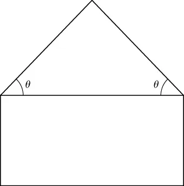
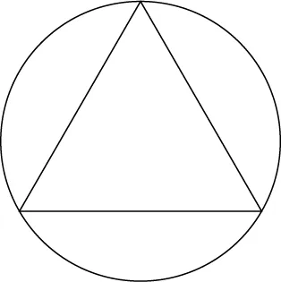

# 6.7 练习

!!! note "译文与来源"

    本页依据 2026 年 11 月 3 日读取的官方 v0.2 源文件制作。数学术语保留英文；原书公式、代码、例题、活动、证明与解答保留。译稿使用机器辅助翻译并进行数学与排版检查，未经原作者审定。原作者：Jacob Denson、Kaitlyn Phillipson、Sebastien Roch。除原书另有注明外，遵循 [CC BY-NC-SA 4.0](https://creativecommons.org/licenses/by-nc-sa/4.0/)。 [阅读英文原文](https://math345-textbook.github.io/u6-exercises.html)。

!!! info "指定练习题面已补全"

    本页所选 Nicholson 与 OpenStax 练习已直接列出中文题面，保留原题号和指定子题，并补齐读题必需的共享说明、跨题数据与配图。数学术语保留英文；每道题的解答可点击展开。来源统一列于本页说明，原有本书自编练习继续保留。

    外部题面于 2026 年 11 月 7 日读取。Nicholson 题目来源于 W. Keith Nicholson 的 *Linear Algebra with Applications*（LibreTexts / Lyryx）；OpenStax 题目来源于 Gilbert Strang、Edwin “Jed” Herman 的 *Calculus Volume 3*（Rice University）。按原页面 [CC BY-NC-SA 4.0](https://creativecommons.org/licenses/by-nc-sa/4.0/) 许可翻译与排版。

**Learning Outcomes**: 下面的标签列出了各组练习对应的学习目标；个别题目也可能用到前面章节的知识。

## Lagrange multipliers

### OpenStax 4.8 #358 {#exercise-openstax-4-8-358}

在下面的练习中，使用 Lagrange multipliers 的方法求出 function 在给定 constraints 的条件下的 maximum 和 minimum 值。

$$
f(x,y)={x}^{2}y;{x}^{2}+2{y}^{2}=6
$$

??? success "解答"

    Lagrange equations 为 $2xy=2\lambda x$、$x^2=4\lambda y$，同时满足 $x^2+2y^2=6$。

    若 $x=0$，则 $y=\pm\sqrt3$，function value 为零。若 $x\ne0$，则 $\lambda=y$，于是 $x^2=4y^2$，代入 constraint 得到 $y=\pm1,x=\pm2$。

    比较候选值：**maximum 为 $4$**，在 $(\pm2,1)$ 取得；**minimum 为 $-4$**，在 $(\pm2,-1)$ 取得。Constraint 是 closed bounded ellipse，所以候选值比较给出 global extrema。

### OpenStax 4.8 #360 {#exercise-openstax-4-8-360}

在下面的练习中，使用 Lagrange multipliers 的方法求出 function 在给定 constraints 的条件下的 maximum 和 minimum 值。

$$
f(x,y)=xy;4{x}^{2}+8{y}^{2}=16
$$

??? success "解答"

    把 constraint 除以 $4$，得 $x^2+2y^2=4$。Lagrange equations 为 $y=8\lambda x$、$x=16\lambda y$，推出 $x^2=2y^2$。

    所以候选点满足 $x=\pm\sqrt2,y=\pm1$。同号时 $xy=\sqrt2$，异号时 $xy=-\sqrt2$。

    **Maximum 为 $\sqrt2$，minimum 为 $-\sqrt2$**。Constraint 是 closed bounded ellipse，因此都是 global extrema。

### OpenStax 4.8 #362 {#exercise-openstax-4-8-362}

在下面的练习中，使用 Lagrange multipliers 的方法求出 function 在给定 constraints 的条件下的 maximum 和 minimum 值。

$$
f(x,y,z)={x}^{2}+{y}^{2}+{z}^{2},{x}^{4}+{y}^{4}+{z}^{4}=1
$$

??? success "解答"

    Lagrange equations 给出 $2x=4\lambda x^3$，对 $y,z$ 也一样。因此所有非零 coordinates 的 absolute value 相等。

    若恰有 $k$ 个非零 coordinates，constraint 给出每个的 absolute value 为 $k^{-1/4}$，因此

    $$
    f=k\left(k^{-1/4}\right)^2=\sqrt{k},\qquad k=1,2,3
    $$

    **Minimum 为 $1$**，在 $(\pm1,0,0)$ 及其 coordinate permutations 取得；**maximum 为 $\sqrt3$**，在 $|x|=|y|=|z|=3^{-1/4}$ 的八个点取得。

### OpenStax 4.8 #364 {#exercise-openstax-4-8-364}

在下面的练习中，使用 Lagrange multipliers 的方法求出 function 在给定 constraints 的条件下的 maximum 和 minimum 值。

$$
f(x,y)={x}^{2}+{y}^{2},{(x-1)}^{2}+4{y}^{2}=4
$$

??? success "解答"

    Lagrange equations 为

    $$
    2x=2\lambda(x-1),\qquad 2y=8\lambda y
    $$

    若 $y=0$，constraint 给出 $x=3$ 或 $x=-1$，function values 分别为 $9,1$。若 $y\ne0$，则 $\lambda=1/4$，得到 $x=-1/3$，进而 $y=\pm\sqrt5/3$，function value 为 $2/3$。

    因此 **maximum 为 $9$**，在 $(3,0)$ 取得；**minimum 为 $2/3$**，在 $(-1/3,\pm\sqrt5/3)$ 取得。

### OpenStax 4.8 #366 {#exercise-openstax-4-8-366}

在下面的练习中，使用 Lagrange multipliers 的方法求出 function 在给定 constraints 的条件下的 maximum 和 minimum 值。

$$
f(x,y,z)=x+y+z,\frac{1}{x}+\frac{1}{y}+\frac{1}{z}=1
$$

??? success "解答"

    **按题面给出的 domain（允许非零负数），不存在 global maximum 或 global minimum**。

    例如令 $x=y=t$，则 constraint 要求 $z=t/(t-2)$。因此

    $$
    f=2t+\frac{t}{t-2},\qquad t\ne0,2
    $$

    当 $t\to+\infty$ 时，$f\to+\infty$；当 $t\to-\infty$ 时，$f\to-\infty$。因此不能仅凭 Lagrange stationary points 宣称找到了 global extrema。

    若额外要求 $x,y,z>0$，则 Cauchy–Schwarz inequality 给出

    $$
    (x+y+z)\left(\frac1x+\frac1y+\frac1z\right)\ge9
    $$

    此时 minimum 为 $9$，在 $(3,3,3)$ 取得，仍无 maximum。这个正数限制是额外条件，不能默默补入原题。

### OpenStax 4.8 #368 {#exercise-openstax-4-8-368}

在下面的练习中，使用 Lagrange multipliers 的方法求出 function 在给定 constraints 的条件下的 maximum 和 minimum 值。

$$
f(x,y,z)={x}^{2}+{y}^{2}+{z}^{2},xyz=4
$$

??? success "解答"

    由 Lagrange equations 及 $xyz=4\ne0$ 可得 $x^2=y^2=z^2$。所以 $|x|=|y|=|z|=\sqrt[3]4$，且三个 signs 的乘积为正。

    用 AM–GM inequality 可验证 global minimum：

    $$
    x^2+y^2+z^2\ge3\sqrt[3]{x^2y^2z^2}=3\cdot4^{2/3}
    $$

    所以 **minimum 为 $3\cdot4^{2/3}$**，在上述四种 sign combinations 处取得。

    没有 maximum：取 $(x,y,z)=(t,1,4/t)$，当 $t\to\infty$ 时 function value 趋于无穷。

### OpenStax 4.8 #370 {#exercise-openstax-4-8-370}

在下面的练习中，使用 Lagrange multipliers 的方法求出 function 在给定 constraints 的条件下的 maximum 和 minimum 值。

最小化椭圆 ${b}^{2}{x}^{2}+{a}^{2}{y}^{2}={a}^{2}{b}^{2}.$ 上的 $f(x,y)=xy$

??? success "解答"

    设 $a,b>0$。Constraint 等价于 $x^2/a^2+y^2/b^2=1$。Lagrange equations 推出 $x^2/a^2=y^2/b^2=1/2$。

    所以 **minimum 为 $-ab/2$**，在 $(a/\sqrt2,-b/\sqrt2)$ 与 $(-a/\sqrt2,b/\sqrt2)$ 取得。Maximum 为 $ab/2$，在同号的两个对应点取得。

### OpenStax 4.8 #372 {#exercise-openstax-4-8-372}

在下面的练习中，使用 Lagrange multipliers 的方法求出 function 在给定 constraints 的条件下的 maximum 和 minimum 值。

最大化

$$
\begin{matrix}f(x,y)={x}^{2}-{y}^{2};x>0,y>0; \\ g(x,y)=y-{x}^{2}=0\end{matrix}
$$

??? success "解答"

    Constraint 给出 $y=x^2$，且 $x>0$。代入后

    $$
    f=x^2-x^4=\frac14-\left(x^2-\frac12\right)^2
    $$

    因此 **maximum 为 $1/4$**，在 $(x,y)=(1/\sqrt2,1/2)$ 取得。Lagrange equations $2x=-2\lambda x$、$-2y=\lambda$ 也给出同一候选点。

    沿 $x\to\infty,y=x^2$，function value 趋于 $-\infty$，所以没有 minimum。

### OpenStax 4.8 #374 {#exercise-openstax-4-8-374}

在下面的练习中，使用 Lagrange multipliers 的方法求出 function 在给定 constraints 的条件下的 maximum 和 minimum 值。

最大化 $U(x,y)=8{x}^{4\text{/}5}{y}^{1\text{/}5};4x+2y=12$

??? success "解答"

    按 utility model 的含义，取 $x,y\ge0$。在内部最大化 $\ln U$ 等价于最大化 $U$，Lagrange equations 为

    $$
    \frac4{5x}=4\lambda,\qquad\frac1{5y}=2\lambda
    $$

    因此 $x=2y$。与 $4x+2y=12$ 联立得到

    $$
    x=\frac{12}{5},\qquad y=\frac65
    $$

    边界 $x=0$ 或 $y=0$ 时 $U=0$，因此上述内部点给出 global maximum：

    $$
    U_{\max}=8\left(\frac{12}{5}\right)^{4/5}\left(\frac65\right)^{1/5}
    $$

    若不采用非负的经济学 domain，应另外明确 fractional powers 的实数解释。

### OpenStax 4.8 #376 {#exercise-openstax-4-8-376}

在下面的练习中，使用 Lagrange multipliers 的方法求出 function 在给定 constraints 的条件下的 maximum 和 minimum 值。

最大化 $f(x,y)=\sqrt{6-{x}^{2}-{y}^{2}},x+y-2=0.$

??? success "解答"

    Square root 随其输入增加而增加，所以最大化 $f$ 等价于在 $x+y=2$ 下最小化 $x^2+y^2$。Lagrange equations $2x=\lambda,2y=\lambda$ 给出 $x=y=1$。

    因此 **maximum 为 $2$**，在 $(1,1)$ 取得。实际 domain 还要求 $x^2+y^2\le6$。该线段两端为 $(1+\sqrt2,1-\sqrt2)$ 与 $(1-\sqrt2,1+\sqrt2)$，在那里 $f=0$，所以 minimum 为 $0$。

### OpenStax 4.8 #378 {#exercise-openstax-4-8-378}

在下面的练习中，使用 Lagrange multipliers 的方法求出 function 在给定 constraints 的条件下的 maximum 和 minimum 值。

在 constraint $x-2y+6=0.$ 的前提下最小化 $f(x,y)={x}^{2}-{y}^{2}$

??? success "解答"

    Constraint 给出 $x=2y-6$，代入并配方：

    $$
    f=(2y-6)^2-y^2=3(y-4)^2-12
    $$

    所以 **minimum 为 $-12$**，在 $(x,y)=(2,4)$ 取得。Lagrange equations $2x=\lambda,-2y=-2\lambda$ 也给出 $y=2x$，再联立 constraint 即可得到同一结果。

### OpenStax 4.8 #380 {#exercise-openstax-4-8-380}

下一组练习，用 Lagrange multipliers 的方法解决下列应用题。

如图，把一个等腰三角形放在一个矩形上方，组成一个五边形。已知五边形的周长为 $10$ 英寸，求使其面积最大的各边长度。

??? success "解答"

    设矩形宽为 $b$、高为 $h$，屋顶的 height 为 $k$，两条等长斜边长为 $s=\sqrt{k^2+b^2/4}$。内部重合的底边不计入周长：

    $$
    P=b+2h+2s=10,\qquad S=bh+\frac12bk
    $$

    在 $b,h,k>0$ 的内部，用 $\nabla S=\lambda\nabla P$。对 $h,k$ 的方程依次给出

    $$
    \lambda=\frac b2,\qquad k=\frac s2
    $$

    由 $s^2=k^2+b^2/4$ 得 $b=\sqrt3s$。对 $b$ 的方程给出

    $$
    h+\frac k2=\frac b2\left(1+\frac b{2s}\right),\qquad
    h=\frac{\sqrt3+1}{2}s
    $$

    代入 perimeter：

    $$
    s=\frac{10}{3+2\sqrt3},\qquad
    b=\frac{10\sqrt3}{3+2\sqrt3},\qquad
    h=\frac{5(\sqrt3+1)}{3+2\sqrt3}
    $$

    这就是五条外边的长度：底边为 $b$，两条竖边各为 $h$，两条屋顶斜边各为 $s$，单位均为英寸。

    最大面积为 $25\sqrt3/(3+2\sqrt3)$。退化为矩形时面积至多 $25/4$，退化为三角形时至多 $25\sqrt3/9$，均更小，因此内部候选点给出 global maximum。

### OpenStax 4.8 #382 {#exercise-openstax-4-8-382}

下一组练习，用 Lagrange multipliers 的方法解决下列应用题。

求椭圆 ${x}^{2}+xy+2{y}^{2}=1$ 与原点之间的 minimum 和 maximum 距离。

??? success "解答"

    最小化或最大化距离，等价于对 $d^2=x^2+y^2$ 求 extrema。把 constraint 写成 quadratic form：

    $$
    \begin{bmatrix}x&y\end{bmatrix}
    \begin{bmatrix}1&1/2\\1/2&2\end{bmatrix}
    \begin{bmatrix}x\\y\end{bmatrix}=1
    $$

    Lagrange equations 表明候选方向是这个 symmetric matrix 的 eigenvectors，其 eigenvalues 为 $(3\pm\sqrt2)/2$。在 unit eigenvector 的方向上，距离为 $1/\sqrt\lambda$，所以

    $$
    d_{\min}=\sqrt{\frac2{3+\sqrt2}},\qquad
    d_{\max}=\sqrt{\frac2{3-\sqrt2}}
    $$

### OpenStax 4.8 #384 {#exercise-openstax-4-8-384}

下一组练习，用 Lagrange multipliers 的方法解决下列应用题。

证明，在半径为 $R$ 的圆内切的所有三角形中（见图），等边三角形的周长最大。

??? success "解答"

    设三角形的三个内角为 $A,B,C>0$，且 $A+B+C=\pi$。由 sine rule，周长为

    $$
    P=2R(\sin A+\sin B+\sin C)
    $$

    Lagrange equations 给出 $\cos A=\cos B=\cos C$。因为 $\cos$ 在 $(0,\pi)$ 上严格递减，所以 $A=B=C=\pi/3$。

    再用 $\sin$ 在 $[0,\pi]$ 上的 concavity 验证 global bound：

    $$
    \sin A+\sin B+\sin C\le3\sin\frac\pi3=\frac{3\sqrt3}{2}
    $$

    因此周长至多 $3\sqrt3R$，等号只在等边三角形取得。

### OpenStax 4.8 #386 {#exercise-openstax-4-8-386}

下一组练习，用 Lagrange multipliers 的方法解决下列应用题。

求抛物线 $y={x}^{2}$ 与点 $(0,3).$ 之间的 minimum distance。

??? success "解答"

    最小化距离的平方，并把 constraint $y=x^2$ 代入：

    $$
    d^2=x^2+(x^2-3)^2=x^4-5x^2+9
    $$

    Derivative 为 $4x^3-10x=2x(2x^2-5)$，候选点为 $x=0$ 与 $x=\pm\sqrt{5/2}$。对应的 squared distances 为 $9$ 与 $11/4$。当 $|x|\to\infty$ 时距离趋于无穷，因此

    $$
    d_{\min}=\frac{\sqrt{11}}2
    $$

    最近点为 $(\pm\sqrt{5/2},5/2)$。用 Lagrange equations $2x=-2\lambda x,2(y-3)=\lambda$ 也可得到这些候选点。

### OpenStax 4.8 #388 {#exercise-openstax-4-8-388}

下一组练习，用 Lagrange multipliers 的方法解决下列应用题。

一个长方体容器的体积必须为 $480$ 立方米。底面的制作费用为每平方米 5 美元，顶面及各侧面的制作费用为每平方米 3 美元。用 Lagrange multipliers 求使总费用达到 minimum 的容器尺寸。

??? success "解答"

    设底边为 $x,y>0$，高度为 $z>0$。把底、顶、侧面的费用分别相加：

    $$
    C=5xy+3xy+6xz+6yz=8xy+6z(x+y),\qquad xyz=480
    $$

    Lagrange equations 或消去 $z=480/(xy)$ 后求导，都得到

    $$
    C=8xy+\frac{2880}x+\frac{2880}y,\qquad
    8y=\frac{2880}{x^2},\quad8x=\frac{2880}{y^2}
    $$

    所以 $x=y$，且 $x^3=360$。所求尺寸为

    $$
    x=y=\sqrt[3]{360}\text{ m},\qquad z=\frac43\sqrt[3]{360}\text{ m}
    $$

    AM–GM inequality 给出 $8xy+2880/x+2880/y\ge3\sqrt[3]{8\cdot2880^2}$，上述点取等号，因此确实达到 global minimum cost。

### OpenStax 4.8 #390 {#exercise-openstax-4-8-390}

下一组练习，用 Lagrange multipliers 的方法解决下列应用题。

求出平面 $4x+3y+z=2$ 上最接近点 $(1,−1,1).$ 的点

??? success "解答"

    平面的 normal vector 为 $\mathbf n=(4,3,1)^T$，目标点 $\mathbf p=(1,-1,1)^T$。最近点从 $\mathbf p$ 沿 normal direction 移动：

    $$
    \mathbf q=\mathbf p-\frac{\mathbf n\cdot\mathbf p-2}{\|\mathbf n\|^2}\mathbf n
    =\mathbf p-\frac2{26}(4,3,1)^T
    =\left(\frac9{13},-\frac{16}{13},\frac{12}{13}\right)^T
    $$

    可检查 $4q_x+3q_y+q_z=2$，且 $\mathbf p-\mathbf q$ 平行于 $\mathbf n$，满足最近点条件。

### OpenStax 4.8 #392 {#exercise-openstax-4-8-392}

下一组练习，用 Lagrange multipliers 的方法解决下列应用题。

一个长方体包含在一个四面体中，其顶点为

$(1,0,0),(0,1,0),(0,0,1),$ 和原点。盒子底边尺寸为 $x,y,$，盒子高度为 $z.$ 如果 $x,y, \text{and} z$ 之和为 1.0，求使长方体体积最大化的尺寸。

??? success "解答"

    最大化 $V=xyz$，constraint 为 $x+y+z=1$，且 $x,y,z\ge0$。内部的 Lagrange equations 为

    $$
    yz=\lambda,\quad xz=\lambda,\quad xy=\lambda
    $$

    所以 $x=y=z$，联立 constraint 得到 $x=y=z=1/3$。Boundary 上 volume 为零，因此 global maximum volume 为 $1/27$，在边长均为 $1/3$ 的 cube 取得。

## Singular value decomposition

### Nicholson 8.6.9(b) {#exercise-nicholson-8-6-9-b}

给定 orthogonal matrix $U$，求出 orthogonal matrix $V$，使得 $A=U\Sigma_A V^T$ 是 $A$ 的 SVD。

下面给定

$$
A= \left[ \begin{array}{cc} 0 & 1 \\ 1 & 0 \end{array} \right]
$$

对所列的每个 $U$ 完成上述任务：

$$
U=\frac{1}{\sqrt{2}} \left[ \begin{array}{rr} 1 & -1 \\ 1 & 1 \end{array} \right]
$$

??? success "解答"

    $A^TA=I$，所以两个 singular values 都为 $1$，可取 $\Sigma_A=I_2$。由 $A=UV^T$ 得到 $V=A^TU$，因此

    $$
    V=\frac1{\sqrt2}\begin{bmatrix}1&1\\1&-1\end{bmatrix}
    $$

    直接计算可检查 $V^TV=I$ 且 $UV^T=A$。

## 额外练习

这些练习将 absolute extrema、 Lagrange multipliers 与一个或多个 constraints、 quadratic forms、 maximum stretch、 PCA、 SVD、 rank 以及four fundamental subspaces连接起来。解决方案草图收集在附录[单元 6 应用、几何和计算解释](app-solutions-6.md#app-u6-applied-solutions)中。

**练习 6.7.1：选择候选者和方程**

对于下面的每个问题，请陈述用于查找候选项的方程，并说明必须比较哪些候选项。不要解方程。

1. 在矩形 $D=[a,b]\times[c,d]$ 上找到 differentiable function $f(x,y)$ 的 absolute extrema。

2. 假设 $\nabla g\ne\mathbf{0}$ 在 feasible set 上，求 $f(\mathbf{x})$ 服从

    $$
    g(\mathbf{x})=k,
    $$

     的极值。

3. 假设两个 constraint 梯度在 feasible set 上为 linearly independent，求 $f(\mathbf{x})$ 服从

    $$
    g_1(\mathbf{x})=k_1,
                      \qquad
                      g_2(\mathbf{x})=k_2,
    $$

     的极值。

4. 假设 $\nabla g\ne\mathbf{0}$ 在其 boundary 上，在 closed bounded region

    $$
    D=\{\mathbf{x}:g(\mathbf{x})\leq k\},
    $$

     上求 $f(\mathbf{x})$ 的 absolute extrema。

??? success "解答"

    对于矩形，首先求解

    $$
    \nabla f(x,y)=\mathbf{0}
    $$

     以获得内部的critical point。将 $f$ 限制为四个边中的每一个，并找到这些边上的单变量critical point。包括所有端点和角点。评估每个候选者的 $f$ 并比较这些值。

    利用一个等式 constraint，将

    $$
    \nabla f(\mathbf{x})
              =
              \lambda\nabla g(\mathbf{x})
    $$

     与

    $$
    g(\mathbf{x})=k.
    $$

     一起求解。 在每个结果候选处评估 $f$，并在请求 absolute extrema 时比较这些值。

    有了两个等式 constraints，与

    $$
    g_1(\mathbf{x})=k_1,
              \qquad
              g_2(\mathbf{x})=k_2.
    $$

     一起求解

    $$
    \nabla f(\mathbf{x})
              =
              \lambda_1\nabla g_1(\mathbf{x})
              +
              \lambda_2\nabla g_2(\mathbf{x})
    $$

     再次，评估所有候选者的 $f$ 并比较这些值。

    对于区域$g(\mathbf{x})\leq k$，在满足$g(\mathbf{x})<k$的可行内点处求解

    $$
    \nabla f(\mathbf{x})=\mathbf{0}
    $$

    在 boundary 上，解决

    $$
    \nabla f(\mathbf{x})
              =
              \lambda\nabla g(\mathbf{x}),
              \qquad
              g(\mathbf{x})=k.
    $$

    比较所有内部和 boundary 候选者。由于该区域是封闭且有界的，因此当 $f$ 连续于 [the extreme value theorem](6-1.md#thm-u6-extreme-value) 时， absolute extrema 存在。

**练习 6.7.2：一次 quadratic form，三读**

让

$$
B=
              \begin{bmatrix}
              5 & 4\\
              4 & 5
              \end{bmatrix},
              \qquad
              A=
              \begin{bmatrix}
              1 & 2\\
              2 & 1
              \end{bmatrix},
              \qquad
              C=\frac12B.
$$

1. 求 $B$ 的 eigenvalues 和 eigenvectors 的 orthonormal basis。

2. 在

    $$
    \|\mathbf{x}\|=1.
    $$

     的条件下求 absolute maximum 和

    $$
    q_B(\mathbf{x})=\mathbf{x}^TB\mathbf{x}
    $$

     的最小值

3. 检查

    $$
    A^TA=B.
    $$

    找到$A$的 singular values 和右 singular 方向。

    $$
    \max_{\|\mathbf{x}\|=1}\|A\mathbf{x}\|?
    $$

    是什么

4. 假设$C$是[the activity “Principal directions of a small data set”](6-4.md#act-u6-pca-small-data-set)的 covariance matrix。找到第一个和第二个 principal directions 及其捕获的变体。

5. 第一个 principal direction 捕获了总中心变化的哪一部分？

6. 为什么相同的两个方向出现在所有三个读数中？

**学习目标**： U6-LO4、U6-LO5、U6-LO6、U5-LO4。

??? success "解答"

    $B$的characteristic polynomial为

    $$
    \det(B-\lambda I)
              =
              (5-\lambda)^2-16
              =
              (\lambda-9)(\lambda-1).
    $$

    因此 eigenvalues 为

    $$
    \lambda_1=9,
              \qquad
              \lambda_2=1.
    $$

    对应单位 eigenvectors 为

    $$
    \mathbf{v}_1
              =
              \frac1{\sqrt2}
              \begin{bmatrix}
              1\\
              1
              \end{bmatrix},
              \qquad
              \mathbf{v}_2
              =
              \frac1{\sqrt2}
              \begin{bmatrix}
              1\\
              -1
              \end{bmatrix}.
    $$

    由[the fact “Extrema of a symmetric quadratic form on the unit sphere”](6-3.md#fact-u6-maximum-stretch-eigenvectors)、

    $$
    \max_{\|\mathbf{x}\|=1}q_B(\mathbf{x})=9
    $$

    沿$\mathbf{v}_1$方向行驶，同时沿

    $$
    \min_{\|\mathbf{x}\|=1}q_B(\mathbf{x})=1
    $$

    沿$\mathbf{v}_2$方向行驶。

    我们计算

    $$
    A^TA
              =
              \begin{bmatrix}
              1 & 2\\
              2 & 1
              \end{bmatrix}
              \begin{bmatrix}
              1 & 2\\
              2 & 1
              \end{bmatrix}
              =
              \begin{bmatrix}
              5 & 4\\
              4 & 5
              \end{bmatrix}
              =
              B.
    $$

    因此$A$的 singular values 是

    $$
    \sigma_1=\sqrt9=3,
              \qquad
              \sigma_2=\sqrt1=1,
    $$

    右 singular 方向是$\mathbf{v}_1$和$\mathbf{v}_2$。特别是

    $$
    \max_{\|\mathbf{x}\|=1}\|A\mathbf{x}\|=3.
    $$

    由于

    $$
    C=\frac12B,
    $$

      covariance matrix 具有相同的 eigenvectors，以及 eigenvalues

    $$
    \frac92
              \qquad\text{and}\qquad
              \frac12.
    $$

    因此 $\mathbf{v}_1$ 是第一个 principal direction，$\mathbf{v}_2$ 是第二个 principal direction。他们捕获的变体是$9/2$和$1/2$。

    第一个 principal direction 捕获总中心变化的分数

    $$
    \frac{9/2}{9/2+1/2}
              =
              \frac9{10}
    $$

    出现相同的方向是因为正在分析的三个 symmetric matrices 是

    $$
    B,\qquad A^TA=B,\qquad C=\frac12B.
    $$

    将 matrix 乘以正 scalar 会更改其 eigenvalues，但不会更改其 eigenvectors。

**练习 6.7.3：矩形上的候选表**

让

$$
f(x,y)=x^2+y^2-2x+4y
$$

位于矩形

$$
D=\{(x,y):0\leq x\leq 3,\ -3\leq y\leq 1\}.
$$

上

1. 在$D$的内部找到$f$的 critical point。

2. 在四个边上分别找到 boundary 候选者。

3. 包括四个角点。

4. 制作一个候选表，其中包含每个候选的来源和$f$的值。

5. 在$D$上找到$f$的 absolute maximum 和 absolute minimum。

??? success "解答"

    gradient 是

    $$
    \nabla f(x,y)=
              \begin{bmatrix}
              2x-2\\
              2y+4
              \end{bmatrix}.
    $$

    内部 critical point 是

    $$
    (1,-2),
    $$

    $$
    f(1,-2)=-5.
    $$

    在 $x=0$、

    $$
    f(0,y)=y^2+4y,
    $$

     上， boundary critical point 为 $y=-2$，给出 $(0,-2)$ 和值 $-4$。

    在 $x=3$、

    $$
    f(3,y)=y^2+4y+3,
    $$

     上， boundary critical point 为 $y=-2$，给出 $(3,-2)$ 和值 $-1$。

    在 $y=-3$、

    $$
    f(x,-3)=x^2-2x-3,
    $$

     上， boundary critical point 为 $x=1$，给出 $(1,-3)$ 和值 $-4$。

    在 $y=1$、

    $$
    f(x,1)=x^2-2x+5,
    $$

     上， boundary critical point 为 $x=1$，给出 $(1,1)$ 和值 $4$。

    角点值为

    $$
    f(0,-3)=-3,\qquad
              f(3,-3)=0,\qquad
              f(0,1)=5,\qquad
              f(3,1)=8.
    $$

     因此 absolute minimum 值在

    $$
    (1,-2),
    $$

     处为

    $$
    -5
    $$

    absolute maximum 值在

    $$
    (3,1).
    $$

     处为

    $$
    8
    $$

**练习 6.7.4：圆上的平行渐变**

令

$$
f(x,y)=3x+4y
$$

 并将输入约束为圆

$$
x^2+y^2=25.
$$

1. 将 constraint 写为$g(x,y)=25$。

2. 解决

    $$
    \nabla f=\lambda\nabla g.
    $$

3. 找到受约束的critical point。

4. 在受约束的critical point处评估 $f$。

5. 哪个点给出 absolute maximum？哪个点给出 absolute minimum？

6. 从几何角度解释为什么 $\nabla f$ 在这些点处平行于 $\nabla g$。

??? success "解答"

    使用

    $$
    g(x,y)=x^2+y^2.
    $$

     然后

    $$
    \nabla f=
              \begin{bmatrix}
              3\\
              4
              \end{bmatrix},
              \qquad
              \nabla g=
              \begin{bmatrix}
              2x\\
              2y
              \end{bmatrix}.
    $$

     Lagrange方程为

    $$
    3=2\lambda x,
              \qquad
              4=2\lambda y,
              \qquad
              x^2+y^2=25.
    $$

    前两个方程表示

    $$
    \begin{bmatrix}
              x\\
              y
              \end{bmatrix}
    $$

     与

    $$
    \begin{bmatrix}
              3\\
              4
              \end{bmatrix}.
    $$

     平行，因为

    $$
    \left\|
              \begin{bmatrix}
              3\\
              4
              \end{bmatrix}
              \right\|=5,
    $$

     受约束的critical point是

    $$
    (3,4)
              \quad\text{and}\quad
              (-3,-4).
    $$

     function 值为

    $$
    f(3,4)=25,
              \qquad
              f(-3,-4)=-25.
    $$

    因此 absolute maximum 在 $(3,4)$ 处为 $25$， absolute minimum 在 $(-3,-4)$ 处为 $-25$。

    几何上，$\nabla f$指向$f$增长最快的方向，而$\nabla g$垂直于圆。在最大值和最小值处，这些方向是平行或反平行的。

**练习 6.7.5：单位圆上的 Quadratic form **

让

$$
B=
              \begin{bmatrix}
                5& 0\\
                0& 2
              \end{bmatrix}
$$

$$
q(\mathbf{x})=\mathbf{x}^TB\mathbf{x}.
$$

写成

$$
\mathbf{x}=
              \begin{bmatrix}
                x\\
                y
              \end{bmatrix}.
$$

1. 将$q(\mathbf{x})$写成$x$和$y$。

2. 在

    $$
    \|\mathbf{x}\|=1.
    $$

     的前提下最大化 $q(\mathbf{x})$

3. 在

    $$
    \|\mathbf{x}\|=1.
    $$

     的前提下最小化 $q(\mathbf{x})$

4. 哪个单位 vectors 给出极值？

5. 答案与 $B$ 的 eigenvalues 和 eigenvectors 有什么关系？

??? success "解答"

    对于

    $$
    \mathbf{x}=
              \begin{bmatrix}
              x\\
              y
              \end{bmatrix},
    $$

    我们有

    $$
    q(\mathbf{x})
              =
              \mathbf{x}^T
              \begin{bmatrix}
              5&0\\
              0&2
              \end{bmatrix}
              \mathbf{x}
              =
              5x^2+2y^2.
    $$

     在单位圆上，

    $$
    x^2+y^2=1.
    $$

    最大值为 $5$，在

    $$
    \mathbf{x}=
              \begin{bmatrix}
              1\\
              0
              \end{bmatrix}
              \quad\text{and}\quad
              \mathbf{x}=
              \begin{bmatrix}
              -1\\
              0
              \end{bmatrix}.
    $$

     处获得 最小值为 $2$，在

    $$
    \mathbf{x}=
              \begin{bmatrix}
              0\\
              1
              \end{bmatrix}
              \quad\text{and}\quad
              \mathbf{x}=
              \begin{bmatrix}
              0\\
              -1
              \end{bmatrix}.
    $$

     处获得 这些是 $B$ 的 eigenvalues 和 eigenvectors： eigenvalues 是 $5$ 和 $2$，其中 eigenvector 方向$\mathbf{e}_1$和$\mathbf{e}_2$。

**练习 6.7.6： Maximum stretch matrix **

让

$$
A=
              \begin{bmatrix}
                1& 2\\
                2& 1
              \end{bmatrix}.
$$

1. 计算$A^TA$。

2. 求 $A^TA$ 的 eigenvalues。

3. 求 $A$ 的 singular values。

4. 找到与最大的 singular value 对应的单位 right singular vector。

5. 什么是

    $$
    \max_{\|\mathbf{x}\|=1}\|A\mathbf{x}\|?
    $$

6. 哪个输入方向拉伸最多？

??? success "解答"

    由于$A$是 symmetric，

    $$
    A^TA=A^2.
    $$

    计算

    $$
    A^TA
              =
              \begin{bmatrix}
              1&2\\
              2&1
              \end{bmatrix}
              \begin{bmatrix}
              1&2\\
              2&1
              \end{bmatrix}
              =
              \begin{bmatrix}
              5&4\\
              4&5
              \end{bmatrix}.
    $$

     eigenvectors

    $$
    \frac{1}{\sqrt2}
              \begin{bmatrix}
              1\\
              1
              \end{bmatrix}
              \quad\text{and}\quad
              \frac{1}{\sqrt2}
              \begin{bmatrix}
              1\\
              -1
              \end{bmatrix}
    $$

     分别有 eigenvalues $9$ 和 $1$。因此 singular values 是

    $$
    3
              \quad\text{and}\quad
              1.
    $$

    最大的 singular value 是$3$，所以

    $$
    \max_{\|\mathbf{x}\|=1}\|A\mathbf{x}\|=3.
    $$

    拉伸最大的输入方向是

    $$
    \frac{1}{\sqrt2}
              \begin{bmatrix}
              1\\
              1
              \end{bmatrix}.
    $$

**练习 6.7.7：读 SVD **

假设

$$
A=U\Sigma V^T,
$$

 其中

$$
U=
              \begin{bmatrix}
                1& 0\\
                0& 1
              \end{bmatrix},
              \qquad
              \Sigma=
              \begin{bmatrix}
                5& 0& 0\\
                0& 2& 0
              \end{bmatrix},
$$

$$
V=
              \begin{bmatrix}
                1/\sqrt2& 0& 1/\sqrt2\\
                1/\sqrt2& 0& -1/\sqrt2\\
                0& 1& 0
              \end{bmatrix}.
$$

 因此右边的 singular vectors 是

$$
\mathbf{v}_1=
              \frac{1}{\sqrt2}
              \begin{bmatrix}
                1\\
                1\\
                0
              \end{bmatrix},
              \qquad
              \mathbf{v}_2=
              \begin{bmatrix}
                0\\
                0\\
                1
              \end{bmatrix},
              \qquad
              \mathbf{v}_3=
              \frac{1}{\sqrt2}
              \begin{bmatrix}
                1\\
                -1\\
                0
              \end{bmatrix}.
$$

1. $A$的 singular values 是多少？

2. $\operatorname{rank}(A)$是什么？

3. 使用 SVD 计算 $A\mathbf{v}_1$、$A\mathbf{v}_2$ 和 $A\mathbf{v}_3$。

4. 忘记了哪个输入方向？

5. 传输哪些输入方向？

??? success "解答"

    非零 singular values 为

    $$
    5
              \quad\text{and}\quad
              2.
    $$

      matrix 有 rank

    $$
    2.
    $$

     使用

    $$
    A\mathbf{v}_i=\sigma_i\mathbf{u}_i
    $$

     表示正 singular values，使用 $A\mathbf{v}_i=\mathbf{0}$ 表示零方向，

    $$
    A\mathbf{v}_1=
              5
              \begin{bmatrix}
              1\\
              0
              \end{bmatrix}
              =
              \begin{bmatrix}
              5\\
              0
              \end{bmatrix},
    $$

    $$
    A\mathbf{v}_2=
              2
              \begin{bmatrix}
              0\\
              1
              \end{bmatrix}
              =
              \begin{bmatrix}
              0\\
              2
              \end{bmatrix},
    $$

    $$
    A\mathbf{v}_3=\mathbf{0}.
    $$

    忘记的输入方向是

    $$
    \mathbf{v}_3=
              \frac{1}{\sqrt2}
              \begin{bmatrix}
              1\\
              -1\\
              0
              \end{bmatrix}.
    $$

    传输的输入方向是

    $$
    \mathbf{v}_1=
              \frac{1}{\sqrt2}
              \begin{bmatrix}
              1\\
              1\\
              0
              \end{bmatrix}
    $$

    $$
    \mathbf{v}_2=
              \begin{bmatrix}
              0\\
              0\\
              1
              \end{bmatrix}.
    $$

**练习 6.7.8： SVD 的基本子空间**

使用前一个检查点的 SVD 数据。

1. 给 $\operatorname{row}(A)$ 一个 orthonormal basis。

2. 给 $\operatorname{null}(A)$ 一个 orthonormal basis。

3. 给 $\operatorname{col}(A)$ 一个 orthonormal basis。

4. 给 $\operatorname{null}(A^T)$ 一个 orthonormal basis。

5. 检查 dimensions 与 rank - nullity 一致。

??? success "解答"

    由于 rank 是$2$，前两个右 singular vectors 为 row space 形成 orthonormal basis：

    $$
    \operatorname{row}(A)
              =
              \operatorname{span}
              \left\{
              \frac{1}{\sqrt2}
              \begin{bmatrix}
              1\\
              1\\
              0
              \end{bmatrix},
              \begin{bmatrix}
              0\\
              0\\
              1
              \end{bmatrix}
              \right\}.
    $$

     剩下的 right singular vector 给出 null space：

    $$
    \operatorname{null}(A)
              =
              \operatorname{span}
              \left\{
              \frac{1}{\sqrt2}
              \begin{bmatrix}
              1\\
              -1\\
              0
              \end{bmatrix}
              \right\}.
    $$

    剩下的前两个 singular vectors 形成 column space 的 orthonormal basis：

    $$
    \operatorname{col}(A)
              =
              \operatorname{span}
              \left\{
              \begin{bmatrix}
              1\\
              0
              \end{bmatrix},
              \begin{bmatrix}
              0\\
              1
              \end{bmatrix}
              \right\}
              =
              \mathbb R^2.
    $$

    因为$A$有两个 rows 和 rank $2$、

    $$
    \operatorname{null}(A^T)=\{\mathbf{0}\},
    $$

    其中 basis 是空集。

     dimensions 是

    $$
    \dim(\operatorname{row}(A))=2,
              \qquad
              \dim(\operatorname{null}(A))=1,
    $$

    $$
    2+1=3,
    $$

    与 rank - nullity 一致，$2\times 3$ matrix。另外，

    $$
    \dim(\operatorname{col}(A))=2,
              \qquad
              \dim(\operatorname{null}(A^T))=0,
    $$

    $$
    2+0=2.
    $$

**练习 6.7.9：球体上的两个 constraints **

让

$$
f(x,y,z)=x-y.
$$

求$f$服从

$$
x^2+y^2+z^2=1
$$

$$
x+y+z=0.
$$

的 absolute extrema

1. 用几何方式描述 feasible set。为什么 absolute extrema 存在？

2. 证明两个 constraints 在每个可行点的梯度都是 linearly independent。

3. 使用乘数 $\lambda$ 和 $\mu$ 形成Lagrange函数。

4. 写出并求解Lagrange方程。

5. 评估候选者的 $f$ 并确定 absolute maximum 和最小值。

??? success "解答"

    feasible set 是unit sphere与平面

    $$
    x+y+z=0.
    $$

    的交线，它是一个圆，所以它是闭有界的。由于$f$是连续的，因此 absolute extrema 存在于[the extreme value theorem](6-1.md#thm-u6-extreme-value)。

    让

    $$
    g_1(x,y,z)=x^2+y^2+z^2,
              \qquad
              g_2(x,y,z)=x+y+z.
    $$

    然后

    $$
    \nabla g_1
              =
              2
              \begin{bmatrix}
                x\\
                y\\
                z
              \end{bmatrix},
              \qquad
              \nabla g_2
              =
              \begin{bmatrix}
                1\\
                1\\
                1
              \end{bmatrix}.
    $$

    在可行点，

    $$
    \nabla g_1\cdot\nabla g_2
              =
              2(x+y+z)
              =
              0.
    $$

    两个梯度都非零。因此它们是 linearly independent。

    定义

    $$
    L(x,y,z,\lambda,\mu)
              =
              x-y
              -
              \lambda(x^2+y^2+z^2-1)
              -
              \mu(x+y+z).
    $$

     方程为

    $$
    1=2\lambda x+\mu,
    $$

    $$
    -1=2\lambda y+\mu,
    $$

    $$
    0=2\lambda z+\mu,
    $$

     以及两个 constraints。

    将前三个方程相加并使用 $x+y+z=0$ 得到

    $$
    \mu=0.
    $$

     另外，$\lambda\ne0$，因为否则第一个方程是不可能的。因此

    $$
    x=\frac1{2\lambda},
              \qquad
              y=-\frac1{2\lambda},
              \qquad
              z=0.
    $$

     球体 constraint 给出

    $$
    \frac1{2\lambda^2}=1,
    $$

     所以

    $$
    \lambda=\pm\frac1{\sqrt2}.
    $$

    候选者是

    $$
    \frac1{\sqrt2}
              \begin{bmatrix}
                1\\
                -1\\
                0
              \end{bmatrix}
              \qquad\text{and}\qquad
              \frac1{\sqrt2}
              \begin{bmatrix}
                -1\\
                1\\
                0
              \end{bmatrix}.
    $$

    他们的$f$值是

    $$
    \sqrt2\qquad\text{and}\qquad-\sqrt2.
    $$

    因此 absolute maximum 是$\sqrt2$， absolute minimum 是$-\sqrt2$。

**练习 6.7.10： centered data 组中的 Principal directions **

$$
X=
              \begin{bmatrix}
                4&2\\
                2&4\\
                -2&0\\
                0&-2
              \end{bmatrix}
$$

的 rows 是$\mathbb{R}^2$中的四个数据点。

1. 计算平均值 $\bar{\mathbf{x}}$ 和 centered data matrix $Z$。

2. 计算 covariance matrix

    $$
    C=\frac14Z^TZ.
    $$

3. 求$C$的 eigenvalues 和对应的 orthonormal eigenvectors。对于较大的 eigenvalue 选择 $\mathbf{v}_1$，对于较小的 eigenvalue 选择 $\mathbf{v}_2$。

4. 形成

    $$
    V=
                      \begin{bmatrix}
                        \mathbf{v}_1&\mathbf{v}_2
                      \end{bmatrix}
    $$

     并计算principal coordinate matrix

    $$
    T=ZV.
    $$

5. 计算

    $$
    V^TCV.
    $$

6. 第一个 principal direction 捕获了总中心变化的哪一部分？

??? success "解答"

    平均值为

    $$
    \bar{\mathbf{x}}
              =
              \begin{bmatrix}
                1\\
                1
              \end{bmatrix}.
    $$

     因此

    $$
    Z=
              \begin{bmatrix}
                3&1\\
                1&3\\
                -3&-1\\
                -1&-3
              \end{bmatrix}.
    $$

     covariance matrix 为

    $$
    C
              =
              \frac14Z^TZ
              =
              \begin{bmatrix}
                5&3\\
                3&5
              \end{bmatrix}.
    $$

      eigenvalues 为

    $$
    \lambda_1=8,
              \qquad
              \lambda_2=2.
    $$

     对应单位 eigenvectors 为

    $$
    \mathbf{v}_1
              =
              \frac1{\sqrt2}
              \begin{bmatrix}
                1\\
                1
              \end{bmatrix},
              \qquad
              \mathbf{v}_2
              =
              \frac1{\sqrt2}
              \begin{bmatrix}
                1\\
                -1
              \end{bmatrix}.
    $$

    因此

    $$
    V=
              \frac1{\sqrt2}
              \begin{bmatrix}
                1&1\\
                1&-1
              \end{bmatrix}.
    $$

    principal- coordinate matrix 是

    $$
    T=ZV
              =
              \begin{bmatrix}
                2\sqrt2&\sqrt2\\
                2\sqrt2&-\sqrt2\\
                -2\sqrt2&-\sqrt2\\
                -2\sqrt2&\sqrt2
              \end{bmatrix}.
    $$

    另外，

    $$
    V^TCV
              =
              \begin{bmatrix}
                8&0\\
                0&2
              \end{bmatrix}.
    $$

    第一个 principal direction 捕获总中心变化的

    $$
    \frac{\lambda_1}{\lambda_1+\lambda_2}
              =
              \frac8{8+2}
              =
              \frac45
    $$

**练习 6.7.11： PCA reconstruction 和回归**

使用 [the checkpoint “Principal directions of a centered data set”](6-7.md#ex-u6-checkpoint-principal-directions-centered-data) 中的数据和 principal directions。第一个 centered data vector 是

$$
\mathbf{z}_1=
              \begin{bmatrix}
                3\\
                1
              \end{bmatrix},
$$

$$
\mathbf{v}_1
              =
              \frac1{\sqrt2}
              \begin{bmatrix}
                1\\
                1
              \end{bmatrix}.
$$

1. 计算第一principal- component 分数

    $$
    t_1=\mathbf{v}_1^T\mathbf{z}_1.
    $$

2. 计算投影中心 vector

    $$
    \widehat{\mathbf{z}}_1=t_1\mathbf{v}_1
    $$

     和 reconstruction residual

    $$
    \mathbf{r}_1
                      =
                      \mathbf{z}_1-\widehat{\mathbf{z}}_1.
    $$

3. 检查

    $$
    \mathbf{r}_1\cdot\mathbf{v}_1=0.
    $$

4. 找到重构后的原始数据点

    $$
    \widehat{\mathbf{x}}_1
                      =
                      \bar{\mathbf{x}}+\widehat{\mathbf{z}}_1.
    $$

5. 给出 PCA 线

    $$
    \bar{\mathbf{x}}+\operatorname{span}\{\mathbf{v}_1\}.
    $$

     的方程

6. 对于$y$对$x$的回归，使用

    $$
    m=\frac{C_{12}}{C_{11}},
                      \qquad
                      b=\bar y-m\bar x
    $$

    求回归线。

7. 为什么 PCA 和回归线不同？描述每种方法最小化的 residual 方向。

??? success "解答"

    分数为

    $$
    t_1
              =
              \mathbf{v}_1^T\mathbf{z}_1
              =
              \frac4{\sqrt2}
              =
              2\sqrt2.
    $$

     因此

    $$
    \widehat{\mathbf{z}}_1
              =
              t_1\mathbf{v}_1
              =
              \begin{bmatrix}
                2\\
                2
              \end{bmatrix},
    $$

    $$
    \mathbf{r}_1
              =
              \begin{bmatrix}
                3\\
                1
              \end{bmatrix}
              -
              \begin{bmatrix}
                2\\
                2
              \end{bmatrix}
              =
              \begin{bmatrix}
                1\\
                -1
              \end{bmatrix}.
    $$

    我们检查

    $$
    \mathbf{r}_1\cdot\mathbf{v}_1
              =
              \frac1{\sqrt2}(1-1)
              =
              0.
    $$

    自从

    $$
    \bar{\mathbf{x}}
              =
              \begin{bmatrix}
                1\\
                1
              \end{bmatrix},
    $$

    重建的原始数据点是

    $$
    \widehat{\mathbf{x}}_1
              =
              \begin{bmatrix}
                3\\
                3
              \end{bmatrix}.
    $$

     PCA 线沿$(1,1)$ 方向穿过$(1,1)$，因此其方程为

    $$
    y=x.
    $$

     对于回归，

    $$
    m=\frac35,
              \qquad
              b=1-\frac35=\frac25.
    $$

     因此回归线为

    $$
    \widehat y
              =
              \frac25+\frac35x.
    $$

     PCA 对称对待两个 feature coordinates 并最小化垂直 reconstruction residuals。回归将$x$视为预测变量，将$y$视为响应，并最小化垂直预测 residuals。两个目标不必产生相同的线。

**练习 6.7.12： singular values 重新审视冗余 features **

返回单元2冗余- feature matrix

$$
X=
              \begin{bmatrix}
                1& 2& 3\\
                2& 4& 6\\
                0& 1& 1\\
                1& -1& 0
              \end{bmatrix}.
$$

第三个 column 是前两个 columns 之和。

1. 验证

    $$
    X
                      \begin{bmatrix}
                        1\\
                        1\\
                        -1
                      \end{bmatrix}
                      =
                      \mathbf{0}.
    $$

2. 这对$\operatorname{null}(X)$说明了什么？

3. 这对于 $X$ 的 rank 意味着什么？

4. 由于这种冗余，应该出现什么 singular value？

5. 如果$X\mathbf{c}=\mathbf{y}$，

    $$
    X\left(\mathbf{c}+t
                      \begin{bmatrix}
                        1\\
                        1\\
                        -1
                      \end{bmatrix}\right)?
    $$

    是多少

6. 解释这如何重新审视第二单元非唯一 coefficient vectors 的想法。

??? success "解答"

    计算

    $$
    X
              \begin{bmatrix}
              1\\
              1\\
              -1
              \end{bmatrix}
              =
              \begin{bmatrix}
              1+2-3\\
              2+4-6\\
              0+1-1\\
              1-1-0
              \end{bmatrix}
              =
              \begin{bmatrix}
              0\\
              0\\
              0\\
              0
              \end{bmatrix}.
    $$

     因此

    $$
    \begin{bmatrix}
              1\\
              1\\
              -1
              \end{bmatrix}
              \in \operatorname{null}(X).
    $$

    第三个 column 是前两个 columns 之和，因此 columns 是相关的。前两个 columns 不是彼此的倍数，因此

    $$
    \operatorname{rank}(X)=2.
    $$

     因为 $X$ 有 3 个 columns 但 rank $2$，所以 1 个 singular value 为零。

    如果$X\mathbf{c}=\mathbf{y}$，则

    $$
    X\left(\mathbf{c}+t
              \begin{bmatrix}
              1\\
              1\\
              -1
              \end{bmatrix}\right)
              =
              X\mathbf{c}
              +
              tX
              \begin{bmatrix}
              1\\
              1\\
              -1
              \end{bmatrix}
              =
              \mathbf{y}.
    $$

    所以不同的 coefficient vectors 可以给出相同的输出。这与单元 2 中的非唯一性相同，现在由零 singular value 检测到。

**练习 6.7.13： PCA 来自 SVD **

从[the checkpoint “Principal directions of a centered data set”](6-7.md#ex-u6-checkpoint-principal-directions-centered-data)返回 centered data matrix。假设

$$
Z=U_2\Sigma_2V^T,
$$

 其中

$$
\mathbf{u}_1
              =
              \frac12
              \begin{bmatrix}
                1\\
                1\\
                -1\\
                -1
              \end{bmatrix},
              \qquad
              \mathbf{u}_2
              =
              \frac12
              \begin{bmatrix}
                1\\
                -1\\
                -1\\
                1
              \end{bmatrix},
$$

$$
U_2=
              \begin{bmatrix}
                \mathbf{u}_1&\mathbf{u}_2
              \end{bmatrix},
              \qquad
              \Sigma_2=
              \begin{bmatrix}
                4\sqrt2&0\\
                0&2\sqrt2
              \end{bmatrix},
$$

$$
V=
              \frac1{\sqrt2}
              \begin{bmatrix}
                1&1\\
                1&-1
              \end{bmatrix}.
$$

1. 使用

    $$
    \lambda_j=\frac{\sigma_j^2}{4}
    $$

    恢复两个 covariance eigenvalues。

2. $V$中的哪一个 columns 是第一个和第二个 principal directions？

3. 计算principal- coordinate matrix

    $$
    T=U_2\Sigma_2.
    $$

4. 仅使用第一个 principal direction 计算 reconstruction：

    $$
    \widehat Z_1
                      =
                      \sigma_1\mathbf{u}_1\mathbf{v}_1^T.
    $$

5. 第一个 principal direction 捕获了总中心变化的哪一部分？

6. $T$的两个 columns 代表什么？

??? success "解答"

    covariance eigenvalues 是

    $$
    \lambda_1
              =
              \frac{(4\sqrt2)^2}{4}
              =
              8,
              \qquad
              \lambda_2
              =
              \frac{(2\sqrt2)^2}{4}
              =
              2.
    $$

    因此

    $$
    \mathbf{v}_1
              =
              \frac1{\sqrt2}
              \begin{bmatrix}
                1\\
                1
              \end{bmatrix}
    $$

     是第一个 principal direction，

    $$
    \mathbf{v}_2
              =
              \frac1{\sqrt2}
              \begin{bmatrix}
                1\\
                -1
              \end{bmatrix}
    $$

     是第二个 principal direction。

    principal- coordinate matrix 是

    $$
    T=U_2\Sigma_2
              =
              \begin{bmatrix}
                2\sqrt2&\sqrt2\\
                2\sqrt2&-\sqrt2\\
                -2\sqrt2&-\sqrt2\\
                -2\sqrt2&\sqrt2
              \end{bmatrix}.
    $$

    仅保留第一个 principal direction 给出

    $$
    \widehat Z_1
              =
              \sigma_1\mathbf{u}_1\mathbf{v}_1^T
              =
              \begin{bmatrix}
                2&2\\
                2&2\\
                -2&-2\\
                -2&-2
              \end{bmatrix}.
    $$

    捕获的分数是

    $$
    \frac{\sigma_1^2}
              {\sigma_1^2+\sigma_2^2}
              =
              \frac{32}{32+8}
              =
              \frac45.
    $$

    $T$的两个 columns 是第一个和第二个 principal directions 的分数 vectors。
