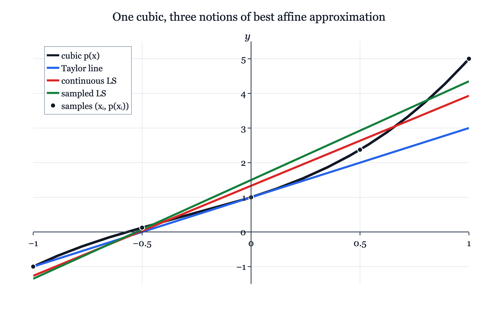

# 7.3 polynomial spaces 与全课程的联系

!!! note "译文与来源"

    本页依据 2026 年 11 月 3 日读取的官方 v0.2 源文件制作。数学术语保留英文；原书公式、代码、例题、活动、证明与解答保留。译稿使用机器辅助翻译并进行数学与排版检查，未经原作者审定。原作者：Jacob Denson、Kaitlyn Phillipson、Sebastien Roch。除原书另有注明外，遵循 [CC BY-NC-SA 4.0](https://creativecommons.org/licenses/by-nc-sa/4.0/)。 [阅读英文原文](https://math345-textbook.github.io/u7-polynomial-spaces-course-connections.html)。

7.1 和 7.2 节介绍了抽象的概念。本节用次数有上界的  polynomial spaces ，作为理解这些概念的有限维例子。一个 polynomial 可以用自己的  coefficient  作为  coordinates ，而同一个  polynomial space  又可以配备不同的  inner products 。改变  inner product  就会改变  projection ，也就改变了“ best approximation ”的具体含义。

本节通过一个具体例子，把  vector  space、 inner products 、 projections 、 least squares 、 Taylor approximation  和  Gram-Schmidt  联系起来，帮助你理解这些工具如何配合使用；这里不展开完整的 polynomial approximation 理论。

## 多项式为  vectors 

次数有上界的 polynomial space 是有限维的：

$$
\mathcal P_{\le d}
        =
        \{a_0+a_1x+\cdots+a_dx^d:a_0,\ldots,a_d\in\mathbb R\}.
$$

标准 ordered basis 是

$$
B=(1,x,x^2,\ldots,x^d).
$$

如果

$$
p(x)=a_0+a_1x+\cdots+a_dx^d,
$$

则 basis $B$中$p$的 coordinate vector 是

$$
\mathbf c_p
        =
        \begin{bmatrix}
        a_0\\
        a_1\\
        \vdots\\
        a_d
        \end{bmatrix}.
$$

多项式$p$是$\mathcal P_{\le d}$ 中的 vector 。选择 basis 后， column $\mathbf c_p$就是它的 coordinate vector 。

**活动 7.3.1：多项式  coordinates  (U7-LO2)**

在 $\mathcal P_{\le3}$ 和  ordered basis  

$$
B=(1,x,x^2,x^3).
$$

 中工作，找到 

$$
p(x)=2-3x+x^3,\qquad
            q(x)=x^2-4x,\qquad
            r(x)=5.
$$

 的  coordinate   vectors 

??? success "解答"

    按照$1,x,x^2,x^3$：

    $$
    \mathbf c_p=
                \begin{bmatrix}
                2\\
                -3\\
                0\\
                1
                \end{bmatrix},
                \qquad
                \mathbf c_q=
                \begin{bmatrix}
                0\\
                -4\\
                1\\
                0
                \end{bmatrix},
                \qquad
                \mathbf c_r=
                \begin{bmatrix}
                5\\
                0\\
                0\\
                0
                \end{bmatrix}.
    $$

    的顺序匹配 coefficients

当$d\ge1$时，最多一度 polynomial space 

$$
\mathcal P_{\le1}=\operatorname{span}\{1,x\}
$$

是$\mathcal P_{\le d}$的 subspace 。其元素的形式为 

$$
c_0+c_1x.
$$

 这些是一个变量中的  affine  多项式。虽然单词  affine  通常表示移位的对象，但 $\mathcal P_{\le1}$ 是  vector   subspace ：它包含零多项式，并且在加法和  scalar multiplication  下闭合。

**活动 7.3.2：根条件为  subspace  (U7-LO2)**

让

$$
U=\{p\in\mathcal P_{\le4}:p(-2)=0\}.
$$

解释为什么$U$是$\mathcal P_{\le4}$的 subspace ，并找到$U$的 basis 。

??? success "解答"

    零多项式满足$0(-2)=0$，因此$0\in U$。如果$p(-2)=0$和$q(-2)=0$，则

    $$
    (p+q)(-2)=p(-2)+q(-2)=0.
    $$

     如果$c\in\mathbb R$，则

    $$
    (cp)(-2)=c\,p(-2)=0.
    $$

     因此$U$是 subspace 。

    当 $x+2$ 为因子时，多项式恰好满足 $p(-2)=0$。由于 $p\in\mathcal P_{\le4}$, 

    $$
    p(x)=(x+2)(a_0+a_1x+a_2x^2+a_3x^3).
    $$

     因此  basis  是 

    $$
    x+2,\qquad x(x+2),\qquad x^2(x+2),\qquad x^3(x+2).
    $$

**活动 7.3.3：消失值和  slope  (U7-LO2)**

让

$$
W=\{p\in\mathcal P_{\le3}:p(0)=0,\ p'(0)=0\}.
$$

找到$W$的 basis 。

??? success "解答"

    写出

    $$
    p(x)=a_0+a_1x+a_2x^2+a_3x^3.
    $$

    然后

    $$
    p(0)=a_0,\qquad p'(0)=a_1.
    $$

    条件$p(0)=0$和$p'(0)=0$强制$a_0=0$和$a_1=0$。因此

    $$
    p(x)=a_2x^2+a_3x^3,
    $$

    所以

    $$
    W=\operatorname{span}\{x^2,x^3\}.
    $$

    A basis 是$x^2,x^3$。

下一个问题不是$\mathcal P_{\le1}$是否是 subspace 。它是：$\mathcal P_{\le1}$ 的哪个元素最接近给定多项式或 function ？这个问题需要 inner product 。

##  Inner products  和  projection  方程

相同的 vector space 可以携带不同的 inner products 。不同的 inner products 给出不同的长度、距离、 orthogonality 条件和 projections 。

设

$$
p(x)=a_0+a_1x+\cdots+a_dx^d,
        \qquad
        q(x)=b_0+b_1x+\cdots+b_dx^d.
$$

 coefficient  inner product 为

$$
\langle p,q\rangle_{\mathrm{coef}}
        =
        a_0b_0+a_1b_1+\cdots+a_db_d.
$$

这就是 basis $1,x,\ldots,x^d$中 coordinate  vectors 的普通 dot product 。

另一个有用的 inner product 是$L^2[-1,1]$ inner product ：

$$
\langle p,q\rangle_{L^2}
        =
        \int_{-1}^{1}p(x)q(x)\,dx.
$$

这个 inner product 衡量整个区间$[-1,1]$的一致性。

给定样本点$x_1,\ldots,x_N$，采样的 inner product 是

$$
\langle p,q\rangle_{\mathrm{sample}}
        =
        \sum_{i=1}^{N}p(x_i)q(x_i).
$$

这是采样的 least squares 和多项式回归背后的 inner product 。

**注意**

如果 $\mathcal P_{\le d}$ 中的非零多项式在每个样本点都消失，则采样规则可能无法成为所有 $\mathcal P_{\le d}$ 上的  inner product 。在下面的计算中，选择样本点，以便近似  subspace  中的  feature   columns  是独立的。这对于这里使用的  least-squares   projection  来说已经足够了。

假设 

$$
U=\operatorname{span}\{\phi_0,\phi_1,\ldots,\phi_m\}
$$

 是多项式  subspace 。我们想要 $U$ 内的  best approximation  到 $f$。写 

$$
q=c_0\phi_0+c_1\phi_1+\cdots+c_m\phi_m.
$$

  residual  为 

$$
r=f-q.
$$

  projection  条件为 

$$
\langle r,\phi_i\rangle=0,
        \qquad i=0,\ldots,m.
$$

 将公式代入 $q$ 得到 

$$
\sum_{j=0}^{m}c_j\langle \phi_j,\phi_i\rangle
        =
        \langle f,\phi_i\rangle,
        \qquad i=0,\ldots,m.
$$

这是 Gram- matrix  系统 

$$
G\mathbf c=\mathbf b,
$$

其中 

$$
G_{ij}=\langle \phi_j,\phi_i\rangle,
        \qquad
        b_i=\langle f,\phi_i\rangle,
$$

 和 

$$
\mathbf c=
        \begin{bmatrix}
        c_0\\
        c_1\\
        \vdots\\
        c_m
        \end{bmatrix},
        \qquad
        \mathbf b=
        \begin{bmatrix}
        b_0\\
        b_1\\
        \vdots\\
        b_m
        \end{bmatrix}.
$$

**活动 7.3.4： affine  多项式 (U7-LO4) 的  Gram matrix **

让 

$$
U=\mathcal P_{\le1}=\operatorname{span}\{1,x\}
$$

 与 $L^2[-1,1]$  inner product 。计算  ordered basis  

$$
\phi_0=1,\qquad \phi_1=x.
$$

 的  Gram matrix 

??? success "解答"

    我们计算

    $$
    \langle 1,1\rangle=\int_{-1}^{1}1\,dx=2,
    $$

    $$
    \langle 1,x\rangle=\int_{-1}^{1}x\,dx=0,
    $$

    $$
    \langle x,1\rangle=\int_{-1}^{1}x\,dx=0,
    $$

    和

    $$
    \langle x,x\rangle=\int_{-1}^{1}x^2\,dx=\frac23.
    $$

    因此

    $$
    G=
                \begin{bmatrix}
                2&0\\
                0&\frac23
                \end{bmatrix}.
    $$

    如果$q=c_0+c_1x$是$f$到$\mathcal P_{\le1}$的$L^2[-1,1]$- projection ，那么

    $$
    \begin{bmatrix}
                2&0\\
                0&\frac23
                \end{bmatrix}
                \begin{bmatrix}
                c_0\\
                c_1
                \end{bmatrix}
                =
                \begin{bmatrix}
                \int_{-1}^{1}f(x)\,dx\\
                \int_{-1}^{1}xf(x)\,dx
                \end{bmatrix}.
    $$

**活动 7.3.5：采样  projection  和  design matrix  (U7-LO4)**

设 $x_1,\ldots,x_N$ 为样本点，假设我们用 

$$
q(x)=c_0+c_1x.
$$

 来近似 $f$ 的采样值 定义 

$$
A=
            \begin{bmatrix}
            1& x_1\\
            1& x_2\\
            \vdots&\vdots\\
            1& x_N
            \end{bmatrix},
            \qquad
            \mathbf c=
            \begin{bmatrix}
            c_0\\
            c_1
            \end{bmatrix},
            \qquad
            \mathbf y=
            \begin{bmatrix}
            f(x_1)\\
            f(x_2)\\
            \vdots\\
            f(x_N)
            \end{bmatrix}.
$$

 解释为什么采样的  residual  条件为 

$$
A^T\mathbf r=\mathbf{0},
            \qquad
            \mathbf r=\mathbf y-A\mathbf c.
$$

??? success "解答"

    vector  $A\mathbf c$ 存储拟合值 

    $$
    q(x_1),q(x_2),\ldots,q(x_N).
    $$

     因此 

    $$
    \mathbf r=\mathbf y-A\mathbf c
    $$

     存储采样的  residuals  

    $$
    r_i=f(x_i)-q(x_i).
    $$

     采样的  projection  条件表示  residual  是  orthogonal  到采样常数  feature  和采样$x$- feature : 

    $$
    \sum_i r_i=0,
                \qquad
                \sum_i x_ir_i=0.
    $$

     这正是

    $$
    A^T\mathbf r=
                \begin{bmatrix}
                \sum_i r_i\\
                \sum_i x_ir_i
                \end{bmatrix}.
    $$

    的两个条目，所以$A^T\mathbf r=\mathbf{0}$是采样的 residual - orthogonality 条件。

**说明**

多项式回归是  linear regression  和多项式  feature   columns 。例如，拟合

$$
y\approx c_0+c_1x+c_2x^2
$$

使用 design matrix 

$$
A=
          \begin{bmatrix}
          1& x_1& x_1^2\\
          1& x_2& x_2^2\\
          \vdots&\vdots&\vdots\\
          1& x_N& x_N^2
          \end{bmatrix}.
$$

模型在$x$中为 nonlinear ，但在 coefficient vector 

$$
\mathbf c=
          \begin{bmatrix}
          c_0\\
          c_1\\
          c_2
          \end{bmatrix}.
$$

中为 linear

下一小节使用一个多项式和一个近似值  subspace ，但使用三种不同的误差度量：局部泰勒匹配、连续 $L^2$- least squares  和采样  least squares 。

## 泰勒线与  least-squares  线

我们现在使用一个多项式和一个近似值 subspace ，但是“最佳”有三种不同的含义。

设 

$$
p(x)=1+2x+x^2+x^3,
$$

 和

$$
U=\mathcal P_{\le1}=\operatorname{span}\{1,x\}.
$$

 $U$ 的每个元素都具有形式 

$$
q(x)=\alpha+\beta x.
$$

 泰勒线、连续  least-squares  线和采样  least-squares  线都位于 $U$ 中。它们之所以不同，是因为它们以不同的方式衡量误差。

**活动 7.3.6：原点泰勒线 (U7-LO5)**

求 $0$ 处的一阶  Taylor approximation  到 $p$。然后验证 residual 条件。

??? success "解答"

    我们计算

    $$
    p(0)=1.
    $$

     也

    $$
    p'(x)=2+2x+3x^2,
    $$

     所以

    $$
    p'(0)=2.
    $$

     因此$0$处的一阶 Taylor approximation 是

    $$
    T(x)=p(0)+p'(0)x=1+2x.
    $$

      residual 是

    $$
    r_T(x)=p(x)-T(x)=x^2+x^3.
    $$

     因此

    $$
    r_T(0)=0,
    $$

    和

    $$
    r_T'(x)=2x+3x^2,
    $$

    所以

    $$
    r_T'(0)=0.
    $$

     泰勒线匹配值和原点处的  slope  或 $p$。

**活动 7.3.7：连续 least-squares 线（U7-LO4、U7-LO5）**

使用$L^2[-1,1]$ inner product 查找$U=\operatorname{span}\{1,x\}$中的 best approximation 到$p$。

??? success "解答"

    写 

    $$
    q_{L^2}(x)=\alpha+\beta x.
    $$

      residual  为 

    $$
    r_{L^2}(x)=p(x)-q_{L^2}(x).
    $$

      projection  条件表示 

    $$
    \langle r_{L^2},1\rangle_{L^2}=0,
                \qquad
                \langle r_{L^2},x\rangle_{L^2}=0.
    $$

     等价，

    $$
    \int_{-1}^{1}r_{L^2}(x)\,dx=0,
                \qquad
                \int_{-1}^{1}x\,r_{L^2}(x)\,dx=0.
    $$

     现在 

    $$
    r_{L^2}(x)
                =
                (1-\alpha)+(2-\beta)x+x^2+x^3.
    $$

     第一个  residual  方程给出 

    $$
    \int_{-1}^{1}\big((1-\alpha)+(2-\beta)x+x^2+x^3\big)\,dx=0.
    $$

     奇数项在 $[-1,1]$ 上积分为零，因此 

    $$
    2(1-\alpha)+\frac23=0.
    $$

     因此

    $$
    \alpha=\frac43.
    $$

     第二个  residual  方程给出 

    $$
    \int_{-1}^{1}x\big((1-\alpha)+(2-\beta)x+x^2+x^3\big)\,dx=0.
    $$

     再次使用对称性， 

    $$
    (2-\beta)\frac23+\frac25=0.
    $$

     因此 

    $$
    \beta=\frac{13}{5}.
    $$

     所以连续的  least-squares  线是 

    $$
    q_{L^2}(x)=\frac43+\frac{13}{5}x.
    $$

**活动 7.3.8：采样 least-squares 线（U7-LO4、U7-LO5）**

使用样本点 

$$
-1,\ -\frac12,\ 0,\ \frac12,\ 1
$$

 查找 $U=\operatorname{span}\{1,x\}$ 中 $p$ 的采样  least-squares  近似值。

??? success "解答"

    设样本点为$x_1,\ldots,x_5$，写为

    $$
    q_{\mathrm{sample}}(x)=\alpha+\beta x.
    $$

     采样的 residuals 为

    $$
    r_i=p(x_i)-q_{\mathrm{sample}}(x_i).
    $$

     采样的 projection 条件为

    $$
    \sum_i r_i=0,
                \qquad
                \sum_i x_ir_i=0.
    $$

     等价，如果

    $$
    A=
                \begin{bmatrix}
                1& x_1\\
                1& x_2\\
                \vdots&\vdots\\
                1& x_5
                \end{bmatrix},
                \qquad
                \mathbf r=
                \begin{bmatrix}
                r_1\\
                r_2\\
                \vdots\\
                r_5
                \end{bmatrix},
    $$

    则

    $$
    A^T\mathbf r=\mathbf{0}.
    $$

    对于 symmetric 样本点，

    $$
    \sum_i x_i=0,
                \qquad
                \sum_i x_i^2=\frac52.
    $$

    还有

    $$
    \sum_i p(x_i)=\sum_i(1+2x_i+x_i^2+x_i^3)=5+\frac52=\frac{15}{2},
    $$

    所以

    $$
    5\alpha=\frac{15}{2},
                \qquad
                \alpha=\frac32.
    $$

    接下来，

    $$
    \sum_i x_ip(x_i)
                =
                \sum_i(x_i+2x_i^2+x_i^3+x_i^4)
                =
                2\sum_i x_i^2+\sum_i x_i^4.
    $$

    这里

    $$
    \sum_i x_i^4=1+\frac1{16}+0+\frac1{16}+1=\frac{17}{8},
    $$

    所以

    $$
    \sum_i x_ip(x_i)=5+\frac{17}{8}=\frac{57}{8}.
    $$

    第二个 residual 方程给出

    $$
    \beta\sum_i x_i^2=\sum_i x_ip(x_i),
    $$

    所以

    $$
    \beta\cdot\frac52=\frac{57}{8},
                \qquad
                \beta=\frac{57}{20}.
    $$

    因此采样的 least-squares 线是

    $$
    q_{\mathrm{sample}}(x)=\frac32+\frac{57}{20}x.
    $$

三个近似值是

$$
\begin{aligned}
T(x)=1+2x, \\
q_{L^2}(x)=\frac43+\frac{13}{5}x, \\
q_{\mathrm{sample}}(x)=\frac32+\frac{57}{20}x.
\end{aligned}
$$

它们是不同的，因为它们解决了不同的 projection 问题。

| 近似值 | 如何选择 |  Residual 条件 |
|---|---|---|
| 泰勒线 | 匹配值和 $0$ 处的  slope  | $r_T(0)=0,$ $r_T'(0)=0$ |
| 连续 least squares  | 最小化$[-1,1]$的平方误差 | $\int_{-1}^{1}r(x)\,dx=0,$ $\int_{-1}^{1}x\,r(x)\,dx=0$ |
| 采样 least squares  | 最小化样本点的平方误差 | $\sum_i r_i=0,$ $\sum_i x_ir_i=0$ |

*一条曲线，三条线：泰勒、连续  least squares  和采样  least squares  不同地测量  best approximation 。*

??? info "图像说明"

    黑色立方体 $p(x)=1+2x+x^2+x^3$ 显示为与原点交叉的标记  coordinate  轴上的 $-1\leq x\leq 1$。五个黑色采样点位于立方体上$x=-1,-1/2,0,1/2,1$ 处。蓝色泰勒线 $T(x)=1+2x$ 在 $x=0$ 处与具有相同  slope  的三次方相交。红色连续  least-squares  线平衡区间内的误差，而绿色采样  least-squares  线由五个绘制的样本确定。这三行不同，因为它们使用不同的误差度量。

**注意**

在指定误差测量之前，短语“最佳  affine  近似”是不完整的。泰勒匹配、连续 least squares 和采样 least squares 给出不同的答案，因为它们使用不同的 residual 条件。

下一小节解释如何将 Taylor approximation 本身视为 projection ，但具有基于本地 derivative 的 inner product 。

##  Taylor approximation  作为本地  projection 

上一小节表明泰勒和  least squares  可以给出不同的直线。这并不矛盾。  Taylor approximation  是本地的。固定间隔内的普通$L^2$- least squares 是全局的。

连接  Taylor approximation  和  projection  有两种有用的方法。

首先，对于基于  derivative  的  inner product  在扩展点， Taylor approximation  恰好是  projection 。

其次，当区间收缩到膨胀点时，收缩区间上的普通 $L^2$- least-squares   projection  会收敛到  Taylor approximation 。

 Derivative 基于 inner product 。固定一个点$a$，然后在$\mathcal P_{\le d}$工作。定义

$$
\langle p,q\rangle_{\mathrm{jet},a}
        =
        \sum_{k=0}^{d}
        w_k
        \frac{p^{(k)}(a)}{k!}
        \frac{q^{(k)}(a)}{k!},
        \qquad
        w_k>0.
$$

 这是$\mathcal P_{\le d}$上的 inner product ，因为次数最多为$d$的多项式是由其 derivatives 通过$a$阶次$d$确定的。

**活动 7.3.9：泰勒线精确  projection  (U7-LO4, U7-LO5)**

假设

$$
p(x)=c_0+c_1(x-a)+c_2(x-a)^2+c_3(x-a)^3
$$

并让

$$
q(x)=\alpha+\beta(x-a).
$$

使用上面基于 derivative 的 inner product 来找到最接近 affine 多项式$q$到$p$。

??? success "解答"

    在居中的 basis 

    $$
    1,\quad (x-a),\quad (x-a)^2,\quad (x-a)^3,
    $$

    $p$的 coefficients 是$c_0,c_1,c_2,c_3$，而$q$的 coefficients 是$\alpha,\beta,0,0$。因此 

    $$
    p-q=(c_0-\alpha)+(c_1-\beta)(x-a)+c_2(x-a)^2+c_3(x-a)^3.
    $$

      residual  的平方  norm  的形式为 

    $$
    \|p-q\|_{\mathrm{jet},a}^2
                =
                w_0(c_0-\alpha)^2
                +
                w_1(c_1-\beta)^2
                +
                w_2c_2^2
                +
                w_3c_3^2.
    $$

     最后两项不依赖于 $\alpha$ 或 $\beta$。当

    $$
    \alpha=c_0,
                \qquad
                \beta=c_1.
    $$

    时，表达式最小化，因此最接近的 affine 多项式是

    $$
    q(x)=c_0+c_1(x-a).
    $$

    从

    $$
    c_0=p(a),
                \qquad
                c_1=p'(a),
    $$

    我们得到

    $$
    q(x)=p(a)+p'(a)(x-a).
    $$

    这是$a$处的一阶 Taylor approximation 。

更一般地， projection 到$\mathcal P_{\le m}$，以$x-a$的幂表示，保留泰勒项到$m$度，并丢弃更高次的项。

**注意**

inner product  $\langle\cdot,\cdot\rangle_{\mathrm{jet},a}$ 取决于扩展点$a$。一个固定的 projection 无法在每一点都产生泰勒线，因为当展开点改变时，同一个多项式的泰勒线也会改变。

**活动 7.3.10：固定间隔  least squares  不是  Taylor approximation （U7-LO4、U7-LO5）**

使用 $L^2[-1,1]$  inner product  将 

$$
p(x)=x^2
$$

 投影到 $\mathcal P_{\le1}=\operatorname{span}\{1,x\}$。将答案与 $0$ 处的泰勒线进行比较。

??? success "解答"

    $x^2$ 在 $0$ 的泰勒线是 

    $$
    T(x)=0.
    $$

     现在计算 $L^2[-1,1]$- projection 。写 

    $$
    q(x)=\alpha+\beta x.
    $$

     因为 $x^2$ 是偶数，$x$ 是奇数，所以最佳线没有 $x$ 项： 

    $$
    \beta=0.
    $$

     常数项是 $x^2$ 在 $[-1,1]$ 上的平均值： 

    $$
    \alpha
                =
                \frac{\int_{-1}^{1}x^2\,dx}{\int_{-1}^{1}1\,dx}
                =
                \frac{2/3}{2}
                =
                \frac13.
    $$

     因此，$L^2[-1,1]$-最佳  affine  近似是 

    $$
    q(x)=\frac13,
    $$

     不是 $0$。  Taylor approximation 是局部的，而固定间隔内的 least squares 是全局的。

**Shrinking intervals**: 对于$t>0$，令$P_t f$为$f$到$\operatorname{span}\{1,x\}$的$L^2[-t,t]$- projection 。写

$$
P_t f(x)=a_t+b_t x.
$$

  residual 条件为

$$
\int_{-t}^{t}\big(f(x)-a_t-b_t x\big)\,dx=0,
$$

和

$$
\int_{-t}^{t}x\big(f(x)-a_t-b_t x\big)\,dx=0.
$$

 因为间隔为 symmetric 、

$$
\int_{-t}^{t}x\,dx=0.
$$

因此公式简化为

$$
a_t=\frac{1}{2t}\int_{-t}^{t}f(x)\,dx,
$$

和

$$
b_t=
        \frac{\int_{-t}^{t}xf(x)\,dx}{\int_{-t}^{t}x^2\,dx}
        =
        \frac{3}{2t^3}\int_{-t}^{t}xf(x)\,dx.
$$

**活动 7.3.11：缩小 $x^2$ 和 $x^3$ 的  least squares （U7-LO4、U7-LO5）**

将 $x^2$ 和 $x^3$ 的 $L^2[-t,t]$- projection  计算到 $\operatorname{span}\{1,x\}$ 上。 $t\to0$ 会发生什么？

??? success "解答"

    对于$f(x)=x^2$，对称性给出$b_t=0$和

    $$
    a_t=
                \frac{1}{2t}\int_{-t}^{t}x^2\,dx
                =
                \frac{1}{2t}\cdot\frac{2t^3}{3}
                =
                \frac{t^2}{3}.
    $$

    因此

    $$
    P_t(x^2)=\frac{t^2}{3}.
    $$

    与$t\to0$一样，

    $$
    P_t(x^2)\to0,
    $$

    是$x^2$在$0$处的泰勒线。

    对于$f(x)=x^3$，对称性给出$a_t=0$和

    $$
    b_t=
                \frac{\int_{-t}^{t}x^4\,dx}{\int_{-t}^{t}x^2\,dx}
                =
                \frac{2t^5/5}{2t^3/3}
                =
                \frac{3t^2}{5}.
    $$

    因此

    $$
    P_t(x^3)=\frac{3t^2}{5}x.
    $$

    与$t\to0$、

    $$
    P_t(x^3)\to0,
    $$

    同样是$0$处的泰勒线。

**说明**

如果

$$
p(x)=c_0+c_1x+c_2x^2+\cdots+c_dx^d,
$$

则$p$到$\operatorname{span}\{1,x\}$的$L^2[-t,t]$- projection 具有形式

$$
P_t p(x)=a_t+b_t x,
$$

其中

$$
a_t
          =
          c_0+\frac{c_2t^2}{3}+\frac{c_4t^4}{5}+\frac{c_6t^6}{7}+\cdots
$$

和

$$
b_t
          =
          c_1+\frac{3c_3t^2}{5}+\frac{3c_5t^4}{7}+\frac{3c_7t^6}{9}+\cdots.
$$

因此

$$
a_t\to c_0=p(0),
          \qquad
          b_t\to c_1=p'(0).
$$

所以

$$
P_t p(x)\to p(0)+p'(0)x.
$$

这是一阶 Taylor polynomial  $0$。

**注意**

即使  inner products  崩溃为 $t\to0$， projections  $P_t p$ 也可以收敛到  Taylor approximation 。事实上，对于 

$$
\langle p,q\rangle_t=\int_{-t}^{t}p(x)q(x)\,dx,
$$

我们有 

$$
\langle p,q\rangle_t\to0
$$

 固定多项式 $p,q$。如果我们按间隔长度进行归一化， limit 只记住原点处的值：

$$
\frac{1}{2t}\int_{-t}^{t}p(x)q(x)\,dx\to p(0)q(0).
$$

这不是$\mathcal P_{\le d}$上的非简并 inner product 。 Taylor- coefficient   inner product  仅在按比例分离度数后出现。对于本课程，重要的一点是：收缩 $L^2$- projections  恢复Taylor polynomial，但普通 $L^2[-t,t]$  inner products  本身不会收敛到基于  derivative  的泰勒 inner product 。

单变量图片现已完成：

$$
\begin{aligned}
\text{fixed-interval least squares is global,} \\
\text{shrinking-interval least squares becomes local,} \\
\text{the derivative-based inner product makes Taylor projection exact.}
\end{aligned}
$$

##  Gram-Schmidt  和  Legendre polynomials 

 Gram-Schmidt 不仅仅是$\mathbb R^n$中 column  vectors 的算法。它适用于任何有限维  inner product space 。这里  vectors  是多项式。

在$\mathcal P_{\le3}$上使用 inner product 

$$
\langle f,g\rangle
        =
        \int_{-1}^{1}f(x)g(x)\,dx
$$

从标准的 ordered basis 

$$
1,\quad x,\quad x^2,\quad x^3.
$$

开始，这个 basis 跨越$\mathcal P_{\le3}$，但它不是 orthogonal basis 。对于相同的  polynomial space ， Gram-Schmidt  将其替换为  orthogonal basis 。

**说明：$[-1,1]$ 对称**

如果 $h(x)$ 是奇数  function ，则 

$$
\int_{-1}^{1}h(x)\,dx=0.
$$

 这解释了下面的许多零。总功率为奇数的产品在  symmetric  区间积分为零。

**活动 7.3.12：前两个  orthogonal  多项式 (U7-LO3)**

使用 $L^2[-1,1]$  inner product  证明 $1$ 和 $x$ 是  orthogonal 。

??? success "解答"

    我们计算

    $$
    \langle 1,x\rangle
                =
                \int_{-1}^{1}x\,dx
                =
                0.
    $$

    因此$1$和$x$已经是 orthogonal 。

**活动 7.3.13：正交化 $x^2$ (U7-LO6)**

让

$$
\phi_0(x)=1,
            \qquad
            \phi_1(x)=x.
$$

使用 Gram-Schmidt 从$x^2$减去它的 projections 到$\phi_0$和$\phi_1$。

??? success "解答"

    首先，

    $$
    \langle x^2,1\rangle
                =
                \int_{-1}^{1}x^2\,dx
                =
                \frac23,
    $$

    和

    $$
    \langle 1,1\rangle
                =
                \int_{-1}^{1}1\,dx
                =
                2.
    $$

    因此

    $$
    \operatorname{proj}_{\operatorname{span}\{1\}}(x^2)
                =
                \frac{\langle x^2,1\rangle}{\langle 1,1\rangle}1
                =
                \frac{2/3}{2}1
                =
                \frac13.
    $$

    还有

    $$
    \langle x^2,x\rangle
                =
                \int_{-1}^{1}x^3\,dx
                =
                0,
    $$

    所以没有$x$- component 可以相减。因此下一个 orthogonal  vector 是

    $$
    \phi_2(x)=x^2-\frac13.
    $$

**活动 7.3.14：正交化 $x^3$ (U7-LO6)**

让

$$
\phi_0(x)=1,
            \qquad
            \phi_1(x)=x,
            \qquad
            \phi_2(x)=x^2-\frac13.
$$

使用 Gram-Schmidt 从$x^3$减去其 projections 到$\phi_0,\phi_1,\phi_2$。

??? success "解答"

    根据对称性，

    $$
    \langle x^3,1\rangle
                =
                \int_{-1}^{1}x^3\,dx
                =
                0.
    $$

     同样，根据对称性，

    $$
    \langle x^3,\phi_2\rangle
                =
                \int_{-1}^{1}x^3\left(x^2-\frac13\right)\,dx
                =
                \int_{-1}^{1}\left(x^5-\frac13x^3\right)\,dx
                =
                0,
    $$

    唯一要减去的  projection  是 $x$ 上的  projection 。我们计算

    $$
    \langle x^3,x\rangle
                =
                \int_{-1}^{1}x^4\,dx
                =
                \frac25,
    $$

    和

    $$
    \langle x,x\rangle
                =
                \int_{-1}^{1}x^2\,dx
                =
                \frac23.
    $$

    因此

    $$
    \operatorname{proj}_{\operatorname{span}\{x\}}(x^3)
                =
                \frac{\langle x^3,x\rangle}{\langle x,x\rangle}x
                =
                \frac{2/5}{2/3}x
                =
                \frac35x.
    $$

    因此下一个 orthogonal  vector 是

    $$
    \phi_3(x)=x^3-\frac35x.
    $$

 Gram-Schmidt  使用$L^2[-1,1]$  inner product  为$\mathcal P_{\le3}$ 生成了 orthogonal basis  

$$
1,\qquad x,\qquad x^2-\frac13,\qquad x^3-\frac35x
$$

**注意： Orthogonal 并不意味着标准化**

上面的 vectors 是 orthogonal ，但是它们的 norms 并不都等于$1$。  Gram-Schmidt 可以先产生 orthogonal basis ；标准化每个  vector  是一个单独的步骤。

**说明：缩放 Legendre polynomials **

传统的第一个 Legendre polynomials 开始

$$
P_0(x)=1,
          \qquad
          P_1(x)=x,
$$

$$
P_2(x)=\frac12(3x^2-1),
          \qquad
          P_3(x)=\frac12(5x^3-3x).
$$

这些是

$$
1,\qquad x,\qquad x^2-\frac13,\qquad x^3-\frac35x.
$$

的非零 scalar 倍数我们在这里不发展 Legendre polynomials 的理论。关键是 Gram-Schmidt 创建了适应 inner product 的 coordinates 。

当$\phi_0,\ldots,\phi_m$非零且 orthogonal 时，

$$
U=\operatorname{span}\{\phi_0,\ldots,\phi_m\}
$$

上的 projection 具有简单形式

$$
\operatorname{proj}_U(f)
        =
        \sum_{j=0}^{m}
        \frac{\langle f,\phi_j\rangle}{\langle \phi_j,\phi_j\rangle}\phi_j.
$$

Gram matrix 是 orthogonal basis 中的对角线，因此 projection 方程解耦。

**活动 7.3.15：重新审视连续的  least-squares  线（U7-LO2、U7-LO4、U7-LO5）**

让

$$
p(x)=1+2x+x^2+x^3.
$$

用 orthogonal basis 

$$
\phi_0=1,\qquad
            \phi_1=x,\qquad
            \phi_2=x^2-\frac13,\qquad
            \phi_3=x^3-\frac35x
$$

来表达$p$。然后将$p$投影到

$$
\mathcal P_{\le1}=\operatorname{span}\{1,x\}.
$$

??? success "解答"

    由于

    $$
    x^2=\phi_2+\frac13\phi_0
    $$

    和

    $$
    x^3=\phi_3+\frac35\phi_1,
    $$

    我们有

    $$
    p(x)
                =
                1+2x+x^2+x^3
    $$

    $$
    =
                1+2\phi_1+\left(\phi_2+\frac13\phi_0\right)
                +
                \left(\phi_3+\frac35\phi_1\right).
    $$

    因此

    $$
    p
                =
                \frac43\phi_0+\frac{13}{5}\phi_1+\phi_2+\phi_3.
    $$

     Projection 到$\mathcal P_{\le1}=\operatorname{span}\{\phi_0,\phi_1\}$只保留$\phi_0$和$\phi_1$分量：

    $$
    \operatorname{proj}_{\mathcal P_{\le1}}(p)
                =
                \frac43\phi_0+\frac{13}{5}\phi_1.
    $$

    由于$\phi_0=1$和$\phi_1=x$， 

    $$
    \operatorname{proj}_{\mathcal P_{\le1}}(p)
                =
                \frac43+\frac{13}{5}x.
    $$

     这是前一小节中连续的 least-squares  线。

同样的想法解释了为什么 orthogonal 、 bases 和QR在 least squares 中有用：更改为 orthogonal basis 不会改变近似空间，但它使 projection 计算更容易。

下一小节从单变量多项式转向双变量  polynomial spaces ，其中  affine  近似值是平面。

## 二变量多项式和切平面

同样的想法适用于多个输入变量的多项式。这是返回多变量微积分的桥梁： affine  近似值变成平面，采样的  least squares  变成平面拟合。

总次数最多$2$的二元polynomial space为

$$
\mathcal P_{\le2}^{(2)}
        =
        \operatorname{span}\{1,x,y,x^2,xy,y^2\}.
$$

 标准 ordered basis 为

$$
B=(1,x,y,x^2,xy,y^2).
$$

 $\mathcal P_{\le2}^{(2)}$的元素具有形式

$$
a_0+a_1x+a_2y+a_3x^2+a_4xy+a_5y^2.
$$

  basis $B$中的 coordinate vector 为

$$
\begin{bmatrix}
        a_0\\
        a_1\\
        a_2\\
        a_3\\
        a_4\\
        a_5
        \end{bmatrix}.
$$

**活动 7.3.16： Coordinates  双变量  polynomial space  (U7-LO2)**

在 $\mathcal P_{\le2}^{(2)}$ 和  ordered basis  

$$
B=(1,x,y,x^2,xy,y^2).
$$

 中工作，找到 

$$
p(x,y)=3-2x+y+5xy.
$$

 的  coordinate vector 

??? success "解答"

    按照$1,x,y,x^2,xy,y^2$的顺序匹配 coefficients 。我们得到

    $$
    \mathbf c_p
                =
                \begin{bmatrix}
                3\\
                -2\\
                1\\
                0\\
                5\\
                0
                \end{bmatrix}.
    $$

 affine 多项式 subspace 为

$$
\mathcal A=\operatorname{span}\{1,x,y\}.
$$

其元素的形式为

$$
q(x,y)=\alpha+\beta x+\gamma y.
$$

在几何上，$q$的 graph 是一个平面。

现在考虑

$$
f(x,y)=1+2x-y+x^2+xy+2y^2+x^3.
$$

在$(0,0)$， tangent plane 仅使用$f$的值和第一个部分 derivatives 。

**活动 7.3.17： Tangent plane  在原点 (U7-LO5, U3-LO4)**

计算 $(0,0)$ 处的  tangent plane  到 

$$
f(x,y)=1+2x-y+x^2+xy+2y^2+x^3
$$

然后说出它满足的 residual 条件。

??? success "解答"

    我们计算

    $$
    f(0,0)=1.
    $$

    $$
    f_x(x,y)=2+2x+y+3x^2,
    $$

     所以

    $$
    f_x(0,0)=2.
    $$

     和

    $$
    f_y(x,y)=-1+x+4y,
    $$

     所以

    $$
    f_y(0,0)=-1.
    $$

     因此 tangent plane  是

    $$
    T(x,y)=1+2x-y.
    $$

      residual  是

    $$
    r_T(x,y)=f(x,y)-T(x,y)=x^2+xy+2y^2+x^3.
    $$

     因此

    $$
    r_T(0,0)=0,
    $$

     和

    $$
    \nabla r_T(0,0)
                =
                \begin{bmatrix}
                0\\
                0
                \end{bmatrix}.
    $$

      tangent plane  匹配值和第一个在原点部分 derivatives 。

**A best-fit plane uses a different idea**: 它不是在一点上进行匹配，而是最大限度地减少多点上的错误。

设

$$
(x_1,y_1),\ldots,(x_N,y_N)
$$

为采样点。通过 

$$
\langle u,v\rangle_{\mathrm{sample}}
        =
        \sum_{i=1}^{N}u(x_i,y_i)v(x_i,y_i).
$$

 定义采样的  inner product  对于平面 

$$
q(x,y)=\alpha+\beta x+\gamma y,
$$

采样的  residuals  为 

$$
r_i=f(x_i,y_i)-q(x_i,y_i).
$$

 采样的  projection  条件为 

$$
\sum_i r_i=0,
        \qquad
        \sum_i x_ir_i=0,
        \qquad
        \sum_i y_ir_i=0.
$$

**活动 7.3.18： Design matrix  对于采样的最佳拟合平面 (U7-LO4)**

让

$$
q(x,y)=\alpha+\beta x+\gamma y.
$$

构造 design matrix ，将$q$拟合到$f$在点

$$
(x_1,y_1),\ldots,(x_N,y_N).
$$

的采样值，以 matrix 形式解释 residual 条件。

??? success "解答"

    design matrix 为

    $$
    A=
                \begin{bmatrix}
                1& x_1& y_1\\
                1& x_2& y_2\\
                \vdots&\vdots&\vdots\\
                1& x_N& y_N
                \end{bmatrix}.
    $$

    coefficient vector 为

    $$
    \mathbf c=
                \begin{bmatrix}
                \alpha\\
                \beta\\
                \gamma
                \end{bmatrix},
    $$

    采样- value vector 为

    $$
    \mathbf f=
                \begin{bmatrix}
                f(x_1,y_1)\\
                f(x_2,y_2)\\
                \vdots\\
                f(x_N,y_N)
                \end{bmatrix}.
    $$

    拟合值为$A\mathbf c$，所以 residual vector 为

    $$
    \mathbf r=\mathbf f-A\mathbf c.
    $$

    采样 residual - orthogonality 条件为

    $$
    A^T\mathbf r=\mathbf{0}.
    $$

    逐条写入，这表示

    $$
    \sum_i r_i=0,
                \qquad
                \sum_i x_ir_i=0,
                \qquad
                \sum_i y_ir_i=0.
    $$

    这些与之前的 projection 条件相同，现在针对采样常数 feature 、采样$x$- feature 和采样$y$- feature 。

**活动 7.3.19： symmetric  网格上的采样最佳拟合平面（U7-LO4、U7-LO5）**

使用网格

$$
x,y\in\left\{-1,-\frac12,0,\frac12,1\right\}
$$

和 function 

$$
f(x,y)=1+2x-y+x^2+xy+2y^2+x^3.
$$

找到采样的 least-squares 平面

$$
q_{\mathrm{sample}}(x,y)=\alpha+\beta x+\gamma y.
$$

??? success "解答"

    网格有 $25$ 个点。根据对称性，

    $$
    \sum_i x_i=0,
                \qquad
                \sum_i y_i=0,
                \qquad
                \sum_i x_iy_i=0.
    $$

    还有

    $$
    \sum_i x_i^2=\sum_i y_i^2=\frac{25}{2},
    $$

    和

    $$
    \sum_i x_i^4=\frac{85}{8}.
    $$

    因为网格是 symmetric ，所以 normal equations 解耦。对于常数项，

    $$
    25\alpha=\sum_i f(x_i,y_i).
    $$

    所有奇数项在 symmetric 网格上的和为零，并且$xy$项也具有零和。因此

    $$
    \sum_i f(x_i,y_i)
                =
                25+\sum_i x_i^2+2\sum_i y_i^2
                =
                25+\frac{25}{2}+25
                =
                \frac{125}{2}.
    $$

     因此

    $$
    \alpha=\frac52.
    $$

    对于 $x$- coefficient ，

    $$
    \beta\sum_i x_i^2=\sum_i x_if(x_i,y_i).
    $$

     根据对称性，

    $$
    \sum_i x_if(x_i,y_i)
                =
                2\sum_i x_i^2+\sum_i x_i^4
                =
                25+\frac{85}{8}
                =
                \frac{285}{8}.
    $$

     因此 

    $$
    \beta\cdot\frac{25}{2}=\frac{285}{8},
    $$

     所以 

    $$
    \beta=\frac{57}{20}.
    $$

    对于$y$- coefficient 、

    $$
    \gamma\sum_i y_i^2=\sum_i y_if(x_i,y_i).
    $$

     根据对称性，唯一幸存的项是$-y$，因此

    $$
    \sum_i y_if(x_i,y_i)=-\sum_i y_i^2.
    $$

     因此

    $$
    \gamma=-1.
    $$

     采样的最佳拟合平面为

    $$
    q_{\mathrm{sample}}(x,y)=\frac52+\frac{57}{20}x-y.
    $$

 tangent plane 和采样的最佳拟合平面是不同的：

$$
T(x,y)=1+2x-y,
$$

而

$$
q_{\mathrm{sample}}(x,y)=\frac52+\frac{57}{20}x-y.
$$

它们是不同的，因为它们解决了不同的近似问题。

| 飞机 | 如何选择 |  Residual 条件 |
|---|---|---|
|  Tangent plane  | 匹配值和第一个部分 derivatives 位于$(0,0)$ | $r(0,0)=0,$ $\nabla r(0,0)=\mathbf{0}$ |
| 采样的最佳拟合平面 | 最小化采样点的平方误差 | $\sum_i r_i=0,$ $\sum_i x_ir_i=0,$ $\sum_i y_ir_i=0$ |
| 连续最佳拟合平面 | 最小化区域内的平方误差 | $\iint_R r\,dA=0,$ $\iint_R xr\,dA=0,$ $\iint_R yr\,dA=0$ |

**注意**

tangent plane  是本地的。采样的最佳拟合平面取决于所选的采样点。连续最佳拟合平面取决于所选区域并使用二重积分。

**说明：连续最佳拟合作为预览**

在一个变量中，连续  inner product  

$$
\langle u,v\rangle=\int_{-1}^{1}u(x)v(x)\,dx
$$

 衡量一个区间内的一致性。在两个变量中，区域 $R$ 上的类似连续  inner product  为 

$$
\langle u,v\rangle_R=\iint_R u(x,y)v(x,y)\,dA.
$$

 MATH 345 不发展二重积分，因此课程级计算使用采样和： 

$$
\langle u,v\rangle_{\mathrm{sample}}
          =
          \sum_i u(x_i,y_i)v(x_i,y_i).
$$

 通过许多分布良好的采样点，缩放采样和可以近似连续积分。这也是通向  probability  的桥梁：采样点的平均值近似于期望值。

对于正方形 

$$
R=[-1,1]\times[-1,1],
$$

同一  function  的连续 $L^2(R)$ 最佳拟合平面为 

$$
q_{L^2}(x,y)=2+\frac{13}{5}x-y.
$$

 这仅作为预览显示。上面的采样平面是本课程中使用的计算。

**说明：展望未来**

想要学习  probability  以及连续平均背后的多元积分工具的学生可以看看 MATH 331。MATH 331 是一门介绍性的  probability  课程，适合没有学过多元微积分的学生，它介绍了多元积分所需的工具以及  probability 。

总结一下：次数有上界的  polynomial spaces  是  vector  空间。  Inner products 定义 projection 和 least squares 。  Taylor approximation  是本地 projection 。  Gram-Schmidt  构建  orthogonal  多项式  coordinates 。在两个变量中，切平面和最佳拟合平面是  affine  多项式近似。

