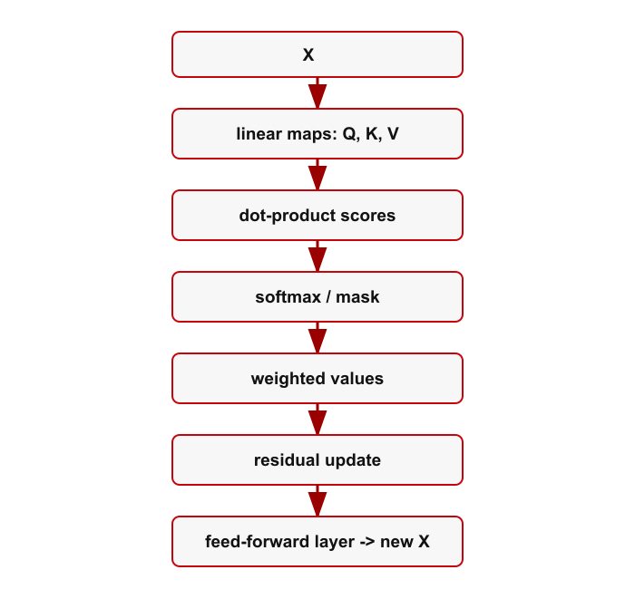

# 附录 A：Transformer 综合练习

!!! note "译文与来源"

    本页依据 2026 年 11 月 3 日读取的官方 v0.2 源文件制作。数学术语保留英文；原书公式、代码、例题、活动、证明与解答保留。译稿使用机器辅助翻译并进行数学与排版检查，未经原作者审定。原作者：Jacob Denson、Kaitlyn Phillipson、Sebastien Roch。除原书另有注明外，遵循 [CC BY-NC-SA 4.0](https://creativecommons.org/licenses/by-nc-sa/4.0/)。 [阅读英文原文](https://math345-textbook.github.io/transformer-wrap-up-worksheet.html)。

此可选工作表要求您使用课程中的工具阅读简化的变压器块： vectors 、 dot products 、 matrix multiplication 、 affine maps 、零空间、 nonlinear  functions 、雅可比行列式、梯度、优化、 rank 和低 rank 结构。

目标不是教授大型语言模型的完整工程。目标是认识数学并解释信息如何通过简化模型移动。

**核心问题**：第 1-6 单元的工具如何帮助我们阅读 Transformer 式的计算？

**How to use this worksheet**: 按顺序完成活动。每项活动都要求您确定正在使用哪个课程工具，而不是从头开始学习新的转换器主题。

**说明：本工作表的范围**

本工作表不涵盖标记化、真实训练数据集、硬件、通过  attention  的反向传播、模型评估、对齐、微调管道或提示工程。这些主题属于其他课程。这里我们重点阅读一个简化的计算。

**说明：链接笔记本**

对于附加到此工作表的小型计算，请使用 [Transformer Wrap-Up Lab: A Tiny Attention Block](https://sebroc.github.io/MATH345-Course-Materials/labs/#lab-transformer-wrap-up)。笔记本用于解读 shapes 、 dot products 、面具、 weighted averages 、 logits 、以及一小块 loss ；这不是真正的模型训练作业。

对于涉及 row 方向 softmax 、掩码、`np.triu`、`.astype(bool)`、`.copy()`、`np.outer`和绘图的 attention 块代码，请参阅编程快速参考部分[布尔掩码、复制和  Attention  助手](app-computation-13.md#appcomp-attention-helpers)和[可选绘图](app-computation-14.md#appcomp-plotting)。

**Worksheet goals**: 阅读完本附录后，您应该能够：

1. 读取 token  matrix $X$并检查$Q=XW_Q$、$K=XW_K$、$V=XW_V$、$S=QK^T$和$H=A_{\mathrm{att}}V$的 shapes 。

2. 将 attention 解释为点积分数， attention 权重，以及 value vectors 的 weighted averages 。

3. 区分 Transformer 样式块内的  linear 、 affine 、 nonlinear  和数据相关操作。

4. 使用零空间语言解释输出层$\ell=Wh+b$。

5. 将训练  loss  和  gradient descent  更新读取为  optimization problem 。

6. 使用 rank 和存储解释低 rank 更新$W_{\mathrm{new}}=W+BC$。

记谱卡：一张简化的 attention 头。假设一个序列有$L$ tokens ，每个都由$\mathbb R^d$中的 vector 表示。将  token   vectors  存储为 

$$
X\in\mathbb R^{L\times d}.
$$

 的  rows 

令

$$
Q=XW_Q,\qquad K=XW_K,\qquad V=XW_V.
$$

得分 matrix 为

$$
S=QK^T.
$$

nonlinear 加权规则将$S$的每个 row 转换为 attention 权重。我们将结果  matrix  写为 

$$
A_{\mathrm{att}}.
$$

  attention output  为 

$$
H=A_{\mathrm{att}}V.
$$

在变压器 attention 中，加权规则通常是 row 方向 softmax ，可能在 scaling 和掩码之后。第 3 单元将  row  方向的  softmax  视为  nonlinear   function 。

*变压器块是由  linear maps 、 dot products 、 weighted averages  和  nonlinear  操作构建的  nonlinear  信息处理器。*

??? info "图像说明"

    垂直流程图从$X$开始，向下穿过 linear maps 到$Q$、$K$和$V$、点积分数、 softmax 或掩码、加权值、 residual 更新和前馈层。红色箭头按顺序连接方框。最后一个框表示该块输出更新的$X$。

**活动：变压器数据卡**

假设

$$
X\in\mathbb R^{4\times 3},\qquad W_Q,W_K,W_V\in\mathbb R^{3\times 2}.
$$

定义

$$
Q=XW_Q,\qquad K=XW_K,\qquad V=XW_V,\qquad S=QK^T.
$$

 row 明智的加权规则产生

$$
A_{\mathrm{att}}\in\mathbb R^{4\times 4},
$$

并且 attention output 是

$$
H=A_{\mathrm{att}}V.
$$

1. $Q,K,V,S,A_{\mathrm{att}},H$的 shapes 是多少？

2. $S_{ij}$ 比较什么？

3. $A_{\mathrm{att}}$的 row $i$控制什么？

4. 哪种乘积形成  weighted averages  或  value vectors ？

5. nonlinear 是哪一步？

6. 哪些单位解释了这些步骤？

**学习目标**： U1-LO3、U1-LO6、U1-LO8、U3-LO7。

??? success "解答"

    $Q,K,V$是$4\times 2$。得分 matrix $S=QK^T$为$4\times 4$。  attention 权重 matrix $A_{\mathrm{att}}$是$4\times 4$，所以$H=A_{\mathrm{att}}V$是$4\times 2$。条目$S_{ij}$将 token $i$的 query 与 token $j$的 key 进行比较。  Row  $i$ of $A_{\mathrm{att}}$ 给出用于组合  rows  和 $V$ 的权重。乘积$A_{\mathrm{att}}V$形成 weighted averages 。将分数转化为 attention 权重的加权规则是 nonlinear 。 1、2、3、5 和 6 单元提供主要工具。

**活动： Linearity 审核**

将每个操作分类为  linear 、 affine 、 nonlinear ，或相关输入中的数据相关。

1. $X\mapsto XW_Q$

2. $x\mapsto W_1x+b_1$

3. $x\mapsto \sigma(x)$，其中 $\sigma$ 按坐标应用

4. $S\mapsto \operatorname{softmax}_{\mathrm{rows}}(S)$

5. $(A_{\mathrm{att}},V)\mapsto A_{\mathrm{att}}V$

6. $(x,\Delta x)\mapsto x+\Delta x$

7. $x\mapsto \operatorname{normalize}(x)$

**Learning outcomes**: 

??? success "解答"

    1 是$X$ 中的 linear 。 2 是$x$ 中的 affine 。 3是 nonlinear 。 4是 nonlinear 。 5 是 $(A_{\mathrm{att}},V)$ 对中的  bilinear ，如果另一个保持固定，则其中一个是  linear 。 6是 linear 作为$(x,\Delta x)$对的映射，并表示 vector addition 。 7一般是 nonlinear 。因此，变压器式块可以包含许多  matrix  乘法，而不是  linear map 。

**活动： Attention 还是 projection ？**

attention 和 orthogonal projection 都使用 dot products 。将每个描述与  attention 、 projection  或两者匹配。

1. 形成点积分数。

2. 生成  weighted average  中使用的权重。

3. 查找  subspace  中最接近的  vector 。

4. 具有  orthogonal   residual  条件。

5. 可以对分数使用  nonlinear   normalization  规则。

6. 通过 $A^Tr=0$ 等方程进行检查。

**Learning outcomes**: 

??? success "解答"

    1 可以出现在两种设置中。 2 类似于  attention 。 3 是  projection 。 4是 projection 。 5 类似于  attention 。 6 是  projection 。主要区别在于 attention 使用分数来混合 value vectors ，而 orthogonal projection 则用 orthogonal  residual 解决最接近的 vector 问题。

**活动：输出层和遗忘的隐藏方向**

最终隐藏的 vector $h$通过

$$
\ell=Wh+b.
$$

转换为分数假设$Wz=0$。

1. 将 $W(h+z)+b$ 与 $Wh+b$ 进行比较。

2. 什么 subspace 包含$z$？

3. 这说明分数是否唯一地确定了隐藏的 vector ？

4. 偏差  vector  $b$ 是否会改变哪些方向被遗忘？

**Learning outcomes**: 

??? success "解答"

    $$
    W(h+z)+b=Wh+Wz+b=Wh+b.
    $$

      vector  $z$ 位于 $\operatorname{null}(W)$ 中。相差 $z$ 的隐藏 vectors  给出相同的分数。偏差会改变分数，但不会改变条件$Wz=0$。

**活动：阅读培训目标**

简化的下一步  token  训练目标是 

$$
L(\theta)=-\sum_{i=1}^{L-1}\log p_\theta(t_{i+1}\mid t_1,\ldots,t_i).
$$

  gradient descent  步骤的形式为 

$$
\theta_{k+1}=\theta_k-\alpha\nabla L(\theta_k).
$$

1. parameters 是什么？

2. 最小化的数量是多少？

3. learning rate 是哪个符号？

4. $\nabla L(\theta_k)$本地描述什么？

5. 为什么这是 optimization problem ？

**Learning outcomes**: 

??? success "解答"

    parameters  收集在 $\theta$ 中。  loss  $L(\theta)$ 正在最小化。  learning rate  是 $\alpha$。  gradient  $\nabla L(\theta_k)$ 给出了  loss  增长最快的局部方向，因此负  gradient  用于下降。这是一个 optimization problem ，因为训练意味着调整 parameters 以减少 loss 。

**活动：正在阅读低 rank 更新**

模型  matrix  由 

$$
W_{\mathrm{new}}=W+BC,
$$

 更新，其中 

$$
W\in\mathbb R^{m\times n},\qquad B\in\mathbb R^{m\times r},\qquad C\in\mathbb R^{r\times n},\qquad r\ll \min(m,n).
$$

1. $BC$的 shape 是多少？

2. 为什么是$\operatorname{rank}(BC)\le r$？

3. 与$W$相比，$B$和$C$中存储了多少条目？

4. 这是否意味着 $W_{\mathrm{new}}$ 的  rank  较低？

**Learning outcomes**: 

??? success "解答"

    产品$BC$有 shape $m\times n$，匹配$W$。由于$BC$通过$r$维中间空间进行因子分解，因此其 rank 至多为$r$。这两个因子存储 $mr+rn=r(m+n)$ 条目，而 $W$ 则存储 $mn$ 条目。这并不意味着 $W_{\mathrm{new}}$ 的  rank  较低。更新$BC$低 rank ；整个 matrix $W+BC$可能还有大 rank 。

**活动：课程概念图**

完成表格。

| 课程理念 | 它出现在工作表中的位置 | 课程来源 |
|---|---|---|
|  Vectors  | ____ | ____ |
|  Dot products  | ____ | ____ |
|  Matrix multiplication  | ____ | ____ |
|  Affine maps  | ____ | ____ |
|  Null space  | ____ | ____ |
|  Nonlinear   functions  | ____ | ____ |
| 雅可比行列式 | ____ | ____ |
|  Projection  和  least squares  | ____ | ____ |
| 渐变 | ____ | ____ |
|  Eigenvalues 、 quadratic forms  和  Hessian  曲率 | ____ | ____ |
|  Rank  和  SVD  | ____ | ____ |

**学习目标**： U1-LO8、U2-LO3、U3-LO7、U3-LO9、U4-LO4、U6-LO7。

??? success "解答"

    - Vectors ： token 表示；第一单元。

    - Dot products ： attention 分数；第一单元。

    - Matrix multiplication ：$Q=XW_Q$、$K=XW_K$、$V=XW_V$、$S=QK^T$、$H=A_{\mathrm{att}}V$；第一单元。

    - Affine maps ：$Wh+b$等层；第一单元。

    - Null space ：输出层无法检测到的隐藏方向；第二单元。

    - Nonlinear   functions ： softmax ，激活， normalization ；第三单元。

    - 雅可比行列式： nonlinear 块的局部 linear 行为；第三单元。

    - Projection  和  least squares ：第 4 单元中最接近的 vector  问题和  residual  检查，第 5 单元中的  least-squares  应用程序。

    - 梯度、critical point和 gradient descent ：训练为 first-order optimization ；第三单元。

    - Eigenvalues 、 quadratic forms 、 Hessian 曲率：二阶结构和分类；第 5 单元。

    - Rank 和 SVD ：传递和遗忘的方向、 singular values 和基本子空间；第 6 单元。

**说明：总结亮点**

**核心问题**：课程工具如何帮助我们阅读变压器式计算？

**Notation**:  $X$、$Q=XW_Q$、$K=XW_K$、$V=XW_V$、$S=QK^T$、$A_{\mathrm{att}}$、$H=A_{\mathrm{att}}V$、$\ell=Wh+b$、$L(\theta)$、$W_{\mathrm{new}}=W+BC$。

**Main idea**: 变压器式块不是一个  linear map 。它是由 linear maps 、 dot products 、 weighted averages 、 affine maps 、 nonlinear 加权规则、 residual 添加、 normalization 和优化构建的 nonlinear  function 。

**Course synthesis**: 第 1 单元解释了 vectors 、 dot products 、 matrix  产品、 weighted averages  和  affine maps 。第 2 单元解释了被遗忘的方向。第 3 单元解释了 nonlinear 、 functions 、 local linearization 、梯度、critical point和 gradient descent 。单元 4 将  attention  与  projection  分开。第 5 单元提供  eigenvalues 、 quadratic forms 、 Hessian  曲率和  least-squares  应用。第 6 单元解释了 constrained optimization 、 principal directions  和  SVD 。低 rank 更新活动结合了来自单元 1 的  matrix   shapes  和来自单元 2 的  rank 。

如果您可以阅读公式并解释每个步骤使用的课程工具，则该工作表是成功的。

**补充说明：进一步阅读**

有关与此工作表相关的变压器、GPT 样式语言模型和低 rank  适应读数，请参阅[参考文献](app-references-index.md#backmatter-references)。

